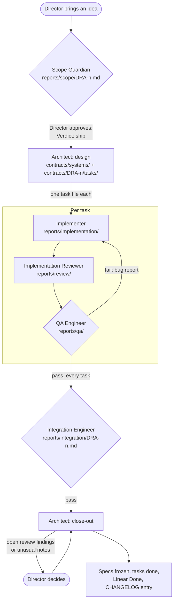

# docs

Everything about the game except the code. This page says what lives where and how one feature moves through these folders.

## Folders

| Folder | What it holds | Who writes it |
|---|---|---|
| `design/gdd/` | The game design document: rules, values, pillars, open questions, decisions. The only source of truth for the game. Start at `design/gdd/00-index.md`. | The Director |
| `crew/` | The crew roster: which agent owns which path, and how work moves between agents. | The Director |
| `contracts/` | Specs for the code (`contracts/systems/`), task files per feature (`contracts/<feature-id>/tasks/`), and the CHANGELOG. See `contracts/README.md`. | The Architect |
| `reports/` | One report per step of the work, named after the feature or task. | The agent that did the step |

`reports/` has one folder per step:

| Folder | One file per | Written by |
|---|---|---|
| `reports/scope/` | feature | Scope Guardian |
| `reports/implementation/gameplay/`, `reports/implementation/ui/` | task | Gameplay Implementer, UI Developer |
| `reports/review/` | task | Implementation Reviewer |
| `reports/qa/` | task | QA Engineer |
| `reports/integration/` | feature | Integration Engineer |
| `reports/waves/` | wave | Wave Critic |

## How one feature moves



Diamonds block work until they pass.

What each feature leaves behind:

```
Feature   scope report + Linear parent issue   what and why
 └ Tasks  task files + Linear sub-issues       the tickets
     └ point at a section of a system contract  how the code must be
 └ CHANGELOG entry                              which specs changed, old → new
```

1. **Scope.** The Director brings an idea. The Scope Guardian shapes it, creates the Linear issue and writes `reports/scope/<feature-id>.md`. Line 1 becomes `Verdict: ship` once the Director approves.
2. **Design.** The Architect updates or adds system contracts in `contracts/systems/` and writes one task file per piece of work in `contracts/<feature-id>/tasks/`. Each task gets a Linear sub-issue.
3. **Build.** Each task goes through implement → review → QA. Each step writes its report.
4. **Integrate.** The Integration Engineer wires the game together, plays it in a real browser and writes `reports/integration/<feature-id>.md`.
5. **Close-out.** The Architect asks the Director about open review findings and unusual integration notes. Then it freezes the contracts it touched, closes the tasks and sub-issues, and adds a CHANGELOG entry.

## Tickets

The tickets are the task files, not the contracts. A task has one assignee, one folder it may write to, and one check the Director can run. It is closed at close-out and never edited after that.

Task IDs and Linear keys differ. Linear numbers every issue in one team-wide count, so the tasks of DRA-13 became DRA-14 to DRA-18. Task files use `<feature-id>-<nn>-<assignee>` instead, so `DRA-13-01` shows its feature and its build order. Three links tie them together:
- the task file's `Linear:` line
- the task path in the sub-issue's description
- the sub-issue's parent issue in Linear

## Following one feature

Take DRA-13:
- what and why: `reports/scope/DRA-13.md`
- the tickets: `contracts/DRA-13/tasks/`
- what each step found: the `DRA-13*` files in `reports/`
- which specs changed: the DRA-13 entry in `contracts/CHANGELOG.md`
