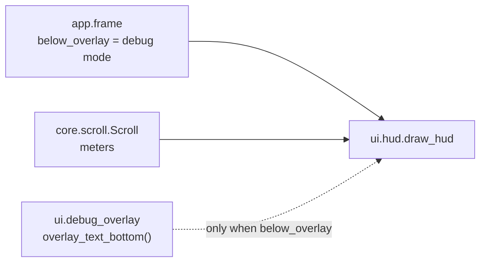

# HUD
Version: 1
Status: frozen
Features: DRA-13
Created by: architect

## Purpose
Keep the run's numbers in view during play. In DRA-13 the HUD shows one thing: the meters flown, as a readout like `312 m`. SCORE, lives, LV and GRAZE come in later features and take their places in this layout then. The HUD only reads core state.

In debug mode the HUD sits below the debug overlay's text, so the two never overlap.

Who builds what:
- `game/ui/hud.py`, and the helper `overlay_text_bottom()` in `game/ui/debug_overlay.py`: the UI Developer, task `DRA-13-03-ui-developer`.
- `game/tests/ui/test_hud.py`: the QA Engineer, task `DRA-13-05-qa-engineer`.
- Calling `draw_hud` every frame and deciding `below_overlay`: the Integration Engineer, in `game/app/frame.py`, from `docs/contracts/DRA-5/DRA-5-app.md`.
- The `meters` field: `docs/contracts/DRA-13/DRA-13-scroll.md`.

## Diagram
Normal mode:
```
 x=4
  +--------------------------------+  y=0
  | (line 1, empty for now)        |  y=4   HUD_TOP
  | 312 m                          |  y=24  HUD_TOP + HUD_LINE_SPACING
  |                                |
```
Debug mode, overlay shown or hidden by F3:
```
  +--------------------------------+  y=0
  | x 320.00                       |  y=4   overlay line 1
  | y 240.00                       |
  | vx 0.00                        |
  | vy 0.00                        |  overlay line 4
  |                                |  overlay_text_bottom()
  | (line 1, empty for now)        |  hud top = overlay_text_bottom() + HUD_OVERLAY_GAP
  | 312 m                          |  hud top + HUD_LINE_SPACING
  |- - - - - - TOP LINE - - - - - -|  y=168
```


## Interface
```python
# game/ui/hud.py
# Imports: pygame, core.scroll, ui.debug_overlay. Never app. Never reads the run mode.
HUD_COLOR: tuple[int, int, int] = (255, 255, 255)   # scope report DRA-13, readout text (temporary stand-in)
HUD_FONT_SIZE: int = 16                             # scope report DRA-13, readout text: default font, 16 px
HUD_MARGIN: int = 4                                 # scope report DRA-13, HUD left margin
HUD_LINE_SPACING: int = 20                          # scope report DRA-13, HUD line spacing (16 px font + 4 px)
HUD_TOP: int = 4                                    # scope report DRA-13, normal mode: first line at y 4
HUD_OVERLAY_GAP: int = 4                            # scope report DRA-13, debug mode: 4 px below the overlay's fourth line

def draw_hud(surface: pygame.Surface, scroll: Scroll, below_overlay: bool) -> None: ...
```

```python
# game/ui/debug_overlay.py, added. Nothing else in the overlay changes.
def overlay_text_bottom() -> int: ...
    # The first screen row below every pixel the overlay's four text lines can cover.
    # = OVERLAY_MARGIN + 3 * linesize + max(linesize, font height), with the overlay's own font.
    # Needs pygame.font initialized. Uses the same cached font as the overlay.
```

## Presentation
`draw_hud` reads only this core field. It draws on top of everything else in the frame.

| Core field | Shown as |
|---|---|
| `scroll.meters` | HUD line 2: the whole number, a space, then `m`. `f"{scroll.meters} m"`, e.g. `0 m`, `312 m`. Top-left corner at (`HUD_MARGIN`, `hud_top + HUD_LINE_SPACING`). Source: scope report DRA-13, Values needed (readout format and position, temporary stand-ins); 06-scoring.md, meters_rounding |

Layout:
- `hud_top` is `HUD_TOP` (4) when `below_overlay` is False, so the readout's top is at y 24. Source: scope report DRA-13, HUD layout (normal mode).
- `hud_top` is `overlay_text_bottom() + HUD_OVERLAY_GAP` when `below_overlay` is True. Source: scope report DRA-13, HUD layout (debug mode).
- HUD line 1 starts at `hud_top` and is left empty in DRA-13. It is where SCORE and lives go later. Source: scope report DRA-13, HUD layout; 10-ui.md, rule 2.
- Text in the default font at 16 px (`pygame.font.Font(None, HUD_FONT_SIZE)`), antialiased, in `HUD_COLOR`, (255, 255, 255). Source: scope report DRA-13, readout text (temporary stand-in).
- The font is created once, on the first draw, and kept. Never per frame. Source: 15-tech-constraints.md, rule 5.
- The HUD only draws. It never fills, never flips, never logs per frame, never catches an error, never changes the scroll, never reads the run mode or a key. Source: 10-ui.md, rule 5; game/CONTEXT.md, Run modes.

`overlay_text_bottom()`:
- Line 4 of the overlay text has its top at `OVERLAY_MARGIN + 3 × linesize`. Its rendered height is the font's height. The function returns the row just below the lower of the two: the end of line 4's line slot or the end of its rendered text. So no overlay text pixel is on that row or below it.
- It changes nothing the overlay shows. The overlay keeps exactly the DRA-6 content and layout. Source: scope report DRA-13, Limits (no new overlay content); 10-ui.md, debug_overlay_layout.

## Rules
- In DRA-13 the HUD shows only the meters readout. No SCORE, lives, LV, GRAZE or BEST. Source: scope report DRA-13, Limits.
- The readout is a temporary stand-in. 10-ui.md, rule 2 lists SCORE, lives, level and grazes, and no separate meters item. The Director approved the readout and chose not to change the GDD. Source: scope report DRA-13, Fit and Values needed.
- The HUD shows in both modes, from the first frame. It reads `0 m` until the world has scrolled 10 px. Source: scope report DRA-13, Player sees.
- In debug mode the HUD sits below the overlay's text and never overlaps it. Source: scope report DRA-13, Decision log (Director: "Overlap is not acceptable").
- In debug mode the HUD stays below the overlay's place even while F3 hides the overlay, so the readout never jumps. The app passes `below_overlay` from the run mode, never from `overlay_visible`. Source: scope report DRA-13, HUD layout.
- The HUD draws on top of everything. Source: 10-ui.md, rule 1.
- The HUD only reads game state. It never changes it. Source: 10-ui.md, rule 5.
- The HUD never covers the top line. Its lowest line ends far above row 168 in both modes. Source: 10-ui.md, rule 1.

## Rationale
- **`below_overlay` comes from the app.** game/CONTEXT.md lets only `game/app/` and the debug overlay read the run mode. The app knows the mode and passes a layout flag, the same way it passes `detail` to the error screen. The HUD stays a pure function of what it's given.
- **The overlay's bottom comes from the overlay.** The overlay's line height is a font metric, not a fixed number, and only the overlay owns its font. One function there keeps the two views from computing the overlay's size twice and drifting apart. It reads, it doesn't draw, so the overlay's content is unchanged.
- **`max(linesize, font height)`.** pygame's line size is usually at least the rendered text height, but not for every font. Taking the larger of the two guarantees the gap, whatever the default font is in the browser build.
- **The readout starts at the left margin.** The scope places it on line 2, "after where LV and GRAZE will go later", and gives the HUD a 4 px left margin. Nothing else is on line 2 yet, and no x is given for the reserved space, so the readout starts at the margin. When LV and GRAZE land, that feature sets their x and moves the readout after them.
- **Line 1 stays empty, not collapsed.** The approved layout puts the readout on line 2 in both modes. Keeping line 1's slot means SCORE and lives can land later without moving the readout.
- **The HUD is drawn after the overlay.** 10-ui.md, rule 1 puts the HUD on top of everything. The two never overlap, so the order only matters if a later bug makes them meet. Then the game's own HUD stays readable.
- **HUD values live in `ui/hud.py`, not `ui/look.py`.** Only the HUD uses them, and they are temporary stand-ins waiting for UI-01.
- **No core change for the HUD.** `meters` already exists in `core.scroll`. The layout flag and the overlay's size are presentation, not game state.
