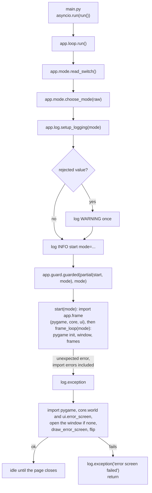
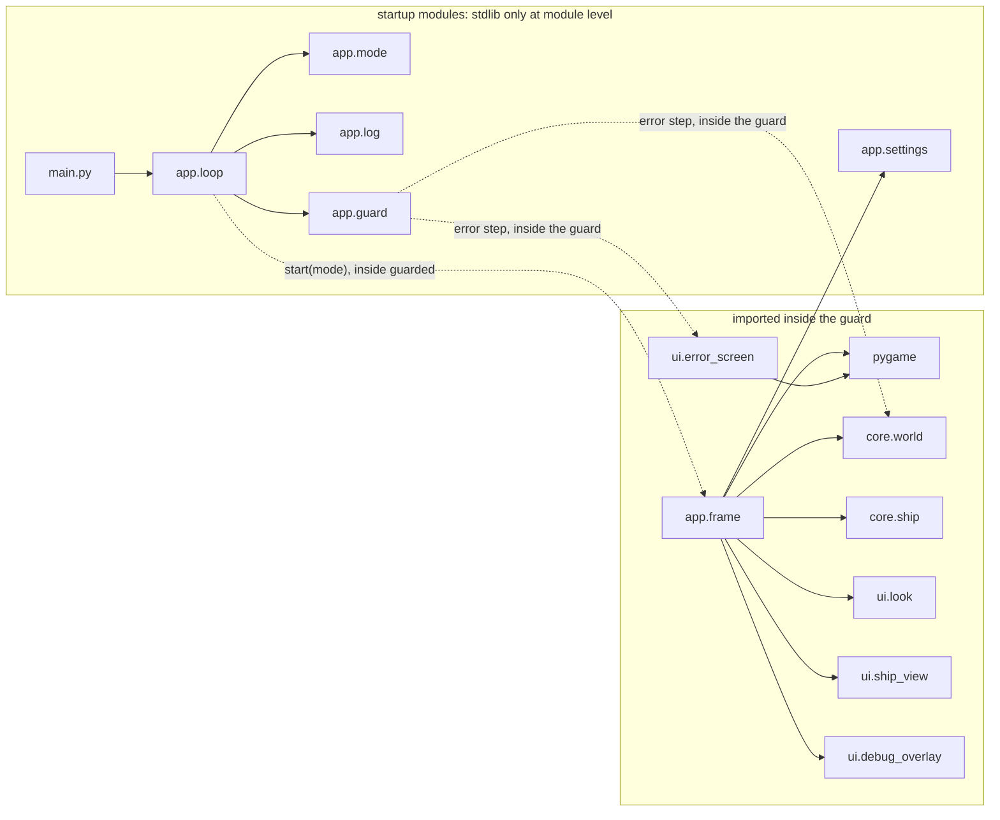
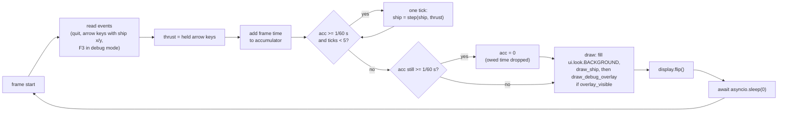

# App base: entry point, logging, run mode, loop, error guard, error screen
Version: 2
Status: frozen
Features: DRA-5, DRA-6
Created by: architect

## Purpose
Start the game, set up logging once, read the run mode once, run the async loop on the fixed 60 Hz tick, and catch any unexpected error so the page shows the error screen instead of freezing. That includes an error raised while importing pygame, core, the views or the frame loop. Build a release package that holds only runtime files.

From DRA-6, each tick steps the ship, each frame draws the ship and, in debug mode, the debug overlay. The arrow-key log lines carry the ship's x and y. F3 toggles the overlay in debug mode.

Who builds what:
- `game/main.py`, `game/app/`, `game/scripts/`, `pygbag.ini` (repo root): the Integration Engineer, during integration, from this contract. No task file.
- `game/ui/look.py`, `game/ui/error_screen.py`: the UI Developer, task `DRA-5-01-ui-developer`.
- `game/tests/ui/test_error_screen.py`: the QA Engineer, task `DRA-5-02-qa-engineer`.
- `game/core/world.py`, `game/core/ship.py`: DRA-6, see `docs/contracts/DRA-6/DRA-6-world.md` and `docs/contracts/DRA-6/DRA-6-ship.md`. Core is the same in both modes.
- `game/ui/ship_view.py`, `game/ui/debug_overlay.py`: DRA-6, see `docs/contracts/DRA-6/DRA-6-ship.md` and `docs/contracts/DRA-6/DRA-6-debug-overlay.md`.

## Diagram


Import boundary. Everything above the guard imports only the standard library and other startup modules. pygame, `ui` and `core` are imported for the first time inside the guard.




## Interface
Import root is `game/`, as in the tests: `from app.loop import run`, `from ui.error_screen import draw_error_screen`.

### game/main.py (Integration Engineer)
```python
# /// script
# dependencies = [
#   "pygame-ce",
# ]
# ///
import asyncio

from app.loop import run

asyncio.run(run())
```
Nothing else. No logic, no imports beyond these. The opening block is PEP 723 inline metadata. It is pygbag's documented way to declare packages: pygbag installs only what `main.py` imports or declares, so without it the browser build has no pygame-ce. Any new third-party package goes into this block. Source: Director decision D1 (DRA-5 integration). game/CONTEXT.md, Layout.

### game/app/mode.py (Integration Engineer)
```python
class RunMode(Enum):
    NORMAL = "normal"
    DEBUG = "debug"

@dataclass(frozen=True)
class ModeChoice:
    mode: RunMode
    rejected: str | None   # the switch value that was present but not "1"; None otherwise

def read_switch() -> str | None: ...
    # Browser (sys.platform == "emscripten"): the first value of URL query parameter `debug`.
    # Desktop: environment variable DRIFTWARD_DEBUG.
    # None when the switch is absent. Present with an empty value returns "".

def choose_mode(raw: str | None) -> ModeChoice: ...
    # Pure. No logging, no I/O.
```

### game/app/log.py (Integration Engineer)
```python
def setup_logging(mode: RunMode) -> None: ...
    # The only place that configures logging. Called once, at startup.
    # Installs exactly one handler on the root logger:
    #   browser (sys.platform == "emscripten"): writes each formatted line
    #     with platform.window.console.log
    #   desktop: logging.StreamHandler(sys.stdout)
```

### game/app/guard.py (Integration Engineer)
```python
async def guarded(body: Callable[[], Awaitable[None]], mode: RunMode) -> None: ...
    # Awaits body(). Holds the project's only `except Exception`.
    # Module level: stdlib and app.mode only. pygame, core.world and
    # ui.error_screen are imported inside the error step, never at the top.
```

### game/app/settings.py (Integration Engineer)
```python
TICK_RATE: int = 60                         # 15-tech-constraints.md, tick_rate
MAX_TICKS_PER_FRAME: int = 5                # 15-tech-constraints.md, max_ticks_per_frame (guess)
```
Constants only. No imports. From DRA-6 the screen size lives in `core/world.py` (`SCREEN_W`, `SCREEN_H`), and `SCREEN_SIZE` is removed from here. See Impact.

### game/app/loop.py (Integration Engineer)
```python
async def run() -> None: ...
    # Startup order, then guarded(functools.partial(start, choice.mode), choice.mode).

async def start(mode: RunMode) -> None: ...
    # The guarded body. Imports app.frame here, inside the guard, then awaits frame_loop(mode).
```
Module level: stdlib, `app.mode`, `app.log` and `app.guard` only. No pygame, no `core`, no `ui`, no `app.frame`.

### game/app/frame.py (Integration Engineer)
```python
ARROW_NAMES: dict[int, str]   # pygame.K_UP -> "up", K_DOWN -> "down", K_LEFT -> "left", K_RIGHT -> "right"

async def frame_loop(mode: RunMode) -> None: ...
    # pygame init, window, frames until pygame.QUIT.
    # Owns: ship (core.ship.Ship), thrust (core.ship.Thrust), overlay_visible (bool).
```
Imports pygame, `app.settings`, `app.mode`, `core.world`, `core.ship`, `ui.look`, `ui.ship_view` and `ui.debug_overlay`. Only `start()` imports this module, inside the guard.

App-owned state in `frame_loop`:
```python
ship: Ship              # core.ship.spawn() before the first frame; replaced by step() every tick
thrust: Thrust          # rebuilt once per frame from the held arrow keys
overlay_visible: bool   # True from the first frame in debug mode, always False in normal mode.
                        # F3 flips it, debug mode only.
```

### pygbag.ini (repo root, Integration Engineer)
```ini
[DEPENDENCIES]
ignoreDirs = [...]    # folders under game/ left out of the package
ignoreFiles = [...]   # files under game/ left out of the package
```
pygbag 0.9.3 reads it from its working directory. The start script and the build check both run pygbag from the repo root. Source: Director decision (DRA-5 close-out, round 1 observations). docs/crew/roster.md, row 12.

DRA-6 calls, all made by `frame_loop`. Their signatures are set in the DRA-6 contracts:
```python
# before the first frame:
ship = spawn()                                  # DRA-6-ship.md
# per frame, after the events:
thrust = Thrust(up=..., down=..., left=..., right=...)
# per tick, inside the accumulator loop:
ship = step(ship, thrust)                       # DRA-6-ship.md
# per frame, draw:
surface.fill(BACKGROUND)
draw_ship(surface, ship)                        # DRA-6-ship.md
if overlay_visible:
    draw_debug_overlay(surface, ship)           # DRA-6-debug-overlay.md
```

### game/ui/look.py (UI Developer)
```python
BACKGROUND: tuple[int, int, int]   # 12-art-and-audio.md, placeholder_bg
```
The one home of the background color in code. `app/frame.py` and later views import it.

### game/ui/error_screen.py (UI Developer)
```python
def draw_error_screen(surface: pygame.Surface, detail: str | None) -> None: ...
```
`detail` is `None` in normal mode, and the one-line `<ErrorType>: <message>` text in debug mode. The app decides which. The view never reads the run mode.

### game/scripts/start-driftward-ace.sh (Integration Engineer)
```
start-driftward-ace.sh            # serves the build, prints http://localhost:<PORT>
start-driftward-ace.sh --debug    # same build, prints http://localhost:<PORT>/?debug=1
```

## Presentation
The app draws nothing itself beyond the background fill. The ship view and the debug overlay have their own Presentation sections in `docs/contracts/DRA-6/DRA-6-ship.md` and `docs/contracts/DRA-6/DRA-6-debug-overlay.md`. The error screen reads no core state, only what the guard passes it.

| Input | Shown as |
|---|---|
| (always) | the whole surface filled with `BACKGROUND`, (0, 0, 0). Source: 12-art-and-audio.md, placeholder_bg (guess) |
| (always) | `Something broke. Reload the page.` in the default font (`pygame.font.Font(None, 24)`), color (255, 255, 255), centered horizontally and vertically on the surface. Source: 10-ui.md, error_screen, error_text_font, error_layout, error_text_color (guess) |
| `detail` is a string | `detail` in the default font at 16 px (`pygame.font.Font(None, 16)`), color (255, 255, 255), centered horizontally. Its top edge sits one line-height below the main line's top (the main font's `get_linesize()`), so it reads as the next line. Source: 10-ui.md, error_layout, debug_text_font, error_text_color (guess) |
| `detail` wider than the surface | cut from the end, one character at a time, until its rendered width fits the surface width. No ellipsis. Source: 10-ui.md, error_debug_line (guess) |
| `detail` is `None` | nothing below the main line |

- Centering uses `surface.get_size()`, never a hard-coded screen size.
- Text is rendered antialiased.
- The view only draws. It never flips the display, never logs per frame, never catches an error. If it fails, it raises.
- Logging: the module has `log = logging.getLogger(__name__)`. It may log one DEBUG line when the detail is cut, with the original and cut lengths. Nothing else.

## Rules
Startup (`app.loop.run`), in this order:
1. `raw = read_switch()`, then `choice = choose_mode(raw)`. Source: 15-tech-constraints.md, rule 7 (read once, at launch).
2. `setup_logging(choice.mode)`. Source: game/CONTEXT.md, Logging.
3. If `choice.rejected is not None`: one WARNING, `debug switch value %r is not 1, using normal mode`. Source: 15-tech-constraints.md, debug_switch_other_value.
4. One INFO line: `start mode=%s` with `choice.mode.value`. In the console this reads like `12:00:01 INFO app.loop: start mode=debug`. Source: DRA-5 scope report, Player sees.
5. `await guarded(functools.partial(start, choice.mode), choice.mode)`. Everything after logging setup runs inside the guard: importing `app.frame` (and through it pygame, `core` and `ui`), pygame init, the window and the loop. Source: 15-tech-constraints.md, rule 8. Director decision (DRA-5 close-out: import errors must be logged and show the error screen).

Import boundary:
- Startup modules are `main.py`, `app/loop.py`, `app/mode.py`, `app/log.py`, `app/guard.py` and `app/settings.py`. At module level they import only the standard library and each other. Never pygame, `ui`, `core` or `app.frame`. pygbag's built-in `platform` module counts as standard library here. Source: Director decision (DRA-5 close-out).
- pygame, `ui` and `core` are first imported inside the guard: by `start()` through `app.frame`, or by the guard's error step. So an import error in any of them is caught by the guard, after logging is set up.
- `main.py` keeps its exact text above: the PEP 723 block, `import asyncio`, `from app.loop import run`, `asyncio.run(run())`. Source: Director decisions D1 and DRA-5 close-out.
- What runs before the guard is limited to stdlib-only code: the startup module imports, `read_switch`, `choose_mode` and `setup_logging`. Errors there can't reach the guard. See Rationale.

Run mode (`choose_mode`):
- `None` (switch absent): normal, `rejected=None`, no log. Source: 15-tech-constraints.md, run_mode_default, debug_switch_other_value.
- `"1"`: debug. Source: 15-tech-constraints.md, debug_switch_browser, debug_switch_desktop.
- Any other string, including `"0"` and `""`: normal, `rejected=<that string>`. Source: 15-tech-constraints.md, debug_switch_other_value.
- The mode never changes after startup. Source: 15-tech-constraints.md, rule 7.
- In the browser only the URL is read. On desktop only the env var is read. They never conflict.

Logging (`setup_logging`):
- Root logger level: INFO in normal mode, DEBUG in debug mode. Source: 15-tech-constraints.md, log_level_normal, log_level_debug.
- Exactly one handler on the root logger. Any handler set up before it is replaced. Source: game/CONTEXT.md, Logging.
  - Browser (`sys.platform == "emscripten"`): each formatted line goes to the devtools console through `platform.window.console.log`, at every level. pygbag sends stdout and stderr only to its hidden terminal, so this is the only way the lines reach the console. Source: Director decision D2 (DRA-5 integration). game/CONTEXT.md, Browser.
  - Desktop: a `StreamHandler` on `sys.stdout`.
- Format `%(asctime)s %(levelname)s %(name)s: %(message)s`, date format `%H:%M:%S`. That gives `HH:MM:SS LEVEL logger: message`. Same format and levels on both targets. Source: 15-tech-constraints.md, log_format.
- No other code calls `basicConfig`, adds a handler or sets a level. Source: game/CONTEXT.md, Logging.
- Log by event, never by tick. Source: 15-tech-constraints.md, rule 9.

Frame loop (`app/frame.py`, `frame_loop(mode)`):
- Inside the guard: `pygame.init()`, then `pygame.display.set_mode((SCREEN_W, SCREEN_H))` from `core.world`. Source: 03-world-and-camera.md, screen_w, screen_h (guess). DRA-6-world.md.
- Before the first frame: `ship = spawn()`, and `overlay_visible = mode is RunMode.DEBUG`. Source: 03-world-and-camera.md, ship_start; 10-ui.md, debug_overlay_toggle (shown from the first frame).
- Each frame, in order: read all events, build `thrust` from the held keys, add the frame time to the accumulator, run one tick per whole 1/60 s in the accumulator, draw, `pygame.display.flip()`, `await asyncio.sleep(0)`. Source: 15-tech-constraints.md, rules 1 and 2.
- Frame time comes from a monotonic clock (`time.perf_counter`). Ticks never use frame time. Source: 15-tech-constraints.md, rule 2.
- **Held keys.** After the events, read `pygame.key.get_pressed()` once and build `Thrust(up=pressed[K_UP], down=pressed[K_DOWN], left=pressed[K_LEFT], right=pressed[K_RIGHT])`. Every tick in that frame uses the same `thrust`. Only the four arrow keys move the ship. Source: 01-vision.md, locked decision 1; 04-ship.md, rule 2.1.
- **Tick.** `ship = step(ship, thrust)`, one call per tick, nothing else. Source: 04-ship.md, rules 1 and 3; DRA-6-ship.md.
- **Draw.** Fill with `ui.look.BACKGROUND`, then `draw_ship(surface, ship)`, then `draw_debug_overlay(surface, ship)` only if `overlay_visible`. The overlay is drawn last, on top. Source: DRA-6-ship.md and DRA-6-debug-overlay.md, Presentation.
- `pygame.QUIT`: log INFO `quit` and leave the loop. That only happens on desktop.
- **Arrow keys** (Up, Down, Left, Right): on `KEYDOWN` log DEBUG `key down key=%s x=%.2f y=%.2f`, on `KEYUP` log DEBUG `key up key=%s x=%.2f y=%.2f`, with names `up`, `down`, `left`, `right` and the ship's `x` and `y` at the moment the event is read (before this frame's ticks). Example: `key down key=up x=320.00 y=240.00`. No other arrow event is logged. Source: game/CONTEXT.md, Logging (a key pressed or released is an event). 01-vision.md, locked decision 1. Director decision (DRA-6: the integration check compares y between key-down and key-up).
- **F3.** In debug mode, on `KEYDOWN` of `pygame.K_F3`: flip `overlay_visible` and log DEBUG `overlay visible=%s`. `KEYUP` of F3 does nothing. In normal mode F3 does nothing and logs nothing. Source: 10-ui.md, debug_overlay_toggle (guess) and rule 7.
- **Log by event.** The frame loop logs only on the events in these rules: quit, arrow keys, F3 and the cap. Never a line per tick or per frame. Ship events (wall hit, top-line stop, respawn) are logged by `core.ship`, not by the app. Source: 15-tech-constraints.md, rule 9; DRA-6-ship.md, Rules, Logging.
- **Catch-up cap.** One frame runs at most `MAX_TICKS_PER_FRAME` (5) ticks. If, after the 5th tick, the accumulator still holds one tick or more, set it to 0.0: the owed time is dropped, never run later. The game carries on from where it was. Source: 15-tech-constraints.md, max_ticks_per_frame (guess) and rule 2; 91-decision-log.md, row 21.
- **Cap log, by event.** Log DEBUG `tick cap hit, dropped %.3f s` (the seconds dropped) on a frame where the cap drops time and the frame before didn't. While frames keep hitting the cap, log nothing more. The next capped frame after an uncapped one logs again. Source: 15-tech-constraints.md, rule 9.
- No `time.sleep`, no thread, no blocking call. Source: 15-tech-constraints.md, rule 1.

Error guard (`app/guard.py`):
- The only `except Exception` in the game. Source: game/CONTEXT.md, Error handling.
- On an exception from `body`:
  1. `log.exception("unexpected error, showing the error screen")`. That is ERROR level with the full traceback. Source: 15-tech-constraints.md, rule 8.
  2. `detail = None` in normal mode. In debug mode, `detail = f"{type(exc).__name__}: {exc}"` with every newline replaced by a space, so it is one line. Source: 10-ui.md, error_screen, error_debug_line.
  3. Show the error screen, once. Source: 10-ui.md, rule 8. In this order:
     1. Import pygame, `core.world` and `ui.error_screen` here, inside the step. Source: Director decision (DRA-5 close-out).
     2. If `pygame.display.get_surface()` is `None` (the error came before the window existed, such as an import error in `app.frame`), call `pygame.init()` and `pygame.display.set_mode((SCREEN_W, SCREEN_H))` from `core.world`. If a window already exists, reuse it.
     3. `draw_error_screen(surface, detail)`, then `pygame.display.flip()`.
  4. Idle: each frame, drain the event queue and `await asyncio.sleep(0)`. No tick, no redraw. The game doesn't resume, and the player reloads the page. Source: 10-ui.md, rule 8. Leave the idle loop only on `pygame.QUIT` (desktop).
- If any part of step 3 raises, log it with `log.exception("error screen failed")` and return, without idling. That covers pygame missing or broken (an `ImportError`, or an `AttributeError` from an empty `pygame` namespace package as in round 0), `core.world` or `ui.error_screen` failing to import, the window failing to open, and the draw or flip failing. `run()` then returns, so nothing hangs. The page shows whatever was last drawn, and the console holds both tracebacks. Source: Director decision (DRA-5 close-out).
- Both tracebacks reach the console, because logging was set up before the guard started.
- `KeyboardInterrupt`, `SystemExit` and `asyncio.CancelledError` are not `Exception` and are not caught.
- Code outside `game/app/` never catches broadly, never shows an error on screen, and never decides to keep running. Source: game/CONTEXT.md, Error handling.

Launch script (`game/scripts/start-driftward-ace.sh`):
- `--debug`: same build and same server. The only difference is the printed URL, `http://localhost:${PORT}/?debug=1`. Source: 15-tech-constraints.md, debug_switch_launcher.
- No argument: unchanged behavior, prints `http://localhost:${PORT}`.
- Any other argument: print a usage line naming the bad argument to stderr and exit non-zero before starting anything.
- Keep the existing rules: `set -euo pipefail`, quoted variables, cleanup trap, never `--bind`. Source: game/CONTEXT.md, Good practice and INTEGRATION.
- Keep running pygbag from the repo root, so it reads `pygbag.ini`.

Release package (`pygbag.ini`):
- The package (`game.apk` inside `game/build/web.zip`, and the live build the start script serves) holds only runtime files: `main.py`, `app/`, `ui/`, `core/`, and later the asset and data files the game reads. From DRA-6, `core/*.py` must be in it. Source: Director decision (DRA-5 close-out, round 1 observations).
- Left out, at least: `tests/` (with its `CONTEXT.md` and `conftest.py`), `scripts/`, `CONTEXT.md`, `requirements.txt`, `ruff.toml`. Any non-runtime file added to `game/` later is left out the same way. Source: Director decision (DRA-5 close-out).
- Configured only in `pygbag.ini` at the repo root, `[DEPENDENCIES]` section, `ignoreDirs` and `ignoreFiles`. Built by the Integration Engineer. Source: Director decision (DRA-5 close-out). docs/crew/roster.md, row 12.
- No pygbag flag or template change. pygbag stays at 0.9.3. Source: 15-tech-constraints.md, web_build.

Integration checks for DRA-5, on top of the required browser checks in game/CONTEXT.md, INTEGRATION:
- **Arrow keys:** passes when the key-down and key-up lines appear with the right key name. DRA-5 has no ship, so there is no x/y to compare. That comparison starts with DRA-6. Source: Director decision D3 (DRA-5 integration).
- **Run modes:** no switch logs `start mode=normal`. `?debug=1` logs `start mode=debug`. `?debug=yes` logs one WARNING, then `start mode=normal`. `?debug=1` reaches Python unchanged and doesn't switch pygbag into a mode of its own.
- **Click to start:** record whether pygbag's click screen shows, whether "MEDIA USER ACTION REQUIRED" appears, and the time of the start line against the time of the click. Report what happened. A game that starts before the click doesn't fail DRA-5, but it goes under Observations. Source: Director decision (DRA-5 close-out, round 1 observations: follow up).
- **Package contents:** list the files in `game.apk` from `pygbag --archive game`. None of the left-out files may be there, and `main.py`, `app/*.py` and `ui/*.py` must be.
- **Import errors (desktop, headless, `SDL_VIDEODRIVER=dummy`):** no code change, only a blocked import from the command line.
  - Block `app.frame` (for example `sys.modules["app.frame"] = None` before `import main`): the log shows the start line, then ERROR `unexpected error, showing the error screen` with the `ImportError` traceback. The error screen is drawn and the process idles until it is stopped.
  - Block `pygame` the same way: the log shows the start line, the ERROR with the traceback, then ERROR `error screen failed` with its own traceback. The process ends by itself and doesn't hang.

Integration checks for DRA-6, on top of the required browser checks and every DRA-5 check above (all must still pass). Background: with no key held, the ship falls off the floor and respawns about once a second.
- **Arrow keys with x/y (`?debug=1`):** hold ArrowUp for about 2 s (`keyboard.down`, wait, `keyboard.up`). The key-down and key-up lines both carry `x=` and `y=`. The key-up `y` is smaller than the key-down `y`, and after a 2 s hold it is `184.00` (top edge on the top line). Source: Director decision (DRA-5 integration, D3; DRA-6 design input).
- **Log by event, not by tick (`?debug=1`):** hold ArrowUp and ArrowLeft together for about 3 s. Between that key-down and key-up there is exactly one `top line stop` line and exactly one `wall hit side=left` line. With no key held for 5 s, the only new lines are `respawn from ...`, about one a second, never one per tick. Source: 15-tech-constraints.md, rule 9; DRA-6-ship.md, Rules, Logging.
- **Respawn (`?debug=1`):** after the keys are released, a `respawn from x=... y=...` line appears within about 2 s, with `y` at least 496.00 (top edge at or past 480). Source: DRA-6 scope report, Limits.
- **Ship visible (`/`):** the canvas shows white (255, 255, 255) pixels (the ship) and no (0, 255, 0) pixels. F3 logs nothing and changes nothing. Source: DRA-6-ship.md, Presentation; 10-ui.md, rule 7.
- **Overlay and F3 (`?debug=1`):** from the first frame there are (0, 255, 0) pixels on row 168, away from the ship. F3 logs `overlay visible=False` and those pixels go to the background color. F3 again logs `overlay visible=True` and they come back. Source: 10-ui.md, debug_overlay, debug_overlay_toggle.
- **Click to start, follow-up:** the Director asked for this again, because in DRA-5 headless Chromium skipped the click. Record, in a fresh tab: whether pygbag's click screen shows, whether "MEDIA USER ACTION REQUIRED" appears, `navigator.userActivation.hasBeenActive` before any click, the time of the start line, and whether `respawn` lines appear before the click (the ship already moving). Report what happened under Observations. A game that starts before the click doesn't fail DRA-6. A game that doesn't start after a click fails it. Source: Director decision (DRA-5 close-out, follow up; DRA-6 design input).
- **Catch-up cap (`?debug=1`):** hide the tab for about 5 s, or open another tab over it, then come back. One `tick cap hit, dropped ... s` line appears, with about the hidden time. It is not repeated every frame. The game carries on: the ship doesn't jump ahead by the hidden time, and the respawn lines stay about one a second. If the browser keeps the tab running while it's hidden, so no line appears, report that under Observations. It doesn't fail DRA-6. Source: 15-tech-constraints.md, max_ticks_per_frame, rules 2 and 9.
- **Package contents:** as for DRA-5, and `core/world.py`, `core/ship.py`, `ui/ship_view.py` and `ui/debug_overlay.py` must be in `game.apk`.

## Impact
DRA-6 changes this frozen contract (v1). Every file in `game/` that depends on it, found by grepping `game/` (tests included) for `SCREEN_SIZE`, `TICK_RATE`, `frame_loop`, `start`, `ARROW_NAMES`, `app.` imports and `BACKGROUND`:

| File | Change needed |
|---|---|
| `game/app/settings.py` | remove `SCREEN_SIZE`. `TICK_RATE` stays. Add `MAX_TICKS_PER_FRAME = 5`. |
| `game/app/guard.py` | drop the module-level `from app.settings import SCREEN_SIZE`. The error step imports `core.world` and opens the window at `(SCREEN_W, SCREEN_H)`. |
| `game/app/frame.py` | `frame_loop(mode)`. Window size from `core.world`. Ship, thrust, tick, catch-up cap and its log, draw, key-log format with x/y, F3. |
| `game/app/loop.py` | `start(mode)`, and `run()` passes `functools.partial(start, choice.mode)` to `guarded`. |
| `game/main.py` | none. `run()` keeps its signature. |
| `game/app/mode.py`, `game/app/log.py` | none. |
| `game/ui/look.py`, `game/ui/error_screen.py` | none. |
| `game/tests/ui/test_error_screen.py` | none. It imports only `ui.error_screen` and `ui.look.BACKGROUND`, both unchanged. |
| `game/scripts/start-driftward-ace.sh`, `pygbag.ini` | none. `core/` is already packed as a runtime folder. |

All app changes are the Integration Engineer's, during DRA-6 integration.

## Rationale
- **`choose_mode` is pure and returns the rejected value.** The WARNING for a bad switch must go out after logging is configured, and logging needs the mode first. Returning the rejected value lets `run()` set up logging and then warn, with one config call.
- **`read_switch` runs before logging and outside the guard.** It only reads a string and has nothing to fail on in normal use. If it ever raises, Python prints the traceback to stdout. In the browser that is pygbag's hidden terminal, not the devtools console (D2), so the page stays blank. The same holds for the startup module imports and `setup_logging`. This gap is accepted because that code is stdlib only and small. The guard can't cover it, because the guard needs logging, and logging needs the mode.
- **Heavy imports inside the guard.** In round 0, pygame failed while `main.py` imported `app.loop`, before the guard or logging existed. The page stayed blank and the console was empty. So the startup modules import only the stdlib, and everything that can realistically fail at import (pygame, `ui`, later `core` and assets) is first imported by `start()` inside the guard. `app.frame` is a separate module so that `app.loop` stays light and the loop code itself still imports pygame at the top, as usual.
- **The guard imports its error screen late, and opens a window if there is none.** An import error in `app.frame` happens before `pygame.init()`, so there is no surface yet. Opening one in the guard lets that error still show the error screen. If pygame itself is missing, the error screen can't be shown at all, so the guard logs a second traceback and returns instead of idling. Idling would need pygame's event queue and would hang.
- **`app/settings.py` holds `TICK_RATE`.** It is a constants-only module with no imports. In DRA-5 it also held `SCREEN_SIZE`, so the guard could read it without pygame. From DRA-6, see the next point.
- **The screen size moved to `core/world.py` (DRA-6).** Core needs the walls and the floor, and core may never import `app`. Keeping a copy in `app/settings.py` would leave two homes for one guess value. The guard may not import `core` at module level (import boundary), so it imports `core.world` inside its error step, next to pygame and `ui.error_screen`. `core/world.py` is constants only, so that import can't realistically fail.
- **The release package is set in `pygbag.ini`.** pygbag packs the whole `game/` folder by default, so tests and tooling shipped in round 1. `pygbag.ini` is pygbag 0.9.3's own way to exclude them, with no flag or template change. It is a build file read on the build machine, not a runtime file, so it may sit at the repo root.
- **The error screen takes `detail`, not the mode.** game/CONTEXT.md says only `game/app/` and the debug overlay read the run mode. The guard decides normal or debug content, and the view only draws what it's given. The cut to screen width stays in the view, because only the view knows the font metrics.
- **`ui/look.py` holds `BACKGROUND`.** placeholder_bg is a look value, used by the loop's fill and by the error screen. One home in code avoids two copies of a guess value drifting apart.
- **`TICK_RATE` stays in `game/app/`.** `core.ship.step` is one tick by definition and never needs the rate. Only the loop turns frame time into ticks.
- **The mode reaches `frame_loop` through `functools.partial`.** `guarded` awaits a body with no arguments, and the loop needs the mode only to set `overlay_visible` and to gate F3. `guarded` keeps its DRA-5 signature.
- **Held keys come from `pygame.key.get_pressed()`, read once per frame.** That is SDL's own key state, so a missed event can't leave a key stuck in a set of our own. Reading it once per frame gives every tick in that frame the same thrust, so a frame with several ticks behaves like several frames with one tick.
- **Key lines log the ship before this frame's ticks.** That is the state the player saw when the key went down or up. The integration check needs only that y changes between the two lines.
- **Ship events are logged in core, key events in the app.** Each side logs what only it knows: the app sees the key events, core sees the wall, the line and the floor. Core logging is by event and doesn't change any rule, so core still behaves the same in both modes.
- **F3 lives in the app.** It is input, and only the app reads input. The overlay view never sees the mode or the key, only whether the app calls it.
- **The catch-up cap drops time instead of saving it.** The Director chose 5 ticks per frame, with owed time beyond that dropped (decision-log row 21). Without it, a long hidden-tab gap would run every missed tick in one frame: the ship would jump ahead unseen, and a slow frame could snowball. Setting the accumulator to 0.0 is the plain reading of "dropped". The fraction of a tick it also drops is under 1/60 s and can't be seen.
- **The cap is in `app/settings.py`, not core.** It is about frames, and only the loop knows about frames. Core sees only whole ticks, so the rules stay the same whatever the frame rate.
- **The cap logs only when it starts.** A slow device can hit the cap every frame. Logging each time would be a line per frame, which the log policy forbids.
- **Browser logs go to `console.log`.** In pygbag 0.9.3, stdout and stderr reach only its hidden terminal, never the devtools console. Writing through `platform.window.console.log` makes the start line visible, as the scope report promises. Every level uses `console.log`, not `console.warn` or `console.error`, as the Director decided (D2). Desktop keeps stdout, so the level is still readable from the line text.
- **The PEP 723 block in `main.py`.** pygbag reads only `main.py` to pick the packages it installs. `main.py` imports only `asyncio` and `app.loop`, so the block is what gets pygame-ce into the browser build (D1). It is metadata only, with no logic and no import, so `main.py` stays a thin entry point.
- **Idle after the error, don't exit.** Ending `run()` hands control back to pygbag in a state we haven't tested. Idling keeps the canvas showing the error screen and keeps the page responsive.
- **The error screen is tested headless.** A browser run can't trigger an unexpected error without a debug-only trigger, and that would be new scope. Task DRA-5-02 proves the screen draws right in both modes.
- **Run-mode parsing has no permanent test.** It lives in `game/app/`, and `game/tests/check.sh` runs only `tests/core` and `tests/ui`. Only the Director can add an `app` step. The integration browser run covers the three cases (Rules, Integration checks, Run modes).
- **`?debug=1` and pygbag.** pygbag's page reads some URL parts for its own options. The Integration Engineer checks that `?debug=1` reaches Python unchanged and doesn't switch pygbag into a mode of its own. If it does, that is a blocked report: the switch value is locked in the GDD.
