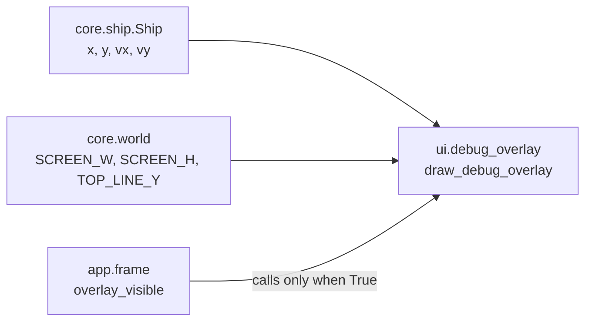

# Debug overlay
Version: 1
Status: frozen
Features: DRA-6
Created by: architect

## Purpose
In debug mode, show the ship's numbers and the lines the rules use, so the drift can be read and tuned. The view only reads core state. Whether it shows is decided by the app.

Who builds what:
- `game/ui/debug_overlay.py`: the UI Developer, task `DRA-6-04-ui-developer`.
- `overlay_visible` and the F3 toggle: the Integration Engineer, in `game/app/frame.py`, from `docs/contracts/DRA-5/DRA-5-app.md`.

## Diagram


## Interface
```python
# game/ui/debug_overlay.py
# Imports: pygame, core.ship, core.world. Never app. Never reads the run mode.
OVERLAY_COLOR: tuple[int, int, int] = (0, 255, 0)   # 10-ui.md, debug_overlay_color (guess)
OVERLAY_FONT_SIZE: int = 16                         # 10-ui.md, debug_text_font: default font, 16 (guess)
OVERLAY_MARGIN: int = 4                             # 10-ui.md, debug_overlay_layout: text 4 px from left and top (guess)

def draw_debug_overlay(surface: pygame.Surface, ship: Ship) -> None: ...
```

## Presentation
`draw_debug_overlay` reads only these core fields and constants. It draws on top of what is there.

| Core field | Shown as |
|---|---|
| `ship.x` | text line 1, `x <value>` with two decimals, e.g. `x 320.00`. Source: 10-ui.md, debug_overlay, debug_overlay_layout (guess) |
| `ship.y` | text line 2, `y <value>`, e.g. `y 240.00`. Source: same |
| `ship.vx` | text line 3, `vx <value>`, e.g. `vx 0.00`. Source: same |
| `ship.vy` | text line 4, `vy <value>`, e.g. `vy 0.00`. Source: same |
| `TOP_LINE_Y` | a 1 px horizontal line, the full surface width, on row `TOP_LINE_Y` (168). Source: 10-ui.md, debug_overlay, debug_overlay_layout; 03-world-and-camera.md, rule 2 |
| `SCREEN_H` (the floor) | a 1 px horizontal line, the full surface width, on row `SCREEN_H - 1` (479), the last visible row. Source: 10-ui.md, debug_overlay_layout; 03-world-and-camera.md, rule 5 |

- Text layout: line 1's top-left corner sits at (`OVERLAY_MARGIN`, `OVERLAY_MARGIN`), (4, 4). Each next line's top is one `font.get_linesize()` below the one before. Source: 10-ui.md, debug_overlay_layout (guess).
- Numbers use Python's `f"{value:.2f}"`, so negatives show a minus sign, e.g. `vy -0.26`.
- All text and lines in `OVERLAY_COLOR`, (0, 255, 0). Text in the default font at 16 px (`pygame.font.Font(None, 16)`), antialiased. Source: 10-ui.md, debug_overlay_color, debug_text_font (guess).
- Line width uses `surface.get_width()`, never a hard-coded 640.
- Draw order inside the view: the two lines, then the text, so the text stays readable where they cross.
- The font is created once, on the first draw, and kept. Never once per frame. Source: 15-tech-constraints.md, rule 5 (Python in WebAssembly is slow).
- The view only draws. It never flips, never logs per frame, never catches an error, never changes the ship, never reads the run mode.

## Rules
- Exists only in debug mode. In normal mode it never shows. Source: 10-ui.md, rule 7 and debug_overlay_toggle.
- Shown from the first frame in debug mode. F3 hides or shows it, in debug mode only. In normal mode F3 does nothing. The app owns this flag and calls the view only while it is True. Source: 10-ui.md, debug_overlay_toggle (guess); scope report DRA-6, Decision log.
- The overlay only reads game state. It never changes it. Source: 10-ui.md, rules 5 and 7.
- Layout as in Presentation. Source: 10-ui.md, debug_overlay_layout (guess); 91-decision-log.md, row 20.

## Rationale
- **The app passes nothing about the mode.** game/CONTEXT.md lets the debug overlay read the run mode, but it doesn't need to. The app decides whether to call it, so the view stays a pure function of the ship.
- **A separate contract.** The overlay is its own system in 10-ui.md. Later features (camera, hazards) will add fields to it without touching the ship contract.
- **The floor line is on row 479, not 480.** The floor is the screen's bottom edge, y 480, one row past the last visible row. Row 479 is the closest row that can be seen. The Director chose this (decision-log row 20).
- **Every fact the overlay shows is a core field or a core constant.** Ship numbers come from `core.ship.Ship`. Line positions come from `core.world`. The view computes nothing but pixel positions.
