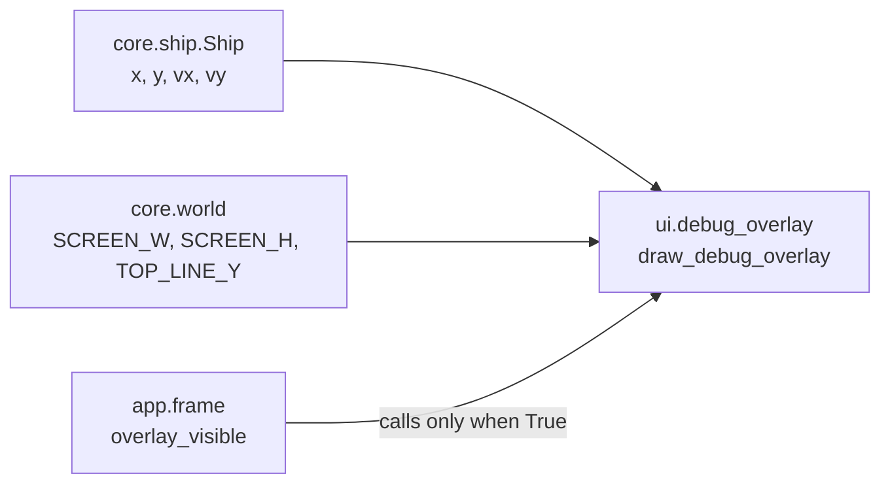

# Debug overlay
Version: 3
Status: frozen
Features: DRA-6, DRA-13, DRA-19
Created by: architect

## Purpose
In debug mode, show the ship's numbers and the lines the rules use, so the drift can be read and tuned. The view only reads core state. Whether it shows is decided by the app.

From DRA-13 the overlay also tells the HUD where its text ends, so the HUD can sit below it with no overlap (`docs/contracts/DRA-13/DRA-13-hud.md`). What the overlay shows doesn't change.

Who builds what:
- `game/ui/debug_overlay.py`: the UI Developer, task `DRA-6-04-ui-developer`. `overlay_text_bottom()`: task `DRA-13-03-ui-developer`. No `-0.00` in DRA-19: task `DRA-19-02-ui-developer`.
- `overlay_visible` and the F3 toggle: the Integration Engineer, in `game/app/frame.py`, from `docs/contracts/DRA-5/DRA-5-app.md`.

## Diagram


## Interface
```python
# game/ui/debug_overlay.py
# Imports: pygame, core.ship, core.world. Never app. Never reads the run mode.
OVERLAY_COLOR: tuple[int, int, int] = (0, 255, 0)   # 10-ui.md, debug_overlay_color (guess)
OVERLAY_FONT_SIZE: int = 16                         # 10-ui.md, debug_text_font: default font, 16 (guess)
OVERLAY_MARGIN: int = 4                             # 10-ui.md, debug_overlay_layout: text 4 px from left and top (guess)

def draw_debug_overlay(surface: pygame.Surface, ship: Ship) -> None: ...

def overlay_text_bottom() -> int: ...       # DRA-13
    # The first screen row below every pixel the four text lines can cover:
    # OVERLAY_MARGIN + 3 * linesize + max(linesize, font height), from the overlay's own font.
    # Draws nothing. Needs pygame.font initialized. Uses the same cached font as the draw.
```

## Presentation
`draw_debug_overlay` reads only these core fields and constants. It draws on top of what is there.

| Core field | Shown as |
|---|---|
| `ship.x` | text line 1, `x <value>` with two decimals, e.g. `x 320.00`. Source: 10-ui.md, debug_overlay, debug_overlay_layout (guess) |
| `ship.y` | text line 2, `y <value>`, e.g. `y 240.00`. Source: same |
| `ship.vx` | text line 3, `vx <value>`, e.g. `vx 0.00`. Source: same |
| `ship.vy` | text line 4, `vy <value>`, e.g. `vy 0.00`. Source: same |
| `TOP_LINE_Y` | a 1 px horizontal line, the full surface width, on row `TOP_LINE_Y` (168). Source: 10-ui.md, debug_overlay, debug_overlay_layout; 03-world-and-camera.md, rule 2 |
| `SCREEN_H` (the floor) | a 1 px horizontal line, the full surface width, on row `SCREEN_H - 1` (479), the last visible row. Source: 10-ui.md, debug_overlay_layout; 03-world-and-camera.md, rule 5 |

- Text layout: line 1's top-left corner sits at (`OVERLAY_MARGIN`, `OVERLAY_MARGIN`), (4, 4). Each next line's top is one `font.get_linesize()` below the one before. Source: 10-ui.md, debug_overlay_layout (guess).
- Numbers use Python's `f"{value:z.2f}"`: two decimals, and negatives show a minus sign, e.g. `vy -0.26`. A value that rounds to zero at two decimals shows `0.00`, never `-0.00`, e.g. vx -0.001 shows `vx 0.00`. The `z` option (Python 3.11+) turns a negative zero after rounding into `0.00`. From DRA-19. Source: 10-ui.md, debug_overlay_layout (two decimals, guess); scope report DRA-19, item 3; review DRA-6-04-ui-developer, finding 1.
- All text and lines in `OVERLAY_COLOR`, (0, 255, 0). Text in the default font at 16 px (`pygame.font.Font(None, 16)`), antialiased. Source: 10-ui.md, debug_overlay_color, debug_text_font (guess).
- Line width uses `surface.get_width()`, never a hard-coded 640.
- Draw order inside the view: the two lines, then the text, so the text stays readable where they cross.
- The font is created once, on the first draw, and kept. Never once per frame. Source: 15-tech-constraints.md, rule 5 (Python in WebAssembly is slow).
- The view only draws. It never flips, never logs per frame, never catches an error, never changes the ship, never reads the run mode.
- `overlay_text_bottom()` is in screen px. With the text layout above, line 4's top is `OVERLAY_MARGIN + 3 × linesize`, so the value is that plus the larger of the line size and the font height. It is the same whether the overlay is shown or hidden. Source: scope report DRA-13, HUD layout (debug mode).

## Rules
- Exists only in debug mode. In normal mode it never shows. Source: 10-ui.md, rule 7 and debug_overlay_toggle.
- Shown from the first frame in debug mode. F3 hides or shows it, in debug mode only. In normal mode F3 does nothing. The app owns this flag and calls the view only while it is True. Source: 10-ui.md, debug_overlay_toggle (guess); scope report DRA-6, Decision log.
- The overlay only reads game state. It never changes it. Source: 10-ui.md, rules 5 and 7.
- Layout as in Presentation. Source: 10-ui.md, debug_overlay_layout (guess); 91-decision-log.md, row 20.
- DRA-13 adds no content: no distance line, no scroll value. The overlay shows exactly what DRA-6 built. Source: scope report DRA-13, Limits and Decision log (Director: "Leave it simple as before").
- The overlay sits above the HUD on screen and never overlaps it. The HUD moves; the overlay stays where it is. Source: scope report DRA-13, Decision log; DRA-13-hud.md.

## Impact
DRA-19 changes this frozen contract (v2). One display rule changes: a number that rounds to zero shows `0.00`, never `-0.00`. No signature, constant, layout or color changes. Every file in `game/` that depends on it, found by grepping `game/` (tests included) for `debug_overlay`, `draw_debug_overlay`, `overlay_text_bottom`, `OVERLAY_` and `-0.00`:

| File | Change needed |
|---|---|
| `game/ui/debug_overlay.py` | the number format in `_draw_text` becomes `f"{value:z.2f}"`, and the docstrings that name the format follow. Task `DRA-19-02-ui-developer`. |
| `game/ui/hud.py` | none. `overlay_text_bottom()` doesn't change. |
| `game/app/frame.py` | none. |
| `game/tests/ui/test_hud.py` | none. It draws the overlay for `spawn()`, whose values are all positive or zero, and checks pixel rows, not text. No test expects `-0.00`. |

## Rationale
- **The app passes nothing about the mode.** game/CONTEXT.md lets the debug overlay read the run mode, but it doesn't need to. The app decides whether to call it, so the view stays a pure function of the ship.
- **A separate contract.** The overlay is its own system in 10-ui.md. Later features (hazards) will add fields to it without touching the ship contract.
- **`overlay_text_bottom()` lives here.** Only the overlay owns its font, and the line size is a font metric, not a fixed number. The HUD asks the overlay instead of rebuilding the overlay's font and repeating its layout.
- **The floor line is on row 479, not 480.** The floor is the screen's bottom edge, y 480, one row past the last visible row. Row 479 is the closest row that can be seen. The Director chose this (decision-log row 20).
- **`0.00`, not `-0.00` (DRA-19).** Drag shrinks vx toward 0 but never reaches it, so after the player lets go of Left the old format showed `vx -0.00` for a long time, while letting go of Right showed `vx 0.00`. The Director chose `0.00`. It is still two decimals, as debug_overlay_layout asks.
- **The `z` format option, not a special case in code.** `z` is Python's own rule for exactly this (PEP 682): it changes only a negative zero after rounding, and every other value prints as before. The game runs on Python 3.12 in the browser and on desktop (`.devcontainer/Dockerfile`, `game/tests/check.sh`), and `z` needs 3.11. The core value stays as it is; this is display only.
- **Every fact the overlay shows is a core field or a core constant.** Ship numbers come from `core.ship.Ship`. Line positions come from `core.world`. The view computes nothing but pixel positions.
