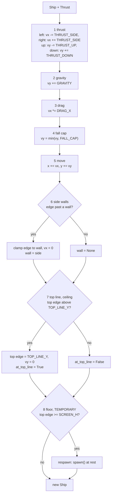
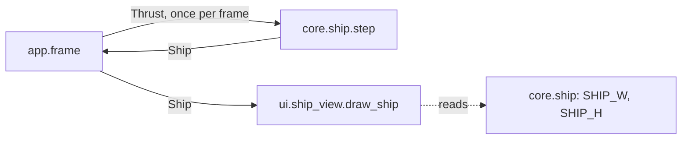

# Ship
Version: 2
Status: frozen
Features: DRA-6, DRA-13
Created by: architect

## Purpose
The ship's state and its one-tick physics step: thrust, gravity, drag, fall cap, move, side walls, top line. One temporary stand-in ends the tick: the floor respawn, until lives exist. Plus the view that draws the ship as its placeholder rectangle.

From DRA-13 the top-line stop is the real rule, not a stand-in: the screen is fixed and the top line is a ceiling (03-world-and-camera.md, rule 2; 04-ship.md, rule 2, step 7). Its behavior doesn't change. The world scroll never touches the ship (`docs/contracts/DRA-13/DRA-13-scroll.md`).

Who builds what:
- `game/core/ship.py`: the Gameplay Implementer, task `DRA-6-01-gameplay-implementer`.
- `game/ui/ship_view.py`: the UI Developer, task `DRA-6-02-ui-developer`.
- `game/tests/core/test_ship.py`: the QA Engineer, task `DRA-6-03-qa-engineer`.
- Calling `step` once per tick and building `Thrust` from the keys: the Integration Engineer, in `game/app/frame.py`, from `docs/contracts/DRA-5/DRA-5-app.md`.

## Diagram




## Interface
```python
# game/core/ship.py
# Imports: stdlib, core.world. Never pygame, ui or app.

SHIP_W: int = 32               # 04-ship.md, ship_w (guess)
SHIP_H: int = 32               # 04-ship.md, ship_h (guess)
GRAVITY: float = 0.16          # 04-ship.md, gravity, px/tick² (guess)
THRUST_SIDE: float = 0.42      # 04-ship.md, thrust_side, px/tick² (guess)
THRUST_UP: float = 0.42        # 04-ship.md, thrust_up, px/tick² (guess)
THRUST_DOWN: float = 0.42      # 04-ship.md, thrust_down, px/tick² (guess)
DRAG_X: float = 0.94           # 04-ship.md, drag_x, × per tick (guess)
FALL_CAP: float = 5.5          # 04-ship.md, fall_cap, px/tick (guess)
SPAWN_X: float = 320.0         # 03-world-and-camera.md ship_start = 05-lives-and-damage.md fall_respawn
SPAWN_Y: float = 240.0         # same

Wall = Literal["left", "right"]

@dataclass(frozen=True)
class Thrust:
    """Which arrow keys are held this tick."""
    up: bool = False
    down: bool = False
    left: bool = False
    right: bool = False

@dataclass(frozen=True)
class Ship:
    """Ship state after a tick. Screen px, y down."""
    x: float                       # center x
    y: float                       # center y
    vx: float                      # px/tick, + is right
    vy: float                      # px/tick, + is down (falling)
    wall: Wall | None = None       # wall the ship was clamped against this tick
    at_top_line: bool = False      # the top line (ceiling) clamped the ship this tick

def spawn() -> Ship: ...
    # Ship at (SPAWN_X, SPAWN_Y), vx = vy = 0, wall None, at_top_line False.

def step(ship: Ship, thrust: Thrust) -> Ship: ...
    # One 60 Hz tick. Pure apart from event logging: same ship and thrust in,
    # same ship out. Never mutates its input.
```
Derived edges, used by the rules below: left edge `x - SHIP_W / 2`, right edge `x + SHIP_W / 2`, top edge `y - SHIP_H / 2`.

```python
# game/ui/ship_view.py
# Imports: pygame, core.ship. Never app.
SHIP_COLOR: tuple[int, int, int] = (255, 255, 255)   # 04-ship.md, placeholder_look (guess)

def draw_ship(surface: pygame.Surface, ship: Ship) -> None: ...
```

## Presentation
`draw_ship` reads only these core fields and constants. It draws on top of what is there and never fills the background.

| Core field | Shown as |
|---|---|
| `ship.x`, `ship.y` | the center of the ship rectangle. Its top-left corner is `(round(ship.x - SHIP_W / 2), round(ship.y - SHIP_H / 2))`. Source: 04-ship.md, placeholder_look; 03-world-and-camera.md, ship_start (screen center) |
| `SHIP_W`, `SHIP_H` | the rectangle's size, 32 × 32. Source: 04-ship.md, ship_w, ship_h (guess) |
| (always) | filled, color `SHIP_COLOR`, (255, 255, 255). Source: 04-ship.md, placeholder_look (guess) |

- `vx`, `vy`, `wall` and `at_top_line` are not shown by the ship view. The debug overlay shows `vx` and `vy` (`docs/contracts/DRA-6/DRA-6-debug-overlay.md`).
- A ship partly past the floor is drawn as is. pygame clips what falls outside the surface.
- The view only draws. It never flips, never logs per frame, never catches an error, never changes the ship.

## Rules
Values:
- Every constant above has its value and source on its line. All are `guess` in the GDD except `fall_respawn`, which is locked. Source: 04-ship.md, 03-world-and-camera.md and 05-lives-and-damage.md, Values. Scope report DRA-6, Values needed.

The step, in this order, every tick. Source: 04-ship.md, rule 2:
1. **Thrust.** `left` subtracts `THRUST_SIDE` from `vx`, `right` adds it. `up` subtracts `THRUST_UP` from `vy`, `down` adds `THRUST_DOWN`. Opposite keys held together cancel. Source: 04-ship.md, rule 2.1 and Edge cases.
2. **Gravity.** `vy += GRAVITY`. Always, whatever is held. Source: 04-ship.md, rule 2.2; 01-vision.md, locked decision 4.
3. **Drag.** `vx *= DRAG_X`. No drag on `vy`. Source: 04-ship.md, rules 2.3 and 7.
4. **Fall cap.** If `vy > FALL_CAP`, `vy = FALL_CAP`. No cap on upward speed. Source: 04-ship.md, rules 2.4 and 7.
5. **Move.** `x += vx`, `y += vy`. Source: 04-ship.md, rule 2.5.
6. **Side walls.** If the left edge is below 0: set the left edge to 0, `vx = 0`, `wall = "left"`. If the right edge is past `SCREEN_W`: set the right edge to `SCREEN_W`, `vx = 0`, `wall = "right"`. Otherwise `wall = None`. No bounce. Source: 03-world-and-camera.md, rule 6; 01-vision.md, locked decision 3; 04-ship.md, rule 2.6.
7. **Top line, a ceiling.** If the top edge is above `TOP_LINE_Y` (`y - SHIP_H / 2 < TOP_LINE_Y`): set the top edge to `TOP_LINE_Y`, `vy = 0`, `at_top_line = True`. Otherwise `at_top_line = False`. Permanent from DRA-13. Source: 03-world-and-camera.md, rule 2 (a ceiling; the top edge is the point that counts); 04-ship.md, rule 2, step 7; 91-decision-log.md, row 22; scope report DRA-13, Limits.
8. **Floor, TEMPORARY.** If the ship is fully below the floor (`y - SHIP_H / 2 >= SCREEN_H`): return `spawn()`. No life is lost, nothing else happens. The world scroll and the distance keep going through it. Source: scope report DRA-6, Limits (temporary build rule, approved by the Director); scope report DRA-13, Limits (kept as is); 03-world-and-camera.md, rules 4 and 5; 05-lives-and-damage.md, fall_respawn. Replaced when lives exist.

Other rules:
- Every tick runs every step. Nothing pauses the physics or the input. Source: 04-ship.md, rule 3.
- Input only changes acceleration. No key sets a speed or a position. The wall clamp, the top-line stop and the respawn are rules, not input. Source: 04-ship.md, rule 4; 01-vision.md, Pillar 1.
- The run starts with `spawn()`: (320, 240), at rest. Source: 03-world-and-camera.md, ship_start (guess).
- `step` uses no frame time and no randomness. Same input, same output. Source: 15-tech-constraints.md, rule 2.
- Core behaves the same in normal and debug mode. It never reads the run mode. Source: game/CONTEXT.md, Run modes; 15-tech-constraints.md, rule 7.
- Core never imports pygame, `ui` or `app`. Source: game/CONTEXT.md, Layout.
- The ship never reads the world scroll, and the scroll never changes the ship. `step` takes no scroll. Source: 03-world-and-camera.md, rule 4; DRA-13-scroll.md.

Logging (logger `core.ship`, DEBUG, by event, never by tick). Source: game/CONTEXT.md, Logging; 15-tech-constraints.md, rule 9:
- `wall hit side=%s x=%.2f y=%.2f`: when the returned ship has `wall` set and the input ship's `wall` was different. Holding a key against a wall logs once, not every tick.
- `top line stop x=%.2f y=%.2f`: when the returned ship has `at_top_line` True and the input ship had it False. Holding Up at the line logs once.
- `respawn from x=%.2f y=%.2f`: on every respawn, with the position the ship fell from (after step 5 and the clamps, before the reset).
- Values are the new position after the clamp. Nothing else is logged. No line on a tick where nothing happened.
- If the ship hits a wall and falls off the floor in the same tick, the wall line comes first, then the respawn line.

## Impact
DRA-13 changes this frozen contract (v1). Only the top-line stop's status changes, from temporary to permanent. No behavior, signature, constant or log line changes. Every file in `game/` that depends on it, found by grepping `game/` (tests included) for `core.ship`, `TEMPORARY`, `at_top_line`, `TOP_LINE_Y` and `camera`:

| File | Change needed |
|---|---|
| `game/core/ship.py` | docstrings only. The module docstring and `_stop_at_top_line` call the top-line stop TEMPORARY and tie it to a camera. Reword: the top line is a ceiling (03, rule 2; 04, step 7). The floor respawn stays marked TEMPORARY. Task `DRA-13-01-gameplay-implementer`. |
| `game/ui/ship_view.py` | none. |
| `game/ui/debug_overlay.py` | none from this contract. See `DRA-6-debug-overlay.md`. |
| `game/app/frame.py` | none from this contract. See `DRA-5-app.md`. |
| `game/tests/core/test_ship.py` | none. Its top-line and respawn tests check behavior that doesn't change, and it has no TEMPORARY wording. |

## Rationale
- **The top-line stop stays as built.** The GDD now makes the top line a ceiling with the same clamp and `vy = 0` that DRA-6 built as a stand-in (91-decision-log.md, row 22). Only its label changes. The floor respawn is still a stand-in: the GDD's fall costs a life, and lives are out of DRA-13.
- **`x`, `y` are the ship's center.** The GDD puts `ship_start` and `fall_respawn` at "screen center (320, 240)", and the scope says the ship starts at screen center. With center coordinates the overlay shows exactly 320 and 240 at the start, the same numbers the GDD uses.
- **`step` returns a new frozen `Ship`.** A pure step is easy to test and to repeat. DRA-5 reserved `state = core_step(state, held_input)` in the loop.
- **`wall` and `at_top_line` live in the state.** The log policy forbids a line every tick, but holding a key against a wall clamps every tick. Keeping the last tick's contact lets `step` log only when contact starts. They are also the facts a later feature (lava walls) will need.
- **Fully below the floor is `top edge >= SCREEN_H`.** With the top edge at 480 the ship covers rows 480 to 511. No pixel of it is on the 480-row screen, so it is fully below the floor (03, rule 5).
- **The top-line clamp triggers only when the edge is past the line.** A ship resting exactly on the line with no upward speed isn't "hitting" it. So `vy = 0` and the log happen when the ship actually pushes past.
- **Physics constants live in `core/ship.py`.** The tuning file is out of DRA-6 scope. When the Tuning Engineer's file exists, a later contract moves these values to it, with a schema.
- **No art task.** The ship is a new entity type, but the scope rules out sprite art and the thrust flame. The placeholder rectangle needs no asset.
- **The view rounds the corner with `round`.** pygame draws on whole pixels. Rounding the corner, not the center, keeps the rectangle exactly 32 × 32.
- **The ship color lives in `ship_view.py`, not `ui/look.py`.** Only the ship view uses it. `look.py` holds values shared by several views.
