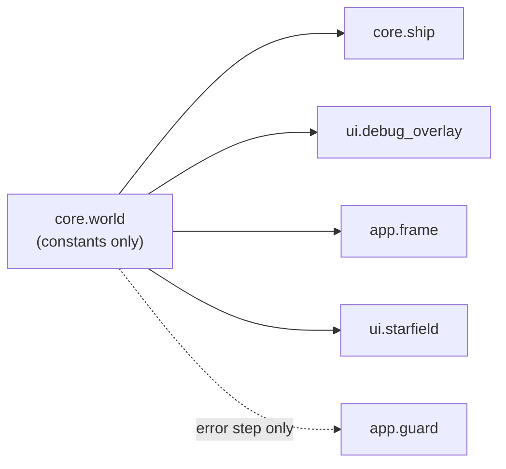

# World: screen geometry
Version: 3
Status: frozen
Features: DRA-6, DRA-13, DRA-19
Created by: architect

## Purpose
Give every system one home for the screen's size and the lines the rules use: the side walls, the top line and the floor. The screen is fixed and never follows the ship (01-vision.md, locked decision 2). There is no camera. The world scrolls down past the fixed screen; the scroll and the distance live in `docs/contracts/DRA-13/DRA-13-scroll.md`, not here.

All rules use screen px. World coordinates with y up (03-world-and-camera.md, rule 1) are for wave files, which don't exist yet. The feature that adds wave loading defines the conversion.

Who builds what:
- `game/core/world.py`: the Gameplay Implementer, task `DRA-6-01-gameplay-implementer`. Docstring update in DRA-13: task `DRA-13-01-gameplay-implementer`. `Final` in DRA-19: task `DRA-19-01-gameplay-implementer`.
- Read by `core/ship.py`, `ui/debug_overlay.py`, `ui/starfield.py`, `app/frame.py` and the error step in `app/guard.py`.

## Diagram
```
 x=0                              x=640  (SCREEN_W)
  +--------------------------------+  y=0
  |                                |
  |- - - - - - TOP LINE - - - - - -|  y=168  (TOP_LINE_Y, ceiling)
  |                                |
  |               ship             |
  |                                |
  +--------------------------------+  y=480  (SCREEN_H, the floor)
  wall                          wall
```


## Interface
```python
# game/core/world.py  (constants only. One import: `from typing import Final`. No logger)
SCREEN_W: Final[int] = 640            # 03-world-and-camera.md, screen_w
SCREEN_H: Final[int] = 480            # 03-world-and-camera.md, screen_h
TOP_LINE_RATIO: Final[float] = 0.35   # 03-world-and-camera.md, top_line_ratio
TOP_LINE_Y: Final[int]                # = round(SCREEN_H * TOP_LINE_RATIO) -> 168
```
Screen coordinates, pygame style: x to the right, y down, in pixels. The left wall is x 0, the right wall is x `SCREEN_W`, the floor is y `SCREEN_H`.

## Rules
- Screen is 640×480. Source: 03-world-and-camera.md, screen_w, screen_h (guess).
- The top line sits at `screen_h × top_line_ratio` = 168. It is computed from the ratio, never written as a bare 168. It is a ceiling for the ship (`DRA-6-ship.md`, step 7). Source: 03-world-and-camera.md, rule 2 and How to extend.
- The screen never moves. No camera offset exists, and none is added. Source: 03-world-and-camera.md, rule 3; 01-vision.md, locked decision 2.
- The side walls are at x 0 and x `SCREEN_W`. Source: 03-world-and-camera.md, rule 6.
- The floor is the bottom edge of the screen, y `SCREEN_H`. Source: 03-world-and-camera.md, rule 5.
- The whole window is the play area. Source: 03-world-and-camera.md, Edge cases (WC-07 still open).
- Constants only: one stdlib import, `typing.Final`, and no logger, no code. Source: game/CONTEXT.md, Logging (a constants-only module has no logger); scope report DRA-19, item 5 (core constants are `Final`).
- Every constant is `Final`. Source: scope report DRA-19, item 5.

## Impact
DRA-19 changes this frozen contract (v2). No constant name, type or value changes. The constants gain `Final`, so the module gains its one import, `from typing import Final`. Every file in `game/` that depends on it, found by grepping `game/` (tests included) for `core.world`, `SCREEN_W`, `SCREEN_H`, `TOP_LINE_RATIO` and `TOP_LINE_Y`:

| File | Change needed |
|---|---|
| `game/core/world.py` | `Final[...]` on the four constants, the import, and the module docstring's "Constants only, no imports." reworded to match. Task `DRA-19-01-gameplay-implementer`. |
| `game/core/ship.py`, `game/ui/debug_overlay.py`, `game/ui/starfield.py`, `game/app/frame.py` | none. They import the constants by name; names and values don't change. |
| `game/app/guard.py` | none. Its error step imports `core.world`. A stdlib `typing` import can't realistically fail, so the guard's reasoning in `DRA-5-app.md`, Rationale still holds. |
| `game/tests/` | none. The tests copy the screen values from the GDD and never import or patch them. |

## Rationale
- **`TOP_LINE_Y` uses `round(...)`.** `480 * 0.35` in floating point is not exactly 168. Rounding gives the int 168 that the GDD names, and keeps the ratio as the source.
- **Screen size moves from `app/settings.py` to `core/world.py`.** Core needs the walls and the floor, and core may not import `app`. One home avoids two copies of a guess value drifting apart. The DRA-5 contract left this choice to DRA-6. The change to the app is listed under Impact in `docs/contracts/DRA-5/DRA-5-app.md`.
- **One import for `Final` (DRA-19).** The scope marks every core constant `Final`, and `Final` lives in `typing`. The module was import-free so the guard's error step could import it with nothing that can fail. `typing` is stdlib and can't realistically fail to import, so that still holds. Same `Final[type]` form as `DRA-6-ship.md`, Rationale.
- **No camera fields, ever.** DRA-6 left room for a camera. The GDD changed on 2026-10-12: the screen is fixed and the world scrolls past it (91-decision-log.md, row 22). The scroll has state and a step, so it lives in its own module, `core/scroll.py`, and this file stays constants only.
