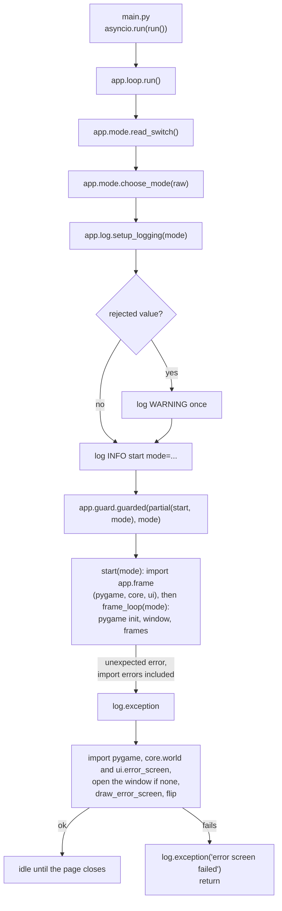
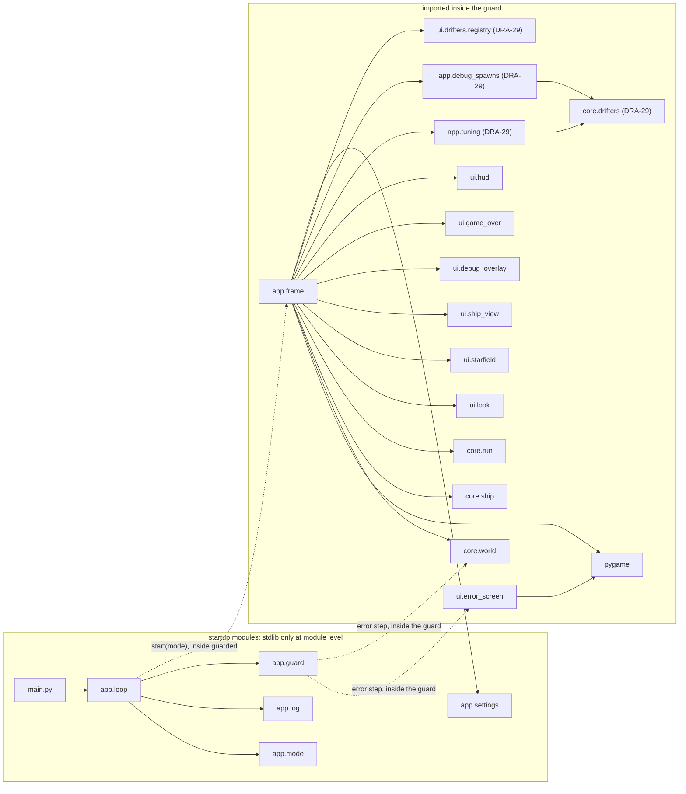
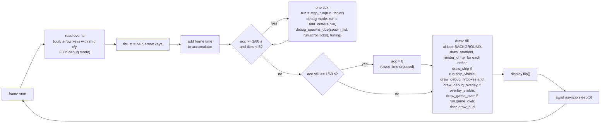

# App base: entry point, logging, run mode, loop, error guard, error screen
Version: 7
Status: frozen
Features: DRA-5, DRA-6, DRA-13, DRA-19, DRA-23, DRA-29, DRA-39, DRA-47
Created by: architect

## Purpose
Start the game, set up logging once, read the run mode once, run the async loop on the fixed 60 Hz tick, and catch any unexpected error so the page shows the error screen instead of freezing. That includes an error raised while importing pygame, core, the views or the frame loop. Build a release package that holds only runtime files.

Before the first frame the app loads and checks the tuning files once (the drifter files, the playtest switches and the shared hazard values) in both modes, and the debug test spawn list in debug mode only, and hands the checked values to core. It holds one `Run` (`docs/contracts/systems/run.md`). Play starts when the ship first appears. Each tick it calls `step_run` once; core does the ship, the scroll, the drifters, the lives, the respawn wait, game over and retry. In debug mode only, after each tick it hands the run the drifters the spawn list says are due, through `core.run.add_drifters`. Normal mode spawns nothing yet.

Each frame draws the starfield, the drifters (entry warnings, meteorites and satellites) behind the ship, the ship while `run.ship_visible` (the blink), in debug mode the hitbox and graze outlines, drifter labels and the debug overlay (F3 toggles them), the Game Over box while `run.game_over`, and the HUD on top. The arrow-key log lines carry the ship's x and y. The guard removes null characters from the debug-mode detail line, so an error message holding one still shows the error screen. Source: scope reports DRA-5 to DRA-39; `docs/contracts/systems/drifters.md`.

Who builds what:
- `game/main.py`, `game/app/`, `game/scripts/`, `pygbag.ini` (repo root): the Integration Engineer, during integration, from this contract. No task file.
- `game/ui/look.py`, `game/ui/error_screen.py`: the UI Developer, task `DRA-5-01-ui-developer`.
- `game/tests/ui/test_error_screen.py`: the QA Engineer, task `DRA-5-02-qa-engineer`.
- `game/core/world.py`, `game/core/ship.py`: DRA-6, see `docs/contracts/systems/world.md` and `docs/contracts/systems/ship.md`. Core is the same in both modes.
- `game/ui/ship_view.py`, `game/ui/debug_overlay.py`: DRA-6, see `docs/contracts/systems/ship.md` and `docs/contracts/systems/debug-overlay.md`.
- `game/core/scroll.py`, `game/ui/starfield.py`: DRA-13, see `docs/contracts/systems/scroll.md`.
- `game/ui/hud.py`: DRA-13, see `docs/contracts/systems/hud.md`.
- `game/core/run.py`, `game/ui/game_over.py`: DRA-23, see `docs/contracts/systems/run.md`.
- `game/core/collision.py`, `game/core/levels.py`, `game/core/drifters/`, `game/ui/shapes.py`, `game/ui/drifters/`: DRA-29 and DRA-39, see `docs/contracts/systems/drifters.md`.
- `game/app/tuning.py`, `game/app/debug_spawns.py`: the Integration Engineer, during DRA-29 integration, from this contract. The hazards file, the satellite's own fields and the editable spawn list: during DRA-39 integration. No task file.
- The data files are content, filled to their schemas by whoever the Director names (DRA-29: the main session, by Director decision): `game/tuning/drifters/meteorite.json` (`docs/contracts/schemas/drifter-tuning.schema.json`), `game/tuning/drifters/satellite.json` (`satellite-tuning.schema.json`), `game/tuning/playtest.json` (`playtest-switches.schema.json`), `game/tuning/hazards.json` (`hazards.schema.json`) and `game/tuning/debug_spawns.json` (`debug-spawn-list.schema.json`), all schemas in `docs/contracts/schemas/`.

## Diagram


Import boundary. Everything above the guard imports only the standard library and other startup modules. pygame, `ui` and `core` are imported for the first time inside the guard.




## Interface
Import root is `game/`, as in the tests: `from app.loop import run`, `from ui.error_screen import draw_error_screen`.

### game/main.py (Integration Engineer)
```python
# /// script
# dependencies = [
#   "pygame-ce",
# ]
# ///
import asyncio

from app.loop import run

asyncio.run(run())
```
Nothing else. No logic, no imports beyond these. The opening block is PEP 723 inline metadata. It is pygbag's documented way to declare packages: pygbag installs only what `main.py` imports or declares, so without it the browser build has no pygame-ce. Any new third-party package goes into this block. Source: Director decision D1 (DRA-5 integration). game/CONTEXT.md, Layout.

### game/app/mode.py (Integration Engineer)
```python
class RunMode(Enum):
    NORMAL = "normal"
    DEBUG = "debug"


@dataclass(frozen=True)
class ModeChoice:
    mode: RunMode
    rejected: (
        str | None
    )  # the switch value that was present but not "1"; None otherwise


def read_switch() -> str | None:
    ...
    # Browser (sys.platform == "emscripten"): the first value of URL query parameter `debug`.
    # Desktop: environment variable DRIFTWARD_DEBUG.
    # None when the switch is absent. Present with an empty value returns "".


def choose_mode(raw: str | None) -> ModeChoice:
    ...
    # Pure. No logging, no I/O.
```

### game/app/log.py (Integration Engineer)
```python
def setup_logging(mode: RunMode) -> None:
    ...
    # The only place that configures logging. Called once, at startup.
    # Installs exactly one handler on the root logger:
    #   browser (sys.platform == "emscripten"): writes each formatted line
    #     with platform.window.console.log
    #   desktop: logging.StreamHandler(sys.stdout)
```

### game/app/guard.py (Integration Engineer)
```python
async def guarded(body: Callable[[], Awaitable[None]], mode: RunMode) -> None:
    ...
    # Awaits body(). Holds the project's only `except Exception`.
    # Module level: stdlib and app.mode only. pygame, core.world and
    # ui.error_screen are imported inside the error step, never at the top.
```

### game/app/settings.py (Integration Engineer)
```python
TICK_RATE: int = 60  # 15-tech-constraints.md, tick_rate
MAX_TICKS_PER_FRAME: int = 5  # 15-tech-constraints.md, max_ticks_per_frame (guess)
```
Constants only. No imports. From DRA-6 the screen size lives in `core/world.py` (`SCREEN_W`, `SCREEN_H`), and `SCREEN_SIZE` is removed from here. See Impact.

### game/app/loop.py (Integration Engineer)
```python
async def run() -> None:
    ...
    # Startup order, then guarded(functools.partial(start, choice.mode), choice.mode).


async def start(mode: RunMode) -> None:
    ...
    # The guarded body. Imports app.frame here, inside the guard, then awaits frame_loop(mode).
```
Module level: stdlib, `app.mode`, `app.log` and `app.guard` only. No pygame, no `core`, no `ui`, no `app.frame`.

### game/app/frame.py (Integration Engineer)
```python
ARROW_NAMES: dict[
    int, str
]  # pygame.K_UP -> "up", K_DOWN -> "down", K_LEFT -> "left", K_RIGHT -> "right"


async def frame_loop(mode: RunMode) -> None:
    ...
    # pygame init, window, frames until pygame.QUIT.
    # Owns: run (core.run.Run), thrust (core.ship.Thrust), overlay_visible (bool).
```
Imports pygame, `app.settings`, `app.mode`, `app.tuning` and `app.debug_spawns` (DRA-29), `core.world`, `core.ship` (for `Thrust`), `core.run`, `ui.look`, `ui.starfield`, `ui.drifters.registry` (DRA-29, for `render_drifter`), `ui.ship_view`, `ui.debug_overlay`, `ui.game_over` and `ui.hud`. From DRA-23 it no longer imports `core.scroll`, `spawn` or `step`. Only `start()` imports this module, inside the guard.

App-owned state in `frame_loop` (DRA-23, DRA-29, DRA-39):
```python
tuning: DrifterTuning  # DRA-29. app.tuning.load_tuning() once, before start_run(). Never reloaded
spawn_list: (
    DebugSpawnList | None
)  # DRA-39. Debug mode: app.debug_spawns.load_debug_spawns(tuning) once,
# right after load_tuning(). Normal mode: None, the file is never read
run: Run  # core.run.start_run() before the first frame; replaced by step_run() every tick,
# and by add_drifters() after a tick in debug mode
thrust: Thrust  # rebuilt once per frame from the held arrow keys
overlay_visible: (
    bool  # True from the first frame in debug mode, always False in normal mode.
)
# F3 flips it, debug mode only.
```
The ship, the scroll and the drifters are `run.ship`, `run.scroll` and `run.drifters`. The app never keeps its own copy.

### game/app/tuning.py (Integration Engineer, DRA-29)
```python
TUNING_DIR: (
    Path  # the game's tuning folder: Path(__file__).resolve().parent.parent / "tuning"
)
PLAYTEST_FILE: str = "playtest.json"  # in TUNING_DIR
HAZARDS_FILE: str = "hazards.json"  # in TUNING_DIR. DRA-39
DRIFTERS_DIR: str = (
    "drifters"  # in TUNING_DIR; one "<drifter_type value>.json" per DrifterType
)


def load_tuning() -> DrifterTuning:
    ...
    # Reads and checks the playtest switches, the shared hazard values (DRA-39) and one file per
    # DrifterType, then builds the core dataclasses (docs/contracts/systems/drifters.md, Interface,
    # core/drifters/tuning.py, and SatelliteVariantExtra in core/drifters/satellite.py).
    # Reads the module-level TUNING_DIR at call time. Raises on any bad file.
```
Not a startup module: it imports `core.drifters`, so only `app.frame` imports it, inside the guard.

### game/app/debug_spawns.py (Integration Engineer, DRA-29; editable list DRA-39)
The debug test spawn list, a file the Director edits by hand: `game/tuning/debug_spawns.json`, to `docs/contracts/schemas/debug-spawn-list.schema.json`. A temporary stand-in kept in the scope reports, not in the GDD. Debug mode only.
```python
SPAWN_LIST_FILE: str = (
    "debug_spawns.json"  # in app.tuning.TUNING_DIR, read at call time
)
ALL_ROWS: str = "all"  # the mode that plays every row
DEFAULT_MODE: str = (
    ALL_ROWS  # scope report DRA-39, Values needed (stand-in): mode left out
)
DEFAULT_LOOP_TICKS: int = (
    180  # scope report DRA-39, Values needed (stand-in, kept from DRA-29):
)
# loop_ticks left out. 3 s


@dataclass(frozen=True, slots=True)
class DebugSpawnList:
    """The checked list, ready to play."""

    mode: str  # "all" or a DrifterType value
    loop_ticks: int  # ticks, >= 1
    schedule: tuple[
        tuple[int, Placement], ...
    ]  # (offset within the loop, placement) for each row in
    # play, in file order. Offsets from 0 to loop_ticks - 1


def load_debug_spawns(tuning: DrifterTuning) -> DebugSpawnList:
    ...
    # Reads and checks the file, then every row by spawning it once with spawn_drifter(placement, 1,
    # tuning). Builds the schedule for the rows in play. Raises on any problem.


def debug_spawns_due(spawn_list: DebugSpawnList, ticks: int) -> tuple[Placement, ...]:
    ...
    # () when ticks < 1. Otherwise every placement in the schedule whose offset ==
    # (ticks - 1) % spawn_list.loop_ticks, in schedule order.
    # ticks is run.scroll.ticks after the tick: 1 on the first tick of play.
```
Not a startup module: it imports `core.drifters`. DRA-39 removes `DEBUG_SPAWN_PERIOD` and `DEBUG_SPAWNS`; their three meteorite rows move into the file.

### pygbag.ini (repo root, Integration Engineer)
```ini
[DEPENDENCIES]
ignoreDirs = [...]    # folders under game/ left out of the package
ignoreFiles = [...]   # files under game/ left out of the package
```
pygbag 0.9.3 reads it from its working directory. The start script and the build check both run pygbag from the repo root. Source: Director decision (DRA-5 close-out, round 1 observations). docs/crew/roster.md, row 12.

The DRA-6 and DRA-13 call blocks below are kept as history. From DRA-23 the ship and scroll calls in them are replaced: the current order is the DRA-23 block after them.

DRA-6 calls, all made by `frame_loop`. Their signatures are set in the DRA-6 contracts:
```python
# before the first frame:
ship = spawn()  # systems/ship.md
# per frame, after the events:
thrust = Thrust(up=..., down=..., left=..., right=...)
# per tick, inside the accumulator loop:
ship = step(ship, thrust)  # systems/ship.md
# per frame, draw:
surface.fill(BACKGROUND)
draw_ship(surface, ship)  # systems/ship.md
if overlay_visible:
    draw_debug_overlay(surface, ship)  # systems/debug-overlay.md
```

DRA-13 calls, all made by `frame_loop`. Their signatures are set in the DRA-13 contracts. The full order, with the DRA-6 calls in place:
```python
# before the first frame:
ship = spawn()
scroll = start_scroll()  # systems/scroll.md, right after spawn(): play starts
# per tick, inside the accumulator loop:
ship = step(ship, thrust)
scroll = step_scroll(scroll)  # systems/scroll.md
# per frame, draw:
surface.fill(BACKGROUND)
draw_starfield(surface, scroll)  # systems/scroll.md, behind everything
draw_ship(surface, ship)
if overlay_visible:
    draw_debug_overlay(surface, ship)
draw_hud(
    surface, scroll, below_overlay=debug
)  # systems/hud.md, last; debug = mode is RunMode.DEBUG
```

DRA-23 calls, all made by `frame_loop`. Their signatures are set in `systems/run.md` and `systems/hud.md`. They replace the DRA-6 and DRA-13 ship and scroll calls above. The full order:
```python
# before the first frame:
run = start_run()  # systems/run.md: spawn() and start_scroll(), play starts
# per frame, after the events:
thrust = Thrust(up=..., down=..., left=..., right=...)
# per tick, inside the accumulator loop:
run = step_run(run, thrust)  # systems/run.md: the only call per tick
# per frame, draw:
surface.fill(BACKGROUND)
draw_starfield(surface, run.scroll)
if run.ship_visible:
    draw_ship(surface, run.ship)  # the blink
if overlay_visible:
    draw_debug_overlay(surface, run.ship)
if run.game_over:
    draw_game_over(surface)  # systems/run.md, Presentation
draw_hud(surface, run, below_overlay=debug)  # systems/hud.md, last
```

DRA-29 calls, all made by `frame_loop`. Their signatures are set in `systems/drifters.md`, `systems/run.md` and `systems/debug-overlay.md`. They add to the DRA-23 block above. The full order:
```python
# before the first frame:
tuning = load_tuning()  # app.tuning, both modes. A bad file raises here
run = start_run()
# per frame, after the events:
thrust = Thrust(up=..., down=..., left=..., right=...)
# per tick, inside the accumulator loop:
run = step_run(run, thrust)
if debug:
    run = add_drifters(
        run, debug_spawns_due(run.scroll.ticks), tuning
    )  # systems/run.md
# per frame, draw:
surface.fill(BACKGROUND)
draw_starfield(surface, run.scroll)
for obj in run.drifters:
    render_drifter(surface, obj)  # systems/drifters.md: warnings and drifters
if run.ship_visible:
    draw_ship(surface, run.ship)  # the inverted T (systems/ship.md)
if overlay_visible:
    draw_debug_hitboxes(
        surface, run
    )  # systems/debug-overlay.md: outlines and labels first
    draw_debug_overlay(surface, run.ship)
if run.game_over:
    draw_game_over(surface)
draw_hud(surface, run, below_overlay=debug)
```

DRA-39 calls, all made by `frame_loop`. They change the DRA-29 block above only before the first frame and in the tick. The draw order is unchanged: `render_drifter(surface, obj)` keeps its signature (the brightness and the tilt come from the drifter itself).
```python
# before the first frame:
tuning = (
    load_tuning()
)  # app.tuning, both modes: drifter files, playtest.json, hazards.json
spawn_list = (
    load_debug_spawns(tuning) if debug else None
)  # app.debug_spawns, debug mode only
run = start_run()
# per tick, inside the accumulator loop:
run = step_run(run, thrust)
if debug:
    run = add_drifters(run, debug_spawns_due(spawn_list, run.scroll.ticks), tuning)
```

### game/ui/look.py (UI Developer)
```python
BACKGROUND: tuple[int, int, int]  # 12-art-and-audio.md, placeholder_bg
```
The one home of the background color in code. `app/frame.py` and later views import it.

### game/ui/error_screen.py (UI Developer)
```python
def draw_error_screen(surface: pygame.Surface, detail: str | None) -> None: ...
```
`detail` is `None` in normal mode, and the one-line `<ErrorType>: <message>` text in debug mode. The app decides which. The view never reads the run mode.

### game/scripts/start-driftward-ace.sh (Integration Engineer)
```
start-driftward-ace.sh            # serves the build, prints http://localhost:<PORT>
start-driftward-ace.sh --debug    # same build, prints http://localhost:<PORT>/?debug=1
```

## Presentation
The app draws nothing itself beyond the background fill. The ship view and the debug overlay have their own Presentation sections in `docs/contracts/systems/ship.md` and `docs/contracts/systems/debug-overlay.md`. The starfield and the HUD have theirs in `docs/contracts/systems/scroll.md` and `docs/contracts/systems/hud.md`. The blink and the Game Over box have theirs in `docs/contracts/systems/run.md` (DRA-23). The drifters and their entry warnings have theirs in `docs/contracts/systems/drifters.md` (DRA-29). The error screen reads no core state, only what the guard passes it.

| Input | Shown as |
|---|---|
| (always) | the whole surface filled with `BACKGROUND`, (0, 0, 0). Source: 12-art-and-audio.md, placeholder_bg (guess) |
| (always) | `Something broke. Reload the page.` in the default font (`pygame.font.Font(None, 24)`), color (255, 255, 255), centered horizontally and vertically on the surface. Source: 10-ui.md, error_screen, error_text_font, error_layout, error_text_color (guess) |
| `detail` is a string | `detail` in the default font at 16 px (`pygame.font.Font(None, 16)`), color (255, 255, 255), centered horizontally. Its top edge sits one line-height below the main line's top (the main font's `get_linesize()`), so it reads as the next line. Source: 10-ui.md, error_layout, debug_text_font, error_text_color (guess) |
| `detail` wider than the surface | cut from the end, one character at a time, until its rendered width fits the surface width. No ellipsis. Source: 10-ui.md, error_debug_line (guess) |
| `detail` is `None` | nothing below the main line |

- Centering uses `surface.get_size()`, never a hard-coded screen size.
- Text is rendered antialiased.
- The view only draws. It never flips the display, never logs per frame, never catches an error. If it fails, it raises.
- Logging: the module has `log = logging.getLogger(__name__)`. It may log one DEBUG line when the detail is cut, with the original and cut lengths. Nothing else.

## Rules
Startup (`app.loop.run`), in this order:
1. `raw = read_switch()`, then `choice = choose_mode(raw)`. Source: 15-tech-constraints.md, rule 7 (read once, at launch).
2. `setup_logging(choice.mode)`. Source: game/CONTEXT.md, Logging.
3. If `choice.rejected is not None`: one WARNING, `debug switch value %r is not 1, using normal mode`. Source: 15-tech-constraints.md, debug_switch_other_value.
4. One INFO line: `start mode=%s` with `choice.mode.value`. In the console this reads like `12:00:01 INFO app.loop: start mode=debug`. Source: DRA-5 scope report, Player sees.
5. `await guarded(functools.partial(start, choice.mode), choice.mode)`. Everything after logging setup runs inside the guard: importing `app.frame` (and through it pygame, `core` and `ui`), pygame init, the window and the loop. Source: 15-tech-constraints.md, rule 8. Director decision (DRA-5 close-out: import errors must be logged and show the error screen).

Import boundary:
- Startup modules are `main.py`, `app/loop.py`, `app/mode.py`, `app/log.py`, `app/guard.py` and `app/settings.py`. At module level they import only the standard library and each other. Never pygame, `ui`, `core` or `app.frame`. pygbag's built-in `platform` module counts as standard library here. Source: Director decision (DRA-5 close-out).
- pygame, `ui` and `core` are first imported inside the guard: by `start()` through `app.frame`, or by the guard's error step. So an import error in any of them is caught by the guard, after logging is set up.
- `main.py` keeps its exact text above: the PEP 723 block, `import asyncio`, `from app.loop import run`, `asyncio.run(run())`. Source: Director decisions D1 and DRA-5 close-out.
- What runs before the guard is limited to stdlib-only code: the startup module imports, `read_switch`, `choose_mode` and `setup_logging`. Errors there can't reach the guard. See Rationale.

Run mode (`choose_mode`):
- `None` (switch absent): normal, `rejected=None`, no log. Source: 15-tech-constraints.md, run_mode_default, debug_switch_other_value.
- `"1"`: debug. Source: 15-tech-constraints.md, debug_switch_browser, debug_switch_desktop.
- Any other string, including `"0"` and `""`: normal, `rejected=<that string>`. Source: 15-tech-constraints.md, debug_switch_other_value.
- The mode never changes after startup. Source: 15-tech-constraints.md, rule 7.
- In the browser only the URL is read. On desktop only the env var is read. They never conflict.

Logging (`setup_logging`):
- Root logger level: INFO in normal mode, DEBUG in debug mode. Source: 15-tech-constraints.md, log_level_normal, log_level_debug.
- Exactly one handler on the root logger. Any handler set up before it is replaced. Source: game/CONTEXT.md, Logging.
  - Browser (`sys.platform == "emscripten"`): each formatted line goes to the devtools console through `platform.window.console.log`, at every level. pygbag sends stdout and stderr only to its hidden terminal, so this is the only way the lines reach the console. Source: Director decision D2 (DRA-5 integration). game/CONTEXT.md, Browser.
  - Desktop: a `StreamHandler` on `sys.stdout`.
- Format `%(asctime)s %(levelname)s %(name)s: %(message)s`, date format `%H:%M:%S`. That gives `HH:MM:SS LEVEL logger: message`. Same format and levels on both targets. Source: 15-tech-constraints.md, log_format.
- No other code calls `basicConfig`, adds a handler or sets a level. Source: game/CONTEXT.md, Logging.
- Log by event, never by tick. Source: 15-tech-constraints.md, rule 9.

Frame loop (`app/frame.py`, `frame_loop(mode)`):
- Inside the guard: `pygame.init()`, then `pygame.display.set_mode((SCREEN_W, SCREEN_H))` from `core.world`. Source: 03-world-and-camera.md, screen_w, screen_h (guess). systems/world.md.
- Before the first frame (DRA-29): `tuning = load_tuning()`, in both modes, before `start_run()`. A bad or missing tuning file raises inside the guard, so the page shows the error screen and the log holds the file and field. Source: game/CONTEXT.md, Error handling (validate at the edge); 15-tech-constraints.md, rule 8; scope report DRA-29, Limits ("The app loads and validates them once at startup").
- Before the first frame, debug mode only (DRA-39): `spawn_list = load_debug_spawns(tuning)`, right after `load_tuning()`. A bad or missing list raises inside the guard the same way. Normal mode never reads the file, so a broken list can't break normal play. Source: 15-tech-constraints.md, rule 7 (debug only adds the test spawn list); scope report DRA-39, Limits.
- Before the first frame: `run = start_run()`, and `overlay_visible = mode is RunMode.DEBUG`. Play starts here: the ship first appears at screen center on the first frame drawn after this. Source: 03-world-and-camera.md, ship_start; 10-ui.md, debug_overlay_toggle (shown from the first frame); scope report DRA-13, Values needed (play start); systems/run.md (DRA-23).
- The app never calls `spawn`, `step`, `start_scroll` or `step_scroll` itself, and never calls `start_run()` again. A respawn, the wait, game over and a retry all happen inside `step_run`. Source: systems/run.md (DRA-23).
- **Game over.** While `run.game_over` is True the frame loop carries on as always: it reads events, builds `thrust`, runs ticks (`step_run` keeps the run frozen and watches for the retry) and draws. Nothing in the app changes. Source: 02-game-flow.md, rules 5 and 6; systems/run.md.
- Each frame, in order: read all events, build `thrust` from the held keys, add the frame time to the accumulator, run one tick per whole 1/60 s in the accumulator, draw, `pygame.display.flip()`, `await asyncio.sleep(0)`. Source: 15-tech-constraints.md, rules 1 and 2.
- Frame time comes from a monotonic clock (`time.perf_counter`). Ticks never use frame time. Source: 15-tech-constraints.md, rule 2.
- **Held keys.** After the events, read `pygame.key.get_pressed()` once and build `Thrust(up=pressed[K_UP], down=pressed[K_DOWN], left=pressed[K_LEFT], right=pressed[K_RIGHT])`. Every tick in that frame uses the same `thrust`. Only the four arrow keys move the ship. Source: 01-vision.md, locked decision 1; 04-ship.md, rule 2.1.
- **Tick.** `run = step_run(run, thrust)`. One `step_run` call per tick. In debug mode only, right after it: `run = add_drifters(run, debug_spawns_due(spawn_list, run.scroll.ticks), tuning)`. In normal mode nothing is added. The app never builds a drifter itself and never changes `run.drifters`. Source: 04-ship.md, rule 1; 15-tech-constraints.md, rules 2 and 7; systems/run.md; scope report DRA-29, Limits ("Normal mode spawns nothing yet").
- **Draw.** In this order: fill with `ui.look.BACKGROUND`; `draw_starfield(surface, run.scroll)`; `render_drifter(surface, obj)` for each `obj` in `run.drifters`, in order (DRA-29); `draw_ship(surface, run.ship)` only if `run.ship_visible`; only if `overlay_visible`, `draw_debug_hitboxes(surface, run)` (DRA-29) then `draw_debug_overlay(surface, run.ship)`; `draw_game_over(surface)` only if `run.game_over`; `draw_hud(surface, run, below_overlay=debug)` last, on top of everything. Source: systems/ship.md, systems/drifters.md, systems/debug-overlay.md, systems/scroll.md, systems/run.md and systems/hud.md, Presentation; 10-ui.md, rules 1 (the HUD on top) and 3 (the blink); 12-art-and-audio.md, rule 2 (the background stays behind).
- **Drifters behind the ship (DRA-29).** Warnings and meteorites are drawn after the starfield and before the ship, so the player's ship stays on top where they cross.
- **`below_overlay`** is `mode is RunMode.DEBUG`, fixed for the run. Never `overlay_visible`: in debug mode the HUD stays below the overlay's place while F3 hides it, so the readout never jumps. Source: scope report DRA-13, HUD layout.
- `pygame.QUIT`: log INFO `quit` and leave the loop. That only happens on desktop.
- **Arrow keys** (Up, Down, Left, Right): on `KEYDOWN` log DEBUG `key down key=%s x=%.2f y=%.2f`, on `KEYUP` log DEBUG `key up key=%s x=%.2f y=%.2f`, with names `up`, `down`, `left`, `right` and the ship's `x` and `y` (`run.ship.x`, `run.ship.y` from DRA-23) at the moment the event is read (before this frame's ticks). Example: `key down key=up x=320.00 y=240.00`. No other arrow event is logged. Source: game/CONTEXT.md, Logging (a key pressed or released is an event). 01-vision.md, locked decision 1. Director decision (DRA-6: the integration check compares y between key-down and key-up).
- **F3.** In debug mode, on `KEYDOWN` of `pygame.K_F3`: flip `overlay_visible` and log DEBUG `overlay visible=%s`. `KEYUP` of F3 does nothing. In normal mode F3 does nothing and logs nothing. F3 never retries: only `thrust`, built from the four arrows, reaches `step_run` (02-game-flow.md, retry_key, locked). Source: 10-ui.md, debug_overlay_toggle (guess) and rule 7.
- **Log by event.** The frame loop logs only on the events in these rules: quit, arrow keys, F3 and the cap. Never a line per tick or per frame. Ship events (wall hit, top-line stop) are logged by `core.ship`, the scroll start by `core.scroll`, and the run's events (life lost, respawn, wait end, invulnerable end, game over, new run, and from DRA-29 drifter spawn, active, touch and gone) by `core.run`, not by the app. The app's only drifter lines are the one `tuning loaded` line at startup and, in debug mode, the one `debug spawns loaded` line after it (DRA-39). Source for the run's lines: systems/run.md, Logging (DRA-23). Source: 15-tech-constraints.md, rule 9; systems/ship.md, Rules, Logging.
- **Catch-up cap.** One frame runs at most `MAX_TICKS_PER_FRAME` (5) ticks. If, after the 5th tick, the accumulator still holds one tick or more, set it to 0.0: the owed time is dropped, never run later. The game carries on from where it was. Source: 15-tech-constraints.md, max_ticks_per_frame (guess) and rule 2; 91-decision-log.md, row 21.
- **Cap log, by event.** Log DEBUG `tick cap hit, dropped %.3f s` (the seconds dropped) on a frame where the cap drops time and the frame before didn't. While frames keep hitting the cap, log nothing more. The next capped frame after an uncapped one logs again. Source: 15-tech-constraints.md, rule 9.
- No `time.sleep`, no thread, no blocking call. Source: 15-tech-constraints.md, rule 1.

Tuning loader (`app/tuning.py`, DRA-29). Source: scope report DRA-29, Limits; game/CONTEXT.md, Error handling ("Validate at the edge ... raise with a message that says what was wrong and where"); CLAUDE.md, Rules for every agent (no silent schema drift):
- Reads `TUNING_DIR / PLAYTEST_FILE`, then `TUNING_DIR / HAZARDS_FILE` (DRA-39), then `TUNING_DIR / DRIFTERS_DIR / f"{drifter_type.value}.json"` for every `DrifterType`, in enum order. UTF-8, `json.loads`. Once, at startup. Read with plain `open`/`Path.read_text`: no blocking beyond a small local file, no network.
- Checks every rule of `docs/contracts/schemas/playtest-switches.schema.json`, `hazards.schema.json`, `drifter-tuning.schema.json` and `satellite-tuning.schema.json` by hand (no schema library: pygbag has none). No unknown field; types exact. A number is an `int` or a `float`, never a `bool`. In the playtest and drifter files every field is required. `entry_warning_ticks` is an `int` ≥ 1. `speed_ratio` ≥ 0. `width`, `height`, `r`, `w`, `h` > 0. Variant names match `^[a-z][a-z0-9_]*$`, at least one variant, each with at least one shape.
- **Hazards file** (DRA-39). Both fields optional; `{}` is valid. `rehit_cooldown` is an `int` ≥ 0 (never a `bool`); `rehit_dim` a number from 0 to 1. A field left out takes its default from `core.drifters.base` (`DEFAULT_REHIT_COOLDOWN_TICKS`, `DEFAULT_REHIT_DIM`); the loader holds no copy of those numbers. The file itself must exist. Builds `HazardRules(rehit_cooldown_ticks=..., rehit_dim=...)`. Source: scope report DRA-39, Limits; 05-lives-and-damage.md, Values.
- **A drifter's own fields** (DRA-39). A drifter type with its own schema is checked against it instead of `drifter-tuning.schema.json`. The satellite: every variant also requires `angle_degrees`, a number ≥ 0 and < 90, and its `hitbox` is exactly two boxes. The loader builds `SatelliteVariantExtra(angle_degrees=...)` (`core.drifters.satellite`) into each `VariantTuning.extra`. The meteorite's variants have no `extra` (None). Error messages name the field the same way, e.g. `tuning/drifters/satellite.json: variants.angled.angle_degrees must be a number >= 0 and < 90`.
- Two rules the schema can't express, also checked: `default_variant` is one of the variant names; and every hitbox shape lies inside its variant's `width × height` footprint, centered on the drifter (circle: `|cx| + r <= width / 2` and `|cy| + r <= height / 2`; box: `|cx| + w / 2 <= width / 2` and `|cy| + h / 2 <= height / 2`). Source: 07-drifters.md, rule 8 (a hitbox is never bigger than what the player sees).
- On any problem: raise `ValueError` with the file and the field, the file named from the tuning folder down, e.g. `tuning/drifters/meteorite.json: variants.small.hitbox[0].r must be a number > 0`. Invalid JSON: `ValueError("tuning/playtest.json: not valid JSON: <decoder message>")`, raised `from` the decode error. A missing file: the `FileNotFoundError` rises as it is (it names the path). Never fall back to a default for a missing file. The guard shows the error screen.
- Builds `DrifterTuning(drifters={...}, switches=PlaytestSwitches(...), hazards=HazardRules(...))` with plain dicts, `Circle` and `Box` from `core.collision`. Core trusts these values.
- Extra files in `drifters/` that match no `DrifterType` are not read. Test task DRA-29-09 fails on them.
- Logs one INFO line after a good load: `tuning loaded drifters=%s hazard_speed_scaling=%s timer_scaling=%s rehit_cooldown=%d rehit_dim=%.2f`, the drifter types as a comma-separated list of values, and the cooldown and dim in use (DRA-39 adds the last two). INFO because it is startup. Nothing else.

Debug test spawn list (`app/debug_spawns.py`). Source: scope report DRA-39, Feature, Limits and Values needed (temporary stand-ins, debug mode only, not in the GDD); 15-tech-constraints.md, rule 7; 91-decision-log.md, row 38:
- **File.** `app.tuning.TUNING_DIR / SPAWN_LIST_FILE` (`game/tuning/debug_spawns.json`), read once at startup in debug mode, UTF-8, `json.loads`. The Director edits it by hand; a change shows on the next page load.
- **Checks**, by hand, every rule of `docs/contracts/schemas/debug-spawn-list.schema.json`: `rows` required, a list (may be empty); `mode` and `loop_ticks` optional; no unknown field anywhere; types exact, never a `bool` for a number. Each row: `type` required; at least one of `x`, `y`; `x`, `y` numbers; `variant` a string matching `^[a-z][a-z0-9_]*$`; `invert` a boolean; `speed` a number > 0. `loop_ticks` an `int` ≥ 1.
- **Checks the schema can't express.** `mode` is `"all"` or a `DrifterType` value. Each row's `type` is a `DrifterType` value. Then every row, in or out of play, is turned into a `Placement(drifter_type, x=..., y=..., variant=..., invert=..., speed=...)`, absent fields left at their `Placement` defaults, and spawned once with `spawn_drifter(placement, 1, tuning)`, and the result thrown away. Whatever that raises (a missing coordinate the drifter needs, an unknown variant, an invert the drifter lacks) is raised again as `ValueError` naming the row, e.g. `tuning/debug_spawns.json: rows[2]: satellite placement needs y`, `from` the original.
- **Errors** name the file and the field like the tuning loader: `tuning/debug_spawns.json: mode must be "all" or a drifter type (meteorite, satellite)`, `tuning/debug_spawns.json: rows[0].speed must be a number > 0`. Invalid JSON and a missing file as in the tuning loader. Never a default for a missing file.
- **Defaults.** `mode` left out: `DEFAULT_MODE`, `"all"`. `loop_ticks` left out: `DEFAULT_LOOP_TICKS`, 180. A row field left out: the drifter's default (`Placement`'s None or False). Source: scope report DRA-39, Values needed.
- **Rows in play.** With mode `"all"`, every row. With a drifter type, only the rows of that type. File order is kept.
- **Timing.** The `n` rows in play are spread evenly over one loop: row `i` (from 0) has offset `(i × loop_ticks) // n`. `debug_spawns_due` places a row on every tick where `(run.scroll.ticks - 1) % loop_ticks` equals its offset. So the first row in play is placed on the first tick of play (`run.scroll.ticks == 1`), and the loop repeats every `loop_ticks` ticks. Rows that share an offset (more rows than ticks) are placed on the same tick, in file order. With the three DRA-29 meteorite rows in play and `loop_ticks` 180, they are placed on ticks 1, 61 and 121, then again from 181, exactly as in DRA-29. Source: scope report DRA-39, Feature ("The list loops"), Decision log (rows need only type and position); this contract, Rationale.
- The list counts the run's own ticks, so it freezes at game over and starts again with a retry.
- **Log.** One INFO line after a good load: `debug spawns loaded mode=%s rows=%d loop_ticks=%d`, with the number of rows in play. INFO because it is startup. Nothing else, and nothing per tick.
- Called only in debug mode. Never in normal mode. Game rules stay the same in both modes; the list only places drifters.
- Not a wave. No wave file, no wave clock, no wave picker. Waves replace it later. Source: scope report DRA-39, Out.

Error guard (`app/guard.py`):
- The only `except Exception` in the game. Source: game/CONTEXT.md, Error handling.
- On an exception from `body`:
  1. `log.exception("unexpected error, showing the error screen")`. That is ERROR level with the full traceback. Source: 15-tech-constraints.md, rule 8.
  2. `detail = None` in normal mode. In debug mode, `detail = f"{type(exc).__name__}: {exc}"` with every newline replaced by a space, so it is one line, and every null character (`\x00`) removed, so the error screen can render it. Source: 10-ui.md, error_screen, error_debug_line. Null characters: scope report DRA-19, item 4; review DRA-5-01-ui-developer, finding 3; 15-tech-constraints.md, rule 8.
  3. Show the error screen, once. Source: 10-ui.md, rule 8. In this order:
     1. Import pygame, `core.world` and `ui.error_screen` here, inside the step. Source: Director decision (DRA-5 close-out).
     2. If `pygame.display.get_surface()` is `None` (the error came before the window existed, such as an import error in `app.frame`), call `pygame.init()` and `pygame.display.set_mode((SCREEN_W, SCREEN_H))` from `core.world`. If a window already exists, reuse it.
     3. `draw_error_screen(surface, detail)`, then `pygame.display.flip()`.
  4. Idle: each frame, drain the event queue and `await asyncio.sleep(0)`. No tick, no redraw. The game doesn't resume, and the player reloads the page. Source: 10-ui.md, rule 8. Leave the idle loop only on `pygame.QUIT` (desktop).
- If any part of step 3 raises, log it with `log.exception("error screen failed")` and return, without idling. That covers pygame missing or broken (an `ImportError`, or an `AttributeError` from an empty `pygame` namespace package as in round 0), `core.world` or `ui.error_screen` failing to import, the window failing to open, and the draw or flip failing. `run()` then returns, so nothing hangs. The page shows whatever was last drawn, and the console holds both tracebacks. Source: Director decision (DRA-5 close-out).
- Both tracebacks reach the console, because logging was set up before the guard started.
- `KeyboardInterrupt`, `SystemExit` and `asyncio.CancelledError` are not `Exception` and are not caught.
- Code outside `game/app/` never catches broadly, never shows an error on screen, and never decides to keep running. Source: game/CONTEXT.md, Error handling.

Launch script (`game/scripts/start-driftward-ace.sh`):
- `--debug`: same build and same server. The only difference is the printed URL, `http://localhost:${PORT}/?debug=1`. Source: 15-tech-constraints.md, debug_switch_launcher.
- No argument: unchanged behavior, prints `http://localhost:${PORT}`.
- Any other argument: print a usage line naming the bad argument to stderr and exit non-zero before starting anything.
- Keep the existing rules: `set -euo pipefail`, quoted variables, cleanup trap, never `--bind`. Source: game/CONTEXT.md, Good practice and INTEGRATION.
- Keep running pygbag from the repo root, so it reads `pygbag.ini`.

Release package (`pygbag.ini`):
- The package (`game.apk` inside `game/build/web.zip`, and the live build the start script serves) holds only runtime files: `main.py`, `app/`, `ui/`, `core/`, and later the asset and data files the game reads. From DRA-6, `core/*.py` must be in it. From DRA-29, `tuning/` with its JSON files must be in it, along with the subpackages `core/drifters/` and `ui/drifters/`. Source: Director decision (DRA-5 close-out, round 1 observations).
- Left out, at least: `tests/` (with its `CONTEXT.md` and `conftest.py`), `scripts/`, `CONTEXT.md`, `requirements.txt`, `ruff.toml`. Any non-runtime file added to `game/` later is left out the same way. Source: Director decision (DRA-5 close-out).
- Configured only in `pygbag.ini` at the repo root, `[DEPENDENCIES]` section, `ignoreDirs` and `ignoreFiles`. Built by the Integration Engineer. Source: Director decision (DRA-5 close-out). docs/crew/roster.md, row 12.
- No pygbag flag or template change. pygbag stays at 0.9.3. Source: 15-tech-constraints.md, web_build.

How the browser checks below are done. These methods are the checks as written, not stand-ins, so using them is never an observation on its own. Source: Director decision (DRA-19 close-out).
- **Screenshot** means reading the canvas pixels and comparing them with the expected color or text, for example text drawn in the same page with the game's own font. A pixel match counts as the screenshot.
- **Hide the tab** means freezing the page's main thread for the stated time, then letting it run again. For the game this is the same thing: one long gap between frames.
- **Real browser behavior** (pygbag's click screen, a truly hidden tab) can only be seen in a desktop browser. The Director checks it by hand when the frame loop or start-up changes, and before a release. The click-to-start checks below still record what they ask for, in Browser run. They go under Observations only when the result differs from the earlier runs (the game starting before any click, in the test browser, is the known result).

Integration checks for DRA-5, on top of the required browser checks in game/CONTEXT.md, INTEGRATION:
- **Arrow keys:** passes when the key-down and key-up lines appear with the right key name. DRA-5 has no ship, so there is no x/y to compare. That comparison starts with DRA-6. Source: Director decision D3 (DRA-5 integration).
- **Run modes:** no switch logs `start mode=normal`. `?debug=1` logs `start mode=debug`. `?debug=yes` logs one WARNING, then `start mode=normal`. `?debug=1` reaches Python unchanged and doesn't switch pygbag into a mode of its own.
- **Click to start:** record whether pygbag's click screen shows, whether "MEDIA USER ACTION REQUIRED" appears, and the time of the start line against the time of the click. Report what happened. A game that starts before the click doesn't fail DRA-5. It goes under Observations only as the "How the browser checks are done" rules above say. Source: Director decision (DRA-5 close-out, round 1 observations: follow up; DRA-19 close-out).
- **Package contents:** list the files in `game.apk` from `pygbag --archive game`. None of the left-out files may be there, and `main.py`, `app/*.py` and `ui/*.py` must be.
- **Import errors (desktop, headless, `SDL_VIDEODRIVER=dummy`):** no code change, only a blocked import from the command line.
  - Block `app.frame` (for example `sys.modules["app.frame"] = None` before `import main`): the log shows the start line, then ERROR `unexpected error, showing the error screen` with the `ImportError` traceback. The error screen is drawn and the process idles until it is stopped.
  - Block `pygame` the same way: the log shows the start line, the ERROR with the traceback, then ERROR `error screen failed` with its own traceback. The process ends by itself and doesn't hang.

Integration checks for DRA-6, on top of the required browser checks and every DRA-5 check above (all must still pass). Background, from DRA-23: with no key held, the ship falls off the floor once, about 1.07 s after play starts, loses a life, respawns at the center and waits there for an arrow press. Every later fall needs a press first, and the third fall ends the run with the Game Over box. Between checks, retry with a fresh arrow press (release every arrow, then press one) or open a fresh page. Before DRA-23 the ship respawned about once a second with no key held; the checks below that relied on it are reworded and marked (DRA-23).
- **Arrow keys with x/y (`?debug=1`):** hold ArrowUp for about 2 s (`keyboard.down`, wait, `keyboard.up`). The key-down and key-up lines both carry `x=` and `y=`. The key-up `y` is smaller than the key-down `y`, and after a 2 s hold it is `184.00` (top edge on the top line). Source: Director decision (DRA-5 integration, D3; DRA-6 design input).
- **Log by event, not by tick (`?debug=1`):** hold ArrowUp and ArrowLeft together for about 3 s. Between that key-down and key-up there is exactly one `top line stop` line and exactly one `wall hit side=left` line. (DRA-23) With the ship waiting at the respawn point and no key held for 5 s, the only new line is one `invulnerable end`, about 0.5 s after the respawn, never a line per tick. From DRA-13, the one `scroll start` line may also fall in that window if it covers the first 0.5 s of play. Source: 15-tech-constraints.md, rule 9; systems/ship.md and systems/run.md, Logging.
- **Respawn (`?debug=1`):** after the keys are released, a `respawn from x=... y=... wait=True` line appears within about 2 s, with `y` at least 496.00 (top edge at or past 480). (DRA-23) The line now comes from `core.run`, right after a `life lost lives=...` line. Source: DRA-6 scope report, Limits; systems/run.md, Logging.
- **Ship visible (`/`):** the canvas shows white (255, 255, 255) pixels (the ship) and no (0, 255, 0) pixels. F3 logs nothing and changes nothing. Source: systems/ship.md, Presentation; 10-ui.md, rule 7.
- **Overlay and F3 (`?debug=1`):** from the first frame there are (0, 255, 0) pixels on row 168, away from the ship. F3 logs `overlay visible=False` and those pixels go to the background color. F3 again logs `overlay visible=True` and they come back. Source: 10-ui.md, debug_overlay, debug_overlay_toggle.
- **Click to start, follow-up:** the Director asked for this again, because in DRA-5 headless Chromium skipped the click. Record, in a fresh tab: whether pygbag's click screen shows, whether "MEDIA USER ACTION REQUIRED" appears, `navigator.userActivation.hasBeenActive` before any click, the time of the start line, and whether `respawn` lines appear before the click (the ship already moving). Report what happened in Browser run, and under Observations only as the "How the browser checks are done" rules above say. A game that starts before the click doesn't fail DRA-6. A game that doesn't start after a click fails it. Source: Director decision (DRA-5 close-out, follow up; DRA-6 design input; DRA-19 close-out).
- **Catch-up cap (`?debug=1`):** hide the tab for about 5 s (see "How the browser checks are done" above), then let it run. One `tick cap hit, dropped ... s` line appears, with about the hidden time. It is not repeated every frame. The game carries on: the ship doesn't jump ahead by the hidden time, and the meters readout doesn't jump by the hidden time's distance. (DRA-23: before, this also checked that the respawn lines stayed about one a second. The ship now waits after a fall, so there is no steady respawn rate to check.) Source: 15-tech-constraints.md, max_ticks_per_frame, rules 2 and 9; Director decision (DRA-19 close-out).
- **Package contents:** as for DRA-5, and `core/world.py`, `core/ship.py`, `ui/ship_view.py` and `ui/debug_overlay.py` must be in `game.apk`.

Integration checks for DRA-13, on top of the required browser checks and every DRA-5 and DRA-6 check above (all must still pass). Background: 1.1 px a tick at 60 ticks a second is 66 px, so 6.6 m, a second. The readout gains about 66 m in 10 s.
- **Scroll start, logged once (`?debug=1`):** exactly one `scroll start tick=31` line after the start line. In about 10 s of play no second one appears, including across a fall, its `respawn from` line and the wait. (DRA-23) A retry starts a new run, and the new run logs its own `scroll start tick=31`. Source: systems/scroll.md, Rules, Logging; 03-world-and-camera.md, rule 4.
- **Readout counts up (`/`):** a screenshot right after play starts shows `0 m` at the top-left, with its text top near y 24. Screenshots about 5 s and 10 s later, with no key held (DRA-23: the ship falls once, then waits at the center), show larger whole numbers, the 10 s one about 66 m. Within a run the number never goes down. Source: scope report DRA-13, Player sees; systems/hud.md, Layout.
- **Hovering still earns meters (`/`):** hold ArrowUp for about 5 s so the ship sits on the top line. The readout keeps counting at the same rate as with no key held. Source: 03-world-and-camera.md, Edge cases.
- **Starfield moves (`/`):** the canvas has (90, 100, 140) pixels. Two screenshots about 1 s apart, after the first 0.5 s, show the dots about 66 px lower, with dots that left the bottom back at the top. In the first 0.5 s after play starts they sit still. Source: systems/scroll.md, Presentation.
- **No overlap in debug mode (`?debug=1`):** the four green overlay lines sit at the top-left, and the white readout sits below the last one, with a gap and no shared pixel row. Press F3: the overlay text goes away and the readout stays exactly where it was. F3 again brings the overlay back, still with no overlap. The overlay shows only x, y, vx and vy and its two lines, as in DRA-6. (DRA-23) The white hearts at the top right are not part of this check; read the top-left area only. Source: systems/hud.md, Rules; scope report DRA-13, Decision log.
- **Top line is still a ceiling (`?debug=1`):** the DRA-6 ArrowUp check still ends at `y=184.00`. Source: systems/ship.md, step 7.
- **Package contents:** as for DRA-6, and `core/scroll.py`, `ui/starfield.py` and `ui/hud.py` must be in `game.apk`.

Integration checks for DRA-19, on top of the required browser checks and every DRA-5, DRA-6 and DRA-13 check above (all must still pass: DRA-19 changes no gameplay).
- **No `-0.00` in the overlay (`?debug=1`):** hold ArrowUp the whole time, so the ship sits on the top line and never falls to a respawn. While holding it, tap ArrowLeft for about 0.2 s, release it, wait about 3 s, and take a screenshot. The overlay's third line reads `vx 0.00`, not `vx -0.00`. Source: scope report DRA-19, Player sees; systems/debug-overlay.md, Presentation.
- **Null character in debug mode (desktop, headless, `SDL_VIDEODRIVER=dummy`, `DRIFTWARD_DEBUG=1`):** no code change, only a stand-in from the command line. Before calling `run()`, replace `app.loop.start` with an async function that raises `ValueError("bad\x00value")`. The log shows the start line, then ERROR `unexpected error, showing the error screen` with the `ValueError` traceback, and no `error screen failed` line. The error screen is drawn and the process idles until it is stopped. Source: scope report DRA-19, item 4; this contract, Rules, Error guard.

Integration checks for DRA-23, on top of the required browser checks and every DRA-5, DRA-6, DRA-13 and DRA-19 check above, as reworded for DRA-23 (all must still pass). Each check starts in a fresh page unless it says otherwise. Background: with no key held, the first fall comes on tick 64, about 1.07 s after play starts, from y 500.20. Positions are on the 640 × 480 canvas.
- **A fall costs a life (`?debug=1`, no key held):** about 1.07 s after play starts, `life lost lives=2`, then `respawn from x=320.00 y=500.20 wait=True`. Read the canvas after it: white heart pixels in the boxes at x 576 to 599 and x 608 to 631 (rows 8 to 31), and none in the box at x 544 to 567. Source: systems/run.md, Rules, step 5.2 and Logging; systems/hud.md, Presentation.
- **Three hearts at the start (`/`):** the first frames show white heart pixels in all three boxes, x 544 to 567, 576 to 599 and 608 to 631, rows 8 to 31, and no white pixel elsewhere in the area x 536 to 639, rows 0 to 39. Source: systems/hud.md, Presentation; scope report DRA-23, Player sees.
- **Blink (`/`, no key held):** read the canvas pixel at the ship's center, (320, 240), on every frame from the fall until about 1 s after it. In the first 0.5 s after the respawn it is white (the ship) for about 0.1 s, then not white for about 0.1 s, and so on: three white spans and two not-white spans. After that it stays white. In `?debug=1`, `invulnerable end` follows the `respawn from` line by about 0.5 s. Source: systems/run.md, Diagram (blink timeline) and Rules; scope report DRA-23, Limits.
- **The wait (`?debug=1`, no key held):** after the respawn, wait 5 s. The overlay reads `x 320.00`, `y 240.00`, `vx 0.00`, `vy 0.00` the whole time. The only new line is `invulnerable end`. The meters readout keeps counting, about 33 m more in the 5 s, and the stars keep moving. Source: 05-lives-and-damage.md, rule 2.5; systems/run.md, Rules, steps 3 and 4.
- **A press ends the wait and thrusts (`?debug=1`):** while the ship waits, tap ArrowUp for about 0.2 s. The log shows `key down key=up x=320.00 y=240.00`, then `respawn wait end`, then `key up key=up x=320.00 y=...` with y below 240.00: the ship rose from the first tick. After the release the ship falls under gravity. Source: 05-lives-and-damage.md, rule 2.5; 91-decision-log.md, row 28.
- **A held key doesn't end the wait (`?debug=1`):** hold ArrowDown from the start, so the ship dives off the floor and respawns with Down still held. Keep holding for 2 s: no `respawn wait end`, and the overlay stays at `x 320.00 y 240.00 vx 0.00 vy 0.00`. Release Down, then tap ArrowLeft: `respawn wait end`, and the ship moves left. Source: systems/run.md, Rules, step 1 and Rationale.
- **Game over (`?debug=1`):** let the ship fall three times, ending each wait with a short tap of ArrowUp. After the third fall: `life lost lives=0`, then INFO `game over meters=<n>`, and no `respawn from` line after it. The canvas shows no heart, and the Game Over box: inside x 160 to 479, rows 180 to 299, star pixels are darker than outside (about (58, 65, 91) instead of (90, 100, 140)), and the white text "Game Over" with "Press any arrow to retry" below it, both centered, matches reference text rendered with the game's default font at 32 px and 16 px. No white ship pixel anywhere: the ship stays below the floor. Source: systems/run.md, Rules, step 5.3 and Presentation; 02-game-flow.md, rule 5; scope report DRA-23, Values needed (Game Over box).
- **Everything freezes (`?debug=1`):** on the Game Over box, two canvas reads 2 s apart are identical: stars, readout, overlay values (the overlay shows the y the ship fell from, at least 496.00). No `scroll start`, `wall hit`, `top line stop` or `respawn` line appears. Source: 02-game-flow.md, rule 5.
- **Retry needs a fresh press (`?debug=1`):** make the third fall a dive with ArrowDown held, and keep holding it for 2 s after the box appears: no `new run`. Press F3 twice: only `overlay visible=...` lines, no `new run`. Release Down, wait about 0.5 s, then tap ArrowLeft: INFO `new run`. Source: 02-game-flow.md, rule 6 and Edge cases; retry_key (locked); 91-decision-log.md, row 31.
- **A new run plays like the first (`?debug=1`, right after the retry):** the box is gone, the readout reads `0 m`, three hearts show, and the ship falls from the center with no wait and no blink. `scroll start tick=31` appears about 0.5 s after `new run`. The next fall, about 1.07 s after `new run`, logs `life lost lives=2`. Source: 02-game-flow.md, rules 3 and 6; 91-decision-log.md, row 30.
- **Normal mode (`/`):** the same game over and retry by pixels only: after three falls the box shows; a fresh arrow press clears it and shows three hearts and `0 m`. No (0, 255, 0) pixels at any point.
- **Package contents:** as for DRA-13, and `core/run.py` and `ui/game_over.py` must be in `game.apk`.

Integration checks for DRA-29, on top of the required browser checks and every earlier check above, as reworded below (all must still pass). Each check starts in a fresh page unless it says otherwise. Background, debug mode: the test spawn list places meteorite id 1 (small, x 160) on tick 1, id 2 (medium, x 320) on tick 61, id 3 (big, x 480) on tick 121, then ids 4, 5, 6 on ticks 181, 241, 301, and so on. Each shows its warning for 60 ticks (1.0 s), then falls at 2.4675 px a tick (about 148 px a second). A medium meteorite at x 320 reaches a ship hovering on the top line about 69 ticks after it appears (3.17 s after play start for id 2), and a ship standing at the respawn point about 91 ticks after (3.53 s for id 2). Timings updated by the 2026-10-15 hotfix (91-decision-log.md, row 40).

Earlier checks in debug mode, reworded for DRA-29. Normal-mode checks (`/`) don't change: nothing spawns there.
- Lines starting with `drifter ` are expected in every debug-mode check and are left out of every count and "only new line" in the DRA-6 to DRA-23 checks.
- **DRA-6, Log by event:** the waiting part becomes: with the ship waiting at the respawn point and no key held, from the respawn until 4 s after it, the new lines are one `invulnerable end` from the fall; then, from medium meteorite id 2 reaching the ship about 3.53 s after play start, one `drifter touch id=2 type=meteorite effect=hit`, one `life lost lives=1` and, 0.5 s later, one `invulnerable end`. Never a line per tick.
- **DRA-13, No overlap in debug mode:** "The overlay shows only x, y, vx and vy and its two lines" now reads: in the top-left text area, the overlay shows only those four lines, as in DRA-6. Hitbox outlines and drifter labels elsewhere are expected.
- **DRA-23, The wait:** wait 4 s after the respawn, not 5 s, so the run ends before the second medium meteorite (id 5) reaches the ship at about 6.53 s. The overlay reads `x 320.00`, `y 240.00`, `vx 0.00`, `vy 0.00` the whole time: a hit doesn't move the ship. The new lines are those in the DRA-6 rewording above. The meters readout gains about 26 m in the 4 s.
- **DRA-23, Game over and Retry needs a fresh press:** a medium meteorite at x 320 can now cost one of the three lives before the third fall. Both checks are about a game over by a fall, so they pass when it is one: `life lost lives=0` follows the fall with no `drifter touch` just before it, and no white ship pixel shows. Ending each wait with a prompt tap usually finishes the three falls before medium id 5 arrives (about 6.5 s). If a hit takes a life first, repeat the check in a fresh page. A game over by a hit is checked in the DRA-29 checks below.

New checks:
- **Tuning loaded (`/` and `?debug=1`):** one INFO line `tuning loaded drifters=meteorite hazard_speed_scaling=True timer_scaling=True`, after the start line and before the first `scroll start`. Source: this contract, Rules, Tuning loader.
- **The ship is an inverted T (`/`):** on one of the first frames (within 0.1 s of play start, the ship near y 240): (320, 230) is white (the bar); (308, 230) and (331, 230) are not white; (308, 250) and (331, 250) are white (the foot). Source: systems/ship.md, Presentation; 04-ship.md, placeholder_look.
- **Normal mode spawns nothing (`/`):** for 5 s, no (255, 220, 120) and no (140, 140, 140) pixel anywhere on the canvas. Source: scope report DRA-29, Feature.
- **The test spawn list (`?debug=1`, no key held):** in the first 5 s the log shows, in this order of time: `drifter spawn id=1 type=meteorite variant=small x=160.00 y=-10.00 speed=2.4x level=1` right after play start (2.4675 rounded to two decimals); about 1 s later `drifter active id=1 type=meteorite x=160.00 y=-10.00`; about 1 s after id 1, `drifter spawn id=2 ... variant=medium x=320.00 y=-14.00`; about 2 s after id 1, `drifter spawn id=3 ... variant=big x=480.00 y=-20.00`; about 4.4 s after play start, `drifter gone id=1 type=meteorite x=160.00 y=...` with y at least 490.00; about 3 s after id 1, `drifter spawn id=4 ... variant=small`. Each id has exactly one `drifter spawn`, one `drifter active` and, once it has left, one `drifter gone`. Source: scope report DRA-29, Test spawn list; systems/run.md, Logging; drifters.md, Diagram (timeline).
- **Warning, then the rock (`?debug=1`):** within the first 1 s, the canvas has glow pixels (255, 220, 120) within 10 px of (160, 10) and none farther from it than 10 px in x or y (the whole warning fits inside the small rock's 20 px width), and grey pixels (140, 140, 140) within 5 px of (160, 10): the half-size copy just inside the top edge. At about 1.2 s, no glow pixel remains near (160, 10), and grey pixels lie in columns 150 to 169 below row 0. Two reads 0.5 s apart show the grey disc about 74 px lower. Source: 07-drifters.md, rule 9 and entry_warning values; drifters/01-meteorite.md, rules 1 and 3.
- **A hit costs one life, once (`?debug=1`):** hold ArrowUp from play start for about 10 s, so the ship sits on the top line at x 320. About 3.2 s after play start: `drifter touch id=2 type=meteorite effect=hit`, then `life lost lives=2`, and no `respawn from`. The pixel at the ship's center (320, 184) blinks for 0.5 s, then stays white. id 2 never logs a second `drifter touch` (the meteorite-only stand-in, scope report DRA-29, Stand-ins). About 6.2 s: `drifter touch id=5 ...` and `life lost lives=1`. About 9.2 s: `drifter touch id=8 ...`, `life lost lives=0`, INFO `game over meters=<n>`. No `drifter touch` line for any small or big meteorite (ids 1, 3, 4, 6, 7). When ArrowUp is released, its `key up` line shows `x=320.00 y=184.00`: the hits never moved the ship. Source: 05-lives-and-damage.md, rules 1 and 5; systems/run.md, Rules, step 7.
- **Game over freezes the drifters, retry clears them (`?debug=1`):** right after the game over above, two canvas reads 2 s apart are identical, and no `drifter` line appears. Release ArrowUp, then tap ArrowLeft: INFO `new run`, then `drifter spawn id=1 ... variant=small` within about 0.1 s. The first frame after `new run` has no grey pixel outside the new warning near (160, 10). Source: 02-game-flow.md, rules 5 and 6; systems/run.md.
- **Outlines and labels (`?debug=1`):** about 2.5 s after play start, with medium id 2 active: green (0, 255, 0) pixels on two circles around the rock's center, radius about 14 and about 28 (its hitbox and graze zone), and green pixels on the outline of the ship's T. Below the rock, green text that matches `meteorite medium x 320.00 y <y> active` rendered with the game's default font at 16 px. While a warning shows, its label sits against the top edge. Press F3: every green pixel goes (outlines, labels, text, lines). F3 again brings them back. Source: 10-ui.md, debug_overlay; systems/debug-overlay.md, Presentation.
- **Bad tuning file (desktop, headless, `SDL_VIDEODRIVER=dummy`, `DRIFTWARD_DEBUG=1`):** no code change. Copy `game/tuning/` to a scratch folder and set `"speed_ratio": "fast"` in its `drifters/meteorite.json`. From the command line, import `app.tuning`, set `app.tuning.TUNING_DIR` to the scratch folder, then call `run()`. The log shows the start line, then ERROR `unexpected error, showing the error screen` with a `ValueError` whose message names `tuning/drifters/meteorite.json` and `speed_ratio`. No `error screen failed` line. The error screen is drawn and the process idles until it is stopped. Source: this contract, Rules, Tuning loader; 15-tech-constraints.md, rule 8.
- **Package contents:** as for DRA-23, and `core/collision.py`, `core/levels.py`, every file in `core/drifters/`, `ui/shapes.py`, every file in `ui/drifters/`, `app/tuning.py`, `app/debug_spawns.py`, `tuning/drifters/meteorite.json` and `tuning/playtest.json` must be in `game.apk`.

Integration checks for DRA-39, on top of the required browser checks and every earlier check above, as reworded below (all must still pass). Each check starts in a fresh page unless it says otherwise. Background: the committed `game/tuning/debug_spawns.json` holds the three DRA-29 meteorite rows (small x 160, medium x 320, big x 480, in that order) and some satellite rows, with `"mode": "meteorite"`, so in debug mode the three rocks fall on their DRA-29 ticks (1, 61, 121, then every 180 ticks) and every DRA-29 debug check keeps its numbers. Checks marked **(satellite mode)** need `"mode": "satellite"` in that file: the Director switches it, or allows the Integration Engineer to switch it for the run and put it back after. Positions are on the 640 × 480 canvas. Satellite numbers at Level 1: flat 2.4675 px a tick across (148 px a second); angled about 2.3187 across and 0.8439 down.

Earlier checks, reworded for DRA-39:
- **DRA-29, Tuning loaded:** the line now reads `tuning loaded drifters=meteorite,satellite hazard_speed_scaling=True timer_scaling=True rehit_cooldown=180 rehit_dim=0.75` with the committed `hazards.json` (whether it sets both values or leaves them out). Still after the start line and before the first `scroll start`.
- **DRA-29, A hit costs one life, once:** id 2 still never logs a second `drifter touch`, now because it leaves the screen (about 2.3 s after the touch) before its 3 s re-hit cooldown ends, not because of the DRA-29 stand-in.
- **DRA-29, Normal mode spawns nothing:** also no (240, 240, 240) and no (60, 110, 220) pixel anywhere for 5 s.
- Every other DRA-29 check stands as written.

New checks:
- **Spawn list loaded (`?debug=1`):** one INFO line `debug spawns loaded mode=meteorite rows=3 loop_ticks=180` (or the committed `loop_ticks` if the file sets it), after `tuning loaded` and before the first `scroll start`. In `/` there is no such line. Source: this contract, Rules, Debug test spawn list.
- **Dim after a hit (`?debug=1`, hold ArrowUp from play start):** about 1 s after `drifter touch id=2 type=meteorite effect=hit` (so about 4.2 s after play start), in columns 306 to 334 between rows 250 and 479 there are (105, 105, 105) pixels (the medium rock at 0.75 brightness) and no (140, 140, 140) pixel. At the same moment the small rocks near x 160 show (140, 140, 140) and no (105, 105, 105): only the hazard that hit is dim. Source: 05-lives-and-damage.md, rule 1.5, rehit_dim (guess); systems/drifters.md, Presentation, Brightness.
- **Satellite warning (satellite mode, `?debug=1`):** for the first row in play, if it is flat, has no `invert` and no `x`, with y `Y`: within its first 1 s, glow pixels (255, 220, 120) lie within 18 px of (18, Y) and none farther from it than 18 px in x or y; white (240, 240, 240) pixels lie within 3 px of (18, Y) (the 6 × 6 half-size body) and blue (60, 110, 220) pixels in columns 9 to 26, within 2 rows of Y (the 18 × 3 half-size bar). The log shows `drifter spawn id=1 type=satellite variant=flat x=-18.00 y=<Y> speed=2.47 level=1`, then about 1 s later `drifter active id=1 type=satellite x=-18.00 y=<Y>`. Source: drifters/02-satellite.md, rules 1 and 7, start, placeholder_look; systems/drifters.md, Presentation, Entry warning.
- **Satellite crosses and leaves (satellite mode, `?debug=1`):** after that `drifter active` line, white body pixels appear at the left edge in rows Y − 6 to Y + 5 (it was not removed while it sat outside the wall). Two canvas reads 0.5 s apart while it crosses show the white body about 74 px further right in the same rows, and the blue bar 36 px wide behind it. About 4.6 s after `drifter active` (274 ticks), `drifter gone id=1 type=satellite x=<x> y=<Y>` with x at least 658.00. Source: drifters/02-satellite.md, rules 3 and 5; 07-drifters.md, rule 12; 91-decision-log.md, row 58.
- **Angled and inverted (satellite mode, `?debug=1`):** for a row in play with `"variant": "angled"` and `"invert": true` and no `x`, with y `Y`: its warning glow sits within 18 px of (622, Y); the blue pixels of its half-size copy run down to the left (the leftmost blue column's lowest blue pixel is lower than the rightmost column's). Once active, two reads 0.5 s apart show the white body about 70 px further left and about 25 px lower, and its boxes stay upright (the body's white pixels form a square). Source: drifters/02-satellite.md, rules 1, 3 and 8; variants (guess).
- **Shared hazard values (desktop, headless, `SDL_VIDEODRIVER=dummy`):** no code change. Copy `game/tuning/` to a scratch folder and write `{"rehit_cooldown": 5}` to its `hazards.json`. Import `app.tuning`, set `app.tuning.TUNING_DIR` to the scratch folder, then call `run()`. The log's `tuning loaded` line ends `rehit_cooldown=5 rehit_dim=0.75`: the field left out keeps its default. Source: scope report DRA-39, Limits.
- **Bad spawn list (desktop, headless, `SDL_VIDEODRIVER=dummy`, `DRIFTWARD_DEBUG=1`):** no code change. In a scratch copy of `game/tuning/`, add the row `{"type": "satellite", "x": 100}` to `debug_spawns.json`. Point `app.tuning.TUNING_DIR` at it and call `run()`. The log shows ERROR `unexpected error, showing the error screen` with a `ValueError` whose message names `tuning/debug_spawns.json`, the row as `rows[<i>]` and `satellite placement needs y`. No `error screen failed` line. The error screen is drawn and the process idles until it is stopped. Repeat with the rows as committed and `"mode": "ufo"`: the message names `mode`. Source: this contract, Rules, Debug test spawn list; 15-tech-constraints.md, rule 8.
- **Normal mode ignores the list (desktop, headless, `SDL_VIDEODRIVER=dummy`, no `DRIFTWARD_DEBUG`):** with the broken scratch list from the check above, `run()` logs `start mode=normal` and `tuning loaded ...`, no `debug spawns loaded`, no ERROR, and runs frames until stopped. Source: 15-tech-constraints.md, rule 7.
- **Package contents:** as for DRA-29, and `core/drifters/satellite.py`, `ui/drifters/satellite_view.py`, `tuning/drifters/satellite.json`, `tuning/hazards.json` and `tuning/debug_spawns.json` must be in `game.apk`.

## Impact
DRA-39 changes this frozen contract (v6). The tuning loader reads `hazards.json` and the satellite's own fields; the debug test spawn list moves from code into `game/tuning/debug_spawns.json`, with two modes and an editable loop length; `debug_spawns_due` takes the loaded list. The DRA-29 "Tuning loaded" check is reworded for the longer log line. Every file in `game/` that depends on it, found by grepping `game/` (tests included) for `load_tuning`, `debug_spawns`, `DEBUG_SPAWN`, `TUNING_DIR`, `frame_loop`, `add_drifters` and `pygbag`:

| File | Change needed |
|---|---|
| `game/app/tuning.py` | `HAZARDS_FILE`, the hazards checks and `HazardRules`, the satellite schema and `SatelliteVariantExtra`, the longer log line. Integration Engineer. |
| `game/app/debug_spawns.py` | rewritten: `SPAWN_LIST_FILE`, `ALL_ROWS`, `DEFAULT_MODE`, `DEFAULT_LOOP_TICKS`, `DebugSpawnList`, `load_debug_spawns`, the new `debug_spawns_due`; `DEBUG_SPAWN_PERIOD` and `DEBUG_SPAWNS` go. Integration Engineer. |
| `game/app/frame.py` | `spawn_list = load_debug_spawns(tuning)` in debug mode before `start_run()`; `debug_spawns_due(spawn_list, ...)` in the tick. Integration Engineer. |
| `game/app/loop.py`, `game/app/guard.py`, `game/app/mode.py`, `game/app/log.py`, `game/app/settings.py`, `game/main.py`, `game/scripts/start-driftward-ace.sh` | none. |
| `pygbag.ini` | none expected: `tuning/` and `.json` files are already packed. The DRA-39 package check confirms it. |
| `game/ui/look.py`, `game/ui/error_screen.py`, `game/tests/ui/test_error_screen.py` | none. |
| `game/tests/` | none: `check.sh` runs no `app` tests. |

All app changes are the Integration Engineer's, during DRA-39 integration. No task file. Until then, once `DrifterType.SATELLITE` exists (task DRA-39-03), the game stops at startup with the error screen, because the DRA-29 loader rejects `satellite.json`. Tests are not affected.

## Rationale
- **`choose_mode` is pure and returns the rejected value.** The WARNING for a bad switch must go out after logging is configured, and logging needs the mode first. Returning the rejected value lets `run()` set up logging and then warn, with one config call.
- **`read_switch` runs before logging and outside the guard.** It only reads a string and has nothing to fail on in normal use. If it ever raises, Python prints the traceback to stdout. In the browser that is pygbag's hidden terminal, not the devtools console (D2), so the page stays blank. The same holds for the startup module imports and `setup_logging`. This gap is accepted because that code is stdlib only and small. The guard can't cover it, because the guard needs logging, and logging needs the mode.
- **Heavy imports inside the guard.** In round 0, pygame failed while `main.py` imported `app.loop`, before the guard or logging existed. The page stayed blank and the console was empty. So the startup modules import only the stdlib, and everything that can realistically fail at import (pygame, `ui`, later `core` and assets) is first imported by `start()` inside the guard. `app.frame` is a separate module so that `app.loop` stays light and the loop code itself still imports pygame at the top, as usual.
- **The guard imports its error screen late, and opens a window if there is none.** An import error in `app.frame` happens before `pygame.init()`, so there is no surface yet. Opening one in the guard lets that error still show the error screen. If pygame itself is missing, the error screen can't be shown at all, so the guard logs a second traceback and returns instead of idling. Idling would need pygame's event queue and would hang.
- **`app/settings.py` holds `TICK_RATE`.** It is a constants-only module with no imports. In DRA-5 it also held `SCREEN_SIZE`, so the guard could read it without pygame. From DRA-6, see the next point.
- **The screen size moved to `core/world.py` (DRA-6).** Core needs the walls and the floor, and core may never import `app`. Keeping a copy in `app/settings.py` would leave two homes for one guess value. The guard may not import `core` at module level (import boundary), so it imports `core.world` inside its error step, next to pygame and `ui.error_screen`. `core/world.py` is constants only, so that import can't realistically fail.
- **The release package is set in `pygbag.ini`.** pygbag packs the whole `game/` folder by default, so tests and tooling shipped in round 1. `pygbag.ini` is pygbag 0.9.3's own way to exclude them, with no flag or template change. It is a build file read on the build machine, not a runtime file, so it may sit at the repo root.
- **The error screen takes `detail`, not the mode.** game/CONTEXT.md says only `game/app/` and the debug overlay read the run mode. The guard decides normal or debug content, and the view only draws what it's given. The cut to screen width stays in the view, because only the view knows the font metrics.
- **`ui/look.py` holds `BACKGROUND`.** placeholder_bg is a look value, used by the loop's fill and by the error screen. One home in code avoids two copies of a guess value drifting apart.
- **`TICK_RATE` stays in `game/app/`.** `core.ship.step` is one tick by definition and never needs the rate. Only the loop turns frame time into ticks.
- **The mode reaches `frame_loop` through `functools.partial`.** `guarded` awaits a body with no arguments, and the loop needs the mode only to set `overlay_visible` and to gate F3. `guarded` keeps its DRA-5 signature.
- **Held keys come from `pygame.key.get_pressed()`, read once per frame.** That is SDL's own key state, so a missed event can't leave a key stuck in a set of our own. Reading it once per frame gives every tick in that frame the same thrust, so a frame with several ticks behaves like several frames with one tick.
- **Key lines log the ship before this frame's ticks.** That is the state the player saw when the key went down or up. The integration check needs only that y changes between the two lines.
- **Ship events are logged in core, key events in the app.** Each side logs what only it knows: the app sees the key events, core sees the wall, the line and the floor. Core logging is by event and doesn't change any rule, so core still behaves the same in both modes.
- **F3 lives in the app.** It is input, and only the app reads input. The overlay view never sees the mode or the key, only whether the app calls it.
- **The catch-up cap drops time instead of saving it.** The Director chose 5 ticks per frame, with owed time beyond that dropped (decision-log row 21). Without it, a long hidden-tab gap would run every missed tick in one frame: the ship would jump ahead unseen, and a slow frame could snowball. Setting the accumulator to 0.0 is the plain reading of "dropped". The fraction of a tick it also drops is under 1/60 s and can't be seen.
- **The cap is in `app/settings.py`, not core.** It is about frames, and only the loop knows about frames. Core sees only whole ticks, so the rules stay the same whatever the frame rate.
- **The scroll starts right after the spawn (DRA-13).** The control card doesn't exist yet, so the Director set play start to the moment the ship first appears at screen center. Calling `start_scroll()` next to `spawn()`, before the first frame, makes tick 0 the state the first frame shows. From DRA-23 `core.run.start_run()` makes both calls.
- **Dropped catch-up time doesn't scroll (DRA-13).** Distance counts ticks the game ran. Time the cap drops is never run, so the world doesn't jump ahead after a hidden tab, the same as the ship.
- **The HUD is drawn last (DRA-13).** 10-ui.md, rule 1 puts the HUD on top of everything. The overlay and the HUD never overlap, so moving the overlay from last to second-to-last changes no pixel today.
- **The cap logs only when it starts.** A slow device can hit the cap every frame. Logging each time would be a line per frame, which the log policy forbids.
- **Browser logs go to `console.log`.** In pygbag 0.9.3, stdout and stderr reach only its hidden terminal, never the devtools console. Writing through `platform.window.console.log` makes the start line visible, as the scope report promises. Every level uses `console.log`, not `console.warn` or `console.error`, as the Director decided (D2). Desktop keeps stdout, so the level is still readable from the line text.
- **The PEP 723 block in `main.py`.** pygbag reads only `main.py` to pick the packages it installs. `main.py` imports only `asyncio` and `app.loop`, so the block is what gets pygame-ce into the browser build (D1). It is metadata only, with no logic and no import, so `main.py` stays a thin entry point.
- **The guard removes null characters, the view doesn't (DRA-19).** pygame's font render raises on a string with `\x00` in it. Before DRA-19 that made the guard log "error screen failed" and leave the last frame up, so a debug-mode player saw no error screen for that message. The guard already shapes `detail` into one line, so it is the one place that turns an exception into displayable text. Removing the character, not replacing it, keeps the rest of the message as it was. The full message with the null stays in the logged traceback (10-ui.md, error_debug_line).
- **The app holds one `Run` (DRA-23).** Game over freezes the ship and the scroll together, and a retry resets them together. Those are game rules, so they live in core. The app keeps one state, calls one step per tick, and only decides what to draw from the run's fields.
- **The app skips `draw_ship` while the ship blinks hidden (DRA-23).** `run.ship_visible` is the core fact; the app reads it and doesn't call the view, the same way it calls the overlay only while `overlay_visible`. The ship view stays unchanged.
- **The Game Over box is drawn before the HUD (DRA-23).** 10-ui.md, rule 1 puts the HUD on top of everything. The box is in the middle of the screen and the HUD at the top, so they never overlap, and the HUD stays the last call.
- **The DRA-6 and DRA-13 checks are reworded, not dropped (DRA-23).** They relied on the ship respawning once a second with no key held. The behavior they check (one line per event, the cap, the readout rate) still holds; only the way to see it changes.
- **The tuning is loaded in the app and checked by hand (DRA-29).** The Director decided the app loads and validates the files once and core never reads files. game/CONTEXT.md puts validation at the edge. A JSON Schema library would need packages pygbag can't install, so the loader checks the schema's rules itself and the schema stays the written rule both sides follow.
- **The tuning is loaded in both modes (DRA-29).** Game rules are the same in both modes, and waves will need it in normal mode. A bad file then breaks both modes the same way, before the first frame.
- **`TUNING_DIR` from `__file__` (DRA-29).** pygbag runs the game from its own folder in the browser; a path built from the module's own place works the same on desktop and in the browser. It is a module constant read at call time so the bad-file check can point it at a scratch folder without a code change.
- **The debug list counts `run.scroll.ticks` (DRA-29).** It is the run's own play time: it freezes at game over and restarts at 0 on a retry, so the list does both with no state of its own. `add_drifters` does nothing at game over, so calling it on frozen ticks never adds a drifter twice.
- **The first test meteorite on tick 1 (DRA-29).** The scope gives the order, the spacing and the repeat, not the first tick. Tick 1 is the first tick of play, so the list starts when play starts. It is a debug stand-in; the Director may shift it.
- **The spawn list is a file in `game/tuning/` (DRA-39).** The Director edits it by hand, and the folder is already packed into the build and read through `TUNING_DIR`, so the bad-file checks can point it at a scratch copy. It is still not a tuning value or a wave: only debug mode reads it.
- **Rows carry no time; they are spread evenly over the loop (DRA-39).** The Director asked for rows with only a type and a position, and a loop whose length can be changed. Spreading the rows in play evenly over one loop needs no time field, keeps the DRA-29 meteorite timing exactly (three rows in 180 ticks: 0, 60, 120), and still works when a mode leaves only some rows in play. A row that needs its own time would be a new field for the Director to approve.
- **Every row is spawned once at load (DRA-39).** Only the drifter knows which coordinate it needs, which variants it has and whether it takes `invert`. Spawning each row once through the real spawner checks all of that with core's own rules and fails at startup, naming the row, instead of mid-run. The spawner is pure, so the throw-away drifters change nothing.
- **Rows out of play are checked too (DRA-39).** Switching the mode should never reveal a broken row that was hidden before.
- **Normal mode never reads the list (DRA-39).** Debug mode adds the list and nothing else (15-tech-constraints.md, rule 7). A hand-edited debug file must not be able to stop the game for players.
- **`hazards.json` must exist, its fields may be left out (DRA-39).** The scope asks that none of the values be required. A missing file still raises, like every other data file, so a broken package shows at once instead of silently using defaults. `{}` is a valid file.
- **The defaults live in core, not in the loader (DRA-39).** `core.drifters.base` holds `DEFAULT_REHIT_COOLDOWN_TICKS` and `DEFAULT_REHIT_DIM` with their GDD sources. The loader fills left-out fields from them, so the numbers have one home.
- **The earlier debug checks are reworded, not dropped (DRA-29).** The test spawn list drops a medium meteorite on the respawn column every 3 s, so a waiting ship gets hit in debug mode. The rules the old checks test still hold; only what else shows up in the log, and how long a wait can last before a hit, changes. Normal-mode checks are untouched.
- **Idle after the error, don't exit.** Ending `run()` hands control back to pygbag in a state we haven't tested. Idling keeps the canvas showing the error screen and keeps the page responsive.
- **The error screen is tested headless.** A browser run can't trigger an unexpected error without a debug-only trigger, and that would be new scope. Task DRA-5-02 proves the screen draws right in both modes.
- **Run-mode parsing has no permanent test.** It lives in `game/app/`, and `game/tests/check.sh` runs only `tests/core` and `tests/ui`. Only the Director can add an `app` step. The integration browser run covers the three cases (Rules, Integration checks, Run modes).
- **`?debug=1` and pygbag.** pygbag's page reads some URL parts for its own options. The Integration Engineer checks that `?debug=1` reaches Python unchanged and doesn't switch pygbag into a mode of its own. If it does, that is a blocked report: the switch value is locked in the GDD.
