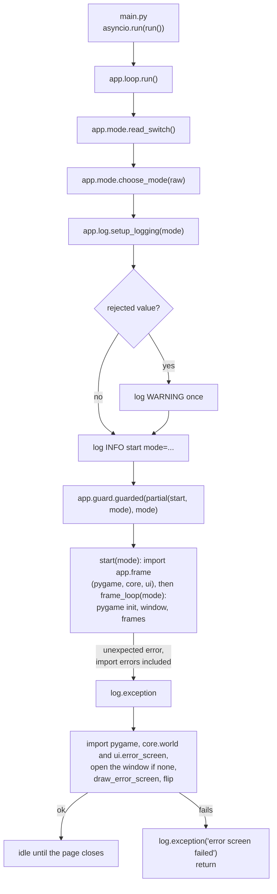
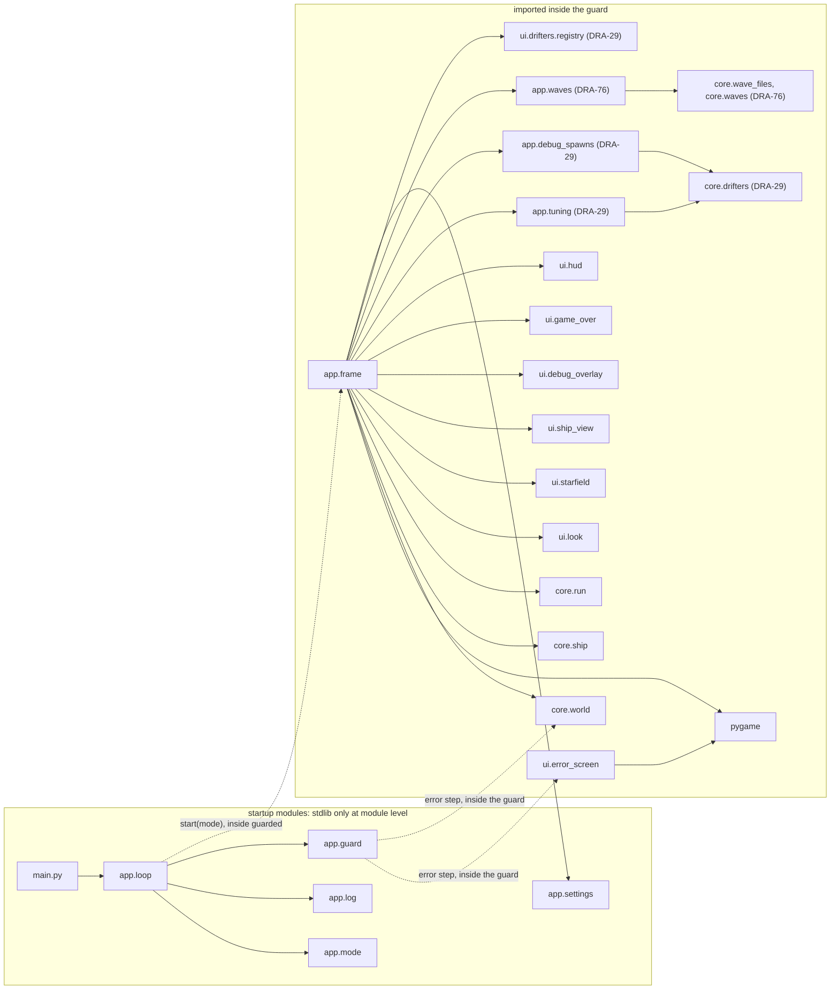
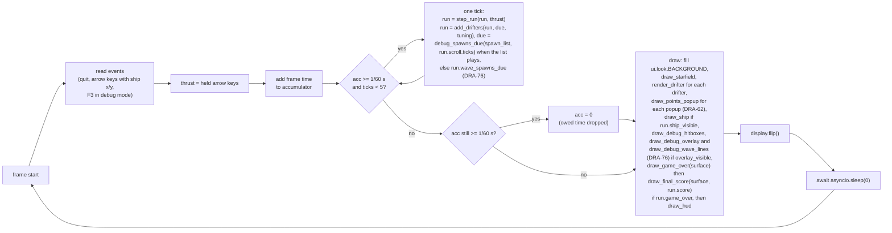

# App, startup
Part of: app
Read when: you change startup, the run mode switch, logging or the import boundary.

## Diagram



Import boundary. Everything above the guard imports only the standard library and other startup modules. pygame, `ui` and `core` are imported for the first time inside the guard.




## Interface

### game/main.py (Integration Engineer)
```python
# /// script
# dependencies = [
#   "pygame-ce",
# ]
# ///
import asyncio

from app.loop import run

asyncio.run(run())
```
Nothing else. No logic, no imports beyond these. The opening block is PEP 723 inline metadata. It is pygbag's documented way to declare packages: pygbag installs only what `main.py` imports or declares, so without it the browser build has no pygame-ce. Any new third-party package goes into this block. Source: Director decision D1 (DRA-5 integration). game/CONTEXT.md, Layout.

### game/app/mode.py (Integration Engineer)
```python
class RunMode(Enum):
    NORMAL = "normal"
    DEBUG = "debug"


@dataclass(frozen=True)
class ModeChoice:
    mode: RunMode
    rejected: (
        str | None
    )  # the switch value that was present but not "1"; None otherwise


def read_switch() -> str | None:
    ...
    # Browser (sys.platform == "emscripten"): the first value of URL query parameter `debug`.
    # Desktop: environment variable DRIFTWARD_DEBUG.
    # None when the switch is absent. Present with an empty value returns "".


def choose_mode(raw: str | None) -> ModeChoice:
    ...
    # Pure. No logging, no I/O.
```

### game/app/log.py (Integration Engineer)
```python
def setup_logging(mode: RunMode) -> None:
    ...
    # The only place that configures logging. Called once, at startup.
    # Installs exactly one handler on the root logger:
    #   browser (sys.platform == "emscripten"): writes each formatted line
    #     with platform.window.console.log
    #   desktop: logging.StreamHandler(sys.stdout)
```

### game/app/settings.py (Integration Engineer)
```python
TICK_RATE: int = 60  # 15-tech-constraints.md, tick_rate
MAX_TICKS_PER_FRAME: int = 5  # 15-tech-constraints.md, max_ticks_per_frame (guess)
```
Constants only. No imports. From DRA-6 the screen size lives in `core/world.py` (`SCREEN_W`, `SCREEN_H`), and `SCREEN_SIZE` is removed from here. See Impact.

## Rules

Startup (`app.loop.run`), in this order:
1. `raw = read_switch()`, then `choice = choose_mode(raw)`. Source: 15-tech-constraints.md, rule 7 (read once, at launch).
2. `setup_logging(choice.mode)`. Source: game/CONTEXT.md, Logging.
3. If `choice.rejected is not None`: one WARNING, `debug switch value %r is not 1, using normal mode`. Source: 15-tech-constraints.md, debug_switch_other_value.
4. One INFO line: `start mode=%s` with `choice.mode.value`. In the console this reads like `12:00:01 INFO app.loop: start mode=debug`. Source: DRA-5 scope report, Player sees.
5. `await guarded(functools.partial(start, choice.mode), choice.mode)`. Everything after logging setup runs inside the guard: importing `app.frame` (and through it pygame, `core` and `ui`), pygame init, the window and the loop. Source: 15-tech-constraints.md, rule 8. Director decision (DRA-5 close-out: import errors must be logged and show the error screen).

Import boundary:
- Startup modules are `main.py`, `app/loop.py`, `app/mode.py`, `app/log.py`, `app/guard.py` and `app/settings.py`. At module level they import only the standard library and each other. Never pygame, `ui`, `core` or `app.frame`. pygbag's built-in `platform` module counts as standard library here. Source: Director decision (DRA-5 close-out).
- pygame, `ui` and `core` are first imported inside the guard: by `start()` through `app.frame`, or by the guard's error step. So an import error in any of them is caught by the guard, after logging is set up.
- `main.py` keeps its exact text above: the PEP 723 block, `import asyncio`, `from app.loop import run`, `asyncio.run(run())`. Source: Director decisions D1 and DRA-5 close-out.
- What runs before the guard is limited to stdlib-only code: the startup module imports, `read_switch`, `choose_mode` and `setup_logging`. Errors there can't reach the guard. See Rationale.

Run mode (`choose_mode`):
- `None` (switch absent): normal, `rejected=None`, no log. Source: 15-tech-constraints.md, run_mode_default, debug_switch_other_value.
- `"1"`: debug. Source: 15-tech-constraints.md, debug_switch_browser, debug_switch_desktop.
- Any other string, including `"0"` and `""`: normal, `rejected=<that string>`. Source: 15-tech-constraints.md, debug_switch_other_value.
- The mode never changes after startup. Source: 15-tech-constraints.md, rule 7.
- In the browser only the URL is read. On desktop only the env var is read. They never conflict.

Logging (`setup_logging`):
- Root logger level: INFO in normal mode, DEBUG in debug mode. Source: 15-tech-constraints.md, log_level_normal, log_level_debug.
- Exactly one handler on the root logger. Any handler set up before it is replaced. Source: game/CONTEXT.md, Logging.
  - Browser (`sys.platform == "emscripten"`): each formatted line goes to the devtools console through `platform.window.console.log`, at every level. pygbag sends stdout and stderr only to its hidden terminal, so this is the only way the lines reach the console. Source: Director decision D2 (DRA-5 integration). game/CONTEXT.md, Browser.
  - Desktop: a `StreamHandler` on `sys.stdout`.
- Format `%(asctime)s %(levelname)s %(name)s: %(message)s`, date format `%H:%M:%S`. That gives `HH:MM:SS LEVEL logger: message`. Same format and levels on both targets. Source: 15-tech-constraints.md, log_format.
- No other code calls `basicConfig`, adds a handler or sets a level. Source: game/CONTEXT.md, Logging.
- Log by event, never by tick. Source: 15-tech-constraints.md, rule 9.
