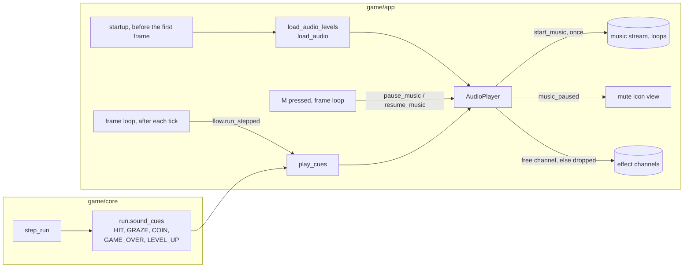

# Audio: the music loop, the effects and their levels
Version: 0
Status: draft
Features: DRA-158, DRA-159
Created by: architect

## Purpose
The game's sound. One looping song plays from the first frame on: the menu, a run, the pause and the game-over screen. Only the M key stops it, and the same key resumes it from the same spot. Five effects play on game events: hit (every life lost), graze (a graze pays), coin (a coin is collected), game over (the last life is lost) and level up (the level-up banner starts). Effects may overlap and never mute. Every loudness is a master times a per-sound level, all read from one tuning file.

The rules that say when an effect plays are core: the run names, for each tick, the sound cues that tick produced (`docs/contracts/systems/run.md`, Interface and Rules, Sound cues). Playing a sound is not a game rule and never a drawing, so it lives in `game/app/`: one audio player the frame loop owns, which opens the mixer, loads the six files once, plays the loop and plays each cue. Core never imports the player. The player never changes the run.

The music is one stream owned by one object. That object also holds the mute: it pauses the stream where it is and resumes it from the same spot. The mute is a sound setting, not a game rule and not saved: it lives in the player, core never sees it, and the app's key handler flips it (`docs/contracts/systems/app/frame-loop.md`, Rules, Music mute). The icon that shows it is a view: `docs/contracts/systems/mute-icon.md`.

## Diagram


## Interface
Existing signatures are read from the code. Only what this feature adds.

### game/core/sound_cue.py (new)
Imports: stdlib only. Never pygame, `ui` or `app`. A constants-and-enum module: it logs nothing.
```python
class SoundCue(Enum):
    """A sound the game wants to play. Names an event, never a file."""
    HIT = "hit"      # a life was lost
    GRAZE = "graze"  # a graze paid
    COIN = "coin"    # a pickup was collected
    GAME_OVER = "game_over"  # the last life was lost: the ship bursts
    LEVEL_UP = "level_up"    # the level-up banner started
```
`Run` gains one field, `sound_cues`. Its shape and rules are in `docs/contracts/systems/run.md`, Interface (DRA-158) and Rules (Sound cues). `level_up_cue` stays as it is; the LEVEL_UP cue is added on the same tick (Rules, Sound cues).

### game/app/audio_tuning.py (Integration Engineer)
Not a startup module, but it imports no pygame: only `app.frame` imports it, inside the guard.
```python
AUDIO_FILE: str  # "audio.json", in app.tuning.TUNING_DIR

@dataclass(frozen=True, slots=True)
class AudioLevels:
    music_master: float    # percent, 0..100
    effects_master: float  # percent, 0..100
    loop_level: float      # percent, 0..100
    hit_level: float       # percent, 0..100
    graze_level: float     # percent, 0..100
    coin_level: float      # percent, 0..100
    game_over_level: float # percent, 0..100
    level_up_level: float  # percent, 0..100
    effect_channels: int   # effects that can sound at once, >= 1

def load_audio_levels() -> AudioLevels: ...
    # Reads TUNING_DIR / AUDIO_FILE once at startup, in both run modes. Checks every rule of
    # docs/contracts/schemas/audio.schema.json by hand. Raises on a bad file.
```

### game/app/audio.py (Integration Engineer)
Imports pygame, `core.sound_cue`, `app.audio_tuning`. Imported only by `app.frame`, inside the guard.
```python
AUDIO_DIR: Path  # game/assets/audio/. Holds music_loop.ogg, sfx_hit.ogg, sfx_graze.ogg, sfx_coin.ogg, sfx_game_over.ogg, sfx_level_up.ogg

class AudioPlayer:
    """The one owner of the music stream and the effect sounds."""
    def start_music(self) -> None: ...
        # Starts the loop from its beginning, looping with no end. Called once, before the first frame.
        # Calling it again is a no-op: the loop never restarts.
    def pause_music(self) -> None: ...
        # DRA-159. Pauses the music stream where it is. A no-op when already paused or not yet started.
        # Never touches an effect.
    def resume_music(self) -> None: ...
        # DRA-159. Continues the music stream from the spot where it was paused, never from the start.
        # A no-op when not paused. Never touches an effect.
    @property
    def music_paused(self) -> bool: ...
        # DRA-159. True from pause_music until resume_music. False at load and after start_music.
        # The one source of "the music is muted": the frame loop and the icon read it, nothing keeps a copy.
    def play_cues(self, cues: tuple[SoundCue, ...]) -> None: ...
        # Plays each cue, in order, on a free effect channel. Never blocks. Never raises for a busy mixer.

def load_audio(levels: AudioLevels) -> AudioPlayer | None: ...
    # Opens the mixer, sets the effect channel count to levels.effect_channels, loads the six files once,
    # sets every volume once (Rules, Loudness). Returns None, after one WARNING, when the mixer cannot
    # start. A missing or unreadable file raises.
```
The frame loop's startup order, the tick hook and the app state are in `docs/contracts/systems/app/frame-loop.md` (DRA-158 lines). The browser checks are in `docs/contracts/systems/app/integration-checks/DRA-158.md`.

### game/tuning/audio.json (content: the main session)
Its fields are in `docs/contracts/schemas/audio.schema.json`. The main session writes it from the schema and the architect's hand-back. The six files move from `staging/assets/audio/` to `game/assets/audio/` when the Director approves them.

## Rules
Values: every level is in `docs/design/gdd/12-art-and-audio.md`, `audio_levels` (guess), and lives only in `game/tuning/audio.json`. Never in code. The format is `audio_format` in `docs/design/gdd/15-tech-constraints.md`.

**Which sounds**
1. One loop and five effects, no more: hit, graze, coin, game over, level up. No sound for menus or buttons. Source: `12-art-and-audio.md`, `sound_list`; scope report DRA-158, Limits.
2. The hit plays on every life lost, by a drifter or by a fall, the last life included. A protected fall or a protected touch loses no life and plays nothing. Source: scope report DRA-158, Feature and Decision log; `91-decision-log.md`, row 145.
3. The graze plays when a graze pays, once per paid graze. The coin plays when a pickup is collected. Source: `12-art-and-audio.md`, `sound_list`; `06-scoring.md`, `graze_sound`.
4. The game-over sound plays once, on the tick the last life is lost, right after that tick's hit. The level-up sound plays once, on the tick the level-up banner starts. Neither plays at any other time. Source: Director (2026-11-07); `12-art-and-audio.md`, `sound_list`, rule 15; `02-game-flow.md`, rule 8.

**The music**
5. The loop starts once, before the first frame, and loops with no end. Nothing in the app stops, restarts or fades it but the mute (rules 19 to 22): not a screen change, the pause, the lost focus, the last life, game over, retry or a new run. Source: `12-art-and-audio.md`, `sound_list`; `02-game-flow.md`, rule 13; scope report DRA-158, Feature.
6. No sound plays before the player's first click or key press on the start page. The start page waits for that gesture and only then lets the game run, so the loop starts on the first frame the game draws and no effect can sound earlier. The app opens no sound on its own, earlier. If a real browser still blocks the loop after the page's gesture, the Integration Engineer reports it and stops: that is a contract change, not a fix. Source: `15-tech-constraints.md`, rule 3; `02-game-flow.md`, rule 1.
7. The music is one stream, held, started, paused and resumed by the `AudioPlayer` alone. No other code touches it. Source: scope report DRA-158, Limits; scope report DRA-159, Feature; `02-game-flow.md`, rule 13.
8. The effects never read, stop or change the music, and the music never reads, stops or changes an effect. Source: `02-game-flow.md`, rule 13 ("The effects never mute"); scope report DRA-158, Limits.

**The effects**
9. Effects overlap. Each cue plays on its own free channel, so two cues on one tick, or a cue over a sound still playing, all sound. The same sound may overlap itself. Source: scope report DRA-158, Decision log (Director: effects overlap).
10. The number of channels is `effect_channels`, and only effects use them. When no channel is free the cue is dropped, one DEBUG line says so, and no playing sound is cut. Source: scope report DRA-158, Values needed (how many effects at once: the Architect sets it).
11. Cues are played in the order the run listed them, on the tick that produced them. The app plays the cues of a tick only when the flow stepped the run on it (`flow.run_stepped`). Source: `docs/contracts/systems/game-flow.md`, Rules (`run_stepped`).

**Loudness**
12. A sound's volume is its master's percent over 100 times its own level's percent over 100: `music_master` with `loop_level` for the loop, `effects_master` with `hit_level`, `graze_level`, `coin_level`, `game_over_level` or `level_up_level` for an effect. It is a number from 0 to 1 and is set once, at load. The code never sets a volume above 1. A sound that is too quiet at its top level gets a louder file, never a bigger number. Source: `12-art-and-audio.md`, `audio_levels`; scope report DRA-158, Values needed (hit).
13. Every level, both masters and the channel count are config, never hard-coded. Source: Director (everything configurable); scope report DRA-158, Limits.

**Loading and failure**
14. The file is read once at startup in both run modes. A missing file raises `FileNotFoundError`. A missing, unknown or badly typed field, a value outside its range, or invalid JSON raises `ValueError` naming `tuning/audio.json` and the field. A number is an `int` or a `float` as the schema says, never a `bool`. The page shows the error screen and the log names the file and the field. Source: `game/CONTEXT.md`, Error handling; `15-tech-constraints.md`, rule 8.
15. A missing or unreadable sound file raises inside the guard, like every asset. Source: `game/CONTEXT.md`, Error handling.
16. A mixer that cannot start (no sound device) is a problem the game recovers from: `load_audio` logs one WARNING and returns None, and the frame loop plays nothing, with no further line. The game runs silent. Source: `game/CONTEXT.md`, Logging (WARNING), and the saves' precedent (`docs/contracts/systems/app/save-storage.md`).
17. Sounds load once at startup and are kept; no file is read or decoded during play. No blocking call, no thread. Source: `15-tech-constraints.md`, rules 1 and 5.
18. The app plays sound on the frame loop's tick, and the sound itself never changes a game rule: no tick, no state and no draw depends on it. Source: `15-tech-constraints.md`, rule 2.

**The mute**
19. The mute is the music's pause. M flips it: muted, the stream is paused where it is; pressed again, the stream resumes from the same spot, never from the start. The loop is never restarted, so `start_music` is never called a second time. Source: scope report DRA-159, Feature; `02-game-flow.md`, `mute_key` and rule 13.
20. Only the music mutes. An effect plays on its cue while the music is muted, at the same level, on the same channels. Muting or unmuting never reads, stops or changes an effect. Source: `02-game-flow.md`, `mute_key` ("The effects always play"); scope report DRA-159, Limits.
21. The mute is not saved. No file, no localStorage key, no schema field holds it. A page load always starts unmuted: `music_paused` is False at load. Source: `02-game-flow.md`, `mute_key`; `91-decision-log.md`, row 144; `01-vision.md`, Locked decisions, rule 9.
22. The mute stays on across screens and runs: no screen change, pause, lost focus, game over, retry or new run unmutes it. Only M does. Source: scope report DRA-159, Feature; `02-game-flow.md`, rule 13.
23. A player with no mixer (`load_audio` returned None) has no music and no mute: M does nothing, and no icon shows. Source: `10-ui.md`, `mute_icon_look`; `91-decision-log.md`, row 148; rule 16.
24. Whether the browser's music pause resumes from the same spot is not known. The Integration Engineer proves it in the browser (`docs/contracts/systems/app/integration-checks/DRA-159.md`). If the browser resumes from the start, or drops the music, the Integration Engineer reports and stops: that is a contract change, not a fix. Source: `15-tech-constraints.md`, rule 3; `02-game-flow.md`, rule 13.

**Logging** (logger `app.audio` and `app.audio_tuning`, by event). Source: `game/CONTEXT.md`, Logging; `15-tech-constraints.md`, rule 9.
- INFO `audio loaded music_master=%g effects_master=%g loop_level=%g hit_level=%g graze_level=%g coin_level=%g game_over_level=%g level_up_level=%g effect_channels=%d`: once, after a good load of the file.
- WARNING `audio off: %s` with the mixer's message: once, when the mixer cannot start.
- DEBUG `music start`: once.
- DEBUG `music pause`: once per `pause_music` that changes the state. DEBUG `music resume`: once per `resume_music` that changes the state. A no-op call logs nothing. (DRA-159)
- DEBUG `sound play cue=%s` with the cue's value: once per cue played.
- DEBUG `sound dropped cue=%s`: once per cue dropped for want of a channel.
- Nothing else. No line per tick or per frame.

## Rationale
- **The run names the cues, the app plays them.** Core owns when a life is lost, a graze pays or a pickup is collected, and must stay free of pygame. A cue list on the run, like `level_up_cue`, lets core and its tests state exactly which sounds a tick asks for, with no sound device. Diffing the run in the app (lives, grazes) would put a rule in the app and could not tell a coin from a graze.
- **A list per tick, not a flag per sound.** Two grazes can pay on one tick and each is a graze; a flag would play one. The order is the step order, so the sound order matches what the player sees.
- **Played only after a stepped tick.** A paused run is frozen, not rebuilt: its last cues would be read on every paused tick. `run_stepped` already tells the app when the run moved, and it is how the due drifters are added. One more reader of the same flag costs nothing.
- **Audio lives in `game/app/`.** Asset loading and the async loop belong there (`game/CONTEXT.md`, Layout), and a sound is neither a rule nor a picture. Putting the player in `ui` would make a view play sounds; in `core` it would import pygame.
- **One player, one music stream.** The Director wants a mute that resumes from the same spot (`02-game-flow.md`, rule 13). The loop is one stream held by one object and started once, so the mute is a pause and a resume on that object. The effects use their own channels and their own volume, so a music-only mute cannot touch them. Streaming the loop through the mixer's music stream, not a long sound on a channel, also keeps its 78 s out of the effect channel pool.
- **Effect channels in config, with a drop on overflow.** Overlap is wanted, but a mixer has a fixed number of channels. A busy moment (several grazes at once) should add sounds, never cut the one already playing, so a cue with no free channel is dropped and logged.
- **Volume set once.** The levels never change during play in this feature, so each volume is computed at load, not per cue. A later volume control would add a method; nothing here blocks it.
- **Louder file, not a bigger number.** The mixer caps volume at 1. The hit's file peaks low on purpose: if 100% is too quiet, the file is made louder before it ships.
- **Mixer failure is silent, a bad file is loud.** A machine with no sound device is the player's setup, not our bug, and the game plays fine without sound. A missing file or a bad config is our bug and must show, like every other asset.
- **The mute is a pause, not a zero volume.** The Director wants the music to resume where it stopped. A music at volume 0 keeps playing, so it would come back at a later spot. A pause holds the spot.
- **The mute lives in the player, not in core.** It is a sound setting: no rule, tick or save depends on it (rule 18). Putting it in core would make core hold a sound flag and take the M key as tick input for no rule's sake. The debug overlay's `overlay_visible` is the precedent: the app owns a view setting and the draw reads it. The icon reads `music_paused` through a parameter of the draw call, never by importing the player. The icon is drawn before the dim of the pause and game-over screens, so the dim darkens it (`docs/contracts/systems/mute-icon.md`, Rule 11).
- **No mixer, no mute.** With no sound device there is no music to mute, and an icon claiming a mute would be wrong.
- **Start on the first frame.** The start page already holds the game until the gesture, so the app needs no gesture logic of its own. A second gate in the app would make the first press count twice.
