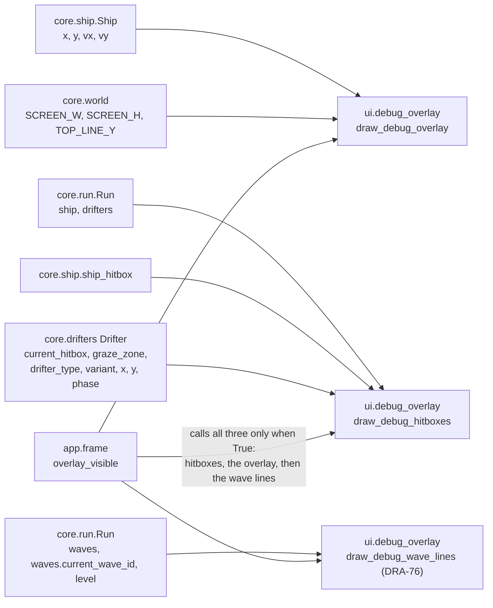

# Debug overlay
Version: 4
Status: draft
Features: DRA-6, DRA-13, DRA-19, DRA-29, DRA-76
Created by: architect

## Purpose
In debug mode, show the ship's numbers, the current wave and the level, and the lines the rules use, so the drift and the wave flow can be read and tuned. It also outlines every hitbox (the ship's and each drifter's) and every hazard's graze zone, and labels each drifter with its name, variant, x, y and phase, so start positions and touches can be checked. The view only reads core state. Whether it shows is decided by the app.

The overlay also tells the HUD where its text ends, so the HUD can sit below it with no overlap (`docs/contracts/systems/hud.md`).

Who builds what:
- `game/ui/debug_overlay.py`: the UI Developer, task `DRA-6-04-ui-developer`. `overlay_text_bottom()`: task `DRA-13-03-ui-developer`. No `-0.00` in DRA-19: task `DRA-19-02-ui-developer`. `draw_debug_hitboxes()` in DRA-29: task `DRA-29-06-ui-developer`. `draw_debug_wave_lines()` and the six-line `overlay_text_bottom()`: task `DRA-76-06-ui-developer`.
- `overlay_visible` and the F3 toggle, and calling both draw functions: the Integration Engineer, in `game/app/frame.py`, from `docs/contracts/systems/app.md`.

## Diagram


The six text lines (DRA-76), top-left, each one line-height below the last:
```
x 320.00          line 1
y 240.00          line 2
vx 0.00           line 3
vy 0.00           line 4   (draw_debug_overlay draws 1 to 4)
wave l1_a         line 5   (draw_debug_wave_lines draws 5 and 6)
level 1           line 6   wave line: `wave <id>`, `wave rest`, or `wave none`
                  overlay_text_bottom()
```

```
   meteorite warning: glow at the top edge        active: outlines follow the rock
   +-----------------------------------------+     .--.  graze zone (r + 14)
   |                 (*)                     |    ( () )  hitbox (r)
   |meteorite medium x 320.00 y -14.00 warning|    '--'
   |                                         |    meteorite medium x 320.00 y 120.00 active
```

## Interface
```python
# game/ui/debug_overlay.py
# Imports: pygame, core.ship, core.world, core.run, core.drifters.base, ui.shapes (DRA-29).
# Never app. Never reads the run mode.
OVERLAY_COLOR: tuple[int, int, int] = (0, 255, 0)   # 10-ui.md, debug_overlay_color (guess)
OVERLAY_FONT_SIZE: int = 16                         # 10-ui.md, debug_text_font: default font, 16 (guess)
OVERLAY_MARGIN: int = 4                             # 10-ui.md, debug_overlay_layout: text 4 px from left and top (guess)
OVERLAY_TEXT_LINES: int = 6                         # DRA-76. 10-ui.md, debug_overlay_layout: six lines (guess)

def draw_debug_overlay(surface: pygame.Surface, ship: Ship) -> None: ...   # unchanged: lines and text lines 1 to 4

def draw_debug_wave_lines(surface: pygame.Surface, run: Run) -> None: ...   # DRA-76
    # Text lines 5 and 6: the wave and the level.

def overlay_text_bottom() -> int: ...       # DRA-13, six lines from DRA-76
    # The first screen row below every pixel the six text lines can cover:
    # OVERLAY_MARGIN + (OVERLAY_TEXT_LINES - 1) * linesize + max(linesize, font height),
    # from the overlay's own font.

def draw_debug_hitboxes(surface: pygame.Surface, run: Run) -> None: ...   # DRA-29
    # Outlines every hitbox and graze zone, and labels every drifter.
```

## Presentation
`draw_debug_overlay` reads only these core fields and constants. Unchanged in DRA-29.

| Core field | Shown as |
|---|---|
| `ship.x` | text line 1, `x <value>` with two decimals, e.g. `x 320.00`. Source: 10-ui.md, debug_overlay, debug_overlay_layout (guess) |
| `ship.y` | text line 2, `y <value>`, e.g. `y 240.00` |
| `ship.vx` | text line 3, `vx <value>`, e.g. `vx 0.00` |
| `ship.vy` | text line 4, `vy <value>`, e.g. `vy 0.00` |
| `TOP_LINE_Y` | a 1 px horizontal line, the full surface width, on row `TOP_LINE_Y` (168). Source: 10-ui.md, debug_overlay_layout; 03-world-and-camera.md, rule 2 |
| `SCREEN_H` (the floor) | a 1 px horizontal line, the full surface width, on row `SCREEN_H - 1` (479). Source: 10-ui.md, debug_overlay_layout; 03-world-and-camera.md, rule 5 |

- Text layout: line 1's top-left at (`OVERLAY_MARGIN`, `OVERLAY_MARGIN`), (4, 4). Each next line's top is one `font.get_linesize()` lower. Source: 10-ui.md, debug_overlay_layout (guess).
- Numbers use `f"{value:z.2f}"`: two decimals, a minus sign for negatives, and never `-0.00`. Source: 10-ui.md, debug_overlay_layout; scope report DRA-19, item 3.
- All text and lines in `OVERLAY_COLOR`, (0, 255, 0). Text in the default font at 16 px, antialiased. Source: 10-ui.md, debug_overlay_color, debug_text_font (guess).
- Line width uses `surface.get_width()`. Draw order: the two lines, then the text.
- `overlay_text_bottom()` is in screen px and the same whether the overlay is shown or hidden. From DRA-76 it covers all six text lines: line 6 has its top at `OVERLAY_MARGIN + 5 × linesize`, and the function returns the row just below the lower of the end of its line slot and the end of its rendered text. So no text pixel of lines 1 to 6 is on that row or below it, whatever lines 5 and 6 say. Source: scope report DRA-13, HUD layout; 10-ui.md, debug_overlay_layout (six lines, guess).

`draw_debug_wave_lines` (DRA-76) reads only these core fields:

| Core field | Shown as |
|---|---|
| `run.waves` is None | text line 5, `wave none`: no waves play (the debug test spawn list). Source: 10-ui.md, debug_overlay_layout ("while the test spawn list plays it reads `wave none`", guess) |
| `run.waves.current_wave_id` | text line 5, `wave <id>`, e.g. `wave wave_0`, `wave l1_b`; `wave rest` while it is None (a rest gap). Source: 10-ui.md, debug_overlay ("the current wave id"), debug_overlay_layout ("During a rest gap the wave line reads `wave rest`", guess) |
| `run.level` | text line 6, `level <n>`, e.g. `level 1`. With no waves it reads `level 1`. Source: 10-ui.md, debug_overlay ("and the level"), debug_overlay_layout (guess); scope report DRA-76, Limits ("the level stays 1") |

- Place: line 5's top-left at (`OVERLAY_MARGIN`, `OVERLAY_MARGIN + 4 × linesize`), line 6's at (`OVERLAY_MARGIN`, `OVERLAY_MARGIN + 5 × linesize`), with the overlay's own cached font: right under `vy`, in the same column and spacing as lines 1 to 4. Source: 10-ui.md, debug_overlay_layout.
- Look: the same as lines 1 to 4: the overlay's font (default, 16 px), antialiased, `OVERLAY_COLOR`. The words `wave`, `level`, `rest` and `none` are lowercase, one space before the value. The wave id is shown exactly as it is, never cut. Source: 10-ui.md, debug_overlay_layout, debug_text_font, debug_overlay_color (guess); scope report DRA-76, Not in GDD (same font and color).
- The view works nothing out: `wave none` comes from `run.waves` being None, `wave rest` from `current_wave_id` being None, and the level from `run.level`. It never reads the wave book, the playlist or the scroll.
- The two lines are rendered each frame, like lines 1 to 4. Only the font is cached. The view only draws: it never fills, flips, logs per frame, catches an error, changes the run or reads the run mode.

`draw_debug_hitboxes` (DRA-29) reads only these core fields and methods:

| Core field or method | Shown as |
|---|---|
| `ship_hitbox(run.ship)` | the ship's two boxes, outlined 1 px. Drawn whether or not the ship is visible this frame: the blink is a look, the hitbox stays. Source: 10-ui.md, debug_overlay ("the outline of every hitbox (ship and drifters)", guess); 05-lives-and-damage.md, Edge cases |
| `obj.current_hitbox()`, each obj in `run.drifters` | each shape outlined 1 px. Empty while the warning shows, so nothing is drawn then. Source: 10-ui.md, debug_overlay; drifters.md, Rules (no hitbox in WARNING) |
| `obj.graze_zone()` | each shape outlined 1 px. Only hazards have one. Source: 10-ui.md, debug_overlay ("and graze zone"); 06-scoring.md, rule 3 |
| `obj.drifter_type.value`, `obj.variant`, `obj.x`, `obj.y`, `obj.phase.value` | one text label per drifter: `<type> <variant> x <x> y <y> <phase>`, e.g. `meteorite medium x 320.00 y -14.00 warning`. Source: 10-ui.md, debug_overlay ("a label on each drifter: its name, variant, x, y and phase (warning or active)", guess) |
| `obj.width`, `obj.height` | where the label goes (below) |

- Outlines: `ui.shapes.draw_hitbox(surface, OVERLAY_COLOR, hitbox, 1)`: a 1 px outline, the same place and rounding as the ship view's filled boxes, so the ship's outline sits exactly on its white edge. Same color and thickness as the overlay's lines. Source: 10-ui.md, debug_overlay_color (guess); debug_overlay_layout (1 px lines).
- Label text: the overlay's own cached font (16 px), antialiased, `OVERLAY_COLOR`. Numbers in `z.2f`, like the four text lines. The phase as its lowercase value, `warning` or `active`.
- Label place: its top-left at the drifter's footprint's bottom-left, `(round(obj.x - obj.width / 2), round(obj.y + obj.height / 2))`, then moved just enough to lie fully on the surface: left into `[0, surface width - label width]`, top into `[0, surface height - label height]` (0 when the label is bigger). So a meteorite still above the screen gets its label against the top edge, next to its warning.
- Draw order inside the view: every graze outline, then every hitbox outline (the ship's first, then each drifter's), then every label. The app then draws `draw_debug_overlay` and `draw_debug_wave_lines` on top, so the six text lines stay readable.
- Nothing is cached per frame but the font. Labels are rendered each frame, like the four text lines.
- The view only draws. It never flips, never logs per frame, never catches an error, never changes the run, never reads the run mode.

## Rules
- Exists only in debug mode. In normal mode it never shows. Source: 10-ui.md, rule 7 and debug_overlay_toggle.
- Shown from the first frame in debug mode. F3 hides or shows it, in debug mode only, all three draw functions together. The app owns this flag. Source: 10-ui.md, debug_overlay_toggle (guess).
- The overlay only reads game state. It never changes it. Source: 10-ui.md, rules 5 and 7.
- Text layout as in Presentation. Source: 10-ui.md, debug_overlay_layout (guess); 91-decision-log.md, row 20.
- The overlay shows the hitbox and graze outlines, the drifter labels, and from DRA-76 the wave and level lines, as the GDD lists. Nothing else: no graze count, no hit marker, no seed, no wave distance. Source: 10-ui.md, debug_overlay; scope report DRA-29, Limits; scope report DRA-76, Limits.
- The six text lines sit above the HUD and never overlap it (`systems/hud.md`). Labels follow their drifter and may cross the HUD or the text for a moment; the HUD is drawn last and stays on top, and the text lines are drawn after the labels. Source: 10-ui.md, rule 1; scope report DRA-13, Decision log.

## Impact
DRA-29 changes this frozen contract (v3). `draw_debug_hitboxes` is new. `draw_debug_overlay` and `overlay_text_bottom` don't change: no signature, text, line, color or layout changes. Every file in `game/` that depends on it, found by grepping `game/` (tests included) for `debug_overlay`, `draw_debug_overlay`, `overlay_text_bottom` and `OVERLAY_`:

| File | Change needed |
|---|---|
| `game/ui/debug_overlay.py` | `draw_debug_hitboxes`, its imports, and the module docstring names it. Task `DRA-29-06-ui-developer`. |
| `game/ui/hud.py` | none. `overlay_text_bottom()` doesn't change. |
| `game/app/frame.py` | calls `draw_debug_hitboxes(surface, run)` right before `draw_debug_overlay` when `overlay_visible`. Integration Engineer, from `systems/app.md`. |
| `game/tests/ui/test_hud.py` | none. It calls only `draw_debug_overlay` and `overlay_text_bottom`, which draw exactly what they drew before. |

DRA-76 changes this frozen contract (v4). `draw_debug_wave_lines` and `OVERLAY_TEXT_LINES` are new; `overlay_text_bottom()` grows by two line-heights; `draw_debug_overlay` and `draw_debug_hitboxes` don't change. In debug mode the HUD moves down by the two lines, through `overlay_text_bottom()`. Grepping `game/` (tests included) for `debug_overlay`, `draw_debug_overlay`, `overlay_text_bottom` and `OVERLAY_`:

| File | Change needed |
|---|---|
| `game/ui/debug_overlay.py` | `OVERLAY_TEXT_LINES`, `draw_debug_wave_lines`, the six-line `overlay_text_bottom`, the module docstring. Task `DRA-76-06-ui-developer`. |
| `game/ui/hud.py` | none in code: it reads `overlay_text_bottom()`. Its contract restates the formula, updated in `systems/hud.md`. |
| `game/app/frame.py` | calls `draw_debug_wave_lines(surface, run)` right after `draw_debug_overlay` when `overlay_visible` (`systems/app.md`). Integration Engineer. Until then lines 5 and 6 are not drawn and the HUD sits two empty line-heights lower in debug mode. |
| `game/tests/ui/test_hud.py` | none. Every place it checks comes from `overlay_text_bottom()` and the drawn pixels of `draw_debug_overlay`, which still draws lines 1 to 4 only. The HUD stays above the top line: six 16 px lines end far above row 168. Must pass unchanged. |

## Rationale
- **A third function for lines 5 and 6 (DRA-76).** `draw_debug_overlay(surface, ship)` and its pixels stay as they were, so the HUD's tests, which measure them, keep working, and the app's call doesn't change. The new lines need the run, as `draw_debug_hitboxes` does. `overlay_text_bottom()` covers all six, so the HUD sits below them whichever functions draw.
- **`OVERLAY_TEXT_LINES` names the six (DRA-76).** The bottom is worked out from the line count, so the next line added to 10-ui.md changes one number.
- **The app passes nothing about the mode.** The app decides whether to call the overlay, so the view stays a pure function of what it is given.
- **A separate contract.** The overlay is its own system in 10-ui.md, and later features add to it without touching the ship contract.
- **`overlay_text_bottom()` lives here.** Only the overlay owns its font.
- **The floor line is on row 479, not 480.** Row 479 is the closest row that can be seen (decision-log row 20).
- **`0.00`, not `-0.00` (DRA-19).** The `z` format option changes only a negative zero after rounding.
- **A second function, not a new argument (DRA-29).** `draw_debug_overlay(surface, ship)` and its pixels stay exactly as they were, so the HUD's no-overlap tests, which measure the overlay's ink, keep working. The new outlines and labels take the run, because they need the ship and the drifters, the same way the HUD takes the run.
- **Outlines before the text (DRA-29).** The DRA-6 rule keeps the four text lines readable where something crosses them. Drawing the outlines and labels first, and the old overlay after, keeps that true.
- **Graze outlines before hitbox outlines (DRA-29).** A graze zone surrounds its hitbox, so drawing the inner outline last keeps it whole where the two are close.
- **The ship has hitbox outlines but no graze outline (DRA-29).** 10-ui.md asks for "the outline of every hitbox (ship and drifters) and graze zone". Graze zones belong to hazards only (06-scoring.md, rule 3), so the ship has none to draw.
- **Labels go under the drifter (DRA-29).** 10-ui.md gives the label's content but not its place. Under the footprint uses only the drifter's own size, keeps the label off the drifter, and the clamp keeps it on the screen for a drifter that is still above the top edge. No new number is needed. The Director may move it.
- **One color for everything (DRA-29).** 10-ui.md gives one overlay color. The graze ring is 14 px wider than the hitbox, so the two read apart without a second color.
- **Every fact the overlay shows is a core field or a core method.** Ship numbers from `core.ship`, line positions from `core.world`, hitboxes, graze zones and labels from the drifters, the wave and the level from the run (DRA-76). The view computes only pixel positions and picks the word for a missing wave (`none` or `rest`) from which core field is None.
