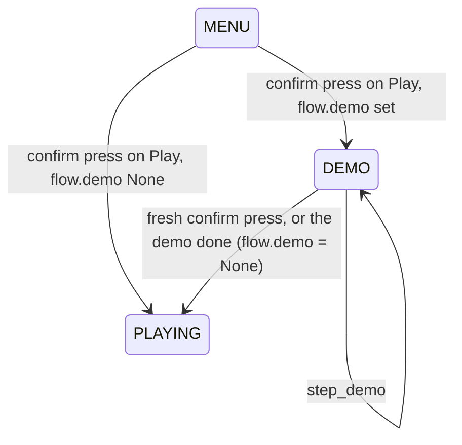

# Demo flight
Version: 0
Status: draft
Features: DEMO-FLIGHT
Created by: main session

## Purpose
A short scripted flight that plays the first time Play is picked after a page load, before the run starts. It shows how the ship drifts and what a coin is: hold up, let go, hover in the middle, steer into a coin, fly back to the middle, then START and the run. A confirm key skips it. A page reload shows it again; nothing is saved.

Four parts make it: `core/demo.py` (the script, the ship and the coin, stepped each tick), a `DEMO` screen in `core/game_flow.py`, `ui/demo_view.py` (the keys, the caption, the skip hint, the fades), and `app/demo_tuning.py` with `game/tuning/demo.json`.

## Diagram


## Interface
```python
# game/core/demo.py (new). Imports: stdlib, core only. Never pygame, ui or app.
@dataclass(frozen=True, slots=True, kw_only=True)
class DemoStep:
    keys: Thrust            # the arrows held through the step
    ticks: int              # >= 1
    caption: str | None     # None: the last caption stays
    stand: bool = False     # the ship stands still, as in the respawn wait
    pilot_to: Spot | None = None   # the autopilot taps the arrows to fly there and hover

@dataclass(frozen=True, slots=True, kw_only=True)
class PilotRules:
    gain: float; max_speed: float; band: float; near_px: float; near_speed: float

@dataclass(frozen=True, slots=True, kw_only=True)
class DemoRules:
    steps: tuple[DemoStep, ...]
    coin_step: int          # index of the step at whose last tick the ship reaches the coin
    coin_type: DrifterType  # a pickup (ACTIVE when born, COLLECT on touch)
    coin_variant: str
    fade_out_ticks: int     # >= 0
    pilot: PilotRules
    key_fade_ticks: int     # >= 1, from look.key_fade_ticks

@dataclass(frozen=True, slots=True, kw_only=True)
class Demo:
    rules: DemoRules
    ship: Ship
    coin: Drifter | None    # None once collected
    popups: tuple[PointsPopup, ...] = ()
    tick: int = 0
    held: Thrust = Thrust() # the arrows the last tick held
    stood: bool = False     # the last tick stood
    glow: tuple[float, float, float, float] = (0, 0, 0, 0)  # up, down, left, right, 0..1
    sound_cues: tuple[SoundCue, ...] = ()   # the last tick's
    points: int = 0         # what the coin paid
    # properties: total_ticks, done, step_index, ticks_in_step, ticks_left, caption, fade (0..1)

def step_at(rules: DemoRules, tick: int) -> tuple[int, int]: ...
def caption_at(rules: DemoRules, index: int) -> str | None: ...
def check_demo_rules(rules: DemoRules) -> None: ...      # ValueError
def autopilot(ship: Ship, spot: Spot, held: Thrust, rules: PilotRules) -> Thrust: ...
def coin_spot(rules: DemoRules) -> tuple[float, float]: ...
def start_demo(rules: DemoRules, tuning: DrifterTuning) -> Demo: ...
def step_demo(demo: Demo) -> Demo: ...

# game/core/game_flow.py, changed.
class Screen(Enum): ...; DEMO = "demo"
class GameFlow: ...; demo: Demo | None = None
def start_flow(run: Run, saves: Saves | None = None, demo: Demo | None = None) -> GameFlow: ...

# game/ui/demo_view.py (new). Imports: pygame, core.demo, core.ship, ui. Never app.
@dataclass(frozen=True, slots=True, kw_only=True)
class DemoLook: ...         # the `look` object of demo.json, one field each
def draw_demo(surface, demo: Demo, rules: DemoLook, look: ScreenLook, ship_look: ShipLook, tick: int) -> None: ...
def draw_fade_in(surface, run_ticks: int, rules: DemoLook) -> None: ...
def key_light(demo: Demo, name: str) -> float: ...
def starting(demo: Demo, rules: DemoLook) -> bool: ...
def caption_age(rules: DemoRules, tick: int) -> int: ...

# game/app/demo_tuning.py (new). Not a startup module.
def load_demo(tuning: DrifterTuning, screen_rules: ScreenRules) -> tuple[DemoRules | None, DemoLook]: ...
```

`game/tuning/demo.json` follows `docs/contracts/schemas/demo.schema.json`.

## Presentation
| Screen | What shows |
|---|---|
| `flow.screen` DEMO | the background and the still starfield, the coin with a pulsing cyan ring, the ship with the flames of the held keys, the points popup, the four arrow key caps (an inverted T, bottom center; a held one lit and sunk), the caption above them, `ENTER SPACE SKIP` top right, then the end fade. The HUD round the play area shows the waiting run, its score the demo's coin points |
| the run after the demo | fades in from black over `fade_in_ticks` |

## Rules
- **Once per page load.** The app builds one `Demo` before the first frame and hands it to `start_flow`. Play enters DEMO while `flow.demo` is set. Leaving DEMO sets it to None, so later Plays and retries go straight to PLAYING. `enabled: false` in demo.json gives no demo.
- **Step.** Each DEMO tick is one `step_demo`. The run is not stepped and adds no drifters. The player's arrows do nothing. A focus loss does nothing.
- **Skip.** A fresh confirm press (02-game-flow.md, rule 12) enters PLAYING at once. The press that picked Play is held, so it never skips.
- **End.** The tick after the last step, the flow enters PLAYING.
- **Ship.** The real `core.ship.step`, no ground, no wells. A key step holds its keys. A standing step leaves the ship as it is. An autopilot step (`pilot_to`) holds what `autopilot` picks each tick: each axis wants a speed toward the spot (distance times `gain`, capped at `max_speed`, sideways 1.5 times); a key goes down when the speed strays past the wanted one by `band` and up once it strays `band` the other way, so taps last a few ticks; down only brakes a climb well past the wanted speed; no side key while within `near_px` and slower than `near_speed` sideways. Only real arrows: the ship is always `step(ship, held)`.
- **Glow.** Each tick every arrow's glow moves 1/`key_fade_ticks` toward 1 when held, toward 0 when free. The view eases it (smoothstep).
- **Start word.** In the last `start_ticks` the start word shows at `start_y` instead of the caption, fading in and shrinking from `start_scale` over `start_pop_ticks`. The HUD's score shows 0 from then on.
- **Coin.** Born with `spawn_drifter` at `coin_spot`: the ship's center after flying the steps up to and including `coin_step`. The world doesn't scroll, so the coin stays put; it still updates (its frames turn). When the ship's hitbox overlaps it: the coin goes, its popup starts, `SoundCue.COIN` plays, `points` rises by its points. `start_demo` refuses a type that isn't an ACTIVE pickup.
- **Fade.** `fade` is 0 until the last `fade_out_ticks`, then rises to 1. The view lays black over the play area by it. The run after the demo fades in from black over its first `fade_in_ticks` (scroll ticks); the app tracks that run with `after_demo`, cleared once the screen is neither PLAYING nor PAUSED.
- **Caption.** It fades in and rises by `caption_rise` px over `caption_fade_ticks` whenever it changes.
- **Sound.** The app plays `flow.demo.sound_cues` after each tick on DEMO.
- **Logging.** DEBUG `demo ready`, `demo coin collected`, `demo end by=key|time`; INFO `demo loaded` at startup and `screen demo` on entry.

## App
`game/app/frame.py`, both modes. Before the first frame, after `load_tuning()` and `load_screen_rules()`: `demo_rules, demo_look = load_demo(tuning, screen_rules)`, then `demo = start_demo(demo_rules, tuning)` when `demo_rules` is not None, passed as `start_flow(run, saves, demo)`. In the tick, after the run's cues: `if audio is not None and flow.screen is Screen.DEMO and flow.demo is not None: audio.play_cues(flow.demo.sound_cues)`. After a frame's ticks, `after_demo` turns True when the screen went from DEMO to PLAYING, False once it is neither PLAYING nor PAUSED. Draw on DEMO: `draw_background(field, ...)`, `draw_starfield(field, flow.run.scroll)`, `draw_demo(field, flow.demo, demo_look, look, ship_look, ticks)`, then `hud.draw` with `flow.run` whose `coin_points` is `flow.demo.points`, then the mute icon. On PLAYING, PAUSED and GAME_OVER with `after_demo`, `draw_fade_in(field, flow.run.scroll.ticks, demo_look)` right after the run's world.

## Rationale
The demo flies the real physics so what the player sees is how the ship feels. The autopilot hovers by tapping up, the way a player does, so the hover and the flight back to the middle teach as well. Ending at rest in the middle, where a run starts, lets the run follow with no fade. The coin is placed on the path rather than at a fixed spot, so a change to the ship's values can never make the demo miss it.
