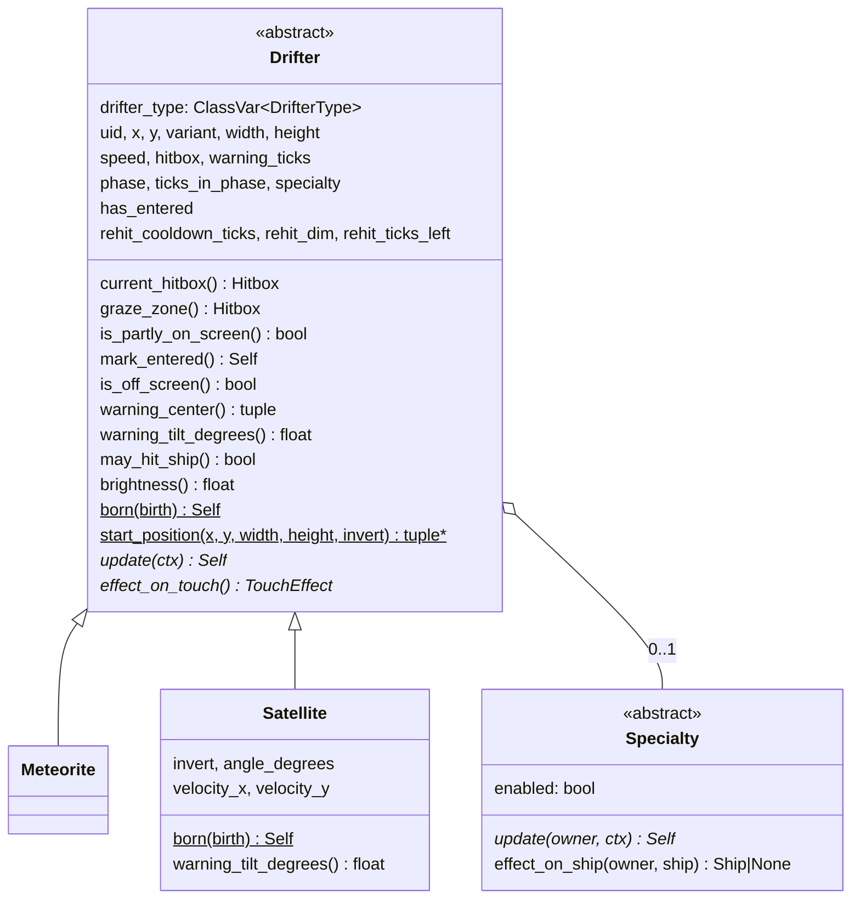
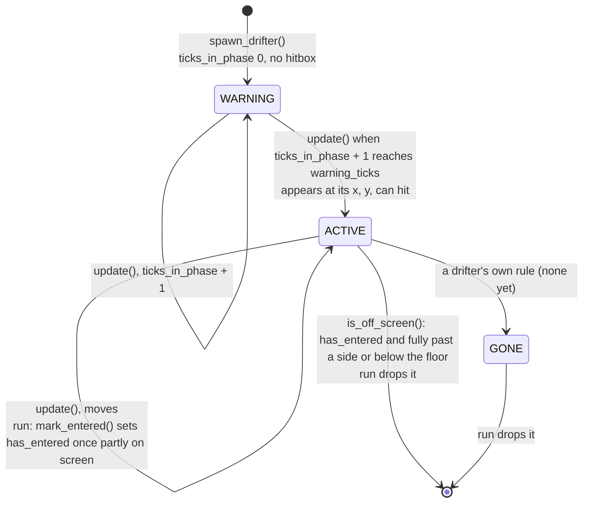
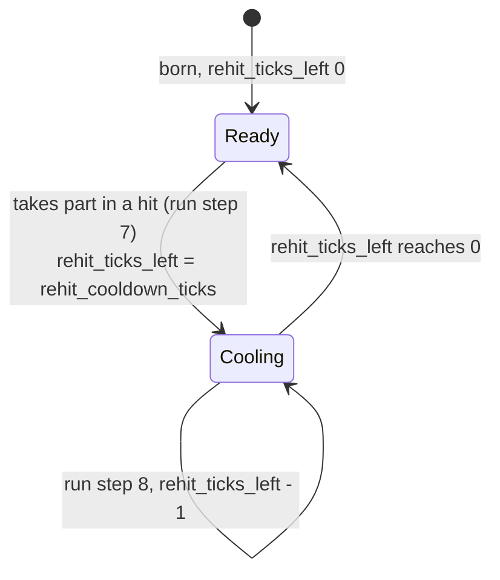
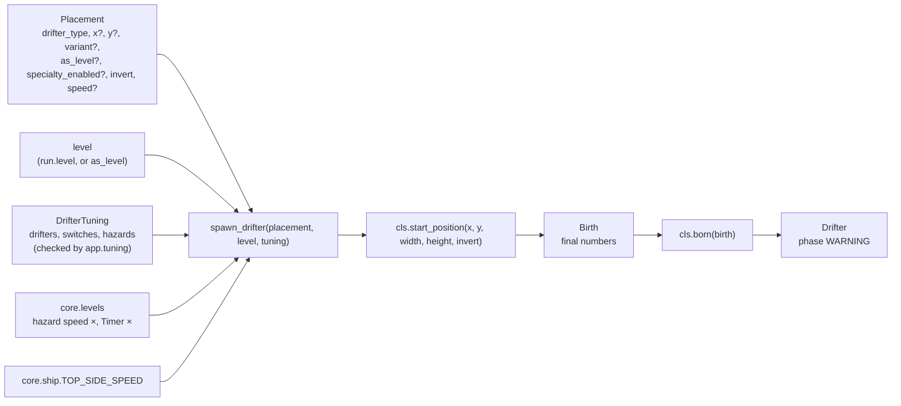
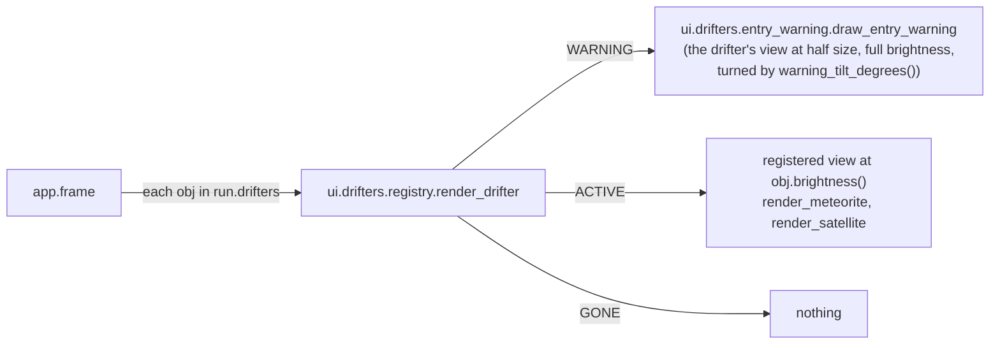

# Drifters: base, hitboxes, levels, spawner, the meteorite, the satellite, the chain lightning and their views
Version: 2
Status: frozen
Features: DRA-29, DRA-39, DRA-47
Created by: architect

## Purpose
Every drifter in the game (hazards first, coins and the rest later) is built on one shared base. This contract holds that base, the hitbox shapes and their overlap test, the level table the spawner reads, the spawner (the only way a drifter is created), the drifters built so far (the meteorite and the satellite), and the views that draw drifters and their entry warnings.

The base holds the rules every drifter shares: the entry warning, the hitbox, the graze zone, when a drifter has entered the screen and when it has left it, and the re-hit cooldown with its dim look. A drifter carries final numbers only. The spawner reads the level and the shared hazard values once, at birth, and sets the drifter's speed and cooldown length. The drifter never knows the level. The run (`docs/contracts/systems/run.md`) holds the drifters, updates them every tick, marks when each has entered, tests them against the ship, starts and counts down their cooldowns, and drops them when they leave.

Structure chosen by the Director (scope report DRA-29, Limits and Decision log): inheritance, a thin abstract base, one subclass per drifter, one level deep, no middle classes. Shared bits are helper functions. Guards: abstract methods, a registry that refuses duplicates, a test that the drifter list, the tuning files, the classes and the views all match, and collision tests that fail when a shape kind has no cases (scope report DRA-39, Limits).

Who builds what:
- `game/core/collision.py`: the Gameplay Implementer, task `DRA-29-01-gameplay-implementer`. Unknown shape kinds raise: task `DRA-39-01-gameplay-implementer`.
- `game/core/levels.py`: task `DRA-29-02-gameplay-implementer`.
- The package `game/core/drifters/` (`__init__.py`, `base.py`, `tuning.py`, `registry.py`, `spawner.py`, `meteorite.py`): task `DRA-29-02-gameplay-implementer`. The shared re-hit cooldown, entering, start position and the new placement fields: task `DRA-39-01-gameplay-implementer`.
- `game/core/drifters/satellite.py`: task `DRA-39-03-gameplay-implementer`.
- The drifters inside `core.run`: `docs/contracts/systems/run.md` (tasks `DRA-29-03`, `DRA-39-01`).
- `game/ui/shapes.py`: the UI Developer, task `DRA-29-04-ui-developer`.
- The package `game/ui/drifters/` (`__init__.py`, `registry.py`, `entry_warning.py`, `meteorite_view.py`): task `DRA-29-05-ui-developer`. Brightness, `dim_color` and the tilted warning copy: task `DRA-39-02-ui-developer`. `satellite_view.py`: task `DRA-39-04-ui-developer`.
- Hitbox and graze outlines and drifter labels in the debug overlay: `docs/contracts/systems/debug-overlay.md` (task `DRA-29-06`). No change in DRA-39.
- Tests: the QA Engineer. DRA-29: tasks `DRA-29-07` to `DRA-29-09`. DRA-39: `DRA-39-05-qa-engineer` (collision), `DRA-39-06-qa-engineer` (base, spawner, meteorite, satellite) and `DRA-39-07-qa-engineer` (drifters in the run).
- The data files, by whoever the Director names (DRA-29: the main session). They are content, so no task file: `game/tuning/drifters/meteorite.json` (`docs/contracts/schemas/drifter-tuning.schema.json`), `game/tuning/drifters/satellite.json` (`docs/contracts/schemas/satellite-tuning.schema.json`), `game/tuning/playtest.json` (`docs/contracts/schemas/playtest-switches.schema.json`), `game/tuning/hazards.json` (`docs/contracts/schemas/hazards.schema.json`) and `game/tuning/debug_spawns.json` (`docs/contracts/schemas/debug-spawn-list.schema.json`).
- Loading and checking the data files, the debug test spawn list, and calling `add_drifters` and `render_drifter`: the Integration Engineer, in `game/app/`, from `docs/contracts/systems/app.md`. No task file.

## Diagram
Class shape. One level deep:


Life of one drifter:


Re-hit cooldown of one hazard (the run sets and counts it, `systems/run.md`, steps 7 and 8):

```
hit on tick T, rehit_cooldown_ticks 180
state after tick    T      T+1 .. T+179    T+180    T+181
rehit_ticks_left    180    179 .. 1        0        0, or 180 if it hits on T+181
may_hit_ship()      no     no              yes
brightness()        0.75   0.75            1.0
```
It can't hit on ticks T+1 to T+180, the 180 ticks after the hit, and can hit again from tick T+181. It is drawn dim on the 180 states after ticks T to T+179, and at full brightness from the state after tick T+180. The same pattern as invulnerability (`systems/run.md`, blink timeline).

Birth, the only place the level is read:


Meteorite timeline, medium, Level 1, added at the end of tick T:
```
state after tick   T        T+1..T+59   T+60            T+61          ...  T+60+n
phase              WARNING  WARNING     ACTIVE          ACTIVE             ACTIVE
ticks_in_phase     0        1..59       0               1                  n
y                  -14.00   -14.00      -14.00          -14 + 2.4675       -14 + n × 2.4675
hitbox             none     none        circle r 14     circle r 14
has_entered        no       no          no              yes                yes
```
At T+60 its bottom edge is on the top edge, so it is not yet on the screen. Dropped on the first state where its top edge is at or past y 480: y − 14 ≥ 480, so n = 206 (y ≈ 494.3).

Satellite timeline, flat, Level 1, placed at y 300 with no x and no `invert`, added at the end of tick T:
```
state after tick   T        T+1..T+59   T+60        T+61            ...  T+60+n
phase              WARNING  WARNING     ACTIVE      ACTIVE               ACTIVE
x                  -18.00   -18.00      -18.00      -15.5325             -18 + n × 2.4675
y                  300.00   300.00      300.00      300.00               300.00
hitbox             none     none        two boxes   two boxes
has_entered        no       no          no          yes                  yes
warning shows at   (18, 300)
```
At T+60 its right edge is on the left wall: it touches the screen but is not on it. Without the entered rule it would be dropped right there. Dropped on the first state where its left edge is at or past x 640: x − 18 ≥ 640, so n = 274 (x ≈ 658.10, about 4.6 s after it appears).

Angled at Level 1: `velocity_x` = 2.4675 × cos 20° ≈ 2.3187, `velocity_y` = 2.4675 × sin 20° ≈ 0.8439. Placed at y 200 from the left wall, it is dropped past the right wall on n = 292 (x ≈ 659.06, y ≈ 446.43). Placed at y 300, it is dropped below the floor first, on n = 221 (x ≈ 494.43, y ≈ 486.51, top edge ≈ 480.51). With `invert` it starts at x 658 and `velocity_x` is negative.

Views:


## Interface
Import root is `game/`, as in the tests. Core modules import stdlib and `core` only, never pygame, `ui` or `app`. Every module-level constant is `typing.Final`. Every dataclass is `frozen=True, slots=True`. Every module with code has `log = logging.getLogger(__name__)`; `core.drifters` and `core.collision` log nothing (the run logs the drifter lifecycle, `docs/contracts/systems/run.md`, Logging).

### game/core/collision.py
```python
# Imports: stdlib only.


@dataclass(frozen=True, slots=True)
class Circle:
    """A circle hitbox shape, px."""

    cx: float  # center x: offset from the owner's center in a variant's hitbox; screen x once placed
    cy: float  # center y, same, y down
    r: float  # radius, px, > 0


@dataclass(frozen=True, slots=True)
class Box:
    """An upright box hitbox shape, px. Boxes never rotate."""

    cx: float  # center x, as Circle.cx
    cy: float  # center y, as Circle.cy
    w: float  # full width, px, > 0
    h: float  # full height, px, > 0


Shape = Circle | Box
Hitbox = tuple[Shape, ...]  # one or more shapes. Empty () = touches nothing


def place_hitbox(hitbox: Hitbox, x: float, y: float) -> Hitbox:
    ...
    # Every shape moved by (x, y): offsets from the owner's center become screen positions.


def hitboxes_overlap(a: Hitbox, b: Hitbox) -> bool:
    ...
    # True when any shape of a overlaps any shape of b. Both placed. Pure.


def grow_hitbox(hitbox: Hitbox, margin: float) -> Hitbox:
    ...
    # Each shape grown by margin on every side: Circle r + margin; Box w + 2 margin, h + 2 margin.


# All three raise TypeError("unknown shape kind '<class name>'") for an object that is not a
# Circle or a Box (DRA-39). Nothing is ever treated as a box by default.
```

### game/core/levels.py
Unchanged in DRA-39.
```python
# Imports: stdlib only.
LEVEL_COUNT: Final[int] = 8  # 08-difficulty.md, level table (locked)
HAZARD_SPEED_MULT: Final[tuple[float, ...]] = (
    1.00,
    1.06,
    1.12,
    1.18,
    1.24,
    1.30,
    1.36,
    1.42,
)
# 08-difficulty.md, Hazard speed × row (locked)
TIMER_MULT: Final[tuple[float, ...]] = (1.00, 0.94, 0.89, 0.85, 0.81, 0.77, 0.74, 0.70)
# 08-difficulty.md, Timer × row (guess)
LEVEL_STARTS_M: Final[tuple[int, ...]] = (
    0,
)  # 08-difficulty.md, Starts at row: Level 1 at 0 m.
# Levels 2 to 8 are TBD (DF-05); they join here when set.


def check_level(level: int) -> None:
    ...
    # Raises ValueError("level <n> is outside 1 to 8") unless 1 <= level <= LEVEL_COUNT.


def hazard_speed_mult(
    level: int,
) -> float: ...  # HAZARD_SPEED_MULT[level - 1], after check_level
def timer_mult(level: int) -> float: ...  # TIMER_MULT[level - 1], after check_level
def level_at(meters: int) -> int:
    ...
    # The highest level whose start in LEVEL_STARTS_M is <= meters. 1 while only Level 1 has a start.
```

### game/core/drifters/base.py
```python
# Imports: stdlib, core.collision, core.ship, core.world.
GRAZE_MARGIN: Final[int] = 14  # 06-scoring.md, graze_margin, px (locked)
DEFAULT_REHIT_COOLDOWN_TICKS: Final[int] = (
    180  # 05-lives-and-damage.md, rehit_cooldown, ticks (guess). DRA-39
)
DEFAULT_REHIT_DIM: Final[float] = (
    0.75  # 05-lives-and-damage.md, rehit_dim, × brightness (guess). DRA-39
)


class DrifterType(Enum):
    """Every drifter the game knows. One member per drifter spec in 07-drifters.md that is built."""

    METEORITE = "meteorite"  # drifters/01-meteorite.md
    SATELLITE = "satellite"  # drifters/02-satellite.md. DRA-39


class Phase(Enum):
    WARNING = "warning"  # the entry warning shows; the drifter can't touch anything
    ACTIVE = "active"  # the drifter is on the field and can touch the ship
    GONE = "gone"  # the drifter is finished; the run drops it this tick


class TouchEffect(Enum):
    HIT = "hit"  # touching it is a hit (05-lives-and-damage.md, rule 1)
    COLLECT = "collect"  # reserved for coins. No drifter returns it yet
    NONE = "none"  # touching it does nothing


@dataclass(frozen=True, slots=True)
class TickContext:
    """Per-tick facts a drifter may read in update(). Never the level."""

    ship: Ship  # the ship as it was at the start of this tick


@dataclass(frozen=True, slots=True)
class VariantExtra:
    """Base of a drifter's own per-variant values. Empty. A drifter that needs some
    subclasses it in its own module (the satellite: SatelliteVariantExtra). DRA-39."""


@dataclass(frozen=True, slots=True)
class Birth:
    """Everything the spawner settled for one new drifter. Final numbers only."""

    x: float  # center x, screen px
    y: float  # center y, screen px, y down
    variant: str  # the variant's name
    width: float  # the variant's visible width, px
    height: float  # the variant's visible height, px
    hitbox: Hitbox  # the variant's shapes, offsets from the center
    speed: float  # final speed, px/tick, hazard speed × already applied
    warning_ticks: int  # entry warning length, ticks, never scaled
    timer_mult: float  # the Timer × to apply to the drifter's own timers. Neither built drifter has one
    specialty_enabled: (
        bool | None
    )  # the placement's switch; None = the drifter's default
    invert: bool  # the placement's invert. DRA-39
    variant_extra: (
        VariantExtra | None
    )  # the variant's own values, None for a drifter with none. DRA-39
    rehit_cooldown_ticks: int  # re-hit cooldown length, ticks, never scaled. DRA-39
    rehit_dim: float  # brightness during the cooldown, 0..1. DRA-39


@dataclass(frozen=True, slots=True, kw_only=True)
class Specialty(ABC):
    """An optional extra behavior on top of a drifter's movement. Only the base exists."""

    enabled: bool  # switched on or off for this drifter

    @abstractmethod
    def update(self, owner: Drifter, ctx: TickContext) -> Self: ...
    def effect_on_ship(self, owner: Drifter, ship: Ship) -> Ship | None:
        ...
        # None: no effect. The default, and the only behavior so far.


@dataclass(frozen=True, slots=True, kw_only=True)
class Drifter(ABC):
    """One drifter on the field after a tick. Screen px, y down, x and y at its center."""

    drifter_type: ClassVar[DrifterType]  # set by each subclass
    uid: int = 0  # unique within a run, from 1. Set by core.run.add_drifters; 0 before
    x: float  # center x, screen px
    y: float  # center y, screen px, y down
    variant: str  # the variant's name, e.g. "medium"
    width: float  # visible width, px, from the variant
    height: float  # visible height, px, from the variant
    speed: float  # final speed, px/tick, set by the spawner
    hitbox: Hitbox  # shapes as offsets from (x, y), from the variant
    warning_ticks: int  # entry warning length, ticks
    phase: Phase = Phase.WARNING
    ticks_in_phase: int = (
        0  # ticks spent in the current phase. 0 on the state it starts
    )
    specialty: Specialty | None = None
    has_entered: bool = False  # DRA-39. It has been at least partly on screen while ACTIVE. Set by the run
    rehit_cooldown_ticks: int = (
        DEFAULT_REHIT_COOLDOWN_TICKS  # DRA-39. Cooldown length, ticks, from the spawner
    )
    rehit_dim: float = (
        DEFAULT_REHIT_DIM  # DRA-39. Brightness while cooling, 0..1, from the spawner
    )
    rehit_ticks_left: int = 0  # DRA-39. Ticks of re-hit cooldown still to come. 0 = it may hit. Set by the run

    def current_hitbox(self) -> Hitbox:
        ...
        # () unless phase is ACTIVE. Otherwise place_hitbox(hitbox, x, y).

    def graze_zone(self) -> Hitbox:
        ...
        # grow_hitbox(current_hitbox(), GRAZE_MARGIN) when effect_on_touch() is HIT, else ().

    def is_partly_on_screen(self) -> bool:
        ...  # DRA-39
        # True when the width × height footprint shares area with the screen (strict).

    def mark_entered(self) -> Self:
        ...  # DRA-39
        # self with has_entered True when ACTIVE and partly on screen; otherwise self unchanged.

    def is_off_screen(self) -> bool:
        ...
        # True only in ACTIVE, once has_entered, when fully past a side wall or fully below the floor.
        # Never at the top.

    def warning_center(self) -> tuple[float, float]:
        ...
        # Where the entry warning is drawn: (x, y) moved just inside the screen.

    def warning_tilt_degrees(self) -> float:
        ...  # DRA-39
        # How far the warning copy is turned, degrees, counterclockwise on screen. 0.0 here.

    def may_hit_ship(self) -> bool:
        ...  # DRA-39: concrete, the shared rule
        # rehit_ticks_left == 0. Subclasses don't override it.

    def brightness(self) -> float:
        ...  # DRA-39
        # rehit_dim while rehit_ticks_left > 0, else 1.0.

    @classmethod
    def born(cls, birth: Birth) -> Self:
        ...
        # born_drifter(cls, birth), after two checks: raises ValueError("<type> has no specialty")
        # when birth.specialty_enabled is True, and ValueError("<type> has no invert") when
        # birth.invert is True. A subclass with a specialty, an invert or its own fields overrides it.

    @classmethod
    @abstractmethod
    def start_position(
        cls, x: float | None, y: float | None, width: float, height: float, invert: bool
    ) -> tuple[float, float]:
        ...  # DRA-39, replaces default_y
        # The center a new drifter starts at. A coordinate the placement set is kept; a missing
        # one gets the drifter's default. Raises ValueError("<type> placement needs <x or y>")
        # for a missing coordinate the drifter has no default for.

    @abstractmethod
    def update(self, ctx: TickContext) -> Self:
        ...
        # Advance one 60 Hz tick and return a new drifter. Never mutates self.

    @abstractmethod
    def effect_on_touch(self) -> TouchEffect: ...


def born_drifter[T: Drifter](cls: type[T], birth: Birth) -> T:
    ...  # DRA-39. PEP 695, bound Drifter
    # cls built in WARNING from birth's shared fields: x, y, variant, width, height, speed, hitbox,
    # warning_ticks, rehit_cooldown_ticks, rehit_dim. Every other field keeps its default, so a
    # subclass's own fields need defaults. No checks.


def tick_warning[T: Drifter](obj: T) -> T:
    ...  # PEP 695 type parameter, bound Drifter
    # The shared WARNING step: ticks_in_phase + 1, or ACTIVE with ticks_in_phase 0 once
    # ticks_in_phase + 1 reaches warning_ticks. Position unchanged.
```
The code documents each field with the comment above, as `core/ship.py` does for `Ship`. `Drifter` and `Specialty` refer to each other, so the module uses `from __future__ import annotations` or string annotations. With `slots=True` the methods never use the zero-argument `super()`. DRA-39 removes the field `hit_ship` and the abstract `default_y`; `may_hit_ship` is no longer abstract.

### game/core/drifters/tuning.py
Checked values the app hands to core. Built by `app.tuning` from the JSON files. Core trusts them.
```python
# Imports: stdlib, core.collision, core.drifters.base.
@dataclass(frozen=True, slots=True, kw_only=True)
class VariantTuning:
    width: float  # visible width, px
    height: float  # visible height, px
    hitbox: Hitbox  # offsets from the center
    extra: VariantExtra | None = (
        None  # DRA-39. The drifter's own per-variant values; None for the meteorite
    )


@dataclass(frozen=True, slots=True, kw_only=True)
class DrifterTypeTuning:
    variants: Mapping[str, VariantTuning]  # by variant name
    default_variant: str  # one of the variant names
    speed_ratio: float  # Level 1 speed as a multiple of core.ship.TOP_SIDE_SPEED
    entry_warning_ticks: int  # ticks, >= 1


@dataclass(frozen=True, slots=True, kw_only=True)
class PlaytestSwitches:
    hazard_speed_scaling: bool = True  # False: Level 1 hazard speed × at every level
    timer_scaling: bool = True  # False: Level 1 Timer × at every level


@dataclass(frozen=True, slots=True, kw_only=True)
class HazardRules:  # DRA-39
    """Values every hazard shares. From game/tuning/hazards.json; a field left out keeps its default."""

    rehit_cooldown_ticks: int = (
        DEFAULT_REHIT_COOLDOWN_TICKS  # ticks, >= 0. Never scales with level
    )
    rehit_dim: float = DEFAULT_REHIT_DIM  # 0..1


@dataclass(frozen=True, slots=True, kw_only=True)
class DrifterTuning:
    drifters: Mapping[DrifterType, DrifterTypeTuning]
    switches: PlaytestSwitches
    hazards: HazardRules = field(default_factory=HazardRules)  # DRA-39
```

### game/core/drifters/registry.py
Unchanged in DRA-39.
```python
# Imports: stdlib, core.drifters.base.
def register_drifter[G: Drifter](cls: type[G]) -> type[G]:
    ...  # PEP 695 type parameter, bound Drifter; class decorator
    # Raises TypeError if cls is abstract (inspect.isabstract) or has no drifter_type.
    # Raises ValueError("drifter type 'meteorite' is already registered") on a duplicate.


def available_drifters() -> frozenset[DrifterType]: ...  # every registered type
def drifter_class(drifter_type: DrifterType) -> type[Drifter]:
    ...
    # Raises ValueError("no class registered for drifter type 'x'").
```

### game/core/drifters/spawner.py
```python
# Imports: stdlib, core.levels, core.ship, core.drifters.base, .tuning, .registry.
@dataclass(frozen=True, slots=True)
class Placement:
    """Where and how to place one drifter. Screen px, y down, at its center."""

    drifter_type: DrifterType
    x: float | None = (
        None  # DRA-39: optional. None: the drifter's default x (start_position)
    )
    y: float | None = None  # None: the drifter's default y (start_position)
    variant: str | None = None  # None: the drifter's default_variant
    as_level: int | None = None  # None: the run's level
    specialty_enabled: bool | None = None  # None: the drifter's default
    invert: bool = (
        False  # DRA-39. The spec's invert; a drifter without one refuses True
    )
    speed: float | None = (
        None  # DRA-39. Level 1 speed in px/tick along its path, replacing the
    )
    # drifter's default; hazard speed × still applies. None: the default


def spawn_drifter(placement: Placement, level: int, tuning: DrifterTuning) -> Drifter:
    ...
    # The only way a drifter is created. Pure: no logging, no randomness.
```
The field order keeps every existing call working: `Placement(DrifterType.METEORITE, x=160.0, variant="small")` and `Placement(DrifterType.METEORITE, 300.0, y=...)` still build.

### game/core/drifters/meteorite.py
```python
# Imports: stdlib, core.drifters.base, core.drifters.registry.
@register_drifter
@dataclass(frozen=True, slots=True, kw_only=True)
class Meteorite(Drifter):
    """Falling blocker. Falls straight down at its speed. drifters/01-meteorite.md."""

    drifter_type: ClassVar[DrifterType] = DrifterType.METEORITE

    @classmethod
    def start_position(
        cls, x: float | None, y: float | None, width: float, height: float, invert: bool
    ) -> tuple[float, float]:
        ...
        # x is required: None raises ValueError("meteorite placement needs x"). y None: -height / 2.

    def update(self, ctx: TickContext) -> Self: ...
    def effect_on_touch(self) -> TouchEffect: ...  # TouchEffect.HIT
```
No new fields. It uses the base `born` (so `invert` True raises) and the base `may_hit_ship`. DRA-39 removes its `default_y` and its own `may_hit_ship` (the "hits once" stand-in).

### game/core/drifters/satellite.py (DRA-39)
```python
# Imports: stdlib (math), core.world, core.drifters.base, core.drifters.registry.
@dataclass(frozen=True, slots=True)
class SatelliteVariantExtra(VariantExtra):
    """The satellite's own per-variant value."""

    angle_degrees: (
        float  # path angle below level, degrees, 0 <= angle < 90. 0 flat, 20 angled
    )


@register_drifter
@dataclass(frozen=True, slots=True, kw_only=True)
class Satellite(Drifter):
    """Side crosser. Crosses from a side wall in a straight line. drifters/02-satellite.md."""

    drifter_type: ClassVar[DrifterType] = DrifterType.SATELLITE
    invert: bool = False  # True: enters from the right wall and flies right to left
    angle_degrees: float = 0.0  # path angle below level, degrees, from the variant
    velocity_x: float = 0.0  # px/tick, + is right. Final, set at birth
    velocity_y: float = 0.0  # px/tick, + is down. Final, set at birth

    @classmethod
    def born(cls, birth: Birth) -> Self: ...
    @classmethod
    def start_position(
        cls, x: float | None, y: float | None, width: float, height: float, invert: bool
    ) -> tuple[float, float]:
        ...
        # y is required: None raises ValueError("satellite placement needs y").
        # x None: -width / 2, or SCREEN_W + width / 2 with invert.

    def update(self, ctx: TickContext) -> Self: ...
    def effect_on_touch(self) -> TouchEffect: ...  # TouchEffect.HIT
    def warning_tilt_degrees(
        self,
    ) -> float: ...  # -angle_degrees, or +angle_degrees with invert
```
The fields have defaults so `born_drifter` can build the satellite before `born` sets them.

### game/core/drifters/__init__.py
Imports every drifter module once (`meteorite`, and `satellite` from DRA-39), so each class registers when anything under `core.drifters` is first imported. A package docstring and nothing else. A new drifter adds one import line here.

### game/ui/shapes.py
Unchanged in DRA-39.
```python
# Imports: pygame, core.collision. Never app.
def draw_shape(
    surface: pygame.Surface, color: tuple[int, int, int], shape: Shape, width: int = 0
) -> None:
    ...
    # One placed shape. width 0 fills it; width 1 draws a 1 px outline.


def draw_hitbox(
    surface: pygame.Surface, color: tuple[int, int, int], hitbox: Hitbox, width: int = 0
) -> None:
    ...
    # draw_shape for every shape, in order.
```

### game/ui/drifters/
```python
# game/ui/drifters/registry.py. Imports: pygame, math, core.drifters.base, ui.drifters.entry_warning. Never app.
DrifterView = Callable[
    [pygame.Surface, Drifter, tuple[float, float], float, float], None
]
# view(surface, obj, center, scale, brightness): draw obj's look centered at center (screen px),
# scaled by scale (1.0 full size, 0.5 half size), every color multiplied by brightness
# (0..1, 1.0 normal) through dim_color. DRA-39 adds brightness.


def dim_color(color: tuple[int, int, int], brightness: float) -> tuple[int, int, int]:
    ...  # DRA-39
    # Each channel times brightness, rounded half up: math.floor(channel * brightness + 0.5).


def register_view(drifter_type: DrifterType) -> Callable[[DrifterView], DrifterView]:
    ...
    # Decorator. Raises ValueError("view for drifter type 'meteorite' is already registered").


def registered_views() -> frozenset[DrifterType]: ...
def render_drifter(surface: pygame.Surface, obj: Drifter) -> None:
    ...
    # WARNING: draw_entry_warning(surface, obj, view). ACTIVE: drop_entry_warning(obj), then
    # view(surface, obj, (obj.x, obj.y), 1.0, obj.brightness()).
    # GONE: nothing. Raises ValueError("no view registered for drifter type 'x'").


# game/ui/drifters/entry_warning.py. Imports: pygame, random, math, core.drifters.base. Never app.
ENTRY_WARNING_GLOW: Final[tuple[int, int, int]] = (
    255,
    220,
    120,
)  # 07-drifters.md, entry_warning_glow (guess)
ENTRY_WARNING_SCALE: Final[float] = (
    0.5  # 07-drifters.md, entry_warning_look: half size (guess)
)
SPIKE_COUNT_MIN: Final[int] = 6  # 07-drifters.md, entry_warning_spikes (guess)
SPIKE_COUNT_MAX: Final[int] = 9  # same
WARNING_SIZE_RATIO: Final[float] = (
    1.0  # 07-drifters.md, entry_warning_size: the whole warning
)
# fits inside the drifter's own width (guess)
GLOW_RATIO: Final[float] = 0.75  # glow radius as a share of the warning's radius.
# Placeholder choice, not in the GDD (see Rationale)


def draw_entry_warning(
    surface: pygame.Surface, obj: Drifter, view: DrifterView
) -> None: ...
def drop_entry_warning(obj: Drifter) -> None:
    ...  # forget obj's warning image; nothing when it has none.
    # render_drifter calls it when it draws obj ACTIVE. Director approval, 2026-10-15.


# game/ui/drifters/meteorite_view.py. Imports: pygame, core.drifters.base, ui.drifters.registry. Never app.
METEORITE_COLOR: Final[tuple[int, int, int]] = (
    140,
    140,
    140,
)  # drifters/01-meteorite.md, placeholder_look (guess)


@register_view(DrifterType.METEORITE)
def render_meteorite(
    surface: pygame.Surface,
    obj: Drifter,
    center: tuple[float, float],
    scale: float,
    brightness: float,
) -> None: ...


# game/ui/drifters/satellite_view.py (DRA-39). Imports: pygame, core.collision, core.drifters.base,
# ui.shapes, ui.drifters.registry. Never app.
SATELLITE_BODY_COLOR: Final[tuple[int, int, int]] = (
    240,
    240,
    240,
)  # drifters/02-satellite.md, placeholder_look (guess)
SATELLITE_PANEL_COLOR: Final[tuple[int, int, int]] = (60, 110, 220)  # same


@register_view(DrifterType.SATELLITE)
def render_satellite(
    surface: pygame.Surface,
    obj: Drifter,
    center: tuple[float, float],
    scale: float,
    brightness: float,
) -> None: ...


# game/ui/drifters/__init__.py: imports every view module once (meteorite_view, and satellite_view
# from DRA-39), so each view registers. A package docstring and nothing else.
```

## Presentation
Every fact a view shows is a core field or a core method. No view works out a rule.

| Core field or method | Shown as |
|---|---|
| `obj.phase` | `render_drifter` picks what to draw: the entry warning in WARNING, the drifter in ACTIVE, nothing in GONE. Source: 07-drifters.md, rule 9 |
| `obj.warning_center()` | the center of the entry warning. Source: 07-drifters.md, rule 9; drifters/01-meteorite.md, rule 1; drifters/02-satellite.md, rule 1 |
| `obj.warning_tilt_degrees()` | how far the half-size copy inside the warning is turned. 0 for the meteorite and the flat satellite. Source: drifters/02-satellite.md, rule 1 (DRA-39) |
| `obj.x`, `obj.y` | the center of the drifter's look while ACTIVE |
| `obj.width`, `obj.height` | the size of the meteorite's look, and the size of the whole entry warning (never wider than `obj.width`) |
| `obj.hitbox` | the satellite's look: its two boxes, filled (DRA-39). Source: drifters/02-satellite.md, placeholder_look |
| `obj.brightness()` | the share of normal brightness the look is drawn at: `rehit_dim` (0.75) during the re-hit cooldown, 1.0 otherwise. Source: 05-lives-and-damage.md, rule 1.5, rehit_dim (guess) (DRA-39) |
| `obj.uid` | the seed for the warning's spikes, so they are random per drifter and steady while it shows. Source: 07-drifters.md, entry_warning_spikes |
| `obj.drifter_type` | which registered view draws it |
| `obj.variant` | not drawn by these views. The debug label shows it (`docs/contracts/systems/debug-overlay.md`) |

**Brightness** (DRA-39). Every view multiplies each color it draws by its `brightness` argument through `dim_color`: `math.floor(channel × brightness + 0.5)` per channel. `render_drifter` passes `obj.brightness()` in ACTIVE; the entry warning always passes 1.0, because a drifter still warning has never hit. At 0.75 the meteorite's grey (140, 140, 140) becomes (105, 105, 105), the satellite's body (240, 240, 240) becomes (180, 180, 180) and its panel (60, 110, 220) becomes (45, 83, 165). The drifter returns to its full colors on the first frame drawn from a state whose cooldown has reached 0. A drifter made of parts calls one view, so all its parts dim together. Source: 05-lives-and-damage.md, rule 1.5 and rehit_dim (guess); 91-decision-log.md, row 56.

**Meteorite** (`render_meteorite`). A filled circle in `dim_color(METEORITE_COLOR, brightness)`, (140, 140, 140) at full brightness, as wide as `obj.width × scale`: center `(round(center[0]), round(center[1]))`, radius `round(obj.width * scale / 2)`. Full size: radius 10, 14, 20 for small, medium, big. Source: drifters/01-meteorite.md, placeholder_look, variants (guess).

**Satellite** (`render_satellite`, DRA-39). The satellite's two hitbox boxes, filled, upright, never turned (the satellite never rotates; only its warning copy is tilted). `obj.hitbox[0]` is the body and `obj.hitbox[1]` the panel bar: the satellite's tuning lists them in that order (`docs/contracts/schemas/satellite-tuning.schema.json`). Each box is drawn with `ui.shapes.draw_shape(surface, color, Box(center[0] + box.cx * scale, center[1] + box.cy * scale, box.w * scale, box.h * scale))`, so the full-size look sits exactly on the debug outlines. First the panel bar in `dim_color(SATELLITE_PANEL_COLOR, brightness)`, (60, 110, 220) at full brightness, then the body on top in `dim_color(SATELLITE_BODY_COLOR, brightness)`, (240, 240, 240). Full size: a 36 × 6 blue bar with a 12 × 12 white square over its middle. Half size: 18 × 3 and 6 × 6. A hitbox that isn't two boxes raises `TypeError`. Source: drifters/02-satellite.md, placeholder_look, size, hitbox, rule 8 (guess).

**Entry warning** (`draw_entry_warning`), one image per drifter, built once and blitted each frame. The whole warning (glow, spikes and copy) fits inside the drifter's own width, so it is smaller than the drifter it warns of. Source: 07-drifters.md, entry_warning_size (guess); scope report DRA-29, Decision log (2026-10-15). With `R = WARNING_SIZE_RATIO × obj.width / 2`, the warning's outer radius (10, 14, 20 px for small, medium, big meteorites; 18 px for the satellite):
- **Glow.** A filled circle in `ENTRY_WARNING_GLOW`, (255, 220, 120), radius `GLOW_RATIO × R` (7.5, 10.5, 15 px; 13.5 px for the satellite), centered. Source: 07-drifters.md, entry_warning_look, entry_warning_glow (guess); the glow's radius is a placeholder choice (see Rationale).
- **Spikes.** `random.Random(obj.uid)` picks, in this order: the count, `randint(SPIKE_COUNT_MIN, SPIKE_COUNT_MAX)` (6 to 9); then for each spike an angle `uniform(0, 2π)` and a length `uniform(GLOW_RATIO × R, R)`, so each spike reaches out of the glow and never past `R`. Each spike is a 1 px line (pygame's `width` 1) in `ENTRY_WARNING_GLOW` from the center outward. Random per drifter, steady while it shows. Source: 07-drifters.md, entry_warning_spikes (guess).
- **Copy.** On top of the glow, the drifter's own view at `ENTRY_WARNING_SCALE` (half size) and full brightness, centered. When `obj.warning_tilt_degrees()` is 0: `view(image, obj, image_center, 0.5, 1.0)`, as before. Otherwise (DRA-39) the copy is drawn the same way onto its own `pygame.SRCALPHA` surface of the image's size, turned with `pygame.transform.rotate(copy, obj.warning_tilt_degrees())` (positive turns counterclockwise on screen), and blitted centered on the image's middle pixel. For the meteorite, a grey circle half as wide as the rock (radius 5, 7, 10). For the satellite, an 18 × 3 bar with a 6 × 6 body; the angled one's copy is turned 20° so its right end dips (or its left end with `invert`): it points the way the satellite will fly. Source: 07-drifters.md, entry_warning_look, entry_warning_size (guess); drifters/02-satellite.md, rule 1.
- **Place.** The image's center sits on `round(obj.warning_center())`: for a top entry, at the drifter's x, just inside the top edge; for the satellite, at its y, just inside the wall it enters from (x 18, or 622 with `invert`). Source: 07-drifters.md, rule 9; drifters/02-satellite.md, rule 1; scope report DRA-29, Decision log (2026-10-15).
- **Pre-rendered.** The image is a `pygame.SRCALPHA` surface, square, side `2 × ceil(R) + 1` (37 px for the satellite), with the warning's center on its middle pixel, so no pixel of the warning lies more than `R` from the center in x or y. A turned copy that would reach past the image is clipped by it; the satellite's turned copy reaches at most about 9.5 px from the center. It is built on the first frame the drifter shows its warning and kept in a dict keyed by `(obj.uid, obj.drifter_type, obj.variant, obj.warning_tilt_degrees())` (the tilt joins the key in DRA-39). The entry is dropped on the first frame `render_drifter` draws that drifter ACTIVE, through `drop_entry_warning(obj)` (Director approval, 2026-10-15). The image depends only on its key, so a kept entry is never wrong. Never rebuilt per frame. Source: 12-art-and-audio.md, rule 3 (glow is pre-rendered); 15-tech-constraints.md, rule 5.

Rules for every view:
- Views only draw. They never fill, never flip, never log per frame, never catch an error, never change a drifter, never read the run mode or a key. Source: 10-ui.md, rule 5; game/CONTEXT.md, Run modes.
- A look partly off the surface is clipped by pygame.
- The app calls `render_drifter` for every drifter in `run.drifters`, in order, after the starfield and before the ship (`docs/contracts/systems/app.md`, Draw).

## Rules
Values. Every constant above has its value and source on its line. Variant sizes, hitboxes, angles, speed, warning length, `rehit_cooldown`, `rehit_dim` and every look value are `guess` in the GDD. The level table's Hazard speed row and `graze_margin` are locked. Variant, angle and speed values are not in code: they come from the tuning files (Tuning files, below). `rehit_cooldown` and `rehit_dim` have their defaults in `core/drifters/base.py` and may be set in `game/tuning/hazards.json`.

Collision (`core/collision.py`). Source: 07-drifters.md, rule 8; 06-scoring.md, rule 3; 91-decision-log.md, row 35:
- A hitbox is one or more circles and upright boxes. Each shape's `cx`, `cy` is an offset from the owner's center until `place_hitbox` moves it to a screen position. Lines and polygons (07-drifters.md, rule 8) are not built yet; they come with the drifters that need them (scope report DRA-39, Out).
- Two shapes overlap when they share area. Shapes that only touch at an edge or a point don't overlap: the tests are strict (`<`). Accepted by the Director (scope report DRA-29, Decision log, 2026-10-15). Circle and circle: distance between centers < r1 + r2. Box and box: |Δcx| < (w1 + w2) / 2 and |Δcy| < (h1 + h2) / 2. Circle and box: the box point nearest the circle's center is at a distance < r.
- The result never depends on the order: `hitboxes_overlap(a, b) == hitboxes_overlap(b, a)`.
- `hitboxes_overlap(a, b)` is True when any shape of `a` overlaps any shape of `b`. An empty hitbox overlaps nothing.
- `grow_hitbox` grows each shape by the margin on every side: a circle's radius grows by it, a box grows by it on all four sides (w and h by twice the margin). Centers don't move. Source: 06-scoring.md, rule 3.
- **Unknown shape kind** (DRA-39). `place_hitbox`, `grow_hitbox` and `hitboxes_overlap` raise `TypeError("unknown shape kind '<class name>'")` for any shape that is not a `Circle` or a `Box`. A new shape kind must be handled in all three, and gets its own collision cases (test task DRA-39-05). Source: scope report DRA-39, Limits (collision tests and guards).
- Pure. No logging, no randomness.

Levels (`core/levels.py`). Source: 08-difficulty.md:
- Levels are 1 to 8. Any other level raises `ValueError` naming it.
- `level_at(meters)` is the highest level whose start is ≤ meters (rule 1). Only Level 1's start is known (0 m), so the run is at Level 1 for now. Levels 2 to 8 start at TBD distances (DF-05) and join `LEVEL_STARTS_M` when the Director sets them.

The base (`core/drifters/base.py`):
- **Position.** `x`, `y` are the drifter's center in screen px, y down. Source: scope report DRA-29, Limits.
- **Phase.** Every drifter is born in WARNING with `ticks_in_phase` 0. In WARNING it can't touch anything: `current_hitbox()` is `()`. `tick_warning` adds one tick; once `ticks_in_phase + 1` reaches `warning_ticks`, the drifter turns ACTIVE with `ticks_in_phase` 0, at its placed position, and can touch from that tick on. So the warning shows on exactly `warning_ticks` states. Entry warnings never scale with level. Source: 07-drifters.md, rules 1 and 9; 08-difficulty.md, rule 4.
- **Hitbox.** In ACTIVE, `current_hitbox()` is the variant's hitbox placed at (x, y). In WARNING and GONE it is `()`. Source: 07-drifters.md, rules 8 and 9.
- **Graze zone.** `graze_zone()` is the current hitbox grown by `GRAZE_MARGIN` (14 px), only for a drifter whose `effect_on_touch()` is HIT. Others have `()`. It is computed and drawn in the debug overlay only; nothing pays for it yet. Source: 06-scoring.md, rules 3 and 5; scope report DRA-39, Out (graze scoring).
- **Entering** (DRA-39). `is_partly_on_screen()` is True when the drifter's `width × height` footprint shares area with the screen: `x - width / 2 < SCREEN_W` and `x + width / 2 > 0` and `y - height / 2 < SCREEN_H` and `y + height / 2 > 0`. A footprint that only touches an edge from outside is not on screen. `mark_entered()` returns the drifter with `has_entered = True` when it is ACTIVE, not yet entered, and partly on screen; otherwise it returns it unchanged. `has_entered` never goes back to False. The run calls `mark_entered()` on every drifter right after its update (`systems/run.md`, step 3). Source: 07-drifters.md, rule 12; 91-decision-log.md, row 58.
- **Leaving.** `is_off_screen()` is True only in ACTIVE, only once `has_entered` is True (DRA-39), and only when the drifter is fully off screen at a side or the bottom: its right edge `x + width / 2 <= 0`, or its left edge `x - width / 2 >= SCREEN_W`, or its top edge `y - height / 2 >= SCREEN_H`. Never at the top, where drifters enter, and never while the warning shows. A drifter that has not yet been at least partly on screen is never off screen, wherever it is. Fully below the floor uses the same test as the ship (`systems/ship.md`, step 8). Source: 07-drifters.md, rule 12; 91-decision-log.md, row 58; drifters/01-meteorite.md, rule 5; drifters/02-satellite.md, rule 5.
- **Warning place.** `warning_center()` is (x, y) clamped so the drifter's `width × height` footprint lies on the screen: x into `[width / 2, SCREEN_W - width / 2]`, y into `[height / 2, SCREEN_H - height / 2]`. A spot on the screen and clear of the edges is unchanged. A spot off the screen moves just inside the nearest edge, in line with it. For a top entry: at the drifter's x, against the top edge. For a side entry: at the drifter's y, against that side. Source: 07-drifters.md, rule 9; drifters/01-meteorite.md, rule 1; drifters/02-satellite.md, rule 1; 91-decision-log.md, row 39.
- **Warning tilt** (DRA-39). `warning_tilt_degrees()` says how far the half-size copy in the entry warning is turned, in degrees, counterclockwise on screen (pygame's `transform.rotate` convention). The base returns 0.0: the copy stays upright. A drifter whose warning must show where it flies overrides it (the satellite; later the fireball). Source: drifters/02-satellite.md, rule 1; drifters/06-fireball.md, rule 1.
- **Re-hit cooldown** (DRA-39). Every hazard shares one rule. A drifter may hit the ship only while `rehit_ticks_left` is 0: `may_hit_ship()` is `rehit_ticks_left == 0`, and no subclass overrides it. When a hazard takes part in a hit, the run sets its `rehit_ticks_left` to its `rehit_cooldown_ticks`, and counts it down by 1 at the end of every later playing tick (`systems/run.md`, steps 7 and 8). So that one hazard can't hit on the `rehit_cooldown_ticks` ticks after the hit, and can hit again after that, even if the ship still touches it. The hazard keeps going as normal: nothing else about it changes. Every other hazard can hit as soon as invulnerability ends. `rehit_cooldown_ticks` and `rehit_dim` are set by the spawner at birth from `tuning.hazards` and never scale with level. `brightness()` is `rehit_dim` while `rehit_ticks_left > 0`, else 1.0: the view draws the hazard that much darker while it can't hit. A drifter made of parts counts as one hazard with one counter, so all its parts dim together. Replaces the DRA-29 "hits once" stand-in and the field `hit_ship`. Source: 05-lives-and-damage.md, rule 1.5, rehit_cooldown, rehit_dim and Edge cases (guess); 91-decision-log.md, rows 54 and 56; scope report DRA-39, Feature and Limits.
- **Birth.** `born_drifter(cls, birth)` builds any drifter from the shared fields of `birth`; the drifter's own fields keep their defaults. The base `born` refuses a specialty (`ValueError("<type> has no specialty")` when `specialty_enabled` is True) and an invert (`ValueError("<type> has no invert")` when `invert` is True), then calls `born_drifter`. `False` and `None` are fine. A drifter with a specialty, an `invert` or its own fields overrides `born` and builds on `born_drifter` with `dataclasses.replace`. Source: 07-drifters.md, rules 11 and 13; scope report DRA-29, Limits.
- **Start.** `start_position(x, y, width, height, invert)` returns the center a new drifter starts at. A coordinate the placement set is always kept (07-drifters.md, rule 14: "A placement may set another spot"). A missing one gets the drifter's default, or raises `ValueError("<type> placement needs <x or y>")` when the drifter has none. Each drifter defines it; there is no base default. Source: 07-drifters.md, rules 13 and 14.
- **Specialty.** The slot exists; no specialty is built. Nothing calls `Specialty.update` or `effect_on_ship` yet. The first feature with a specialty designs where they run in the tick. Source: 07-drifters.md, rule 11; scope report DRA-29, Limits and Out.
- **Variants** change values only (size, hitbox, speed, angle), never behavior. A new variant is a new entry in the drifter's tuning file and needs no code. Source: 07-drifters.md, rule 10; drifters/02-satellite.md, How to extend.
- `update` never mutates its input and uses no frame time, no randomness. Same drifter and context in, same drifter out. Source: 15-tech-constraints.md, rule 2.
- Core behaves the same in normal and debug mode. Source: game/CONTEXT.md, Run modes.

Registry (`core/drifters/registry.py`):
- `@register_drifter` stores one class per `DrifterType`. A second class for the same type raises `ValueError`. An abstract class (one missing `start_position`, `update` or `effect_on_touch`) or one without `drifter_type` raises `TypeError`.
- `core/drifters/__init__.py` imports every drifter module, so the registry is full once anything in `core.drifters` is imported.

Spawner, `spawn_drifter(placement, level, tuning)`. The only place that reads a level. Source: 07-drifters.md, rules 6, 13 and 14; 08-difficulty.md, rules 3 to 5; scope report DRA-29, Limits; scope report DRA-39, Values needed:
1. `cls = drifter_class(placement.drifter_type)`. `type_tuning = tuning.drifters[placement.drifter_type]`; a missing entry raises `ValueError("no tuning for drifter type '<type>'")`.
2. `variant_name = placement.variant` or, when None, `type_tuning.default_variant`. A name not in `type_tuning.variants` raises `ValueError("unknown variant '<name>' for drifter type '<type>'")`. Source: 07-drifters.md, rule 10.
3. `use_level = placement.as_level` when set, else `level`. `check_level(use_level)` raises outside 1 to 8.
4. Speed: `base_speed = placement.speed` when set (DRA-39), else `type_tuning.speed_ratio × TOP_SIDE_SPEED`. Then `speed = base_speed × hazard_speed_mult(use_level)`, or `× hazard_speed_mult(1)` when `tuning.switches.hazard_speed_scaling` is False, whatever the level or `as_level`. A placement's speed is a Level 1 speed in px/tick, along the drifter's path, like the default it replaces. Source: 08-difficulty.md, rules 3 and 5; drifters/01-meteorite.md and drifters/02-satellite.md, speed_ratio; scope report DRA-39, Values needed (speed override: Director, temporary stand-in, not in the GDD).
5. Timers: `timer_mult = timer_mult(use_level)`, or `timer_mult(1)` when `tuning.switches.timer_scaling` is False. Handed to the drifter in `Birth`. Neither built drifter has a timer it scales. Source: 08-difficulty.md, rules 4 and 5.
6. `warning_ticks = type_tuning.entry_warning_ticks`, never scaled. Source: 07-drifters.md, rule 9; 08-difficulty.md, rule 4.
7. `x, y = cls.start_position(placement.x, placement.y, variant.width, variant.height, placement.invert)`. Raises for a missing coordinate the drifter needs (DRA-39).
8. Return `cls.born(Birth(...))` with the variant's width, height, hitbox and `extra` (as `variant_extra`), `placement.invert`, and `tuning.hazards.rehit_cooldown_ticks` and `tuning.hazards.rehit_dim`. Phase WARNING, `ticks_in_phase` 0, `uid` 0 (the run sets it), `has_entered` False, `rehit_ticks_left` 0. `born` raises for a specialty or an invert the drifter lacks.
- Applied once, at birth. The drifter keeps its speed and its cooldown length for its whole life and never knows the level. Source: 07-drifters.md, rule 6; 08-difficulty.md, rule 3; 05-lives-and-damage.md, rehit_cooldown ("Never scales with level"); 91-decision-log.md, row 34.
- Placement coordinates are screen px, y down. Wave files use world coordinates (03-world-and-camera.md, rule 1); the wave loader converts them later.
- `Placement.speed` is set only by the debug test spawn list for now (scope report DRA-39). It is not a GDD placement field (07-drifters.md, rule 13).
- Pure: no logging, no randomness, no frame time.

Meteorite (`core/drifters/meteorite.py`). Source: drifters/01-meteorite.md:
- **Archetype:** Falling blocker. A moving drifter: its speed is its on-screen speed and the scroll doesn't add to it. Source: archetype, kind (locked); 03-world-and-camera.md, rule 9.
- **Start:** `start_position`: x is the placement's (required: `ValueError("meteorite placement needs x")` without it); y is the placement's, or `-height / 2` when None: its bottom edge on the top edge. The variants are round, so height = width and this is the spec's `−width ÷ 2`. Source: start_y (guess); rule 1.
- **Update:** in WARNING, `tick_warning(self)`. In ACTIVE, `y += speed` and `ticks_in_phase + 1`; `x` never changes. In GONE, unchanged. No drift, no spin, no targeting. Source: rule 3.
- **Touch:** `effect_on_touch()` is HIT. Source: rule 4.
- **Hitting again:** the shared re-hit cooldown (The base, above). A meteorite that hit the ship stays, keeps falling, and can hit again once its cooldown ends. Source: Edge cases; 05-lives-and-damage.md, rule 1.5.
- **No specialty, no telegraph, no invert.** The entry warning is its only warning. A placement with `invert` True raises (base `born`). Source: specialty, telegraph (locked); rules 2 and 7 (placing names x, y and variant only).
- **Speed at Level 1:** `0.375 × TOP_SIDE_SPEED` = 0.375 × 6.58 ≈ 2.4675 px/tick with the current ship guesses. At Level 8: × 1.42 ≈ 3.50. Source: speed_ratio, speed (guess, derived); 91-decision-log.md, row 40.

Satellite (`core/drifters/satellite.py`, DRA-39). Source: drifters/02-satellite.md:
- **Archetype:** Side crosser. A moving drifter: its speed is its on-screen speed along its path, and the scroll doesn't add to it. Source: archetype, kind (locked); rule 3; 03-world-and-camera.md, rule 9.
- **Variants:** `flat`, the default, at 0° from level, and `angled`, at 20° below level. Both 36 × 12 with the same two-box hitbox: the body, a 12 × 12 box, and the panel bar, a 36 × 6 box, both centered. The angle comes from the tuning file (`SatelliteVariantExtra.angle_degrees`). Source: variants, default_variant, size, hitbox (guess); 07-drifters.md, rule 10.
- **Start:** `start_position`: y is the placement's (required: `ValueError("satellite placement needs y")` without it; the spec gives no default y). x is the placement's, or when None just outside the wall it enters from, touching it: `-width / 2` (x −18) by default, `SCREEN_W + width / 2` (x 658) with `invert`. Source: start, rule 7 (placing: y, variant, invert) (guess); 07-drifters.md, rule 14.
- **Born:** refuses a specialty (`ValueError("satellite has no specialty")`). Reads `birth.variant_extra`, which must be a `SatelliteVariantExtra`, else `ValueError("satellite variant '<name>' has no angle")`. Then `replace(born_drifter(cls, birth), invert=birth.invert, angle_degrees=angle, velocity_x=..., velocity_y=...)` with `velocity_x = speed × cos(angle)`, negated with `invert`, and `velocity_y = speed × sin(angle)`, the angle in radians from `angle_degrees`. Final numbers: set once, at birth. Source: rules 3 and 6 (the angle never scales); specialty (locked).
- **Update:** in WARNING, `tick_warning(self)`. In ACTIVE, `x += velocity_x`, `y += velocity_y` and `ticks_in_phase + 1`. In GONE, unchanged. No targeting, no turning; the ship in `ctx` is never read. Flat: level, `velocity_y` 0. Angled: 20° below level. Away from the wall it entered from: right without `invert`, left with it. Source: rule 3; direction (guess).
- **Touch:** `effect_on_touch()` is HIT: touching the body or the panel bar is a hit. Graze zone: both boxes grown by 14. Source: rule 4; graze (locked).
- **Hitting again:** the shared re-hit cooldown. Source: Edge cases; 05-lives-and-damage.md, rule 1.5.
- **Warning:** at its y against the wall it enters from (`warning_center`: x 18, or 622 with `invert`). `warning_tilt_degrees()` is `-angle_degrees` without `invert` and `+angle_degrees` with it: the angled copy turns 20° clockwise when it will fly down to the right, counterclockwise when down to the left. Flat: 0. Source: rule 1.
- **Leaving:** the base rule. It starts fully off screen, so it is never removed before it has entered; once it has, it is removed fully past a side wall or fully below the floor. It flies through the walls and through other drifters. Source: rule 5; 07-drifters.md, rules 12 and 15.
- **No telegraph, no specialty.** Source: telegraph, specialty (locked); rule 2.
- **Speed at Level 1:** `0.375 × TOP_SIDE_SPEED` ≈ 2.4675 px/tick along its path, its own `speed_ratio`. Angled: ≈ 2.3187 across and ≈ 0.8439 down per tick. Source: speed_ratio, speed (guess, derived).
- A flat satellite placed above the top line can never reach the ship. Allowed. Source: Edge cases.

Tuning files (loaded by `app.tuning`, `docs/contracts/systems/app.md`). Source: scope report DRA-29, Limits and Decision log; scope report DRA-39, Limits:
- One JSON file per drifter type, `game/tuning/drifters/<drifter_type value>.json`. A drifter with no fields of its own follows `docs/contracts/schemas/drifter-tuning.schema.json` (the meteorite). A drifter with its own fields follows `docs/contracts/schemas/<drifter_type value>-tuning.schema.json` (the satellite: `satellite-tuning.schema.json`, which adds `angle_degrees` to each variant and requires exactly two boxes, body first).
- The two playtest switches in `game/tuning/playtest.json`, to `docs/contracts/schemas/playtest-switches.schema.json`. Both `true` by default: the level table applies (08-difficulty.md, rules 3 and 4). `false` gives Level 1 values at every level (rule 5).
- The shared hazard values in `game/tuning/hazards.json` (DRA-39), to `docs/contracts/schemas/hazards.schema.json`: `rehit_cooldown` and `rehit_dim`, both optional. A field left out keeps its default (`DEFAULT_REHIT_COOLDOWN_TICKS`, `DEFAULT_REHIT_DIM`). Source: scope report DRA-39, Limits ("None of them is required anywhere: left out means default").
- Every `DrifterType` has exactly one tuning file, one registered class and one registered view, and nothing else has. Test task DRA-29-09 guards it.

Logging: `core.collision`, `core.levels` and `core.drifters.*` log nothing. The run logs spawn, active, touch and gone, by event (`systems/run.md`, Logging). Source: 15-tech-constraints.md, rule 9.

How to add a drifter (later features): add a `DrifterType` member; a subclass module with `@register_drifter`, imported in `core/drifters/__init__.py`, with its `start_position`, `update` and `effect_on_touch`; a tuning file in `game/tuning/drifters/` (with its own schema and `VariantExtra` subclass if it has fields of its own, read by `app.tuning`); a view module with `@register_view`, imported in `ui/drifters/__init__.py`. The guard test fails until all four exist. The ship-against-every-variant collision cases pick the new drifter up from its tuning file with no new test code.

## Impact
DRA-39 changes this frozen contract (v1). New: `DrifterType.SATELLITE`, the satellite module and view, `VariantExtra`, `HazardRules`, `born_drifter`, the base fields `has_entered`, `rehit_cooldown_ticks`, `rehit_dim`, `rehit_ticks_left`, the base methods `is_partly_on_screen`, `mark_entered`, `warning_tilt_degrees`, `brightness`, the abstract `start_position`, the `Birth` fields `invert`, `variant_extra`, `rehit_cooldown_ticks`, `rehit_dim`, the `Placement` fields `invert` and `speed`, the `VariantTuning.extra` and `DrifterTuning.hazards` fields, the view argument `brightness` and `dim_color`. Changed: `Placement.x` becomes optional; `is_off_screen` needs `has_entered`; `may_hit_ship` becomes a concrete shared rule; collision raises for unknown shapes; the warning cache key gains the tilt. Removed: `hit_ship`, `default_y`, the meteorite's own `may_hit_ship`. Every file in `game/` that depends on it, found by grepping `game/` (tests included) for `core.drifters`, `core.collision`, `ui.drifters`, `ui.shapes`, `hit_ship`, `may_hit_ship`, `default_y`, `is_off_screen`, `Placement(`, `DrifterTuning(`, `VariantTuning(` and `Meteorite(`:

| File | Change needed |
|---|---|
| `game/core/collision.py` | unknown shape kinds raise. Task `DRA-39-01-gameplay-implementer`. |
| `game/core/drifters/base.py`, `tuning.py`, `spawner.py`, `meteorite.py` | the base, tuning, spawner and meteorite changes above. Task `DRA-39-01-gameplay-implementer`. |
| `game/core/run.py` | `mark_entered` in step 3, cooldowns in steps 7 and 8, no `hit_ship` (`systems/run.md`). Task `DRA-39-01-gameplay-implementer`. |
| `game/core/drifters/satellite.py` (new), `game/core/drifters/__init__.py` | the satellite and its import. Task `DRA-39-03-gameplay-implementer`. |
| `game/core/drifters/registry.py`, `game/core/levels.py`, `game/core/ship.py` | none. |
| `game/ui/drifters/registry.py`, `entry_warning.py`, `meteorite_view.py` | `brightness`, `dim_color`, the tilted copy, the cache key. Task `DRA-39-02-ui-developer`. |
| `game/ui/drifters/satellite_view.py` (new), `game/ui/drifters/__init__.py` | the satellite view and its import. Task `DRA-39-04-ui-developer`. |
| `game/ui/shapes.py`, `game/ui/ship_view.py`, `game/ui/debug_overlay.py` | none. The overlay reads `current_hitbox`, `graze_zone`, `drifter_type`, `variant`, `x`, `y`, `phase`, `width`, `height`, all unchanged. |
| `game/app/tuning.py`, `game/app/debug_spawns.py`, `game/app/frame.py` | the hazards file, the satellite's own fields, the editable spawn list (`systems/app.md`). Integration Engineer. From task DRA-39-03 until integration, `load_tuning` raises at startup: it reads `satellite.json` with the DRA-29 rules, which don't know `angle_degrees`. Tests don't call it. |
| `game/tests/core/test_collision.py` | still passes; rebuilt to the DRA-39 structure by task `DRA-39-05-qa-engineer`. |
| `game/tests/core/test_drifters.py` | breaks: `test_default_placement_gets_default_variant_and_start_y` and `test_meteorite_hits_once` read `hit_ship`; `test_is_off_screen_rules` builds active rocks that never entered; the registry test's stubs define `default_y`, not `start_position`, and `may_hit_ship` is no longer abstract. mypy fails on the `hit_ship` lines. Task `DRA-39-06-qa-engineer`. |
| `game/tests/core/test_run_drifters.py` | breaks: `rock(hit_ship=...)` and every `hit_ship` check; `test_a_meteorite_hits_once`. mypy fails on them. Task `DRA-39-07-qa-engineer`. |
| `game/tests/ui/test_drifter_registry.py` | no change. Fails from task DRA-39-03 until `satellite_view.py` (task DRA-39-04) and `game/tuning/drifters/satellite.json` exist, as it should. |
| `game/tests/core/test_run.py`, `game/tests/ui/test_hud.py`, `game/tests/ui/test_ship_view.py` | none. |

## Rationale
- **A thin abstract base, one subclass per drifter (Director).** Each drifter reads as one file. Abstract `start_position`, `update` and `effect_on_touch` make a half-built subclass fail at registration (`inspect.isabstract`), not mid-run.
- **`born` and `start_position` are classmethods.** The spawner builds every drifter the same way and never knows a subclass's fields. A drifter with its own fields or timers overrides `born` and applies them there, on top of `born_drifter`.
- **`born_drifter` builds the shared part, `replace` adds the rest (DRA-39).** Listing every base field again in each subclass's `born` would break each drifter whenever the base gains a field, as it does in DRA-39. A typed helper plus `dataclasses.replace` keeps mypy strict happy without `**kwargs` of unknown type. The price is that a drifter's own fields need defaults.
- **`start_position` replaces `default_y` (DRA-39).** The meteorite needs x and defaults y; the satellite needs y and defaults x from its wall and `invert`. One classmethod that gets both coordinates and `invert` covers both, and the fireball's corner start later. `Placement.x` turns optional for the same reason; its position in the dataclass keeps every existing call working.
- **The re-hit cooldown is one shared rule in the base (DRA-39).** 05-lives-and-damage.md, rule 1.5 answers LD-06 for every hazard (91-decision-log.md, row 54). In DRA-29 `may_hit_ship` was abstract because the rule was open and the Director wanted no shared default; now the shared default is the rule, so it is concrete and not overridden. Chain lightning's "hurts only while firing" comes from its `current_hitbox`, not from this hook.
- **The cooldown length rides on each drifter (DRA-39).** The spawner copies it from `tuning.hazards` at birth, like the speed. The run then needs no tuning in `step_run` and keeps its signature. The value never scales, so copying it changes nothing.
- **`brightness()` is a core method, `rehit_dim` a drifter field (DRA-39).** When a hazard is dim is a rule (the cooldown), so core answers it, and the view only applies the number. The dim share is a look value, but it is configurable in a file that only the app reads, and the UI never reads files. Carrying it on the drifter, set at birth, gets it to the view with no new wiring.
- **The views take `brightness` and use `dim_color` (DRA-39).** Each view multiplies its own colors, so the dimmed pixels are exact numbers the integration checks can read. Drawing to a temporary surface and blending would cost a surface per dim drifter per frame and give blend-rounded colors. Half-up rounding gives (45, 83, 165) for the panel, not Python's half-even 82.
- **Default values live in `base.py` (DRA-39).** `HazardRules` and the drifter fields share them, and `tuning.py` already imports `base.py`, so one home serves both without an import cycle. Code that builds a drifter directly (tests) gets the GDD defaults.
- **`has_entered` is state, set by the run (DRA-39).** "Has been at least partly on screen" is history, so it must be stored. The run calls `mark_entered()` after every update, so no drifter can forget it. The base still owns what "partly on screen" means.
- **A drifter that never enters is never removed (DRA-39).** That is rule 12 as written (91-decision-log.md, row 58). A satellite placed below the floor, or placed outside a wall and flying away from it, stays in `run.drifters` until game over or a retry. In the debug list that is the row's own mistake; for waves, wave_check should refuse such placements when it is built.
- **The meteorite refuses `invert` (DRA-39).** Its spec names no invert, and silently ignoring it would hide a mistake in a hand-edited row, as with the specialty switch. A later drifter whose spec says `invert` has no effect (the electric ball) accepts and ignores it in its own `born`.
- **`invert` and `speed` sit on `Placement`, not on a drifter's own placement record (DRA-39).** 07-drifters.md, rule 13 lets a spec add placement fields. Satellite, fireball, chain lightning, islands and UFO all have `invert`, so it is shared. `speed` is the debug list's stand-in.
- **The satellite's angle is a per-variant extra (DRA-39).** Variants change values only, and the angle is the only value that tells flat from angled. `VariantExtra` lets each drifter type its own per-variant values in its own module, checked by the app against that drifter's own schema. Core stays typed: `born` checks the subclass.
- **The satellite stores velocities, not the angle alone (DRA-39).** A drifter carries final numbers only. `angle_degrees` and `invert` stay on it for the warning tilt.
- **The warning copy is turned, the satellite is not (DRA-39).** 02-satellite.md, rule 8: "The satellite never rotates, so its boxes stay upright." Rule 1 tilts only the warning copy. `warning_tilt_degrees()` is a base hook so the fireball's tilted warning reuses it.
- **The satellite's look reads its hitbox boxes (DRA-39).** Its placeholder look is "the two hitbox boxes, filled". Drawing exactly those boxes with `draw_shape` keeps the look and the hitbox the same, as the ship view does. The order (body first) is fixed in its schema so the view knows which box is white.
- **Unknown shapes raise (DRA-39).** Before DRA-39 an unknown shape fell through to the box test. When the line shape arrives, a missing case would then pass silently as a box. Raising makes it fail on first use, and the guard test makes it fail before that.
- **Strict overlap, the graze zone as a method, the level table in core, `speed_ratio` per drifter, the switches beating `as_level`, the specialty interface only, `TouchEffect.COLLECT` reserved, the registry in its own module, the glow at 0.75 of the warning's radius, the warning image cached and dropped when the drifter appears, `width` and `height` on the drifter, `uid` from the run.** As in DRA-29; unchanged. The glow's radius is a placeholder choice with no rule depending on it: the glow must be wider than the half-size copy and narrower than `R` so the spikes can reach out of it.
- **The tilt joins the warning cache key (DRA-39).** The image depends on it. uids repeat across runs, so a key without the tilt could, in principle, hand one drifter another's turned copy.
- **Room for the next drifters (scope report DRA-39, Coming next; not built).** Fireball: a type-level extra (its one angle) can join `DrifterTypeTuning` the way `VariantExtra` joined `VariantTuning`; it overrides `born`, `start_position` (corner default) and `warning_tilt_degrees`. Its size is its ball, so its tail lies outside the footprint, and the app's "inside the footprint" check will need a rule for it then. Chain lightning: `current_hitbox` changes over time; the line shape joins `Shape` with its own collision cases; a scaled timer rounds up (08-difficulty.md, rule 4) from `birth.timer_mult`; a placement field for its charge time. Coin: `TouchEffect.COLLECT`, no entry warning (the schema's `entry_warning_ticks` ≥ 1 changes then), and a parked drifter will need the scroll in `TickContext`. Islands: the polygon shape, and collision that reports depth and direction. None of these needs a change to what DRA-39 builds.
- **No spawn on the ship (07-drifters.md, rule 3) is not checked at runtime.** Meteorites start above the top line and satellites outside a wall, where the ship can't be. For waves, it is a wave-design rule that wave_check will enforce.
- **No art task.** Sprite art is out of scope (scope report DRA-39, Out). Every look is a placeholder drawn in code.
