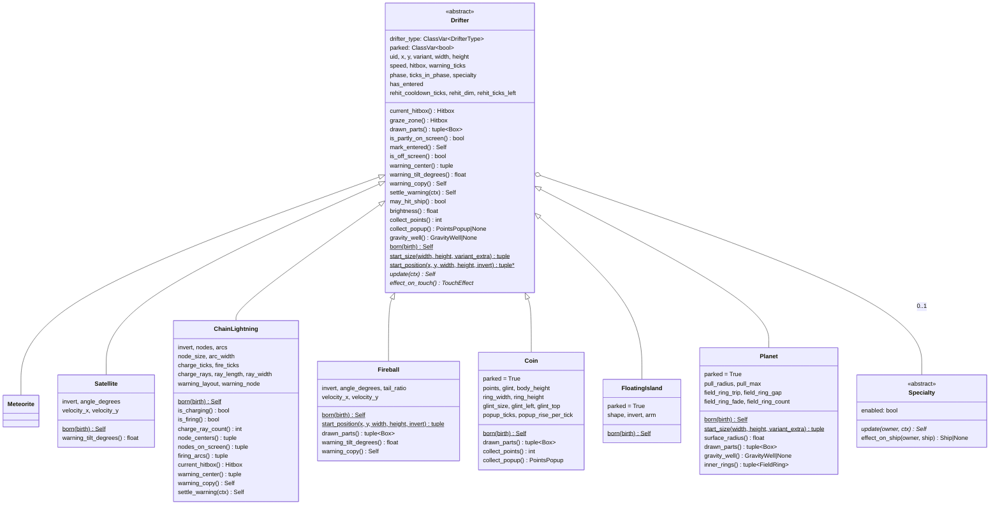
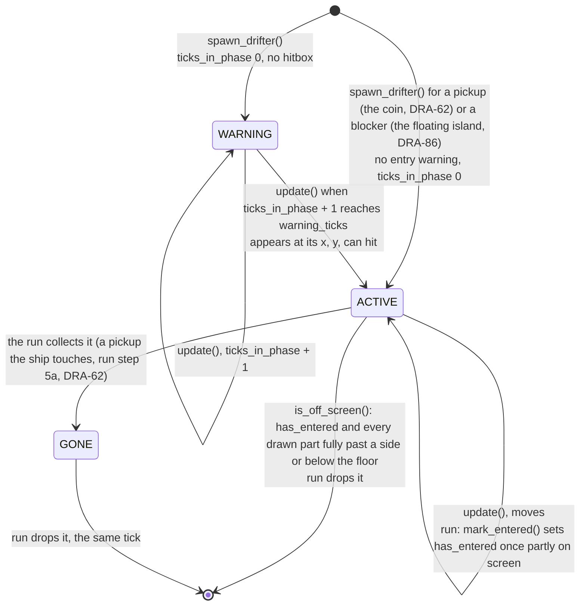
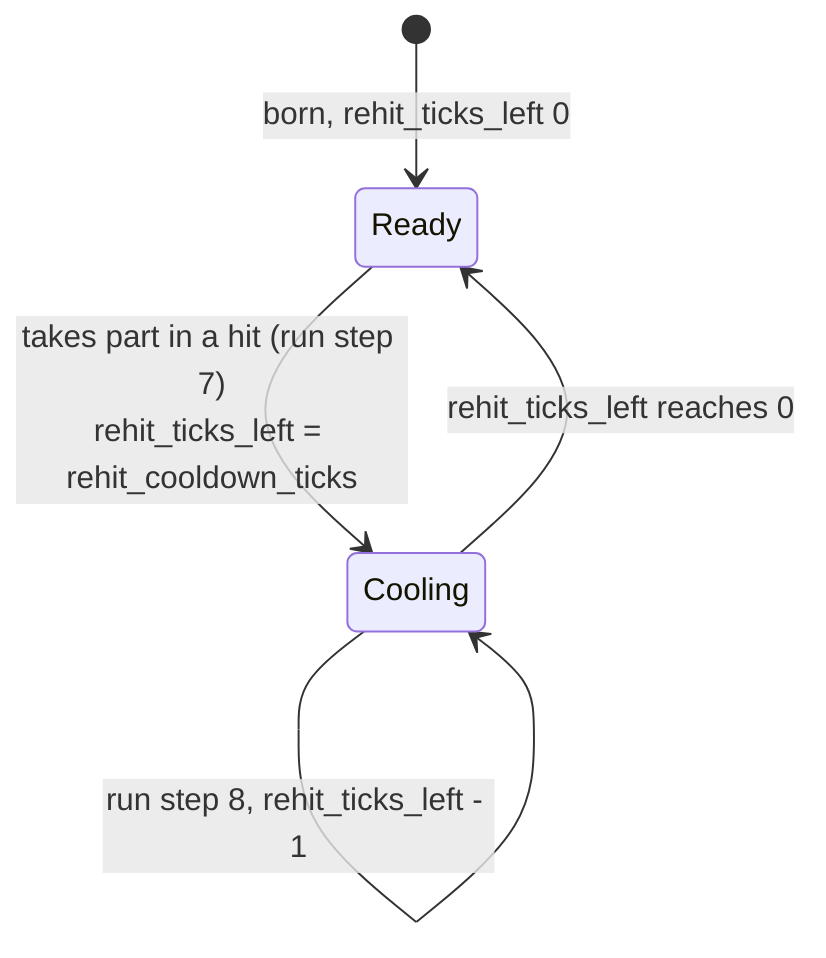
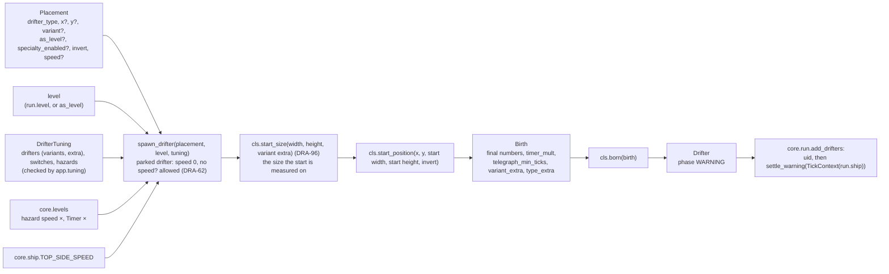
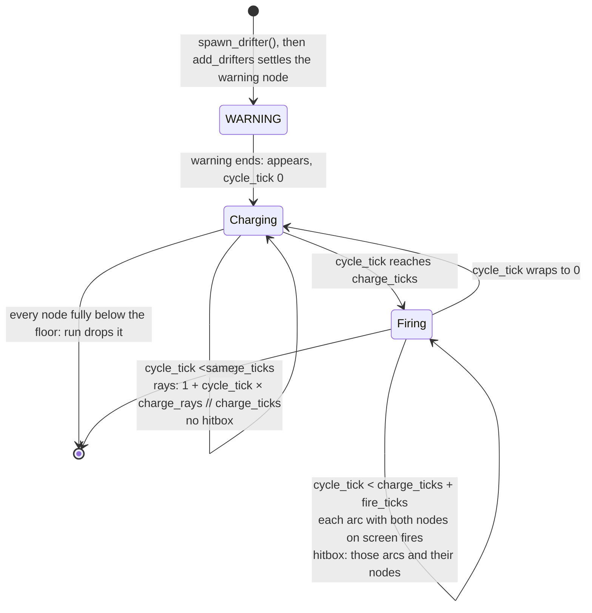
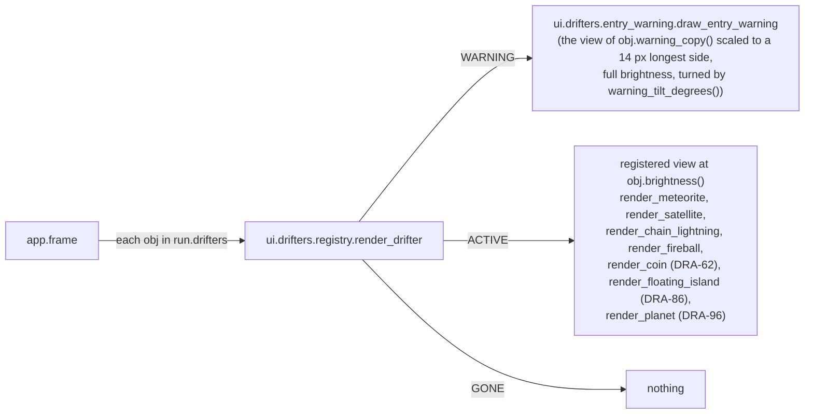

# Drifters: base, hitboxes, levels, spawner, the meteorite, the satellite, the chain lightning, the fireball, the coin, the floating island, the planet and their views
Version: 7
Status: draft
Features: DRA-29, DRA-39, DRA-47, DRA-56, DRA-62, DRA-76, DRA-86, DRA-96
Created by: architect

## Purpose
Every drifter in the game, hazards, pickups and blockers, is built on one shared base. This contract holds that base, the hitbox shapes (circle, box, line and convex polygon), their overlap test and the push-out measure the ship's island block uses, the level table (the spawner reads its hazard speed × and Timer ×, the scroll its scroll speed ×, the waves its Rest gap ×), the spawner (the only way a drifter is created), the drifters built so far (five hazards: the meteorite, the satellite, the chain lightning, the fireball and the planet; one pickup: the coin; one blocker: the floating island), and the views that draw drifters and their entry warnings. How an island blocks the ship and how a planet pulls it are the ship's rules (`docs/contracts/systems/ship.md`); this contract holds the island and the planet themselves, the geometry the block is measured with, and the field a planet hands the ship step.

The base holds the rules every drifter shares: the entry warning (where it shows, what its copy looks like), the hitbox, the graze zone, the parts of the drifter that are drawn, where a drifter starts and when it has entered the screen and left it (all judged on those drawn parts), the re-hit cooldown with its dim look, how a timer scales with level, whether the drifter is parked (it moves only with the scroll) or moving, what a pickup pays when it is collected (its points and its points popup), and whether the drifter has a gravity field that pulls the ship. A drifter carries final numbers only. The spawner reads the level and the shared hazard values once, at birth, and sets the drifter's speed, its timer factor and its cooldown length; a parked drifter gets no speed of its own. The drifter never knows the level. Each tick it may read the ship and how far the world scrolls on that tick (`TickContext`). The run (`docs/contracts/systems/run.md`) holds the drifters, lets each fix its warning from the ship when it is added, updates them every tick, marks when each has entered, collects the pickups the ship touches, tests the hazards against the ship, starts and counts down their cooldowns, and drops them when they leave or are collected.

Structure chosen by the Director (scope report DRA-29, Limits and Decision log): inheritance, a thin abstract base, one subclass per drifter, one level deep, no middle classes. Shared bits are helper functions. Guards: abstract methods, a registry that refuses duplicates, a test that the drifter list, the tuning files, the classes and the views all match, and collision tests that fail when a shape kind has no cases (scope report DRA-39, Limits).

Who builds what:
- `game/core/collision.py`: the Gameplay Implementer, task `DRA-29-01-gameplay-implementer`. Unknown shape kinds raise: task `DRA-39-01-gameplay-implementer`.
- `game/core/levels.py`: task `DRA-29-02-gameplay-implementer`. `FIRST_LEVEL`, the scroll speed × and Rest gap × rows: task `DRA-76-01-gameplay-implementer`. Removing `LEVEL_STARTS_M` and `level_at`: task `DRA-76-05-gameplay-implementer`, with the run that stops reading them (`docs/contracts/systems/run.md`).
- The package `game/core/drifters/` (`__init__.py`, `base.py`, `tuning.py`, `registry.py`, `spawner.py`, `meteorite.py`): task `DRA-29-02-gameplay-implementer`. The shared re-hit cooldown, entering, start position and the new placement fields: task `DRA-39-01-gameplay-implementer`.
- `game/core/drifters/satellite.py`: task `DRA-39-03-gameplay-implementer`.
- The line shape in `game/core/collision.py`: task `DRA-47-01-gameplay-implementer`.
- `DrifterTypeExtra`, the timer helpers, the warning copy and warning settle hooks, the new `Birth` and `HazardRules` fields, the spawner's handing them over, and `add_drifters` calling `settle_warning`: task `DRA-47-02-gameplay-implementer`.
- `game/core/drifters/chain_lightning.py`: task `DRA-47-03-gameplay-implementer`.
- `drawn_parts`, the `FIREBALL` member and `game/core/drifters/fireball.py`: task `DRA-56-01-gameplay-implementer`.
- The `COIN` member, `TickContext.scroll_step_px`, `Drifter.parked`, `collect_points`, `collect_popup`, the spawner's parked rule, `game/core/popup.py` (its Interface is in `docs/contracts/systems/run.md`) and `game/core/drifters/coin.py`: task `DRA-62-01-gameplay-implementer`.
- The drifters inside `core.run`: `docs/contracts/systems/run.md` (tasks `DRA-29-03`, `DRA-39-01`, `DRA-47-02`). DRA-56 changes nothing there. The collect step, the popups and the scroll in `TickContext`: task `DRA-62-02-gameplay-implementer`.
- `game/ui/shapes.py`: the UI Developer, task `DRA-29-04-ui-developer`. The line shape: task `DRA-47-04-ui-developer`.
- The package `game/ui/drifters/` (`__init__.py`, `registry.py`, `entry_warning.py`, `meteorite_view.py`): task `DRA-29-05-ui-developer`. Brightness, `dim_color` and the tilted warning copy: task `DRA-39-02-ui-developer`. `satellite_view.py`: task `DRA-39-04-ui-developer`. The warning drawn from `warning_copy()`: task `DRA-47-05-ui-developer`. `chain_lightning_view.py`: task `DRA-47-06-ui-developer`. `fireball_view.py`: task `DRA-56-02-ui-developer`. `coin_view.py`: task `DRA-62-03-ui-developer`.
- The points popup a coin leaves and its view (`game/ui/popup_view.py`): `docs/contracts/systems/run.md` (task `DRA-62-04-ui-developer`).
- The polygon shape, its overlap, place and grow rules, `deeply_overlaps`, `push_directions` and `exit_distance` in `game/core/collision.py`: task `DRA-86-01-gameplay-implementer`.
- `DrifterType.FLOATING_ISLAND`, `TouchEffect.BLOCK`, `game/core/drifters/floating_island.py` and its import: task `DRA-86-02-gameplay-implementer`.
- The island block in the ship step and the respawn out of an island: `docs/contracts/systems/ship.md` (task `DRA-86-03-gameplay-implementer`) and `docs/contracts/systems/run.md` (task `DRA-86-04-gameplay-implementer`).
- The polygon in `game/ui/shapes.py`: task `DRA-86-05-ui-developer`. `game/ui/drifters/floating_island_view.py` and its import: task `DRA-86-06-ui-developer`.
- `DrifterType.PLANET`, `Drifter.start_size`, `Drifter.gravity_well`, the spawner's use of `start_size`, `game/core/drifters/planet.py` and its import: task `DRA-96-02-gameplay-implementer`. The pull in the ship step and the escape check: `docs/contracts/systems/ship.md` (task `DRA-96-01-gameplay-implementer`). The wells in the run: `docs/contracts/systems/run.md` (task `DRA-96-03-gameplay-implementer`).
- `game/ui/drifters/planet_view.py` and its import: task `DRA-96-04-ui-developer`.
- Tests for DRA-96: `DRA-96-05-qa-engineer` (the pull and the escape check, `systems/ship.md`), `DRA-96-06-qa-engineer` (the ship against every planet variant) and `DRA-96-07-qa-engineer` (the planet, and planets in the run).
- The planet's tuning file `game/tuning/drifters/planet.json` (`docs/contracts/schemas/planet-tuning.schema.json`, DRA-96) is content, like the other drifter files.
- Hitbox and graze outlines and drifter labels in the debug overlay: `docs/contracts/systems/debug-overlay.md` (task `DRA-29-06`). No change in DRA-39, DRA-47, DRA-56, DRA-62, DRA-86 or DRA-96: line and polygon outlines come from `ui.shapes`; the coin's box and the island's shapes are outlined like any shape, and neither has a graze zone; the planet's circle and graze circle are outlined like the meteorite's, and its field ring is already drawn by its view.
- Tests for DRA-86: `DRA-86-07-qa-engineer` (collision with polygons, the push-out measure, the ship against every island variant), `DRA-86-08-qa-engineer` (the island block in the ship step and the respawn spot) and `DRA-86-09-qa-engineer` (the island, and islands in the run).
- The island's tuning file `game/tuning/drifters/floating_island.json` (`docs/contracts/schemas/floating-island-tuning.schema.json`, DRA-86) is content, like the other drifter files.
- Tests: the QA Engineer. DRA-29: tasks `DRA-29-07` to `DRA-29-09`. DRA-39: `DRA-39-05-qa-engineer` (collision), `DRA-39-06-qa-engineer` (base, spawner, meteorite, satellite) and `DRA-39-07-qa-engineer` (drifters in the run). DRA-47: `DRA-47-07-qa-engineer` (collision with lines, the ship against every chain lightning variant) and `DRA-47-08-qa-engineer` (the chain lightning, the new base hooks, chain lightnings in the run). DRA-56: `DRA-56-03-qa-engineer` (the ship against every fireball variant) and `DRA-56-04-qa-engineer` (the fireball, drawn parts, fireballs in the run). DRA-62: `DRA-62-05-qa-engineer` (the ship against every coin variant) and `DRA-62-06-qa-engineer` (the coin, its popup, coins in the run).
- The data files, by whoever the Director names (DRA-29: the main session). They are content, so no task file: `game/tuning/drifters/meteorite.json` (`docs/contracts/schemas/drifter-tuning.schema.json`), `game/tuning/drifters/satellite.json` (`docs/contracts/schemas/satellite-tuning.schema.json`), `game/tuning/drifters/chain_lightning.json` (`docs/contracts/schemas/chain-lightning-tuning.schema.json`, DRA-47), `game/tuning/drifters/fireball.json` (`docs/contracts/schemas/fireball-tuning.schema.json`, DRA-56), `game/tuning/drifters/coin.json` (`docs/contracts/schemas/coin-tuning.schema.json`, DRA-62), `game/tuning/drifters/floating_island.json` (`docs/contracts/schemas/floating-island-tuning.schema.json`, DRA-86), `game/tuning/drifters/planet.json` (`docs/contracts/schemas/planet-tuning.schema.json`, DRA-96), `game/tuning/playtest.json` (`docs/contracts/schemas/playtest-switches.schema.json`), `game/tuning/hazards.json` (`docs/contracts/schemas/hazards.schema.json`) and `game/tuning/debug_spawns.json` (`docs/contracts/schemas/debug-spawn-list.schema.json`).
- Loading and checking the data files, the debug test spawn list, and calling `add_drifters` and `render_drifter`: the Integration Engineer, in `game/app/`, from `docs/contracts/systems/app.md`. No task file.

## Diagram
Class shape. One level deep:


Life of one drifter:


Re-hit cooldown of one hazard (the run sets and counts it, `systems/run.md`, steps 7 and 8):

```
hit on tick T, rehit_cooldown_ticks 180
state after tick    T      T+1 .. T+179    T+180    T+181
rehit_ticks_left    180    179 .. 1        0        0, or 180 if it hits on T+181
may_hit_ship()      no     no              yes
brightness()        0.75   0.75            1.0
```
It can't hit on ticks T+1 to T+180, the 180 ticks after the hit, and can hit again from tick T+181. It is drawn dim on the 180 states after ticks T to T+179, and at full brightness from the state after tick T+180. The same pattern as invulnerability (`systems/run.md`, blink timeline).

Birth, the only place the level is read:


Meteorite timeline, medium, Level 1, added at the end of tick T:
```
state after tick   T        T+1..T+59   T+60            T+61          ...  T+60+n
phase              WARNING  WARNING     ACTIVE          ACTIVE             ACTIVE
ticks_in_phase     0        1..59       0               1                  n
y                  -14.00   -14.00      -14.00          -14 + 2.4675       -14 + n × 2.4675
hitbox             none     none        circle r 14     circle r 14
has_entered        no       no          no              yes                yes
```
At T+60 its bottom edge is on the top edge, so it is not yet on the screen. Dropped on the first state where its top edge is at or past y 480: y − 14 ≥ 480, so n = 206 (y ≈ 494.3).

Satellite timeline, flat, Level 1, placed at y 300 with no x and no `invert`, added at the end of tick T:
```
state after tick   T        T+1..T+59   T+60        T+61            ...  T+60+n
phase              WARNING  WARNING     ACTIVE      ACTIVE               ACTIVE
x                  -18.00   -18.00      -18.00      -15.5325             -18 + n × 2.4675
y                  300.00   300.00      300.00      300.00               300.00
hitbox             none     none        two boxes   two boxes
has_entered        no       no          no          yes                  yes
warning shows at   (18, 300)
```
At T+60 its right edge is on the left wall: it touches the screen but is not on it. Without the entered rule it would be dropped right there. Dropped on the first state where its left edge is at or past x 640: x − 18 ≥ 640, so n = 274 (x ≈ 658.10, about 4.6 s after it appears).

Angled at Level 1: `velocity_x` = 2.4675 × cos 20° ≈ 2.3187, `velocity_y` = 2.4675 × sin 20° ≈ 0.8439. Placed at y 200 from the left wall, it is dropped past the right wall on n = 292 (x ≈ 659.06, y ≈ 446.43). Placed at y 300, it is dropped below the floor first, on n = 221 (x ≈ 494.43, y ≈ 486.51, top edge ≈ 480.51). With `invert` it starts at x 658 and `velocity_x` is negative.

Chain lightning cycle (DRA-47). `cycle_tick = ticks_in_phase % (charge_ticks + fire_ticks)` while ACTIVE:


Chain lightning timeline, `pair_flat`, Level 1, placed at x 320 with no y and no `invert`, added at the end of tick T with the ship at (320, 240). Nodes at offsets (−64, 0) and (64, 0); 140 × 12; `charge_ticks` 120, `fire_ticks` 120, `charge_rays` 4; speed 2.4675:
```
state after tick   T        T+1..T+59   T+60       T+90      T+120     T+150     T+179     T+180     T+259     T+260
phase              WARNING  WARNING     ACTIVE     ACTIVE    ACTIVE    ACTIVE    ACTIVE    ACTIVE    ACTIVE    dropped
ticks_in_phase     0        1..59       0          30        60        90        119       120       199
y                  -6.00    -6.00       -6.00      68.03     142.05    216.08    287.63    290.10    485.03    487.50
charging / firing  -        -           charging   charging  charging  charging  charging  firing    firing
rays per node      0        0           1          2         3         4         4         0         0
firing arcs        ()       ()          ()         ()        ()        ()        ()        (0,)      (0,)
hitbox             none     none        none       none      none      none      none      line + 2 circles
warning shows at   (256, 12)
```
Both nodes are 64 px from the ship in x and equally far in y, so the tie picks the left node, x 256. The warning is 24 px across like every warning, so `R` = 12 and its center sits at y 12. On T+259 the nodes' top edges are at 479.03, still on screen, so the arc fires; on T+260 the top edge is at 481.50 and the run drops it. At Level 1 a chain that starts at the top fires once, on 80 ticks, from y ≈ 290 down; it never charges a second time (see Rationale). At Level 8: speed 2.4675 × 1.42 ≈ 3.5039, charge `ceil(120 × 0.70)` = 84 ticks, fire still 120.

Fireball (DRA-56). One drifter: the head is its size and its center, the tail a smaller circle touching it from behind, along its path. Small, Level 1, no `invert`:
```
            tail r 5.25, center at (x - 9.03, y - 12.90)
              o
               \   path: 35° from straight down, 3.0926 px/tick along it
                O  head r 10.5, center (x, y); width = height = 21
                 \
                  v  velocity_x +1.7738, velocity_y +2.5333 per tick
```
Start and warning by entry. `R` = head width ÷ 2. Without `invert` / with it:
```
entry            placement     start (x, y)               warning center           flies
corner           no x, no y    (0, -R) / (640, -R)        (12, 12) / (628, 12)     down right / down left
along the top    x             (x, -R)                    (x clamped to 12..628, 12)
side             y             (-R, y) / (640 + R, y)     (12, y) / (628, y)
```

Fireball timeline, small, Level 1, placed with no x, no y and no `invert` (the top-left corner), added at the end of tick T. `n` counts ACTIVE ticks. Drawn parts: the head's box 24 × 24, the tail's 13.5 × 13.5 (each circle's radius + `DRAW_MARGIN` 1.5, on each side):
```
state after tick   T        T+1..T+59   T+60       T+61      T+60+n               T+258     T+261     T+262
phase              WARNING  WARNING     ACTIVE     ACTIVE    ACTIVE               ACTIVE    ACTIVE    dropped
x                  0.00     0.00        0.00       1.77      n × 1.7738           351.22    356.54    358.32
y                  -10.50   -10.50      -10.50     -7.97     -10.5 + n × 2.5333   491.10    498.70    501.23
hitbox             none     none        2 circles  2 circles
has_entered        no       no          yes        yes
warning shows at   (12, 12), copy turned 35° counterclockwise: head below and right of the tail
```
At T+60 the head's drawn box reaches 1.5 px into the screen, so it has entered. On T+258 (n 198) the head's own circle is fully below the floor, but the tail's drawn box top is at 471.44, on screen: it stays. On T+261 the tail's box top is at 479.04, still on screen. On T+262 it is at 481.58 and the head's at 489.23: every part is off, so the run drops it. At Level 8: speed 3.0926 × 1.42 ≈ 4.3915, velocities ≈ (2.5189, 3.5973); the angle never changes.

Big, `invert`, the top-right corner: starts at (640, −16), tail at (+13.77, −19.66) from the head, r 8; drawn boxes 35 × 35 and 19 × 19. Dropped on n = 208 (x ≈ 271.04, y ≈ 510.93). Small from the left wall at y 120: starts at (−10.5, 120), warning at (12, 120), dropped on n = 150 (x ≈ 255.58, y ≈ 500.00).

Coin (DRA-62). One drifter: a crystal 12 × 20, its 12 × 10 middle the hitbox, a ring 22 × 8 across its middle. Parked: it moves only by `ctx.scroll_step_px`. No entry warning: born ACTIVE. Full size, center (x, y), pixel columns and rows as the view draws them at `(cx, cy) = (round(x), round(y))`:
```
column        cx-6 . . . . cx-1 cx . . . . cx+5
row cy-10     .  .  .  .  .  #   #  .  .  .  .  .     top point, 2 px wide
row cy-9      .  .  .  .  #  l   s  #  .  .  .  .
row cy-8      .  .  .  #  l  l   s  s  #  .  .  .
row cy-7      .  .  #  G  G  l   s  s  s  #  .  .     G: the rare glint, 2 x 2, its top-left at (3, 3) in the 12 x 20 box
row cy-6      .  #  l  G  G  l   s  s  s  s  #  .
row cy-5      #  l  l  l  l  l   s  s  s  s  s  #     body top row: the hitbox's top
  ...         (rows cy-4 to cy+3 the same: the ring crosses here)
row cy+4      #  l  l  l  l  l   s  s  s  s  s  #     body bottom row: the hitbox's bottom
row cy+5      .  #  l  l  l  l   s  s  s  s  #  .
  ...
row cy+9      .  .  .  .  .  #   #  .  .  .  .  .     bottom point
l: lit side, s: shade side, #: the 1 px rim. Common coins have no G (lit there).
The ring: a 1 px ellipse in the 22 x 8 rect from (cx-11, cy-4), columns cx-11..cx+10, rows cy-4..cy+3, drawn over the crystal.
```
Drawn parts: the crystal's box `Box(x, y, 12, 20)` and the ring's box `Box(x, y, 22, 8)`. Every drawn pixel lies inside them once moved by the center's rounding, which is at most 0.5 px; the sizes are even whole numbers, so the box edges and the pixel edges both fall on whole px (Rationale).

Coin timeline, common, Level 1, placed with x 320 and no y, added at the end of tick T, with the world already scrolling (T ≥ 30), so `scroll_step_px` is 1.1 on every later tick. `n` counts ticks after T:
```
state after tick   T        T+1      T+9      T+n                T+454     T+455
phase              ACTIVE   ACTIVE   ACTIVE   ACTIVE             ACTIVE    dropped
y                  -10.00   -8.90    -0.10    -10 + n × 1.1      489.40    490.50
hitbox             box 12 × 10, centered, on every ACTIVE state
has_entered        no       yes      yes      yes                yes
warning            none, ever
```
At T its crystal's bottom edge is on the top edge: on no state is a pixel of it drawn before T+1. On T+454 the crystal's top edge is at 479.40, still on screen; on T+455 it is at 480.50 and the ring's at 486.50: every part is off, so the run drops it. Placed on tick 1, before the scroll starts, it stays at y −10 on the states after ticks 1 to 30 and first moves on tick 31. Placed at (440, 210): it is on screen at once, enters on its first update, and is dropped on n = 255 (y 490.50). At Level 8 it moves exactly the same: hazard speed × and Timer × never touch it.

Floating island (DRA-86). One drifter, parked like the coin, born ACTIVE with no warning. Its hitbox is its shape: boxes, or one convex polygon for the triangle. Offsets from the center, y down, at the file's sizes (320 × 120, `arm` 40; the box 120 × 120). `island_hitbox` builds them:
```
rectangle                          box
+----------------------------+     +----------+
|                            |     |          |
|            (0,0)           |     |  (0,0)   |
+----------------------------+     +----------+
Box(0, 0, 320, 120)                Box(0, 0, 120, 120)

l_shape                            l_shape, invert
+---+                              +----------------------------+
|   |                              |  bar                       |
|   +------------------------+     +---+------------------------+
|   bar                      |     |   |
+----------------------------+     +---+
bar Box(0, 40, 320, 40)            bar Box(0, -40, 320, 40)
upright Box(-140, 0, 40, 120)      upright Box(-140, 0, 40, 120)

t_shape                            t_shape, invert
+----------------------------+                   +---+
|  bar                       |                   |   |
+------------+---+-----------+     +-------------+   +---------+
             |   |                 |  bar                      |
             +---+                 +---------------------------+
bar Box(0, -40, 320, 40)           bar Box(0, 40, 320, 40)
stem Box(0, 0, 40, 120)            stem Box(0, 0, 40, 120)

triangle                           triangle, invert
(-160,-60)                         (-160,-60)          (160,-60)
 |\                                 +-------------------/
 |   \                              |              /
 |       \                          |         /
 |           \                      |    /
 +--------------\ (160,60)          |/
(-160,60)                          (-160,60)
Polygon(((-160,-60), (160,60), (-160,60)))    Polygon(((-160,60), (160,-60), (-160,-60)))
slope's outward normal (120, -320) / 341.76   slope's outward normal (120, 320) / 341.76
  = (0.3511, -0.9363): up and right             = (0.3511, 0.9363): down and right
```
The L's upright and the T's stem are full height, so the two boxes overlap in an `arm` × `arm` square. Their union is the shape drawn. `invert` mirrors the shape top to bottom: every box's `cy` and every polygon point's y is negated (the triangle's point order turns round; collision accepts either order).

Island timeline, rectangle, Level 1, placed with x 320 and no y, added at the end of tick T with the world already scrolling (`scroll_step_px` 1.1 on every later tick). `n` counts ticks after T:
```
state after tick   T        T+1      T+n                T+545     T+546
phase              ACTIVE   ACTIVE   ACTIVE             ACTIVE    dropped
y                  -60.00   -58.90   -60 + n × 1.1      539.50    540.60
hitbox             Box 320 × 120, centered, on every ACTIVE state
has_entered        no       yes      yes                yes
warning            none, ever
```
At T its bottom edge is on the top edge. On T+545 its top edge is at 479.50, still on screen; on T+546 it is at 480.60 and the run drops it. Placed on screen (a `y` given), it shows there at once. At Level 8 it moves 1.87 px a tick, only because the scroll does: hazard speed × and Timer × never touch it.

Planet (DRA-96). One drifter: a body, its hitbox circle, and around it a gravity field drawn as rings. Parked like the coin, but a hazard: born in WARNING with the shared entry warning. At the file's values (size 64, `pull_radius` 150, `pull_max` 0.2), offsets from the center, y down:
```
                 . - ~ ~ ~ - .            outer ring: 1 px at pull_radius (150), always on
             . '    . - - .    ' .        inner rings: 1 px, sliding from 150 in to the surface,
           .      '         '      .                   fading 50% -> 0%
          .      .   .---.   .      .
          .      .  ( (0,0) ) .      .    body: filled circle r 32 = Circle(0, 0, 32), the hitbox
          .      .   '---'   .      .     graze zone: Circle(0, 0, 46)
           .      .         .      .
             ' .    ' - - '    . '        drawn parts: Box(0, 0, 302, 302): the field ring's
                 ' - ~ ~ ~ - '                         150 + FIELD_DRAW_MARGIN 1 on each side
pull: 0 at d >= 150, 0.2 × (150 - d) / 118 between, 0.2 at d <= 32 (systems/ship.md, Planet pull)
```

Planet timeline, standard, Level 1, placed with x 320 and no y, added at the end of tick T with the world already scrolling (`scroll_step_px` 1.1 on every later tick). `n` counts ACTIVE ticks:
```
state after tick   T        T+1..T+59   T+60       T+61      T+60+n             T+770     T+771
phase              WARNING  WARNING     ACTIVE     ACTIVE    ACTIVE             ACTIVE    dropped
ticks_in_phase     0        1..59       0          1         n                  710
y                  -151.00  -151.00     -151.00    -149.90   -151 + n × 1.1     630.00    631.10
hitbox             none     none        circle r 32 on every ACTIVE state
gravity_well()     None     None        (320, y), surface 32, pull radius 150, pull max 0.2
has_entered        no       no          no         yes       yes                yes
warning shows at   (320, 12)
```
At T+60 the drawn box's bottom edge is on the top edge (y −151 + 151 = 0): nothing drawn is on screen, the field ring's lowest pixel row is above it, and the field already pulls. On T+770 the box's top edge is at 479.00, still on screen; on T+771 it is at 480.10 and the run drops it, the field with it. A ship standing still at (320, 240) is inside the field from T+280 (y 91.00, 149 px away) and touched by the body from T+372 (y 192.20: the circle reaches 224.20, past the bar's top edge at 224). At Level 8 it moves 1.87 px a tick, only because the scroll does.

Inner field rings, `inner_rings()`, at the file's values (`field_ring_trip` 120, `field_ring_gap` 60, `field_ring_fade` 50, `field_ring_count` 2). `t` is `ticks_in_phase` while ACTIVE; ring `i` (from 0) is `k = (t − i × 60) mod 120` ticks into its trip:
```
t      ring 0: k   radius    opacity      ring 1: k   radius    opacity
0          0       150.00    0.5000           60       91.00     0.2500
30         30      120.50    0.3750           90       61.50     0.1250
60         60      91.00     0.2500           0        150.00    0.5000
119        119     32.98     0.0042           59       91.98     0.2542
120        0       150.00    0.5000           60       91.00     0.2500     the cycle repeats
radius = 150 − 118 × k / 120;  opacity = 0.5 × (1 − k / 120)
```

Views:


## Interface
Import root is `game/`, as in the tests. Core modules import stdlib and `core` only, never pygame, `ui` or `app`. Every module-level constant is `typing.Final`. Every dataclass is `frozen=True, slots=True`. Every module with code has `log = logging.getLogger(__name__)`; `core.drifters` and `core.collision` log nothing (the run logs the drifter lifecycle, `docs/contracts/systems/run.md`, Logging).

### game/core/collision.py
```python
# Imports: stdlib only.


@dataclass(frozen=True, slots=True)
class Circle:
    """A circle hitbox shape, px."""

    cx: float  # center x: offset from the owner's center in a variant's hitbox; screen x once placed
    cy: float  # center y, same, y down
    r: float  # radius, px, > 0


@dataclass(frozen=True, slots=True)
class Box:
    """An upright box hitbox shape, px. Boxes never rotate."""

    cx: float  # center x, as Circle.cx
    cy: float  # center y, as Circle.cy
    w: float  # full width, px, > 0
    h: float  # full height, px, > 0


@dataclass(frozen=True, slots=True)
class Line:  # DRA-47
    """A line hitbox shape: straight from A to B, a set thickness, round ends, px."""

    ax: float  # end A x: offset from the owner's center in a variant's hitbox; screen x once placed
    ay: float  # end A y, same, y down
    bx: float  # end B x, same
    by: float  # end B y, same
    thickness: float  # full thickness, px, > 0. Every point within thickness / 2 of segment AB


@dataclass(frozen=True, slots=True)
class Polygon:  # DRA-86
    """A convex polygon hitbox shape: a filled shape with straight edges, px."""

    points: tuple[tuple[float, float], ...]  # its corners in order around the edge, either way
    # round, at least 3. Offsets from the owner's center in a variant's hitbox; screen px once
    # placed, y down. Convex, no two points the same, no three neighbours on one line. Trusted:
    # core builds every polygon (island_hitbox), nothing reads one from a file


Shape = Circle | Box | Line | Polygon  # Line from DRA-47, Polygon from DRA-86
Hitbox = tuple[Shape, ...]  # one or more shapes. Empty () = touches nothing
Direction = tuple[float, float]  # DRA-86. A unit vector, screen px, y down: (0.0, -1.0) is up

SURFACE_TOLERANCE: Final[float] = 1e-9  # DRA-86. px. An overlap this deep or less counts as
# touching for deeply_overlaps and exit_distance. Not a game value (Rationale)


def place_hitbox(hitbox: Hitbox, x: float, y: float) -> Hitbox:
    ...
    # Every shape moved by (x, y): offsets from the owner's center become screen positions.
    # A line moves both ends; a polygon every point.


def hitboxes_overlap(a: Hitbox, b: Hitbox) -> bool:
    ...
    # True when any shape of a overlaps any shape of b. Both placed. Pure.


def grow_hitbox(hitbox: Hitbox, margin: float) -> Hitbox:
    ...
    # Each shape grown by margin on every side: Circle r + margin; Box w + 2 margin, h + 2 margin;
    # Line thickness + 2 margin, ends unchanged (it grows on each side and at both ends).
    # Polygon (DRA-86): the polygon itself, then one Line per edge, point i to point i + 1 (the
    # last to the first), thickness 2 × margin. So a hitbox may come back with more shapes.


# All three raise TypeError("unknown shape kind '<class name>'") for an object that is not a
# Circle, a Box, a Line or a Polygon (DRA-39, Line from DRA-47, Polygon from DRA-86). Nothing is
# ever treated as a box by default.


def deeply_overlaps(moving: Hitbox, solid: Hitbox) -> bool:
    ...  # DRA-86
    # True when some shape of moving overlaps some shape of solid by more than SURFACE_TOLERANCE
    # (Rules, Push-out). Both placed. Pure.


def push_directions(moving: Hitbox, solid: Hitbox) -> tuple[Direction, ...]:
    ...  # DRA-86
    # The directions the push-out tries, in order: up, down, left, right, then each polygon
    # edge's outward and inward normal, solid's polygons first, then moving's, with no repeats
    # (Rules, Push-out). Pure.


def exit_distance(moving: Hitbox, solid: Hitbox, direction: Direction) -> float:
    ...  # DRA-86
    # px >= 0: how far moving must move along direction until no shape of it overlaps a shape of
    # solid at all. 0.0 when deeply_overlaps(moving, solid) is False. Both placed. Pure.


# deeply_overlaps, push_directions and exit_distance take boxes and polygons only: any other shape
# raises TypeError("<function name> takes boxes and polygons, not '<class name>'"), e.g.
# "exit_distance takes boxes and polygons, not 'Circle'". DRA-86.
```

### game/core/levels.py
```python
# Imports: stdlib only.
LEVEL_COUNT: Final[int] = 8  # 08-difficulty.md, level table (locked)
FIRST_LEVEL: Final[int] = 1  # DRA-76. 08-difficulty.md, rule 1: a run starts at Level 1
HAZARD_SPEED_MULT: Final[tuple[float, ...]] = (
    1.00,
    1.06,
    1.12,
    1.18,
    1.24,
    1.30,
    1.36,
    1.42,
)
# 08-difficulty.md, Hazard speed × row (locked)
TIMER_MULT: Final[tuple[float, ...]] = (1.00, 0.94, 0.89, 0.85, 0.81, 0.77, 0.74, 0.70)
# 08-difficulty.md, Timer × row (guess)
SCROLL_MULT: Final[tuple[float, ...]] = (1.0, 1.1, 1.2, 1.3, 1.4, 1.5, 1.6, 1.7)
# DRA-76. 08-difficulty.md, Scroll speed × row (locked)
REST_GAP_MULT: Final[tuple[float, ...]] = (1.00, 0.90, 0.81, 0.73, 0.66, 0.59, 0.53, 0.48)
# DRA-76. 08-difficulty.md, Rest gap × row (locked)


def check_level(level: int) -> None:
    ...
    # Raises ValueError("level <n> is outside 1 to 8") unless 1 <= level <= LEVEL_COUNT.


def hazard_speed_mult(
    level: int,
) -> float: ...  # HAZARD_SPEED_MULT[level - 1], after check_level
def timer_mult(level: int) -> float: ...  # TIMER_MULT[level - 1], after check_level
def scroll_mult(level: int) -> float: ...  # DRA-76. SCROLL_MULT[level - 1], after check_level
def rest_gap_mult(level: int) -> float: ...  # DRA-76. REST_GAP_MULT[level - 1], after check_level
```
From DRA-76 `LEVEL_STARTS_M` and `level_at` are gone: the level no longer comes from the meters (08-difficulty.md, rule 1; 91-decision-log.md, row 65). The run's level comes from its waves (`docs/contracts/systems/waves.md`).

### game/core/drifters/base.py
```python
# Imports: stdlib, core.collision, core.ship (Ship; GravityWell from DRA-96), core.world,
# core.popup (DRA-62, for PointsPopup).
GRAZE_MARGIN: Final[int] = 14  # 06-scoring.md, graze_margin, px (locked)
DEFAULT_REHIT_COOLDOWN_TICKS: Final[int] = (
    180  # 05-lives-and-damage.md, rehit_cooldown, ticks (guess). DRA-39
)
DEFAULT_REHIT_DIM: Final[float] = (
    0.75  # 05-lives-and-damage.md, rehit_dim, × brightness (guess). DRA-39
)
DEFAULT_TELEGRAPH_MIN_TICKS: Final[int] = (
    45  # 07-drifters.md, telegraph_min, ticks (locked). DRA-47
)


class DrifterType(Enum):
    """Every drifter the game knows. One member per drifter spec in 07-drifters.md that is built."""

    METEORITE = "meteorite"  # drifters/01-meteorite.md
    SATELLITE = "satellite"  # drifters/02-satellite.md. DRA-39
    CHAIN_LIGHTNING = "chain_lightning"  # drifters/03-chain-lightning.md. DRA-47
    FIREBALL = "fireball"  # drifters/06-fireball.md. DRA-56
    COIN = "coin"  # drifters/04-coin.md. DRA-62
    FLOATING_ISLAND = "floating_island"  # drifters/05-floating-islands.md. DRA-86
    PLANET = "planet"  # drifters/08-planet.md. DRA-96


class Phase(Enum):
    WARNING = "warning"  # the entry warning shows; the drifter can't touch anything
    ACTIVE = "active"  # the drifter is on the field and can touch the ship
    GONE = "gone"  # the drifter is finished; the run drops it this tick


class TouchEffect(Enum):
    HIT = "hit"  # touching it is a hit (05-lives-and-damage.md, rule 1)
    COLLECT = "collect"  # touching it collects it: it pays and goes (06-scoring.md, rule 2). The coin. DRA-62
    BLOCK = "block"  # touching it neither hurts nor pays: it is ground the ship can't enter
    # (07-drifters.md, Summary, Blocker). The floating island. DRA-86
    NONE = "none"  # touching it does nothing


@dataclass(frozen=True, slots=True)
class TickContext:
    """Per-tick facts a drifter may read in update(). Never the level."""

    ship: Ship  # the ship as it was at the start of this tick
    scroll_step_px: float = 0.0  # DRA-62. px the world scrolls down on this tick, from
    # core.scroll.scroll_step_px. 0.0 before the scroll starts. A parked drifter moves by it


@dataclass(frozen=True, slots=True)
class VariantExtra:
    """Base of a drifter's own per-variant values. Empty. A drifter that needs some
    subclasses it in its own module (the satellite: SatelliteVariantExtra). DRA-39."""


@dataclass(frozen=True, slots=True)
class DrifterTypeExtra:                                             # DRA-47
    """Base of a drifter's own values that hold for every variant. Empty. A drifter that needs
    some subclasses it in its own module (the chain lightning: ChainLightningTypeExtra)."""

@dataclass(frozen=True, slots=True)
class Birth:
    """Everything the spawner settled for one new drifter. Final numbers only."""

    x: float  # center x, screen px
    y: float  # center y, screen px, y down
    variant: str  # the variant's name
    width: float  # the variant's visible width, px
    height: float  # the variant's visible height, px
    hitbox: Hitbox  # the variant's shapes, offsets from the center
    speed: float  # final speed, px/tick, hazard speed × already applied
    warning_ticks: int  # entry warning length, ticks, never scaled
    timer_mult: float  # the Timer × to apply to the drifter's own timers (the chain lightning's charge)
    specialty_enabled: (
        bool | None
    )  # the placement's switch; None = the drifter's default
    invert: bool  # the placement's invert. DRA-39
    variant_extra: (
        VariantExtra | None
    )  # the variant's own values, None for a drifter with none. DRA-39
    rehit_cooldown_ticks: int  # re-hit cooldown length, ticks, never scaled. DRA-39
    rehit_dim: float  # brightness during the cooldown, 0..1. DRA-39
    type_extra: (
        DrifterTypeExtra | None
    )  # the drifter type's own values, None for a drifter with none. DRA-47
    telegraph_min_ticks: int  # the shortest a scaled telegraph may get, ticks. DRA-47


@dataclass(frozen=True, slots=True, kw_only=True)
class Specialty(ABC):
    """An optional extra behavior on top of a drifter's movement. Only the base exists."""

    enabled: bool  # switched on or off for this drifter

    @abstractmethod
    def update(self, owner: Drifter, ctx: TickContext) -> Self: ...
    def effect_on_ship(self, owner: Drifter, ship: Ship) -> Ship | None:
        ...
        # None: no effect. The default, and the only behavior so far.


@dataclass(frozen=True, slots=True, kw_only=True)
class Drifter(ABC):
    """One drifter on the field after a tick. Screen px, y down, x and y at its center."""

    drifter_type: ClassVar[DrifterType]  # set by each subclass
    parked: ClassVar[bool] = False  # DRA-62. True: it sits still in the world and moves only with
    # the scroll (03-world-and-camera.md, rule 9). The coin. Read by the spawner
    uid: int = 0  # unique within a run, from 1. Set by core.run.add_drifters; 0 before
    x: float  # center x, screen px
    y: float  # center y, screen px, y down
    variant: str  # the variant's name, e.g. "medium"
    width: float  # visible width, px, from the variant
    height: float  # visible height, px, from the variant
    speed: float  # final speed, px/tick, set by the spawner
    hitbox: Hitbox  # shapes as offsets from (x, y), from the variant
    warning_ticks: int  # entry warning length, ticks
    phase: Phase = Phase.WARNING
    ticks_in_phase: int = (
        0  # ticks spent in the current phase. 0 on the state it starts
    )
    specialty: Specialty | None = None
    has_entered: bool = False  # DRA-39. It has been at least partly on screen while ACTIVE. Set by the run
    rehit_cooldown_ticks: int = (
        DEFAULT_REHIT_COOLDOWN_TICKS  # DRA-39. Cooldown length, ticks, from the spawner
    )
    rehit_dim: float = (
        DEFAULT_REHIT_DIM  # DRA-39. Brightness while cooling, 0..1, from the spawner
    )
    rehit_ticks_left: int = 0  # DRA-39. Ticks of re-hit cooldown still to come. 0 = it may hit. Set by the run

    def current_hitbox(self) -> Hitbox:
        ...
        # () unless phase is ACTIVE. Otherwise place_hitbox(hitbox, x, y).

    def graze_zone(self) -> Hitbox:
        ...
        # grow_hitbox(current_hitbox(), GRAZE_MARGIN) when effect_on_touch() is HIT, else ().

    def drawn_parts(self) -> tuple[Box, ...]:
        ...  # DRA-56
        # Upright boxes, screen px, that together hold every pixel the drifter's view draws while
        # ACTIVE. Here one box: Box(x, y, width, height), the footprint.

    def is_partly_on_screen(self) -> bool:
        ...  # DRA-39, judged on drawn_parts() from DRA-56
        # True when any box of drawn_parts() shares area with the screen (strict).

    def mark_entered(self) -> Self:
        ...  # DRA-39
        # self with has_entered True when ACTIVE and partly on screen; otherwise self unchanged.

    def is_off_screen(self) -> bool:
        ...  # judged on drawn_parts() from DRA-56
        # True only in ACTIVE, once has_entered, when every box of drawn_parts() is fully past a
        # side wall or fully below the floor. Never at the top.

    def warning_center(self) -> tuple[float, float]:
        ...
        # Where the entry warning is drawn: (x, y) moved just inside the screen.

    def warning_tilt_degrees(self) -> float:
        ...  # DRA-39
        # How far the warning copy is turned, degrees, counterclockwise on screen. 0.0 here.

    def warning_copy(self) -> Self:
        ...  # DRA-47
        # The drifter whose look the entry warning shows, scaled to a 14 px longest side.
        # self here.

    def settle_warning(self, ctx: TickContext) -> Self:
        ...  # DRA-47
        # Fix where the entry warning shows, from the ship at the moment the drifter enters the run.
        # Called once, by core.run.add_drifters. self unchanged here.

    def may_hit_ship(self) -> bool:
        ...  # DRA-39: concrete, the shared rule
        # rehit_ticks_left == 0. Subclasses don't override it.

    def brightness(self) -> float:
        ...  # DRA-39
        # rehit_dim while rehit_ticks_left > 0, else 1.0.

    def collect_points(self) -> int:
        ...  # DRA-62
        # Points the run adds to coin_points when it collects this drifter. 0 here.

    def collect_popup(self) -> PointsPopup | None:
        ...  # DRA-62
        # The points popup the run shows when it collects this drifter, born at age 0.
        # None here: no popup.

    def gravity_well(self) -> GravityWell | None:
        ...  # DRA-96
        # The gravity field this drifter pulls the ship with on this tick, placed at its center.
        # None here: no field.

    @classmethod
    def start_size(
        cls, width: float, height: float, variant_extra: VariantExtra | None
    ) -> tuple[float, float]:
        ...  # DRA-96
        # The width and height the spawner hands start_position: the box around everything the
        # drifter draws while ACTIVE. (width, height) here: the footprint.

    @classmethod
    def born(cls, birth: Birth) -> Self:
        ...
        # born_drifter(cls, birth), after two checks: raises ValueError("<type> has no specialty")
        # when birth.specialty_enabled is True, and ValueError("<type> has no invert") when
        # birth.invert is True. A subclass with a specialty, an invert or its own fields overrides it.

    @classmethod
    @abstractmethod
    def start_position(
        cls, x: float | None, y: float | None, width: float, height: float, invert: bool
    ) -> tuple[float, float]:
        ...  # DRA-39, replaces default_y
        # The center a new drifter starts at. A coordinate the placement set is kept; a missing
        # one gets the drifter's default. Raises ValueError("<type> placement needs <x or y>")
        # for a missing coordinate the drifter has no default for.

    @abstractmethod
    def update(self, ctx: TickContext) -> Self:
        ...
        # Advance one 60 Hz tick and return a new drifter. Never mutates self.

    @abstractmethod
    def effect_on_touch(self) -> TouchEffect: ...


def born_drifter[T: Drifter](cls: type[T], birth: Birth) -> T:
    ...  # DRA-39. PEP 695, bound Drifter
    # cls built in WARNING from birth's shared fields: x, y, variant, width, height, speed, hitbox,
    # warning_ticks, rehit_cooldown_ticks, rehit_dim. Every other field keeps its default, so a
    # subclass's own fields need defaults. No checks.


def tick_warning[T: Drifter](obj: T) -> T:
    ...  # PEP 695 type parameter, bound Drifter
    # The shared WARNING step: ticks_in_phase + 1, or ACTIVE with ticks_in_phase 0 once
    # ticks_in_phase + 1 reaches warning_ticks. Position unchanged.

def scale_timer(ticks: int, timer_mult: float) -> int: ...          # DRA-47
    # A drifter's own timer at its level: ticks × timer_mult rounded up to a whole tick.
def scale_telegraph(ticks: int, timer_mult: float, telegraph_min_ticks: int) -> int: ...   # DRA-47
    # A telegraph at its level: max(scale_timer(ticks, timer_mult), telegraph_min_ticks).
```
The code documents each field with the comment above, as `core/ship.py` does for `Ship`. `Drifter` and `Specialty` refer to each other, so the module uses `from __future__ import annotations` or string annotations. With `slots=True` the methods never use the zero-argument `super()`. DRA-39 removes the field `hit_ship` and the abstract `default_y`; `may_hit_ship` is no longer abstract. DRA-47 adds `warning_copy` and `settle_warning`, both concrete with a do-nothing default, so the meteorite, the satellite and the registry test's stubs need no change. DRA-56 adds `drawn_parts`, concrete, whose default is the footprint the two screen tests used before, so no existing drifter, stub or test changes behavior; `base.py` imports `Box` from `core.collision` for it. DRA-62 adds the `COIN` member, `TickContext.scroll_step_px` with a default of 0.0 (every existing `TickContext(ship=...)` call still builds), the class attribute `parked` (False) and the concrete `collect_points` (0) and `collect_popup` (None), so no existing drifter, stub or test changes behavior. `PointsPopup` is in `game/core/popup.py` (`docs/contracts/systems/run.md`, Interface). DRA-96 adds the `PLANET` member and two concrete hooks with do-nothing defaults, `gravity_well` (None) and the classmethod `start_size` (the footprint), so no existing drifter, stub or test changes behavior. `GravityWell` is in `game/core/ship.py` (`docs/contracts/systems/ship.md`, Interface).

### game/core/drifters/tuning.py
Checked values the app hands to core. Built by `app.tuning` from the JSON files. Core trusts them.
```python
# Imports: stdlib, core.collision, core.drifters.base.
@dataclass(frozen=True, slots=True, kw_only=True)
class VariantTuning:
    width: float  # visible width, px
    height: float  # visible height, px
    hitbox: Hitbox  # offsets from the center
    extra: VariantExtra | None = (
        None  # DRA-39. The drifter's own per-variant values; None for the meteorite
    )


@dataclass(frozen=True, slots=True, kw_only=True)
class DrifterTypeTuning:
    variants: Mapping[str, VariantTuning]  # by variant name
    default_variant: str  # one of the variant names
    speed_ratio: float  # Level 1 speed as a multiple of core.ship.TOP_SIDE_SPEED. Not read for a
    # parked drifter (DRA-62): the loader gives the coin 0.0
    entry_warning_ticks: int  # ticks, >= 1 for a hazard. 0 for the coin, a pickup with no entry
    # warning (DRA-62)
    extra: DrifterTypeExtra | None = (
        None  # DRA-47. The type's own values; None for the meteorite and the satellite
    )


@dataclass(frozen=True, slots=True, kw_only=True)
class PlaytestSwitches:
    hazard_speed_scaling: bool = True  # False: Level 1 hazard speed × at every level
    timer_scaling: bool = True  # False: Level 1 Timer × at every level


@dataclass(frozen=True, slots=True, kw_only=True)
class HazardRules:  # DRA-39
    """Values every hazard shares. From game/tuning/hazards.json; a field left out keeps its default."""

    rehit_cooldown_ticks: int = (
        DEFAULT_REHIT_COOLDOWN_TICKS  # ticks, >= 0. Never scales with level
    )
    rehit_dim: float = DEFAULT_REHIT_DIM  # 0..1
    telegraph_min_ticks: int = DEFAULT_TELEGRAPH_MIN_TICKS  # DRA-47. ticks, >= 0


@dataclass(frozen=True, slots=True, kw_only=True)
class DrifterTuning:
    drifters: Mapping[DrifterType, DrifterTypeTuning]
    switches: PlaytestSwitches
    hazards: HazardRules = field(default_factory=HazardRules)  # DRA-39
```

### game/core/drifters/registry.py
Unchanged in DRA-39.
```python
# Imports: stdlib, core.drifters.base.
def register_drifter[G: Drifter](cls: type[G]) -> type[G]:
    ...  # PEP 695 type parameter, bound Drifter; class decorator
    # Raises TypeError if cls is abstract (inspect.isabstract) or has no drifter_type.
    # Raises ValueError("drifter type 'meteorite' is already registered") on a duplicate.


def available_drifters() -> frozenset[DrifterType]: ...  # every registered type
def drifter_class(drifter_type: DrifterType) -> type[Drifter]:
    ...
    # Raises ValueError("no class registered for drifter type 'x'").
```

### game/core/drifters/spawner.py
```python
# Imports: stdlib, core.levels, core.ship, core.drifters.base, .tuning, .registry.
@dataclass(frozen=True, slots=True)
class Placement:
    """Where and how to place one drifter. Screen px, y down, at its center."""

    drifter_type: DrifterType
    x: float | None = (
        None  # DRA-39: optional. None: the drifter's default x (start_position)
    )
    y: float | None = None  # None: the drifter's default y (start_position)
    variant: str | None = None  # None: the drifter's default_variant
    as_level: int | None = None  # None: the run's level
    specialty_enabled: bool | None = None  # None: the drifter's default
    invert: bool = (
        False  # DRA-39. The spec's invert; a drifter without one refuses True
    )
    speed: float | None = (
        None  # DRA-39. Level 1 speed in px/tick along its path, replacing the
    )
    # drifter's default; hazard speed × still applies. None: the default


def spawn_drifter(placement: Placement, level: int, tuning: DrifterTuning) -> Drifter:
    ...
    # The only way a drifter is created. Pure: no logging, no randomness.
    # DRA-62: a parked drifter gets speed 0.0, and a placement speed raises for it.
    # DRA-96: start_position gets the sizes from cls.start_size (Rules, Spawner, step 7).
```
The field order keeps every existing call working: `Placement(DrifterType.METEORITE, x=160.0, variant="small")` and `Placement(DrifterType.METEORITE, 300.0, y=...)` still build.

### game/core/drifters/meteorite.py
```python
# Imports: stdlib, core.drifters.base, core.drifters.registry.
@register_drifter
@dataclass(frozen=True, slots=True, kw_only=True)
class Meteorite(Drifter):
    """Falling blocker. Falls straight down at its speed. drifters/01-meteorite.md."""

    drifter_type: ClassVar[DrifterType] = DrifterType.METEORITE

    @classmethod
    def start_position(
        cls, x: float | None, y: float | None, width: float, height: float, invert: bool
    ) -> tuple[float, float]:
        ...
        # x is required: None raises ValueError("meteorite placement needs x"). y None: -height / 2.

    def update(self, ctx: TickContext) -> Self: ...
    def effect_on_touch(self) -> TouchEffect: ...  # TouchEffect.HIT
```
No new fields. It uses the base `born` (so `invert` True raises) and the base `may_hit_ship`. DRA-39 removes its `default_y` and its own `may_hit_ship` (the "hits once" stand-in).

### game/core/drifters/satellite.py (DRA-39)
```python
# Imports: stdlib (math), core.world, core.drifters.base, core.drifters.registry.
@dataclass(frozen=True, slots=True)
class SatelliteVariantExtra(VariantExtra):
    """The satellite's own per-variant value."""

    angle_degrees: (
        float  # path angle below level, degrees, 0 <= angle < 90. 0 flat, 20 angled
    )


@register_drifter
@dataclass(frozen=True, slots=True, kw_only=True)
class Satellite(Drifter):
    """Side crosser. Crosses from a side wall in a straight line. drifters/02-satellite.md."""

    drifter_type: ClassVar[DrifterType] = DrifterType.SATELLITE
    invert: bool = False  # True: enters from the right wall and flies right to left
    angle_degrees: float = 0.0  # path angle below level, degrees, from the variant
    velocity_x: float = 0.0  # px/tick, + is right. Final, set at birth
    velocity_y: float = 0.0  # px/tick, + is down. Final, set at birth

    @classmethod
    def born(cls, birth: Birth) -> Self: ...
    @classmethod
    def start_position(
        cls, x: float | None, y: float | None, width: float, height: float, invert: bool
    ) -> tuple[float, float]:
        ...
        # y is required: None raises ValueError("satellite placement needs y").
        # x None: -width / 2, or SCREEN_W + width / 2 with invert.

    def update(self, ctx: TickContext) -> Self: ...
    def effect_on_touch(self) -> TouchEffect: ...  # TouchEffect.HIT
    def warning_tilt_degrees(
        self,
    ) -> float: ...  # -angle_degrees, or +angle_degrees with invert
```
The fields have defaults so `born_drifter` can build the satellite before `born` sets them.

### game/core/drifters/chain_lightning.py (DRA-47)
```python
# Imports: stdlib (math, enum), core.collision, core.world, core.drifters.base, core.drifters.registry.
type Point = tuple[float, float]         # px, y down
type ArcNodes = tuple[int, int]          # two node indices, from 0

class InvertMirror(Enum):
    LEFT_RIGHT = "left_right"            # invert negates every node x
    TOP_BOTTOM = "top_bottom"            # invert negates every node y (the triangle: point down)

@dataclass(frozen=True, slots=True)
class ChainLayout:
    """One layout: where the nodes sit and which ones the lightning joins."""
    nodes: tuple[Point, ...]             # 2 or 3 node centers, px offsets from the chain's center, before invert
    arcs: tuple[ArcNodes, ...]           # the node pairs the lightning joins, at least one
    invert_mirror: InvertMirror          # what invert does to this layout

@dataclass(frozen=True, slots=True)
class ChainLightningVariantExtra(VariantExtra):
    """The chain lightning's per-variant value: its layout."""
    layout: ChainLayout

@dataclass(frozen=True, slots=True, kw_only=True)
class ChainLightningTypeExtra(DrifterTypeExtra):
    """The chain lightning's values that hold for every variant. Final numbers, px and ticks."""
    node_size: float          # node diameter, px, > 0
    arc_width: float          # arc thickness, px, > 0, <= node_size
    charge_ticks: int         # Level 1 charge, ticks, >= 1. Scaled at birth
    fire_ticks: int           # fire, ticks, >= 1. Never scaled
    charge_rays: int          # most rays per node, >= 1
    ray_length: float         # px, > 0, out from the node's edge
    ray_width: float          # px, > 0
    warning_layout: ChainLayout   # the layout the entry warning shows, whatever the variant

def mirrored_nodes(layout: ChainLayout, invert: bool) -> tuple[Point, ...]: ...
    # layout.nodes unchanged without invert. With it: (-x, y) for LEFT_RIGHT, (x, -y) for TOP_BOTTOM.
def layout_size(nodes: Sequence[Point], node_size: float) -> tuple[float, float]: ...
    # (width, height), px, of the box around every node circle: the spread of the centers + node_size.
def chain_hitbox(nodes: Sequence[Point], arcs: Sequence[ArcNodes], node_size: float,
                 arc_width: float) -> Hitbox: ...
    # Offsets from the chain's center: one Line per arc, node center to node center, thickness
    # arc_width, in arcs order; then one Circle per node, radius node_size / 2, in node order.

@register_drifter
@dataclass(frozen=True, slots=True, kw_only=True)
class ChainLightning(Drifter):
    """Telegraphed link. Falls straight down, charges, then fires arcs between its nodes, again
    and again until it leaves. drifters/03-chain-lightning.md."""
    drifter_type: ClassVar[DrifterType] = DrifterType.CHAIN_LIGHTNING
    invert: bool = False                  # the placement's invert
    nodes: tuple[Point, ...] = ()         # node centers, px offsets from (x, y), invert applied
    arcs: tuple[ArcNodes, ...] = ()       # node index pairs, from the variant
    node_size: float = 0.0                # node diameter, px
    arc_width: float = 0.0                # arc thickness, px
    charge_ticks: int = 1                 # final charge, ticks: Timer × applied, never below telegraph_min
    fire_ticks: int = 1                   # fire, ticks, never scaled
    charge_rays: int = 1                  # most rays per node
    ray_length: float = 0.0               # px, out from the node's edge
    ray_width: float = 1.0                # px
    warning_layout: ChainLayout | None = None   # the entry warning's icon layout, before invert, never inverted
    warning_node: int | None = None       # index of the node the warning shows above. Set by settle_warning

    @classmethod
    def born(cls, birth: Birth) -> Self: ...
    @classmethod
    def start_position(cls, x: float | None, y: float | None, width: float, height: float,
                       invert: bool) -> tuple[float, float]: ...
        # x is required: None raises ValueError("chain_lightning placement needs x"). y None: -height / 2.
    def update(self, ctx: TickContext) -> Self: ...
    def effect_on_touch(self) -> TouchEffect: ...     # TouchEffect.HIT
    def is_charging(self) -> bool: ...                # ACTIVE and cycle tick < charge_ticks
    def is_firing(self) -> bool: ...                  # ACTIVE and cycle tick >= charge_ticks
    def charge_ray_count(self) -> int: ...            # rays per node now; 0 unless charging
    def node_centers(self) -> tuple[Point, ...]: ...  # screen px: (x + offset x, y + offset y), node order
    def nodes_on_screen(self) -> tuple[bool, ...]: ...    # per node: its node_size square shares area with the screen
    def firing_arcs(self) -> tuple[int, ...]: ...     # indices into arcs that fire now, ascending; () unless firing
    def current_hitbox(self) -> Hitbox: ...           # placed: the firing arcs, then the nodes they touch; () otherwise
    def warning_center(self) -> tuple[float, float]: ...   # above the settled node, against the top edge
    def warning_copy(self) -> Self: ...               # itself in the warning layout, sized on it
    def settle_warning(self, ctx: TickContext) -> Self: ...   # sets warning_node: the node nearest the ship
```
The fields have defaults so `born_drifter` can build the chain lightning before `born` sets them. `app.tuning` imports `ChainLayout`, `InvertMirror`, `ChainLightningVariantExtra`, `ChainLightningTypeExtra`, `layout_size` and `chain_hitbox` to build the tuning records, so the hitbox is worked out in one place.

### game/core/drifters/fireball.py (DRA-56)
```python
# Imports: stdlib (math), core.collision, core.world, core.drifters.base, core.drifters.registry.
DRAW_MARGIN: Final[float] = 1.5   # px added to each circle's radius in drawn_parts(). Not a game value:
                                  # the view draws a circle at a whole-pixel center with a whole-pixel
                                  # radius, each rounded to the nearest, so no drawn pixel lies farther
                                  # than radius + 1.5 from the true center (Rationale)

@dataclass(frozen=True, slots=True, kw_only=True)
class FireballTypeExtra(DrifterTypeExtra):
    """The fireball's values that hold for every variant. Final numbers."""
    angle_degrees: float      # path angle from straight down, degrees, 0 <= angle < 90. Never scaled
    tail_ratio: float         # tail radius as a share of the head's radius, > 0

def fireball_hitbox(head_width: float, tail_ratio: float, angle_degrees: float,
                    invert: bool) -> Hitbox: ...
    # Offsets from the head's center, head first, tail second:
    # (Circle(0.0, 0.0, R), Circle(tail_x, tail_y, tail_ratio × R)), with R = head_width / 2,
    # d = (1 + tail_ratio) × R (the tail touches the head), θ = radians(angle_degrees):
    # tail_x = −d × sin θ, or +d × sin θ with invert; tail_y = −d × cos θ.

@register_drifter
@dataclass(frozen=True, slots=True, kw_only=True)
class Fireball(Drifter):
    """Fast linear hazard. Dives in a straight line at a fixed angle from straight down, through
    walls and drifters, never turning. drifters/06-fireball.md."""
    drifter_type: ClassVar[DrifterType] = DrifterType.FIREBALL
    invert: bool = False          # True: flies down and to the left; enters at the right
    angle_degrees: float = 0.0    # path angle from straight down, degrees, from the type
    tail_ratio: float = 0.0       # tail radius ÷ head radius, from the type
    velocity_x: float = 0.0       # px/tick, + is right. Final, set at birth
    velocity_y: float = 0.0       # px/tick, + is down. Final, set at birth

    @classmethod
    def born(cls, birth: Birth) -> Self: ...
    @classmethod
    def start_position(cls, x: float | None, y: float | None, width: float, height: float,
                       invert: bool) -> tuple[float, float]: ...
        # Never raises: no x and no y is the corner start.
    def update(self, ctx: TickContext) -> Self: ...
    def effect_on_touch(self) -> TouchEffect: ...     # TouchEffect.HIT
    def drawn_parts(self) -> tuple[Box, ...]: ...     # one box per hitbox circle, its radius + DRAW_MARGIN
    def warning_tilt_degrees(self) -> float: ...      # +angle_degrees, or -angle_degrees with invert
    def warning_copy(self) -> Self: ...               # itself laid straight down, sized head plus tail
```
The fields have defaults so `born_drifter` can build the fireball before `born` sets them. `app.tuning` imports `FireballTypeExtra` and `fireball_hitbox` to build the tuning records, so the hitbox is worked out in one place.

### game/core/drifters/coin.py (DRA-62)
```python
# Imports: stdlib, core.collision, core.popup, core.drifters.base, core.drifters.registry.

@dataclass(frozen=True, slots=True)
class CoinVariantExtra(VariantExtra):
    """The coin's per-variant values."""
    points: int               # points paid when collected, >= 1. 50 common, 100 rare
    glint: bool               # True: the view draws the glint. The rare one

@dataclass(frozen=True, slots=True, kw_only=True)
class CoinTypeExtra(DrifterTypeExtra):
    """The coin's values that hold for every variant. Final numbers, px and ticks."""
    body_height: int          # the crystal's middle rectangle, px, even, < the crystal's height.
                              # The hitbox's height
    ring_width: int           # the ring's ellipse, px, even
    ring_height: int          # px, even
    glint_size: int           # the glint's side, px, >= 1
    glint_left: int           # the glint's left edge, px from the crystal box's left edge
    glint_top: int            # the glint's top edge, px from the crystal box's top edge
    popup_ticks: int          # how long the points popup shows, ticks, >= 1
    popup_rise_per_tick: float  # how far the popup rises each tick, px, >= 0

def coin_hitbox(crystal_width: float, body_height: float) -> Hitbox: ...
    # (Box(0.0, 0.0, crystal_width, body_height),): the crystal's middle rectangle, centered.

@register_drifter
@dataclass(frozen=True, slots=True, kw_only=True)
class Coin(Drifter):
    """Pickup. Sits still in the world and moves down only with the scroll. Collected on touch:
    it pays its points and leaves a points popup. drifters/04-coin.md."""
    drifter_type: ClassVar[DrifterType] = DrifterType.COIN
    parked: ClassVar[bool] = True
    points: int = 0                   # from the variant
    glint: bool = False               # from the variant
    body_height: int = 0              # from the type, and every value below
    ring_width: int = 0
    ring_height: int = 0
    glint_size: int = 0
    glint_left: int = 0
    glint_top: int = 0
    popup_ticks: int = 1
    popup_rise_per_tick: float = 0.0

    @classmethod
    def born(cls, birth: Birth) -> Self: ...          # ACTIVE from birth: no entry warning
    @classmethod
    def start_position(cls, x: float | None, y: float | None, width: float, height: float,
                       invert: bool) -> tuple[float, float]: ...
        # x is required: None raises ValueError("coin placement needs x"). y None: -height / 2.
    def update(self, ctx: TickContext) -> Self: ...   # y += ctx.scroll_step_px while ACTIVE
    def effect_on_touch(self) -> TouchEffect: ...     # TouchEffect.COLLECT
    def drawn_parts(self) -> tuple[Box, ...]: ...     # the crystal's box, then the ring's box
    def collect_points(self) -> int: ...              # points
    def collect_popup(self) -> PointsPopup: ...       # at (x, y), age 0, popup_ticks, popup_rise_per_tick
```
The fields have defaults so `born_drifter` can build the coin before `born` sets them. Sizes are whole px (the schema asks for even integers), so the view's pixels match the boxes exactly (Rationale). `app.tuning` imports `CoinVariantExtra`, `CoinTypeExtra` and `coin_hitbox` to build the tuning records, so the hitbox is worked out in one place.

### game/core/drifters/floating_island.py (DRA-86)
```python
# Imports: stdlib, core.collision, core.drifters.base, core.drifters.registry.

class IslandShape(Enum):
    """The shape kinds an island variant can have. drifters/05-floating-islands.md, Shapes."""
    RECTANGLE = "rectangle"   # a filled rectangle; the box variant is one too, 120 x 120
    L_SHAPE = "l_shape"       # a bar along the bottom, an upright at the left end, full height
    T_SHAPE = "t_shape"       # a bar along the top, a stem centered under it, full height
    TRIANGLE = "triangle"     # a right triangle: base along the bottom, straight side on the left

INVERTIBLE_SHAPES: Final[frozenset[IslandShape]] = frozenset(
    {IslandShape.L_SHAPE, IslandShape.T_SHAPE, IslandShape.TRIANGLE}
)  # drifters/05-floating-islands.md, rule 9: invert is for the L, the T and the triangle only

@dataclass(frozen=True, slots=True)
class IslandVariantExtra(VariantExtra):
    """The island's per-variant value: its shape kind."""
    shape: IslandShape

@dataclass(frozen=True, slots=True, kw_only=True)
class IslandTypeExtra(DrifterTypeExtra):
    """The island's values that hold for every variant. Final numbers, px."""
    arm: float                # the L's and the T's arm thickness, px, > 0

def island_hitbox(shape: IslandShape, width: float, height: float, arm: float,
                  invert: bool) -> Hitbox: ...
    # Offsets from the island's center (Diagram, Floating island), with hw = width / 2,
    # hh = height / 2, offset = (height - arm) / 2, and s = -1 with invert, else 1:
    # RECTANGLE: (Box(0, 0, width, height),)
    # L_SHAPE:   (Box(0, s × offset, width, arm), Box(-(width - arm) / 2, 0, arm, height))  bar, upright
    # T_SHAPE:   (Box(0, -s × offset, width, arm), Box(0, 0, arm, height))                  bar, stem
    # TRIANGLE:  (Polygon(((-hw, -s × hh), (hw, s × hh), (-hw, s × hh))),)
    # Every number a float. Pure.

@register_drifter
@dataclass(frozen=True, slots=True, kw_only=True)
class FloatingIsland(Drifter):
    """Forced-path blocker. Sits still in the world and moves down only with the scroll.
    Touching it neither hurts nor pays: it blocks the ship. drifters/05-floating-islands.md."""
    drifter_type: ClassVar[DrifterType] = DrifterType.FLOATING_ISLAND
    parked: ClassVar[bool] = True
    shape: IslandShape = IslandShape.RECTANGLE   # from the variant
    invert: bool = False                         # the placement's invert: the shape upside down
    arm: float = 0.0                             # from the type, px

    @classmethod
    def born(cls, birth: Birth) -> Self: ...          # ACTIVE from birth: no entry warning
    @classmethod
    def start_position(cls, x: float | None, y: float | None, width: float, height: float,
                       invert: bool) -> tuple[float, float]: ...
        # x is required: None raises ValueError("floating_island placement needs x"). y None: -height / 2.
    def update(self, ctx: TickContext) -> Self: ...   # y += ctx.scroll_step_px while ACTIVE
    def effect_on_touch(self) -> TouchEffect: ...     # TouchEffect.BLOCK
```
The fields have defaults so `born_drifter` can build the island before `born` sets them. Sizes and `arm` are whole even px (the schema asks for even integers), so every box edge and every triangle corner falls on a whole px once the center is rounded (Rationale). `app.tuning` imports `IslandShape`, `IslandVariantExtra`, `IslandTypeExtra` and `island_hitbox` to build the tuning records, so the hitbox is worked out in one place. It uses the base `drawn_parts` (the footprint holds the whole look) and the base `collect_points` and `collect_popup`.

### game/core/drifters/planet.py (DRA-96)
```python
# Imports: stdlib, core.collision, core.ship (GravityWell), core.drifters.base,
# core.drifters.registry.

FIELD_DRAW_MARGIN: Final[float] = 1.0   # px the field ring's drawn pixels may reach past
                                        # pull_radius. Not a game value (Rationale)

@dataclass(frozen=True, slots=True)
class PlanetVariantExtra(VariantExtra):
    """The planet's per-variant values: its gravity field."""
    pull_radius: float        # px from the center where the pull is 0: the field's edge,
                              # > the planet's radius
    pull_max: float           # px/tick², the pull at the surface, > 0

@dataclass(frozen=True, slots=True, kw_only=True)
class PlanetTypeExtra(DrifterTypeExtra):
    """The planet's values that hold for every variant: the inner field rings' look."""
    field_ring_trip: int      # ticks an inner ring takes from pull_radius to the surface, >= 1
    field_ring_gap: int       # ticks each inner ring runs behind the one before it, >= 0
    field_ring_fade: float    # % opacity of an inner ring at pull_radius, 0 to 100; 0 at the surface
    field_ring_count: int     # how many inner rings, >= 0

@dataclass(frozen=True, slots=True)
class FieldRing:
    """One inner field ring on this state. A look only: it never changes the pull."""
    radius: float             # px from the planet's center, surface < radius <= pull_radius
    opacity: float            # 0..1, of the ring color

def planet_hitbox(size: float) -> Hitbox: ...
    # (Circle(0.0, 0.0, size / 2),): the planet's circle, centered. Pure.

@register_drifter
@dataclass(frozen=True, slots=True, kw_only=True)
class Planet(Drifter):
    """Gravity well. Sits still in the world and moves down only with the scroll. Inside its
    field it pulls the ship toward its center. Touching it is a hit. drifters/08-planet.md."""
    drifter_type: ClassVar[DrifterType] = DrifterType.PLANET
    parked: ClassVar[bool] = True
    pull_radius: float = 0.0          # from the variant, px
    pull_max: float = 0.0             # from the variant, px/tick²
    field_ring_trip: int = 1          # from the type, and every value below
    field_ring_gap: int = 0
    field_ring_fade: float = 0.0
    field_ring_count: int = 0

    @classmethod
    def born(cls, birth: Birth) -> Self: ...          # in WARNING, like every hazard
    @classmethod
    def start_size(cls, width: float, height: float,
                   variant_extra: VariantExtra | None) -> tuple[float, float]: ...
        # With a PlanetVariantExtra: both 2 × (pull_radius + FIELD_DRAW_MARGIN), the field
        # ring's box. Otherwise (width, height): born refuses that tuning right after.
    @classmethod
    def start_position(cls, x: float | None, y: float | None, width: float, height: float,
                       invert: bool) -> tuple[float, float]: ...
        # x is required: None raises ValueError("planet placement needs x"). y None: -height / 2.
    def update(self, ctx: TickContext) -> Self: ...   # WARNING: tick_warning. ACTIVE:
                                                      # y += ctx.scroll_step_px. GONE: unchanged
    def effect_on_touch(self) -> TouchEffect: ...     # TouchEffect.HIT
    def surface_radius(self) -> float: ...            # width / 2, px: the body's radius
    def drawn_parts(self) -> tuple[Box, ...]: ...     # (Box(x, y, s, s),), s = 2 × (pull_radius
                                                      # + FIELD_DRAW_MARGIN): the field ring's box
    def gravity_well(self) -> GravityWell | None: ... # ACTIVE: GravityWell(x, y,
                                                      # surface_radius(), pull_radius, pull_max).
                                                      # WARNING and GONE: None
    def inner_rings(self) -> tuple[FieldRing, ...]: ...  # ACTIVE: field_ring_count rings
                                                      # (Rules, Planet, Field rings). Else ()
```
The fields have defaults so `born_drifter` can build the planet before `born` sets them. `app.tuning` imports `PlanetVariantExtra`, `PlanetTypeExtra` and `planet_hitbox` to build the tuning records, so the hitbox is worked out in one place. It uses the base `warning_center`, `warning_tilt_degrees`, `warning_copy`, `settle_warning`, `graze_zone`, `collect_points` and `collect_popup`.

### game/core/drifters/__init__.py
Imports every drifter module once (`meteorite`, `satellite` from DRA-39, `chain_lightning` from DRA-47, `fireball` from DRA-56, `coin` from DRA-62, `floating_island` from DRA-86, `planet` from DRA-96), so each class registers when anything under `core.drifters` is first imported. A package docstring and nothing else. A new drifter adds one import line here.

### game/ui/shapes.py
The line shape from DRA-47, the polygon from DRA-86. Signatures unchanged.
```python
# Imports: pygame, math, core.collision. Never app.
def draw_shape(
    surface: pygame.Surface, color: tuple[int, int, int], shape: Shape, width: int = 0
) -> None:
    ...
    # One placed shape. width 0 fills it; width 1 draws a 1 px outline. Raises
    # TypeError("unknown shape kind '<class name>'") for anything not a Circle, a Box, a Line or a
    # Polygon (DRA-47, Polygon from DRA-86).


def draw_hitbox(
    surface: pygame.Surface, color: tuple[int, int, int], hitbox: Hitbox, width: int = 0
) -> None:
    ...
    # draw_shape for every shape, in order.
```

### game/ui/drifters/
```python
# game/ui/drifters/registry.py. Imports: pygame, math, core.drifters.base, ui.drifters.entry_warning. Never app.
DrifterView = Callable[
    [pygame.Surface, Drifter, tuple[float, float], float, float], None
]
# view(surface, obj, center, scale, brightness): draw obj's look centered at center (screen px),
# scaled by scale (1.0 full size, 0.5 half size), every color multiplied by brightness
# (0..1, 1.0 normal) through dim_color. DRA-39 adds brightness.


def dim_color(color: tuple[int, int, int], brightness: float) -> tuple[int, int, int]:
    ...  # DRA-39
    # Each channel times brightness, rounded half up: math.floor(channel * brightness + 0.5).


def register_view(drifter_type: DrifterType) -> Callable[[DrifterView], DrifterView]:
    ...
    # Decorator. Raises ValueError("view for drifter type 'meteorite' is already registered").


def registered_views() -> frozenset[DrifterType]: ...
def render_drifter(surface: pygame.Surface, obj: Drifter) -> None:
    ...
    # WARNING: draw_entry_warning(surface, obj, view). ACTIVE: drop_entry_warning(obj), then
    # view(surface, obj, (obj.x, obj.y), 1.0, obj.brightness()).
    # GONE: nothing. Raises ValueError("no view registered for drifter type 'x'").


# game/ui/drifters/entry_warning.py. Imports: pygame, random, math, core.drifters.base. Never app.
ENTRY_WARNING_GLOW: Final[tuple[int, int, int]] = (
    255,
    220,
    120,
)  # 07-drifters.md, entry_warning_glow (guess)
ENTRY_WARNING_SIZE: Final[int] = 24  # core/drifters/base.py, not ui. 07-drifters.md,
# entry_warning_size: the warning's diameter, the same for every drifter (guess)
ENTRY_WARNING_COPY_SIZE: Final[int] = (
    14  # 07-drifters.md, entry_warning_size: longest side of the copy (guess)
)
SPIKE_COUNT_MIN: Final[int] = 6  # 07-drifters.md, entry_warning_spikes (guess)
SPIKE_COUNT_MAX: Final[int] = 9  # same
GLOW_RATIO: Final[float] = 0.75  # glow radius as a share of the warning's radius.
# Placeholder choice, not in the GDD (see Rationale)


def draw_entry_warning(
    surface: pygame.Surface, obj: Drifter, view: DrifterView
) -> None:
    ...
    # DRA-47: the copy is view(..., obj.warning_copy(), ...). The warning's size is fixed.


def drop_entry_warning(obj: Drifter) -> None:
    ...  # forget obj's warning image; nothing when it has none.
    # render_drifter calls it when it draws obj ACTIVE. Director approval, 2026-10-15.


# game/ui/drifters/meteorite_view.py. Imports: pygame, core.drifters.base, ui.drifters.registry. Never app.
METEORITE_COLOR: Final[tuple[int, int, int]] = (
    140,
    140,
    140,
)  # drifters/01-meteorite.md, placeholder_look (guess)


@register_view(DrifterType.METEORITE)
def render_meteorite(
    surface: pygame.Surface,
    obj: Drifter,
    center: tuple[float, float],
    scale: float,
    brightness: float,
) -> None: ...


# game/ui/drifters/satellite_view.py (DRA-39). Imports: pygame, core.collision, core.drifters.base,
# ui.shapes, ui.drifters.registry. Never app.
SATELLITE_BODY_COLOR: Final[tuple[int, int, int]] = (
    240,
    240,
    240,
)  # drifters/02-satellite.md, placeholder_look (guess)
SATELLITE_PANEL_COLOR: Final[tuple[int, int, int]] = (60, 110, 220)  # same


@register_view(DrifterType.SATELLITE)
def render_satellite(
    surface: pygame.Surface,
    obj: Drifter,
    center: tuple[float, float],
    scale: float,
    brightness: float,
) -> None: ...


# game/ui/drifters/chain_lightning_view.py (DRA-47). Imports: pygame, math, core.collision,
# core.drifters.base, core.drifters.chain_lightning, ui.shapes, ui.drifters.registry. Never app.
CHAIN_NODE_COLOR: Final[tuple[int, int, int]] = (0, 220, 255)    # drifters/03-chain-lightning.md, placeholder_look (guess)
CHAIN_RAY_COLOR: Final[tuple[int, int, int]] = (120, 200, 255)   # same
CHAIN_ARC_COLOR: Final[tuple[int, int, int]] = (220, 240, 255)   # same
FIRST_RAY_DEGREES: Final[float] = 45.0     # drifters/03-chain-lightning.md, ray_length: the first ray on the
                                           # 45° diagonal (guess). Counterclockwise on screen from pointing right

@register_view(DrifterType.CHAIN_LIGHTNING)
def render_chain_lightning(surface: pygame.Surface, obj: Drifter, center: tuple[float, float],
                           scale: float, brightness: float) -> None: ...
    # Raises TypeError("render_chain_lightning draws a ChainLightning") for any other drifter.

# game/ui/drifters/fireball_view.py (DRA-56). Imports: pygame, core.collision, core.drifters.base,
# ui.shapes, ui.drifters.registry. Never app.
FIREBALL_HEAD_COLOR: Final[tuple[int, int, int]] = (255, 140, 0)   # drifters/06-fireball.md, placeholder_look (guess)
FIREBALL_TAIL_COLOR: Final[tuple[int, int, int]] = (200, 160, 0)   # same

@register_view(DrifterType.FIREBALL)
def render_fireball(surface: pygame.Surface, obj: Drifter, center: tuple[float, float],
                    scale: float, brightness: float) -> None: ...
    # Raises TypeError("render_fireball draws two circles, head then tail") when obj.hitbox is not
    # exactly two Circles.

# game/ui/drifters/coin_view.py (DRA-62). Imports: pygame, core.drifters.base, core.drifters.coin,
# ui.drifters.registry. Never app.
COIN_LIT_COLOR: Final[tuple[int, int, int]] = (200, 30, 90)     # drifters/04-coin.md, palette: crystal lit side (guess)
COIN_SHADE_COLOR: Final[tuple[int, int, int]] = (70, 0, 60)     # same: crystal shade side
COIN_RIM_COLOR: Final[tuple[int, int, int]] = (255, 80, 150)    # same: ring and rim
COIN_GLINT_COLOR: Final[tuple[int, int, int]] = (255, 220, 240) # same: rare glint
COIN_LINE_WIDTH: Final[int] = 1    # drifters/04-coin.md, placeholder_look: the 1 px rim and the 1 px ring (guess)

@register_view(DrifterType.COIN)
def render_coin(surface: pygame.Surface, obj: Drifter, center: tuple[float, float],
                scale: float, brightness: float) -> None: ...
    # Raises TypeError("render_coin draws a Coin") for any other drifter, and
    # ValueError("render_coin draws at full size only") when scale is not 1.0: a coin has no
    # entry warning, so render_drifter never asks for a smaller copy.

# game/ui/drifters/floating_island_view.py (DRA-86). Imports: pygame, core.collision,
# core.drifters.base, core.drifters.floating_island, ui.shapes, ui.drifters.registry. Never app.
ISLAND_FILL_COLOR: Final[tuple[int, int, int]] = (70, 160, 80)   # drifters/05-floating-islands.md, placeholder_look (guess)
ISLAND_EDGE_COLOR: Final[tuple[int, int, int]] = (35, 90, 45)    # same: the darker edge
ISLAND_EDGE_WIDTH: Final[int] = 2  # same: the edge is 2 px, drawn inside the shape (guess)

@register_view(DrifterType.FLOATING_ISLAND)
def render_floating_island(surface: pygame.Surface, obj: Drifter, center: tuple[float, float],
                           scale: float, brightness: float) -> None: ...
    # Raises TypeError("render_floating_island draws a FloatingIsland") for any other drifter, and
    # ValueError("render_floating_island draws at full size only") when scale is not 1.0: an
    # island has no entry warning, so render_drifter never asks for a smaller copy.

# game/ui/drifters/planet_view.py (DRA-96). Imports: pygame, math, core.drifters.base,
# core.drifters.planet, ui.drifters.registry. Never app.
PLANET_BODY_COLOR: Final[tuple[int, int, int]] = (140, 70, 200)   # drifters/08-planet.md, placeholder_look (guess)
PLANET_RING_COLOR: Final[tuple[int, int, int]] = (180, 120, 255)  # same: every field ring
PLANET_RING_WIDTH: Final[int] = 1  # same: every field ring is 1 px (guess)

@register_view(DrifterType.PLANET)
def render_planet(surface: pygame.Surface, obj: Drifter, center: tuple[float, float],
                  scale: float, brightness: float) -> None: ...
    # Raises TypeError("render_planet draws a Planet") for any other drifter.

# game/ui/drifters/__init__.py: imports every view module once (meteorite_view, satellite_view
# from DRA-39, chain_lightning_view from DRA-47, fireball_view from DRA-56, coin_view from DRA-62,
# floating_island_view from DRA-86, planet_view from DRA-96), so each view registers. A package
# docstring and nothing else.
```

## Presentation
Every fact a view shows is a core field or a core method. No view works out a rule.

| Core field or method | Shown as |
|---|---|
| `obj.phase` | `render_drifter` picks what to draw: the entry warning in WARNING, the drifter in ACTIVE, nothing in GONE. Source: 07-drifters.md, rule 9 |
| `obj.warning_center()` | the center of the entry warning. Source: 07-drifters.md, rule 9; drifters/01-meteorite.md, rule 1; drifters/02-satellite.md, rule 1; drifters/03-chain-lightning.md, rule 2 (DRA-47) |
| `obj.warning_tilt_degrees()` | how far the copy inside the warning is turned. 0 for the meteorite, the flat satellite and the chain lightning; ±35 for the fireball (DRA-56). Source: drifters/02-satellite.md, rule 1 (DRA-39); drifters/06-fireball.md, rule 1 |
| `obj.warning_copy()` | the drifter drawn inside the warning, scaled so its longest side is `ENTRY_WARNING_COPY_SIZE`. The drifter itself for the meteorite and the satellite; the `trio_triangle` layout for every chain lightning; for the fireball, itself laid straight down, head below the tail (DRA-56). It does not size the warning: that size is fixed. Source: drifters/03-chain-lightning.md, entry_warning_icon (DRA-47); drifters/06-fireball.md, rule 1 |
| `obj.x`, `obj.y` | the center of the drifter's look while ACTIVE |
| `obj.width`, `obj.height` | the size of the drifter's look. The copy in the entry warning is scaled by `ENTRY_WARNING_COPY_SIZE / max(width, height)` of `obj.warning_copy()`. The warning itself has one fixed size |
| `obj.hitbox` | the satellite's look: its two boxes, filled (DRA-39). Source: drifters/02-satellite.md, placeholder_look. The fireball's look: its two circles, filled, head and tail (DRA-56). Source: drifters/06-fireball.md, placeholder_look |
| `obj.nodes`, `obj.node_size` | the chain lightning's nodes: where each sits around `center`, and how big (DRA-47). Source: drifters/03-chain-lightning.md, placeholder_look, node_size |
| `obj.firing_arcs()`, `obj.arcs`, `obj.arc_width` | which arc bands are drawn, between which nodes, how thick (DRA-47). Source: drifters/03-chain-lightning.md, rules 5 and 9, placeholder_look |
| `obj.charge_ray_count()`, `obj.charge_rays`, `obj.ray_length`, `obj.ray_width` | how many rays each node shows now, how they are spread, how long and how thick (DRA-47). Source: drifters/03-chain-lightning.md, telegraph, charge_rays, ray_length, placeholder_look |
| `obj.brightness()` | the share of normal brightness the look is drawn at: `rehit_dim` (0.75) during the re-hit cooldown, 1.0 otherwise. Source: 05-lives-and-damage.md, rule 1.5, rehit_dim (guess) (DRA-39). A coin and a floating island never take part in a hit, so they are always 1.0 |
| `obj.width`, `obj.height`, `obj.body_height` (coin) | the crystal: 12 wide, 20 tall, its middle rectangle 10 tall, so each point 5 tall (DRA-62). Source: drifters/04-coin.md, crystal_size (guess) |
| `obj.ring_width`, `obj.ring_height` (coin) | the ring's 22 × 8 ellipse across the crystal's middle (DRA-62). Source: drifters/04-coin.md, placeholder_look (guess) |
| `obj.glint`, `obj.glint_size`, `obj.glint_left`, `obj.glint_top` (coin) | whether the glint shows (the rare coin), and its 2 × 2 square with its top-left at (3, 3) in the crystal's 12 × 20 box (DRA-62). Source: drifters/04-coin.md, placeholder_look; scope report DRA-62, Not in GDD (rare glint, Director approval) |
| `obj.hitbox`, `obj.width`, `obj.height` (floating island) | the island's look: its shapes filled, their union exactly, with a 2 px darker edge inside it (DRA-86). Its hitbox is the shape drawn, so the ship stops where the ground is drawn. Source: drifters/05-floating-islands.md, hitbox, placeholder_look (guess), rule 10 |
| `obj.width` (planet) | the body: a filled circle `obj.width` across, exactly its hitbox circle (DRA-96). Source: drifters/08-planet.md, size, hitbox, placeholder_look, rule 10 |
| `obj.pull_radius` (planet) | the outer field ring: a 1 px ring at that radius, where the pull starts (DRA-96). Source: drifters/08-planet.md, rule 2, placeholder_look |
| `obj.inner_rings()` (planet) | the inner field rings: for each, a 1 px ring at its `radius`, at its `opacity` (DRA-96). Source: drifters/08-planet.md, field_ring_trip, field_ring_gap, field_ring_fade, rule 10 |
| `obj.uid` | the seed for the warning's spikes, so they are random per drifter and steady while it shows. Source: 07-drifters.md, entry_warning_spikes |
| `obj.drifter_type` | which registered view draws it |
| `obj.variant` | not drawn by these views. The debug label shows it (`docs/contracts/systems/debug-overlay.md`) |

**Brightness** (DRA-39). Every view multiplies each color it draws by its `brightness` argument through `dim_color`: `math.floor(channel × brightness + 0.5)` per channel. `render_drifter` passes `obj.brightness()` in ACTIVE; the entry warning always passes 1.0, because a drifter still warning has never hit. At 0.75 the meteorite's grey (140, 140, 140) becomes (105, 105, 105), the satellite's body (240, 240, 240) becomes (180, 180, 180) and its panel (60, 110, 220) becomes (45, 83, 165). The chain lightning's nodes (0, 220, 255) become (0, 165, 191), its rays (120, 200, 255) become (90, 150, 191) and its arc band (220, 240, 255) becomes (165, 180, 191) (DRA-47). The fireball's head (255, 140, 0) becomes (191, 105, 0) and its tail (200, 160, 0) becomes (150, 120, 0) (DRA-56). The planet's body (140, 70, 200) becomes (105, 53, 150) and its rings (180, 120, 255) become (135, 90, 191), the field dimming with the body (DRA-96). The drifter returns to its full colors on the first frame drawn from a state whose cooldown has reached 0. A drifter made of parts calls one view, so all its parts dim together. Source: 05-lives-and-damage.md, rule 1.5 and rehit_dim (guess); 91-decision-log.md, row 56.

**Meteorite** (`render_meteorite`). A filled circle in `dim_color(METEORITE_COLOR, brightness)`, (140, 140, 140) at full brightness, as wide as `obj.width × scale`: center `(round(center[0]), round(center[1]))`, radius `round(obj.width * scale / 2)`. Full size: radius 10, 14, 20 for small, medium, big. Source: drifters/01-meteorite.md, placeholder_look, variants (guess).

**Satellite** (`render_satellite`, DRA-39). The satellite's two hitbox boxes, filled, upright, never turned (the satellite never rotates; only its warning copy is tilted). `obj.hitbox[0]` is the body and `obj.hitbox[1]` the panel bar: the satellite's tuning lists them in that order (`docs/contracts/schemas/satellite-tuning.schema.json`). Each box is drawn with `ui.shapes.draw_shape(surface, color, Box(center[0] + box.cx * scale, center[1] + box.cy * scale, box.w * scale, box.h * scale))`, so the full-size look sits exactly on the debug outlines. First the panel bar in `dim_color(SATELLITE_PANEL_COLOR, brightness)`, (60, 110, 220) at full brightness, then the body on top in `dim_color(SATELLITE_BODY_COLOR, brightness)`, (240, 240, 240). Full size: a 36 × 6 blue bar with a 12 × 12 white square over its middle. Half size: 18 × 3 and 6 × 6. A hitbox that isn't two boxes raises `TypeError`. Source: drifters/02-satellite.md, placeholder_look, size, hitbox, rule 8 (guess).

**Chain lightning** (`render_chain_lightning`, DRA-47). Any drifter that is not a `ChainLightning` raises `TypeError`. Each node sits at `(center[0] + offset_x × scale, center[1] + offset_y × scale)` for its offset in `obj.nodes`. Drawn in this order, so the nodes sit on the ends of the bands and the rays on top:
1. **Arc bands.** For each index in `obj.firing_arcs()`, the arc's two placed nodes joined by `ui.shapes.draw_shape(surface, dim_color(CHAIN_ARC_COLOR, brightness), Line(ax, ay, bx, by, obj.arc_width × scale))`, filled: a band (220, 240, 255) 6 px thick at full size, exactly the arc's hitbox. Nothing while charging or in the warning. Source: placeholder_look; rule 9 (the hitbox is never bigger than what the player sees); 91-decision-log.md, row 60.
2. **Nodes.** Every node, a filled circle in `dim_color(CHAIN_NODE_COLOR, brightness)`, (0, 220, 255) at full brightness: center `(round(node_x), round(node_y))`, radius `round(obj.node_size × scale / 2)`: 6 at full size, 1 in the entry warning. Drawn always, firing or not. Source: placeholder_look, node_size.
3. **Rays.** Around every node, `obj.charge_ray_count()` rays (0 unless charging). Ray `k` (from 0) points at `FIRST_RAY_DEGREES + k × 360 / obj.charge_rays` degrees, counterclockwise on screen from pointing right: direction `(cos θ, −sin θ)`. It runs from `node + direction × obj.node_size / 2 × scale` (the node's edge) to `node + direction × (obj.node_size / 2 + obj.ray_length) × scale`, drawn with `pygame.draw.line(surface, dim_color(CHAIN_RAY_COLOR, brightness), start, end, max(1, round(obj.ray_width × scale)))`. With 4 rays the order is 45° (up right), 135° (up left), 225° (down left), 315° (down right): one ray up right for the first quarter of the charge, all four for the last. Source: telegraph, charge_rays, ray_length, placeholder_look (guess); 91-decision-log.md, row 62.
- Full size, firing `pair_flat` at (320, 300): a band from (256, 300) to (384, 300), 6 px thick, with a 12 px cyan disc on each end. The warning copy (WARNING: no band, no ray), at the warning's scale of 0.1: three cyan discs of radius 1 in a point-up triangle with 12.8 px sides. Source: placeholder_look; entry_warning_icon (locked).
- No art, no jagged arc, no glow, no flicker, no sound (scope report DRA-47, Out). The charge's "faster" in the GDD's telegraph is left to the real look; the placeholder shows only the growing count.

**Fireball** (`render_fireball`, DRA-56). The fireball's two hitbox circles, filled. `obj.hitbox[0]` is the head and `obj.hitbox[1]` the tail (`fireball_hitbox` builds them in that order); a hitbox that isn't exactly two `Circle`s raises `TypeError`. Each circle `c` is drawn with `ui.shapes.draw_shape(surface, color, Circle(center[0] + c.cx × scale, center[1] + c.cy × scale, c.r × scale))`, so the full-size look sits exactly on the debug outlines. First the tail in `dim_color(FIREBALL_TAIL_COLOR, brightness)`, (200, 160, 0) at full brightness, then the head on top in `dim_color(FIREBALL_HEAD_COLOR, brightness)`, (255, 140, 0). The tail lies behind the head along the path, so the look points the way it flies. Full size, small: an orange disc of radius 10 (21 px across) with a dark yellow disc of radius 5 touching it up and to the left (up and to the right with `invert`), its center 9.03 px left and 12.90 px up. Big: radius 16 and 8. Source: drifters/06-fireball.md, placeholder_look, hitbox, size (guess); 07-drifters.md, rule 8.
- In the entry warning the view draws `obj.warning_copy()`: the comet laid straight down, the tail above the head, 3 × R long, scaled to 14 px (scale 14 / 31.5 small, 14 / 48 big). At that scale both variants draw the same: a head of radius 5 whose center sits 2.33 px below the copy's center, and a tail of radius 2 whose center sits 4.67 px above it. The entry warning then turns it by `obj.warning_tilt_degrees()`: 35° counterclockwise, so the head points down and to the right, or 35° clockwise with `invert`, so it points down and to the left. Source: drifters/06-fireball.md, rule 1; 07-drifters.md, entry_warning_size.
- No trail, no sprite, no glow, no sound (scope report DRA-56, Out).

**Coin** (`render_coin`, DRA-62). Any drifter that is not a `Coin` raises `TypeError`; a `scale` other than 1.0 raises `ValueError`. Everything is drawn on whole pixels around `(cx, cy) = (round(center[0]), round(center[1]))`, with `half_width = round(obj.width / 2)` (6), `half_height = round(obj.height / 2)` (10) and `half_body = round(obj.body_height / 2)` (5). Each color goes through `dim_color(color, brightness)`. In this order (the pixel map is in Diagram, Coin):
1. **Lit side.** `pygame.draw.polygon` filled in `COIN_LIT_COLOR`, (200, 30, 90), through `(cx − 1, cy − half_height)`, `(cx − half_width, cy − half_body)`, `(cx − half_width, cy + half_body − 1)`, `(cx − 1, cy + half_height − 1)`: the left 6 columns, cx − 6 to cx − 1.
2. **Shade side.** The same in `COIN_SHADE_COLOR`, (70, 0, 60), through `(cx, cy − half_height)`, `(cx + half_width − 1, cy − half_body)`, `(cx + half_width − 1, cy + half_body − 1)`, `(cx, cy + half_height − 1)`: the right 6 columns, cx to cx + 5. Together the two halves are the crystal, columns cx − 6 to cx + 5 and rows cy − 10 to cy + 9: a 12 × 10 body from row cy − 5 to cy + 4 with a 5-row point above and below, each point 2 px wide at its tip.
3. **Rim.** `pygame.draw.polygon` with width `COIN_LINE_WIDTH` (1) in `COIN_RIM_COLOR`, (255, 80, 150), through the crystal's eight corners, clockwise from the top: `(cx − 1, cy − 10)`, `(cx, cy − 10)`, `(cx + 5, cy − 5)`, `(cx + 5, cy + 4)`, `(cx, cy + 9)`, `(cx − 1, cy + 9)`, `(cx − 6, cy + 4)`, `(cx − 6, cy − 5)` (written for the full-size numbers; in general from `half_width`, `half_height`, `half_body` as in steps 1 and 2). The point edges run at 45°, so every rim pixel lies on the crystal's outer pixels.
4. **Ring.** `pygame.draw.ellipse` with width `COIN_LINE_WIDTH` in `COIN_RIM_COLOR`, in the rect `(cx − obj.ring_width // 2, cy − obj.ring_height // 2, obj.ring_width, obj.ring_height)`: (cx − 11, cy − 4, 22, 8), columns cx − 11 to cx + 10, rows cy − 4 to cy + 3. Drawn over the crystal, so its top and bottom arcs cross the crystal's face.
5. **Glint**, only when `obj.glint`. `pygame.draw.rect` filled in `COIN_GLINT_COLOR`, (255, 220, 240), at `(cx − half_width + obj.glint_left, cy − half_height + obj.glint_top, obj.glint_size, obj.glint_size)`: (cx − 3, cy − 7, 2, 2). It lies in the left half of the top point, one pixel inside the rim and three rows above the ring. Drawn last, so it shows whole.
- Every pixel lies inside the crystal's `obj.width × obj.height` box and the ring's `obj.ring_width × obj.ring_height` box, both centered on `(cx, cy)`. Those are `obj.drawn_parts()` moved by the rounding (Rules, Coin, Drawn parts).
- Full size, common, at (440, 210): lit (200, 30, 90) in columns 435 to 439, shade (70, 0, 60) in 440 to 444, pink (255, 80, 150) on the outline (434 and 445 in the body's rows) and on the ring, which reaches columns 429 to 450 on rows 206 to 213; no (255, 220, 240) pixel. Rare: the same plus a (255, 220, 240) square on columns 437 to 438, rows 203 to 204.
- No galaxy core, no cloud, no swirl, no shine, no glint animation, no sound (scope report DRA-62, Limits and Out). The galaxy core color (15, 0, 20) in the palette is not drawn by the placeholder.

**Floating island** (`render_floating_island`, DRA-86). Any drifter that is not a `FloatingIsland` raises `TypeError`; a `scale` other than 1.0 raises `ValueError`. The look is one image per island look, built once and blitted each frame:
- **Image.** A `pygame.SRCALPHA` surface of `round(obj.width) × round(obj.height)`, fully transparent, kept in a dict keyed by `(obj.hitbox, obj.width, obj.height, brightness)` (the hitbox already holds `invert`). Built the first time that key is drawn, never rebuilt, never per frame. With `(hw, hh) = (obj.width / 2, obj.height / 2)`, in this order:
  1. **Edge.** Every shape of `place_hitbox(obj.hitbox, hw, hh)`, filled with `ui.shapes.draw_shape(image, dim_color(ISLAND_EDGE_COLOR, brightness), shape)`: (35, 90, 45) at full brightness. This is the whole shape.
  2. **Fill.** Every shape of the inset hitbox, placed the same way, filled in `dim_color(ISLAND_FILL_COLOR, brightness)`: (70, 160, 80). With `e = ISLAND_EDGE_WIDTH` (2): a `Box(cx, cy, w, h)` insets to `Box(cx, cy, w − 2e, h − 2e)`; a `Polygon` insets to the polygon whose every edge line is moved `e` px toward the inside along its inward unit normal, its corner `i` where the moved lines of edges `i − 1` and `i` meet.
  So the edge is every pixel of the shape that no inset shape covers: 2 px along every outer side, and never along the seam where the L's or the T's two boxes overlap (their insets overlap there too). Source: drifters/05-floating-islands.md, placeholder_look ("a 2 px edge ... drawn inside the shape", guess); scope report DRA-86, Limits ("The edge never draws outside the hitbox").
- **Place.** The image's top-left at `(round(center[0] − obj.width / 2), round(center[1] − obj.height / 2))`. The sizes are even whole px, so this is the rounded center minus the half size, and every box edge and triangle corner lands on a whole px. Every pixel lies inside the footprint `Box(x, y, width, height)` moved by the center's rounding, which is at most 0.5 px: those are `obj.drawn_parts()` (Rules, Floating island, Drawn parts).
- **Examples**, full size, centered at (320, 300), footprint columns 160 to 479 and rows 240 to 359:
  - rectangle: (35, 90, 45) on columns 160, 161, 478, 479 and on rows 240, 241, 358, 359; (70, 160, 80) at every pixel of columns 162 to 477 and rows 242 to 357, e.g. (320, 300). Nothing drawn at (159, 300) or (320, 360).
  - l_shape: the upright is columns 160 to 199, the bar rows 320 to 359. (199, 250) and (198, 320) are edge; (198, 330) and (300, 340) are fill; (200, 250) is not drawn (inside the L's notch). With `invert`: the bar is rows 240 to 279, and (300, 250) is fill, (300, 300) not drawn.
  - t_shape: the bar is rows 240 to 279, the stem columns 300 to 339. (320, 330) is fill, (301, 330) edge, (250, 330) not drawn.
  - triangle: row 240 has one pixel, (160, 240), edge. Row 355 runs from column 160 to 467: (461, 355) fill, (462, 355) to (467, 355) edge, (468, 355) not drawn. Row 359 runs from 160 to 478, all edge. (170, 350) is fill. With `invert`, the same mirrored top to bottom: row 359 has one pixel, (160, 359); row 244 (the mirror of 355) runs from 160 to 467.
- No grass, no rock texture, no shadow, no sound (scope report DRA-86, Out: final art and sound).

**Planet** (`render_planet`, DRA-96). Any drifter that is not a `Planet` raises `TypeError`. Everything is drawn around `(cx, cy) = (round(center[0]), round(center[1]))`, and each color goes through `dim_color(color, brightness)`.
- **Full size** (`scale` 1.0, the planet ACTIVE), in this order:
  1. **Outer ring.** `pygame.draw.circle(surface, dim_color(PLANET_RING_COLOR, brightness), (cx, cy), round(obj.pull_radius), PLANET_RING_WIDTH)`: a 1 px ring in (180, 120, 255) at full opacity. It shows where the pull starts. Source: placeholder_look ("a 1 px ring at `pull_radius`"); rule 2.
  2. **Inner rings.** For each `ring` in `obj.inner_rings()`, in order: a 1 px circle of radius `round(ring.radius)` around the same center, in `dim_color(PLANET_RING_COLOR, brightness)` with alpha `math.floor(255 × ring.opacity + 0.5)`, blended over what is beneath it. A ring whose alpha is 0 is not drawn. They are drawn on one `pygame.SRCALPHA` layer of side `2 × (round(obj.pull_radius) + 1) + 1`, centered on `(cx, cy)`: the layer is kept in a dict keyed by its side, built the first time that side is drawn, and on every frame cleared to fully transparent, drawn on (each ring centered on the layer's middle pixel) and blitted once. Never a new surface per frame. At the file's values, on the state the planet turns ACTIVE: one ring at radius 150, alpha 128, over the outer ring, and one at radius 91, alpha 64. Source: placeholder_look ("two faint 1 px rings that drift inward from it and fade"); field_ring_trip, field_ring_gap, field_ring_fade (guess); 91-decision-log.md, row 76.
  3. **Body.** A filled circle in `dim_color(PLANET_BODY_COLOR, brightness)`, (140, 70, 200) at full brightness, center `(cx, cy)`, radius `round(obj.width × scale / 2)`: 32. Drawn last, over the rings. Its look fills the hitbox circle. Source: placeholder_look; size, hitbox (guess); rule 10 ("Every skin fills the hitbox circle exactly").
- **Smaller** (`scale` below 1.0: the entry warning's copy, the planet in WARNING): the body only, radius `round(obj.width × scale / 2)`: at the warning's scale 14 / 64 a purple disc of radius 7. No ring: the field is on from the tick the planet appears, and at that scale the outer ring (radius about 33) would lie outside the 25 px warning image anyway. Source: rule 1 ("Its field is on from the tick it appears"); 07-drifters.md, entry_warning_size.
- Every drawn pixel lies inside `obj.drawn_parts()` moved by the center's rounding (Rules, Planet, Drawn parts). The view never works out where a ring is: radii and opacities come from core.
- Full size, at (320, 300), full brightness, on its first ACTIVE state: (140, 70, 200) at (320, 300) and at (300, 300); (180, 120, 255) on the ring 150 px out, within 1 px of (320, 150), (470, 300), (320, 450) and (170, 300); a blend of (180, 120, 255) over the background within 1 px of (320, 209) and (229, 300), the inner ring at 91; nothing drawn at (320, 140) or (320, 230) but the background. During the re-hit cooldown: (105, 53, 150) at (320, 300) and (135, 90, 191) on the outer ring.
- No sphere shading, no glow, no pulse, no sound (scope report DRA-96, Out: final art and sound).

**Polygon shape** (`ui.shapes.draw_shape`, DRA-86). Every pixel is drawn by the pixel-center rule, so what is drawn matches the shape to within half a pixel and a polygon with whole-px corners never spills past its edges:
- `width` 0 (filled): every pixel whose center lies inside or on the polygon. For each pixel row `r` from `ceil(min_y − 0.5)` to `floor(max_y − 0.5)` (`min_y`, `max_y` the polygon's lowest and highest point y), with `yc = r + 0.5`: `xl` and `xr` are the leftmost and rightmost x where the line `y = yc` meets the polygon (interpolated along each edge that reaches `yc`; a flat edge on `yc` gives both its ends); the row's pixels are the columns `ceil(xl − 0.5)` to `floor(xr − 0.5)`, drawn as one `pygame.draw.rect(surface, color, pygame.Rect(c0, r, c1 − c0 + 1, 1))` when `c1 ≥ c0`. A polygon with whole-px corners and straight up-and-down and across edges fills exactly the pixels a box with the same edges fills.
- `width` 1 (outline): `pygame.draw.polygon(surface, color, [(round(px), round(py)) for each point], 1)`. The debug overlay's polygon outlines come from this, with no change to the overlay.
- Source: 07-drifters.md, rule 8 (a polygon is a filled shape with straight edges); drifters/05-floating-islands.md, rule 10 ("fill the shape exactly").

**Line shape** (`ui.shapes.draw_shape`, DRA-47). With `t = thickness` and `n` the unit normal of AB:
- `width` 0 (filled): the rectangle with corners `A + n t/2`, `B + n t/2`, `B − n t/2`, `A − n t/2`, through `pygame.draw.polygon` (float corners), then a filled circle at A and at B, center `(round(x), round(y))`, radius `round(t / 2)`. With A equal to B, the circle only.
- `width` 1 (outline): the two long sides, `A + n t/2` to `B + n t/2` and `A − n t/2` to `B − n t/2`, as 1 px lines, and the outer half of each end circle (radius `round(t / 2)`) as a 1 px arc. With A equal to B, a 1 px circle outline. The debug overlay's line outlines and graze zones come from this, with no change to the overlay.
- Source: 07-drifters.md, rule 8 (a line with round ends); 91-decision-log.md, rows 47 and 60.

**Entry warning** (`draw_entry_warning`), one image per drifter, built once and blitted each frame. Every warning has the same size, whatever the drifter (hotfix, 2026-10-18; decision log row 63). With `R = ENTRY_WARNING_SIZE / 2 = 12 px`, the warning's outer radius, the same for every drifter. Source: 07-drifters.md, entry_warning_size (guess); 91-decision-log.md, row 63:
- **Glow.** A filled circle in `ENTRY_WARNING_GLOW`, (255, 220, 120), radius `GLOW_RATIO × R` (9 px), centered. Source: 07-drifters.md, entry_warning_look, entry_warning_glow (guess); the glow's radius is a placeholder choice (see Rationale).
- **Spikes.** `random.Random(obj.uid)` picks, in this order: the count, `randint(SPIKE_COUNT_MIN, SPIKE_COUNT_MAX)` (6 to 9); then for each spike an angle `uniform(0, 2π)` and a length `uniform(GLOW_RATIO × R, R)`, so each spike reaches out of the glow and never past `R`. Each spike is a 1 px line (pygame's `width` 1) in `ENTRY_WARNING_GLOW` from the center outward. Random per drifter, steady while it shows. Source: 07-drifters.md, entry_warning_spikes (guess).
- **Copy.** On top of the glow, the drifter's own view drawing `copy = obj.warning_copy()` (DRA-47) at `scale = ENTRY_WARNING_COPY_SIZE / max(copy.width, copy.height)` and full brightness, centered, so its longest side is 14 px, inside the 18 px glow. When `obj.warning_tilt_degrees()` is 0: `view(image, copy, image_center, scale, 1.0)`; for the meteorite and the satellite the copy is `obj` itself. For a chain lightning, three cyan discs in the point-up triangle, whatever its variant or `invert`, scaled by 14 / 140 = 0.1: discs of radius 1, 12.8 px between the nodes. Otherwise (DRA-39) the copy is drawn the same way onto its own `pygame.SRCALPHA` surface of the image's size, turned with `pygame.transform.rotate(copy, obj.warning_tilt_degrees())` (positive turns counterclockwise on screen), and blitted centered on the image's middle pixel. For the meteorite, a grey circle 14 px across (radius 7) at every size. For the satellite, a 14 × 2.3 bar with a 4.7 × 4.7 body (scale 14 / 36); the angled one's copy is turned 20° so its right end dips (or its left end with `invert`): it points the way the satellite will fly. For the fireball (DRA-56), the comet laid straight down, turned 35° counterclockwise (clockwise with `invert`): head down and to the right of the tail (to the left with `invert`), the tail pointing back. Source: 07-drifters.md, entry_warning_look, entry_warning_size (guess); drifters/02-satellite.md, rule 1; drifters/06-fireball.md, rule 1.
- **Place.** The image's center sits on `round(obj.warning_center())`: for a top entry, at the drifter's x, just inside the top edge; for the satellite, at its y, just inside the wall it enters from (x 12, or 628 with `invert`); for a chain lightning, at the x of the node nearest the ship when it was added, with its center at y 12 (DRA-47); for a fireball, at its head's x against the top edge for a corner or top entry ((12, 12) or (628, 12) for the corners), at its y against the wall for a side entry (DRA-56). Source: 07-drifters.md, rule 9; drifters/02-satellite.md, rule 1; drifters/03-chain-lightning.md, rule 2; drifters/06-fireball.md, rule 1; scope report DRA-29, Decision log (2026-10-15).
- **Pre-rendered.** The image is a `pygame.SRCALPHA` surface, square, side `2 × ceil(R) + 1` (25 px, the same for every drifter, a chain lightning too), with the warning's center on its middle pixel, so no pixel of the warning lies more than `R` from the center in x or y. A turned copy that would reach past the image is clipped by it; the satellite's turned copy reaches at most about 7 px from the center. It is built on the first frame the drifter shows its warning and kept in a dict keyed by `(obj.uid, obj.drifter_type, obj.variant, obj.warning_tilt_degrees())` (the tilt joins the key in DRA-39). The entry is dropped on the first frame `render_drifter` draws that drifter ACTIVE, through `drop_entry_warning(obj)` (Director approval, 2026-10-15). The image depends only on its key, so a kept entry is never wrong. Never rebuilt per frame. Source: 12-art-and-audio.md, rule 3 (glow is pre-rendered); 15-tech-constraints.md, rule 5.

Rules for every view:
- Views only draw. They never fill, never flip, never log per frame, never catch an error, never change a drifter, never read the run mode or a key. Source: 10-ui.md, rule 5; game/CONTEXT.md, Run modes.
- A look partly off the surface is clipped by pygame.
- The app calls `render_drifter` for every drifter in `run.drifters`, in order, after the starfield and before the ship (`docs/contracts/systems/app.md`, Draw).

## Rules
Values. Every constant above has its value and source on its line. Variant sizes, hitboxes, angles, layouts, speed, warning length, the chain lightning's sizes and timers, the fireball's head widths, angle and tail size, `rehit_cooldown`, `rehit_dim` and every look value are `guess` in the GDD. `DRAW_MARGIN` is not a game value (Rationale). The level table's Hazard speed row, `graze_margin`, `telegraph_min` and the chain lightning's `entry_warning_icon` are locked. Variant, angle, layout, size, timer, ray and speed values are not in code: they come from the tuning files (Tuning files, below). `rehit_cooldown`, `rehit_dim` and `telegraph_min` (DRA-47) have their defaults in `core/drifters/base.py` and may be set in `game/tuning/hazards.json`. Colors stay constants in the views, as for every placeholder look so far (see Rationale). The coin's values (DRA-62) are all `guess` but `common` 50 and its locked rows; its popup rise (0.5 px a tick) and its glint are Director approvals not in the GDD (scope report DRA-62, Not in GDD); all of them come from `game/tuning/drifters/coin.json`. The floating island's values (DRA-86) are all `guess` but its locked rows (archetype, enters_from, kind, scroll_kind, entry_warning, telegraph, specialty, graze); its sizes, shapes and `arm` come from `game/tuning/drifters/floating_island.json`; its colors and its 2 px edge stay in its view. The planet's values (DRA-96) are all `guess` but its locked rows (archetype, enters_from, kind, pull_shape, telegraph, specialty, graze, look_pick); its size, `pull_radius`, `pull_max`, entry warning and the field rings' trip, gap, fade and count come from `game/tuning/drifters/planet.json`; its two colors and the 1 px ring width stay in its view. `FIELD_DRAW_MARGIN` is not a game value (Rationale).

Collision (`core/collision.py`). Source: 07-drifters.md, rule 8; 06-scoring.md, rule 3; 91-decision-log.md, row 35:
- A hitbox is one or more circles, upright boxes, lines (from DRA-47) and convex polygons (from DRA-86). Each shape's position (`cx`, `cy`; a line's `ax`, `ay`, `bx`, `by`; a polygon's `points`) is an offset from the owner's center until `place_hitbox` moves it to a screen position.
- Two shapes overlap when they share area. Shapes that only touch at an edge or a point don't overlap: the tests are strict (`<`). Accepted by the Director (scope report DRA-29, Decision log, 2026-10-15). Circle and circle: distance between centers < r1 + r2. Box and box: |Δcx| < (w1 + w2) / 2 and |Δcy| < (h1 + h2) / 2. Circle and box: the box point nearest the circle's center is at a distance < r.
- **Line** (DRA-47). A line is every point within `thickness / 2` of the segment AB: straight, at any angle, with round ends. A line whose A and B are the same point is a circle of radius `thickness / 2`. With `h = thickness / 2`. Source: 07-drifters.md, rule 8; 91-decision-log.md, rows 47 and 60:
  - Line and circle: the shortest distance from the circle's center to segment AB < h + r.
  - Line and line: the shortest distance between the two segments < h1 + h2. Segments that cross or touch are at distance 0.
  - Line and box: the shortest distance between segment AB and the box (the filled rectangle) < h. A segment that meets the box, inside or on its edge, is at distance 0.
  - Distances are compared squared, with no square root: the point-to-segment distance uses the clamped projection `t = clamp(((P − A) · (B − A)) / |B − A|², 0, 1)` (or P to A when A equals B), and a crossing is found with cross-product signs. When segments don't meet, their shortest distance is the smallest of the four end-to-other-segment distances; a segment that doesn't meet a box is closest at one of its two ends or at one of the box's four corners. So whole numbers, halves and 3-4-5 triangles give exact results, as for the other shapes.
- **Polygon** (DRA-86). A polygon is the filled convex shape inside its corners, edges included. Its edges run from point `i` to point `i + 1`, the last back to the first. A box counts as the polygon of its four corners. Source: 07-drifters.md, rule 8; drifters/05-floating-islands.md, hitbox:
  - Polygon and polygon, polygon and box: separating axes. The axes are the edge normals of both shapes, `(−dy, dx)` for each edge `(dx, dy)`, not made unit (the test compares projections, so length doesn't matter, and whole numbers stay exact). They overlap when, on every axis, the two projection ranges share more than a point: `max(min_a, min_b) < min(max_a, max_b)`.
  - Polygon and circle: the circle's center lies inside or on the polygon, or the shortest distance from the center to an edge segment is < r.
  - Polygon and line: with `h = thickness / 2`, an end of the line lies inside or on the polygon, or the segment AB meets an edge segment, or the shortest distance between AB and an edge segment is < h.
  - Distances are compared squared and crossings found with cross-product signs, as for the line. "Inside or on" for a point is: every edge's cross product with the point has the polygon's own sign, or 0. The polygon's sign is the sign of its area (twice the area is `Σ (x_i × y_(i+1) − x_(i+1) × y_i)`); it may be either, so either point order works.
- The result never depends on the order: `hitboxes_overlap(a, b) == hitboxes_overlap(b, a)`.
- `hitboxes_overlap(a, b)` is True when any shape of `a` overlaps any shape of `b`. An empty hitbox overlaps nothing.
- `grow_hitbox` grows each shape by the margin on every side: a circle's radius grows by it, a box grows by it on all four sides (w and h by twice the margin), a line's thickness grows by twice the margin, so it grows on each side and at both ends (DRA-47). Centers and line ends don't move. A polygon (DRA-86) becomes itself plus one line per edge, from corner to corner, of thickness twice the margin, in edge order right after it: together exactly every point within the margin of the polygon, with round corners. So `grow_hitbox` returns one shape per circle, box and line, and `1 + edges` shapes per polygon, each shape's results in its place. Source: 06-scoring.md, rule 3; 91-decision-log.md, row 47.
- **Unknown shape kind** (DRA-39). `place_hitbox`, `grow_hitbox` and `hitboxes_overlap` raise `TypeError("unknown shape kind '<class name>'")` for any shape that is not a `Circle`, a `Box`, a `Line` or a `Polygon`. A new shape kind must be handled in all three, and gets its own collision cases (test tasks DRA-39-05, DRA-47-07, DRA-86-07). Source: scope report DRA-39, Limits (collision tests and guards).
- Pure. No logging, no randomness.

Push-out (`core/collision.py`, DRA-86). The measure the ship's island block and the respawn spot use (`docs/contracts/systems/ship.md`, Rules, Islands). It works on boxes and polygons only, the shapes of the ship and the islands. Source: drifters/05-floating-islands.md, rule 4 ("moved out the shortest way, just to the surface"); 05-lives-and-damage.md, rule 2.3 ("the nearest clear spot straight above or below"); scope report DRA-39, Decision log ("collision that can tell how deep and which way to push the ship out"):
- **Pairs and axes.** For each shape `p` of `moving` and each shape `q` of `solid`, both as polygons, the axes are the outward unit normals of every edge of `p` and of `q`. On an axis `a`, a shape's range is `[min, max]` of its corners' dot products with `a`. The overlap of the pair on `a` is `min(max_p, max_q) − max(min_p, min_q)`, and the pair's depth is the smallest overlap over its axes (negative or 0 when they are apart). An outward normal of edge `(dx, dy)` is `(dy, −dx) / length` when the polygon's area sign (Polygon, above) is positive, else `(−dy, dx) / length`: for the box from (0, 0) to (1, 1) the top edge's outward normal is (0, −1), up.
- **`deeply_overlaps(moving, solid)`** is True when some pair's depth is > `SURFACE_TOLERANCE`. So an overlap of a billionth of a px, which a push can leave behind in floating point, counts as touching. `hitboxes_overlap` keeps its strict rule; only the push-out uses the tolerance.
- **`exit_distance(moving, solid, direction)`.** With `moving` moved by `t × direction`, `t ≥ 0`, a pair overlaps on axis `a` while `max_p + t × k > min_q` and `min_p + t × k < max_q`, with `k = direction · a`. Each axis with `k ≠ 0` keeps `t` inside one open interval; an axis with `k = 0` keeps every `t` or none. The pair's blocked span is the intersection of its axes' intervals: one open interval `(low, high)`, maybe empty. Then: 0.0 when `deeply_overlaps(moving, solid)` is False. Otherwise `t = 0`, and while some pair's span has `low < t < high`, `t` becomes that span's `high`; the result is the last `t`. So it steps through spans that chain into each other, the L's two boxes or two overlapping islands, and stops at the first spot where no shape overlaps at all (an edge touching is clear). The result is exact for whole and half px on boxes moved up, down, left or right.
- **`push_directions(moving, solid)`**, in this order: `(0.0, −1.0)` up, `(0.0, 1.0)` down, `(−1.0, 0.0)` left, `(1.0, 0.0)` right; then, for each polygon of `solid` in hitbox order and each of its edges in order, its outward unit normal, then that normal turned round (inward); then the same for each polygon of `moving`. A direction within `SURFACE_TOLERANCE` of an earlier one on both components is left out. Boxes add no direction past the first four. For the ship against any island this is the four axis directions, plus the triangle's three normals both ways round, less the ones already there (its flat sides' normals are axis directions): up, down, left, right, the slope's outward normal, the slope's inward normal.
- These three raise `TypeError("<function name> takes boxes and polygons, not '<class name>'")` for any other shape, in either hitbox. Pure.
- What a push is for, and which direction is used, is the ship's rule (`systems/ship.md`).

Levels (`core/levels.py`). Source: 08-difficulty.md:
- Levels are 1 to 8. Any other level raises `ValueError` naming it, in every function that takes a level.
- Four rows, one value per level, Level 1 first, each copied from the 08-difficulty.md level table: hazard speed × (locked), Timer × (guess), scroll speed × (locked, DRA-76) and Rest gap × (locked, DRA-76). Each is read through its function, never by index outside this module.
- Who reads which row: the spawner reads hazard speed × and Timer × (Spawner, below); the scroll reads scroll speed × (`docs/contracts/systems/scroll.md`); the waves read Rest gap × (`docs/contracts/systems/waves.md`, `rest_gap_ticks`).
- `FIRST_LEVEL` (1) is the level a run starts at, and the level of a run with no waves. Source: 08-difficulty.md, rule 1.
- The level of a run is not worked out here. It is held by the run's waves and rises when a level's playlist ends (`docs/contracts/systems/waves.md`; 08-difficulty.md, rule 1). Source: 91-decision-log.md, row 65 (replaces the level from meters, row 26, and DF-05).

The base (`core/drifters/base.py`):
- **Position.** `x`, `y` are the drifter's center in screen px, y down. Source: scope report DRA-29, Limits.
- **Phase.** Every hazard is born in WARNING with `ticks_in_phase` 0. A pickup has no entry warning: the coin is born ACTIVE (Coin, Born; DRA-62). Neither has a blocker: the floating island is born ACTIVE (Floating island, Born; DRA-86). In WARNING it can't touch anything: `current_hitbox()` is `()`. `tick_warning` adds one tick; once `ticks_in_phase + 1` reaches `warning_ticks`, the drifter turns ACTIVE with `ticks_in_phase` 0, at its placed position, and can touch from that tick on. So the warning shows on exactly `warning_ticks` states. Entry warnings never scale with level. Source: 07-drifters.md, rules 1 and 9; 08-difficulty.md, rule 4.
- **Hitbox.** In ACTIVE, `current_hitbox()` is the variant's hitbox placed at (x, y). In WARNING and GONE it is `()`. Source: 07-drifters.md, rules 8 and 9.
- **Graze zone.** `graze_zone()` is the current hitbox grown by `GRAZE_MARGIN` (14 px), only for a drifter whose `effect_on_touch()` is HIT. Others have `()`. It is computed and drawn in the debug overlay only; nothing pays for it yet. Source: 06-scoring.md, rules 3 and 5; scope report DRA-39, Out (graze scoring).
- **Drawn parts** (DRA-56). `drawn_parts()` returns upright boxes, in screen px, that together hold every pixel the drifter's view draws while ACTIVE. The base returns one box, the footprint: `Box(x, y, width, height)`. That holds the whole look of the meteorite (a disc as wide as it) and the satellite (its two boxes inside 36 × 12). A drifter whose look reaches outside its footprint overrides it (the fireball: its tail). The chain lightning keeps the footprint: its rays reach up to `ray_length` past its nodes' box, the one exception 07-drifters.md, rule 12 names, kept as it is (drifters/03-chain-lightning.md, rule 7: it leaves once every node is below the floor). Entering and leaving are judged on these boxes, so a drifter is fully off screen only when nothing of it that is drawn is still on screen. Source: 07-drifters.md, rule 12; 91-decision-log.md, row 64.
- **Entering** (DRA-39, drawn parts from DRA-56). `is_partly_on_screen()` is True when any box `b` of `drawn_parts()` shares area with the screen: `b.cx - b.w / 2 < SCREEN_W` and `b.cx + b.w / 2 > 0` and `b.cy - b.h / 2 < SCREEN_H` and `b.cy + b.h / 2 > 0`. A box that only touches an edge from outside is not on screen. With the base's one footprint box this is exactly the DRA-39 test. `mark_entered()` returns the drifter with `has_entered = True` when it is ACTIVE, not yet entered, and partly on screen; otherwise it returns it unchanged. `has_entered` never goes back to False. The run calls `mark_entered()` on every drifter right after its update (`systems/run.md`, step 3). Source: 07-drifters.md, rule 12; 91-decision-log.md, row 58.
- **Leaving.** `is_off_screen()` is True only in ACTIVE, only once `has_entered` is True (DRA-39), and only when every box `b` of `drawn_parts()` (DRA-56) is fully off screen at a side or the bottom: its right edge `b.cx + b.w / 2 <= 0`, or its left edge `b.cx - b.w / 2 >= SCREEN_W`, or its top edge `b.cy - b.h / 2 >= SCREEN_H`. Each box may leave by a different edge. A box above the top edge does not count as off: never at the top, where drifters enter, and never while the warning shows. A drifter that has not yet been at least partly on screen is never off screen, wherever it is. Fully below the floor uses the same test as the ship (`systems/ship.md`, step 8). With the base's one footprint box this is exactly the DRA-39 test. Source: 07-drifters.md, rule 12; 91-decision-log.md, rows 58 and 64; drifters/01-meteorite.md, rule 5; drifters/02-satellite.md, rule 5; drifters/06-fireball.md, rule 5.
- **Warning place.** `warning_center()` is (x, y) clamped so the whole warning lies on the screen, whatever the drifter's size: x into `[ENTRY_WARNING_SIZE / 2, SCREEN_W - ENTRY_WARNING_SIZE / 2]`, y into `[ENTRY_WARNING_SIZE / 2, SCREEN_H - ENTRY_WARNING_SIZE / 2]` (12 px from each edge). A spot on the screen and clear of the edges is unchanged. A spot off the screen moves just inside the nearest edge, in line with it. For a top entry: at the drifter's x, against the top edge. For a side entry: at the drifter's y, against that side. Source: 07-drifters.md, rule 9; drifters/01-meteorite.md, rule 1; drifters/02-satellite.md, rule 1; 91-decision-log.md, rows 39 and 63.
- **Warning tilt** (DRA-39). `warning_tilt_degrees()` says how far the copy in the entry warning is turned, in degrees, counterclockwise on screen (pygame's `transform.rotate` convention). The base returns 0.0: the copy stays upright. A drifter whose warning must show where it flies overrides it (the satellite; the fireball, DRA-56). Source: drifters/02-satellite.md, rule 1; drifters/06-fireball.md, rule 1.
- **Warning copy** (DRA-47). `warning_copy()` is the drifter whose look the entry warning shows, scaled so its longest side is `ENTRY_WARNING_COPY_SIZE`. The base returns `self`. A drifter whose warning shows something other than itself overrides it (the chain lightning: always the triangle). The copy is only drawn; nothing else reads it, and it does not size the warning. Source: 07-drifters.md, entry_warning_look and entry_warning_size; drifters/03-chain-lightning.md, entry_warning_icon.
- **Warning settle** (DRA-47). `settle_warning(ctx)` fixes, once, anything about the entry warning that depends on the ship at the moment the drifter enters the run. `core.run.add_drifters` calls it on each new drifter right after giving it its uid, with `TickContext(ship=run.ship)` (`systems/run.md`). The base returns `self` unchanged. It never moves the drifter, never changes its phase or timers. A drifter built without `add_drifters` (the debug list's load check, tests) is simply not settled and falls back to its own default. Source: drifters/03-chain-lightning.md, rule 2 ("nearest the ship when the warning starts"); 07-drifters.md, rule 9.
- **Re-hit cooldown** (DRA-39). Every hazard shares one rule. A drifter may hit the ship only while `rehit_ticks_left` is 0: `may_hit_ship()` is `rehit_ticks_left == 0`, and no subclass overrides it. When a hazard takes part in a hit, the run sets its `rehit_ticks_left` to its `rehit_cooldown_ticks`, and counts it down by 1 at the end of every later playing tick (`systems/run.md`, steps 7 and 8). So that one hazard can't hit on the `rehit_cooldown_ticks` ticks after the hit, and can hit again after that, even if the ship still touches it. The hazard keeps going as normal: nothing else about it changes. Every other hazard can hit as soon as invulnerability ends. `rehit_cooldown_ticks` and `rehit_dim` are set by the spawner at birth from `tuning.hazards` and never scale with level. `brightness()` is `rehit_dim` while `rehit_ticks_left > 0`, else 1.0: the view draws the hazard that much darker while it can't hit. A drifter made of parts counts as one hazard with one counter, so all its parts dim together. Replaces the DRA-29 "hits once" stand-in and the field `hit_ship`. Source: 05-lives-and-damage.md, rule 1.5, rehit_cooldown, rehit_dim and Edge cases (guess); 91-decision-log.md, rows 54 and 56; scope report DRA-39, Feature and Limits.
- **Timers** (DRA-47). A drifter's own timer scales at birth, in its `born`, from `birth.timer_mult`. `scale_timer(ticks, timer_mult)` is `math.ceil(round(ticks × timer_mult, 6))`: rounded up to a whole tick, after rounding to 6 decimals so a floating-point error never adds a tick (120 × 0.85 is 102, never 103). `scale_telegraph(ticks, timer_mult, telegraph_min_ticks)` is `max(scale_timer(ticks, timer_mult), telegraph_min_ticks)`: a telegraph never gets shorter than `telegraph_min`, at any level, and a tuning value already below it is raised to it. The spawner hands `telegraph_min_ticks` over from `tuning.hazards` in `Birth`. Entry warnings and the re-hit cooldown never use these. Source: 08-difficulty.md, rules 4 and 5; 07-drifters.md, rule 2, telegraph_min (locked).
- **Birth.** `born_drifter(cls, birth)` builds any drifter from the shared fields of `birth`; the drifter's own fields keep their defaults. The base `born` refuses a specialty (`ValueError("<type> has no specialty")` when `specialty_enabled` is True) and an invert (`ValueError("<type> has no invert")` when `invert` is True), then calls `born_drifter`. `False` and `None` are fine. A drifter with a specialty, an `invert` or its own fields overrides `born` and builds on `born_drifter` with `dataclasses.replace`. Source: 07-drifters.md, rules 11 and 13; scope report DRA-29, Limits.
- **Start.** `start_position(x, y, width, height, invert)` returns the center a new drifter starts at. A coordinate the placement set is always kept (07-drifters.md, rule 14: "A placement may set another spot"). A missing one gets the drifter's default, or raises `ValueError("<type> placement needs <x or y>")` when the drifter has none. Each drifter defines it; there is no base default. Source: 07-drifters.md, rules 13 and 14.
- **Start size** (DRA-96). The `width` and `height` the spawner hands `start_position` come from `start_size(width, height, variant_extra)`, with the variant's own width, height and extra: the box around everything the drifter draws while ACTIVE, so "fully off screen, touching that edge" is judged on what is drawn, as leaving is (rule 12). The base returns the variant's `(width, height)`, so every drifter built before DRA-96 starts exactly where it did. A drifter whose look reaches well past its size overrides it (the planet: its field ring). Source: 07-drifters.md, rules 12 and 14; scope report DRA-96, Decision log (Q1, Director: start and leaving are judged on the field ring too).
- **Gravity field** (DRA-96). `gravity_well()` is the field the drifter pulls the ship with on this tick, as a `core.ship.GravityWell` placed at its center, or None. The base returns None. The run gathers every drifter's field into the wells the ship step adds up (`systems/run.md`, step 4; `systems/ship.md`, Planet pull). It never changes the drifter's touch effect: the planet's body is still a hazard. Only the planet has one so far, while ACTIVE. Source: drifters/08-planet.md, rule 4; 04-ship.md, rule 2, step 2.
- **Parked and moving** (DRA-62). A drifter is moving (the default, `parked` False: its speed is its on-screen speed, and the scroll doesn't add to it) or parked (`parked` True: it sits still in the world and moves down the screen only with the scroll). A parked drifter has no speed of its own: the spawner gives it 0.0, and in `update` it moves down by `ctx.scroll_step_px` and nothing else, so it moves exactly with the starfield, stands still before the scroll starts, and hazard speed × never touches it. Source: 03-world-and-camera.md, rule 9; drifters/04-coin.md, kind (locked) and rule 3.
- **Per-tick facts** (DRA-62). `TickContext` holds the ship as it was at the start of the tick and `scroll_step_px`, the px the world scrolls down on this tick (`core.scroll.scroll_step_px` of the scroll going into the tick, `systems/scroll.md`). The run builds it in step 3 (`systems/run.md`). Moving drifters never read `scroll_step_px`. A `TickContext` built with the ship alone (tests, `settle_warning` in `add_drifters`) has 0.0, the world standing still. Source: 03-world-and-camera.md, rules 4 and 9.
- **Collect** (DRA-62). A drifter whose `effect_on_touch()` is COLLECT is a pickup. The run collects it when the ship's hitbox overlaps its `current_hitbox()` (`systems/run.md`, step 5a): it adds `collect_points()` to the run's coin points, shows `collect_popup()` if it isn't None, and sets the drifter GONE, so it is dropped on the same tick. The base returns 0 and None; the coin overrides both. A pickup has no graze zone (`graze_zone()` is () for anything but HIT) and never starts a re-hit cooldown. Source: 07-drifters.md, Summary (Pickup); 06-scoring.md, rules 2 and 5; drifters/04-coin.md, rule 4.
- **Block** (DRA-86). A drifter whose `effect_on_touch()` is BLOCK is a blocker: ground the ship can't enter. The run never tests it for a hit or a collect; it gathers every ACTIVE blocker's `current_hitbox()` into the ground the ship step pushes the ship out of (`systems/run.md`, step 4; `systems/ship.md`, Islands). A blocker has no graze zone (`graze_zone()` is () for anything but HIT), never starts a re-hit cooldown, never pays. Every blocker so far is parked, so the ground moves exactly with the scroll. Source: 07-drifters.md, Summary (Blocker); drifters/05-floating-islands.md, kind (locked), rules 4 to 6.
- **Specialty.** The slot exists; no specialty is built. Nothing calls `Specialty.update` or `effect_on_ship` yet. The first feature with a specialty designs where they run in the tick. Source: 07-drifters.md, rule 11; scope report DRA-29, Limits and Out.
- **Variants** change values only (size, hitbox, speed, angle), never behavior. A new variant is a new entry in the drifter's tuning file and needs no code. Source: 07-drifters.md, rule 10; drifters/02-satellite.md, How to extend.
- `update` never mutates its input and uses no frame time, no randomness. Same drifter and context in, same drifter out. Source: 15-tech-constraints.md, rule 2.
- Core behaves the same in normal and debug mode. Source: game/CONTEXT.md, Run modes.

Registry (`core/drifters/registry.py`):
- `@register_drifter` stores one class per `DrifterType`. A second class for the same type raises `ValueError`. An abstract class (one missing `start_position`, `update` or `effect_on_touch`) or one without `drifter_type` raises `TypeError`.
- `core/drifters/__init__.py` imports every drifter module, so the registry is full once anything in `core.drifters` is imported.

Spawner, `spawn_drifter(placement, level, tuning)`. The only place that reads a level. Source: 07-drifters.md, rules 6, 13 and 14; 08-difficulty.md, rules 3 to 5; scope report DRA-29, Limits; scope report DRA-39, Values needed:
1. `cls = drifter_class(placement.drifter_type)`. `type_tuning = tuning.drifters[placement.drifter_type]`; a missing entry raises `ValueError("no tuning for drifter type '<type>'")`.
2. `variant_name = placement.variant` or, when None, `type_tuning.default_variant`. A name not in `type_tuning.variants` raises `ValueError("unknown variant '<name>' for drifter type '<type>'")`. Source: 07-drifters.md, rule 10.
3. `use_level = placement.as_level` when set, else `level`. `check_level(use_level)` raises outside 1 to 8.
4. Speed: `base_speed = placement.speed` when set (DRA-39), else `type_tuning.speed_ratio × TOP_SIDE_SPEED`. Then `speed = base_speed × hazard_speed_mult(use_level)`, or `× hazard_speed_mult(1)` when `tuning.switches.hazard_speed_scaling` is False, whatever the level or `as_level`. A placement's speed is a Level 1 speed in px/tick, along the drifter's path, like the default it replaces. Source: 08-difficulty.md, rules 3 and 5; drifters/01-meteorite.md and drifters/02-satellite.md, speed_ratio; scope report DRA-39, Values needed (speed override: Director, temporary stand-in, not in the GDD).
   **Parked** (DRA-62): when `cls.parked` is True, a placement with `speed` set raises `ValueError("<type> has no speed")` (the coin: `coin has no speed`), and otherwise `speed = 0.0`. `speed_ratio` and hazard speed × are not read. Source: 03-world-and-camera.md, rule 9; drifters/04-coin.md, rule 3 ("Hazard speed and Timer × don't touch it"); scope report DRA-62, Limits (debug rows: no speed).
5. Timers: `timer_mult = timer_mult(use_level)`, or `timer_mult(1)` when `tuning.switches.timer_scaling` is False. Handed to the drifter in `Birth`, with `telegraph_min_ticks = tuning.hazards.telegraph_min_ticks` (DRA-47). The drifter scales its own timers in `born` (The base, Timers). Only the chain lightning has one so far, its charge. Source: 08-difficulty.md, rules 4 and 5.
6. `warning_ticks = type_tuning.entry_warning_ticks`, never scaled. Source: 07-drifters.md, rule 9; 08-difficulty.md, rule 4.
7. `start_width, start_height = cls.start_size(variant.width, variant.height, variant.extra)` (DRA-96), then `x, y = cls.start_position(placement.x, placement.y, start_width, start_height, placement.invert)`. Raises for a missing coordinate the drifter needs (DRA-39). `Birth.width` and `Birth.height` stay the variant's own `width` and `height`; only the start uses the start size.
8. Return `cls.born(Birth(...))` with the variant's width, height, hitbox and `extra` (as `variant_extra`), `type_tuning.extra` (as `type_extra`, DRA-47), `placement.invert`, and `tuning.hazards.rehit_cooldown_ticks`, `tuning.hazards.rehit_dim` and `tuning.hazards.telegraph_min_ticks` (DRA-47). Phase WARNING (ACTIVE for the coin, whose `born` skips the warning, DRA-62), `ticks_in_phase` 0, `uid` 0 (the run sets it), `has_entered` False, `rehit_ticks_left` 0. `born` raises for a specialty or an invert the drifter lacks.
- Applied once, at birth. The drifter keeps its speed and its cooldown length for its whole life and never knows the level. Source: 07-drifters.md, rule 6; 08-difficulty.md, rule 3; 05-lives-and-damage.md, rehit_cooldown ("Never scales with level"); 91-decision-log.md, row 34.
- Placement coordinates are screen px, y down. Wave files use world coordinates (03-world-and-camera.md, rule 1); the wave loader converts them later.
- `Placement.speed` is set only by the debug test spawn list for now (scope report DRA-39). It is not a GDD placement field (07-drifters.md, rule 13).
- Pure: no logging, no randomness, no frame time.

Meteorite (`core/drifters/meteorite.py`). Source: drifters/01-meteorite.md:
- **Archetype:** Falling blocker. A moving drifter: its speed is its on-screen speed and the scroll doesn't add to it. Source: archetype, kind (locked); 03-world-and-camera.md, rule 9.
- **Start:** `start_position`: x is the placement's (required: `ValueError("meteorite placement needs x")` without it); y is the placement's, or `-height / 2` when None: its bottom edge on the top edge. The variants are round, so height = width and this is the spec's `−width ÷ 2`. Source: start_y (guess); rule 1.
- **Update:** in WARNING, `tick_warning(self)`. In ACTIVE, `y += speed` and `ticks_in_phase + 1`; `x` never changes. In GONE, unchanged. No drift, no spin, no targeting. Source: rule 3.
- **Touch:** `effect_on_touch()` is HIT. Source: rule 4.
- **Hitting again:** the shared re-hit cooldown (The base, above). A meteorite that hit the ship stays, keeps falling, and can hit again once its cooldown ends. Source: Edge cases; 05-lives-and-damage.md, rule 1.5.
- **No specialty, no telegraph, no invert.** The entry warning is its only warning. A placement with `invert` True raises (base `born`). Source: specialty, telegraph (locked); rules 2 and 7 (placing names x, y and variant only).
- **Speed at Level 1:** `0.375 × TOP_SIDE_SPEED` = 0.375 × 6.58 ≈ 2.4675 px/tick with the current ship guesses. At Level 8: × 1.42 ≈ 3.50. Source: speed_ratio, speed (guess, derived); 91-decision-log.md, row 40.

Satellite (`core/drifters/satellite.py`, DRA-39). Source: drifters/02-satellite.md:
- **Archetype:** Side crosser. A moving drifter: its speed is its on-screen speed along its path, and the scroll doesn't add to it. Source: archetype, kind (locked); rule 3; 03-world-and-camera.md, rule 9.
- **Variants:** `flat`, the default, at 0° from level, and `angled`, at 20° below level. Both 36 × 12 with the same two-box hitbox: the body, a 12 × 12 box, and the panel bar, a 36 × 6 box, both centered. The angle comes from the tuning file (`SatelliteVariantExtra.angle_degrees`). Source: variants, default_variant, size, hitbox (guess); 07-drifters.md, rule 10.
- **Start:** `start_position`: y is the placement's (required: `ValueError("satellite placement needs y")` without it; the spec gives no default y). x is the placement's, or when None just outside the wall it enters from, touching it: `-width / 2` (x −18) by default, `SCREEN_W + width / 2` (x 658) with `invert`. Source: start, rule 7 (placing: y, variant, invert) (guess); 07-drifters.md, rule 14.
- **Born:** refuses a specialty (`ValueError("satellite has no specialty")`). Reads `birth.variant_extra`, which must be a `SatelliteVariantExtra`, else `ValueError("satellite variant '<name>' has no angle")`. Then `replace(born_drifter(cls, birth), invert=birth.invert, angle_degrees=angle, velocity_x=..., velocity_y=...)` with `velocity_x = speed × cos(angle)`, negated with `invert`, and `velocity_y = speed × sin(angle)`, the angle in radians from `angle_degrees`. Final numbers: set once, at birth. Source: rules 3 and 6 (the angle never scales); specialty (locked).
- **Update:** in WARNING, `tick_warning(self)`. In ACTIVE, `x += velocity_x`, `y += velocity_y` and `ticks_in_phase + 1`. In GONE, unchanged. No targeting, no turning; the ship in `ctx` is never read. Flat: level, `velocity_y` 0. Angled: 20° below level. Away from the wall it entered from: right without `invert`, left with it. Source: rule 3; direction (guess).
- **Touch:** `effect_on_touch()` is HIT: touching the body or the panel bar is a hit. Graze zone: both boxes grown by 14. Source: rule 4; graze (locked).
- **Hitting again:** the shared re-hit cooldown. Source: Edge cases; 05-lives-and-damage.md, rule 1.5.
- **Warning:** at its y against the wall it enters from (`warning_center`: x 18, or 622 with `invert`). `warning_tilt_degrees()` is `-angle_degrees` without `invert` and `+angle_degrees` with it: the angled copy turns 20° clockwise when it will fly down to the right, counterclockwise when down to the left. Flat: 0. Source: rule 1.
- **Leaving:** the base rule. It starts fully off screen, so it is never removed before it has entered; once it has, it is removed fully past a side wall or fully below the floor. It flies through the walls and through other drifters. Source: rule 5; 07-drifters.md, rules 12 and 15.
- **No telegraph, no specialty.** Source: telegraph, specialty (locked); rule 2.
- **Speed at Level 1:** `0.375 × TOP_SIDE_SPEED` ≈ 2.4675 px/tick along its path, its own `speed_ratio`. Angled: ≈ 2.3187 across and ≈ 0.8439 down per tick. Source: speed_ratio, speed (guess, derived).
- A flat satellite placed above the top line can never reach the ship. Allowed. Source: Edge cases.

Chain lightning (`core/drifters/chain_lightning.py`, DRA-47). Source: drifters/03-chain-lightning.md; scope report DRA-47:
- **Archetype:** Telegraphed link. A moving drifter: its speed is its on-screen speed and the scroll doesn't add to it. Source: archetype, kind (locked); rule 4; 03-world-and-camera.md, rule 9.
- **One drifter.** Its 2 or 3 nodes are parts of it, never drifters of their own. `x`, `y` is the center of the box around all its nodes; `nodes` holds each node's offset from it. All nodes move together. `width` and `height` are the box around every node circle, so entering, leaving and the debug label use the whole chain. Source: rule 1.
- **Layout.** A variant is its layout: node positions, arcs and what `invert` does. The tuning file gives node positions in units of `node_spacing`; `app.tuning` multiplies them by it and builds `ChainLayout` in px, `width` and `height` with `layout_size`, and the un-inverted `hitbox` with `chain_hitbox`. Arcs join neighbouring nodes along the shape, left to middle to right; the triangle also joins its two ends. The seven layouts, in units (y down, from the chain's center), with their size at `node_spacing` 128 and `node_size` 12. Source: Layouts table, node_spacing, node_size (guess); 91-decision-log.md, row 62:

  | Variant | Nodes | Arcs | invert_mirror | Width × height, px |
  |---|---|---|---|---|
  | pair_flat (default) | (−0.5, 0), (0.5, 0) | (0, 1) | left_right | 140 × 12 |
  | pair_diagonal | (−0.35355339, −0.35355339), (0.35355339, 0.35355339) | (0, 1) | left_right | ≈ 102.51 × 102.51 |
  | pair_vertical | (0, −0.5), (0, 0.5) | (0, 1) | left_right | 12 × 140 |
  | trio_line | (−1, 0), (0, 0), (1, 0) | (0, 1), (1, 2) | left_right | 268 × 12 |
  | trio_diagonal | (−0.70710678, −0.70710678), (0, 0), (0.70710678, 0.70710678) | (0, 1), (1, 2) | left_right | ≈ 193.02 × 193.02 |
  | trio_l | (−0.5, −0.5), (−0.5, 0.5), (0.5, 0.5) | (0, 1), (1, 2) | left_right | 140 × 140 |
  | trio_triangle | (−0.5, 0.4330127), (0, −0.4330127), (0.5, 0.4330127) | (0, 1), (1, 2), (2, 0) | top_bottom | 140 × ≈ 122.85 |

  Diagonals are at 45° with the left node highest (y down, so the left node has the smaller y). The L is top, corner, right. The triangle has equal sides and its point up. Every arc joins two nodes 1 unit (`node_spacing`) apart. `left_right` on a layout that is already symmetric (pair_flat, pair_vertical, trio_line) changes nothing, as the GDD's "the same".
- **Born:** refuses a specialty (`ValueError("chain_lightning has no specialty")`). Reads `birth.variant_extra`, which must be a `ChainLightningVariantExtra`, else `ValueError("chain_lightning variant '<name>' has no layout")`, and `birth.type_extra`, which must be a `ChainLightningTypeExtra`, else `ValueError("chain_lightning tuning has no type values")`. Then `replace(born_drifter(cls, birth), ...)` with: `invert = birth.invert`; `nodes = mirrored_nodes(layout, birth.invert)`; `arcs = layout.arcs`; `hitbox = chain_hitbox(nodes, arcs, node_size, arc_width)`; `charge_ticks = scale_telegraph(type.charge_ticks, birth.timer_mult, birth.telegraph_min_ticks)`; `fire_ticks = type.fire_ticks`; `node_size`, `arc_width`, `charge_rays`, `ray_length`, `ray_width` and `warning_layout` from the type; `warning_node` None. Mirroring keeps the box around the nodes, so `width` and `height` stay as born. Final numbers: set once, at birth. Source: rules 1, 8; Layouts ("`invert` mirrors the layout exactly"); specialty (locked).
- **Start:** `start_position`: x is the placement's (required: `ValueError("chain_lightning placement needs x")` without it). y is the placement's, or `-height / 2` when None: the bottom of its box on the top edge, fully off screen. Source: rule 2; 07-drifters.md, rule 14.
- **Update:** in WARNING, `tick_warning(self)`. In ACTIVE, `y += speed` and `ticks_in_phase + 1`; `x` never changes. In GONE, unchanged. No targeting; the ship in `ctx` is never read. Source: rule 4.
- **Cycle.** In ACTIVE, `cycle_tick = ticks_in_phase % (charge_ticks + fire_ticks)`. `is_charging()` is True while `cycle_tick < charge_ticks`; `is_firing()` is True otherwise. Both are False outside ACTIVE. So the charge starts on the state where it appears and lasts exactly `charge_ticks` states; then every arc fires for `fire_ticks` states; then the next charge starts, until it leaves. No pause besides the charge. Source: rules 3 and 5; cycle (locked); telegraph (locked).
- **Charge rays.** `charge_ray_count()` is `1 + cycle_tick × charge_rays // charge_ticks` while charging (integer division), else 0. At Level 1 (120 ticks, 4 rays): 1 ray on cycle ticks 0 to 29, 2 on 30 to 59, 3 on 60 to 89, 4 on 90 to 119. It never passes `charge_rays`, and the last part of every charge shows them all, at every level. Source: charge_rays (guess); 91-decision-log.md, row 62; scope report DRA-47, Decision log.
- **On screen.** `nodes_on_screen()` holds, for each node, whether its `node_size × node_size` square, centered on the node, shares area with the screen: `nx − node_size / 2 < SCREEN_W` and `nx + node_size / 2 > 0` and `ny − node_size / 2 < SCREEN_H` and `ny + node_size / 2 > 0`, strict like the base's `is_partly_on_screen`. Any part visible counts. Source: rule 5 ("any part visible").
- **Firing arcs.** `firing_arcs()` is, while firing, every arc index (ascending) whose two nodes are both on screen; otherwise (). A node that has not come in yet, or has left, takes its arcs with it; the other arcs keep firing while their own nodes are on screen. An arc stops on the first state one of its nodes is off screen. Source: rule 5; Edge cases ("A node leaves while its arc fires: that arc stops at once").
- **Hitbox.** `current_hitbox()` is `()` in WARNING and GONE, while charging, and while firing with no arc in `firing_arcs()`. Otherwise it is placed at (x, y): one `Line` per firing arc, node center to node center, thickness `arc_width`, in `firing_arcs()` order; then one `Circle` of radius `node_size / 2` for every node that is an end of at least one firing arc, in node order. A node whose arcs are all off is not a hit. The line's round ends lie inside its nodes. Source: hitbox (guess); rule 6; 07-drifters.md, rule 8; 91-decision-log.md, row 60.
- **Touch:** `effect_on_touch()` is HIT. Touching a firing arc, or a node while one of its arcs fires, is a hit; nothing hits while it charges. The run's hit test reads `current_hitbox()` as for every drifter. The graze zone (base) is the current hitbox grown by 14, so it exists only while an arc fires; nothing pays for it yet. Source: rule 6; graze (locked); 06-scoring.md, rule 3; scope report DRA-47, Out (graze scoring).
- **Hitting again:** the shared re-hit cooldown. The whole chain is one hazard with one counter: after a hit no part of it can hit for `rehit_cooldown_ticks`, and `brightness()` dims every node, ray and band together. It keeps falling and keeps its cycle. A touch while the ship is invulnerable is no hit and the arc keeps firing; a ship still inside the arc when invulnerability ends is not hit again until the cooldown ends. Source: Edge cases; 05-lives-and-damage.md, rule 1.5; 91-decision-log.md, row 54.
- **Warning node.** `settle_warning(ctx)` sets `warning_node` to the index of the node whose center (`node_centers()`) has the smallest squared distance to the ship's center (`ctx.ship.x`, `ctx.ship.y`). On equal distances, the node with the smaller x; on equal x too, the lower index. Called once, by `add_drifters`, on the birth state, which is the first state drawn with the warning: "when the warning starts". Source: rule 2; 91-decision-log.md, row 62.
- **Warning place.** `warning_center()`, with `R = ENTRY_WARNING_SIZE / 2` (12): the settled node's center (or the chain's own (x, y) when `warning_node` is None) with x clamped into `[R, SCREEN_W − R]` and y into `[R, SCREEN_H − R]`, so the whole warning shows. A chain that starts above the top edge warns at the node's x, against the top edge, at y 12. The chain doesn't move in WARNING, so the warning stays where it started. Source: rule 2; 07-drifters.md, rule 9.
- **Warning copy.** `warning_copy()` is `replace(self, nodes=warning_layout.nodes, arcs=warning_layout.arcs, width=..., height=..., hitbox=...)` with `width` and `height` from `layout_size(warning_layout.nodes, node_size)` and the hitbox from `chain_hitbox`: the `trio_triangle` layout, point up, never mirrored, whatever the variant or `invert`. It is in WARNING like its owner, so it is drawn as nodes only. `warning_tilt_degrees()` is the base's 0. Source: entry_warning_icon (locked), entry_warning_size (guess); "The real layout is a surprise".
- **Leaving:** the base rule. Its box is fully below the floor exactly when every node is. It starts fully above the top edge, so it is never removed before it has entered. Source: rule 7; 07-drifters.md, rules 12 and 14.
- **Values at Level 1** (all guess but `telegraph_min`): `speed_ratio` 0.375 × `TOP_SIDE_SPEED` ≈ 2.4675 px/tick; `charge_ticks` 120; `fire_ticks` 120; `charge_rays` 4; `ray_length` 6; `ray_width` 1; `node_spacing` 128; `node_size` 12; `arc_width` 6; `entry_warning_ticks` 60. Charge by level, 120 × Timer × rounded up: 120, 113, 107, 102, 98, 93, 89, 84, all above `telegraph_min` 45. With `timer_scaling` off, 120 at every level. Source: Values table; 08-difficulty.md, Timer × row and rules 4 and 5; 07-drifters.md, telegraph_min.
- **No specialty.** It accepts `invert`, `variant`, `x`, `y`, `speed` (the debug list) and `as_level`. Arcs pass over coins and other drifters with no effect. Source: specialty (locked); 07-drifters.md, rule 15.

Fireball (`core/drifters/fireball.py`, DRA-56). Source: drifters/06-fireball.md; scope report DRA-56:
- **Archetype:** Fast linear hazard. A moving drifter: its speed is its on-screen speed along its path, and the scroll doesn't add to it. Source: archetype, kind (locked); rule 3; 03-world-and-camera.md, rule 9.
- **One drifter, two circles.** Its size is its head: `width` and `height` are the head width (21 small, 32 big). `x`, `y` is the head's center. The tail is part of it, never a drifter of its own. Source: size; 91-decision-log.md, rows 61 and 64.
- **Variants:** `small`, the default, 21 px head, and `big`, 32 px head. Both fly at the same speed. The tuning file gives each variant's `head_width`; `app.tuning` builds `width` = `height` = `head_width` and the un-inverted hitbox with `fireball_hitbox`. Source: variants, default_variant (guess); 07-drifters.md, rule 10.
- **Hitbox:** two circles, head first. The head: radius `R` = head width ÷ 2 (10.5, 16), on the center. The tail: radius `tail_ratio × R` (5.25, 8), touching the head from behind along its path, its center `(1 + tail_ratio) × R` from the head's (15.75, 24), at `angle_degrees` from straight up behind it: up and to the left without `invert`, up and to the right with it. `fireball_hitbox` is the one place that rule lives. Source: hitbox (guess); 07-drifters.md, rule 8.
- **Born:** refuses a specialty (`ValueError("fireball has no specialty")`). Reads `birth.type_extra`, which must be a `FireballTypeExtra`, else `ValueError("fireball tuning has no type values")`. Then `replace(born_drifter(cls, birth), ...)` with: `invert = birth.invert`; `angle_degrees` and `tail_ratio` from the type; `hitbox = fireball_hitbox(birth.width, tail_ratio, angle_degrees, birth.invert)`; `velocity_x = speed × sin θ`, negated with `invert`; `velocity_y = speed × cos θ`, θ in radians from `angle_degrees`. Final numbers, set once, at birth. The speed already holds the level's hazard speed ×; the angle never scales. Source: rules 3 and 6; specialty (locked).
- **Start:** `start_position(x, y, width, height, invert)`, with `R = width / 2`. A coordinate the placement set is kept. No x and no y: the corner, `(0, −R)`, or `(SCREEN_W, −R)` with `invert`: the head's center on the wall, its bottom edge on the top edge. An x and no y: along the top, `(x, −R)`. A y and no x: a side, `(−R, y)`, or `(SCREEN_W + R, y)` with `invert`: the head's edge on the wall, fully outside it. Both: `(x, y)`. It never raises. Source: start, enters_from (guess, locked); rule 3; 07-drifters.md, rule 14.
- **Update:** in WARNING, `tick_warning(self)`. In ACTIVE, `x += velocity_x`, `y += velocity_y` and `ticks_in_phase + 1`. In GONE, unchanged. No targeting, no turning; the ship in `ctx` is never read. Source: rule 3.
- **Touch:** `effect_on_touch()` is HIT: touching the head or the tail is a hit. Graze zone (base): both circles grown by 14; nothing pays for it yet. Source: rule 4; graze (locked); scope report DRA-56, Out (graze scoring).
- **Hitting again:** the shared re-hit cooldown. One hazard with one counter: head and tail dim together and keep flying. A touch while the ship is invulnerable is no hit. Source: Edge cases; 05-lives-and-damage.md, rule 1.5.
- **Drawn parts:** `drawn_parts()` is one box per circle of `current position + hitbox`, in hitbox order: `Box(x + c.cx, y + c.cy, 2 × (c.r + DRAW_MARGIN), 2 × (c.r + DRAW_MARGIN))`. Small: 24 × 24 and 13.5 × 13.5. Big: 35 × 35 and 19 × 19. Source: rule 5; 07-drifters.md, rule 12; 91-decision-log.md, row 64.
- **Leaving:** the base rule on those boxes: once it has entered, it is removed only when the head's box and the tail's box are both fully past a side wall or the floor, so nothing of it is still visible when it goes. It flies through the walls and through other drifters. Source: rule 5; 07-drifters.md, rules 12 and 15.
- **Warning place:** the base `warning_center()`. Corner: (12, 12), or (628, 12) with `invert`. Along the top: at its x, against the top edge. Side: at its y, against the wall it enters from. Source: rule 1; 07-drifters.md, rule 9.
- **Warning tilt:** `warning_tilt_degrees()` is `+angle_degrees` without `invert` and `−angle_degrees` with it. The copy lies straight down, head at the bottom; turning it 35° counterclockwise points the head down and to the right, the way it flies; clockwise with `invert`, down and to the left. Source: rule 1 ("tilted along its path, with the tail pointing back").
- **Warning copy:** `warning_copy()` is `replace(self, width=2 × R, height=2 × (1 + tail_ratio) × R, hitbox=(Circle(0.0, tail_ratio × R, R), Circle(0.0, −R, tail_ratio × R)))`, with `R = width / 2`: the comet laid straight down, the tail above the head, touching it, centered on the copy's center. Its longest side is head plus tail (31.5 small, 48 big), so the whole comet fits the 14 px copy. In WARNING like its owner. Source: rule 1; 07-drifters.md, entry_warning_size.
- **No telegraph, no specialty.** The entry warning is its only warning. It accepts `invert`, `variant`, `x`, `y`, `speed` (the debug list) and `as_level`. Source: telegraph, specialty (locked); rule 2; 07-drifters.md, rule 13.
- **Speed at Level 1:** `0.47 × TOP_SIDE_SPEED` = 0.47 × 6.58 ≈ 3.0926 px/tick along its path: ≈ 1.7738 across and ≈ 2.5333 down per tick. Source: speed_ratio, speed (guess, derived); 06-fireball.md, Values note (about 2.5 down and 1.8 sideways).
- A side entry placed so low that it never shows (below the floor) is never removed, as for every drifter (Rationale, DRA-39).

Coin (`core/drifters/coin.py`, DRA-62). Source: drifters/04-coin.md; scope report DRA-62:
- **Archetype:** Pickup. A parked drifter: it doesn't move on its own, only down with the scroll. Source: archetype, kind (locked); rule 3; 03-world-and-camera.md, rule 9.
- **Variants:** `common`, the default, 50 points, and `rare`, 100 points, with the glint. Same size, same hitbox, same everything else. The tuning file gives each variant's `points` and `glint`; `app.tuning` builds every variant's `width` (12), `height` (20) and hitbox from the type's sizes. Source: variants (common 50 locked, rare 100 guess), default_variant (guess); 06-scoring.md, coin_points; 07-drifters.md, rule 10.
- **Size and hitbox:** the crystal is 12 wide and 20 tall: a 12 × 10 rectangle with a 5 px point above and one below. `width` and `height` are the crystal. The hitbox is one box, the rectangle only: `coin_hitbox(12, 10)`, `Box(0, 0, 12, 10)`. The points, the ring and the glint never count, so the ship must really touch the crystal. Source: crystal_size, hitbox (guess); 07-drifters.md, rule 8.
- **Born:** refuses a specialty (`ValueError("coin has no specialty")`) and an invert (`ValueError("coin has no invert")`), as the base does. Reads `birth.variant_extra`, which must be a `CoinVariantExtra`, else `ValueError("coin variant '<name>' has no points")`, and `birth.type_extra`, which must be a `CoinTypeExtra`, else `ValueError("coin tuning has no type values")`. Then `replace(born_drifter(cls, birth), phase=Phase.ACTIVE, ticks_in_phase=0, ...)` with `points` and `glint` from the variant and every `CoinTypeExtra` value copied onto its field of the same name. Its `speed` is the spawner's 0.0 and its `warning_ticks` the file's 0. Source: entry_warning none (locked); 07-drifters.md, rule 9 and entry_warning_ticks ("Pickups have none"); 91-decision-log.md, row 42; specialty, invert: not in the spec (07-drifters.md, rule 13).
- **No warning of any kind.** It is ACTIVE on the state it is added, so `render_drifter` never draws an entry warning for it, and nothing at all is drawn before the coin itself scrolls in. No telegraph. Source: entry_warning (locked); rules 1 and 2; scope report DRA-62, Limits (Director: "COIN SHOWS NO WARNING").
- **Start:** `start_position`: x is the placement's (required: `ValueError("coin placement needs x")` without it). y is the placement's, or `-height / 2` (−10) when None: the crystal's bottom edge on the top edge, fully off screen. Source: enters_from (locked); rule 1; 07-drifters.md, rules 13 and 14.
- **Update:** in ACTIVE, `y += ctx.scroll_step_px` and `ticks_in_phase + 1`; `x` never changes. In WARNING and GONE, unchanged. The ship in `ctx` is never read. Before the scroll starts it stands still; then it moves 1.1 px a tick at Level 1, exactly as the starfield does. Source: rule 3; kind (locked).
- **Touch:** `effect_on_touch()` is COLLECT. Touching it never hits. No graze zone (base: only HIT has one). Source: rule 4; graze (locked: no); 06-scoring.md, rule 5.
- **Collected** (by the run, `systems/run.md`, step 5a): `collect_points()` is `points`; `collect_popup()` is `PointsPopup(x=x, start_y=y, points=points, lifetime_ticks=popup_ticks, rise_per_tick=popup_rise_per_tick)` at age 0: its center is the coin's center on the tick it is collected. The run then sets it GONE and drops it the same tick: it disappears. An invulnerable ship collects it, and so does a ship that falls below the floor on that tick; a ship standing in the respawn wait doesn't. Those three rules are the run's. Source: rule 4; Edge cases; scope report DRA-62, Limits and Not in GDD (popup start, fall tick).
- **Drawn parts:** `drawn_parts()` is `(Box(x, y, width, height), Box(x, y, ring_width, ring_height))`: the crystal's box, 12 × 20, and the ring's box, 22 × 8, both centered on the coin. The ring is wider than the crystal, so it counts at the sides. The view draws every pixel inside these two boxes moved by the center's rounding (Presentation, Coin), so when both boxes are fully past an edge nothing of the coin is on screen. Source: 07-drifters.md, rule 12 ("every part counts", the ring included: scope report DRA-62, Values needed); 91-decision-log.md, row 64.
- **Leaving:** the base rule on those boxes. It starts fully above the top edge, so it is never removed before it has entered. Once it has, it is removed when its crystal's top edge is at or below the floor (y ≥ 490 at the 20 px height). A coin not collected is lost: nothing pays for it. Source: rule 5; 07-drifters.md, rule 12.
- **Scales:** nothing. Its points, its size, its popup and its movement never change with level; `as_level` is accepted and changes nothing. Source: rule 6.
- **Values** (all guess but `common` 50 and the locked rows): points 50 and 100; crystal 12 × 20, body 10; ring 22 × 8; glint 2 × 2 at (3, 3); `popup_ticks` 60; `popup_rise_per_tick` 0.5. Source: Values table; scope report DRA-62, Not in GDD (rise 0.5 px a tick and the glint, both Director approvals).
- It accepts `x`, `y`, `variant` and `as_level`. `invert`, a specialty and `speed` are refused. Drifters pass over it with no effect, and it never blocks. Source: 07-drifters.md, rules 13 and 15; drifters/04-coin.md, Edge cases.

Floating island (`core/drifters/floating_island.py`, DRA-86). Source: drifters/05-floating-islands.md; scope report DRA-86:
- **Archetype:** Forced-path blocker. A parked drifter: it doesn't move on its own, only down with the scroll. Source: archetype, kind, scroll_kind (locked); rule 3; 03-world-and-camera.md, rule 9.
- **Variants:** `rectangle`, the default, 320 × 120; `box`, 120 × 120; `l_shape`, `t_shape` and `triangle`, each 320 × 120. Every size is the box around the shape, centered on the island's position. A variant is a shape kind (`IslandShape`) and a size; the box is a rectangle kind. The tuning file gives each variant's `shape`, `width` and `height`, and `arm` (40) once for the type; `app.tuning` builds each variant's un-inverted hitbox with `island_hitbox`. Source: variants, default_variant, the Shapes table, arm (guess); scope report DRA-86, Decision log (Q2: "All five, listed sizes").
- **Hitbox:** the shape itself, exactly as drawn (Diagram, Floating island). The rectangle and the box: one box. The L: the bar along the bottom, full width and `arm` tall, and the upright at the left end, `arm` wide and full height. The T: the bar along the top and the stem centered under it, full height. The triangle: one polygon, its base along the bottom, its straight side up the left edge, its slope from the top-left corner to the bottom-right. `island_hitbox` is the one place that rule lives. Source: hitbox (guess); 07-drifters.md, rule 8.
- **Born:** refuses a specialty (`ValueError("floating_island has no specialty")`). Reads `birth.variant_extra`, which must be an `IslandVariantExtra`, else `ValueError("floating_island variant '<name>' has no shape")`, and `birth.type_extra`, which must be an `IslandTypeExtra`, else `ValueError("floating_island tuning has no type values")`. `birth.invert` True on a shape not in `INVERTIBLE_SHAPES` raises `ValueError("floating_island variant '<name>' has no invert")`. Then `replace(born_drifter(cls, birth), phase=Phase.ACTIVE, ticks_in_phase=0, shape=..., invert=birth.invert, arm=type_extra.arm, hitbox=island_hitbox(shape, birth.width, birth.height, arm, birth.invert))`. Its `speed` is the spawner's 0.0 and its `warning_ticks` the file's 0. Source: entry_warning (locked: none); rule 9 (`invert` for the L, the T and the triangle only); specialty (locked: none).
- **No warning of any kind.** It is ACTIVE on the state it is added, so nothing is drawn for it before the island itself scrolls in. No telegraph. Source: entry_warning, telegraph (locked); rules 1 and 2; scope report DRA-86, Feature ("with no warning of any kind").
- **Start:** `start_position`: x is the placement's (required: `ValueError("floating_island placement needs x")` without it). y is the placement's, or `-height / 2` (−60 at 120 tall) when None: its bottom edge on the top edge, fully off screen. Source: enters_from (locked); rule 1; 07-drifters.md, rules 13 and 14.
- **Update:** in ACTIVE, `y += ctx.scroll_step_px` and `ticks_in_phase + 1`; `x` never changes. In WARNING and GONE, unchanged. The ship in `ctx` is never read. Before the scroll starts it stands still; then it moves exactly as the starfield and the coins do. Source: rule 3.
- **Touch:** `effect_on_touch()` is BLOCK. Touching it never hits and never pays, invulnerable or not: no `drifter touch` line, no life, no cooldown, no points (The base, Block). It blocks the ship (`systems/ship.md`, Islands), in the respawn wait too, and moves the fall respawn spot (`systems/run.md`, step 6). Source: rules 4 to 6; 05-lives-and-damage.md, rule 2.3.
- **Drawn parts:** the base footprint, `Box(x, y, width, height)`: the look is the union of its shapes, which fills at most that box. Source: 07-drifters.md, rule 12.
- **Leaving:** the base rule on that box. It starts fully above the top edge, so it is never removed before it has entered; once it has, it is removed when its top edge is at or below the floor (y ≥ 540 at 120 tall). Placed on screen near a side, it is never fully past a side, as it never moves sideways. Source: rule 7; 07-drifters.md, rule 12.
- **Scales:** nothing. Its size and shape never change with level; `as_level` is accepted and changes nothing. Source: rule 8.
- It accepts `x`, `y`, `variant`, `invert` (L, T, triangle) and `as_level`. A specialty and `speed` are refused (the spawner's parked rule: `floating_island has no speed`). Drifters pass through it with no effect: only the ship collides with it. Source: rule 9; 07-drifters.md, rules 13 and 15.
- **For wave_check** (built in `tools/wave_check/` outside this contract's tasks; 09-waves.md, rule 7). An island is told apart by its type, `drifter_type is DrifterType.FLOATING_ISLAND` (a track's kind `"floating_island"`), or by `effect_on_touch() is TouchEffect.BLOCK`, which every blocker shares. For check 7, a coin sits inside an island on a tick where both are ACTIVE and `hitboxes_overlap(coin.current_hitbox(), island.current_hitbox())` is True: the strict test, the triangle's polygon included, so a coin touching an island's edge from outside passes and any shared area fails. Both are parked, so once both are on the field their places relative to each other never change, and one tick with both present decides it. For the coin-near check, an island's `grow_hitbox` is exact for its polygon too. The bot's island physics is `core.ship.step(ship, thrust, ground)` with the ground `core.run.island_ground` builds (`systems/run.md`). Source: 09-waves.md, rule 7.7 and the hazard note under rule 7; scope report DRA-86, Limits (wave_check).

Planet (`core/drifters/planet.py`, DRA-96). Source: drifters/08-planet.md; scope report DRA-96:
- **Archetype:** Gravity well. A parked hazard: it doesn't move on its own, only down with the scroll. Source: archetype, kind (locked); rule 3; 03-world-and-camera.md, rule 9.
- **One drifter.** Its body and its field are one drifter. `x`, `y` is the planet's center, the field's too. `width` and `height` are its size, 64: the body. The field reaches past them (Drawn parts, below). Source: size; rule 1.
- **Variants:** one, `standard`, the default: size 64, `pull_radius` 150, `pull_max` 0.2. Size and pull are per variant: a new size or pull is a new variant, a new entry in the tuning file with no code. Looks are not variants: one placeholder look, picked every time, so `look_pick` holds; the skin list waits for the art (scope report DRA-96, Out). Source: variants, default_variant, size, pull_radius, pull_max (guess); look_pick (locked); How to extend.
- **Hitbox:** one circle, radius size ÷ 2 (32), centered: `planet_hitbox(64)`, `Circle(0, 0, 32)`. Only the body. Graze zone (base): the circle grown by 14, radius 46; nothing pays for it yet. Source: hitbox (guess); graze (locked); 07-drifters.md, rule 8; scope report DRA-96, Out (graze pay).
- **Born:** refuses a specialty (`ValueError("planet has no specialty")`) and an invert (`ValueError("planet has no invert")`), as the base does. Reads `birth.variant_extra`, which must be a `PlanetVariantExtra`, else `ValueError("planet variant '<name>' has no pull")`, and `birth.type_extra`, which must be a `PlanetTypeExtra`, else `ValueError("planet tuning has no type values")`. Then `replace(born_drifter(cls, birth), pull_radius=..., pull_max=..., field_ring_trip=..., field_ring_gap=..., field_ring_fade=..., field_ring_count=...)`, from the variant and the type. It stays in WARNING with `ticks_in_phase` 0, as every hazard. Its `speed` is the spawner's 0.0 (parked) and its `warning_ticks` the file's 60. Source: specialty (locked: none); rule 9 (no invert); entry_warning_ticks (07-drifters.md, the shared value).
- **Warning:** the shared entry warning, `entry_warning_ticks` long, from the base: at its x against the top edge for a top start (`warning_center()` (x, 12), x kept 12 px inside each side); at its placed spot when that is on screen. The copy is the planet itself, drawn as its body only at the copy's scale (Presentation, Planet). It doesn't move while the warning shows, and turns ACTIVE where it was placed. No telegraph. Source: rules 1 and 2; telegraph (locked: none); 07-drifters.md, rule 9.
- **Start:** `start_size` gives `2 × (pull_radius + FIELD_DRAW_MARGIN)` for both: 302 × 302, the field ring's box. `start_position`: x is the placement's (required: `ValueError("planet placement needs x")` without it). y is the placement's, or `-height / 2` of that box when None: −151, so the field ring's box touches the top edge from above and nothing drawn is on screen. Source: enters_from (locked); rule 1; 07-drifters.md, rules 12 and 14; scope report DRA-96, Limits ("The planet starts with its ring touching the top edge (center 151 px above it)") and Decision log (Q1).
- **Update:** in WARNING, `tick_warning(self)`: it stays where it is. In ACTIVE, `y += ctx.scroll_step_px` and `ticks_in_phase + 1`; `x` never changes. In GONE, unchanged. The ship in `ctx` is never read. Before the scroll starts it stands still; then it moves exactly as the starfield does. Source: rule 3; kind (locked).
- **Touch:** `effect_on_touch()` is HIT: touching the body is a hit, through the run's shared hit rules and the shared re-hit cooldown (body and field dim together). The field never hits. Source: rule 6; Edge cases; 05-lives-and-damage.md, rules 1.5 and 2.7.
- **Field:** `gravity_well()` while ACTIVE is `GravityWell(x=x, y=y, surface_radius=surface_radius(), pull_radius=pull_radius, pull_max=pull_max)`: (x, y), 32, 150, 0.2 at the file's values. In WARNING and GONE it is None. So the field is on from the tick the planet appears and goes with it when it is dropped. How the ship is pulled is the ship's rule (`systems/ship.md`, Planet pull); when it is pulled is the run's (`systems/run.md`, step 4). The pull never changes with level. Source: rules 1, 4, 7 and 8; pull_shape (locked).
- **Field rings:** `inner_rings()` while ACTIVE returns `field_ring_count` rings, ring `i` from 0: `k = (ticks_in_phase − i × field_ring_gap) % field_ring_trip` (Python's `%`, never negative), `progress = k / field_ring_trip`, `radius = pull_radius − (pull_radius − surface_radius()) × progress`, `opacity = field_ring_fade / 100 × (1 − progress)`. So each ring slides at a steady speed from `pull_radius` to the surface in `field_ring_trip` ticks and starts again at `pull_radius`; each runs `field_ring_gap` ticks behind the one before it; each fades in a straight line from `field_ring_fade` % at `pull_radius` to 0 at the surface. Every ring is on its cycle from the first ACTIVE state (with the file's values the second starts halfway in), so the field looks the same whenever it is seen. In WARNING and GONE it is `()`. The rings are looks only: they show where the field is, not how strong the pull is, and never scale with level. Source: field_ring_trip, field_ring_gap, field_ring_fade (guess); placeholder_look ("two faint 1 px rings"); rules 2 ("always drawn"), 8 and 10; 91-decision-log.md, row 76; scope report DRA-96, Decision log (Q2: Director "Figure it out. Make it reasonable.", then "Approve as proposed").
- **Drawn parts:** `drawn_parts()` is `(Box(x, y, s, s),)` with `s = 2 × (pull_radius + FIELD_DRAW_MARGIN)`: 302 × 302, centered on the planet. It holds the outer ring, every inner ring and the body. Source: 07-drifters.md, rule 12 ("every part counts"); scope report DRA-96, Limits and Decision log (Q1).
- **Leaving:** the base rule on that box. It starts with the box fully above the top edge, so it is never removed before it has entered. Once it has, it is removed when the box's top edge is at or below the floor (y ≥ 631 at the file's values): the field ring is fully below the floor, and the planet pulls until then. Placed on screen near a side, it is never fully past a side, as it never moves sideways; it leaves at the floor. Source: rule 7; 07-drifters.md, rule 12.
- **Scales:** nothing. Its size, pull, field, rings and movement never change with level; `as_level` is accepted and changes nothing. A faster scroll only brings it sooner. Source: rule 8.
- It accepts `x`, `y`, `variant` and `as_level`. `invert`, a specialty and `speed` are refused (the spawner's parked rule: `planet has no speed`). Drifters pass through it and its field pulls none of them. Source: rule 9; 07-drifters.md, rules 13 and 15; rule 4.
- **For wave_check** (built in `tools/wave_check/` by the main session after QA, outside this contract's tasks; 09-waves.md, rule 7). A planet is told apart by its type, `drifter_type is DrifterType.PLANET` (a track's kind `"planet"`). It is a hazard for the seam, placement and coin-near checks, measured from its body (`current_hitbox()`, `graze_zone()`), never from its field or its `drawn_parts()`. The bot's pull physics is part 2 of wave_check, not built: when it is, it steps the ship with `core.ship.step(ship, thrust, ground, core.run.gravity_wells(drifters))`. Source: drifters/08-planet.md, rule 11; scope report DRA-96, Limits and Out.

Tuning files (loaded by `app.tuning`, `docs/contracts/systems/app.md`). Source: scope report DRA-29, Limits and Decision log; scope report DRA-39, Limits:
- One JSON file per drifter type, `game/tuning/drifters/<drifter_type value>.json`. A drifter with no fields of its own follows `docs/contracts/schemas/drifter-tuning.schema.json` (the meteorite). A drifter with its own fields follows `docs/contracts/schemas/<drifter_type value>-tuning.schema.json` (the satellite: `satellite-tuning.schema.json`, which adds `angle_degrees` to each variant and requires exactly two boxes, body first; the chain lightning: `chain-lightning-tuning.schema.json`, file `chain_lightning.json`, DRA-47; the fireball: `fireball-tuning.schema.json`, file `fireball.json`, DRA-56; the coin: `coin-tuning.schema.json`, file `coin.json`, DRA-62; the floating island: `floating-island-tuning.schema.json`, file `floating_island.json`, DRA-86; the planet: `planet-tuning.schema.json`, file `planet.json`, DRA-96).
- **The planet's file** (DRA-96). `default_variant`, `variants`, `entry_warning_ticks` and its own type values `field_ring_trip`, `field_ring_gap`, `field_ring_fade` and `field_ring_count`. Each variant gives `size`, `pull_radius` and `pull_max`, and no `width`, `height` or `hitbox`. It has no `speed_ratio`: a parked drifter has none. `app.tuning` builds from it: per variant, `VariantTuning(width=float(size), height=float(size), hitbox=planet_hitbox(float(size)), extra=PlanetVariantExtra(pull_radius=float(pull_radius), pull_max=float(pull_max)))`, after `core.ship.check_escapable_pull(pull_max)` accepts the pull; for the type, `DrifterTypeTuning(..., speed_ratio=0.0, entry_warning_ticks=..., extra=PlanetTypeExtra(field_ring_trip=..., field_ring_gap=..., field_ring_fade=float(...), field_ring_count=...))`, the zero never read as tuning (Spawner, step 4). The file's values: `default_variant` standard; `standard` size 64, `pull_radius` 150, `pull_max` 0.2; `entry_warning_ticks` 60; `field_ring_trip` 120; `field_ring_gap` 60; `field_ring_fade` 50; `field_ring_count` 2. Every size, pull and timing the planet uses is in this file; none is in code. Only the look's two colors and the 1 px ring width stay in the view (Rationale). Source: drifters/08-planet.md, Values; 07-drifters.md, entry_warning_ticks; scope report DRA-96, Limits ("Every value in the tuning file, never hard-coded").
- **The floating island's file** (DRA-86). `default_variant`, `variants` and its own type value `arm`. Each variant gives `shape` (an `IslandShape` value), `width` and `height`, and no `hitbox`. It has no `speed_ratio` and no `entry_warning_ticks`: a parked blocker has neither. `app.tuning` builds from it: per variant, `VariantTuning(width=float(width), height=float(height), hitbox=island_hitbox(IslandShape(shape), width, height, arm, False), extra=IslandVariantExtra(shape=IslandShape(shape)))`; for the type, `DrifterTypeTuning(..., speed_ratio=0.0, entry_warning_ticks=0, extra=IslandTypeExtra(arm=float(arm)))`, the two zeros never read as tuning (Spawner, step 4; Floating island, Born). The file's values: `default_variant` rectangle; `arm` 40; `rectangle` rectangle 320 × 120; `box` rectangle 120 × 120; `l_shape` l_shape 320 × 120; `t_shape` t_shape 320 × 120; `triangle` triangle 320 × 120. Every size the island uses is in this file; none is in code. Only the look's two colors and its 2 px edge stay in the view (Rationale). Source: drifters/05-floating-islands.md, Values and Shapes; scope report DRA-86, Limits ("Every value in the tuning file, never hard-coded").
- **The coin's file** (DRA-62). Its own type values (`crystal_width`, `crystal_height`, `body_height`, `ring_width`, `ring_height`, `glint_size`, `glint_left`, `glint_top`, `popup_ticks`, `popup_rise_per_tick`) sit next to `default_variant` and `variants`, and each variant gives `points` and `glint` only. It has no `speed_ratio` and no `entry_warning_ticks`: a parked pickup has neither. `app.tuning` builds from it: per variant, `VariantTuning(width=crystal_width, height=crystal_height, hitbox=coin_hitbox(crystal_width, body_height), extra=CoinVariantExtra(points=..., glint=...))`; for the type, `DrifterTypeTuning(..., speed_ratio=0.0, entry_warning_ticks=0, extra=CoinTypeExtra(...))`, the two zeros never read as tuning (Spawner, step 4; Coin, Born). The file's values: `default_variant` common; `common` 50 and no glint, `rare` 100 with the glint; `crystal_width` 12; `crystal_height` 20; `body_height` 10; `ring_width` 22; `ring_height` 8; `glint_size` 2; `glint_left` 3; `glint_top` 3; `popup_ticks` 60; `popup_rise_per_tick` 0.5. Every size, point value and timing the coin uses is in this file; none is in code. Only the look's colors, the 1 px line width of the rim and the ring, and the popup's font stay in the views (Rationale). Source: drifters/04-coin.md, Values; scope report DRA-62, Limits ("Every value in the tuning file, never hard-coded").
- **The fireball's file** (DRA-56). Its own type values (`angle_degrees`, `tail_ratio`) sit next to the shared ones, and each variant gives `head_width` only, instead of `width`, `height` and `hitbox`. `app.tuning` builds from it: per variant, `VariantTuning(width=head_width, height=head_width, hitbox=fireball_hitbox(head_width, tail_ratio, angle_degrees, False), extra=None)`; for the type, `DrifterTypeTuning.extra = FireballTypeExtra(angle_degrees=..., tail_ratio=...)`. The file's values: `default_variant` small; `small` 21 and `big` 32; `speed_ratio` 0.47; `entry_warning_ticks` 60; `angle_degrees` 35; `tail_ratio` 0.5. Every number the fireball uses is in this file or in `hazards.json`; none is in code. Source: drifters/06-fireball.md, Values (guess); scope report DRA-56, Limits ("Every value in the tuning file, never hard-coded").
- **The chain lightning's file** (DRA-47). Its own type values (`node_spacing`, `node_size`, `arc_width`, `charge_ticks`, `fire_ticks`, `charge_rays`, `ray_length`, `ray_width`, `entry_warning_icon`) sit next to the shared ones, and each variant gives `nodes`, `arcs` and `invert_mirror` instead of `width`, `height` and `hitbox`. `app.tuning` builds from it: per variant, `ChainLayout` (nodes × `node_spacing`), `VariantTuning(width, height, hitbox, extra=ChainLightningVariantExtra(layout))` with `layout_size` and `chain_hitbox`; for the type, `DrifterTypeTuning.extra = ChainLightningTypeExtra(...)` with `warning_layout` the layout of the variant `entry_warning_icon` names. The file's values are the Layout table and Values at Level 1 above. Every number the chain lightning uses is in this file or in `hazards.json`; none is in code. Source: scope report DRA-47, Limits ("Every value in the tuning file, never hard-coded").
- The two playtest switches in `game/tuning/playtest.json`, to `docs/contracts/schemas/playtest-switches.schema.json`. Both `true` by default: the level table applies (08-difficulty.md, rules 3 and 4). `false` gives Level 1 values at every level (rule 5).
- The shared hazard values in `game/tuning/hazards.json` (DRA-39), to `docs/contracts/schemas/hazards.schema.json`: `rehit_cooldown`, `rehit_dim` and, from DRA-47, `telegraph_min`, all optional. A field left out keeps its default (`DEFAULT_REHIT_COOLDOWN_TICKS`, `DEFAULT_REHIT_DIM`, `DEFAULT_TELEGRAPH_MIN_TICKS`). Source: scope report DRA-39, Limits ("None of them is required anywhere: left out means default").
- Every `DrifterType` has exactly one tuning file, one registered class and one registered view, and nothing else has. Test task DRA-29-09 guards it.

Logging: `core.collision`, `core.levels`, `core.popup` and `core.drifters.*` log nothing. The run logs spawn, active, touch (a hit or a collect) and gone, by event (`systems/run.md`, Logging). Source: 15-tech-constraints.md, rule 9.

How to add a drifter (later features): add a `DrifterType` member; a subclass module with `@register_drifter`, imported in `core/drifters/__init__.py`, with its `start_position`, `update` and `effect_on_touch` (and `parked = True` for a drifter that moves only with the scroll; `collect_points` and `collect_popup` for a pickup; `TouchEffect.BLOCK`, boxes and polygons only, for a blocker; `gravity_well` for a drifter that pulls the ship; `start_size` and `drawn_parts` for a drifter whose look reaches well past its size); a tuning file in `game/tuning/drifters/` (with its own schema and `VariantExtra` or `DrifterTypeExtra` subclass if it has fields of its own, read by `app.tuning`); a view module with `@register_view`, imported in `ui/drifters/__init__.py`. The guard test fails until all four exist. The ship-against-every-variant collision cases pick the new drifter up from its tuning file with no new test code when its variants list a `hitbox`; a drifter whose hitbox is built from other values (the chain lightning, the fireball, the coin, the floating island, the planet) has its own branch there. A drifter whose look reaches outside its footprint overrides `drawn_parts`.

## Impact
DRA-96 changes this frozen contract (v7). New: `DrifterType.PLANET`; the base hooks `gravity_well` (None) and `start_size` (the footprint); the spawner hands `start_position` the start size; the planet module (`FIELD_DRAW_MARGIN`, `PlanetVariantExtra`, `PlanetTypeExtra`, `FieldRing`, `planet_hitbox`, `Planet`) and its view (`render_planet` and its constants); the planet's tuning file and schema. Nothing removed, and no existing drifter changes behavior or start position. Every file that depends on it, found by grepping `game/` (tests included) and `tools/` for `DrifterType`, `start_position`, `spawn_drifter`, `available_drifters`, `registered_views`, `tuning/drifters`, `not a drifter type` and `load_variant_cases`:

| File | Change needed |
|---|---|
| `game/core/drifters/base.py` | the `PLANET` member, `gravity_well`, `start_size`; imports `GravityWell` from `core.ship`. Task `DRA-96-02-gameplay-implementer`. |
| `game/core/drifters/spawner.py` | step 7 calls `start_size`. Task `DRA-96-02-gameplay-implementer`. |
| `game/core/drifters/planet.py` (new), `game/core/drifters/__init__.py` | the planet and its import. Task `DRA-96-02-gameplay-implementer`, after `DRA-96-01` (`GravityWell`). |
| `game/core/ship.py`, `game/core/run.py` | the pull, the escape check and the wells (`systems/ship.md`, `systems/run.md`). Tasks `DRA-96-01-gameplay-implementer` and `DRA-96-03-gameplay-implementer`. |
| `game/core/drifters/meteorite.py`, `satellite.py`, `chain_lightning.py`, `fireball.py`, `coin.py`, `floating_island.py`, `registry.py`, `tuning.py`, `game/core/collision.py`, `levels.py`, `world.py`, `scroll.py`, `waves.py`, `popup.py` | none. The base's new hooks have defaults that keep every drifter as it was. |
| `game/core/wave_files.py` | none in code: planets are a `DrifterType`, so wave files accept them, and the type list in its message grows by `planet` on its own. A planet's touch is HIT, so the load-time seam refuses one triggered below 120 px, like every hazard. |
| `game/ui/drifters/planet_view.py` (new), `game/ui/drifters/__init__.py` | the view and its import. Task `DRA-96-04-ui-developer`. |
| `game/ui/drifters/registry.py`, `entry_warning.py`, the six other views, `game/ui/shapes.py`, `game/ui/debug_overlay.py`, `ship_view.py` | none. The entry warning draws the planet's copy through its view; the overlay outlines its circle and graze circle and labels it like the meteorite. |
| `game/app/tuning.py` | the planet's file, built with `PlanetVariantExtra`, `PlanetTypeExtra` and `planet_hitbox`, each `pull_max` passed through `check_escapable_pull` (`systems/app.md`). Integration Engineer. Once `DrifterType.PLANET` exists (task DRA-96-02), `load_tuning` raises at startup until the file and its loader exist. |
| `game/app/debug_spawns.py`, `game/app/frame.py`, `game/app/waves.py` | none: planet rows and the `planet` mode go through `DrifterType` and `spawn_drifter`; planets are drawn by `render_drifter`. |
| `game/tuning/drifters/planet.json` (new), `game/tuning/debug_spawns.json` | content, by whoever the Director names: the new file to its schema with the values in Rules, Tuning files; the planet rows in `systems/app.md`, Integration checks for DRA-96. |
| `game/tests/core/test_collision.py` | breaks: `load_variant_cases` fails the first ship test naming `planet` while its file is missing, and its plain-file path reads `raw["hitbox"]` and `data["speed_ratio"]` from it once it exists, which has neither (an error at collection). Task `DRA-96-06-qa-engineer`. |
| `game/tests/core/test_wave_files.py` | breaks: the unknown-type refusal expects the type list ending `floating_island)`, which gains `planet`. Task `DRA-96-07-qa-engineer`. |
| `game/tests/ui/test_drifter_registry.py` | no change. Fails from task DRA-96-02 until `planet_view.py` (task DRA-96-04) and `game/tuning/drifters/planet.json` exist, as it should. |
| `game/tests/core/test_drifters.py` and every other test | none. Their drifters start where they did (the base `start_size` is the footprint) and have no field. |
| `tools/wave_check/`, `tools/wave_editor/` | none from this contract's tasks. The main session's wave_check part (Rules, Planet, For wave_check) is built after QA; the editor's type list comes from `DrifterType`. Both load the tuning through `app.tuning`, so they stop the same way as the game until integration. |

DRA-39 changes this frozen contract (v1). New: `DrifterType.SATELLITE`, the satellite module and view, `VariantExtra`, `HazardRules`, `born_drifter`, the base fields `has_entered`, `rehit_cooldown_ticks`, `rehit_dim`, `rehit_ticks_left`, the base methods `is_partly_on_screen`, `mark_entered`, `warning_tilt_degrees`, `brightness`, the abstract `start_position`, the `Birth` fields `invert`, `variant_extra`, `rehit_cooldown_ticks`, `rehit_dim`, the `Placement` fields `invert` and `speed`, the `VariantTuning.extra` and `DrifterTuning.hazards` fields, the view argument `brightness` and `dim_color`. Changed: `Placement.x` becomes optional; `is_off_screen` needs `has_entered`; `may_hit_ship` becomes a concrete shared rule; collision raises for unknown shapes; the warning cache key gains the tilt. Removed: `hit_ship`, `default_y`, the meteorite's own `may_hit_ship`. Every file in `game/` that depends on it, found by grepping `game/` (tests included) for `core.drifters`, `core.collision`, `ui.drifters`, `ui.shapes`, `hit_ship`, `may_hit_ship`, `default_y`, `is_off_screen`, `Placement(`, `DrifterTuning(`, `VariantTuning(` and `Meteorite(`:

| File | Change needed |
|---|---|
| `game/core/collision.py` | unknown shape kinds raise. Task `DRA-39-01-gameplay-implementer`. |
| `game/core/drifters/base.py`, `tuning.py`, `spawner.py`, `meteorite.py` | the base, tuning, spawner and meteorite changes above. Task `DRA-39-01-gameplay-implementer`. |
| `game/core/run.py` | `mark_entered` in step 3, cooldowns in steps 7 and 8, no `hit_ship` (`systems/run.md`). Task `DRA-39-01-gameplay-implementer`. |
| `game/core/drifters/satellite.py` (new), `game/core/drifters/__init__.py` | the satellite and its import. Task `DRA-39-03-gameplay-implementer`. |
| `game/core/drifters/registry.py`, `game/core/levels.py`, `game/core/ship.py` | none. |
| `game/ui/drifters/registry.py`, `entry_warning.py`, `meteorite_view.py` | `brightness`, `dim_color`, the tilted copy, the cache key. Task `DRA-39-02-ui-developer`. |
| `game/ui/drifters/satellite_view.py` (new), `game/ui/drifters/__init__.py` | the satellite view and its import. Task `DRA-39-04-ui-developer`. |
| `game/ui/shapes.py`, `game/ui/ship_view.py`, `game/ui/debug_overlay.py` | none. The overlay reads `current_hitbox`, `graze_zone`, `drifter_type`, `variant`, `x`, `y`, `phase`, `width`, `height`, all unchanged. |
| `game/app/tuning.py`, `game/app/debug_spawns.py`, `game/app/frame.py` | the hazards file, the satellite's own fields, the editable spawn list (`systems/app.md`). Integration Engineer. From task DRA-39-03 until integration, `load_tuning` raises at startup: it reads `satellite.json` with the DRA-29 rules, which don't know `angle_degrees`. Tests don't call it. |
| `game/tests/core/test_collision.py` | still passes; rebuilt to the DRA-39 structure by task `DRA-39-05-qa-engineer`. |
| `game/tests/core/test_drifters.py` | breaks: `test_default_placement_gets_default_variant_and_start_y` and `test_meteorite_hits_once` read `hit_ship`; `test_is_off_screen_rules` builds active rocks that never entered; the registry test's stubs define `default_y`, not `start_position`, and `may_hit_ship` is no longer abstract. mypy fails on the `hit_ship` lines. Task `DRA-39-06-qa-engineer`. |
| `game/tests/core/test_run_drifters.py` | breaks: `rock(hit_ship=...)` and every `hit_ship` check; `test_a_meteorite_hits_once`. mypy fails on them. Task `DRA-39-07-qa-engineer`. |
| `game/tests/ui/test_drifter_registry.py` | no change. Fails from task DRA-39-03 until `satellite_view.py` (task DRA-39-04) and `game/tuning/drifters/satellite.json` exist, as it should. |
| `game/tests/core/test_run.py`, `game/tests/ui/test_hud.py`, `game/tests/ui/test_ship_view.py` | none. |

DRA-47 changes this contract on top of DRA-39, which has passed integration but is not closed out, so it is still `draft` at v1. New: the `Line` shape and its overlap rules, `DrifterType.CHAIN_LIGHTNING`, `DrifterTypeExtra`, `DEFAULT_TELEGRAPH_MIN_TICKS`, `scale_timer`, `scale_telegraph`, the base methods `warning_copy` and `settle_warning`, the `Birth` fields `type_extra` and `telegraph_min_ticks`, `DrifterTypeTuning.extra`, `HazardRules.telegraph_min_ticks`, the chain lightning module and view, line drawing in `ui.shapes`. Changed: `Shape` gains `Line`; the entry warning is sized on and draws `warning_copy()`; `draw_shape` raises for an unknown shape instead of drawing it as a box; the spawner fills the two new `Birth` fields. Nothing removed. Every file in `game/` that depends on it, found by grepping `game/` (tests included) for `core.collision`, `Shape`, `.cx`, `.w`, `core.drifters`, `Birth(`, `HazardRules(`, `DrifterTypeTuning(`, `DrifterType`, `draw_shape`, `draw_hitbox`, `warning_center`, `obj.width` / `drifter.width` and `ui.drifters`:

| File | Change needed |
|---|---|
| `game/core/collision.py` | `Line`, its overlap, place and grow rules. Task `DRA-47-01-gameplay-implementer`. |
| `game/core/drifters/base.py`, `tuning.py`, `spawner.py`, `game/core/run.py` | the hooks, helpers and fields above; `add_drifters` calls `settle_warning` (`systems/run.md`). Task `DRA-47-02-gameplay-implementer`. |
| `game/core/drifters/chain_lightning.py` (new), `game/core/drifters/__init__.py`, the `CHAIN_LIGHTNING` member in `base.py` | the chain lightning and its import. Task `DRA-47-03-gameplay-implementer`. |
| `game/core/drifters/meteorite.py`, `satellite.py`, `registry.py`, `game/core/levels.py`, `game/core/ship.py` | none. The new base methods have defaults. |
| `game/ui/shapes.py` | the line, filled and outlined; unknown shapes raise. mypy fails on its box branch once `Shape` gains `Line` (task DRA-47-01) until then. Task `DRA-47-04-ui-developer`. |
| `game/ui/drifters/entry_warning.py` | size and copy from `warning_copy()`. Task `DRA-47-05-ui-developer`. |
| `game/ui/drifters/chain_lightning_view.py` (new), `game/ui/drifters/__init__.py` | the view and its import. Task `DRA-47-06-ui-developer`. |
| `game/ui/drifters/registry.py`, `meteorite_view.py`, `satellite_view.py`, `game/ui/ship_view.py`, `game/ui/debug_overlay.py` | none. The overlay draws line outlines through `ui.shapes`. |
| `game/app/tuning.py` | reads `chain_lightning.json` and `telegraph_min`, builds the chain lightning's records; `_check_inside` must not read `Line` as a box, and mypy fails on it once `Shape` gains `Line` until integration (`systems/app.md`). Once `DrifterType.CHAIN_LIGHTNING` exists (task DRA-47-03), `load_tuning` raises at startup until the file and the loader exist. Integration Engineer. |
| `game/app/debug_spawns.py`, `game/app/frame.py` | none: chain lightning rows and the `chain_lightning` mode work through `DrifterType` and `spawn_drifter`. |
| `game/tests/core/test_collision.py` | breaks: the guard test expects `{Circle, Box}`; `moved` and `touching_distance` read box fields from any non-circle (mypy fails there once `Line` exists); `load_variant_cases` reads `hitbox` from every tuning file, so it fails without `chain_lightning.json` and errors at collection with it. Task `DRA-47-07-qa-engineer`. |
| `game/tests/ui/test_drifter_registry.py` | no change. Fails from task DRA-47-03 until `chain_lightning_view.py` (task DRA-47-06) and `game/tuning/drifters/chain_lightning.json` exist, as it should. |
| `game/tests/core/test_drifters.py`, `test_satellite.py`, `test_run_drifters.py`, `test_run.py`, `game/tests/ui/test_hud.py`, `test_ship_view.py` | none. They build `DrifterTypeTuning` and `HazardRules` with keywords, and the new fields have defaults. |
| `game/tests/core/test_chain_lightning.py` (new) | task `DRA-47-08-qa-engineer`. |

DRA-56 changes this frozen contract (v3). New: `DrifterType.FIREBALL`, the base method `drawn_parts`, the fireball module (`DRAW_MARGIN`, `FireballTypeExtra`, `fireball_hitbox`, `Fireball`) and its view (`render_fireball`, `FIREBALL_HEAD_COLOR`, `FIREBALL_TAIL_COLOR`), the fireball's tuning file and schema. Changed: `is_partly_on_screen` and `is_off_screen` are judged on `drawn_parts()`, whose default is the footprint they used before, so no existing drifter changes behavior. Nothing removed. Every file in `game/` that depends on it, found by grepping `game/` (tests included) for `DrifterType`, `is_partly_on_screen`, `is_off_screen`, `mark_entered`, `available_drifters`, `registered_views`, `DrifterTypeTuning(`, `core.drifters`, `ui.drifters` and `tuning/drifters`:

| File | Change needed |
|---|---|
| `game/core/drifters/base.py` | the `FIREBALL` member, `drawn_parts`, the two screen tests through it, the `Box` import. Task `DRA-56-01-gameplay-implementer`. |
| `game/core/drifters/fireball.py` (new), `game/core/drifters/__init__.py` | the fireball and its import. Task `DRA-56-01-gameplay-implementer`. |
| `game/core/drifters/meteorite.py`, `satellite.py`, `chain_lightning.py`, `registry.py`, `spawner.py`, `tuning.py`, `game/core/collision.py`, `levels.py`, `ship.py`, `world.py`, `game/core/run.py` | none. The run calls `mark_entered` and `is_off_screen` as before; the spawner already hands `type_extra` and `invert` over and calls `start_position` with both coordinates possibly None. |
| `game/ui/drifters/fireball_view.py` (new), `game/ui/drifters/__init__.py` | the view and its import. Task `DRA-56-02-ui-developer`. |
| `game/ui/drifters/registry.py`, `entry_warning.py`, `meteorite_view.py`, `satellite_view.py`, `chain_lightning_view.py`, `game/ui/shapes.py`, `game/ui/debug_overlay.py` | none. The warning cache key already holds the tilt, which differs with `invert` (±35). The overlay outlines two circles and labels under the head's footprint. |
| `game/app/tuning.py`, `game/app/debug_spawns.py` | the fireball's file, and rows with no position (`systems/app.md`). Integration Engineer. Once `DrifterType.FIREBALL` exists (task DRA-56-01), `load_tuning` raises at startup until the file and its loader exist. |
| `game/tuning/drifters/fireball.json` (new), `game/tuning/debug_spawns.json` | content, by whoever the Director names: the new file to its schema with the values in Rules, Tuning files; the six fireball rows in `systems/app.md`, Integration checks for DRA-56. |
| `game/tests/core/test_collision.py` | breaks: `load_variant_cases` fails the first ship test naming `fireball` while the file is missing, and reads `raw["hitbox"]` from `fireball.json` once it exists, which has none (an error at collection). Task `DRA-56-03-qa-engineer`. |
| `game/tests/ui/test_drifter_registry.py` | no change. Fails from task DRA-56-01 until `fireball_view.py` (task DRA-56-02) and `game/tuning/drifters/fireball.json` exist, as it should. |
| `game/tests/core/test_drifters.py`, `test_satellite.py`, `test_chain_lightning.py`, `test_run_drifters.py`, `test_run.py`, `game/tests/ui/test_hud.py`, `test_ship_view.py` | none. Their entering and leaving cases use drifters with the footprint default, and they build tuning for their own types only. |
| `game/tests/core/test_fireball.py` (new) | task `DRA-56-04-qa-engineer`. |

Rule 12 check for the shipped drifters (91-decision-log.md, row 64). The meteorite's look is a disc as wide as its footprint, and the satellite's two boxes lie inside its 36 × 12 footprint; both are drawn with whole-pixel sizes (radius 10, 14, 20; boxes 12 × 12 and 36 × 6), so when the footprint is fully past an edge no pixel of them is on screen. Neither breaks the new rule; neither needs a follow-up. The chain lightning is the named exception and keeps its rule.

DRA-62 changes this frozen contract (v4). New: `DrifterType.COIN`, `TickContext.scroll_step_px` (default 0.0), the class attribute `Drifter.parked` (default False), the base methods `collect_points` and `collect_popup`, the spawner's parked rule, the coin module (`CoinVariantExtra`, `CoinTypeExtra`, `coin_hitbox`, `Coin`) and its view (`render_coin` and its constants), the coin's tuning file and schema. Changed: `TouchEffect.COLLECT` is no longer only reserved; the comments on `DrifterTypeTuning.speed_ratio` and `entry_warning_ticks`. Nothing removed, and no existing drifter changes behavior. Every file in `game/` that depends on it, found by grepping `game/` (tests included) for `TickContext(`, `DrifterType`, `TouchEffect`, `available_drifters`, `registered_views`, `spawn_drifter`, `DrifterTypeTuning(`, `core.drifters`, `ui.drifters` and `tuning/drifters`:

| File | Change needed |
|---|---|
| `game/core/drifters/base.py` | the `COIN` member, `scroll_step_px`, `parked`, `collect_points`, `collect_popup`, the `core.popup` import, the `COLLECT` docstring. Task `DRA-62-01-gameplay-implementer`. |
| `game/core/popup.py` (new) | `PointsPopup` and `step_popups` (`systems/run.md`, Interface). Task `DRA-62-01-gameplay-implementer`. |
| `game/core/drifters/spawner.py`, `tuning.py` | the parked rule in step 4; the two `DrifterTypeTuning` docstrings. Task `DRA-62-01-gameplay-implementer`. |
| `game/core/drifters/coin.py` (new), `game/core/drifters/__init__.py` | the coin and its import. Task `DRA-62-01-gameplay-implementer`. |
| `game/core/run.py` | step 3 passes `scroll_step_px`; the collect step and the popups (`systems/run.md`). Task `DRA-62-02-gameplay-implementer`. |
| `game/core/drifters/meteorite.py`, `satellite.py`, `chain_lightning.py`, `fireball.py`, `registry.py`, `game/core/collision.py`, `levels.py`, `ship.py`, `world.py` | none. They never read `scroll_step_px`; `parked` defaults to False, and the collect methods have defaults. |
| `game/ui/drifters/coin_view.py` (new), `game/ui/drifters/__init__.py` | the view and its import. Task `DRA-62-03-ui-developer`. |
| `game/ui/drifters/registry.py`, `entry_warning.py`, the four other views, `game/ui/shapes.py`, `game/ui/debug_overlay.py` | none. A coin is never in WARNING, so the entry warning never sees it. The overlay outlines its box and labels it like any drifter, and draws no graze outline for it (`graze_zone()` is ()). |
| `game/app/tuning.py`, `game/app/frame.py` | the coin's file, the popups in the draw (`systems/app.md`). Integration Engineer. Once `DrifterType.COIN` exists (task DRA-62-01), `load_tuning` raises at startup until the file and its loader exist. |
| `game/app/debug_spawns.py` | none: coin rows and the `coin` mode go through `DrifterType` and `spawn_drifter`, which refuse `speed` and `invert` for a coin. |
| `game/tuning/drifters/coin.json` (new), `game/tuning/debug_spawns.json` | content, by whoever the Director names: the new file to its schema with the values in Rules, Tuning files; the coin rows in `systems/app.md`, Integration checks for DRA-62. |
| `game/tests/core/test_collision.py` | breaks: `load_variant_cases` fails the first ship test naming `coin` while the file is missing, and reads `raw["hitbox"]` from `coin.json` once it exists, which has none (an error at collection). Its shared ship test also expects every drifter to be born in WARNING. Task `DRA-62-05-qa-engineer`. |
| `game/tests/ui/test_drifter_registry.py` | no change. Fails from task DRA-62-01 until `coin_view.py` (task DRA-62-03) and `game/tuning/drifters/coin.json` exist, as it should. |
| `game/tests/core/test_drifters.py`, `test_satellite.py`, `test_chain_lightning.py`, `test_fireball.py`, `test_run_drifters.py`, `test_run.py`, `test_run_score.py`, `game/tests/ui/test_hud.py`, `test_ship_view.py`, `test_entry_warning.py` | none. They build `TickContext(ship=...)`, which still builds; their drifters are not parked and never collect; their runs hold no coin. |
| `game/tests/core/test_coin.py` (new) | task `DRA-62-06-qa-engineer`. |

DRA-76 changes this frozen contract (v5), in `core/levels.py` only. New: `FIRST_LEVEL`, `SCROLL_MULT`, `REST_GAP_MULT`, `scroll_mult`, `rest_gap_mult`. Gone: `LEVEL_STARTS_M`, `level_at`. `check_level`, `hazard_speed_mult`, `timer_mult`, the spawner and every drifter don't change. Grepping `game/` (tests included) for `core.levels`, `level_at`, `LEVEL_STARTS_M`, `check_level`, `hazard_speed_mult` and `timer_mult`:

| File | Change needed |
|---|---|
| `game/core/levels.py` | the new constants and functions: task `DRA-76-01-gameplay-implementer`. `LEVEL_STARTS_M` and `level_at` removed: task `DRA-76-05-gameplay-implementer`. |
| `game/core/run.py` | `Run.level` reads the waves instead of `level_at` (`systems/run.md`). Task `DRA-76-05-gameplay-implementer`. |
| `game/core/scroll.py` | reads `scroll_mult` (`systems/scroll.md`). Task `DRA-76-01-gameplay-implementer`. |
| `game/core/waves.py` (new) | reads `rest_gap_mult`, `FIRST_LEVEL`, `LEVEL_COUNT` (`systems/waves.md`). Task `DRA-76-03-gameplay-implementer`. |
| `game/core/drifters/spawner.py`, every drifter module, `game/ui/` | none. |
| `game/tests/core/test_drifters.py` | breaks once `level_at` is gone: it imports it, and one test checks it. Task `DRA-76-02-qa-engineer` drops that check and its import and adds the two new rows to the level table test, before task DRA-76-05 removes `level_at`. |
| every other test | none. |

DRA-86 changes this frozen contract (v6). New: the `Polygon` shape with its overlap, place and grow rules, `Direction`, `SURFACE_TOLERANCE`, `deeply_overlaps`, `push_directions` and `exit_distance` in `core.collision`; `DrifterType.FLOATING_ISLAND`; `TouchEffect.BLOCK`; the island module (`IslandShape`, `INVERTIBLE_SHAPES`, `IslandVariantExtra`, `IslandTypeExtra`, `island_hitbox`, `FloatingIsland`) and its view (`render_floating_island` and its constants); the polygon in `ui.shapes`; the island's tuning file and schema. Changed: `Shape` gains `Polygon`; `grow_hitbox` returns more shapes than it gets for a polygon. Nothing removed, and no existing drifter changes behavior. Every file in `game/` that depends on it, found by grepping `game/` (tests included) for `core.collision`, `Shape`, `grow_hitbox`, `DrifterType`, `TouchEffect`, `draw_shape`, `draw_hitbox`, `available_drifters`, `registered_views`, `tuning/drifters` and `not a drifter type`:

| File | Change needed |
|---|---|
| `game/core/collision.py` | `Polygon`, its cases in the three shape functions, the push-out functions and their constants. Task `DRA-86-01-gameplay-implementer`. |
| `game/core/drifters/base.py` | the `FLOATING_ISLAND` member and `TouchEffect.BLOCK`. Task `DRA-86-02-gameplay-implementer`. |
| `game/core/drifters/floating_island.py` (new), `game/core/drifters/__init__.py` | the island and its import. Task `DRA-86-02-gameplay-implementer`. |
| `game/core/ship.py`, `game/core/run.py` | the ground, the block and the respawn spot (`systems/ship.md`, `systems/run.md`). Tasks `DRA-86-03-gameplay-implementer` and `DRA-86-04-gameplay-implementer`. |
| `game/core/drifters/meteorite.py`, `satellite.py`, `chain_lightning.py`, `fireball.py`, `coin.py`, `registry.py`, `spawner.py`, `tuning.py`, `game/core/levels.py`, `world.py`, `scroll.py`, `waves.py`, `popup.py` | none. The spawner's parked rule already serves the island, and no other drifter makes a polygon. |
| `game/core/wave_files.py` | none in code: islands are a `DrifterType`, so wave files accept them, and the type list in its message grows by `floating_island` on its own. A BLOCK drifter is not a hazard to its seam check, so an island may trigger anywhere at load, like a coin; wave_check counts it for the seam (09-waves.md, rule 7). |
| `game/ui/shapes.py` | the polygon, filled and outlined. Task `DRA-86-05-ui-developer`. Until then an island's outline in the debug overlay raises `TypeError`; no island is on the field before integration. |
| `game/ui/drifters/floating_island_view.py` (new), `game/ui/drifters/__init__.py` | the view and its import. Task `DRA-86-06-ui-developer`. |
| `game/ui/drifters/registry.py`, `entry_warning.py`, the five other views, `game/ui/debug_overlay.py`, `ship_view.py` | none. An island is never in WARNING; the overlay outlines its shapes through `ui.shapes` and draws no graze outline for it. The five views read only their own drifter's shapes. |
| `game/app/tuning.py` | the island's file, built with `IslandShape`, `IslandVariantExtra`, `IslandTypeExtra` and `island_hitbox` (`systems/app.md`). Integration Engineer. Once `DrifterType.FLOATING_ISLAND` exists (task DRA-86-02), `load_tuning` raises at startup until the file and its loader exist. Its own shape types are `Circle | Box`, so mypy is not affected by `Polygon`. |
| `game/app/debug_spawns.py`, `game/app/frame.py`, `game/app/waves.py` | none: island rows and the `floating_island` mode go through `DrifterType` and `spawn_drifter`; islands are drawn by `render_drifter`. |
| `game/tuning/drifters/floating_island.json` (new), `game/tuning/debug_spawns.json` | content, by whoever the Director names: the new file to its schema with the values in Rules, Tuning files; the island rows in `systems/app.md`, Integration checks for DRA-86. |
| `game/tests/core/test_collision.py` | breaks: the guard test finds `Polygon` with no table; mypy fails in `moved` and `anchor`, which read box fields from any shape that is not a circle or a line; `load_variant_cases` fails the first ship test naming `floating_island` while its file is missing, and reads `raw["hitbox"]` from it once it exists, which has none (an error at collection). Task `DRA-86-07-qa-engineer`. |
| `game/tests/core/test_wave_files.py` | breaks: the unknown-type refusal expects the type list `(meteorite, satellite, chain_lightning, fireball, coin)`, which gains `floating_island`. Task `DRA-86-09-qa-engineer`. |
| `game/tests/ui/test_drifter_registry.py` | no change. Fails from task DRA-86-02 until `floating_island_view.py` (task DRA-86-06) and `game/tuning/drifters/floating_island.json` exist, as it should. |
| `game/tests/core/test_chain_lightning.py` | none: its helpers raise for a shape they don't expect, and no chain lightning holds a polygon. |
| every other test | none. They never make a polygon, and their drifters are not blockers. |

## Rationale
- **`start_size` is a base hook with the footprint as default (DRA-96).** 07-drifters.md, rule 14 starts a drifter "fully off screen, touching that edge", and the Director confirmed it is judged on everything drawn, the field ring included. `start_position` only gets the size, and the planet's size is its body. A classmethod that turns the variant's size and extra into the start size lets the planet say how far its look reaches, keeps `start_position`'s signature, and changes nothing for the six drifters before it. Making the planet's `width` 302 instead would shrink its warning copy to a speck and put its debug label under the field, not the body.
- **`FIELD_DRAW_MARGIN` is 1 px (DRA-96).** The view draws the 1 px ring at `round(pull_radius)` around the rounded center: the ring's 1 px line sits on and just inside or outside that radius, depending on how pygame lays out the circle's pixels. One px past `pull_radius` covers the line's own width. With a whole `pull_radius`, as the file requires: at the start, y −151, a whole number, the ring's lowest row is at most row −1, off the canvas; at the drop, y ≥ 631, its top row is at least `round(y) − 150 − 1` ≥ 480, below the canvas. So the planet starts with nothing drawn on screen and is dropped only once nothing drawn is left, to the pixel. The scope report's "center 151 px above it" is this margin. It is not a tuning value.
- **Size and pull are per variant, the ring look per type (DRA-96).** 08-planet.md, How to extend: "A new size or pull is a new variant." The rings are one look for every planet, so their trip, gap, fade and count sit once at the top of the file, as the coin's popup values do.
- **The rings' motion is worked out in core (DRA-96).** Where each inner ring is depends on the planet's own clock, `ticks_in_phase`; working it out in the view would be a rule in the UI. Core hands the view each ring's radius and opacity, and the view only draws them, as it does for the chain lightning's ray count.
- **Every ring is on its cycle from the first ACTIVE state (DRA-96).** The GDD says the second ring runs 60 ticks behind the first and the field is always on and always shown. Read as a phase on a repeating cycle, the field looks the same the moment it appears as at any later moment; the other reading, a second ring that only starts 60 ticks in, would show a half-built field for the first second, mostly above the screen anyway. The Director left the inner rings to the design ("Figure it out. Make it reasonable.", scope report DRA-96, Q2).
- **`field_ring_count` is in the file (DRA-96).** The GDD's placeholder look has two inner rings. The scope report asks for every value in the tuning file; the count is a number, not a color, so it joins the trip, gap and fade there. Colors and the 1 px ring width stay in the view, as for every drifter (DRA-47, DRA-62, DRA-86): a wider ring would draw past the box `drawn_parts` promises, so it isn't a free knob.
- **The planet's inner rings are drawn through one reused alpha layer (DRA-96).** The rings fade, so they must blend over the starfield; pygame draws a color's alpha only onto an alpha surface. Their radius changes every tick, so one pre-rendered image per state would cost a 303 px image per tick of the cycle. One layer per field size, cleared and redrawn each frame, costs a fill, two thin circles and one blit, with no surface built per frame. The outer ring is opaque and goes straight onto the screen.
- **The warning copy shows the body only (DRA-96).** The field is on from the tick the planet appears (rule 1), and at the copy's scale the outer ring would sit outside the 25 px warning image, clipped away. Drawing the body only gives the same picture with no clipped work.
- **The field dims with the body during the re-hit cooldown (DRA-96).** A drifter made of parts calls one view, so all its parts dim together (DRA-39). The field is part of the planet's look.
- **No art task (DRA-96).** Final art, the skin list and sound are out of scope (scope report DRA-96, Out). The look is a placeholder drawn in code.
- **The scroll and rest gap rows join the level table (DRA-76).** The four rows are one table in 08-difficulty.md. One module with one check keeps every per-level value in one place, and the scroll and the waves read it the same way the spawner does.
- **A thin abstract base, one subclass per drifter (Director).** Each drifter reads as one file. Abstract `start_position`, `update` and `effect_on_touch` make a half-built subclass fail at registration (`inspect.isabstract`), not mid-run.
- **`born` and `start_position` are classmethods.** The spawner builds every drifter the same way and never knows a subclass's fields. A drifter with its own fields or timers overrides `born` and applies them there, on top of `born_drifter`.
- **`born_drifter` builds the shared part, `replace` adds the rest (DRA-39).** Listing every base field again in each subclass's `born` would break each drifter whenever the base gains a field, as it does in DRA-39. A typed helper plus `dataclasses.replace` keeps mypy strict happy without `**kwargs` of unknown type. The price is that a drifter's own fields need defaults.
- **`start_position` replaces `default_y` (DRA-39).** The meteorite needs x and defaults y; the satellite needs y and defaults x from its wall and `invert`. One classmethod that gets both coordinates and `invert` covers both, and the fireball's corner start later. `Placement.x` turns optional for the same reason; its position in the dataclass keeps every existing call working.
- **The re-hit cooldown is one shared rule in the base (DRA-39).** 05-lives-and-damage.md, rule 1.5 answers LD-06 for every hazard (91-decision-log.md, row 54). In DRA-29 `may_hit_ship` was abstract because the rule was open and the Director wanted no shared default; now the shared default is the rule, so it is concrete and not overridden. Chain lightning's "hurts only while firing" comes from its `current_hitbox`, not from this hook.
- **The cooldown length rides on each drifter (DRA-39).** The spawner copies it from `tuning.hazards` at birth, like the speed. The run then needs no tuning in `step_run` and keeps its signature. The value never scales, so copying it changes nothing.
- **`brightness()` is a core method, `rehit_dim` a drifter field (DRA-39).** When a hazard is dim is a rule (the cooldown), so core answers it, and the view only applies the number. The dim share is a look value, but it is configurable in a file that only the app reads, and the UI never reads files. Carrying it on the drifter, set at birth, gets it to the view with no new wiring.
- **The views take `brightness` and use `dim_color` (DRA-39).** Each view multiplies its own colors, so the dimmed pixels are exact numbers the integration checks can read. Drawing to a temporary surface and blending would cost a surface per dim drifter per frame and give blend-rounded colors. Half-up rounding gives (45, 83, 165) for the panel, not Python's half-even 82.
- **Default values live in `base.py` (DRA-39).** `HazardRules` and the drifter fields share them, and `tuning.py` already imports `base.py`, so one home serves both without an import cycle. Code that builds a drifter directly (tests) gets the GDD defaults.
- **`has_entered` is state, set by the run (DRA-39).** "Has been at least partly on screen" is history, so it must be stored. The run calls `mark_entered()` after every update, so no drifter can forget it. The base still owns what "partly on screen" means.
- **A drifter that never enters is never removed (DRA-39).** That is rule 12 as written (91-decision-log.md, row 58). A satellite placed below the floor, or placed outside a wall and flying away from it, stays in `run.drifters` until game over or a retry. In the debug list that is the row's own mistake; for waves, wave_check should refuse such placements when it is built.
- **The meteorite refuses `invert` (DRA-39).** Its spec names no invert, and silently ignoring it would hide a mistake in a hand-edited row, as with the specialty switch. A later drifter whose spec says `invert` has no effect (the electric ball) accepts and ignores it in its own `born`.
- **`invert` and `speed` sit on `Placement`, not on a drifter's own placement record (DRA-39).** 07-drifters.md, rule 13 lets a spec add placement fields. Satellite, fireball, chain lightning, islands and UFO all have `invert`, so it is shared. `speed` is the debug list's stand-in.
- **The satellite's angle is a per-variant extra (DRA-39).** Variants change values only, and the angle is the only value that tells flat from angled. `VariantExtra` lets each drifter type its own per-variant values in its own module, checked by the app against that drifter's own schema. Core stays typed: `born` checks the subclass.
- **The satellite stores velocities, not the angle alone (DRA-39).** A drifter carries final numbers only. `angle_degrees` and `invert` stay on it for the warning tilt.
- **The warning copy is turned, the satellite is not (DRA-39).** 02-satellite.md, rule 8: "The satellite never rotates, so its boxes stay upright." Rule 1 tilts only the warning copy. `warning_tilt_degrees()` is a base hook so the fireball's tilted warning reuses it.
- **The satellite's look reads its hitbox boxes (DRA-39).** Its placeholder look is "the two hitbox boxes, filled". Drawing exactly those boxes with `draw_shape` keeps the look and the hitbox the same, as the ship view does. The order (body first) is fixed in its schema so the view knows which box is white.
- **Unknown shapes raise (DRA-39).** Before DRA-39 an unknown shape fell through to the box test. When the line shape arrives, a missing case would then pass silently as a box. Raising makes it fail on first use, and the guard test makes it fail before that.
- **Strict overlap, the graze zone as a method, the level table in core, `speed_ratio` per drifter, the switches beating `as_level`, the specialty interface only, `TouchEffect.COLLECT` reserved, the registry in its own module, the glow at 0.75 of the warning's radius, the warning image cached and dropped when the drifter appears, `width` and `height` on the drifter, `uid` from the run.** As in DRA-29; unchanged. The glow's radius is a placeholder choice with no rule depending on it: the glow must be wider than the copy (14 px) and narrower than `R` so the spikes can reach out of it.
- **The tilt joins the warning cache key (DRA-39).** The image depends on it. uids repeat across runs, so a key without the tilt could, in principle, hand one drifter another's turned copy.
- **Room for the next drifters (not built).** Electric ball: its pulse is a telegraph, so `scale_telegraph` serves it.
- **The line is a capsule, measured squared (DRA-47).** 07-drifters.md, rule 8 and 91-decision-log.md, row 60 give it round ends, so "every point within thickness / 2 of AB" is the whole definition, and each overlap is a distance test against the segment. Comparing squared distances and finding crossings with cross-product signs keeps whole numbers, halves and 3-4-5 cases exact, so the line's collision tables can hold exact edge cases like the circle's and the box's. Growing it is one number, which is also what row 47 asks of its graze zone.
- **Nodes in units of `node_spacing` (DRA-47).** The GDD gives one spacing for every layout. Units make it one knob: changing 128 rescales all seven layouts with no other edit. The loader checks that every arc is 1 unit long and that the nodes are centered, so a hand-edited layout can't drift from 03, rule 1 and the spacing rule. Diagonal and triangle coordinates are irrational; 8 decimals put them well inside the 1e-6 check.
- **A variant is data: nodes, arcs and `invert_mirror` (DRA-47).** 07-drifters.md, rule 10 says variants change values only, and 03, How to extend says a new layout is a new row. The GDD's With invert column is not one rule for all (the triangle turns upside down, the rest mirror left to right), so each layout names its mirror. A new layout needs no code.
- **Width, height and hitbox are worked out, never typed in (DRA-47).** They follow from the nodes, `node_size` and `arc_width`. One function each in core (`layout_size`, `chain_hitbox`), used by the loader and by `born`, keeps one home for that rule. The variant's `hitbox` is the full firing set; what fires on a tick is `current_hitbox()`, which is where the re-hit cooldown bullet above already put the chain's "hurts only while firing".
- **`DrifterTypeExtra` joins `DrifterTypeTuning` (DRA-47).** Sizes, timers, rays and the warning icon hold for every layout, so they sit once at the top of the file and reach `born` through `Birth.type_extra`, the way the DRA-39 Rationale planned for the fireball. Copying them into every variant would put one value in seven places.
- **`warning_copy()` instead of a size hook and a look hook (DRA-47).** The chain's warning must show the triangle and be sized on it. One method that returns the drifter to draw covers both, and the entry warning still calls the drifter's own view, so no view learns that it is drawing a warning.
- **`settle_warning(ctx)` in `add_drifters`, not in the spawner (DRA-47).** "The node nearest the ship when the warning starts" needs the ship, and the spawner is pure and shipless: the debug list's load check spawns rows with no run at all. `add_drifters` already holds the run, and the state it returns is the first one drawn with the warning, so that is the moment the warning starts. Passing a `TickContext` keeps one shape for "facts a drifter may read" and leaves room for the scroll later.
- **Nearest is straight-line distance between centers (DRA-47).** The GDD says "nearest the ship", with no axis. For the layouts with nodes at different heights, the lower node is nearer, which is the one the player will meet first. Ties go to the leftmost node (91-decision-log.md, row 62); the lower index only settles nodes stacked at one x, which share their x anyway.
- **The chain's warning is clamped by `R` on both axes (DRA-47).** The base clamps by the same fixed `R`, but the chain's warning centers on a node, not on the chain, so it has its own `warning_center()`. Clamping by `R` keeps all of it on screen at any node x, and puts its center at y 12 for a top entry.
- **The cycle is read from `ticks_in_phase` (DRA-47).** Charge and fire alternate with fixed lengths from the moment it appears, so `ticks_in_phase % (charge + fire)` is the whole state. No second counter can drift from the first, and `update` stays the meteorite's.
- **Ray count by integer division (DRA-47).** `1 + cycle_tick × charge_rays // charge_ticks` gives the Director's "one more every 0.5 s" at Level 1 and keeps "all four for the last quarter" at every level, where Timer × makes the charge shorter (scope report DRA-47, Decision log). Integer math has no rounding to argue about.
- **A node is on screen by its square, like the base's footprint (DRA-47).** "Any part visible" with the same strict test as `is_partly_on_screen` keeps one meaning of "on screen" across the game. At a screen corner the square can show a sliver the circle doesn't; nothing is drawn or hit there, and it can last a tick or two at most.
- **`scale_timer` rounds to 6 decimals before rounding up (DRA-47).** 08-difficulty.md, rule 4 rounds up. A product like 120 × 0.85 can land a hair above 102 in floating point, and a plain `ceil` would then add a tick the GDD never asked for. The table values give the same result either way today; the guard is for tuned values.
- **`telegraph_min` is a hazards value with a core default (DRA-47).** It is shared by every telegraph, like the re-hit cooldown, and the Director wants every value configurable. Its GDD value is locked, so the file may leave it out and get 45.
- **`ray_width` is in the file; colors stay in the views (DRA-47).** "Everything configurable" covers sizes and thicknesses, so the 1 px of the rays joins `ray_length`. Colors are placeholder look values; every view so far keeps them as constants with their GDD source, and art will replace them. Making colors configurable would mean carrying them on the drifter like `rehit_dim`; that is a call for the Director, not made here.
- **Draw order: bands, nodes, rays (DRA-47).** The band runs center to center, so its round ends sit under the node discs, and the player reads the lightning as joining the nodes (03, rule 3). Rays start at the node's edge, so drawing them last never hides a node.
- **A top-start chain fires once at Level 1 (DRA-47).** At 2.4675 px a tick it crosses the 480 px screen in about 200 ticks, and the charge takes 120, so it fires from about y 290 for at most about 80 ticks and leaves during its fire. That is what the GDD's guesses give; the contract doesn't change them. It is reported to the Director as a tuning point.
- **No art task (DRA-47).** Sprite art, the jagged arc and sound are out of scope (scope report DRA-47, Out). Every look is a placeholder drawn in code.
- **`drawn_parts()` in the base (DRA-56).** Rule 12 now says a drifter leaves only when nothing of it that is drawn is still on screen. Where its look lies is a fact core must hold, so the UI never decides it. One hook keeps entering and leaving in the base for every drifter. Its default is the footprint, which already holds the meteorite's and the satellite's whole look, so neither changes, and the chain lightning keeps its rule as the named exception. Boxes, not circles: the edge tests stay the same four comparisons, and a box around a circle never lets a drawn pixel go unseen.
- **`DRAW_MARGIN` (DRA-56).** The fireball's radii are 10.5 and 5.25, which no screen draws exactly. `ui.shapes.draw_shape` draws a circle at a whole-pixel center with a whole-pixel radius, each rounded, so a pixel may sit up to about 1.5 px past the true circle's edge, counting the pixel itself. Adding 1.5 px to each radius in `drawn_parts()` keeps "nothing drawn on screen" true to the pixel. It moves when the fireball is dropped by under one tick and changes nothing the player can see, so it is not a tuning value. The meteorite and the satellite have whole-pixel sizes and need none.
- **The fireball's size is its head (DRA-56).** 91-decision-log.md, row 61 makes the head the fireball's size; row 64 adds that the tail still counts for leaving. So `width` and `height` stay the head (the debug label sits under it, the warning copy is sized from it), and the tail joins only through `drawn_parts()` and the hitbox.
- **The hitbox is worked out, never typed in (DRA-56).** The tail's place follows from the head, `tail_ratio` and the angle, and mirrors with `invert`. One function in core (`fireball_hitbox`), used by the loader and by `born`, keeps one home for that rule, as `chain_hitbox` does for the chain lightning. The file holds only the GDD's own numbers: head width per variant, `tail_ratio` and `angle_degrees` once for the type (the GDD: "Fixed for every fireball; changed only by tuning").
- **`angle_degrees` and `tail_ratio` are a `DrifterTypeExtra` (DRA-56).** Both hold for every variant, as the DRA-39 Rationale planned. Copying them into each variant would put one value in two places.
- **The fireball stores velocities (DRA-56).** As the satellite: a drifter carries final numbers only. `angle_degrees` and `invert` stay on it for the warning tilt, `tail_ratio` for the warning copy.
- **The warning copy lies straight down and is turned by the tilt (DRA-56).** That reuses the satellite's turned-copy path in the entry warning with no new UI rule, and 06-fireball.md, rule 1 asks for exactly that: the copy "tilted along its path, with the tail pointing back". The copy is sized on head plus tail, so the whole comet fits the 14 px copy inside the glow; sized on the head alone, the tail would reach past the 25 px image and be clipped. The tilt differs with `invert` (±35), so the warning cache key keeps the two apart.
- **The fireball's look is its hitbox, drawn with `draw_shape` (DRA-56).** Its placeholder look is "two filled circles the size of its hitbox". Drawing exactly those circles keeps the look on the debug outlines, as the satellite does. A 10.5 px radius draws as radius 10, a disc 21 px across, the GDD's head width.
- **A fireball dropped later than its head alone allows (DRA-56).** From a top corner at Level 1 its head is fully below the floor on n 198; its tail on n 202. Those 4 ticks (about 0.07 s) are what row 64 asks for: the tail can still hit until it disappears (scope report DRA-56, Decision log).
- **No art task (DRA-56).** Trail art, sprite art and sound are out of scope (scope report DRA-56, Out). The look is a placeholder drawn in code.
- **The scroll reaches the drifter through `TickContext` (DRA-62).** The DRA-29 and DRA-47 notes planned it: one shape for the facts a drifter may read each tick. A parked drifter needs only how far the world moves this tick, not the whole scroll, so it gets that one number and stays unaware of the start delay and, later, of the level's scroll speed. The default of 0.0 keeps every existing `TickContext(ship=...)` valid.
- **`parked` is a class attribute read by the spawner (DRA-62).** Parked or moving is the drifter kind 03-world-and-camera.md, rule 9 names, fixed per drifter type, so it lives on the class. The spawner already turns the level into a speed; giving a parked drifter 0.0 there, and refusing a placement speed, keeps "hazard speed × never touches it" in the one place speeds are made. Floating islands will reuse it.
- **The coin is born ACTIVE (DRA-62).** "No warning of any kind" means no WARNING state at all: `tick_warning` with 0 ticks would still leave one drawn state in WARNING, and the entry warning would show for a frame. Overriding `born` keeps the base rule ("every drifter is born in WARNING") true for every hazard, and the coin says in one line that it has none. It never logs `drifter active`, because it never turns from WARNING to ACTIVE.
- **`collect_points` and `collect_popup` in the base (DRA-62).** The run must not know which drifter is a coin. Two small hooks with do-nothing defaults let any pickup say what it pays and what it shows, the way `effect_on_touch` says what a touch does. The run owns the collection itself (the score, the popups, the respawn wait), as it owns hits.
- **The popup's values ride on the coin (DRA-62).** Its length and rise are coin values in the coin's file, which only the app reads. Copying them onto the coin at birth, like the chain lightning's timers, lets the coin build its own popup with no tuning in `step_run`.
- **The coin's drawn parts need no margin (DRA-62).** The fireball needed `DRAW_MARGIN` because its radii are fractions. The coin's sizes are even whole numbers and its view draws on whole pixels around the rounded center, so each pixel edge sits on a whole px within 0.5 px of the box edge. A box edge at or past 480 then puts the pixel edge at 480 or past too. So the plain boxes are exact, and the drop points in Diagram land clear of the line (y 490.50 against 490). The schema asks for even sizes to keep this true after tuning.
- **The coin's 12 × 20 is drawn on exactly 12 columns and 20 rows (DRA-62).** An even width has no middle pixel, so each point ends in a 2-px tip and the sides run at 45°. That keeps the two halves 6 columns each ("split down the middle"), the body 10 rows, each point 5 rows, and the glint the Director approved, at (3, 3), one pixel clear of the rim.
- **The rim and ring line width and the colors stay in the view (DRA-62).** The scope report asks for every value in the tuning file, and every size, point value and timing is there. Colors are placeholder look values kept in views, as for every drifter. The 1 px line width is part of the same look, and a wider rim would draw outside the boxes `drawn_parts` promises, so it isn't a free knob. The popup's font is the HUD's look, kept in its view like the HUD's own font size.
- **No art task (DRA-62).** The galaxy, the cloud, the shine, the glint animation and sound are out of scope (scope report DRA-62, Out). The look is a placeholder drawn in code.
- **Polygons are convex, and core builds them (DRA-86).** 07-drifters.md, rule 8 names "a diamond or a triangle", both convex. Convex shapes keep every test a short separating-axis or distance test with an exact answer, and a concave island is two convex shapes, as the L and the T already are. Only `island_hitbox` makes a polygon, so no file can hand core a bad one, and the loader needs no polygon checks.
- **The separating-axis test uses raw edge normals (DRA-86).** Comparing projections on `(−dy, dx)` needs no square root, so whole-number corners give exact answers, as the box and line tables do. Only the push-out needs unit normals, because there the overlap is a distance.
- **A grown polygon is the polygon plus its edges as lines (DRA-86).** Growing a convex shape by a margin on every side gives round corners. A line with round ends along each edge, as thick as twice the margin, covers exactly what is added, so the result is exact and needs no new shape. No island has a graze zone; wave_check's coin-near check grows island hitboxes, and `grow_hitbox` must not raise on them.
- **The push-out measures one direction at a time, over every shape at once (DRA-86).** The ship is two boxes and an island is up to two shapes; islands may overlap each other. Pushing out of one shape at a time catches the ship on the seam inside an L or between two islands. Measuring, for each direction, how far the whole ship must go before it is clear of every shape lets a chain of shapes count as one surface. The candidate directions are the separating axes, so for one convex shape the shortest exit is the true shortest one.
- **`SURFACE_TOLERANCE` (DRA-86).** A push puts the ship exactly on the surface, and floating point can leave it a billionth of a px inside. Without a tolerance the next tick would push it again by that hair, and a ship standing still on an island would log a contact every tick. A billionth of a px is far below a pixel and below any speed a rule uses, so it changes nothing the player sees and is not a tuning value.
- **The island's sizes and `arm` are even whole px (DRA-86).** The view draws at the rounded center, so with even sizes every box edge and triangle corner is a whole px from it, and the drawn pixels are exactly the shape's pixels. That is what lets the edge stay inside the hitbox to the pixel.
- **A variant is a shape kind and a size (DRA-86).** 05-floating-islands.md says a new shape or size is a new variant. The size is data; the box is the rectangle kind at 120 × 120. A new shape kind needs a new `IslandShape` and its case in `island_hitbox`, which is a new look, so a code change is right there.
- **`invert` is refused on the rectangle and the box (DRA-86).** Rule 9 lists `invert` for the L, the T and the triangle only. The shape table's "the same" for the rectangle says a flipped rectangle would look no different, so a placement that sets it is a mistake, refused as the other drifters refuse what they lack. Decided by Architect, Director to confirm.
- **`BLOCK` is its own touch effect (DRA-86).** The run picks what a touch does from `effect_on_touch()` and must not know which drifter is an island. A third effect keeps the hit and collect steps exactly as they were (they never see a blocker) and gives the run and wave_check one test for "ground".
- **The island's look is pre-rendered (DRA-86).** A 320 × 120 shape drawn row by row, or two boxes and two insets, every frame for every island would cost far more than one blit. The image depends only on its key, which never changes in an island's life, so it is built once.
- **The edge is the shape less its inset (DRA-86).** Outlining each box would draw a line across the L's and the T's joint, inside the island. Filling the whole shape in the edge color and then the inset shapes in the fill color draws the edge along the outer sides only, and never outside the shape.
- **Colors and the 2 px edge stay in the view (DRA-86).** As for every drifter so far (DRA-47 and DRA-62 Rationale): colors are placeholder look values, and a wider edge changes nothing but the look. Every size and the `arm`, which decide where the ship stops, are in the tuning file.
- **No art task (DRA-86).** Final art and sound are out of scope (scope report DRA-86, Out). The look is a placeholder drawn in code.
- **No spawn on the ship (07-drifters.md, rule 3) is not checked at runtime.** Meteorites start above the top line and satellites outside a wall, where the ship can't be. For waves, it is a wave-design rule that wave_check will enforce.
- **No art task.** Sprite art is out of scope (scope report DRA-39, Out). Every look is a placeholder drawn in code.
