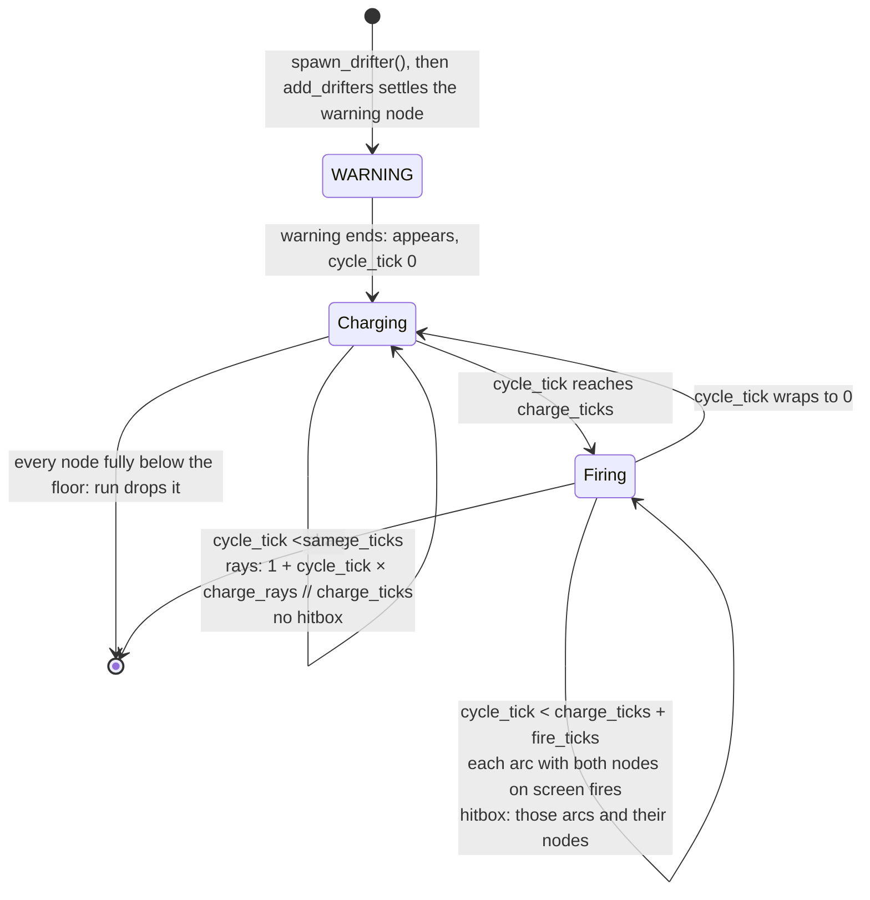

# Drifters, the chain lightning, core
Part of: drifters
Read when: you change how the chain lightning behaves (`chain_lightning.py`).

## Diagram

Chain lightning cycle (DRA-47). `cycle_tick = ticks_in_phase % (charge_ticks + fire_ticks)` while ACTIVE:


Chain lightning timeline, `pair_flat`, Level 1, placed at x 320 with no y and no `invert`, added at the end of tick T with the ship at (320, 240). Nodes at offsets (−64, 0) and (64, 0); 140 × 12; `charge_ticks` 120, `fire_ticks` 120, `charge_rays` 4; speed 2.4675:
```
state after tick   T        T+1..T+59   T+60       T+90      T+120     T+150     T+179     T+180     T+259     T+260
phase              WARNING  WARNING     ACTIVE     ACTIVE    ACTIVE    ACTIVE    ACTIVE    ACTIVE    ACTIVE    dropped
ticks_in_phase     0        1..59       0          30        60        90        119       120       199
y                  -6.00    -6.00       -6.00      68.03     142.05    216.08    287.63    290.10    485.03    487.50
charging / firing  -        -           charging   charging  charging  charging  charging  firing    firing
rays per node      0        0           1          2         3         4         4         0         0
firing arcs        ()       ()          ()         ()        ()        ()        ()        (0,)      (0,)
hitbox             none     none        none       none      none      none      none      line + 2 circles
warning shows at   (256, 12)
```
Both nodes are 64 px from the ship in x and equally far in y, so the tie picks the left node, x 256. The warning is 24 px across like every warning, so `R` = 12 and its center sits at y 12. On T+259 the nodes' top edges are at 479.03, still on screen, so the arc fires; on T+260 the top edge is at 481.50 and the run drops it. At Level 1 a chain that starts at the top fires once, on 80 ticks, from y ≈ 290 down; it never charges a second time (see Rationale). At Level 8: speed 2.4675 × 1.42 ≈ 3.5039, charge `ceil(120 × 0.70)` = 84 ticks, fire still 120.

## Interface

### game/core/drifters/chain_lightning.py (DRA-47)
```python
# Imports: stdlib (math, enum), core.collision, core.world, core.drifters.base, core.drifters.registry.
type Point = tuple[float, float]         # px, y down
type ArcNodes = tuple[int, int]          # two node indices, from 0

class InvertMirror(Enum):
    LEFT_RIGHT = "left_right"            # invert negates every node x
    TOP_BOTTOM = "top_bottom"            # invert negates every node y (the triangle: point down)

@dataclass(frozen=True, slots=True)
class ChainLayout:
    """One layout: where the nodes sit and which ones the lightning joins."""
    nodes: tuple[Point, ...]             # 2 or 3 node centers, px offsets from the chain's center, before invert
    arcs: tuple[ArcNodes, ...]           # the node pairs the lightning joins, at least one
    invert_mirror: InvertMirror          # what invert does to this layout

@dataclass(frozen=True, slots=True)
class ChainLightningVariantExtra(VariantExtra):
    """The chain lightning's per-variant value: its layout."""
    layout: ChainLayout

@dataclass(frozen=True, slots=True, kw_only=True)
class ChainLightningTypeExtra(DrifterTypeExtra):
    """The chain lightning's values that hold for every variant. Final numbers, px and ticks."""
    node_size: float          # node diameter, px, > 0
    arc_width: float          # arc thickness, px, > 0, <= node_size
    charge_ticks: int         # Level 1 charge, ticks, >= 1. Scaled at birth
    fire_ticks: int           # fire, ticks, >= 1. Never scaled
    charge_rays: int          # most rays per node, >= 1
    ray_length: float         # px, > 0, out from the node's edge
    ray_width: float          # px, > 0
    warning_layout: ChainLayout   # the layout the entry warning shows, whatever the variant

def mirrored_nodes(layout: ChainLayout, invert: bool) -> tuple[Point, ...]: ...
    # layout.nodes unchanged without invert. With it: (-x, y) for LEFT_RIGHT, (x, -y) for TOP_BOTTOM.
def layout_size(nodes: Sequence[Point], node_size: float) -> tuple[float, float]: ...
    # (width, height), px, of the box around every node circle: the spread of the centers + node_size.
def chain_hitbox(nodes: Sequence[Point], arcs: Sequence[ArcNodes], node_size: float,
                 arc_width: float) -> Hitbox: ...
    # Offsets from the chain's center: one Line per arc, node center to node center, thickness
    # arc_width, in arcs order; then one Circle per node, radius node_size / 2, in node order.

@register_drifter
@dataclass(frozen=True, slots=True, kw_only=True)
class ChainLightning(Drifter):
    """Telegraphed link. Falls straight down, charges, then fires arcs between its nodes, again
    and again until it leaves. drifters/03-chain-lightning.md."""
    drifter_type: ClassVar[DrifterType] = DrifterType.CHAIN_LIGHTNING
    invert: bool = False                  # the placement's invert
    nodes: tuple[Point, ...] = ()         # node centers, px offsets from (x, y), invert applied
    arcs: tuple[ArcNodes, ...] = ()       # node index pairs, from the variant
    node_size: float = 0.0                # node diameter, px
    arc_width: float = 0.0                # arc thickness, px
    charge_ticks: int = 1                 # final charge, ticks: Timer × applied, never below telegraph_min
    fire_ticks: int = 1                   # fire, ticks, never scaled
    charge_rays: int = 1                  # most rays per node
    ray_length: float = 0.0               # px, out from the node's edge
    ray_width: float = 1.0                # px
    warning_layout: ChainLayout | None = None   # the entry warning's icon layout, before invert, never inverted
    warning_node: int | None = None       # index of the node the warning shows above. Set by settle_warning

    @classmethod
    def born(cls, birth: Birth) -> Self: ...
    @classmethod
    def start_position(cls, x: float | None, y: float | None, width: float, height: float,
                       invert: bool) -> tuple[float, float]: ...
        # x is required: None raises ValueError("chain_lightning placement needs x"). y None: -height / 2.
    def update(self, ctx: TickContext) -> Self: ...
    @classmethod
    def telegraph_ticks(cls, type_extra: DrifterTypeExtra | None) -> int | None: ...
        # The charge, ticks, from ChainLightningTypeExtra: the telegraph before an arc fires.
    def effect_on_touch(self) -> TouchEffect: ...     # TouchEffect.HIT
    def is_charging(self) -> bool: ...                # ACTIVE and cycle tick < charge_ticks
    def is_firing(self) -> bool: ...                  # ACTIVE and cycle tick >= charge_ticks
    def charge_ray_count(self) -> int: ...            # rays per node now; 0 unless charging
    def node_centers(self) -> tuple[Point, ...]: ...  # screen px: (x + offset x, y + offset y), node order
    def nodes_on_screen(self) -> tuple[bool, ...]: ...    # per node: its node_size square shares area with the screen
    def firing_arcs(self) -> tuple[int, ...]: ...     # indices into arcs that fire now, ascending; () unless firing
    def current_hitbox(self) -> Hitbox: ...           # placed: the firing arcs, then the nodes they touch; () otherwise
    def warning_center(self) -> tuple[float, float]: ...   # above the settled node, against the top edge
    def warning_copy(self) -> Self: ...               # itself in the warning layout, sized on it
    def settle_warning(self, ctx: TickContext) -> Self: ...   # sets warning_node: the node nearest the ship
```
The fields have defaults so `born_drifter` can build the chain lightning before `born` sets them. `app.tuning` imports `ChainLayout`, `InvertMirror`, `ChainLightningVariantExtra`, `ChainLightningTypeExtra`, `layout_size` and `chain_hitbox` to build the tuning records, so the hitbox is worked out in one place.

## Rules

Chain lightning (`core/drifters/chain_lightning.py`, DRA-47). Source: drifters/03-chain-lightning.md; scope report DRA-47:
- **Archetype:** Telegraphed link. A moving drifter: its speed is its on-screen speed and the scroll doesn't add to it. Source: archetype, kind (locked); rule 4; 03-world-and-camera.md, rule 9.
- **One drifter.** Its 2 or 3 nodes are parts of it, never drifters of their own. `x`, `y` is the center of the box around all its nodes; `nodes` holds each node's offset from it. All nodes move together. `width` and `height` are the box around every node circle, so entering, leaving and the debug label use the whole chain. Source: rule 1.
- **Layout.** A variant is its layout: node positions, arcs and what `invert` does. The tuning file gives node positions in units of `node_spacing`; `app.tuning` multiplies them by it and builds `ChainLayout` in px, `width` and `height` with `layout_size`, and the un-inverted `hitbox` with `chain_hitbox`. Arcs join neighbouring nodes along the shape, left to middle to right; the triangle also joins its two ends. The seven layouts, in units (y down, from the chain's center), with their size at `node_spacing` 128 and `node_size` 12. Source: Layouts table, node_spacing, node_size (guess); 91-decision-log.md, row 62:

  | Variant | Nodes | Arcs | invert_mirror | Width × height, px |
  |---|---|---|---|---|
  | pair_flat (default) | (−0.5, 0), (0.5, 0) | (0, 1) | left_right | 140 × 12 |
  | pair_diagonal | (−0.35355339, −0.35355339), (0.35355339, 0.35355339) | (0, 1) | left_right | ≈ 102.51 × 102.51 |
  | pair_vertical | (0, −0.5), (0, 0.5) | (0, 1) | left_right | 12 × 140 |
  | trio_line | (−1, 0), (0, 0), (1, 0) | (0, 1), (1, 2) | left_right | 268 × 12 |
  | trio_diagonal | (−0.70710678, −0.70710678), (0, 0), (0.70710678, 0.70710678) | (0, 1), (1, 2) | left_right | ≈ 193.02 × 193.02 |
  | trio_l | (−0.5, −0.5), (−0.5, 0.5), (0.5, 0.5) | (0, 1), (1, 2) | left_right | 140 × 140 |
  | trio_triangle | (−0.5, 0.4330127), (0, −0.4330127), (0.5, 0.4330127) | (0, 1), (1, 2), (2, 0) | top_bottom | 140 × ≈ 122.85 |

  Diagonals are at 45° with the left node highest (y down, so the left node has the smaller y). The L is top, corner, right. The triangle has equal sides and its point up. Every arc joins two nodes 1 unit (`node_spacing`) apart. `left_right` on a layout that is already symmetric (pair_flat, pair_vertical, trio_line) changes nothing, as the GDD's "the same".
- **Born:** refuses a specialty (`ValueError("chain_lightning has no specialty")`). Reads `birth.variant_extra`, which must be a `ChainLightningVariantExtra`, else `ValueError("chain_lightning variant '<name>' has no layout")`, and `birth.type_extra`, which must be a `ChainLightningTypeExtra`, else `ValueError("chain_lightning tuning has no type values")`. Then `replace(born_drifter(cls, birth), ...)` with: `invert = birth.invert`; `nodes = mirrored_nodes(layout, birth.invert)`; `arcs = layout.arcs`; `hitbox = chain_hitbox(nodes, arcs, node_size, arc_width)`; `charge_ticks = scale_telegraph(type.charge_ticks, birth.timer_mult, birth.telegraph_min_ticks)`; `fire_ticks = type.fire_ticks`; `node_size`, `arc_width`, `charge_rays`, `ray_length`, `ray_width` and `warning_layout` from the type; `warning_node` None. Mirroring keeps the box around the nodes, so `width` and `height` stay as born. Final numbers: set once, at birth. Source: rules 1, 8; Layouts ("`invert` mirrors the layout exactly"); specialty (locked).
- **Start:** `start_position`: x is the placement's (required: `ValueError("chain_lightning placement needs x")` without it). y is the placement's, or `-height / 2` when None: the bottom of its box on the top edge, fully off screen. Source: rule 2; 07-drifters.md, rule 14.
- **Update:** in WARNING, `tick_warning(self)`. In ACTIVE, `y += speed` and `ticks_in_phase + 1`; `x` never changes. In GONE, unchanged. No targeting; the ship in `ctx` is never read. Source: rule 4.
- **Cycle.** In ACTIVE, `cycle_tick = ticks_in_phase % (charge_ticks + fire_ticks)`. `is_charging()` is True while `cycle_tick < charge_ticks`; `is_firing()` is True otherwise. Both are False outside ACTIVE. So the charge starts on the state where it appears and lasts exactly `charge_ticks` states; then every arc fires for `fire_ticks` states; then the next charge starts, until it leaves. No pause besides the charge. Source: rules 3 and 5; cycle (locked); telegraph (locked).
- **Charge rays.** `charge_ray_count()` is `1 + cycle_tick × charge_rays // charge_ticks` while charging (integer division), else 0. At Level 1 (120 ticks, 4 rays): 1 ray on cycle ticks 0 to 29, 2 on 30 to 59, 3 on 60 to 89, 4 on 90 to 119. It never passes `charge_rays`, and the last part of every charge shows them all, at every level. Source: charge_rays (guess); 91-decision-log.md, row 62; scope report DRA-47, Decision log.
- **On screen.** `nodes_on_screen()` holds, for each node, whether its `node_size × node_size` square, centered on the node, shares area with the screen: `nx − node_size / 2 < SCREEN_W` and `nx + node_size / 2 > 0` and `ny − node_size / 2 < SCREEN_H` and `ny + node_size / 2 > 0`, strict like the base's `is_partly_on_screen`. Any part visible counts. Source: rule 5 ("any part visible").
- **Firing arcs.** `firing_arcs()` is, while firing, every arc index (ascending) whose two nodes are both on screen; otherwise (). A node that has not come in yet, or has left, takes its arcs with it; the other arcs keep firing while their own nodes are on screen. An arc stops on the first state one of its nodes is off screen. Source: rule 5; Edge cases ("A node leaves while its arc fires: that arc stops at once").
- **Hitbox.** `current_hitbox()` is `()` in WARNING and GONE, while charging, and while firing with no arc in `firing_arcs()`. Otherwise it is placed at (x, y): one `Line` per firing arc, node center to node center, thickness `arc_width`, in `firing_arcs()` order; then one `Circle` of radius `node_size / 2` for every node that is an end of at least one firing arc, in node order. A node whose arcs are all off is not a hit. The line's round ends lie inside its nodes. Source: hitbox (guess); rule 6; 07-drifters.md, rule 8; 91-decision-log.md, row 60.
- **Touch:** `effect_on_touch()` is HIT. Touching a firing arc, or a node while one of its arcs fires, is a hit; nothing hits while it charges. The run's hit test reads `current_hitbox()` as for every drifter. The graze zone (base) is the current hitbox grown by 14, so it exists only while an arc fires; nothing pays for it yet. Source: rule 6; graze (locked); 06-scoring.md, rule 3; scope report DRA-47, Out (graze scoring).
- **Hitting again:** the shared re-hit cooldown. The whole chain is one hazard with one counter: after a hit no part of it can hit for `rehit_cooldown_ticks`, and `brightness()` dims every node, ray and band together. It keeps falling and keeps its cycle. A touch while the ship is invulnerable is no hit and the arc keeps firing; a ship still inside the arc when invulnerability ends is not hit again until the cooldown ends. Source: Edge cases; 05-lives-and-damage.md, rule 1.5; 91-decision-log.md, row 54.
- **Warning node.** `settle_warning(ctx)` sets `warning_node` to the index of the node whose center (`node_centers()`) has the smallest squared distance to the ship's center (`ctx.ship.x`, `ctx.ship.y`). On equal distances, the node with the smaller x; on equal x too, the lower index. Called once, by `add_drifters`, on the birth state, which is the first state drawn with the warning: "when the warning starts". Source: rule 2; 91-decision-log.md, row 62.
- **Warning place.** `warning_center()`, with `R = ENTRY_WARNING_SIZE / 2` (12): the settled node's center (or the chain's own (x, y) when `warning_node` is None) with x clamped into `[R, SCREEN_W − R]` and y into `[R, SCREEN_H − R]`, so the whole warning shows. A chain that starts above the top edge warns at the node's x, against the top edge, at y 12. The chain doesn't move in WARNING, so the warning stays where it started. Source: rule 2; 07-drifters.md, rule 9.
- **Warning copy.** `warning_copy()` is `replace(self, nodes=warning_layout.nodes, arcs=warning_layout.arcs, width=..., height=..., hitbox=...)` with `width` and `height` from `layout_size(warning_layout.nodes, node_size)` and the hitbox from `chain_hitbox`: the `trio_triangle` layout, point up, never mirrored, whatever the variant or `invert`. It is in WARNING like its owner, so it is drawn as nodes only. `warning_tilt_degrees()` is the base's 0. Source: entry_warning_icon (locked), entry_warning_size (guess); "The real layout is a surprise".
- **Leaving:** the base rule. Its box is fully below the floor exactly when every node is. It starts fully above the top edge, so it is never removed before it has entered. Source: rule 7; 07-drifters.md, rules 12 and 14.
- **Values at Level 1** (all guess but `telegraph_min`): `speed_ratio` 0.375 × `TOP_SIDE_SPEED` ≈ 2.4675 px/tick; `charge_ticks` 120; `fire_ticks` 120; `charge_rays` 4; `ray_length` 6; `ray_width` 1; `node_spacing` 128; `node_size` 12; `arc_width` 6; `entry_warning_ticks` 60. Charge by level, 120 × Timer × rounded up: 120, 113, 107, 102, 98, 93, 89, 84, all above `telegraph_min` 45. With `timer_scaling` off, 120 at every level. Source: Values table; 08-difficulty.md, Timer × row and rules 4 and 5; 07-drifters.md, telegraph_min.
- **No specialty.** It accepts `invert`, `variant`, `x`, `y`, `speed` (the debug list) and `as_level`. Arcs pass over coins and other drifters with no effect. Source: specialty (locked); 07-drifters.md, rule 15.
