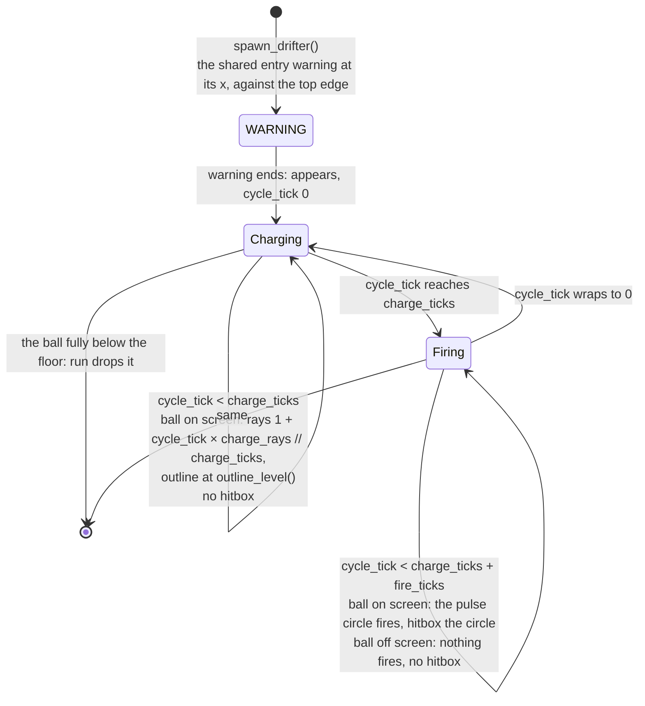

# Drifters, the electric ball, core
Part of: drifters
Read when: you change how the electric ball behaves (`electric_ball.py`) or its tuning file.

## Diagram

Electric ball cycle. `cycle_tick = ticks_in_phase % (charge_ticks + fire_ticks)` while ACTIVE:


Electric ball timeline, placed with x and no y, added at the end of tick T. `W` = `warning_ticks`, `C` = `charge_ticks`, `F` = `fire_ticks`, `R` = `charge_rays`, `v` = `speed`, `h` = the ball's height, `n` = `ticks_in_phase` while ACTIVE, `c` = `n % (C + F)`:
```
state after tick   T        T+1..T+W−1   T+W        T+W+n, c < C        T+W+n, c >= C         first state with y − h/2 >= SCREEN_H
phase              WARNING  WARNING      ACTIVE     ACTIVE              ACTIVE                dropped by the run
y                  −h/2     −h/2         −h/2       −h/2 + n × v        −h/2 + n × v
ball on screen     no       no           no         yes (n >= 1)        yes, until it leaves
charging / firing  -        -            charging   charging            firing
rays               0        0            0          1 + c × R // C      0
outline_level()    0        0            0          rays / R            0
hitbox             none     none         none       none                the pulse circle
```
On the state where it appears the ball's box touches the top edge from above, so nothing of the charge shows yet; from the next state on, the ball and its charge are on screen together. The warning shows at the ball's x against the top edge (the base `warning_center()`). With a placed `y` on screen, the ball appears there and shows its charge from that state on.

## Interface

A brief of what DRA-111 adds. Existing code is read from the files.

### game/core/drifters/base.py
```python
class DrifterType(Enum):
    ...
    ELECTRIC_BALL = "electric_ball"   # drifters/10-electric-ball.md. DRA-111. Added last, after UFO
```

### game/core/drifters/electric_ball.py (new, DRA-111)
```python
# Imports: stdlib (dataclasses, typing), core.collision, core.world, core.drifters.base,
# core.drifters.registry. Never pygame, ui or app.
PULSE_DRAW_MARGIN: Final[float]   # px. The fireball's DRAW_MARGIN, for the circles the view draws at a
                                  # rounded center. Not a game value (rationale part)

@dataclass(frozen=True, slots=True)
class ElectricBallVariantExtra(VariantExtra):
    """The electric ball's per-variant value: how far its pulse reaches."""
    pulse_radius: float          # px, from the ball's center, > half the ball's size

@dataclass(frozen=True, slots=True, kw_only=True)
class ElectricBallTypeExtra(DrifterTypeExtra):
    """The electric ball's values that hold for every variant. Final numbers, px and ticks."""
    charge_ticks: int            # Level 1 charge, ticks, >= 1. Scaled at birth
    fire_ticks: int              # fire, ticks, >= 1. Never scaled
    charge_rays: int             # most rays around the ball, >= 1
    ray_length: float            # px, > 0, out from the ball's edge
    ray_width: float             # px, > 0
    outline_width: float         # px, > 0: the charge outline of the pulse circle
    rim_width: float             # px, > 0: the firing circle's bright rim, inside the circle
    fill_opacity: float          # > 0 and <= 1: how opaque the firing circle's fill is

def electric_ball_hitbox(pulse_radius: float) -> Hitbox: ...
    # (Circle(0.0, 0.0, pulse_radius),): the firing circle, as an offset from the ball's center.
def check_electric_ball_variant(ball_size: float, pulse_radius: float) -> None: ...
    # Raises ValueError unless the pulse circle reaches past the ball (Rules, Tuning checks).

@register_drifter
@dataclass(frozen=True, slots=True, kw_only=True)
class ElectricBall(Drifter):
    """Pulse node. Falls straight down, charges, then fires a circle of lightning around itself,
    again and again until it leaves. drifters/10-electric-ball.md."""
    drifter_type: ClassVar[DrifterType] = DrifterType.ELECTRIC_BALL
    pulse_radius: float = 0.0      # px, from the variant
    charge_ticks: int = 1          # final charge, ticks: Timer × applied, never below telegraph_min
    fire_ticks: int = 1            # fire, ticks, never scaled
    charge_rays: int = 1           # most rays
    ray_length: float = 0.0        # px, out from the ball's edge
    ray_width: float = 1.0         # px
    outline_width: float = 1.0     # px
    rim_width: float = 1.0         # px
    fill_opacity: float = 0.0      # 0..1

    @classmethod
    def born(cls, birth: Birth) -> Self: ...
    @classmethod
    def start_position(cls, x: float | None, y: float | None, width: float, height: float,
                       invert: bool) -> tuple[float, float]: ...
        # x is required: None raises ValueError("electric_ball placement needs x"). y None: -height / 2.
    def update(self, ctx: TickContext) -> Self: ...
    @classmethod
    def telegraph_ticks(cls, type_extra: DrifterTypeExtra | None) -> int | None: ...
        # The charge, ticks, from ElectricBallTypeExtra: the telegraph before the circle fires.
    def effect_on_touch(self) -> TouchEffect: ...     # TouchEffect.HIT
    def is_charging(self) -> bool: ...                # ACTIVE and cycle tick < charge_ticks
    def is_firing(self) -> bool: ...                  # ACTIVE and cycle tick >= charge_ticks
    def ball_on_screen(self) -> bool: ...             # the ball's box shares area with the screen
    def pulse_fires(self) -> bool: ...                # is_firing() and ball_on_screen()
    def charge_ray_count(self) -> int: ...            # rays now; 0 unless charging with the ball on screen
    def outline_level(self) -> float: ...             # the charge outline's share of full color, 0..1
    def current_hitbox(self) -> Hitbox: ...           # the placed pulse circle while pulse_fires(); () otherwise
    def drawn_parts(self) -> tuple[Box, ...]: ...     # the ball's box, and the pulse box while the ball is on screen
```
The fields have defaults so `born_drifter` can build the electric ball before `born` sets them. `app.tuning` imports `ElectricBallVariantExtra`, `ElectricBallTypeExtra`, `electric_ball_hitbox` and `check_electric_ball_variant` to build and check the tuning records, so the hitbox and the check each have one home. It uses the base `graze_zone`, `is_partly_on_screen`, `mark_entered`, `is_off_screen`, `warning_center`, `warning_tilt_degrees`, `warning_copy`, `settle_warning`, `start_size`, `may_hit_ship`, `brightness`, `collect_points`, `collect_popup` and `gravity_well`. `parked` and `seeded` stay False.

### game/core/drifters/__init__.py
Gains one import line, `electric_ball`, in sorted order (between `coin` and `fireball`).

## Rules

Electric ball (`core/drifters/electric_ball.py`, DRA-111). Source: drifters/10-electric-ball.md; scope report DRA-111:
- **Archetype:** Pulse node. A moving drifter: its speed is its on-screen speed and the scroll doesn't add to it. No targeting. Source: archetype, kind (locked); rule 3; 03-world-and-camera.md, rule 9.
- **One drifter.** Its size is its ball: `width` and `height` are `ball_size`, and `x`, `y` is the ball's center. The pulse circle is part of it, never a drifter of its own; it joins through the hitbox and `drawn_parts()`. Source: ball_size, pulse_radius, hitbox (guess).
- **Variants:** one, `standard`, the default. A variant gives `ball_size` and `pulse_radius`; `app.tuning` builds `width` = `height` = `ball_size`, the hitbox with `electric_ball_hitbox(pulse_radius)` and `extra` = `ElectricBallVariantExtra(pulse_radius)`. A new size is a new entry in the tuning file with no code. The timings are type values, the same for every variant (rationale part). Source: variants, default_variant (guess); How to extend; 07-drifters.md, rule 10.
- **Hitbox:** one circle of radius `pulse_radius`, centered on the ball. The ball itself has none, ever. `electric_ball_hitbox` is the one place that rule lives. Source: hitbox (guess); rule 5; 07-drifters.md, rule 8.
- **Born:** refuses a specialty (`ValueError("electric_ball has no specialty")`). Reads `birth.variant_extra`, which must be an `ElectricBallVariantExtra`, else `ValueError("electric_ball variant '<name>' has no pulse_radius")`, and `birth.type_extra`, which must be an `ElectricBallTypeExtra`, else `ValueError("electric_ball tuning has no type values")`. In that order. `birth.invert` is accepted and changes nothing. Then `replace(born_drifter(cls, birth), ...)` with `pulse_radius` from the variant extra; `charge_ticks = scale_telegraph(type.charge_ticks, birth.timer_mult, birth.telegraph_min_ticks)`; `fire_ticks`, `charge_rays`, `ray_length`, `ray_width`, `outline_width`, `rim_width` and `fill_opacity` from the type. The hitbox is `birth.hitbox`, as the loader built it. It stays in WARNING with `ticks_in_phase` 0, as every hazard. Final numbers, set once, at birth. Source: specialty (locked: none); rules 7 and 8.
- **Start:** `start_position`: x is the placement's (required: `ValueError("electric_ball placement needs x")` without it). y is the placement's, or `-height / 2` when None: the ball's box touching the top edge from above, fully off screen. Nothing else of it is drawn while the ball is off screen (Drawn parts), so that is "fully off screen, touching that edge". `invert` is not read. Source: rule 1; 07-drifters.md, rule 14.
- **Warning:** the shared entry warning, `entry_warning_ticks` long: the base `warning_center()`, at its x against the top edge for a top start. The copy is the electric ball itself (the base `warning_copy()`); in WARNING it neither charges nor fires, so the copy is the ball alone. It doesn't move while the warning shows and turns ACTIVE where it was placed. Source: rule 1; 07-drifters.md, rule 9, entry_warning_look.
- **Update:** in WARNING, `tick_warning(self)`. In ACTIVE, `y += speed` and `ticks_in_phase + 1`; `x` never changes. In GONE, unchanged. The ship in `ctx` and `ctx.scroll_step_px` are never read. Source: rule 3.
- **Cycle.** In ACTIVE, `cycle_tick = ticks_in_phase % (charge_ticks + fire_ticks)`. `is_charging()` is True while `cycle_tick < charge_ticks`; `is_firing()` is True otherwise. Both are False outside ACTIVE. So the charge starts on the state where it appears and lasts exactly `charge_ticks` states; then the fire lasts `fire_ticks` states; then the next charge starts, until it leaves. No pause besides the charge. The cycle runs whether or not the ball is on screen. Source: rules 2 and 4; cycle (locked); telegraph (locked).
- **Ball on screen.** `ball_on_screen()` is True when the ball's box, `Box(x, y, width, height)`, shares area with the screen, strict like the base's `is_partly_on_screen`: `x − width / 2 < SCREEN_W` and `x + width / 2 > 0` and `y − height / 2 < SCREEN_H` and `y + height / 2 > 0`. Any part visible counts. Source: rule 4 ("any part visible").
- **Shown only with the ball.** The charge (rays and outline) and the fire show only while `ball_on_screen()`. Off screen the cycle keeps counting, but no ray shows, the outline is at 0, and nothing fires. Source: rule 4 (it fires only while the ball is on screen; the charge look shows only while the ball is on screen; off screen the cycle keeps counting, but nothing shows); rule 6 and 07-drifters.md, rule 12 (it is removed once the ball is fully below the floor, and nothing of it that is drawn may still be on screen then); Edge cases ("The ball leaves the screen while firing: the circle stops at once").
- **Charge rays.** `charge_ray_count()` is `1 + cycle_tick × charge_rays // charge_ticks` (integer division) while `is_charging()` and `ball_on_screen()`, else 0. One ray when the charge starts, one more each time another `1 / charge_rays` of the charge has passed, all of them for the last part, at every level. It never passes `charge_rays`. Source: telegraph (locked: "more ... as the charge fills"); drifters/03-chain-lightning.md, charge_rays and ray_length (reused: scope report DRA-111, Left to the Architect).
- **Outline level.** `outline_level()` is `charge_ray_count() / charge_rays`: 0.0 with no ray, and full (1.0) once every ray shows. The outline brightens in the same steps as the rays. Source: telegraph (locked: "a faint outline of the pulse circle brightens with them"); placeholder_look ("brighter as it fills").
- **Fires.** `pulse_fires()` is `is_firing() and ball_on_screen()`. The circle fires on every firing state with the ball partly on screen, and stops on the first state the ball is not. Source: rule 4; Edge cases.
- **Hitbox now.** `current_hitbox()` is the variant's circle placed at (x, y), `place_hitbox(hitbox, x, y)`, while `pulse_fires()`; `()` otherwise: in WARNING and GONE, while charging, and while the ball is off screen. The ball and the charge outline never hit. Source: rule 5; hitbox (guess).
- **Touch:** `effect_on_touch()` is HIT. Touching the firing circle is a hit, through the run's shared hit rules: the run's hit test reads `current_hitbox()` as for every drifter, after the update, so a ship sitting on the ball while it charges is not hit, and is hit on the first firing state if it is still inside the circle. The graze zone (base) is the current hitbox grown by the drifter's `graze_margin`, so it exists only while the circle fires; the run's graze step pays for it (`systems/run.md`, step 5b), once per electric ball, and the circle stopping with the ship inside counts as leaving it. Source: rule 5; Edge cases; graze (locked); 06-scoring.md, rules 3 and 4.
- **Hitting again:** the shared re-hit cooldown. One hazard with one counter: after a hit the circle can't hit for `rehit_cooldown_ticks`, and `brightness()` dims the ball, the rays, the outline, the fill and the rim together. It keeps falling and keeps its cycle. A touch while the ship is invulnerable is no hit and the circle keeps firing; a ship still inside the circle when invulnerability ends is not hit again until the cooldown ends. Source: Edge cases; 05-lives-and-damage.md, rule 1.5.
- **Drawn parts:** `drawn_parts()` is `(Box(x, y, width, height),)` while the ball is off screen, and `(Box(x, y, width, height), Box(x, y, side, side))` while `ball_on_screen()`, with `side = 2 × (max(pulse_radius, width / 2 + ray_length) + PULSE_DRAW_MARGIN)`: the box around the pulse circle and the rays. Entering and leaving judged on these boxes are exactly entering and leaving judged on the ball. Source: 07-drifters.md, rule 12; this part, Shown only with the ball.
- **Leaving:** the base rule on those boxes. It starts fully above the top edge, so it is never removed before it has entered. Once it has, it is removed on the first state its ball is fully below the floor: `y − height / 2 >= SCREEN_H`. If it was firing, the circle stopped on that state already. Source: rule 6; 07-drifters.md, rules 12 and 14.
- **Scales:** at birth. `speed` × the level's hazard speed (the spawner); `charge_ticks` × the level's Timer ×, rounded up, never below `telegraph_min` (`scale_telegraph` in `born`). `fire_ticks`, `pulse_radius`, `ball_size`, the rays, the widths and `fill_opacity` never scale; neither does the entry warning. With the playtest switches off, Level 1 values. Source: rule 7; 08-difficulty.md, rules 3 to 5; 07-drifters.md, telegraph_min (locked).
- **Placement fields:** `x` (required), `y`, `variant`, `invert` (no effect), `as_level`, and `speed` (the debug list only). A specialty and a seed are refused (`electric_ball has no specialty`, `electric_ball has no seed`). Source: rule 8; 07-drifters.md, rules 13 and 14; scope report DRA-111, Limits and Decision log.
- **Flies freely.** The circle passes over coins, islands and other drifters with no effect. Source: Edge cases; 07-drifters.md, rule 15.
- **Values:** every number it uses comes from its tuning file or `hazards.json`; none is in code. Only the look's colors stay in the view. Source: scope report DRA-111, Limits ("Every value in a tuning file, never hard-coded").

Tuning (`game/tuning/drifters/electric_ball.json`, to `docs/contracts/schemas/electric-ball-tuning.schema.json`). Loaded by `app.tuning` (`systems/app.md`, tuning-loader part):
- **The electric ball's file.** The shared `default_variant`, `variants`, `speed_ratio` and `entry_warning_ticks`, and its own type values `charge_ticks`, `fire_ticks`, `charge_rays`, `ray_length`, `ray_width`, `outline_width`, `rim_width` and `fill_opacity`. Each variant gives `ball_size` and `pulse_radius`, and no `width`, `height` or `hitbox`. Where each value comes from, by key: `default_variant`, `variants`, `ball_size`, `pulse_radius`, `speed_ratio`, `charge_ticks`, `fire_ticks` and `fill_opacity` from drifters/10-electric-ball.md, Values; `entry_warning_ticks` from 07-drifters.md, Values; `charge_rays` and `ray_length` from drifters/03-chain-lightning.md, Values (reused: scope report DRA-111, Left to the Architect); `ray_width` and `outline_width` are the placeholder_look's 1 px, `rim_width` its 2 px rim. `fill_opacity` is the opacity of the placeholder_look's translucent fill, kept in tuning (scope report DRA-111, Left to the Architect: "Keep it in tuning").
- **What `app.tuning` builds:** per variant, after `check_electric_ball_variant` accepts it, `VariantTuning(width=float(ball_size), height=float(ball_size), hitbox=electric_ball_hitbox(float(pulse_radius)), extra=ElectricBallVariantExtra(pulse_radius=float(pulse_radius)))`; for the type, `DrifterTypeTuning(..., speed_ratio=..., entry_warning_ticks=..., extra=ElectricBallTypeExtra(...))`, every number a float but the three tick and ray counts.
- **Tuning checks.** `check_electric_ball_variant(ball_size, pulse_radius)` raises `ValueError("pulse_radius must be more than ball_size / 2 (<pulse_radius> <= <half>)")`, numbers in `g` format, unless `pulse_radius > ball_size / 2`: the circle reaches past the ball it is fired around. `app.tuning` calls it per variant. Source: Summary ("a full circle of lightning around itself"); hitbox (guess); the planet's `pull_radius > size / 2` precedent (DRA-96).

For wave_check (built in `tools/wave_check/` by the main session, outside this contract's tasks; 09-waves.md, rule 7). wave_check asks the drifter, never its type:
- `telegraph_ticks(type_extra)` returns the file's `charge_ticks`, so the existing telegraph check scales it by the level's Timer × and fails a wave when the charge at a level drops below `telegraph_min`, as rule 10 asks for Level 8. No new wave_check code. Source: rule 10; 07-drifters.md, rule 2.
- `effect_on_touch()` is HIT, so it is a hazard for the seam, placement and coin-near checks, measured from `current_hitbox()` and `graze_zone()`, which exist only while the circle fires. The bot's own use of the circle (rule 10, second sentence) is out of scope (scope report DRA-111, Out). Source: rule 10.

Logging: `core.drifters.electric_ball` logs nothing. The run logs spawn, active, touch and gone, as for every drifter (`systems/run.md`, Logging). Source: 15-tech-constraints.md, rule 9.
