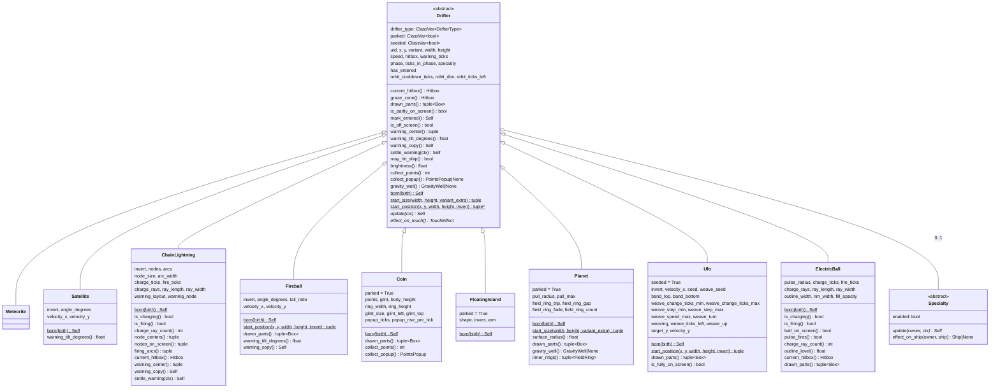
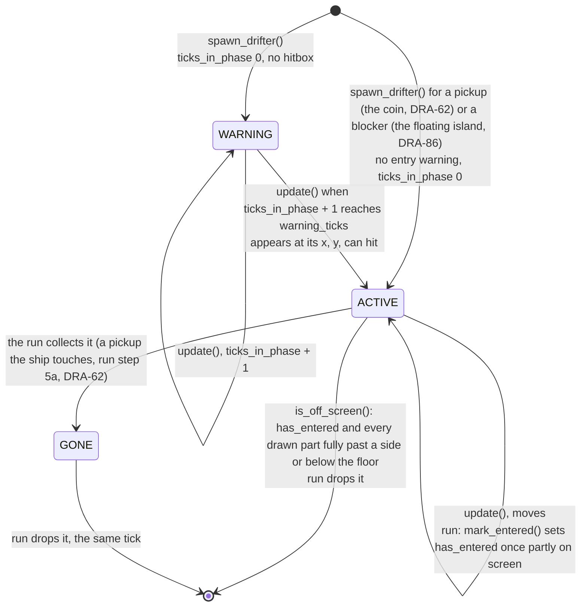
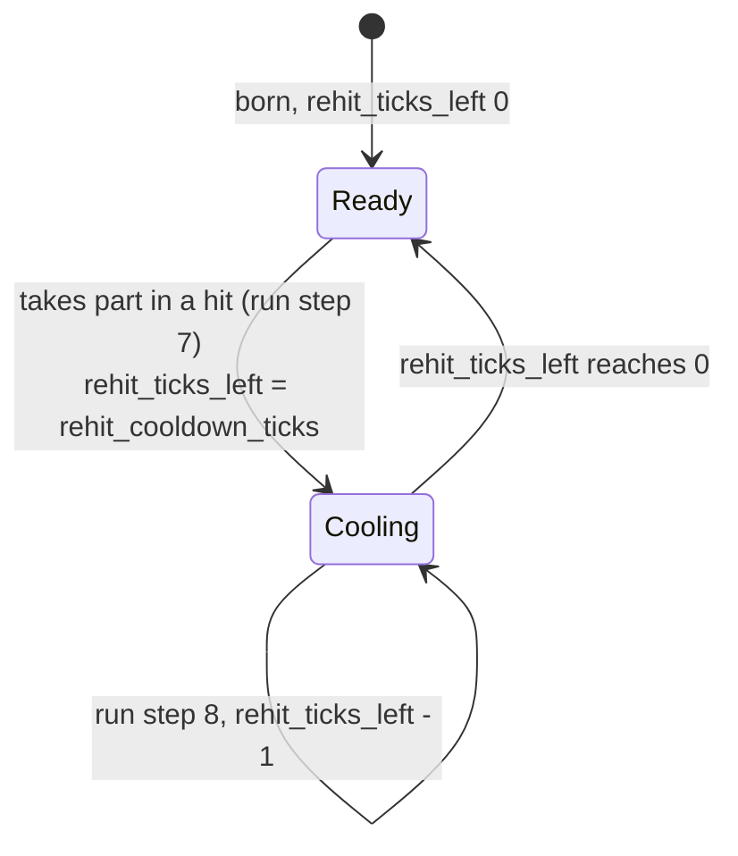

# Drifters, the base
Part of: drifters
Read when: you change what every drifter shares: phases, warning, hitbox, start, re-hit.

## Purpose

Every drifter in the game, hazards, pickups and blockers, is built on one shared base. This contract holds that base, the hitbox shapes (circle, box, line and convex polygon), their overlap test and the push-out measure the ship's island block uses, the level table (the spawner reads its hazard speed × and Timer ×, the scroll its scroll speed ×, the waves its Rest gap ×), the spawner (the only way a drifter is created) and the placement seed, the drifters built so far (seven hazards: the meteorite, the satellite, the chain lightning, the fireball, the planet, the UFO and the electric ball; one pickup: the coin; one blocker: the floating island), and the views that draw drifters and their entry warnings. How an island blocks the ship and how a planet pulls it are the ship's rules (`docs/contracts/systems/ship.md`); this contract holds the island and the planet themselves, the geometry the block is measured with, and the field a planet hands the ship step.

The base holds the rules every drifter shares: the entry warning (where it shows, what its copy looks like), the hitbox, the graze zone, the parts of the drifter that are drawn, where a drifter starts and when it has entered the screen and left it (all judged on those drawn parts), the re-hit cooldown with its dim look, how a timer scales with level, whether the drifter is parked (it moves only with the scroll) or moving, what a pickup pays when it is collected (its points and its points popup), whether the drifter has a gravity field that pulls the ship, and whether its path comes from a seed (a seeded drifter: the UFO). A drifter carries final numbers only. The spawner reads the level and the shared hazard values once, at birth, and sets the drifter's speed, its speed and timer factors and its cooldown length, and hands a seeded drifter its placement's seed; a parked drifter gets no speed of its own. The drifter never knows the level. Each tick it may read the ship and how far the world scrolls on that tick (`TickContext`). The run (`docs/contracts/systems/run.md`) holds the drifters, lets each fix its warning from the ship when it is added, updates them every tick, marks when each has entered, collects the pickups the ship touches, tests the hazards against the ship, starts and counts down their cooldowns, and drops them when they leave or are collected.

Structure chosen by the Director (scope report DRA-29, Limits and Decision log): inheritance, a thin abstract base, one subclass per drifter, one level deep, no middle classes. Shared bits are helper functions. Guards: abstract methods, a registry that refuses duplicates, a test that the drifter list, the tuning files, the classes and the views all match, and collision tests that fail when a shape kind has no cases (scope report DRA-39, Limits).

## Diagram

Class shape. One level deep:


Life of one drifter:


Re-hit cooldown of one hazard (the run sets and counts it, `systems/run.md`, steps 7 and 8):

```
hit on tick T, rehit_cooldown_ticks 180
state after tick    T      T+1 .. T+179    T+180    T+181
rehit_ticks_left    180    179 .. 1        0        0, or 180 if it hits on T+181
may_hit_ship()      no     no              yes
brightness()        0.75   0.75            1.0
```
It can't hit on ticks T+1 to T+180, the 180 ticks after the hit, and can hit again from tick T+181. It is drawn dim on the 180 states after ticks T to T+179, and at full brightness from the state after tick T+180. The same pattern as invulnerability (`systems/run.md`, blink timeline).

## Rules

Values. Every constant above has its value and source on its line. Variant sizes, hitboxes, angles, layouts, speed, warning length, the chain lightning's sizes and timers, the fireball's head widths, angle and tail size, `rehit_cooldown`, `rehit_dim` and every look value are `guess` in the GDD. `DRAW_MARGIN` is not a game value (Rationale). The level table's Hazard speed row, `graze_margin`, `telegraph_min` and the chain lightning's `entry_warning_icon` are locked. Variant, angle, layout, size, timer, ray and speed values are not in code: they come from the tuning files (Tuning files, below). `rehit_cooldown`, `rehit_dim` and `telegraph_min` (DRA-47) have their defaults in `core/drifters/base.py` and may be set in `game/tuning/hazards.json`. Colors stay constants in the views, as for every placeholder look so far (see Rationale). The coin's values (DRA-62) are all `guess` but `common` 50 and its locked rows; its popup rise (0.5 px a tick) and its glint are Director approvals not in the GDD (scope report DRA-62, Not in GDD); all of them come from `game/tuning/drifters/coin.json`. The floating island's values (DRA-86) are all `guess` but its locked rows (archetype, enters_from, kind, scroll_kind, entry_warning, telegraph, specialty, graze); its sizes, shapes and `arm` come from `game/tuning/drifters/floating_island.json`; its colors and its 2 px edge stay in its view. The planet's values (DRA-96) are all `guess` but its locked rows (archetype, enters_from, kind, pull_shape, telegraph, specialty, graze, look_pick); its size, `pull_radius`, `pull_max`, entry warning and the field rings' trip, gap, fade and count come from `game/tuning/drifters/planet.json`; its two colors and the 1 px ring width stay in its view. `FIELD_DRAW_MARGIN` is not a game value (Rationale). The UFO's values (DRA-104) are all `guess` but its locked rows (archetype, enters_from, kind, seed, telegraph, specialty, graze); its disc and dome sizes, `speed_ratio`, entry warning, weave values and band come from `game/tuning/drifters/ufo.json`; its two colors stay in its view. `DOME_DRAW_MARGIN`, `ARRIVAL_TOLERANCE_PX` and `MAX_SEED` are not game values (Rationale). The electric ball's values (DRA-111) are all `guess` but its locked rows (archetype, enters_from, kind, cycle, telegraph, specialty, graze) and `telegraph_min`; its sizes, `speed_ratio`, timings, rays, widths and fill opacity come from `game/tuning/drifters/electric_ball.json`; its four colors stay in its view. `PULSE_DRAW_MARGIN` is not a game value (`electric-ball/rationale.md`).

The base (`core/drifters/base.py`):
- **Position.** `x`, `y` are the drifter's center in screen px, y down. Source: scope report DRA-29, Limits.
- **Phase.** Every hazard is born in WARNING with `ticks_in_phase` 0. A pickup has no entry warning: the coin is born ACTIVE (Coin, Born; DRA-62). Neither has a blocker: the floating island is born ACTIVE (Floating island, Born; DRA-86). In WARNING it can't touch anything: `current_hitbox()` is `()`. `tick_warning` adds one tick; once `ticks_in_phase + 1` reaches `warning_ticks`, the drifter turns ACTIVE with `ticks_in_phase` 0, at its placed position, and can touch from that tick on. So the warning shows on exactly `warning_ticks` states. Entry warnings never scale with level. Source: 07-drifters.md, rules 1 and 9; 08-difficulty.md, rule 4.
- **Hitbox.** In ACTIVE, `current_hitbox()` is the variant's hitbox placed at (x, y). In WARNING and GONE it is `()`. Source: 07-drifters.md, rules 8 and 9.
- **Graze zone.** `graze_zone()` is the current hitbox grown by `GRAZE_MARGIN` (14 px), only for a drifter whose `effect_on_touch()` is HIT. Others have `()`. It is computed and drawn in the debug overlay only; nothing pays for it yet. Source: 06-scoring.md, rules 3 and 5; scope report DRA-39, Out (graze scoring).
- **Drawn parts** (DRA-56). `drawn_parts()` returns upright boxes, in screen px, that together hold every pixel the drifter's view draws while ACTIVE. The base returns one box, the footprint: `Box(x, y, width, height)`. That holds the whole look of the meteorite (a disc as wide as it) and the satellite (its two boxes inside 36 × 12). A drifter whose look reaches outside its footprint overrides it (the fireball: its tail). The chain lightning keeps the footprint: its rays reach up to `ray_length` past its nodes' box, the one exception 07-drifters.md, rule 12 names, kept as it is (drifters/03-chain-lightning.md, rule 7: it leaves once every node is below the floor). The electric ball (DRA-111) adds the box of its pulse circle only while its ball is on screen, because its charge and fire show only then (`electric-ball/core.md`, Drawn parts). Entering and leaving are judged on these boxes, so a drifter is fully off screen only when nothing of it that is drawn is still on screen. Source: 07-drifters.md, rule 12; 91-decision-log.md, row 64.
- **Entering** (DRA-39, drawn parts from DRA-56). `is_partly_on_screen()` is True when any box `b` of `drawn_parts()` shares area with the screen: `b.cx - b.w / 2 < SCREEN_W` and `b.cx + b.w / 2 > 0` and `b.cy - b.h / 2 < SCREEN_H` and `b.cy + b.h / 2 > 0`. A box that only touches an edge from outside is not on screen. With the base's one footprint box this is exactly the DRA-39 test. `mark_entered()` returns the drifter with `has_entered = True` when it is ACTIVE, not yet entered, and partly on screen; otherwise it returns it unchanged. `has_entered` never goes back to False. The run calls `mark_entered()` on every drifter right after its update (`systems/run.md`, step 3). Source: 07-drifters.md, rule 12; 91-decision-log.md, row 58.
- **Leaving.** `is_off_screen()` is True only in ACTIVE, only once `has_entered` is True (DRA-39), and only when every box `b` of `drawn_parts()` (DRA-56) is fully off screen at a side or the bottom: its right edge `b.cx + b.w / 2 <= 0`, or its left edge `b.cx - b.w / 2 >= SCREEN_W`, or its top edge `b.cy - b.h / 2 >= SCREEN_H`. Each box may leave by a different edge. A box above the top edge does not count as off: never at the top, where drifters enter, and never while the warning shows. A drifter that has not yet been at least partly on screen is never off screen, wherever it is. Fully below the floor uses the same test as the ship (`systems/ship.md`, step 8). With the base's one footprint box this is exactly the DRA-39 test. Source: 07-drifters.md, rule 12; 91-decision-log.md, rows 58 and 64; drifters/01-meteorite.md, rule 5; drifters/02-satellite.md, rule 5; drifters/06-fireball.md, rule 5.
- **Warning place.** `warning_center()` is (x, y) clamped so the whole warning lies on the screen, whatever the drifter's size: x into `[ENTRY_WARNING_SIZE / 2, SCREEN_W - ENTRY_WARNING_SIZE / 2]`, y into `[ENTRY_WARNING_SIZE / 2, SCREEN_H - ENTRY_WARNING_SIZE / 2]` (12 px from each edge). A spot on the screen and clear of the edges is unchanged. A spot off the screen moves just inside the nearest edge, in line with it. For a top entry: at the drifter's x, against the top edge. For a side entry: at the drifter's y, against that side. Source: 07-drifters.md, rule 9; drifters/01-meteorite.md, rule 1; drifters/02-satellite.md, rule 1; 91-decision-log.md, rows 39 and 63.
- **Warning tilt** (DRA-39). `warning_tilt_degrees()` says how far the copy in the entry warning is turned, in degrees, counterclockwise on screen (pygame's `transform.rotate` convention). The base returns 0.0: the copy stays upright. A drifter whose warning must show where it flies overrides it (the satellite; the fireball, DRA-56). Source: drifters/02-satellite.md, rule 1; drifters/06-fireball.md, rule 1.
- **Warning copy** (DRA-47). `warning_copy()` is the drifter whose look the entry warning shows, scaled so its longest side is `ENTRY_WARNING_COPY_SIZE`. The base returns `self`. A drifter whose warning shows something other than itself overrides it (the chain lightning: always the triangle). The copy is only drawn; nothing else reads it, and it does not size the warning. Source: 07-drifters.md, entry_warning_look and entry_warning_size; drifters/03-chain-lightning.md, entry_warning_icon.
- **Warning settle** (DRA-47). `settle_warning(ctx)` fixes, once, anything about the entry warning that depends on the ship at the moment the drifter enters the run. `core.run.add_drifters` calls it on each new drifter right after giving it its uid, with `TickContext(ship=run.ship)` (`systems/run.md`). The base returns `self` unchanged. It never moves the drifter, never changes its phase or timers. A drifter built without `add_drifters` (the debug list's load check, tests) is simply not settled and falls back to its own default. Source: drifters/03-chain-lightning.md, rule 2 ("nearest the ship when the warning starts"); 07-drifters.md, rule 9.
- **Re-hit cooldown** (DRA-39). Every hazard shares one rule. A drifter may hit the ship only while `rehit_ticks_left` is 0: `may_hit_ship()` is `rehit_ticks_left == 0`, and no subclass overrides it. When a hazard takes part in a hit, the run sets its `rehit_ticks_left` to its `rehit_cooldown_ticks`, and counts it down by 1 at the end of every later playing tick (`systems/run.md`, steps 7 and 8). So that one hazard can't hit on the `rehit_cooldown_ticks` ticks after the hit, and can hit again after that, even if the ship still touches it. The hazard keeps going as normal: nothing else about it changes. Every other hazard can hit as soon as invulnerability ends. `rehit_cooldown_ticks` and `rehit_dim` are set by the spawner at birth from `tuning.hazards` and never scale with level. `brightness()` is `rehit_dim` while `rehit_ticks_left > 0`, else 1.0: the view draws the hazard that much darker while it can't hit. A drifter made of parts counts as one hazard with one counter, so all its parts dim together. Replaces the DRA-29 "hits once" stand-in and the field `hit_ship`. Source: 05-lives-and-damage.md, rule 1.5, rehit_cooldown, rehit_dim and Edge cases (guess); 91-decision-log.md, rows 54 and 56; scope report DRA-39, Feature and Limits.
- **Timers** (DRA-47). A drifter's own timer scales at birth, in its `born`, from `birth.timer_mult`. `scale_timer(ticks, timer_mult)` is `math.ceil(round(ticks × timer_mult, 6))`: rounded up to a whole tick, after rounding to 6 decimals so a floating-point error never adds a tick (120 × 0.85 is 102, never 103). `scale_telegraph(ticks, timer_mult, telegraph_min_ticks)` is `max(scale_timer(ticks, timer_mult), telegraph_min_ticks)`: a telegraph never gets shorter than `telegraph_min`, at any level, and a tuning value already below it is raised to it. The spawner hands `telegraph_min_ticks` over from `tuning.hazards` in `Birth`. Entry warnings and the re-hit cooldown never use these. Source: 08-difficulty.md, rules 4 and 5; 07-drifters.md, rule 2, telegraph_min (locked).
- **Birth.** `born_drifter(cls, birth)` builds any drifter from the shared fields of `birth`; the drifter's own fields keep their defaults. The base `born` refuses a specialty (`ValueError("<type> has no specialty")` when `specialty_enabled` is True) and an invert (`ValueError("<type> has no invert")` when `invert` is True), then calls `born_drifter`. `False` and `None` are fine. A drifter with a specialty, an `invert` or its own fields overrides `born` and builds on `born_drifter` with `dataclasses.replace`. Source: 07-drifters.md, rules 11 and 13; scope report DRA-29, Limits.
- **Start.** `start_position(x, y, width, height, invert)` returns the center a new drifter starts at. A coordinate the placement set is always kept (07-drifters.md, rule 14: "A placement may set another spot"). A missing one gets the drifter's default, or raises `ValueError("<type> placement needs <x or y>")` when the drifter has none. Each drifter defines it; there is no base default. Source: 07-drifters.md, rules 13 and 14.
- **Start size** (DRA-96). The `width` and `height` the spawner hands `start_position` come from `start_size(width, height, variant_extra)`, with the variant's own width, height and extra: the box around everything the drifter draws while ACTIVE, so "fully off screen, touching that edge" is judged on what is drawn, as leaving is (rule 12). The base returns the variant's `(width, height)`, so every drifter built before DRA-96 starts exactly where it did. A drifter whose look reaches well past its size overrides it (the planet: its field ring). Source: 07-drifters.md, rules 12 and 14; scope report DRA-96, Decision log (Q1, Director: start and leaving are judged on the field ring too).
- **Gravity field** (DRA-96). `gravity_well()` is the field the drifter pulls the ship with on this tick, as a `core.ship.GravityWell` placed at its center, or None. The base returns None. The run gathers every drifter's field into the wells the ship step adds up (`systems/run.md`, step 4; `systems/ship.md`, Planet pull). It never changes the drifter's touch effect: the planet's body is still a hazard. Only the planet has one so far, while ACTIVE. Source: drifters/08-planet.md, rule 4; 04-ship.md, rule 2, step 2.
- **Seeded** (DRA-104). A drifter whose class has `seeded` True takes its path from a seed and from nothing else: never from the ship, the clock or the run. Every placement of it carries a seed (`Placement.seed`): the one the file gives, or the default the loader fills in with `placement_seed(source, index)`, so a placement always flies the same path. The spawner refuses a seed for a drifter that isn't seeded (Spawner, step 8). A seeded drifter keeps its randomness as seeds in its state and draws only from a `random.Random` built from them, so `update` stays a pure function of its inputs (`systems/waves.md` does the same for the wave picks). Only the UFO is seeded so far. Source: drifters/07-ufo.md, seed (locked) and rule 6; 15-tech-constraints.md, rule 2; scope report DRA-104, Left to the Architect.
- **Parked and moving** (DRA-62). A drifter is moving (the default, `parked` False: its speed is its on-screen speed, and the scroll doesn't add to it) or parked (`parked` True: it sits still in the world and moves down the screen only with the scroll). A parked drifter has no speed of its own: the spawner gives it 0.0, and in `update` it moves down by `ctx.scroll_step_px` and nothing else, so it moves exactly with the starfield, stands still before the scroll starts, and hazard speed × never touches it. Source: 03-world-and-camera.md, rule 9; drifters/04-coin.md, kind (locked) and rule 3.
- **Per-tick facts** (DRA-62). `TickContext` holds the ship as it was at the start of the tick and `scroll_step_px`, the px the world scrolls down on this tick (`core.scroll.scroll_step_px` of the scroll going into the tick, `systems/scroll.md`). The run builds it in step 3 (`systems/run.md`). Moving drifters never read `scroll_step_px`. A `TickContext` built with the ship alone (tests, `settle_warning` in `add_drifters`) has 0.0, the world standing still. Source: 03-world-and-camera.md, rules 4 and 9.
- **Collect** (DRA-62). A drifter whose `effect_on_touch()` is COLLECT is a pickup. The run collects it when the ship's hitbox overlaps its `current_hitbox()` (`systems/run.md`, step 5a): it adds `collect_points()` to the run's coin points, shows `collect_popup()` if it isn't None, and sets the drifter GONE, so it is dropped on the same tick. The base returns 0 and None; the coin overrides both. A pickup has no graze zone (`graze_zone()` is () for anything but HIT) and never starts a re-hit cooldown. Source: 07-drifters.md, Summary (Pickup); 06-scoring.md, rules 2 and 5; drifters/04-coin.md, rule 4.
- **Block** (DRA-86). A drifter whose `effect_on_touch()` is BLOCK is a blocker: ground the ship can't enter. The run never tests it for a hit or a collect; it gathers every ACTIVE blocker's `current_hitbox()` into the ground the ship step pushes the ship out of (`systems/run.md`, step 4; `systems/ship.md`, Islands). A blocker has no graze zone (`graze_zone()` is () for anything but HIT), never starts a re-hit cooldown, never pays. Every blocker so far is parked, so the ground moves exactly with the scroll. Source: 07-drifters.md, Summary (Blocker); drifters/05-floating-islands.md, kind (locked), rules 4 to 6.
- **Specialty.** The slot exists; no specialty is built. Nothing calls `Specialty.update` or `effect_on_ship` yet. The first feature with a specialty designs where they run in the tick. Source: 07-drifters.md, rule 11; scope report DRA-29, Limits and Out.
- **Variants** change values only (size, hitbox, speed, angle), never behavior. A new variant is a new entry in the drifter's tuning file and needs no code. Source: 07-drifters.md, rule 10; drifters/02-satellite.md, How to extend.
- `update` never mutates its input and uses no frame time and no randomness but a `random.Random` built from a seed in the drifter's own state (the UFO, DRA-104). Same drifter and context in, same drifter out. Source: 15-tech-constraints.md, rule 2.
- Core behaves the same in normal and debug mode. Source: game/CONTEXT.md, Run modes.
