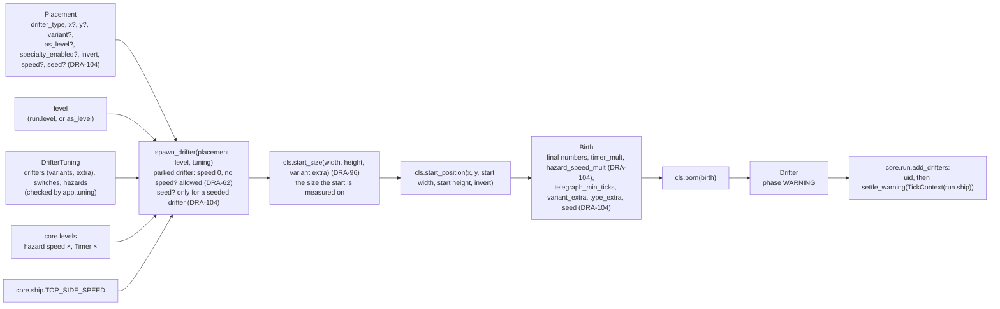

# Drifters, levels, registry, spawner and tuning files
Part of: drifters
Read when: you change levels, the registry, the spawner or the shared tuning, or add a drifter.

## Diagram

Birth, the only place the level is read:


## Interface

### game/core/levels.py
```python
# Imports: stdlib only.
LEVEL_COUNT: Final[int] = 8  # 08-difficulty.md, level table (locked)
FIRST_LEVEL: Final[int] = 1  # DRA-76. 08-difficulty.md, rule 1: a run starts at Level 1
HAZARD_SPEED_MULT: Final[tuple[float, ...]] = (
    1.00,
    1.06,
    1.12,
    1.18,
    1.24,
    1.30,
    1.36,
    1.42,
)
# 08-difficulty.md, Hazard speed × row (locked)
TIMER_MULT: Final[tuple[float, ...]] = (1.00, 0.94, 0.89, 0.85, 0.81, 0.77, 0.74, 0.70)
# 08-difficulty.md, Timer × row (guess)
SCROLL_MULT: Final[tuple[float, ...]] = (1.0, 1.1, 1.2, 1.3, 1.4, 1.5, 1.6, 1.7)
# DRA-76. 08-difficulty.md, Scroll speed × row (locked)
REST_GAP_MULT: Final[tuple[float, ...]] = (1.00, 0.90, 0.81, 0.73, 0.66, 0.59, 0.53, 0.48)
# DRA-76. 08-difficulty.md, Rest gap × row (locked)


def check_level(level: int) -> None:
    ...
    # Raises ValueError("level <n> is outside 1 to 8") unless 1 <= level <= LEVEL_COUNT.


def hazard_speed_mult(
    level: int,
) -> float: ...  # HAZARD_SPEED_MULT[level - 1], after check_level
def timer_mult(level: int) -> float: ...  # TIMER_MULT[level - 1], after check_level
def scroll_mult(level: int) -> float: ...  # DRA-76. SCROLL_MULT[level - 1], after check_level
def rest_gap_mult(level: int) -> float: ...  # DRA-76. REST_GAP_MULT[level - 1], after check_level
```
From DRA-76 `LEVEL_STARTS_M` and `level_at` are gone: the level no longer comes from the meters (08-difficulty.md, rule 1; 91-decision-log.md, row 65). The run's level comes from its waves (`docs/contracts/systems/waves.md`).

### game/core/drifters/tuning.py
Checked values the app hands to core. Built by `app.tuning` from the JSON files. Core trusts them.
```python
# Imports: stdlib, core.collision, core.drifters.base.
@dataclass(frozen=True, slots=True, kw_only=True)
class VariantTuning:
    width: float  # visible width, px
    height: float  # visible height, px
    hitbox: Hitbox  # offsets from the center
    extra: VariantExtra | None = (
        None  # DRA-39. The drifter's own per-variant values; None for the meteorite
    )


@dataclass(frozen=True, slots=True, kw_only=True)
class DrifterTypeTuning:
    variants: Mapping[str, VariantTuning]  # by variant name
    default_variant: str  # one of the variant names
    speed_ratio: float  # Level 1 speed as a multiple of core.ship.TOP_SIDE_SPEED. Not read for a
    # parked drifter (DRA-62): the loader gives the coin 0.0
    entry_warning_ticks: int  # ticks, >= 1 for a hazard. 0 for the coin, a pickup with no entry
    # warning (DRA-62)
    extra: DrifterTypeExtra | None = (
        None  # DRA-47. The type's own values; None for the meteorite and the satellite
    )


@dataclass(frozen=True, slots=True, kw_only=True)
class PlaytestSwitches:
    hazard_speed_scaling: bool = True  # False: Level 1 hazard speed × at every level
    timer_scaling: bool = True  # False: Level 1 Timer × at every level


@dataclass(frozen=True, slots=True, kw_only=True)
class HazardRules:  # DRA-39
    """Values every hazard shares. From game/tuning/hazards.json; a field left out keeps its default."""

    rehit_cooldown_ticks: int = (
        DEFAULT_REHIT_COOLDOWN_TICKS  # ticks, >= 0. Never scales with level
    )
    rehit_dim: float = DEFAULT_REHIT_DIM  # 0..1
    telegraph_min_ticks: int = DEFAULT_TELEGRAPH_MIN_TICKS  # DRA-47. ticks, >= 0


@dataclass(frozen=True, slots=True, kw_only=True)
class DrifterTuning:
    drifters: Mapping[DrifterType, DrifterTypeTuning]
    switches: PlaytestSwitches
    hazards: HazardRules = field(default_factory=HazardRules)  # DRA-39
```

### game/core/drifters/registry.py
Unchanged in DRA-39.
```python
# Imports: stdlib, core.drifters.base.
def register_drifter[G: Drifter](cls: type[G]) -> type[G]:
    ...  # PEP 695 type parameter, bound Drifter; class decorator
    # Raises TypeError if cls is abstract (inspect.isabstract) or has no drifter_type.
    # Raises ValueError("drifter type 'meteorite' is already registered") on a duplicate.


def available_drifters() -> frozenset[DrifterType]: ...  # every registered type
def drifter_class(drifter_type: DrifterType) -> type[Drifter]:
    ...
    # Raises ValueError("no class registered for drifter type 'x'").
```

### game/core/drifters/spawner.py
```python
# Imports: stdlib, core.levels, core.ship, core.drifters.base, .tuning, .registry.
@dataclass(frozen=True, slots=True)
class Placement:
    """Where and how to place one drifter. Screen px, y down, at its center."""

    drifter_type: DrifterType
    x: float | None = (
        None  # DRA-39: optional. None: the drifter's default x (start_position)
    )
    y: float | None = None  # None: the drifter's default y (start_position)
    variant: str | None = None  # None: the drifter's default_variant
    as_level: int | None = None  # None: the run's level
    specialty_enabled: bool | None = None  # None: the drifter's default
    invert: bool = (
        False  # DRA-39. The spec's invert; a drifter without one refuses True
    )
    speed: float | None = (
        None  # DRA-39. Level 1 speed in px/tick along its path, replacing the
    )
    # drifter's default; hazard speed × still applies. None: the default
    seed: int | None = None  # DRA-104. 0 to MAX_SEED: picks a seeded drifter's path. Required
    # for a seeded drifter (its born raises without one), refused for any other. The loaders fill
    # it with placement_seed when the file leaves it out


MAX_SEED: Final[int] = 4_294_967_295  # DRA-104. The largest seed a file may give, 2^32 − 1.
# Not a game value (Rationale)


def placement_seed(source: str, index: int) -> int:
    ...  # DRA-104
    # The default seed of the placement at index (from 0) in the list named source: a wave id, or
    # DEBUG_SPAWNS_SOURCE for the debug list. random.Random(f"{source}#{index}").getrandbits(32):
    # 0 to MAX_SEED, the same on every platform and every run. Pure.


DEBUG_SPAWNS_SOURCE: Final[str] = "debug_spawns"  # DRA-104. The source name of the debug list's rows


def spawn_drifter(placement: Placement, level: int, tuning: DrifterTuning) -> Drifter:
    ...
    # The only way a drifter is created. Pure: no logging, no randomness.
    # DRA-62: a parked drifter gets speed 0.0, and a placement speed raises for it.
    # DRA-96: start_position gets the sizes from cls.start_size (Rules, Spawner, step 7).
    # DRA-104: a seed raises for a drifter that isn't seeded; Birth gets hazard_speed_mult and seed.
```
The field order keeps every existing call working: `Placement(DrifterType.METEORITE, x=160.0, variant="small")` and `Placement(DrifterType.METEORITE, 300.0, y=...)` still build. `placement_seed` and `DEBUG_SPAWNS_SOURCE` live here, next to `Placement`, because both loaders that build placements already import this module (`core.wave_files`, `app.debug_spawns`).

### game/core/drifters/__init__.py
Imports every drifter module once (`meteorite`, `satellite` from DRA-39, `chain_lightning` from DRA-47, `fireball` from DRA-56, `coin` from DRA-62, `floating_island` from DRA-86, `planet` from DRA-96, `ufo` from DRA-104), so each class registers when anything under `core.drifters` is first imported. A package docstring and nothing else. A new drifter adds one import line here.

## Rules

Levels (`core/levels.py`). Source: 08-difficulty.md:
- Levels are 1 to 8. Any other level raises `ValueError` naming it, in every function that takes a level.
- Four rows, one value per level, Level 1 first, each copied from the 08-difficulty.md level table: hazard speed × (locked), Timer × (guess), scroll speed × (locked, DRA-76) and Rest gap × (locked, DRA-76). Each is read through its function, never by index outside this module.
- Who reads which row: the spawner reads hazard speed × and Timer × (Spawner, below); the scroll reads scroll speed × (`docs/contracts/systems/scroll.md`); the waves read Rest gap × (`docs/contracts/systems/waves.md`, `rest_gap_ticks`).
- `FIRST_LEVEL` (1) is the level a run starts at, and the level of a run with no waves. Source: 08-difficulty.md, rule 1.
- The level of a run is not worked out here. It is held by the run's waves and rises when a level's playlist ends (`docs/contracts/systems/waves.md`; 08-difficulty.md, rule 1). Source: 91-decision-log.md, row 65 (replaces the level from meters, row 26, and DF-05).

Registry (`core/drifters/registry.py`):
- `@register_drifter` stores one class per `DrifterType`. A second class for the same type raises `ValueError`. An abstract class (one missing `start_position`, `update` or `effect_on_touch`) or one without `drifter_type` raises `TypeError`.
- `core/drifters/__init__.py` imports every drifter module, so the registry is full once anything in `core.drifters` is imported.

Spawner, `spawn_drifter(placement, level, tuning)`. The only place that reads a level. Source: 07-drifters.md, rules 6, 13 and 14; 08-difficulty.md, rules 3 to 5; scope report DRA-29, Limits; scope report DRA-39, Values needed:
1. `cls = drifter_class(placement.drifter_type)`. `type_tuning = tuning.drifters[placement.drifter_type]`; a missing entry raises `ValueError("no tuning for drifter type '<type>'")`.
2. `variant_name = placement.variant` or, when None, `type_tuning.default_variant`. A name not in `type_tuning.variants` raises `ValueError("unknown variant '<name>' for drifter type '<type>'")`. Source: 07-drifters.md, rule 10.
3. `use_level = placement.as_level` when set, else `level`. `check_level(use_level)` raises outside 1 to 8.
4. Speed: `base_speed = placement.speed` when set (DRA-39), else `type_tuning.speed_ratio × TOP_SIDE_SPEED`. Then `speed = base_speed × hazard_speed_mult(use_level)`, or `× hazard_speed_mult(1)` when `tuning.switches.hazard_speed_scaling` is False, whatever the level or `as_level`. A placement's speed is a Level 1 speed in px/tick, along the drifter's path, like the default it replaces. Source: 08-difficulty.md, rules 3 and 5; drifters/01-meteorite.md and drifters/02-satellite.md, speed_ratio; scope report DRA-39, Values needed (speed override: Director, temporary stand-in, not in the GDD).
   **Parked** (DRA-62): when `cls.parked` is True, a placement with `speed` set raises `ValueError("<type> has no speed")` (the coin: `coin has no speed`), and otherwise `speed = 0.0`. `speed_ratio` and hazard speed × are not read. Source: 03-world-and-camera.md, rule 9; drifters/04-coin.md, rule 3 ("Hazard speed and Timer × don't touch it"); scope report DRA-62, Limits (debug rows: no speed).
5. Timers: `timer_mult = timer_mult(use_level)`, or `timer_mult(1)` when `tuning.switches.timer_scaling` is False. Handed to the drifter in `Birth`, with `telegraph_min_ticks = tuning.hazards.telegraph_min_ticks` (DRA-47). The drifter scales its own timers in `born` (The base, Timers). Only the chain lightning has one so far, its charge. Source: 08-difficulty.md, rules 4 and 5.
6. `warning_ticks = type_tuning.entry_warning_ticks`, never scaled. Source: 07-drifters.md, rule 9; 08-difficulty.md, rule 4.
7. `start_width, start_height = cls.start_size(variant.width, variant.height, variant.extra)` (DRA-96), then `x, y = cls.start_position(placement.x, placement.y, start_width, start_height, placement.invert)`. Raises for a missing coordinate the drifter needs (DRA-39). `Birth.width` and `Birth.height` stay the variant's own `width` and `height`; only the start uses the start size.
8. **Seed** (DRA-104): when `cls.seeded` is False, a placement with `seed` set raises `ValueError("<type> has no seed")` (the meteorite: `meteorite has no seed`). Return `cls.born(Birth(...))` with the variant's width, height, hitbox and `extra` (as `variant_extra`), `type_tuning.extra` (as `type_extra`, DRA-47), `placement.invert`, `tuning.hazards.rehit_cooldown_ticks`, `tuning.hazards.rehit_dim` and `tuning.hazards.telegraph_min_ticks` (DRA-47), the hazard speed × of step 4 as `hazard_speed_mult` (`hazard_speed_mult(use_level)`, or `hazard_speed_mult(1)` with the switch off; also for a parked drifter, which never reads it) and `placement.seed` as `seed` (DRA-104). Phase WARNING (ACTIVE for the coin, whose `born` skips the warning, DRA-62), `ticks_in_phase` 0, `uid` 0 (the run sets it), `has_entered` False, `rehit_ticks_left` 0. `born` raises for a specialty or an invert the drifter lacks.
- Applied once, at birth. The drifter keeps its speed and its cooldown length for its whole life and never knows the level. Source: 07-drifters.md, rule 6; 08-difficulty.md, rule 3; 05-lives-and-damage.md, rehit_cooldown ("Never scales with level"); 91-decision-log.md, row 34.
- Placement coordinates are screen px, y down. Wave files use world coordinates (03-world-and-camera.md, rule 1); the wave loader converts them later.
- `Placement.speed` is set only by the debug test spawn list for now (scope report DRA-39). It is not a GDD placement field (07-drifters.md, rule 13).
- `spawn_drifter` is pure: no logging, no randomness, no frame time.
- **Placement seed** (DRA-104). `placement_seed(source, index)` is `random.Random(f"{source}#{index}").getrandbits(32)`: Python's string seeding hashes the text with SHA-512, so the result is the same on the desktop and in the browser build, on every run, and never reads the clock. `source` is the wave id for a wave's placement (`systems/waves.md`) and `DEBUG_SPAWNS_SOURCE` for a debug row (`systems/app.md`); `index` is the placement's place in its file's list, from 0. It is a default only: a seed the file gives is used as it is. Source: drifters/07-ufo.md, seed (locked: "fixed per placement"); scope report DRA-104, Left to the Architect ("the same path in the browser build as on the desktop").

Tuning files (loaded by `app.tuning`, `docs/contracts/systems/app.md`). Source: scope report DRA-29, Limits and Decision log; scope report DRA-39, Limits:
- One JSON file per drifter type, `game/tuning/drifters/<drifter_type value>.json`. A drifter with no fields of its own follows `docs/contracts/schemas/drifter-tuning.schema.json` (the meteorite). A drifter with its own fields follows `docs/contracts/schemas/<drifter_type value>-tuning.schema.json` (the satellite: `satellite-tuning.schema.json`, which adds `angle_degrees` to each variant and requires exactly two boxes, body first; the chain lightning: `chain-lightning-tuning.schema.json`, file `chain_lightning.json`, DRA-47; the fireball: `fireball-tuning.schema.json`, file `fireball.json`, DRA-56; the coin: `coin-tuning.schema.json`, file `coin.json`, DRA-62; the floating island: `floating-island-tuning.schema.json`, file `floating_island.json`, DRA-86; the planet: `planet-tuning.schema.json`, file `planet.json`, DRA-96; the UFO: `ufo-tuning.schema.json`, file `ufo.json`, DRA-104).

- The two playtest switches in `game/tuning/playtest.json`, to `docs/contracts/schemas/playtest-switches.schema.json`. Both `true` by default: the level table applies (08-difficulty.md, rules 3 and 4). `false` gives Level 1 values at every level (rule 5).
- The shared hazard values in `game/tuning/hazards.json` (DRA-39), to `docs/contracts/schemas/hazards.schema.json`: `rehit_cooldown`, `rehit_dim` and, from DRA-47, `telegraph_min`, all optional. A field left out keeps its default (`DEFAULT_REHIT_COOLDOWN_TICKS`, `DEFAULT_REHIT_DIM`, `DEFAULT_TELEGRAPH_MIN_TICKS`). Source: scope report DRA-39, Limits ("None of them is required anywhere: left out means default").
- Every `DrifterType` has exactly one tuning file, one registered class and one registered view, and nothing else has. Test task DRA-29-09 guards it.

Logging: `core.collision`, `core.levels`, `core.popup` and `core.drifters.*` log nothing. The run logs spawn, active, touch (a hit or a collect) and gone, by event (`systems/run.md`, Logging). Source: 15-tech-constraints.md, rule 9.

How to add a drifter (later features): add a `DrifterType` member; a subclass module with `@register_drifter`, imported in `core/drifters/__init__.py`, with its `start_position`, `update` and `effect_on_touch` (and `parked = True` for a drifter that moves only with the scroll; `collect_points` and `collect_popup` for a pickup; `TouchEffect.BLOCK`, boxes and polygons only, for a blocker; `gravity_well` for a drifter that pulls the ship; `start_size` and `drawn_parts` for a drifter whose look reaches well past its size; `seeded = True` for a drifter whose path comes from a seed); a tuning file in `game/tuning/drifters/` (with its own schema and `VariantExtra` or `DrifterTypeExtra` subclass if it has fields of its own, and then a module `app/drifters/<name>_tuning.py` that registers its loader with `@register_tuning`, imported in `app/drifters/__init__.py`; `app.tuning` reads the file through it); a view module with `@register_view`, imported in `ui/drifters/__init__.py`. The guard test fails until all four exist. The ship-against-every-variant collision cases pick the new drifter up from its tuning file with no new test code when its variants list a `hitbox`; a drifter whose hitbox is built from other values (the chain lightning, the fireball, the coin, the floating island, the planet, the UFO) has its own branch there. A drifter whose look reaches outside its footprint overrides `drawn_parts`. A drifter with a telegraph overrides the classmethod `telegraph_ticks`. No file outside a drifter's own modules (`core/drifters/<name>.py`, `ui/drifters/<name>_view.py`, `app/drifters/<name>_tuning.py`) names its `DrifterType` member: `game/tests/core/test_drifter_registration.py` fails when one does. `tools/wave_check/` asks the drifter (its `effect_on_touch` and `telegraph_ticks`), never its type. So a new drifter costs one enum line, the import lines in the three `__init__.py` files, its own modules and its debug spawn rows.
