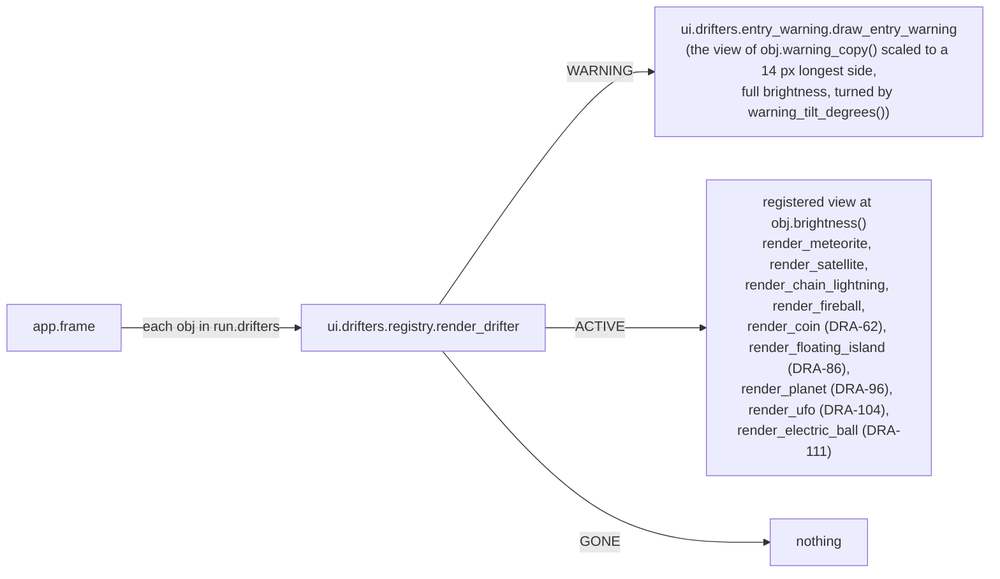

# Drifters, views and the entry warning
Part of: drifters
Read when: you change how drifters are drawn: view registry, brightness, entry warning, shapes.

## Diagram

Views:


## Interface

### game/ui/shapes.py
The line shape from DRA-47, the polygon from DRA-86. Signatures unchanged.
```python
# Imports: pygame, math, core.collision. Never app.
def draw_shape(
    surface: pygame.Surface, color: tuple[int, int, int], shape: Shape, width: int = 0
) -> None:
    ...
    # One placed shape. width 0 fills it; width 1 draws a 1 px outline. Raises
    # TypeError("unknown shape kind '<class name>'") for anything not a Circle, a Box, a Line or a
    # Polygon (DRA-47, Polygon from DRA-86).


def draw_hitbox(
    surface: pygame.Surface, color: tuple[int, int, int], hitbox: Hitbox, width: int = 0
) -> None:
    ...
    # draw_shape for every shape, in order.
```

### game/ui/drifters/
```python
# game/ui/drifters/registry.py. Imports: pygame, math, core.drifters.base, ui.drifters.entry_warning. Never app.
DrifterView = Callable[
    [pygame.Surface, Drifter, tuple[float, float], float, float], None
]
# view(surface, obj, center, scale, brightness): draw obj's look centered at center (screen px),
# scaled by scale (1.0 full size, 0.5 half size), every color multiplied by brightness
# (0..1, 1.0 normal) through dim_color. DRA-39 adds brightness.


def dim_color(color: tuple[int, int, int], brightness: float) -> tuple[int, int, int]:
    ...  # DRA-39
    # Each channel times brightness, rounded half up: math.floor(channel * brightness + 0.5).


def register_view(drifter_type: DrifterType) -> Callable[[DrifterView], DrifterView]:
    ...
    # Decorator. Raises ValueError("view for drifter type 'meteorite' is already registered").


def registered_views() -> frozenset[DrifterType]: ...
def render_drifter(surface: pygame.Surface, obj: Drifter) -> None:
    ...
    # WARNING: draw_entry_warning(surface, obj, view). ACTIVE: drop_entry_warning(obj), then
    # view(surface, obj, (obj.x, obj.y), 1.0, obj.brightness()).
    # GONE: nothing. Raises ValueError("no view registered for drifter type 'x'").

# game/ui/drifters/entry_warning.py. Imports: pygame, random, math, core.drifters.base. Never app.
ENTRY_WARNING_GLOW: Final[tuple[int, int, int]] = (
    255,
    220,
    120,
)  # 07-drifters.md, entry_warning_glow (guess)
ENTRY_WARNING_SIZE: Final[int] = 24  # core/drifters/base.py, not ui. 07-drifters.md,
# entry_warning_size: the warning's diameter, the same for every drifter (guess)
ENTRY_WARNING_COPY_SIZE: Final[int] = (
    14  # 07-drifters.md, entry_warning_size: longest side of the copy (guess)
)
SPIKE_COUNT_MIN: Final[int] = 6  # 07-drifters.md, entry_warning_spikes (guess)
SPIKE_COUNT_MAX: Final[int] = 9  # same
GLOW_RATIO: Final[float] = 0.75  # glow radius as a share of the warning's radius.
# Placeholder choice, not in the GDD (see Rationale)


def draw_entry_warning(
    surface: pygame.Surface, obj: Drifter, view: DrifterView
) -> None:
    ...
    # DRA-47: the copy is view(..., obj.warning_copy(), ...). The warning's size is fixed.


def drop_entry_warning(obj: Drifter) -> None:
    ...  # forget obj's warning image; nothing when it has none.
    # render_drifter calls it when it draws obj ACTIVE. Director approval, 2026-10-15.

# game/ui/drifters/__init__.py: imports every view module once (meteorite_view, satellite_view
# from DRA-39, chain_lightning_view from DRA-47, fireball_view from DRA-56, coin_view from DRA-62,
# floating_island_view from DRA-86, planet_view from DRA-96, ufo_view from DRA-104,
# electric_ball_view from DRA-111), so each view
# registers. A package docstring and nothing else. Import lines sit in sorted order
# (ruff's import-sort rule): electric_ball_view goes between coin_view and fireball_view.
```

## Presentation

Every fact a view shows is a core field or a core method. No view works out a rule.

| Core field or method | Shown as |
|---|---|
| `obj.phase` | `render_drifter` picks what to draw: the entry warning in WARNING, the drifter in ACTIVE, nothing in GONE. Source: 07-drifters.md, rule 9 |
| `obj.warning_center()` | the center of the entry warning. Source: 07-drifters.md, rule 9; drifters/01-meteorite.md, rule 1; drifters/02-satellite.md, rule 1; drifters/03-chain-lightning.md, rule 2 (DRA-47) |
| `obj.warning_tilt_degrees()` | how far the copy inside the warning is turned. 0 for the meteorite, the flat satellite and the chain lightning; ±35 for the fireball (DRA-56). Source: drifters/02-satellite.md, rule 1 (DRA-39); drifters/06-fireball.md, rule 1 |
| `obj.warning_copy()` | the drifter drawn inside the warning, scaled so its longest side is `ENTRY_WARNING_COPY_SIZE`. The drifter itself for the meteorite and the satellite; the `trio_triangle` layout for every chain lightning; for the fireball, itself laid straight down, head below the tail (DRA-56). It does not size the warning: that size is fixed. Source: drifters/03-chain-lightning.md, entry_warning_icon (DRA-47); drifters/06-fireball.md, rule 1 |
| `obj.x`, `obj.y` | the center of the drifter's look while ACTIVE |
| `obj.width`, `obj.height` | the size of the drifter's look. The copy in the entry warning is scaled by `ENTRY_WARNING_COPY_SIZE / max(width, height)` of `obj.warning_copy()`. The warning itself has one fixed size |
| `obj.hitbox` | the satellite's look: its two boxes, filled (DRA-39). Source: drifters/02-satellite.md, placeholder_look. The fireball's look: its two circles, filled, head and tail (DRA-56). Source: drifters/06-fireball.md, placeholder_look |
| `obj.nodes`, `obj.node_size` | the chain lightning's nodes: where each sits around `center`, and how big (DRA-47). Source: drifters/03-chain-lightning.md, placeholder_look, node_size |
| `obj.firing_arcs()`, `obj.arcs`, `obj.arc_width` | which arc bands are drawn, between which nodes, how thick (DRA-47). Source: drifters/03-chain-lightning.md, rules 5 and 9, placeholder_look |
| `obj.charge_ray_count()`, `obj.charge_rays`, `obj.ray_length`, `obj.ray_width` | how many rays each node shows now, how they are spread, how long and how thick (DRA-47). Source: drifters/03-chain-lightning.md, telegraph, charge_rays, ray_length, placeholder_look |
| `obj.brightness()` | the share of normal brightness the look is drawn at: `rehit_dim` (0.75) during the re-hit cooldown, 1.0 otherwise. Source: 05-lives-and-damage.md, rule 1.5, rehit_dim (guess) (DRA-39). A coin and a floating island never take part in a hit, so they are always 1.0 |
| `obj.width`, `obj.height`, `obj.body_height` (coin) | the crystal: 12 wide, 20 tall, its middle rectangle 10 tall, so each point 5 tall (DRA-62). Source: drifters/04-coin.md, crystal_size (guess) |
| `obj.ring_width`, `obj.ring_height` (coin) | the ring's 22 × 8 ellipse across the crystal's middle (DRA-62). Source: drifters/04-coin.md, placeholder_look (guess) |
| `obj.glint`, `obj.glint_size`, `obj.glint_left`, `obj.glint_top` (coin) | whether the glint shows (the rare coin), and its 2 × 2 square with its top-left at (3, 3) in the crystal's 12 × 20 box (DRA-62). Source: drifters/04-coin.md, placeholder_look; scope report DRA-62, Not in GDD (rare glint, Director approval) |
| `obj.hitbox`, `obj.width`, `obj.height` (floating island) | the island's look: its shapes filled, their union exactly, with a 2 px darker edge inside it (DRA-86). Its hitbox is the shape drawn, so the ship stops where the ground is drawn. Source: drifters/05-floating-islands.md, hitbox, placeholder_look (guess), rule 10 |
| `obj.width` (planet) | the body: a filled circle `obj.width` across, exactly its hitbox circle (DRA-96). Source: drifters/08-planet.md, size, hitbox, placeholder_look, rule 10 |
| `obj.pull_radius` (planet) | the outer field ring: a 1 px ring at that radius, where the pull starts (DRA-96). Source: drifters/08-planet.md, rule 2, placeholder_look |
| `obj.inner_rings()` (planet) | the inner field rings: for each, a 1 px ring at its `radius`, at its `opacity` (DRA-96). Source: drifters/08-planet.md, field_ring_trip, field_ring_gap, field_ring_fade, rule 10 |
| `obj.hitbox` (UFO) | the UFO's look: the dome circle filled green, then the disc box filled grey over its lower half (DRA-104). `obj.x`, `obj.y` move both, up and down as it weaves; the view never works out the weave. Source: drifters/07-ufo.md, placeholder_look, size, hitbox (guess) |
| `obj.pulse_fires()`, `obj.outline_level()`, `obj.charge_ray_count()` and the size fields (electric ball) | the ball, its charge rays and outline, and its firing circle (DRA-111). The full list is in `electric-ball/view.md`, Presentation. Source: drifters/10-electric-ball.md, telegraph, placeholder_look, rule 9 |
| `obj.uid` | the seed for the warning's spikes, so they are random per drifter and steady while it shows. Source: 07-drifters.md, entry_warning_spikes |
| `obj.drifter_type` | which registered view draws it |
| `obj.variant` | not drawn by these views. The debug label shows it (`docs/contracts/systems/debug-overlay.md`) |

**Brightness** (DRA-39). Every view multiplies each color it draws by its `brightness` argument through `dim_color`: `math.floor(channel × brightness + 0.5)` per channel. `render_drifter` passes `obj.brightness()` in ACTIVE; the entry warning always passes 1.0, because a drifter still warning has never hit. At 0.75 the meteorite's grey (140, 140, 140) becomes (105, 105, 105), the satellite's body (240, 240, 240) becomes (180, 180, 180) and its panel (60, 110, 220) becomes (45, 83, 165). The chain lightning's nodes (0, 220, 255) become (0, 165, 191), its rays (120, 200, 255) become (90, 150, 191) and its arc band (220, 240, 255) becomes (165, 180, 191) (DRA-47). The fireball's head (255, 140, 0) becomes (191, 105, 0) and its tail (200, 160, 0) becomes (150, 120, 0) (DRA-56). The planet's body (140, 70, 200) becomes (105, 53, 150) and its rings (180, 120, 255) become (135, 90, 191), the field dimming with the body (DRA-96). The UFO's disc (170, 170, 185) becomes (128, 128, 139) and its dome (90, 220, 110) becomes (68, 165, 83) (DRA-104). The electric ball's ball, rays, outline, fill and rim dim together, each color through `dim_color` (DRA-111). The drifter returns to its full colors on the first frame drawn from a state whose cooldown has reached 0. A drifter made of parts calls one view, so all its parts dim together. Source: 05-lives-and-damage.md, rule 1.5 and rehit_dim (guess); 91-decision-log.md, row 56.

**Polygon shape** (`ui.shapes.draw_shape`, DRA-86). Every pixel is drawn by the pixel-center rule, so what is drawn matches the shape to within half a pixel and a polygon with whole-px corners never spills past its edges:
- `width` 0 (filled): every pixel whose center lies inside or on the polygon. For each pixel row `r` from `ceil(min_y − 0.5)` to `floor(max_y − 0.5)` (`min_y`, `max_y` the polygon's lowest and highest point y), with `yc = r + 0.5`: `xl` and `xr` are the leftmost and rightmost x where the line `y = yc` meets the polygon (interpolated along each edge that reaches `yc`; a flat edge on `yc` gives both its ends); the row's pixels are the columns `ceil(xl − 0.5)` to `floor(xr − 0.5)`, drawn as one `pygame.draw.rect(surface, color, pygame.Rect(c0, r, c1 − c0 + 1, 1))` when `c1 ≥ c0`. A polygon with whole-px corners and straight up-and-down and across edges fills exactly the pixels a box with the same edges fills.
- `width` 1 (outline): `pygame.draw.polygon(surface, color, [(round(px), round(py)) for each point], 1)`. The debug overlay's polygon outlines come from this, with no change to the overlay.
- Source: 07-drifters.md, rule 8 (a polygon is a filled shape with straight edges); drifters/05-floating-islands.md, rule 10 ("fill the shape exactly").

**Line shape** (`ui.shapes.draw_shape`, DRA-47). With `t = thickness` and `n` the unit normal of AB:
- `width` 0 (filled): the rectangle with corners `A + n t/2`, `B + n t/2`, `B − n t/2`, `A − n t/2`, through `pygame.draw.polygon` (float corners), then a filled circle at A and at B, center `(round(x), round(y))`, radius `round(t / 2)`. With A equal to B, the circle only.
- `width` 1 (outline): the two long sides, `A + n t/2` to `B + n t/2` and `A − n t/2` to `B − n t/2`, as 1 px lines, and the outer half of each end circle (radius `round(t / 2)`) as a 1 px arc. With A equal to B, a 1 px circle outline. The debug overlay's line outlines and graze zones come from this, with no change to the overlay.
- Source: 07-drifters.md, rule 8 (a line with round ends); 91-decision-log.md, rows 47 and 60.

**Entry warning** (`draw_entry_warning`), one image per drifter, built once and blitted each frame. Every warning has the same size, whatever the drifter (hotfix, 2026-10-18; decision log row 63). With `R = ENTRY_WARNING_SIZE / 2 = 12 px`, the warning's outer radius, the same for every drifter. Source: 07-drifters.md, entry_warning_size (guess); 91-decision-log.md, row 63:
- **Glow.** A filled circle in `ENTRY_WARNING_GLOW`, (255, 220, 120), radius `GLOW_RATIO × R` (9 px), centered. Source: 07-drifters.md, entry_warning_look, entry_warning_glow (guess); the glow's radius is a placeholder choice (see Rationale).
- **Spikes.** `random.Random(obj.uid)` picks, in this order: the count, `randint(SPIKE_COUNT_MIN, SPIKE_COUNT_MAX)` (6 to 9); then for each spike an angle `uniform(0, 2π)` and a length `uniform(GLOW_RATIO × R, R)`, so each spike reaches out of the glow and never past `R`. Each spike is a 1 px line (pygame's `width` 1) in `ENTRY_WARNING_GLOW` from the center outward. Random per drifter, steady while it shows. Source: 07-drifters.md, entry_warning_spikes (guess).
- **Copy.** On top of the glow, the drifter's own view drawing `copy = obj.warning_copy()` (DRA-47) at `scale = ENTRY_WARNING_COPY_SIZE / max(copy.width, copy.height)` and full brightness, centered, so its longest side is 14 px, inside the 18 px glow. When `obj.warning_tilt_degrees()` is 0: `view(image, copy, image_center, scale, 1.0)`; for the meteorite and the satellite the copy is `obj` itself. For a chain lightning, three cyan discs in the point-up triangle, whatever its variant or `invert`, scaled by 14 / 140 = 0.1: discs of radius 1, 12.8 px between the nodes. Otherwise (DRA-39) the copy is drawn the same way onto its own `pygame.SRCALPHA` surface of the image's size, turned with `pygame.transform.rotate(copy, obj.warning_tilt_degrees())` (positive turns counterclockwise on screen), and blitted centered on the image's middle pixel. For the meteorite, a grey circle 14 px across (radius 7) at every size. For the satellite, a 14 × 2.3 bar with a 4.7 × 4.7 body (scale 14 / 36); the angled one's copy is turned 20° so its right end dips (or its left end with `invert`): it points the way the satellite will fly. For the fireball (DRA-56), the comet laid straight down, turned 35° counterclockwise (clockwise with `invert`): head down and to the right of the tail (to the left with `invert`), the tail pointing back. Source: 07-drifters.md, entry_warning_look, entry_warning_size (guess); drifters/02-satellite.md, rule 1; drifters/06-fireball.md, rule 1.
- **Place.** The image's center sits on `round(obj.warning_center())`: for a top entry, at the drifter's x, just inside the top edge; for the satellite, at its y, just inside the wall it enters from (x 12, or 628 with `invert`); for a chain lightning, at the x of the node nearest the ship when it was added, with its center at y 12 (DRA-47); for a fireball, at its head's x against the top edge for a corner or top entry ((12, 12) or (628, 12) for the corners), at its y against the wall for a side entry (DRA-56); for a UFO, at its y against the wall it enters from, (12, y) or (628, y) (DRA-104); for an electric ball, at its x against the top edge, as for the meteorite (DRA-111). Source: 07-drifters.md, rule 9; drifters/02-satellite.md, rule 1; drifters/03-chain-lightning.md, rule 2; drifters/06-fireball.md, rule 1; scope report DRA-29, Decision log (2026-10-15).
- **Pre-rendered.** The image is a `pygame.SRCALPHA` surface, square, side `2 × ceil(R) + 1` (25 px, the same for every drifter, a chain lightning too), with the warning's center on its middle pixel, so no pixel of the warning lies more than `R` from the center in x or y. A turned copy that would reach past the image is clipped by it; the satellite's turned copy reaches at most about 7 px from the center. It is built on the first frame the drifter shows its warning and kept in a dict keyed by `(obj.uid, obj.drifter_type, obj.variant, obj.warning_tilt_degrees())` (the tilt joins the key in DRA-39). The entry is dropped on the first frame `render_drifter` draws that drifter ACTIVE, through `drop_entry_warning(obj)` (Director approval, 2026-10-15). The image depends only on its key, so a kept entry is never wrong. Never rebuilt per frame. Source: 12-art-and-audio.md, rule 3 (glow is pre-rendered); 15-tech-constraints.md, rule 5.

Rules for every view:
- Views only draw. They never fill, never flip, never log per frame, never catch an error, never change a drifter, never read the run mode or a key. Source: 10-ui.md, rule 5; game/CONTEXT.md, Run modes.
- A look partly off the surface is clipped by pygame.
- The app calls `render_drifter` for every drifter in `run.drifters`, in order, after the starfield and before the ship (`docs/contracts/systems/app.md`, Draw).
