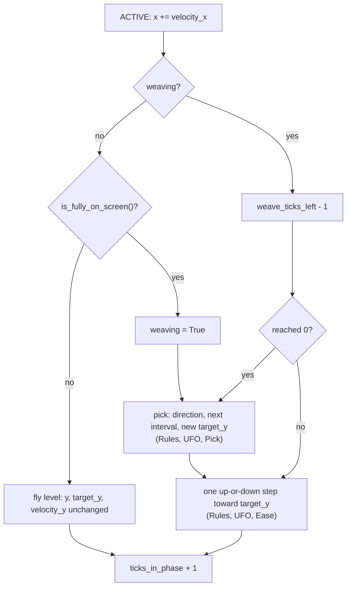

# Drifters, the UFO, core
Part of: drifters
Read when: you change how the UFO behaves (`ufo.py`).

## Diagram

UFO (DRA-104). One drifter: a disc and a dome on top of it. Its center (x, y) is the disc's center. A moving hazard: it crosses at its own speed, the scroll never adds to it. At the file's values (disc 40 × 10, dome radius 9), offsets from the center, y down:
```
                  .-~~~-.                  dome: Circle(0, -5, 9), green, centered on the middle of
                /         \                      the disc's top edge; its lower half lies under the disc
   +-----------'-----.-----'-----------+   disc top edge, y -5
   |                (0,0)              |   disc: Box(0, 0, 40, 10), grey. hitbox = (disc, dome)
   +-----------------------------------+   y +5
   x -20                           x +20
drawn parts: Box(0, 0, 40, 10) and Box(0, -5, 21, 21) (dome r 9 + DOME_DRAW_MARGIN 1.5, each side)
graze zone:  Box(0, 0, 68, 38) and Circle(0, -5, 23)
```

UFO timeline, standard, Level 1, placed at y 300 with no x and no `invert`, added at the end of tick T. Speed 0.3 × `TOP_SIDE_SPEED` ≈ 1.974 px/tick. `n` counts ACTIVE ticks:
```
state after tick   T        T+1..T+59   T+60       T+61       T+80       T+81            T+60+n               T+404      T+405
phase              WARNING  WARNING     ACTIVE     ACTIVE     ACTIVE     ACTIVE          ACTIVE               ACTIVE     dropped
x                  -20.00   -20.00      -20.00     -18.03     19.48      21.45           -20 + n × 1.974      659.06     661.03
y                  300.00   300.00      300.00     300.00     300.00     first step      weaves, 188 to 440
weaving            no       no          no         no         no         yes: 1st pick   yes
has_entered        no       no          no         yes        yes        yes
hitbox             none     none        disc box + dome circle on every ACTIVE state
warning shows at   (12, 300)
```
At T+60 the disc's right edge is on the left wall: not yet on screen. On T+81 (n 21) the disc's left edge is past x 0, so the whole UFO is on screen: it picks its first new height and takes its first up-or-down step on that tick. On T+404 the disc's left edge is at 639.06, still on screen; on T+405 it is at 641.03 and the dome's box at 650.53: everything drawn is past the right wall, so the run drops it, about 5.75 s after it appeared. With `invert` it starts at x 660, warns at (628, 300), flies left, starts weaving on n 21 (x 618.55) and is dropped on n 345 (x −21.03). At Level 8: speed ≈ 2.8031, `weave_speed_max` 2.272, `weave_turn` 0.142, a new height every 42 to 68 ticks; it starts weaving on n 15 and is dropped on n 243.

One ACTIVE tick of a UFO (Rules, UFO, Update):


Easing, Level 1 (`weave_speed_max` 1.6, `weave_turn` 0.1): a UFO level at y 300 picks `target_y` 220 (80 px up). Tick 1 is the tick of the pick:
```
tick of the swing   1        2        16       17 .. 50          51       52       64       65       66 on
velocity_y          -0.10    -0.20    -1.60    -1.60             -1.50    -1.40    -0.20    -0.10    0.00
y                   299.90   299.70   286.40   284.80 .. 232.00  230.50   229.10   220.10   220.00   220.00
```
It speeds up by 0.1 a tick for 16 ticks (13.6 px), cruises at 1.6, and brakes by exactly 0.1 a tick from 12 px out, so it lands on 220 with no overshoot and flies level until its next pick. Braking starts where `weave_brake_speed(r, 0.1)` drops below 1.6: at r 12.0 it is 1.5.

## Interface

### game/core/drifters/ufo.py (DRA-104)
```python
# Imports: stdlib (math, random), core.collision, core.world, core.levels (HAZARD_SPEED_MULT),
# core.drifters.base, core.drifters.registry.

DOME_DRAW_MARGIN: Final[float] = 1.5      # px added to the dome's radius in drawn_parts(). Not a game
                                          # value: the same pixel margin as the fireball's DRAW_MARGIN
                                          # (Rationale)
ARRIVAL_TOLERANCE_PX: Final[float] = 1e-9 # px. A step that ends this close to target_y ends on it.
                                          # Not a game value (Rationale)

@dataclass(frozen=True, slots=True, kw_only=True)
class UfoTypeExtra(DrifterTypeExtra):
    """The UFO's values that hold for every variant: its weave and its band. Level 1 numbers."""
    weave_change_ticks_min: int   # fewest ticks between two picks, >= 1. Timer × at birth
    weave_change_ticks_max: int   # most ticks between two picks, >= weave_change_ticks_min
    weave_step_min: float         # least distance to a new height, px, > 0. Also the least room
                                  # a turn needs (Rules, UFO, Pick). Never scaled
    weave_step_max: float         # most distance to a new height, px, >= weave_step_min
    weave_speed_max: float        # top up-or-down speed, px/tick, > 0. Hazard speed × at birth
    weave_turn: float             # most change of the up-or-down speed per tick, px/tick², > 0. Same
    band_top: float               # smallest y of the UFO's center, screen px. Never scaled
    band_bottom: float            # largest y of the UFO's center, screen px, > band_top

def ufo_hitbox(disc_width: float, disc_height: float, dome_radius: float) -> Hitbox: ...
    # Offsets from the disc's center, disc first, dome second:
    # (Box(0.0, 0.0, disc_width, disc_height), Circle(0.0, -disc_height / 2, dome_radius)). Pure.

def check_ufo_variant(disc_width: float, disc_height: float, dome_radius: float) -> None: ...
    # Raises ValueError("dome_radius is too wide for the disc: 2 × (dome_radius + 1.5) must be at
    # most disc_width (<a:g> > <b:g>)") unless 2 × (dome_radius + DOME_DRAW_MARGIN) <= disc_width.

def check_ufo_weave(extra: UfoTypeExtra) -> None: ...
    # Raises ValueError for tuning the weave rules can't keep (Rules, UFO, Tuning checks).

def weave_stop_distance(speed: float, turn: float) -> float: ...
    # px the UFO needs to stop from up-or-down speed `speed` while braking by `turn` a tick:
    # turn × k × (k + 1) / 2 with k = ceil(round(speed / turn, 6)). Pure.

def weave_brake_speed(distance: float, turn: float) -> float: ...
    # The fastest up-or-down speed, px/tick, from which the UFO still stops exactly `distance` px
    # on while braking by `turn` a tick (Rules, UFO, Ease). 0.0 at distance 0. Pure.

@register_drifter
@dataclass(frozen=True, slots=True, kw_only=True)
class Ufo(Drifter):
    """Wildcard mover. Crosses from a side wall at a steady speed, weaving up and down along a
    path its seed picks, never aiming at the ship. drifters/07-ufo.md."""
    drifter_type: ClassVar[DrifterType] = DrifterType.UFO
    seeded: ClassVar[bool] = True
    invert: bool = False                # True: enters at the right wall and flies left
    velocity_x: float = 0.0             # px/tick, + is right: speed, or -speed with invert. Final
    seed: int = 0                       # the placement's seed. Final
    weave_seed: int = 0                 # the seed of the next pick; starts at seed (Rules, UFO, Pick)
    band_top: float = 0.0               # from the type, screen px
    band_bottom: float = 0.0            # from the type, screen px
    weave_change_ticks_min: int = 1     # final: Timer × applied, rounded up
    weave_change_ticks_max: int = 1     # final: Timer × applied, rounded up
    weave_step_min: float = 0.0         # from the type, px
    weave_step_max: float = 0.0         # from the type, px
    weave_speed_max: float = 0.0        # final: hazard speed × applied, px/tick
    weave_turn: float = 0.0             # final: hazard speed × applied, px/tick²
    weaving: bool = False               # it has been fully on screen while ACTIVE and weaves
    weave_ticks_left: int = 0           # ticks until the next pick, while weaving
    weave_up: bool | None = None        # the way the last pick went: True up, False down; None before
    target_y: float = 0.0               # the height it eases toward, screen px
    velocity_y: float = 0.0             # up-or-down speed, px/tick, + is down

    @classmethod
    def born(cls, birth: Birth) -> Self: ...          # in WARNING, like every hazard
    @classmethod
    def start_position(cls, x: float | None, y: float | None, width: float, height: float,
                       invert: bool) -> tuple[float, float]: ...
        # y is required: None raises ValueError("ufo placement needs y").
        # x None: -width / 2, or SCREEN_W + width / 2 with invert.
    def update(self, ctx: TickContext) -> Self: ...   # Rules, UFO, Update
    def effect_on_touch(self) -> TouchEffect: ...     # TouchEffect.HIT
    def drawn_parts(self) -> tuple[Box, ...]: ...     # the disc's box, then the dome's box
    def is_fully_on_screen(self) -> bool: ...         # every box of drawn_parts() inside the screen
```
The fields have defaults so `born_drifter` can build the UFO before `born` sets them. `app.tuning` imports `UfoTypeExtra`, `ufo_hitbox`, `check_ufo_variant` and `check_ufo_weave` to build and check the tuning records, so the hitbox and the weave checks are worked out in one place. It uses the base `current_hitbox`, `graze_zone`, `warning_center`, `warning_tilt_degrees`, `warning_copy`, `settle_warning`, `start_size`, `collect_points`, `collect_popup` and `gravity_well`.

## Rules

UFO (`core/drifters/ufo.py`, DRA-104). Source: drifters/07-ufo.md; scope report DRA-104:
- **Archetype:** Wildcard mover. A moving drifter: its speed across the screen is its on-screen speed, and the scroll doesn't add to it. Source: archetype, kind (locked); rule 3; 03-world-and-camera.md, rule 9.
- **One drifter, two shapes.** Its size is its disc: `width` and `height` are the disc's (40 × 10), and `x`, `y` is the disc's center. The dome is part of it, never a drifter of its own; it joins through the hitbox and `drawn_parts()`, as the fireball's tail does. The band is measured on this center. Source: size, hitbox, band (guess).
- **Variants:** one, `standard`, the default: disc 40 × 10, dome radius 9. A new size is a new variant, a new entry in the tuning file with no code. The file gives each variant's `disc_width`, `disc_height` and `dome_radius`; `app.tuning` builds `width` = `disc_width`, `height` = `disc_height`, the hitbox with `ufo_hitbox`, and `extra` None. Source: variants, default_variant (guess); How to extend; 07-drifters.md, rule 10.
- **Hitbox:** two shapes, disc first: the disc, `Box(0, 0, 40, 10)`, and the dome, `Circle(0, −5, 9)`, its center on the middle of the disc's top edge. `ufo_hitbox` is the one place that rule lives. Source: hitbox (guess); 07-drifters.md, rule 8.
- **Born:** refuses a specialty (`ValueError("ufo has no specialty")`). Reads `birth.type_extra`, which must be a `UfoTypeExtra`, else `ValueError("ufo tuning has no type values")`. `birth.seed` None raises `ValueError("ufo placement needs seed")`. `birth.y` outside the band, below `band_top` or above `band_bottom` (both ends allowed), raises `ValueError("ufo placement y <y> is outside its band <band_top> to <band_bottom>")`, the numbers in `g` format: `ufo placement y 100 is outside its band 188 to 440`. In that order. Then `replace(born_drifter(cls, birth), ...)` with: `invert = birth.invert`; `velocity_x = speed`, or `−speed` with `invert`; `seed = weave_seed = birth.seed`; `band_top`, `band_bottom`, `weave_step_min` and `weave_step_max` from the type; `weave_change_ticks_min = scale_timer(type.weave_change_ticks_min, birth.timer_mult)` and the same for the max; `weave_speed_max = type.weave_speed_max × birth.hazard_speed_mult` and the same for `weave_turn`; `weaving` False, `weave_ticks_left` 0, `weave_up` None, `target_y = birth.y`, `velocity_y` 0.0. It stays in WARNING with `ticks_in_phase` 0, as every hazard. Final numbers, set once, at birth. Source: specialty (locked: none); rules 9 and 10; band and start ("The placed y must sit inside `band`"); seed (locked).
- **Start:** `start_position`: y is the placement's (required: `ValueError("ufo placement needs y")` without it). x is the placement's, or when None just outside the wall it enters from, the disc touching it: `−width / 2` (x −20), or `SCREEN_W + width / 2` (x 660) with `invert`. The dome's drawn box is narrower than the disc (Tuning checks), so nothing drawn is on screen at the start. Source: start, enters_from (guess, locked); rule 10; 07-drifters.md, rules 12 and 14.
- **Warning:** the shared entry warning, `entry_warning_ticks` long: the base `warning_center()`, at its y against the wall it enters from, (12, y) or (628, y). The copy is the UFO itself, untilted: it flies level. It doesn't move while the warning shows and turns ACTIVE where it was placed. No telegraph. Source: rules 1 and 2; telegraph (locked: none); 07-drifters.md, rule 9.
- **Update:** in WARNING, `tick_warning(self)`. In GONE, unchanged. In ACTIVE, in this order (Diagram, One ACTIVE tick of a UFO): (1) `x += velocity_x`; (2) if `weaving`, `weave_ticks_left − 1`, and a pick when it reaches 0; else, if `is_fully_on_screen()` on the new x, `weaving` becomes True and it picks; (3) if `weaving`, one ease step; otherwise `y`, `target_y` and `velocity_y` are unchanged: it flies level at its placed y; (4) `ticks_in_phase + 1`. The ship in `ctx` and `ctx.scroll_step_px` are never read. It never stops and never turns back. Source: rules 3, 4 and 6.
- **Fully on screen:** `is_fully_on_screen()` is True when every box `b` of `drawn_parts()` lies inside the screen: `b.cx − b.w / 2 >= 0`, `b.cx + b.w / 2 <= SCREEN_W`, `b.cy − b.h / 2 >= 0` and `b.cy + b.h / 2 <= SCREEN_H`. Judged on everything drawn, as entering and leaving are. Once `weaving` is True it never goes back, even as the UFO leaves. Source: rule 4 ("until it is fully on screen"); 07-drifters.md, rule 12.
- **Pick**, on the tick weaving starts and on every tick `weave_ticks_left` reaches 0. With `chooser = random.Random(weave_seed)`, drawing only `chooser.random()` and, last, `chooser.getrandbits(64)`, in this order:
  1. Direction. On the first pick (`weave_up` None): up when `chooser.random() < 0.5`, else down. On every later pick: the opposite of `weave_up`, the way the last pick actually went.
  2. Interval: `ticks = weave_change_ticks_min + floor(chooser.random() × (weave_change_ticks_max − weave_change_ticks_min + 1))`, a whole number from the min to the max.
  3. Step: `step = weave_step_min + chooser.random() × (weave_step_max − weave_step_min)`.
  4. Room, from `y` on this tick (after the x move, before the ease step): `room_up = y − band_top`, `room_down = band_bottom − y`. If the room in the chosen direction is less than `weave_step_min`, it goes the other way instead.
  5. `target_y = y − min(step, room_up)` going up, `y + min(step, room_down)` going down: `step` px away, never past the band's edge.
  6. `weave_up` = the direction taken in 4; `weave_ticks_left = ticks`; `weave_seed = chooser.getrandbits(64)`.
  Draws 2 and 3 happen on every pick, whatever 4 and 5 do, so one seed always gives one sequence of draws, on the desktop and in the browser (only `random()` and `getrandbits()`, whose results Python keeps the same across versions). Examples at the file's values: at y 210 a pick that says up has 22 px of room, less than 40, so it goes down, to 210 + `step`; at y 400 a pick that says down with `step` 70 has 40 px of room, so `target_y` is 440. Source: rules 4 to 6; weave_change_ticks, weave_step (guess); seed (locked); 15-tech-constraints.md, rule 2.
- **Ease**, every ACTIVE tick while `weaving`, after any pick on that tick: `r = target_y − y`; `want = sign(r) × min(weave_speed_max, weave_brake_speed(|r|, weave_turn))`, 0.0 when `r` is 0; `velocity_y += clamp(want − velocity_y, −weave_turn, weave_turn)`; `y += velocity_y`; then if `|target_y − y| <= ARRIVAL_TOLERANCE_PX`, `y = target_y`. `weave_brake_speed(d, a)`: with `k` the smallest whole number ≥ 0 such that `d <= a × (k + 1) × (k + 2) / 2`, it is `d / (k + 1) + a × k / 2`. That is the speed from which braking by exactly `a` a tick, `v`, `v − a`, ..., `v − k × a`, covers exactly `d` and stops, the last step at most `a`. So: the up-or-down speed never passes `weave_speed_max` and never changes by more than `weave_turn` in a tick; the UFO speeds up, cruises, brakes and lands exactly on `target_y` without passing it; once there, `velocity_y` falls to 0 on the next tick and it flies level until its next pick. A new pick the other way while it still moves brakes it at `weave_turn` a tick, then turns it: where it heads next can always be read from where it is going now (Diagram, Easing). Source: rule 4 ("never above `weave_speed_max` and never changing by more than `weave_turn` per tick, without overshooting. If it gets there early, it flies level until the next change"); rule 2.
- **Band:** its center's y never leaves `band_top` to `band_bottom`. It starts inside (Born), every `target_y` is inside (Pick, step 5), it never passes a target, and a pick the other way stops it before the last target (it was already braking for that one). With tuning that passes `check_ufo_weave`, a pick in the way it is already moving is at least `weave_step_min` away, never closer than it needs to stop. Source: rule 5; band (guess).
- **Touch:** `effect_on_touch()` is HIT: touching the disc or the dome is a hit, through the run's shared hit rules. Graze zone (base): the disc box and the dome circle grown by 14; nothing pays for it yet. Source: rule 7; graze (locked); scope report DRA-104, Out (graze pay).
- **Hitting again:** the shared re-hit cooldown. One hazard with one counter: disc and dome dim together and it keeps flying, weaving as before. A touch while the ship is invulnerable is no hit. Source: Edge cases; 05-lives-and-damage.md, rules 1.5 and 2.7.
- **Drawn parts:** `drawn_parts()` is `(Box(x, y, disc.w, disc.h), Box(x + dome.cx, y + dome.cy, s, s))` with `disc, dome = hitbox` and `s = 2 × (dome.r + DOME_DRAW_MARGIN)`: 40 × 10 and 21 × 21 at the file's values. The disc has whole-pixel sizes, so its box needs no margin (the coin's argument); the dome is a circle drawn at a rounded center, so it gets the fireball's margin. Source: rule 8; 07-drifters.md, rule 12.
- **Leaving:** the base rule on those boxes. It starts fully off screen, so it is never removed before it has entered; once it has, it is removed when both boxes are fully past the far wall: the disc's left edge at or past x 640 (its right edge at or past 0 with `invert`). It flies through the walls and through other drifters. Source: rule 8; 07-drifters.md, rules 12 and 15.
- **Scales:** at birth, from the spawner: `speed`, `weave_speed_max` and `weave_turn` × the level's hazard speed (the speed by the spawner, the other two in `born` from `birth.hazard_speed_mult`); both ends of `weave_change_ticks` × the level's Timer ×, rounded up (`scale_timer`); `weave_step`, the band and the entry warning never. With the playtest switches off, Level 1 values. Level 1: speed ≈ 1.974, 1.6, 0.1, 60 to 96 ticks. Level 8: ≈ 2.8031, 2.272, 0.142, 42 to 68 ticks. Source: rule 9; 08-difficulty.md, rules 3 to 5.
- It accepts `y`, `x`, `variant`, `invert`, `seed`, `speed` (the debug list) and `as_level`. `x` sets another start spot (07-drifters.md, rule 14); it still flies level until fully on screen. `speed` replaces only its speed across the screen; its weave keeps the file's values. Source: rule 10; 07-drifters.md, rules 13 and 14; scope report DRA-104, Decision log (Q1).
- **For wave_check** (built in `tools/wave_check/` by the main session after QA, outside this contract's tasks; 09-waves.md, rule 7). wave_check tells a drifter apart by what the drifter says, not by its type: a track's `effect`, the drifter's `effect_on_touch()`. A UFO's is HIT, so it is a hazard for the seam, placement and coin-near checks, measured from `current_hitbox()` and `graze_zone()`. Its path comes from its placement's seed, which the wave book already holds (`systems/waves.md`), so stepping it with `update` gives the wave's one outcome. A placed y outside the band never reaches the checks: the wave loader's load-time spawn refuses it, naming the placement and `ufo placement y <y> is outside its band <top> to <bottom>`, so wave_check reports it as that wave failing to load. The band is `UfoTypeExtra.band_top` and `band_bottom` in the loaded tuning. Source: rule 12; scope report DRA-104, Limits and Decision log (Q3).
