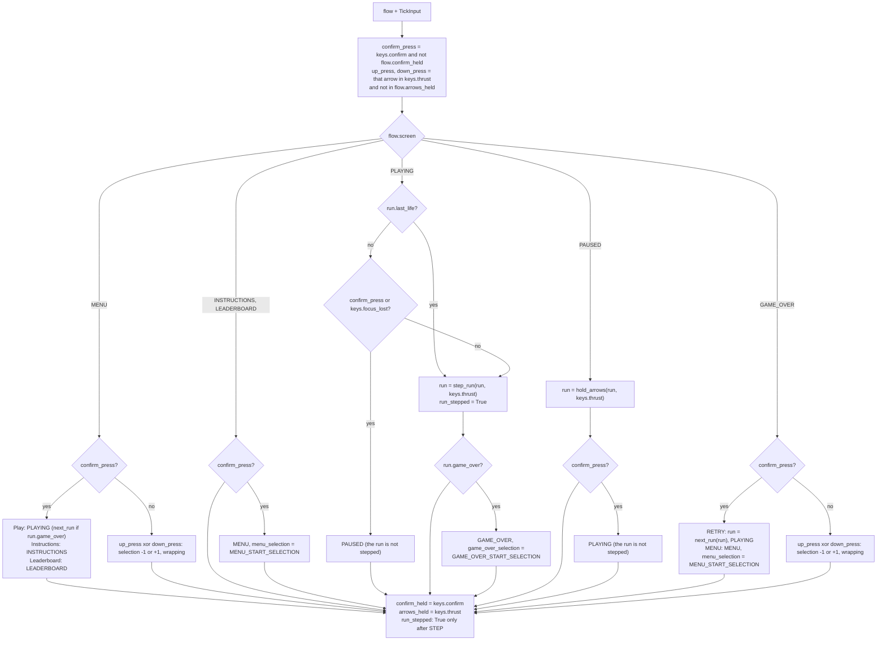

# Game flow: menu, instructions, leaderboard, pause and game over
Version: 0
Status: draft
Features: DRA-125
Created by: architect

## Purpose
The screens around a run and the keys that move between them. One core state, `GameFlow`, holds which screen shows, the run (`docs/contracts/systems/run.md`), the menu's selection, the game-over screen's selection, and the keys held on the last tick. Each tick it reads what the player did (the arrows, a confirm key, a focus loss), decides what that does on the current screen, and steps the run only while the run plays.

After pygbag's click-to-start the menu shows Play, Instructions and Leaderboard, with Play selected. Up and down move the selection and wrap around; a confirm key picks it. Instructions and Leaderboard open one page each; a confirm key goes back to the menu. Play starts the run. During play a confirm key or a focus loss pauses: the PAUSE box shows over the frozen world, and only a confirm key resumes. When the last life is lost the run plays its last-life delay, where keys and focus do nothing, then the game-over screen shows over the frozen world: GAME OVER, the score, and RETRY with MENU under it, RETRY selected. Up and down move that selection and wrap; a confirm key picks it. RETRY starts a new run at once; MENU goes back to the menu with Play selected.

Every confirm key counts only on a fresh press, on every screen: a key held from the screen before does nothing on the new one. The arrows are read the same way for the selections.

The leaderboard page opens empty and the game-over screen's message is always GAME OVER: saves, the filled top 10, name entry, BEST and the place messages come with DRA-126. Every screen is a stand-in look: plain text and shapes, until UI-03 and UI-04.

## Diagram

```mermaid
stateDiagram-v2
    [*] --> MENU: start_flow(run), after pygbag's click
    MENU --> MENU: up or down press, selection moves (wraps)
    MENU --> INSTRUCTIONS: confirm press on Instructions
    MENU --> LEADERBOARD: confirm press on Leaderboard
    INSTRUCTIONS --> MENU: confirm press, Play selected
    LEADERBOARD --> MENU: confirm press, Play selected
    MENU --> PLAYING: confirm press on Play<br/>(next_run first if the run is over)
    PLAYING --> PAUSED: confirm press or focus lost,<br/>not in the last life
    PAUSED --> PLAYING: confirm press
    PLAYING --> PLAYING: step_run; the last life runs here too
    PLAYING --> GAME_OVER: run.game_over after a step, RETRY selected
    GAME_OVER --> GAME_OVER: up or down press, selection moves (wraps)
    GAME_OVER --> PLAYING: confirm press on RETRY, run = next_run(run)
    GAME_OVER --> MENU: confirm press on MENU, Play selected
```

The GDD's `LastLife` state (02-game-flow.md, rule 8) is `PLAYING` with `run.last_life` True: the run is stepped, but no key or focus loss does anything.

One tick, `step_flow(flow, keys)`:


Fresh presses across screens, with Enter held from tick P to tick P+40 and no arrow:
```
tick                 P-1        P                    P+1 .. P+40          P+41         P+42
keys.confirm         False      True                 True                 False        True
confirm_press        -          yes                  no (held)            no           yes
screen after         MENU       PLAYING (Play)       PLAYING, stepped     PLAYING      PAUSED
run stepped          no         no                   yes                  yes          no
```
The press that picks Play never pauses: the run plays from tick P+1 while the key is held, and a second, fresh press pauses. The same holds for RETRY, for the press that closes a page (it never picks a menu item) and for resuming (it never pauses again).

A pause during the respawn wait, an arrow pressed during the pause and held:
```
tick            T (pause)     T+1 .. R-1 (paused)        R (resume)     R+1               R+2 (arrow released)   R+3 (pressed)
run stepped     no            no                         no             yes               yes                    yes
run.held        as before     the arrows held now        same           held = thrust     released               the press
wait            frozen        frozen                     frozen         still waiting     still waiting          ends: thrust
```

Screens (stand-ins, centered across the 640 × 480 canvas, white default-font text on the background):
```
MENU                          INSTRUCTIONS                          LEADERBOARD
                              HOW TO PLAY                           LEADERBOARD
DRIFTWARD ACE                 [] FLY                                No scores yet.
                              Arrows thrust. Let go and ...
 > Play                       [] PAUSE
   Instructions               ...  (six sections)
   Leaderboard
                              Press Enter or Space to go back.      Press Enter or Space to go back.

PAUSED (over the frozen world, HUD on top)      GAME_OVER (over the frozen world, HUD on top)
        +------------------+                            +------------------+
        |      PAUSE       |                            |    GAME OVER     |
        +------------------+                            |   SCORE 1 234    |
                                                        |   > RETRY        |
                                                        |     MENU         |
                                                        +------------------+
```

## Interface
```python
# game/core/game_flow.py (new). Imports: stdlib, core.run, core.ship (Thrust), core.drifters.spawner
# (Placement), core.drifters.tuning (DrifterTuning). Never pygame, ui or app.

class Screen(Enum):
    MENU = "menu"
    INSTRUCTIONS = "instructions"
    LEADERBOARD = "leaderboard"
    PLAYING = "playing"        # the run is stepped; its last life too (run.last_life)
    PAUSED = "paused"
    GAME_OVER = "game_over"

class MenuItem(Enum):          # members in menu order, top first
    PLAY = "play"
    INSTRUCTIONS = "instructions"
    LEADERBOARD = "leaderboard"

class GameOverChoice(Enum):    # members in screen order, top first
    RETRY = "retry"
    MENU = "menu"

MENU_START_SELECTION: Final[MenuItem]             # 02-game-flow.md, menu_start_selection (guess)
GAME_OVER_START_SELECTION: Final[GameOverChoice]  # 02-game-flow.md, game_over_choices (locked: RETRY first)

@dataclass(frozen=True, slots=True, kw_only=True)
class TickInput:
    """What the player did, as one tick sees it."""
    thrust: Thrust = field(default_factory=Thrust)  # the arrows held now
    confirm: bool = False                           # Enter or Space held now
    focus_lost: bool = False                        # the page lost focus since the last tick

@dataclass(frozen=True, slots=True, kw_only=True)
class GameFlow:
    """The screen that shows, the run, the two selections and the keys of the last tick."""
    screen: Screen
    run: Run
    menu_selection: MenuItem
    game_over_selection: GameOverChoice
    confirm_held: bool    # a confirm key was held on the last tick
    arrows_held: Thrust   # the arrows held on the last tick
    run_stepped: bool     # step_run ran on the last tick

def start_flow(run: Run) -> GameFlow: ...
    # MENU, MENU_START_SELECTION, GAME_OVER_START_SELECTION, the run as given (the app's first run),
    # confirm_held True, every arrow held, run_stepped False (Rules, Start).

def step_flow(flow: GameFlow, keys: TickInput) -> GameFlow: ...
    # One 60 Hz tick (Rules). Pure apart from event logging. Never mutates its input.

def add_flow_drifters(
    flow: GameFlow, placements: Sequence[Placement], tuning: DrifterTuning
) -> GameFlow: ...
    # flow unchanged unless flow.run_stepped; then the flow with run = add_drifters(flow.run,
    # placements, tuning). Raises what add_drifters raises.
```
`Run`, `step_run`, `add_drifters`, `next_run` and `hold_arrows` are in `docs/contracts/systems/run.md`. `Thrust` is in `docs/contracts/systems/ship.md`.

```python
# game/ui/screen_look.py (new). The stand-in look the screens share. Imports: pygame. Never core, never app.
SCREEN_TEXT_COLOR: Final[tuple[int, int, int]]   # scope report DRA-125, Values needed (stand-ins: white text)
SCREEN_TITLE_FONT_SIZE: Final[int]               # same: every title, the menu's, the pages', PAUSE and GAME OVER
SCREEN_BODY_FONT_SIZE: Final[int]                # same: the pages' sections and lines, the footer, the game-over lines
SELECTION_MARKER: Final[str]                     # same: in front of the selected item
SCREEN_BOX_COLOR: Final[tuple[int, int, int, int]]  # same: the DRA-23 box fill (scope report DRA-23, Game Over box)
BACK_PROMPT_TEXT: Final[str]                     # same: the instructions and leaderboard pages' footer

def screen_font(size: int) -> pygame.font.Font: ...
    # The default font at `size` px, built on the first call for that size and kept.
```
```python
# game/ui/menu.py (new). Imports: pygame, core.game_flow (MenuItem), ui.screen_look. Never app.
MENU_TITLE_TEXT: Final[str]                   # scope report DRA-125, Values needed (Menu: title)
MENU_ITEM_FONT_SIZE: Final[int]               # same: the items' size
MENU_ITEM_SPACING: Final[int]                 # same: px from one item's top to the next one's
MENU_ITEM_TEXTS: Final[Mapping[MenuItem, str]]  # same: each item's label

def draw_menu(surface: pygame.Surface, selection: MenuItem) -> None: ...
```
```python
# game/ui/instructions.py (new). Imports: pygame, ui.screen_look. Never core, never app.
INSTRUCTIONS_TITLE_TEXT: Final[str]                        # scope report DRA-125, Values needed (Instructions page: title)
INSTRUCTION_SECTIONS: Final[tuple[tuple[str, str], ...]]   # same: the six (title, line) pairs, in the scope report's order
ICON_SIZE: Final[int]                                      # same: the icon square's side, px
ICON_LINE_WIDTH: Final[int]                                # the icon's outline width, px (Presentation, Instructions)

def draw_instructions(surface: pygame.Surface) -> None: ...
```
```python
# game/ui/leaderboard.py (new). Imports: pygame, ui.screen_look. Never core, never app.
LEADERBOARD_TITLE_TEXT: Final[str]   # scope report DRA-125, Values needed (Leaderboard page: title)
LEADERBOARD_EMPTY_TEXT: Final[str]   # same: the line an empty top 10 shows

def draw_leaderboard(surface: pygame.Surface) -> None: ...
```
```python
# game/ui/pause_box.py (new). Imports: pygame, ui.screen_look. Never core, never app.
PAUSE_BOX_SIZE: Final[tuple[int, int]]   # scope report DRA-125, Values needed (Pause box: the DRA-23 box size)
PAUSE_TEXT: Final[str]                   # same

def draw_pause_box(surface: pygame.Surface) -> None: ...
```
```python
# game/ui/game_over.py, changed. Imports: pygame, core.game_flow (GameOverChoice), ui.score_text,
# ui.screen_look. Never app. Never reads the run mode or a key.
BOX_SIZE: tuple[int, int]     # changed: scope report DRA-125, Values needed (Game-over screen: the box grown)
TITLE_TEXT: str               # changed: same (GAME OVER, the only message until DRA-126)
RETRY_TEXT: Final[str]        # new: same
MENU_TEXT: Final[str]         # new: same
# Removed: PROMPT_TEXT, PROMPT_FONT_SIZE. BOX_COLOR, TEXT_COLOR, TITLE_FONT_SIZE and
# SCORE_FONT_SIZE give way to ui.screen_look's shared constants.

def draw_game_over(surface: pygame.Surface) -> None: ...                    # signature unchanged: the box and the title
def draw_final_score(surface: pygame.Surface, score: int) -> None: ...      # signature unchanged: the score line
def draw_game_over_choices(surface: pygame.Surface, selection: GameOverChoice) -> None: ...  # new: RETRY and MENU
```
`score_text` (`game/ui/score_text.py`) is in `docs/contracts/systems/hud.md`. The app's side (reading Enter, Space and the focus, calling `step_flow` and `add_flow_drifters`, drawing each screen) is in `docs/contracts/systems/app/frame-loop.md`.

## Presentation
The app picks what to draw from `flow.screen` (`systems/app/frame-loop.md`, Draw). Every fact shown is a core field; no view works one out.

| Core field | Shown as |
|---|---|
| `flow.screen` MENU, INSTRUCTIONS, LEADERBOARD | the background, then that page alone: `draw_menu`, `draw_instructions` or `draw_leaderboard`. No world, no HUD, no debug overlay. Source: scope report DRA-125, Values needed ("white text on the black background"); 02-game-flow.md, rules 2 to 4 |
| `flow.menu_selection` | which menu item has the marker. Source: 10-ui.md, menu_screen ("the selected one marked") |
| `flow.screen` PLAYING | the world, the HUD on top (`systems/run.md`, Presentation), the burst during the last life |
| `flow.screen` PAUSED | the world exactly as it was on the last tick played, then `draw_pause_box`, then the HUD on top. Source: 02-game-flow.md, rule 7; 10-ui.md, pause_box; scope report DRA-125, Values needed ("The HUD stays visible") |
| `flow.screen` GAME_OVER | the frozen world, then `draw_game_over`, `draw_final_score(surface, flow.run.score)` and `draw_game_over_choices(surface, flow.game_over_selection)`, then the HUD on top. Source: 02-game-flow.md, rule 10; 10-ui.md, game_over_screen |
| `flow.run.score` | the game-over screen's score line: the final score, frozen since the last life (`systems/run.md`, Score) |
| `flow.game_over_selection` | which of RETRY and MENU has the marker. Source: 02-game-flow.md, game_over_choices |

Every view here is a stand-in: the look values are the scope report's (DRA-125, Values needed), approved by the Director and not in the GDD, until UI-03 and UI-04 (10-ui.md, instructions_text_and_look, screens_look, TBD). Each one is its own constant, so those features replace them one by one. Shared by all:
- **Text.** The default font (`screen_font(size)`), antialiased, in `SCREEN_TEXT_COLOR`, every line centered across the surface's width (`centerx = width // 2`, from `surface.get_size()`). A title at `SCREEN_TITLE_FONT_SIZE`, body lines at `SCREEN_BODY_FONT_SIZE`, menu items at `MENU_ITEM_FONT_SIZE`.
- **Lines and blank lines.** A line's height is its font's `get_linesize()`. A blank line is one body line's height. Stacked lines sit one under the other with no other gap.
- **Selection marker.** Shared by the menu and the game-over screen. The label is centered as every line; it never moves with the selection. The selected label gets `SELECTION_MARKER`, rendered in the label's font, with the same top, its right edge one space (the font's `size(" ")` width) left of the label's left edge. Other labels have no marker.
- **Box.** The pause box and the game-over box are a rectangle of their size filled with `SCREEN_BOX_COLOR`, no border, centered: top-left `((width - box_width) // 2, (height - box_height) // 2)`.
- **Cache.** Fonts are built once per size; every fixed text is rendered once, on the first draw, and kept; the box surfaces are built once. Only the game-over score line is rendered again, when the score differs from the last one rendered. Never a render per frame for a text already rendered. Source: 15-tech-constraints.md, rule 5.
- **Only draws.** No view fills the background, flips, logs per frame, catches an error, changes core state, or reads the run mode, a key or the focus. Source: 10-ui.md, rule 5.

**Menu** (`draw_menu`). Source: scope report DRA-125, Values needed (Menu); 10-ui.md, menu_screen; 02-game-flow.md, menu_items.
- The title `MENU_TITLE_TEXT` at the title size. One blank title line under it (one title line's height), then the items in `MenuItem` order, each `MENU_ITEM_TEXTS[item]` at `MENU_ITEM_FONT_SIZE`, their tops `MENU_ITEM_SPACING` px apart.
- The whole block, from the title's top to the last item's bottom (its top plus its font's `get_height()`), is centered vertically on the surface.
- The marker is on `selection`.

**Instructions page** (`draw_instructions`). Source: scope report DRA-125, Values needed (Instructions page, Footer); 10-ui.md, instructions_page (locked content).
- From the top of the block: the title `INSTRUCTIONS_TITLE_TEXT` at the title size; a blank line; then each of `INSTRUCTION_SECTIONS` in order as two rows, a heading row and its line, with a blank line between sections.
- **Heading row.** The icon, then one space (the body font's `size(" ")` width), then the section title at the body size; the icon and the title together are centered across the width. The icon is a square outline of `ICON_SIZE` px with a line `ICON_LINE_WIDTH` px wide, in `SCREEN_TEXT_COLOR`, drawn with `pygame.draw.rect`; it is a stand-in icon for every section, the same square for all six. The row is as tall as the taller of the icon and a body line; the icon and the title are each centered vertically in it.
- **Line row.** The section's line at the body size, centered.
- **Footer.** `BACK_PROMPT_TEXT` at the body size, centered, its top two body lines' height above the surface's bottom (so one blank line stays under it).
- The block from the title's top to the last section's line bottom is centered vertically in the space from the surface's top to the footer's top.

**Leaderboard page** (`draw_leaderboard`). Empty until DRA-126. Source: scope report DRA-125, Values needed (Leaderboard page, Footer); 02-game-flow.md, rule 4 (opens even when the list is empty).
- The title `LEADERBOARD_TITLE_TEXT` at the title size, a blank line, then `LEADERBOARD_EMPTY_TEXT` at the body size. This block is centered vertically in the space above the footer, as on the instructions page.
- The footer as on the instructions page, in the same place.

**Pause box** (`draw_pause_box`). Source: scope report DRA-125, Values needed (Pause box); 10-ui.md, pause_box (locked content).
- A box of `PAUSE_BOX_SIZE`, centered, then `PAUSE_TEXT` at the title size with its rect centered on the box's center.
- It draws over whatever is on the surface and hides nothing: the world shows through the see-through fill.

**Game-over screen** (`draw_game_over`, `draw_final_score`, `draw_game_over_choices`). Source: scope report DRA-125, Values needed (Game-over screen); 10-ui.md, game_over_screen and game_over_message (GAME OVER only until DRA-126); 02-game-flow.md, rule 10 and game_over_choices; scope report DRA-61 (the score line's text and look).
- **Layout.** Four lines, top to bottom: the title, the score line, RETRY, MENU. The block (title line height + score line height + RETRY line height + MENU font's `get_height()`) is centered vertically in the box. All three functions place their lines by this one layout, worked out from `surface.get_size()` and the fonts, so each line lands in its place whichever functions are called.
- `draw_game_over`: the box of `BOX_SIZE`, centered, then `TITLE_TEXT` at the title size in the first line's place. It leaves the other three places empty.
- `draw_final_score`: `score_text(score)` at the body size in the second line's place, centered, however long it is (no digit limit, as in DRA-61). `score` is a whole number ≥ 0 from the app, trusted.
- `draw_game_over_choices`: `RETRY_TEXT` in the third place and `MENU_TEXT` in the fourth, at the body size, the marker on `selection`.
- Room for DRA-126: the title's place takes the place message and the letter picker goes between the score and RETRY. DRA-126 sets that layout; nothing here assumes the block stays four lines.

The burst is presented in `docs/contracts/systems/run.md`, Presentation (Burst).

## Rules
Values. Every key and screen value comes from the GDD or the scope report; none is restated here.
- Confirm keys: Enter or Space, both the same everywhere (02-game-flow.md, confirm_keys, locked). The app maps them to `TickInput.confirm` (`systems/app/frame-loop.md`). The arrows are the only other keys (01-vision.md, locked decision 1).
- Menu items and order: 02-game-flow.md, menu_items (locked). Start selection: menu_start_selection (guess).
- Game-over choices, order and start selection: 02-game-flow.md, game_over_choices (locked).
- Screen texts and look: scope report DRA-125, Values needed (stand-ins approved by the Director, not in the GDD; UI-03 and UI-04 are TBD).

**Presses** (02-game-flow.md, fresh_press and rule 12, locked; 91-decision-log.md, row 89). On every tick, on every screen:
- `confirm_press` is `keys.confirm` and not `flow.confirm_held`. `up_press` is `keys.thrust.up` and not `flow.arrows_held.up`; `down_press` likewise for down.
- After the tick, whatever the screen and whatever happened: `confirm_held = keys.confirm`, `arrows_held = keys.thrust`. So a key held across a screen change is never a press on the new screen, and one press never does two things.
- On a selection screen, `up_press` and `down_press` on the same tick cancel out: no move. A `confirm_press` acts on the selection as it was going into the tick; arrows on that tick don't move it.
- Left and right do nothing on any screen but PLAYING, where they fly.

**Start** (`start_flow`). After pygbag's click-to-start the app builds its first run as before and calls `start_flow(run)`: MENU, `MENU_START_SELECTION`, `GAME_OVER_START_SELECTION`, `run_stepped` False. `confirm_held` is True and every arrow is held in `arrows_held`, so a key already down when the menu first shows does nothing until it is released and pressed again. Source: 02-game-flow.md, rules 1, 2 and 12 (pygbag's start screen is the screen before).

**MENU** (02-game-flow.md, rule 2 and menu_navigation, locked; 91-decision-log.md, rows 80 and 89; 01-vision.md, locked decision 8):
- `confirm_press` picks `menu_selection`: Play goes to PLAYING; Instructions to INSTRUCTIONS; Leaderboard to LEADERBOARD.
- Play: when `run.game_over` (the menu was reached through MENU), `run = next_run(run)` first. Otherwise the run is the app's first run, untouched. Either way the run is not stepped on this tick; it is first stepped on the next one, exactly as a run starts today. Source: 02-game-flow.md, rule 5.
- Otherwise `up_press` moves the selection one item up, from the first to the last; `down_press` one item down, from the last to the first.
- A focus loss does nothing. Source: 02-game-flow.md, Edge cases.
- Every time MENU is entered, from a page or from GAME_OVER, `menu_selection = MENU_START_SELECTION`: the menu always opens with it selected. Source: 02-game-flow.md, rule 2 ("It opens with `menu_start_selection` selected").

**INSTRUCTIONS and LEADERBOARD** (02-game-flow.md, rules 3 and 4): `confirm_press` goes to MENU. Nothing else does anything: no arrow, no focus loss. The instructions open only from the menu (01-vision.md, locked decision 8). The leaderboard page opens empty in this feature (scope report DRA-125, Limits).

**PLAYING**:
- `run.last_life` True going in: `run = step_run(run, keys.thrust)`. A confirm key and a focus loss do nothing. Source: 02-game-flow.md, rule 8 ("Keys do nothing") and Edge cases ("The tab loses focus during LastLife: it doesn't pause").
- Otherwise, `confirm_press` or `keys.focus_lost`: PAUSED. The run is not stepped on this tick, so it freezes as the player last saw it. Source: 02-game-flow.md, rule 7 and pause_key, pause_on_focus_loss (locked); 91-decision-log.md, row 81.
- Otherwise `run = step_run(run, keys.thrust)`.
- After a step, if `run.game_over`: GAME_OVER with `game_over_selection = GAME_OVER_START_SELECTION`. Source: 02-game-flow.md, rules 8 and 10.

**PAUSED** (02-game-flow.md, rule 7 and Edge cases; 91-decision-log.md, row 81):
- The run is never stepped: physics, scroll, drifters, timers, invulnerability, cooldowns, the respawn wait, popups, rings and the waves all freeze, because they all live in the run. No velocity changes, so the drift goes on as it was.
- Every paused tick, `run = hold_arrows(run, keys.thrust)`: the arrows do nothing while paused, and an arrow pressed during the pause is not a press after it (`systems/run.md`, `hold_arrows`). So a pause during the respawn wait resumes into the wait, which still needs a fresh arrow press.
- `confirm_press` resumes: PLAYING. The run is not stepped on this tick; it plays from the next one.
- A focus loss does nothing; getting the focus back does not resume. There are no other options.

**GAME_OVER** (02-game-flow.md, rules 10 and 11 and game_over_choices, locked; 91-decision-log.md, rows 79 and 90):
- The run is never stepped: everything is frozen.
- `confirm_press` picks `game_over_selection`. RETRY: `run = next_run(run)` and PLAYING, at once, with no delay; the menu and the instructions don't show. MENU: MENU with `MENU_START_SELECTION`; the run stays as it is until Play.
- Otherwise `up_press` and `down_press` move the selection with wraparound, as on the menu. With two choices, either one moves to the other.
- The arrows no longer retry. A focus loss does nothing.
- The message is always GAME OVER in this feature: the place messages come with DRA-126 (10-ui.md, game_over_message; scope report DRA-125, Out).

**`run_stepped`** is True only after a tick on which `step_run` ran (PLAYING, the last life included). It is False after every tick that changed the screen, paused, resumed, started a run or stood on a page or the game-over screen.

**`add_flow_drifters`**. The app calls it after every tick, with the due placements (the run's waves' or the debug spawn list's). It adds them only when `run_stepped`: a paused or frozen run never gets the same due placements twice, and a run never gets drifters before it is first stepped. Source: `systems/run.md`, `add_drifters`; `systems/app/frame-loop.md`, Tick.

**Same in both modes.** The flow never reads the run mode: debug mode shows the menu and runs the same screens. Source: 91-decision-log.md, row 93; game/CONTEXT.md, Run modes.

**Pure.** `step_flow`, `start_flow` and `add_flow_drifters` use no frame time and no randomness of their own; same input, same output, apart from logging. They never mutate their input. Source: 15-tech-constraints.md, rule 2.

**Logging** (logger `core.game_flow`, by event, never by tick). Source: game/CONTEXT.md, Logging (screen changes at INFO); 15-tech-constraints.md, rule 9:
- INFO `screen %s`: on every tick the screen changes, with the new `Screen` value, e.g. `screen paused`, `screen game_over`.
- DEBUG `pause by=%s`: right before `screen paused`, with `key` for a confirm press or `focus` for a focus loss (`key` when both happen on one tick).
- DEBUG `menu select %s` and `game over select %s`: when a selection moves, with the new `MenuItem` or `GameOverChoice` value. Not when it is reset on entering a screen.
- Order inside a tick: the run's own lines (from `step_run`, or `next_run`'s `new run` and the waves' `wave start`), then the flow's lines.
- Nothing else. A paused or page tick logs nothing.

## Rationale
- **One core state above the run.** Which screen shows and what a confirm key does on it are rules (02-game-flow.md), so they live in core, and the views only read them. The run already owns everything that freezes, so a pause is simply not stepping it: nothing in the run needs a paused flag, and every timer freezes together for free.
- **Fresh presses by held state, tick by tick.** The respawn wait already tells a press from a hold by comparing with the last tick (`systems/run.md`, step 1). The flow does the same for the confirm keys and the selection arrows, so a press is one tick, deterministic and testable without events, and a key held across a screen change is a hold on the new screen by construction (rule 12).
- **Start with every key held.** pygbag's start screen is the screen before the menu. Treating every key as held at the start means a key down through the click never acts on the menu, with no special case.
- **The pause, resume, Play and RETRY ticks don't step the run.** The tick that changes the screen belongs to the old screen's key. Not stepping the run on it keeps "a press does one thing only" for the run too, and a new run starts exactly as `start_run` built it, as the DRA-23 retry did.
- **`run_stepped` and `add_flow_drifters`.** The due placements come from the last stepped tick, and the debug list counts the run's own ticks. A paused run would hand the same placements back on every paused tick. Guarding the add in core keeps the app's tick loop as simple as before: it calls one function after every tick.
- **The menu keeps a finished run until Play.** MENU then Play gives exactly what RETRY gives, a `next_run`, and the `new run` log line comes when the run really starts. The app's very first run is not replaced, so the first Play plays the run the app started, with the seed drawn at page load.
- **The menu always opens on Play.** Rule 2 sets the selection the menu opens with, and the menu opens again after each page. Reading it on every entry needs no memory of where the player was.
- **A focus loss is a tick input.** It reaches core on the tick after the browser reports it, like a key, so the pause happens on the fixed tick (15-tech-constraints.md, rule 2) and tests can feed it.
- **The views take plain values, not the flow.** The menu takes its selection, the game-over screen its score and its choice, the pages nothing. The views stay small, testable alone, and free of the flow's rules. `draw_game_over` and `draw_final_score` keep their DRA-61 signatures, so the app's current calls stay valid until integration and QA stays clean between tasks.
- **Shared look in `ui/screen_look.py`.** Five screens use the same color, sizes, marker and box. One home for each stand-in means UI-04 changes one constant, not five copies. Values that only one screen uses stay in its own module.
- **Layout from font metrics.** The scope report gives sizes and "centered"; the rows are placed by the fonts' own line heights and a space's width, so no spacing number is invented and the layout follows the font if UI-03 or UI-04 changes it.
- **One outline square for every icon.** The scope report asks for a stand-in icon per section and gives one: a white outline square. A 1-px outline is the plainest outline pygame draws; UI-03 sets the real icons.
- **The HUD and the debug overlay stay off the pages.** The pages are plain text on the background (scope report DRA-125, Values needed). The HUD shows a run's numbers and the overlay a run's ship, and no run plays on a page. They show on every screen where the run is in view: playing, the last life, paused and game over.
