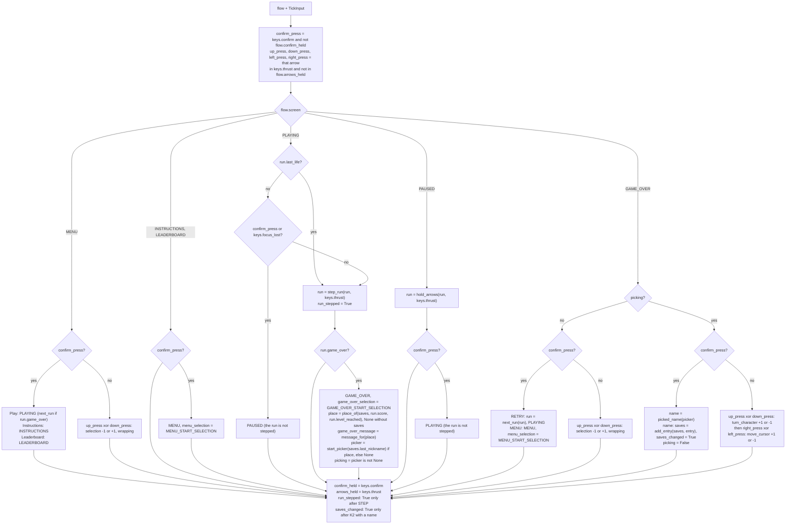

# Game flow: menu, instructions, leaderboard, pause, game over and name entry
Version: 1
Status: draft
Features: DRA-125, DRA-126
Created by: architect

## Purpose
The screens around a run and the keys that move between them. One core state, `GameFlow`, holds which screen shows, the run (`docs/contracts/systems/run.md`), the saves (`docs/contracts/systems/saves.md`), the menu's selection, the game-over screen's message, letter picker and selection, and the keys held on the last tick. Each tick it reads what the player did (the arrows, a confirm key, a focus loss), decides what that does on the current screen, and steps the run only while the run plays.

After pygbag's click-to-start the menu shows Play, Instructions and Leaderboard, with Play selected. Up and down move the selection and wrap around; a confirm key picks it. Instructions opens one page; Leaderboard opens the top 10, in place order, or "No scores yet." when the list is empty or saves don't work. A confirm key goes back to the menu. Play starts the run. During play a confirm key or a focus loss pauses: the PAUSE box shows over the frozen world, and only a confirm key resumes. When the last life is lost the run plays its last-life delay, where keys and focus do nothing, then the game-over screen shows over the frozen world.

The game-over screen holds everything; name entry has no screen of its own. From its first frame it shows the message for the run's place on the top 10 (NEW BEST SCORE, TOP 3, TOP 10, or GAME OVER off the list or when saves don't work), the score, and RETRY with MENU under it, RETRY selected. When the score makes the top 10, the letter picker shows between the score and RETRY, filled with the last nickname, and takes the keys: up and down change the character in the current slot, left and right move between slots, all wrapping, and a confirm key saves. A name saves the entry and becomes the last nickname; a name of only blanks saves nothing. Then the picker takes no more keys and RETRY and MENU take over: up and down move the selection and wrap, a confirm key picks it. Without the picker they take over from the first frame. RETRY starts a new run at once; MENU goes back to the menu with Play selected. The message never changes while the screen shows.

Every confirm key counts only on a fresh press, on every screen: a key held from the screen before does nothing on the new one. The arrows are read the same way for the selections and the picker.

The flow holds the saves the app loaded at startup for the page's life, and tells the app, through `saves_changed`, on the tick an entry is saved, so the app writes them. When saves don't work there is no picker, no BEST and nothing is saved, and the game runs on. Debug mode runs the same screens and saves to the same top 10. Every screen is a stand-in look: plain text and shapes, until UI-01, UI-03 and UI-04.

## Diagram

```mermaid
stateDiagram-v2
    [*] --> MENU: start_flow(run, saves), after pygbag's click
    MENU --> MENU: up or down press, selection moves (wraps)
    MENU --> INSTRUCTIONS: confirm press on Instructions
    MENU --> LEADERBOARD: confirm press on Leaderboard
    INSTRUCTIONS --> MENU: confirm press, Play selected
    LEADERBOARD --> MENU: confirm press, Play selected
    MENU --> PLAYING: confirm press on Play<br/>(next_run first if the run is over)
    PLAYING --> PAUSED: confirm press or focus lost,<br/>not in the last life
    PAUSED --> PLAYING: confirm press
    PLAYING --> PLAYING: step_run; the last life runs here too
    PLAYING --> GAME_OVER: run.game_over after a step, RETRY selected,<br/>message, picker and picking by the run's place
    GAME_OVER --> GAME_OVER: picking: arrow presses turn a character or move the cursor (wrap);<br/>confirm press saves the name (or nothing, if empty), picking = False
    GAME_OVER --> GAME_OVER: not picking: up or down press, selection moves (wraps)
    GAME_OVER --> PLAYING: not picking, confirm press on RETRY, run = next_run(run)
    GAME_OVER --> MENU: not picking, confirm press on MENU, Play selected
```

The GDD's `LastLife` state (02-game-flow.md, rule 8) is `PLAYING` with `run.last_life` True: the run is stepped, but no key or focus loss does anything. The GDD's name entry (02-game-flow.md, rule 9) is `GAME_OVER` with `picking` True.

One tick, `step_flow(flow, keys)`:


The game-over screen with a top-10 score, Enter held from tick S to S+30, no arrow held:
```
tick              G (screen opens)     ...      S (Enter down)         S+1 .. S+30     S+31 (up)   S+32 (Enter)
picking           True                          False                  False           False       False
saves_changed     False                         True (name saved)      False           False       False
confirm_press     -                             yes                    no (held)       no          yes
screen after      GAME_OVER                     GAME_OVER              GAME_OVER       GAME_OVER   PLAYING (RETRY)
```
The press that saves never picks RETRY: a fresh press does (02-game-flow.md, rule 12 and Edge cases).

Fresh presses across screens, with Enter held from tick P to tick P+40 and no arrow:
```
tick                 P-1        P                    P+1 .. P+40          P+41         P+42
keys.confirm         False      True                 True                 False        True
confirm_press        -          yes                  no (held)            no           yes
screen after         MENU       PLAYING (Play)       PLAYING, stepped     PLAYING      PAUSED
run stepped          no         no                   yes                  yes          no
```
The press that picks Play never pauses: the run plays from tick P+1 while the key is held, and a second, fresh press pauses. The same holds for RETRY, for the press that closes a page (it never picks a menu item) and for resuming (it never pauses again).

A pause during the respawn wait, an arrow pressed during the pause and held:
```
tick            T (pause)     T+1 .. R-1 (paused)        R (resume)     R+1               R+2 (arrow released)   R+3 (pressed)
run stepped     no            no                         no             yes               yes                    yes
run.held        as before     the arrows held now        same           held = thrust     released               the press
wait            frozen        frozen                     frozen         still waiting     still waiting          ends: thrust
```

Screens (stand-ins, centered across the 640 × 480 canvas, white default-font text on the background):
```
MENU                          INSTRUCTIONS                          LEADERBOARD
                              HOW TO PLAY                           LEADERBOARD
DRIFTWARD ACE                 [] FLY                                No scores yet.
                              Arrows thrust. Let go and ...
 > Play                       [] PAUSE
   Instructions               ...  (six sections)
   Leaderboard
                              Press Enter or Space to go back.      Press Enter or Space to go back.

PAUSED (over the frozen world, HUD on top)      GAME_OVER, no picker (over the frozen world, HUD on top)
        +------------------+                            +------------------+
        |      PAUSE       |                            |    GAME OVER     |
        +------------------+                            |   SCORE 1 234    |
                                                        |   > RETRY        |
                                                        |     MENU         |
                                                        +------------------+

GAME_OVER with the picker, picking             after the save                      LEADERBOARD, filled
+------------------------------------+         +------------------------------+    LEADERBOARD
|           NEW BEST SCORE           |         |        NEW BEST SCORE        |
|            SCORE 1 234             |         |         SCORE 1 234          |     1.  ACE      1 234  LV 3
|  [A] C  E  _  _  _  _  _  _  _     |         |   A  C  E  _  _  _  ...      |     2.  ACE        900  LV 2
| Up/Down: letter   Left/Right: ...  |         |   (no outline, no hint)      |     ...
|               RETRY  (grey)        |         |         > RETRY              |
|               MENU   (grey)        |         |           MENU               |    Press Enter or Space to go back.
+------------------------------------+         +------------------------------+
```
`[ ]` is the white outline on the cursor's slot; `_` here is each slot's grey underline, never a drawn character. After the save the hint's line stays empty and nothing moves. The leaderboard's columns are in Presentation (Leaderboard page).

## Interface
```python
# game/core/game_flow.py (new). Imports: stdlib, core.run, core.ship (Thrust), core.drifters.spawner
# (Placement), core.drifters.tuning (DrifterTuning). Never pygame, ui or app.

class Screen(Enum):
    MENU = "menu"
    INSTRUCTIONS = "instructions"
    LEADERBOARD = "leaderboard"
    PLAYING = "playing"        # the run is stepped; its last life too (run.last_life)
    PAUSED = "paused"
    GAME_OVER = "game_over"

class MenuItem(Enum):          # members in menu order, top first
    PLAY = "play"
    INSTRUCTIONS = "instructions"
    LEADERBOARD = "leaderboard"

class GameOverChoice(Enum):    # members in screen order, top first
    RETRY = "retry"
    MENU = "menu"

MENU_START_SELECTION: Final[MenuItem]             # 02-game-flow.md, menu_start_selection (guess)
GAME_OVER_START_SELECTION: Final[GameOverChoice]  # 02-game-flow.md, game_over_choices (locked: RETRY first)

@dataclass(frozen=True, slots=True, kw_only=True)
class TickInput:
    """What the player did, as one tick sees it."""
    thrust: Thrust = field(default_factory=Thrust)  # the arrows held now
    confirm: bool = False                           # Enter or Space held now
    focus_lost: bool = False                        # the page lost focus since the last tick

@dataclass(frozen=True, slots=True, kw_only=True)
class GameFlow:
    """The screen that shows, the run, the two selections and the keys of the last tick."""
    screen: Screen
    run: Run
    menu_selection: MenuItem
    game_over_selection: GameOverChoice
    confirm_held: bool    # a confirm key was held on the last tick
    arrows_held: Thrust   # the arrows held on the last tick
    run_stepped: bool     # step_run ran on the last tick

def start_flow(run: Run) -> GameFlow: ...
    # MENU, MENU_START_SELECTION, GAME_OVER_START_SELECTION, the run as given (the app's first run),
    # confirm_held True, every arrow held, run_stepped False (Rules, Start).

def step_flow(flow: GameFlow, keys: TickInput) -> GameFlow: ...
    # One 60 Hz tick (Rules). Pure apart from event logging. Never mutates its input.

def add_flow_drifters(
    flow: GameFlow, placements: Sequence[Placement], tuning: DrifterTuning
) -> GameFlow: ...
    # flow unchanged unless flow.run_stepped; then the flow with run = add_drifters(flow.run,
    # placements, tuning). Raises what add_drifters raises.
```
`Run`, `step_run`, `add_drifters`, `next_run` and `hold_arrows` are in `docs/contracts/systems/run.md`. `Thrust` is in `docs/contracts/systems/ship.md`.

```python
# game/ui/screen_look.py (new). The stand-in look the screens share. Imports: pygame. Never core, never app.
SCREEN_TEXT_COLOR: Final[tuple[int, int, int]]   # scope report DRA-125, Values needed (stand-ins: white text)
SCREEN_TITLE_FONT_SIZE: Final[int]               # same: every title, the menu's, the pages', PAUSE and GAME OVER
SCREEN_BODY_FONT_SIZE: Final[int]                # same: the pages' sections and lines, the footer, the game-over lines
SELECTION_MARKER: Final[str]                     # same: in front of the selected item
SCREEN_BOX_COLOR: Final[tuple[int, int, int, int]]  # same: the DRA-23 box fill (scope report DRA-23, Game Over box)
BACK_PROMPT_TEXT: Final[str]                     # same: the instructions and leaderboard pages' footer

def screen_font(size: int) -> pygame.font.Font: ...
    # The default font at `size` px, built on the first call for that size and kept.
```
```python
# game/ui/menu.py (new). Imports: pygame, core.game_flow (MenuItem), ui.screen_look. Never app.
MENU_TITLE_TEXT: Final[str]                   # scope report DRA-125, Values needed (Menu: title)
MENU_ITEM_FONT_SIZE: Final[int]               # same: the items' size
MENU_ITEM_SPACING: Final[int]                 # same: px from one item's top to the next one's
MENU_ITEM_TEXTS: Final[Mapping[MenuItem, str]]  # same: each item's label

def draw_menu(surface: pygame.Surface, selection: MenuItem) -> None: ...
```
```python
# game/ui/instructions.py (new). Imports: pygame, ui.screen_look. Never core, never app.
INSTRUCTIONS_TITLE_TEXT: Final[str]                        # scope report DRA-125, Values needed (Instructions page: title)
INSTRUCTION_SECTIONS: Final[tuple[tuple[str, str], ...]]   # same: the six (title, line) pairs, in the scope report's order
ICON_SIZE: Final[int]                                      # same: the icon square's side, px
ICON_LINE_WIDTH: Final[int]                                # the icon's outline width, px (Presentation, Instructions)

def draw_instructions(surface: pygame.Surface) -> None: ...
```
```python
# game/ui/leaderboard.py (new). Imports: pygame, ui.screen_look. Never core, never app.
LEADERBOARD_TITLE_TEXT: Final[str]   # scope report DRA-125, Values needed (Leaderboard page: title)
LEADERBOARD_EMPTY_TEXT: Final[str]   # same: the line an empty top 10 shows

def draw_leaderboard(surface: pygame.Surface) -> None: ...
```
```python
# game/ui/pause_box.py (new). Imports: pygame, ui.screen_look. Never core, never app.
PAUSE_BOX_SIZE: Final[tuple[int, int]]   # scope report DRA-125, Values needed (Pause box: the DRA-23 box size)
PAUSE_TEXT: Final[str]                   # same

def draw_pause_box(surface: pygame.Surface) -> None: ...
```
```python
# game/ui/game_over.py, changed. Imports: pygame, core.game_flow (GameOverChoice), ui.score_text,
# ui.screen_look. Never app. Never reads the run mode or a key.
BOX_SIZE: tuple[int, int]     # changed: scope report DRA-125, Values needed (Game-over screen: the box grown)
TITLE_TEXT: str               # changed: same (GAME OVER, the only message until DRA-126)
RETRY_TEXT: Final[str]        # new: same
MENU_TEXT: Final[str]         # new: same
# Removed: PROMPT_TEXT, PROMPT_FONT_SIZE. BOX_COLOR, TEXT_COLOR, TITLE_FONT_SIZE and
# SCORE_FONT_SIZE give way to ui.screen_look's shared constants.

def draw_game_over(surface: pygame.Surface) -> None: ...                    # signature unchanged: the box and the title
def draw_final_score(surface: pygame.Surface, score: int) -> None: ...      # signature unchanged: the score line
def draw_game_over_choices(surface: pygame.Surface, selection: GameOverChoice) -> None: ...  # new: RETRY and MENU
```
### DRA-126: what saves add and change
Existing signatures are read from the code. Only the new and changed ones are here.
```python
# game/core/game_flow.py, changed. Imports also core.saves. Every new GameFlow field has a default,
# so start_flow(run) and every existing caller build what they built before.
@dataclass(frozen=True, slots=True, kw_only=True)
class GameFlow:
    ...
    saves: Saves | None = None                                   # the saves the app loaded; None: saves don't work
    game_over_message: GameOverMessage = GameOverMessage.GAME_OVER  # set when GAME_OVER opens, never changed on it
    picker: NamePicker | None = None                             # the letter picker shown on GAME_OVER; None: no picker
    picking: bool = False                                        # the picker takes the keys; RETRY and MENU don't
    saves_changed: bool = False                                  # an entry was saved on the last tick: the app writes `saves`

    @property
    def best(self) -> int | None: ...
        # saves.best, or None when saves is None.
    @property
    def leaderboard(self) -> tuple[ScoreEntry, ...]: ...
        # saves.entries, or () when saves is None.

def start_flow(run: Run, saves: Saves | None = None) -> GameFlow: ...
    # changed: also holds `saves` as given. start_flow(run) is a flow with saves that don't work.

def stop_saves(flow: GameFlow) -> GameFlow: ...
    # new: the flow with saves = None and saves_changed = False, nothing else changed. The app calls it
    # when a write fails (systems/app/save-storage.md). Pure, no logging.
```
`Saves`, `ScoreEntry`, `GameOverMessage` and `NamePicker` are in `docs/contracts/systems/saves.md`. `Run.level_reached` is in `docs/contracts/systems/run.md`.

```python
# game/ui/game_over.py, changed. Imports also core.saves (GameOverMessage, NamePicker, NICKNAME_CHARACTERS,
# BLANK). Each function keeps its DRA-125 call valid: the new parameters default to the DRA-125 screen.
MESSAGE_TEXTS: Final[Mapping[GameOverMessage, str]]  # 10-ui.md, game_over_message (locked): the four texts
PICKER_BOX_SIZE: Final[tuple[int, int]]              # scope report DRA-126, Values needed (Game-over screen with the picker: box)
PICKER_FONT_SIZE: Final[int]                         # same: the slots' characters
PICKER_HINT_TEXT: Final[str]                         # same: the hint line
INACTIVE_TEXT_COLOR: Final[tuple[int, int, int]]     # same: RETRY and MENU before the save (grey)
SLOT_UNDERLINE_COLOR: Final[tuple[int, int, int]]    # same, Picker slots: each slot's underline (grey)
CURSOR_COLOR: Final[tuple[int, int, int]]            # same, Picker slots: the outline on the current slot (white)
SLOT_LINE_WIDTH: Final[int]                          # the underline's and the outline's width, px: docs/reports/DRA-126-away-log.md, Decisions, 4
# Removed: TITLE_TEXT, whose text is MESSAGE_TEXTS[GameOverMessage.GAME_OVER].

def draw_game_over(
    surface: pygame.Surface,
    message: GameOverMessage = GameOverMessage.GAME_OVER,
    picker_shown: bool = False,
) -> None: ...                                       # changed: the box of the layout, then the message
def draw_final_score(surface: pygame.Surface, score: int, picker_shown: bool = False) -> None: ...  # changed
def draw_name_picker(surface: pygame.Surface, picker: NamePicker, picking: bool) -> None: ...      # new
def draw_game_over_choices(
    surface: pygame.Surface,
    selection: GameOverChoice,
    picker_shown: bool = False,
    active: bool = True,
) -> None: ...                                       # changed: grey and no marker while not active
```
```python
# game/ui/leaderboard.py, changed. Imports also core.saves (ScoreEntry) and ui.score_text (group_digits).
PLACE_FORMAT: Final[str]          # scope report DRA-126, Values needed (Leaderboard rows: `1.`)
LEVEL_LABEL: Final[str]           # same (`LV 3`)
ROW_SPACING: Final[int]           # same: px from one row's top to the next one's
COLUMN_GAP: Final[int]            # px between columns: docs/reports/DRA-126-away-log.md, Decisions, 5

def draw_leaderboard(surface: pygame.Surface, entries: Sequence[ScoreEntry] = ()) -> None: ...
    # changed: the rows, or the empty-list line when entries is empty. draw_leaderboard(surface) is the
    # DRA-125 page.
```
`group_digits` (`game/ui/score_text.py`) is in `docs/contracts/systems/hud.md`.

`score_text` (`game/ui/score_text.py`) is in `docs/contracts/systems/hud.md`. The app's side (reading Enter, Space and the focus, calling `step_flow` and `add_flow_drifters`, drawing each screen) is in `docs/contracts/systems/app/frame-loop.md`; loading and writing the saves is in `docs/contracts/systems/app/save-storage.md`.

## Presentation
The app picks what to draw from `flow.screen` (`systems/app/frame-loop.md`, Draw). Every fact shown is a core field; no view works one out.

| Core field | Shown as |
|---|---|
| `flow.screen` MENU, INSTRUCTIONS, LEADERBOARD | the background, then that page alone: `draw_menu`, `draw_instructions` or `draw_leaderboard`. No world, no HUD, no debug overlay. Source: scope report DRA-125, Values needed ("white text on the black background"); 02-game-flow.md, rules 2 to 4 |
| `flow.menu_selection` | which menu item has the marker. Source: 10-ui.md, menu_screen ("the selected one marked") |
| `flow.screen` PLAYING | the world, the HUD on top (`systems/run.md`, Presentation), the burst during the last life |
| `flow.screen` PAUSED | the world exactly as it was on the last tick played, then `draw_pause_box`, then the HUD on top. Source: 02-game-flow.md, rule 7; 10-ui.md, pause_box; scope report DRA-125, Values needed ("The HUD stays visible") |
| `flow.screen` GAME_OVER | the frozen world, then `draw_game_over(surface, flow.game_over_message, picker_shown)`, `draw_final_score(surface, flow.run.score, picker_shown)`, `draw_name_picker(surface, flow.picker, flow.picking)` only when `flow.picker` is not None, and `draw_game_over_choices(surface, flow.game_over_selection, picker_shown, active=not flow.picking)`, then the HUD on top. `picker_shown` is `flow.picker is not None`. Source: 02-game-flow.md, rules 9 and 10; 10-ui.md, game_over_screen |
| `flow.run.score` | the game-over screen's score line: the final score, frozen since the last life (`systems/run.md`, Score) |
| `flow.game_over_selection` | which of RETRY and MENU has the marker, once they take the keys. Source: 02-game-flow.md, game_over_choices |
| `flow.game_over_message` (DRA-126) | the game-over screen's first line: `MESSAGE_TEXTS[message]`. Source: 10-ui.md, game_over_message (locked); 11-save-data.md, rule 10 |
| `flow.picker`, `flow.picking` (DRA-126) | the letter picker: its slots' characters and, while `picking`, the cursor's outline; RETRY and MENU grey while `picking`. Source: 11-save-data.md, nickname_input; scope report DRA-126, Values needed |
| `flow.leaderboard` (DRA-126) | the leaderboard page's rows: `draw_leaderboard(surface, flow.leaderboard)`. Entry `i` is place `i + 1`. Source: 10-ui.md, leaderboard_page; 02-game-flow.md, rule 4 |
| `flow.best` (DRA-126) | BEST on the HUD: `docs/contracts/systems/hud.md` |

Every view here is a stand-in: the look values are the scope reports' (DRA-125 and DRA-126, Values needed), approved by the Director and not in the GDD, until UI-03 and UI-04 (10-ui.md, instructions_text_and_look, screens_look, TBD). Each one is its own constant, so those features replace them one by one. Shared by all:
- **Text.** The default font (`screen_font(size)`), antialiased, in `SCREEN_TEXT_COLOR`, every line centered across the surface's width (`centerx = width // 2`, from `surface.get_size()`). A title at `SCREEN_TITLE_FONT_SIZE`, body lines at `SCREEN_BODY_FONT_SIZE`, menu items at `MENU_ITEM_FONT_SIZE`.
- **Lines and blank lines.** A line's height is its font's `get_linesize()`. A blank line is one body line's height. Stacked lines sit one under the other with no other gap.
- **Selection marker.** Shared by the menu and the game-over screen. The label is centered as every line; it never moves with the selection. The selected label gets `SELECTION_MARKER`, rendered in the label's font, with the same top, its right edge one space (the font's `size(" ")` width) left of the label's left edge. Other labels have no marker.
- **Box.** The pause box and the game-over box are a rectangle of their size filled with `SCREEN_BOX_COLOR`, no border, centered: top-left `((width - box_width) // 2, (height - box_height) // 2)`.
- **Cache.** Fonts are built once per size; every fixed text is rendered once, on the first draw, and kept; the box surfaces are built once. Only the game-over score line is rendered again, when the score differs from the last one rendered. Each picker character is rendered once per character and kept (`NICKNAME_CHARACTERS` is small); each message once per message; each leaderboard cell text once and kept. Never a render per frame for a text already rendered. Source: 15-tech-constraints.md, rule 5.
- **Only draws.** No view fills the background, flips, logs per frame, catches an error, changes core state, or reads the run mode, a key or the focus. Source: 10-ui.md, rule 5.

**Menu** (`draw_menu`). Source: scope report DRA-125, Values needed (Menu); 10-ui.md, menu_screen; 02-game-flow.md, menu_items.
- The title `MENU_TITLE_TEXT` at the title size. One blank title line under it (one title line's height), then the items in `MenuItem` order, each `MENU_ITEM_TEXTS[item]` at `MENU_ITEM_FONT_SIZE`, their tops `MENU_ITEM_SPACING` px apart.
- The whole block, from the title's top to the last item's bottom (its top plus its font's `get_height()`), is centered vertically on the surface.
- The marker is on `selection`.

**Instructions page** (`draw_instructions`). Source: scope report DRA-125, Values needed (Instructions page, Footer); 10-ui.md, instructions_page (locked content).
- From the top of the block: the title `INSTRUCTIONS_TITLE_TEXT` at the title size; a blank line; then each of `INSTRUCTION_SECTIONS` in order as two rows, a heading row and its line, with a blank line between sections.
- **Heading row.** The icon, then one space (the body font's `size(" ")` width), then the section title at the body size; the icon and the title together are centered across the width. The icon is a square outline of `ICON_SIZE` px with a line `ICON_LINE_WIDTH` px wide, in `SCREEN_TEXT_COLOR`, drawn with `pygame.draw.rect`; it is a stand-in icon for every section, the same square for all six. The row is as tall as the taller of the icon and a body line; the icon and the title are each centered vertically in it.
- **Line row.** The section's line at the body size, centered.
- **Footer.** `BACK_PROMPT_TEXT` at the body size, centered, its top two body lines' height above the surface's bottom (so one blank line stays under it).
- The block from the title's top to the last section's line bottom is centered vertically in the space from the surface's top to the footer's top.

**Leaderboard page** (`draw_leaderboard(surface, entries)`). Source: scope report DRA-125, Values needed (Leaderboard page, Footer); scope report DRA-126, Values needed (Leaderboard rows); 10-ui.md, leaderboard_page (locked content); 02-game-flow.md, rule 4 (opens even when the list is empty or saves don't work).
- **Empty** (`entries` empty: nothing saved yet, or saves don't work, since `flow.leaderboard` is then `()`): the title `LEADERBOARD_TITLE_TEXT` at the title size, a blank line, then `LEADERBOARD_EMPTY_TEXT` at the body size. This block is centered vertically in the space above the footer, as on the instructions page.
- **Filled**: the title, a blank body line, then one row per entry in the order given, entry `i` (0-based) as place `i + 1`. Rows are at the body size, their tops `ROW_SPACING` px apart. The block, from the title's top to the last row's bottom (its top plus a body line's height), is centered vertically in the space above the footer.
- **Row cells**, each its own text: the place, `PLACE_FORMAT` with the place number (`1.`); the nickname as saved, blanks drawn as spaces; the score as `group_digits(score)`, the digits grouped as SCORE groups them, with no label; the level as `LEVEL_LABEL`, one space, the level reached (`LV 3`).
- **Columns.** Four columns, in the cell order above, each as wide as its widest cell on the page, `COLUMN_GAP` px between columns, the whole table centered across the width; the place and the score right-aligned in their columns, the nickname and the level left-aligned. Source: docs/reports/DRA-126-away-log.md, Decisions, 5 (the Architect's proposal, accepted; a stand-in, not in the GDD).
- The footer as on the instructions page, in the same place, in both cases.

**Pause box** (`draw_pause_box`). Source: scope report DRA-125, Values needed (Pause box); 10-ui.md, pause_box (locked content).
- A box of `PAUSE_BOX_SIZE`, centered, then `PAUSE_TEXT` at the title size with its rect centered on the box's center.
- It draws over whatever is on the surface and hides nothing: the world shows through the see-through fill.

**Game-over screen** (`draw_game_over`, `draw_final_score`, `draw_name_picker`, `draw_game_over_choices`). Source: scope report DRA-125, Values needed (Game-over screen); scope report DRA-126, Values needed (Game-over screen with the picker, Picker slots); 10-ui.md, game_over_screen and game_over_message (locked); 02-game-flow.md, rules 9 and 10 and game_over_choices; 11-save-data.md, nickname_input; scope report DRA-61 (the score line's text and look).
- **Two layouts**, picked by `picker_shown`. All four functions place their lines by one layout function, worked out from `surface.get_size()`, the fonts and `picker_shown`, so each line lands in its place whichever functions are called.
  - **Without the picker** (`picker_shown` False): the DRA-125 screen. Box `BOX_SIZE`. Four lines, top to bottom: the message, the score line, RETRY, MENU. The block (message line height + score line height + RETRY line height + MENU font's `get_height()`) is centered vertically in the box.
  - **With the picker** (`picker_shown` True): box `PICKER_BOX_SIZE`. Six lines, top to bottom: the message, the score line, the slot row, the hint, RETRY, MENU. The block (message line + score line + slot row height + hint line + RETRY line heights + MENU font's `get_height()`) is centered vertically in the box. The slot row's height is the picker font's `get_linesize()`.
- `draw_game_over`: the layout's box, centered, then `MESSAGE_TEXTS[message]` at the title size in the first line's place, centered. Without the picker the message is always GAME OVER (`systems/saves.md`, Message), but the view draws the message it is given.
- `draw_final_score`: `score_text(score)` at the body size in the second line's place, centered, however long it is (no digit limit, as in DRA-61). `score` is a whole number ≥ 0 from the app, trusted.
- `draw_name_picker` (with the picker only): the slot row, then the hint.
  - **Cells.** One cell per slot, `NICKNAME_LENGTH` of them side by side. Every cell is as wide as the widest character of `NICKNAME_CHARACTERS` at `PICKER_FONT_SIZE` (the font's `size(c)[0]`) and as tall as the slot row. One space of that font (`size(" ")[0]`) between cells. The row of cells is centered across the width, in the third line's place.
  - **Characters.** Each slot's character at `PICKER_FONT_SIZE`, in `SCREEN_TEXT_COLOR`, centered across its cell, its top on the row's top. A `BLANK` draws nothing: never `_`, which is a name character.
  - **Underline.** Every cell has a `SLOT_UNDERLINE_COLOR` line `SLOT_LINE_WIDTH` px thick on its bottom row, the cell's full width.
  - **Cursor.** While `picking`, the cell at `picker.cursor` gets a `CURSOR_COLOR` rectangle outline `SLOT_LINE_WIDTH` px wide on the cell's own edges, drawn after the underlines.
  - **Hint.** `PICKER_HINT_TEXT` at the body size, centered, in the fourth line's place, while `picking`.
  - **After the save.** Once `picking` is False (a name saved, or an empty name confirmed) the slots keep showing the characters as picked, with their underlines; the cursor's outline and the hint are not drawn, and their places stay empty, so nothing else moves. Source: docs/reports/DRA-126-away-log.md, Decisions, 4 (the Architect's proposal, accepted; a stand-in, not in the GDD).
- `draw_game_over_choices`: `RETRY_TEXT` and `MENU_TEXT` at the body size in the last two places of the layout. `active` True: in `SCREEN_TEXT_COLOR`, the marker on `selection`, as in DRA-125. `active` False (the picker still takes the keys): both in `INACTIVE_TEXT_COLOR` and no marker, read from the stand-in "grey until the save, then white, with `>` in front of the selected one" (scope report DRA-126, Values needed).
- `SLOT_LINE_WIDTH`: the underline's and the outline's width. Source: docs/reports/DRA-126-away-log.md, Decisions, 4 (a stand-in, not in the GDD): the plainest line pygame draws, as for the instructions icon's outline (Rationale, One outline square).
- The grey RETRY and MENU with no marker while `picking` is the Director's reading of the scope report's stand-in. Source: docs/reports/DRA-126-away-log.md, Decisions, 4.

The burst is presented in `docs/contracts/systems/run.md`, Presentation (Burst).

## Rules
Values. Every key and screen value comes from the GDD or the scope report; none is restated here.
- Confirm keys: Enter or Space, both the same everywhere (02-game-flow.md, confirm_keys, locked). The app maps them to `TickInput.confirm` (`systems/app/frame-loop.md`). The arrows are the only other keys (01-vision.md, locked decision 1).
- Menu items and order: 02-game-flow.md, menu_items (locked). Start selection: menu_start_selection (guess).
- Game-over choices, order and start selection: 02-game-flow.md, game_over_choices (locked).
- Screen texts and look: scope reports DRA-125 and DRA-126, Values needed (stand-ins approved by the Director, not in the GDD; UI-03 and UI-04 are TBD). The game-over messages: 10-ui.md, game_over_message (locked).
- The top 10, the place, the picker's characters and steps: `docs/contracts/systems/saves.md`, from 11-save-data.md.

**Presses** (02-game-flow.md, fresh_press and rule 12, locked; 91-decision-log.md, row 89). On every tick, on every screen:
- `confirm_press` is `keys.confirm` and not `flow.confirm_held`. `up_press` is `keys.thrust.up` and not `flow.arrows_held.up`; `down_press`, `left_press` and `right_press` likewise for down, left and right.
- After the tick, whatever the screen and whatever happened: `confirm_held = keys.confirm`, `arrows_held = keys.thrust`. So a key held across a screen change is never a press on the new screen, and one press never does two things.
- On a selection screen, `up_press` and `down_press` on the same tick cancel out: no move. A `confirm_press` acts on the selection as it was going into the tick; arrows on that tick don't move it.
- In the picker the same holds (DRA-126): up and down on one tick cancel out, and so do left and right. A `confirm_press` saves the name as it was going into the tick; arrows on that tick change nothing. An up or down press and a left or right press on one tick both act: the character turns in the slot the cursor was on going into the tick, then the cursor moves.
- A held arrow never repeats: one press, one step, on every screen and in the picker (02-game-flow.md, rule 12).
- Left and right do nothing on any screen but PLAYING, where they fly, and GAME_OVER while `picking`, where they move the cursor (DRA-126; 11-save-data.md, nickname_input).

**Start** (`start_flow`). After pygbag's click-to-start the app builds its first run as before, loads the saves (`systems/app/save-storage.md`) and calls `start_flow(run, saves)`: MENU, `MENU_START_SELECTION`, `GAME_OVER_START_SELECTION`, `run_stepped` False, `saves` as given (None when saves don't work), every other DRA-126 field at its default. `confirm_held` is True and every arrow is held in `arrows_held`, so a key already down when the menu first shows does nothing until it is released and pressed again. Source: 02-game-flow.md, rules 1, 2 and 12 (pygbag's start screen is the screen before).

**MENU** (02-game-flow.md, rule 2 and menu_navigation, locked; 91-decision-log.md, rows 80 and 89; 01-vision.md, locked decision 8):
- `confirm_press` picks `menu_selection`: Play goes to PLAYING; Instructions to INSTRUCTIONS; Leaderboard to LEADERBOARD.
- Play: when `run.game_over` (the menu was reached through MENU), `run = next_run(run)` first. Otherwise the run is the app's first run, untouched. Either way the run is not stepped on this tick; it is first stepped on the next one, exactly as a run starts today. Source: 02-game-flow.md, rule 5.
- Otherwise `up_press` moves the selection one item up, from the first to the last; `down_press` one item down, from the last to the first.
- A focus loss does nothing. Source: 02-game-flow.md, Edge cases.
- Every time MENU is entered, from a page or from GAME_OVER, `menu_selection = MENU_START_SELECTION`: the menu always opens with it selected. Source: 02-game-flow.md, rule 2 ("It opens with `menu_start_selection` selected").

**INSTRUCTIONS and LEADERBOARD** (02-game-flow.md, rules 3 and 4): `confirm_press` goes to MENU. Nothing else does anything: no arrow, no focus loss. The instructions open only from the menu (01-vision.md, locked decision 8). The leaderboard page shows `flow.leaderboard`: the saves' entries, or none when saves don't work (11-save-data.md, rule 5).

**PLAYING**:
- `run.last_life` True going in: `run = step_run(run, keys.thrust)`. A confirm key and a focus loss do nothing. Source: 02-game-flow.md, rule 8 ("Keys do nothing") and Edge cases ("The tab loses focus during LastLife: it doesn't pause").
- Otherwise, `confirm_press` or `keys.focus_lost`: PAUSED. The run is not stepped on this tick, so it freezes as the player last saw it. Source: 02-game-flow.md, rule 7 and pause_key, pause_on_focus_loss (locked); 91-decision-log.md, row 81.
- Otherwise `run = step_run(run, keys.thrust)`.
- After a step, if `run.game_over`: GAME_OVER, opened as in **Opening GAME_OVER** below. Source: 02-game-flow.md, rules 8 and 10.

**Opening GAME_OVER** (DRA-126), on the tick the run's game over comes, from the stepped run:
- `game_over_selection = GAME_OVER_START_SELECTION`.
- `place = place_of(saves, run.score, run.level_reached)` when `saves` is not None; None when it is (saves don't work). Source: 11-save-data.md, rules 5, 6 and 10 and Edge cases (the level reached); `systems/saves.md`, Place. `run.level_reached`: `systems/run.md`, Score (Level reached).
- `game_over_message = message_for(place)`. It is never changed while GAME_OVER shows. Source: 02-game-flow.md, rule 10 ("The message never changes while the screen shows"); 10-ui.md, game_over_message ("Shown from the screen's first frame").
- `place` not None: `picker = start_picker(saves.last_nickname)`, `picking = True`. Otherwise `picker = None`, `picking = False`. Source: 02-game-flow.md, rule 9; 11-save-data.md, rules 6 and 7.
- Every opening sets all four; nothing from an earlier game over is kept.

**PAUSED** (02-game-flow.md, rule 7 and Edge cases; 91-decision-log.md, row 81):
- The run is never stepped: physics, scroll, drifters, timers, invulnerability, cooldowns, the respawn wait, popups, rings and the waves all freeze, because they all live in the run. No velocity changes, so the drift goes on as it was.
- Every paused tick, `run = hold_arrows(run, keys.thrust)`: the arrows do nothing while paused, and an arrow pressed during the pause is not a press after it (`systems/run.md`, `hold_arrows`). So a pause during the respawn wait resumes into the wait, which still needs a fresh arrow press.
- `confirm_press` resumes: PLAYING. The run is not stepped on this tick; it plays from the next one.
- A focus loss does nothing; getting the focus back does not resume. There are no other options.

**GAME_OVER** (02-game-flow.md, rules 9 to 11 and game_over_choices, locked; 11-save-data.md, rules 6 to 9 and nickname_input, locked; 91-decision-log.md, rows 79, 90, 91 and 92):
- The run is never stepped: everything is frozen. A focus loss does nothing. The arrows never retry.
- **While `picking`** (the GDD's name entry), RETRY and MENU take no keys:
  - `confirm_press`: `name = picked_name(picker)`. A name (not `""`): `saves = add_entry(saves, ScoreEntry(nickname=name, score=run.score, level_reached=run.level_reached))` and `saves_changed = True`. An empty name: nothing is saved, `saves` and its `last_nickname` stay as they were. Either way `picking = False`; `picker` stays, holding the slots as picked; `game_over_selection` stays `GAME_OVER_START_SELECTION`. Source: 11-save-data.md, rules 8 and 9.
  - Otherwise: `up_press` xor `down_press` gives `picker = turn_character(picker, +1)` for up or `-1` for down; then `right_press` xor `left_press` gives `picker = move_cursor(picker, +1)` for right or `-1` for left (Presses). Source: 11-save-data.md, nickname_input and nickname_char_order (guess: up moves forward).
- **Not `picking`** (no picker, or after the confirm), as in DRA-125:
  - `confirm_press` picks `game_over_selection`. RETRY: `run = next_run(run)` and PLAYING, at once, with no delay; the menu and the instructions don't show. MENU: MENU with `MENU_START_SELECTION`; the run stays as it is until Play.
  - Otherwise `up_press` and `down_press` move the selection with wraparound, as on the menu. With two choices, either one moves to the other. Left and right do nothing.
- The confirm that saves is held on the next tick, so it never also picks RETRY: RETRY needs a fresh press (Presses; 02-game-flow.md, Edge cases).
- `saves` is kept through RETRY, MENU and every later run, for the page's life. `game_over_message`, `picker` and `picking` are read only on GAME_OVER and set again each time it opens.

**`saves_changed`** (DRA-126) is True only after the tick on which a name was saved. It is False after every other tick, an empty-name confirm included. The app writes `flow.saves` after that tick (`systems/app/save-storage.md`). Source: 11-save-data.md, rule 9.

**`stop_saves`** (DRA-126). The app calls it when a write fails: from then on saves don't work for the page's life. `saves = None`, `saves_changed = False`; the screen, the message, the picker and every selection stay as they are. So BEST hides, no later game over gets a picker, and the leaderboard page opens empty. Source: 11-save-data.md, rule 5.

**`best` and `leaderboard`** (DRA-126) read `saves` and nothing else: BEST is the #1 score saved so far, so during a run it stays at the best saved before the run and changes only when an entry is saved. Source: 11-save-data.md, rule 3; scope report DRA-126, Decision log (BEST changes only when an entry is saved).

**`run_stepped`** is True only after a tick on which `step_run` ran (PLAYING, the last life included). It is False after every tick that changed the screen, paused, resumed, started a run or stood on a page or the game-over screen. Like `saves_changed`, it is cleared at the start of every tick.

**`add_flow_drifters`**. The app calls it after every tick, with the due placements (the run's waves' or the debug spawn list's). It adds them only when `run_stepped`: a paused or frozen run never gets the same due placements twice, and a run never gets drifters before it is first stepped. Source: `systems/run.md`, `add_drifters`; `systems/app/frame-loop.md`, Tick.

**Same in both modes.** The flow never reads the run mode: debug mode shows the menu, runs the same screens and saves to the same top 10. Source: 91-decision-log.md, row 93; game/CONTEXT.md, Run modes.

**Pure.** `step_flow`, `start_flow`, `add_flow_drifters` and `stop_saves` use no frame time and no randomness of their own; same input, same output, apart from logging. They never mutate their input. The flow never reads or writes the browser. Source: 15-tech-constraints.md, rule 2.

**Logging** (logger `core.game_flow`, by event, never by tick). Source: game/CONTEXT.md, Logging (screen changes at INFO); 15-tech-constraints.md, rule 9:
- INFO `screen %s`: on every tick the screen changes, with the new `Screen` value, e.g. `screen paused`, `screen game_over`.
- DEBUG `pause by=%s`: right before `screen paused`, with `key` for a confirm press or `focus` for a focus loss (`key` when both happen on one tick).
- DEBUG `menu select %s` and `game over select %s`: when a selection moves, with the new `MenuItem` or `GameOverChoice` value. Not when it is reset on entering a screen.
- DEBUG `game over message=%s place=%s` (DRA-126): right before `screen game_over`, with the `GameOverMessage` value and the place number, or `none` off the list or without saves. E.g. `game over message=top_3 place=2`.
- DEBUG `picker slot=%d char=%r` when a character turns, with the slot and its new character; DEBUG `picker cursor=%d` when the cursor moves (DRA-126). Each once per press.
- DEBUG `name saved nickname=%r place=%d score=%d level=%d` when an entry is saved; DEBUG `name empty, nothing saved` on a confirm with an empty name (DRA-126).
- Order inside a tick: the run's own lines (from `step_run`, or `next_run`'s `new run` and the waves' `wave start`), then the flow's lines.
- Nothing else. A paused or page tick logs nothing.

## Rationale
- **One core state above the run.** Which screen shows and what a confirm key does on it are rules (02-game-flow.md), so they live in core, and the views only read them. The run already owns everything that freezes, so a pause is simply not stepping it: nothing in the run needs a paused flag, and every timer freezes together for free.
- **Fresh presses by held state, tick by tick.** The respawn wait already tells a press from a hold by comparing with the last tick (`systems/run.md`, step 1). The flow does the same for the confirm keys and the selection arrows, so a press is one tick, deterministic and testable without events, and a key held across a screen change is a hold on the new screen by construction (rule 12).
- **Start with every key held.** pygbag's start screen is the screen before the menu. Treating every key as held at the start means a key down through the click never acts on the menu, with no special case.
- **The pause, resume, Play and RETRY ticks don't step the run.** The tick that changes the screen belongs to the old screen's key. Not stepping the run on it keeps "a press does one thing only" for the run too, and a new run starts exactly as `start_run` built it, as the DRA-23 retry did.
- **`run_stepped` and `add_flow_drifters`.** The due placements come from the last stepped tick, and the debug list counts the run's own ticks. A paused run would hand the same placements back on every paused tick. Guarding the add in core keeps the app's tick loop as simple as before: it calls one function after every tick.
- **The menu keeps a finished run until Play.** MENU then Play gives exactly what RETRY gives, a `next_run`, and the `new run` log line comes when the run really starts. The app's very first run is not replaced, so the first Play plays the run the app started, with the seed drawn at page load.
- **The menu always opens on Play.** Rule 2 sets the selection the menu opens with, and the menu opens again after each page. Reading it on every entry needs no memory of where the player was.
- **A focus loss is a tick input.** It reaches core on the tick after the browser reports it, like a key, so the pause happens on the fixed tick (15-tech-constraints.md, rule 2) and tests can feed it.
- **The views take plain values, not the flow.** The menu takes its selection, the game-over screen its score and its choice, the pages nothing. The views stay small, testable alone, and free of the flow's rules. `draw_game_over` and `draw_final_score` keep their DRA-61 signatures, so the app's current calls stay valid until integration and QA stays clean between tasks.
- **Shared look in `ui/screen_look.py`.** Five screens use the same color, sizes, marker and box. One home for each stand-in means UI-04 changes one constant, not five copies. Values that only one screen uses stay in its own module.
- **Layout from font metrics.** The scope report gives sizes and "centered"; the rows are placed by the fonts' own line heights and a space's width, so no spacing number is invented and the layout follows the font if UI-03 or UI-04 changes it.
- **One outline square for every icon.** The scope report asks for a stand-in icon per section and gives one: a white outline square. A 1-px outline is the plainest outline pygame draws; UI-03 sets the real icons.
- **Name entry is a mode of GAME_OVER, not a screen (DRA-126).** The GDD merged them (02-game-flow.md, rule 9; 91-decision-log.md, row 91). One `picking` flag decides who takes the keys, so the world, the box and the HUD draw the same way with or without the picker.
- **The place is worked out once, when GAME_OVER opens.** The message must never change while the screen shows, and the saves can't change before the name is saved. Storing the message keeps the view from working out a rule, and keeps the message fixed even after the save moves the list.
- **The flow holds the saves; the app writes them.** The saved entry is a rule's result, so it is made in core, and `saves_changed` tells the app when, the way `run_stepped` tells it when to add drifters. Core stays free of the browser, and tests read `saves_changed` without a browser.
- **A failed write turns saves off.** Rule 5 says saves that don't work save nothing and show no BEST. `stop_saves` gives the app one call for that, and the screen the player is on doesn't change.
- **New fields and parameters have defaults.** `start_flow(run)`, `draw_game_over(surface)`, `draw_final_score(surface, score)`, `draw_game_over_choices(surface, selection)` and `draw_leaderboard(surface)` keep meaning the DRA-125 screens, so the app and the DRA-125 tests stay valid until each DRA-126 task lands and integration wires the rest.
- **The picker's arrows are presses, never repeats.** Rule 12 counts one press, one action on every screen; a held arrow turning characters by itself would also skip past the one wanted.
- **The HUD and the debug overlay stay off the pages.** The pages are plain text on the background (scope report DRA-125, Values needed). The HUD shows a run's numbers and the overlay a run's ship, and no run plays on a page. They show on every screen where the run is in view: playing, the last life, paused and game over.
