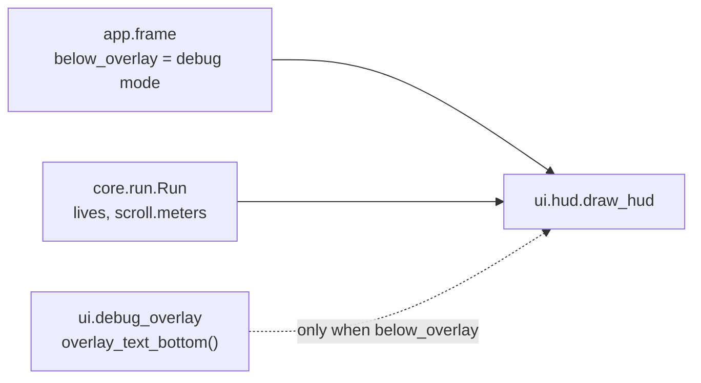

# HUD
Version: 2
Status: frozen
Features: DRA-13, DRA-23
Created by: architect

## Purpose
Keep the run's numbers in view during play. The HUD shows the meters flown, as a readout like `312 m` at the top left, and from DRA-23 the lives left, as white hearts at the top right. SCORE, LV and GRAZE come in later features and take their places in this layout then. The HUD only reads core state.

In debug mode the readout sits below the debug overlay's text, so the two never overlap. The hearts are at the top right, away from the overlay, and don't move.

Who builds what:
- `game/ui/hud.py`, and the helper `overlay_text_bottom()` in `game/ui/debug_overlay.py`: the UI Developer, task `DRA-13-03-ui-developer`. The hearts and the `run` argument in DRA-23: task `DRA-23-02-ui-developer`.
- `game/tests/ui/test_hud.py`: the QA Engineer, task `DRA-13-05-qa-engineer`. Updated for DRA-23: task `DRA-23-05-qa-engineer`.
- Calling `draw_hud` every frame and deciding `below_overlay`: the Integration Engineer, in `game/app/frame.py`, from `docs/contracts/systems/app.md`.
- The `meters` field: `docs/contracts/systems/scroll.md`. The `lives` field: `docs/contracts/systems/run.md`.

## Diagram
Normal mode:
```
 x=4                                        x=544   576   608  632
  +----------------------------------------------------------------+  y=0
  | (line 1, empty for now)                     [♥]   [♥]   [♥]    |  y=4 HUD_TOP; hearts y=8 to 31
  | 312 m                                                          |  y=24  HUD_TOP + HUD_LINE_SPACING
  |                                                                |
```
Hearts, each `HEART_SIZE` (24) square, `HEART_GAP` (8) apart, `HEART_MARGIN` (8) from the top and right edges. Slot 0 is the rightmost. A lost life empties the leftmost filled slot:
```
lives 3:   [♥]   [♥]   [♥]     slots 2, 1, 0 filled
lives 2:         [♥]   [♥]     slots 1, 0
lives 1:               [♥]     slot 0
lives 0:                       none (game over)
```
Debug mode, overlay shown or hidden by F3:
```
  +----------------------------------------------------------------+  y=0
  | x 320.00                                    [♥]   [♥]   [♥]    |  y=4   overlay line 1
  | y 240.00                                                       |
  | vx 0.00                                                        |
  | vy 0.00                                                        |  overlay line 4
  |                                                                |  overlay_text_bottom()
  | (line 1, empty for now)                                        |  hud top = overlay_text_bottom() + HUD_OVERLAY_GAP
  | 312 m                                                          |  hud top + HUD_LINE_SPACING
  |- - - - - - - - - - - - - - TOP LINE - - - - - - - - - - - - - -|  y=168
```


## Interface
```python
# game/ui/hud.py
# Imports: pygame, core.run, ui.debug_overlay. Never app. Never reads the run mode.
HUD_COLOR: tuple[int, int, int] = (255, 255, 255)   # scope report DRA-13, readout text (temporary stand-in)
HUD_FONT_SIZE: int = 16                             # scope report DRA-13, readout text: default font, 16 px
HUD_MARGIN: int = 4                                 # scope report DRA-13, HUD left margin
HUD_LINE_SPACING: int = 20                          # scope report DRA-13, HUD line spacing (16 px font + 4 px)
HUD_TOP: int = 4                                    # scope report DRA-13, normal mode: first line at y 4
HUD_OVERLAY_GAP: int = 4                            # scope report DRA-13, debug mode: 4 px below the overlay's fourth line
HEART_COLOR: tuple[int, int, int] = (255, 255, 255) # scope report DRA-23, hearts: white (temporary stand-in)
HEART_SIZE: int = 24                                # scope report DRA-23, hearts: 24 × 24 px each
HEART_GAP: int = 8                                  # scope report DRA-23, hearts: 8 px apart
HEART_MARGIN: int = 8                               # scope report DRA-23, hearts: 8 px from the top and right edges

def draw_hud(surface: pygame.Surface, run: Run, below_overlay: bool) -> None: ...   # DRA-23: takes the run
```

```python
# game/ui/debug_overlay.py. Unchanged in DRA-23.
def overlay_text_bottom() -> int: ...
    # The first screen row below every pixel the overlay's four text lines can cover.
    # = OVERLAY_MARGIN + 3 * linesize + max(linesize, font height), with the overlay's own font.
    # Needs pygame.font initialized. Uses the same cached font as the overlay.
```

## Presentation
`draw_hud` reads only these core fields. It draws on top of everything else in the frame.

| Core field | Shown as |
|---|---|
| `run.scroll.meters` | HUD line 2: the whole number, a space, then `m`. `f"{run.scroll.meters} m"`, e.g. `0 m`, `312 m`. Top-left corner at (`HUD_MARGIN`, `hud_top + HUD_LINE_SPACING`). Source: scope report DRA-13, Values needed (readout format and position, temporary stand-ins); 06-scoring.md, meters_rounding |
| `run.lives` | that many white hearts at the top right, one per slot, filling slots 0 to `lives - 1`. Slot `i` has its 24 × 24 box's top-left corner at (`width - HEART_MARGIN - HEART_SIZE - i * (HEART_SIZE + HEART_GAP)`, `HEART_MARGIN`), with `width` from `surface.get_width()`: (608, 8), (576, 8) and (544, 8) on the 640-px screen. Source: scope report DRA-23, Values needed (hearts, temporary stand-in approved by the Director, not in the GDD; UI-01 and UI-02 are TBD); 10-ui.md, hud_lives (top right, locked) |

Readout layout:
- `hud_top` is `HUD_TOP` (4) when `below_overlay` is False, so the readout's top is at y 24. Source: scope report DRA-13, HUD layout (normal mode).
- `hud_top` is `overlay_text_bottom() + HUD_OVERLAY_GAP` when `below_overlay` is True. Source: scope report DRA-13, HUD layout (debug mode).
- HUD line 1 starts at `hud_top` and is left empty. It is where SCORE goes later. Source: scope report DRA-13, HUD layout; 10-ui.md, rule 2.
- Text in the default font at 16 px (`pygame.font.Font(None, HUD_FONT_SIZE)`), antialiased, in `HUD_COLOR`, (255, 255, 255). Source: scope report DRA-13, readout text (temporary stand-in).

Hearts:
- Each heart is a filled heart shape in `HEART_COLOR`, (255, 255, 255): two round lobes side by side at the top, meeting in a point at the bottom center. Drawn with `pygame.draw` shapes, no image file. Every heart pixel lies inside its 24 × 24 box. The shape spans the box's full width (it reaches the box's left and right columns) and its point reaches the box's bottom row. Source: scope report DRA-23 ("3 white hearts", 24 × 24 px).
- The heart is drawn once onto a 24 × 24 `pygame.SRCALPHA` surface, on the first draw, and kept. Each frame blits it once per life. Never redrawn per frame. Source: 15-tech-constraints.md, rule 5.
- A lost life empties the leftmost filled slot. The other hearts don't move, and the visible hearts always end 8 px from the right edge. Source: scope report DRA-23 ("A lost life makes one heart disappear"; 8 px from the right edge).
- The hearts are in the same place in both modes and whatever `below_overlay` is. They never touch the overlay's text, which stays at the left, or the readout. Their lowest row is 31, far above the top line on row 168. Source: 10-ui.md, rule 1; scope report DRA-13, Decision log (no overlap).
- `lives` 0 draws no heart. That only happens at game over.

Both:
- Fonts and the heart surface are created once, on the first draw, and kept. Never per frame. Source: 15-tech-constraints.md, rule 5.
- The HUD only draws. It never fills, never flips, never logs per frame, never catches an error, never changes the run, never reads the run mode or a key. Source: 10-ui.md, rule 5; game/CONTEXT.md, Run modes.

`overlay_text_bottom()`:
- Line 4 of the overlay text has its top at `OVERLAY_MARGIN + 3 × linesize`. Its rendered height is the font's height. The function returns the row just below the lower of the two: the end of line 4's line slot or the end of its rendered text. So no overlay text pixel is on that row or below it.
- It changes nothing the overlay shows. Source: scope report DRA-13, Limits (no new overlay content); 10-ui.md, debug_overlay_layout.

## Rules
- The HUD shows the meters readout and, from DRA-23, the lives as hearts. No SCORE, LV, GRAZE or BEST. Source: scope report DRA-13, Limits; scope report DRA-23, Limits.
- The readout is a temporary stand-in. 10-ui.md, rule 2 lists SCORE, lives, level and grazes, and no separate meters item. The Director approved the readout and chose not to change the GDD. Source: scope report DRA-13, Fit and Values needed.
- The hearts are a temporary stand-in. 10-ui.md, lives_display is TBD (UI-02). Source: scope report DRA-23, Values needed.
- The HUD shows in both modes, from the first frame, and while the Game Over box shows. The readout reads `0 m` until the world has scrolled 10 px. Three hearts show from the first frame of every run. Source: scope report DRA-13, Player sees; scope report DRA-23, Player sees.
- In debug mode the readout sits below the overlay's text and never overlaps it. Source: scope report DRA-13, Decision log (Director: "Overlap is not acceptable").
- In debug mode the readout stays below the overlay's place even while F3 hides the overlay, so it never jumps. The app passes `below_overlay` from the run mode, never from `overlay_visible`. Source: scope report DRA-13, HUD layout.
- The HUD draws on top of everything. Source: 10-ui.md, rule 1.
- The HUD only reads game state. It never changes it. Source: 10-ui.md, rule 5.
- The HUD never covers the top line. Its lowest line ends far above row 168 in both modes. Source: 10-ui.md, rule 1.

## Impact
DRA-23 changes this frozen contract (v1). `draw_hud` takes the run instead of the scroll, and draws the hearts. The readout's text, place and look don't change. Every file in `game/` that depends on it, found by grepping `game/` (tests included) for `draw_hud`, `ui.hud`, `HUD_` and `Scroll`:

| File | Change needed |
|---|---|
| `game/ui/hud.py` | `draw_hud(surface, run, below_overlay)`; the readout reads `run.scroll.meters`; the four heart constants and the hearts. Task `DRA-23-02-ui-developer`. |
| `game/ui/debug_overlay.py` | none. |
| `game/app/frame.py` | passes `run` instead of `scroll`. Integration Engineer, from `systems/app.md`. |
| `game/tests/ui/test_hud.py` | every test calls `draw_hud(surface, SCROLL, below_overlay)` and fails after task DRA-23-02 on the new argument. The readout tests also count every white pixel as the readout, and the white hearts would break them. Task `DRA-23-05-qa-engineer` updates them and adds the heart tests. |

## Rationale
- **`draw_hud` takes the run (DRA-23).** The HUD now reads two core fields from two places: `lives` on the run and `meters` on its scroll. Passing the run gives it one source, and SCORE and LV can join later without another signature change. Passing the scroll and the lives apart would grow the argument list with every HUD item.
- **Hearts in fixed slots from the right.** "8 px from the top and right edges" holds for the visible hearts at every life count only if the leftmost heart is the one that goes. Fixed slots also mean no heart ever moves.
- **One heart surface, blitted.** The shape is drawn once and copied per life. Python in WebAssembly is slow (15-tech-constraints.md, rule 5).
- **The hearts don't follow `below_overlay`.** The overlay is at the top left, the hearts at the top right. They can't meet, so the hearts keep one place in both modes.
- **`below_overlay` comes from the app.** game/CONTEXT.md lets only `game/app/` and the debug overlay read the run mode. The app knows the mode and passes a layout flag, the same way it passes `detail` to the error screen.
- **The overlay's bottom comes from the overlay.** The overlay's line height is a font metric, not a fixed number, and only the overlay owns its font.
- **`max(linesize, font height)`.** pygame's line size is usually at least the rendered text height, but not for every font. Taking the larger of the two guarantees the gap.
- **The readout starts at the left margin.** Nothing else is on line 2 yet. When LV and GRAZE land, that feature sets their x and moves the readout after them.
- **Line 1 stays empty, not collapsed.** Keeping line 1's slot means SCORE can land later without moving the readout.
- **The HUD is drawn last.** 10-ui.md, rule 1 puts the HUD on top of everything.
- **HUD values live in `ui/hud.py`, not `ui/look.py`.** Only the HUD uses them, and they are temporary stand-ins waiting for UI-01 and UI-02.
