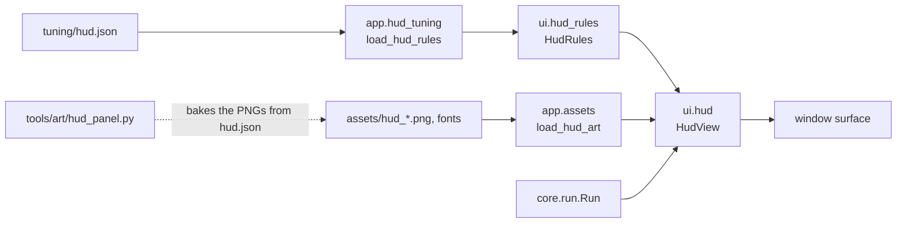

# HUD
Version: 7
Status: draft
Features: DRA-13, DRA-23, DRA-61, DRA-76, DRA-117, DRA-125, DRA-126, HUD-PANEL
Created by: architect

## Purpose
Keep the run's numbers in view while the run is on screen: playing, the last life, paused and game over. From HUD-PANEL the HUD is a side panel in the ship's hull, to the right of the play area, inside a window of 856 × 518 px, with a cockpit window frame round the play area (`10-ui.md`, `hud_*`, `cockpit_frame`). The play area itself stays 640 × 480 and nothing of the HUD is ever drawn over it. The panel shows the score as 7 digit tiles with a 14 segment progress bar, the best score, the lives as hearts on a hull wireframe, the level as a number with climb bars, and the grazes on a radar dial. It moves in six ways (`10-ui.md`, `hud_motion`). It only reads core state. It doesn't show on the menu, the instructions page or the leaderboard page.

This contract also sets the score's text, `score_text`, which the game-over screen uses, and the digit grouping, `group_digits`, which the leaderboard page uses (`docs/contracts/systems/game-flow.md`, Presentation).

The text HUD of DRA-13 to DRA-126 (SCORE, BEST and GRAZE lines at the top left, hearts at the top right, `below_overlay`) is replaced. Its constants (`HUD_COLOR`, `HUD_FONT_SIZE`, `HUD_MARGIN`, `HUD_LINE_SPACING`, `HUD_TOP`, `HUD_OVERLAY_GAP`, `HUD_BEST_X`, `HEART_*`) are removed. Every value now comes from `game/tuning/hud.json`.

## Diagram
```
 window 856 × 518 (x right, y down)
 +--------------------------------------------+------+----------------+
 | frame                                      |pillar| panel (184 wide)|
 |   +------------------------------------+   |      |  SCORE tiles   |
 |   | play area 640 × 480 at (16, 10)    |   |      |  score bar     |
 |   | glass: nothing drawn over it       |   |      |  BEST          |
 |   | (the sheen is the one translucent  |   |      |  hull wireframe|
 |   |  layer, see Rules)                 |   |      |  + 3 hearts    |
 |   +------------------------------------+   |      |  LEVEL | GRAZE |
 | frame                                      |      |  footer line   |
 +--------------------------------------------+------+----------------+
```


## Interface
```python
# game/ui/hud_rules.py. Imports: stdlib only. Frozen records that mirror docs/contracts/schemas/hud.schema.json.
RGB = tuple[int, int, int]

@dataclass(frozen=True)
class HudRules:
    palette: Mapping[str, RGB]   # the 17 keys of the schema's palette, as RGB
    window: WindowRules          # width, height, field_x, field_y, dim_alpha
    panel: PanelRules            # x, width, content_y, scale (read by the art tool only)
    frame: FrameRules            # pillar and sheen: sheen on or off, the corner lights' radius
    score: ScoreRules            # tiles, score bar, labels, best, caps
    hearts: HeartRules           # the three slot centres in panel space, the image cell size
    level: LevelRules            # label, number anchor, bars, tier steps
    graze: DialRules             # centre, radius, number size, label anchor, count limit
    motion: MotionRules          # every period in ticks and every scale, the break keys
    fonts: FontRules             # the two font files, the sizes, label letter spacing, text mixes
```
```python
# game/ui/hud.py. Imports: pygame, core.world, ui.hud_rules, ui.score_text. Never app, never core.run. Never reads the run mode.
class HudRun(Protocol):          # read-only score, lives, grazes, level (ints). core.run.Run satisfies it
    ...

@dataclass(frozen=True)
class HudArt:
    frame: pygame.Surface        # hud_frame.png: frame body and pillar, glass and panel transparent
    sheen: pygame.Surface        # hud_sheen.png: the glass sheen, play-area sized
    panel: pygame.Surface        # hud_panel.png: panel background with boxes, tile backs, dial rings, footer
    ship: pygame.Surface         # hud_ship.png: the wireframe with empty heart sockets
    hearts: tuple[pygame.Surface, ...]   # hud_hearts.png cells: lit, dim, last, break_white, break_hue
    radar: tuple[pygame.Surface, ...]    # hud_radar.png cells: the sweep wedge, one full turn
    ring: tuple[pygame.Surface, ...]     # hud_ring.png cells: the graze ring's growth
    scan: pygame.Surface         # hud_scan.png: the scan line
    label_font: pygame.font.Font # Share Tech Mono
    fonts: Mapping[str, pygame.font.Font]  # Exo 2 Bold at the schema's sizes: value, tile, graze, level

class HudView:
    def __init__(self, rules: HudRules, art: HudArt) -> None: ...
        # Builds once: the panel composite (panel, wireframe, static labels), 20 digit images (10 lit,
        # 10 dim), the pre-scaled last-life hearts, the dim layer, the frame's strips.
    def draw(self, window: pygame.Surface, run: HudRun, best: int | None, tick: int) -> None: ...
        # Draws the panel, the frame and the sheen on `window`. `tick` is the view clock (ticks, int).
        # Never touches the play area except for the sheen. Keeps the last lives and grazes to start the motions.
    def dim(self, window: pygame.Surface) -> None: ...
        # Black at window.dim_alpha over the whole window. Called before the pause box and the game-over screen.

def clamp_score(score: int, digits: int) -> int: ...   # min(score, 10**digits - 1). Pure.
def lit_segments(score: int, best: int | None, segments: int, step: int) -> int: ...   # the score bar. Pure.
def tier_color_key(level: int, tier_mid: int, tier_high: int) -> str: ...   # "level", "mid" or "last_life". Pure.
```
```python
# game/ui/window_view.py. Imports: pygame, core.world, ui.background_view.
class WindowBackdrop:
    def __init__(self, window_size: tuple[int, int]) -> None: ...
    def draw(self, window: pygame.Surface, art: BackgroundArt, ticks: float) -> None: ...
        # The full-window background for the menu, the instructions and the leaderboard: the
        # background drawn at play-area size, scaled up to cover the window, bottom-aligned.
```
```python
# game/app/hud_tuning.py. Not a startup module (imports ui); only app.frame imports it, inside the guard.
def load_hud_rules() -> HudRules: ...
    # Reads tuning/hud.json, checks every rule of hud.schema.json by hand. Missing file: FileNotFoundError.
    # Bad file: ValueError naming the file and the field. Every field is required: no defaults in code.
# game/app/assets.py
def load_hud_art(rules: HudRules) -> HudArt: ...
    # Reads the hud_*.png files and the two fonts. A missing file raises FileNotFoundError. An image whose
    # size doesn't match the rules (window, panel, cells) raises ValueError naming the file.
```
The app opens the window from the rules: `pygame.display.set_mode((rules.window.width, rules.window.height))`, keeps the play area as `window.subsurface(Rect(field_x, field_y, SCREEN_W, SCREEN_H))` and draws the world on it. `core.world.SCREEN_W` and `SCREEN_H` don't change.

## Presentation
`HudView.draw` reads only: `run.score`, `run.lives`, `run.grazes`, `run.level` (the `HudRun` protocol), and `best` (a parameter, from the saves). Positions are in panel space (origin at the panel's top-left, `content_y` below the window's top) and live in the tuning file.

| Part | What is drawn | Cached or drawn |
|---|---|---|
| Panel background | gradient, score box, level box, tile backs, dial rings and cross, footer | once, `hud_panel.png` |
| Wireframe | the ship's hull outline with three empty sockets | once, `hud_ship.png` |
| Labels SCORE, LEVEL, GRAZE | Share Tech Mono, letter-spaced, at the label mix of panel body and plating | once, on the panel composite |
| Score tiles | 7 digit images, one per tile, leading zeros in the dim image. Tile top bar: score color, dim for leading zeros | 10 lit and 10 dim digit images made once; per frame 7 blits and 7 rect fills |
| Score bar | 14 segments, lit ones on a ramp from `ship_lines` to `score`, the rest `dim` | rect fills per frame |
| BEST | label and the grouped number (comma), right-aligned, only when `best` is not None | the number is rendered again only when `best` changes |
| Hearts | slots center, right, left: slot `i` lit while `i < lives`. Lit: the lit image; lost: dim; last life (`lives == 1`) the lit slot uses the last image | blits |
| Scan line | `scan` at a y that falls from `y0` to `y1` once per `scan_ticks` | one blit |
| Level | the number in the tier color, the bars: lit up to the level, ramp `level` to `last_life`; bars past `level` are `dim` | number cached by level; rect fills |
| Radar | frame `(tick % sweep_ticks) * frames // sweep_ticks` of the wedge | one blit |
| Graze count | cached by value, centered in the dial, shrunk to fit `count_limit` | rendered again only when the count changes |
| Frame | the strips of `hud_frame.png` round the play area and at the pillar, then the sheen over the play area when `frame.sheen` is on, as strips `sheen_rows` tall trimmed to where they have any sheen (about 60 000 px, not the play area's 307 200) | blits |
| Motions | see Rules | frames made ahead of time |

States: lives 3, 2 and 1 show 3, 2 and 1 lit hearts, the last one orange; lives 0 (game over) shows none lit; a level or graze count past the limits is clamped as the GDD says.

Pause and game over: the app calls `HudView.dim(window)` after the HUD, then draws the pause box or the game-over screen on the whole window, centered on it (`systems/game-flow.md`, Presentation).

## Rules
- The HUD shows in both modes, from the first frame of every run, through the last life, while paused and while the game-over screen shows. It never shows on the menu, the instructions page or the leaderboard page. Source: 10-ui.md, `window_screens`.
- Nothing of the HUD covers a pixel of the play area. The only layer that could go over it is the glass sheen, a faint white band; it is off (`frame.sheen` false) and nothing draws over the play area. Source: 10-ui.md, rule 1; 03-world-and-camera.md, rule 10.
- The debug overlay sits inside the play area, so the HUD and the overlay never overlap and the HUD takes no `below_overlay`. Source: 10-ui.md, rule 1.
- The HUD only reads game state. It never changes it. It keeps only view state: the last lives, the last grazes and the start tick of each running motion. Source: 10-ui.md, rule 5.
- **Motions** (all from `tuning/hud.json`, `motion`): the radar wedge turns once per `sweep_ticks`; the scan line falls once per `scan_ticks`; on the last life the last heart swells to `beat_scale` and back over `beat_ticks`; when `lives` drops, the heart that went plays its break (`break_keys`) over `break_ticks`, then stays dim; when `grazes` rises, the count swells to `bump_scale` over `bump_ticks` and a ring grows over `ring_ticks`. A rise in lives, or a fall in grazes, is a new run: all motions reset, none plays. The motions run on the `tick` the app passes, which stops while paused. Source: 10-ui.md, `hud_motion`.
- Colors, sizes, positions, counts and timings all come from the tuning file. No value is written in code. The pictures `tools/art/hud_panel.py` bakes read the same file; changing a color or a position needs the tool run again for the baked parts. Source: 10-ui.md, rule 12.
- The sheen is never blended as one play-area-sized picture: measured in the browser build, that one blit took the game from 59 to 32 frames a second. Source: 15-tech-constraints.md, rule 5.
- Per frame the HUD makes no new surface, except the count's and the best's text when they change and the count's swell frames while it swells. Source: 10-ui.md, rule 11; 15-tech-constraints.md, rule 5.
- The score shows `min(score, 10**tile_count - 1)`. The tiles never show a number the score doesn't have. Source: 10-ui.md, `hud_score`.
- Score bar: with `best` not None and above 0, the target is `best`; else the next multiple of `bar_step` above the score. Lit segments are `ceil(min(1, score / target) * segments)`, 0 at score 0. Source: 10-ui.md, `hud_score_bar`.
- The level bars count `level.bars` (8). `lit = min(level, bars)`. Source: 10-ui.md, `hud_level`; 08-difficulty.md, rule 1.
- Fonts: Exo 2 Bold for the numbers, Share Tech Mono for the labels. Both are static files in `assets/fonts/`. Source: 10-ui.md, `hud_fonts`.
- `score_text`, `graze_text`, `best_text` and `group_digits` in `ui/score_text.py` are unchanged. The HUD doesn't use `score_text`, `graze_text` or `best_text`. The game-over screen and the leaderboard still do. BEST on the panel groups with `score.best_separator` instead of the space of `group_digits`. Source: scope DRA-61 and DRA-126 for the other screens; 10-ui.md, `hud_best`.

## Rationale
- **Baked pictures, live values.** The frame, the panel, the wireframe, the hearts, the radar and the rings are drawn at 4× and shrunk once, offline, because pygame draws no smooth edges and Python in WebAssembly is slow. Per frame the view only copies images and fills rects. Digits are 20 cached images, so a score change costs 7 blits and never a text render (15-tech-constraints.md, rule 5).
- **A class, not functions.** The motions need to remember the last lives and grazes. `HudView` holds that and nothing else. The old module-level `lru_cache` text surfaces went with the text HUD.
- **View clock is a parameter.** The view never reads time. The app passes the same clock it gives the background, which stops while paused, so a paused panel is calm and a test can set any tick.
- **All motion is frames made ahead of time.** The sweep, the ring and the heart's break are image cells or alpha blends of one image. The beat uses pre-scaled hearts. Only the count's swell scales text at run time, on a surface a few px wide.
- **Panel content centered in a taller window.** The panel is drawn at 80% of the mock-up (`panel.scale`), so its content is 384 rows tall in a 518 px window. Centering with `content_y` (67) keeps every distance inside the panel in proportion and moves nothing else.
- **80% size, 184 px panel.** The Director found the panel too big and too eye-catching. Every position, size and font size in `hud.json` is the mock-up's value scaled by 0.8 and rounded; the pillar stays 24 px and the frame keeps its size. The art tool draws the fixed shapes (wireframe, hearts, dial, footer) on the mock-up's grid and scales them by `panel.scale`; strokes never go under 1 px.
- **No pillar lamps.** The Director removed the three lamps. The last life shows through the orange heart and its beat only.
- **The play area is a subsurface.** Everything already drawn in play-area coordinates keeps working, so `SCREEN_W` and `SCREEN_H` stay as the play area for the 25 files that use them, and core is untouched.
- **Rules and window numbers in the tuning file.** The window size is in `hud.json` with the panel, so the tool and the game read one home. The loader checks every baked image against it, so a mismatch fails at startup with the file named.
- **Why `HUD-PANEL` is not a `DRA-` key.** The feature ran in one session without Linear tasks. Its impact is in `docs/contracts/HUD-PANEL/impact.md`.
