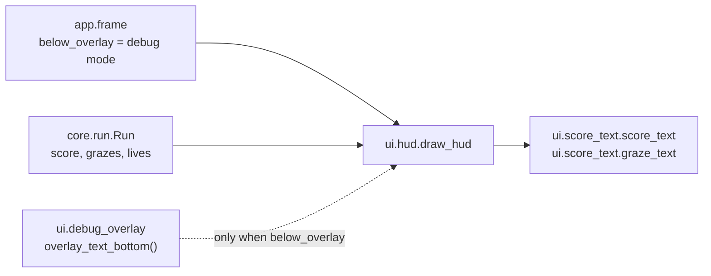

# HUD
Version: 6
Status: frozen
Features: DRA-13, DRA-23, DRA-61, DRA-76, DRA-117, DRA-125
Created by: architect

## Purpose
Keep the run's numbers in view while the run is on screen: playing, the last life, paused and game over. The HUD shows the score at the top left, on HUD line 1, as `SCORE 1 234`, the graze count below it, on HUD line 2 at the left margin, as `GRAZE 5`, and the lives left as white hearts at the top right. LV comes in a later feature, on line 2 too, and pushes GRAZE to the right then. BEST comes only once saves ship. The HUD only reads core state. It doesn't show on the menu, the instructions page or the leaderboard page.

In debug mode the HUD's lines sit below the debug overlay's text, so the two never overlap. The hearts are at the top right, away from the overlay, and don't move.

This contract also sets the score's text, `score_text`, which the game-over screen uses too (`docs/contracts/systems/game-flow.md`, Presentation).

## Diagram
Normal mode:
```
 x=4                                        x=544   576   608  632
  +----------------------------------------------------------------+  y=0
  | SCORE 1 234                                 [♥]   [♥]   [♥]    |  y=4 HUD_TOP, line 1; hearts y=8 to 31
  | GRAZE 5                                                        |  y=24  HUD_TOP + HUD_LINE_SPACING, line 2
  |                                                                |
```
Hearts, each `HEART_SIZE` (24) square, `HEART_GAP` (8) apart, `HEART_MARGIN` (8) from the top and right edges. Slot 0 is the rightmost. A lost life empties the leftmost filled slot:
```
lives 3:   [♥]   [♥]   [♥]     slots 2, 1, 0 filled
lives 2:         [♥]   [♥]     slots 1, 0
lives 1:               [♥]     slot 0
lives 0:                       none (game over)
```
Debug mode, overlay shown or hidden by F3:
```
  +----------------------------------------------------------------+  y=0
  | x 320.00                                    [♥]   [♥]   [♥]    |  y=4   overlay line 1
  | y 240.00                                                       |
  | vx 0.00                                                        |
  | vy 0.00                                                        |  overlay line 4
  | wave l1_a                                                      |  overlay line 5 (DRA-76)
  | level 1                                                        |  overlay line 6 (DRA-76)
  |                                                                |  overlay_text_bottom()
  | SCORE 1 234                                                    |  hud top = overlay_text_bottom() + HUD_OVERLAY_GAP
  | GRAZE 5                                                        |  hud top + HUD_LINE_SPACING
  |- - - - - - - - - - - - - - TOP LINE - - - - - - - - - - - - - -|  y=168
```


## Interface
```python
# game/ui/score_text.py (DRA-61)
# Imports: stdlib only (logging). Never pygame, core or app.
SCORE_LABEL: str = "SCORE"   # scope report DRA-61, Limits (format); the label from the 10-ui.md mockup
DIGIT_GROUP: int = 3         # scope report DRA-61, Limits: digits in groups of three
GROUP_SEPARATOR: str = " "   # scope report DRA-61, Limits: split by a single space (Director: "Space: 1 234 567")

def score_text(score: int) -> str: ...
    # The text shown for a score. score is a whole number >= 0, from core; trusted, not checked.
```

```python
# game/ui/hud.py
# Imports: pygame, core.run, ui.debug_overlay, ui.score_text (DRA-61). Never app. Never reads the run mode.
HUD_COLOR: tuple[int, int, int] = (255, 255, 255)   # scope report DRA-13, HUD text (temporary stand-in); kept by DRA-61
HUD_FONT_SIZE: int = 16                             # scope report DRA-13, HUD text: default font, 16 px; kept by DRA-61
HUD_MARGIN: int = 4                                 # scope report DRA-13, HUD left margin
HUD_LINE_SPACING: int = 20                          # scope report DRA-13, HUD line spacing (16 px font + 4 px)
HUD_TOP: int = 4                                    # scope report DRA-13, normal mode: first line at y 4
HUD_OVERLAY_GAP: int = 4                            # scope report DRA-13, debug mode: 4 px below the overlay's last text line
HEART_COLOR: tuple[int, int, int] = (255, 255, 255) # scope report DRA-23, hearts: white (temporary stand-in)
HEART_SIZE: int = 24                                # scope report DRA-23, hearts: 24 × 24 px each
HEART_GAP: int = 8                                  # scope report DRA-23, hearts: 8 px apart
HEART_MARGIN: int = 8                               # scope report DRA-23, hearts: 8 px from the top and right edges

def draw_hud(surface: pygame.Surface, run: Run, below_overlay: bool) -> None: ...   # unchanged signature
```

DRA-117 adds, nothing else changes in either module (existing signatures are read from the code):
```python
# game/ui/score_text.py
GRAZE_LABEL: str  # scope report DRA-117, Limits ("GRAZE <n>"); the label from the 10-ui.md mockup

def graze_text(grazes: int) -> str: ...
    # The text shown for a graze count. grazes is a whole number >= 0, from core; trusted, not checked.
```
```python
# game/ui/hud.py
# draw_hud keeps its signature and also draws the GRAZE line from run.grazes.
```

```python
# game/ui/debug_overlay.py. Set in docs/contracts/systems/debug-overlay.md.
def overlay_text_bottom() -> int: ...
    # The first screen row below every pixel the overlay's text lines can cover: six lines from
    # DRA-76 (OVERLAY_TEXT_LINES). Needs pygame.font initialized. Uses the overlay's cached font.
```

## Presentation
`draw_hud` reads only these core fields. It draws on top of everything else in the frame.

| Core field | Shown as |
|---|---|
| `run.score` | HUD line 1: `score_text(run.score)`, e.g. `SCORE 0`, `SCORE 999`, `SCORE 1 234`, `SCORE 1 234 567`. Top-left corner at (`HUD_MARGIN`, `hud_top`): (4, 4) in normal mode. Source: scope report DRA-61, Limits (SCORE on line 1, format, look); 10-ui.md, hud_score (top left, locked), rule 2 |
| `run.grazes` | HUD line 2 (DRA-117): `graze_text(run.grazes)`, e.g. `GRAZE 0`, `GRAZE 5`, `GRAZE 1 234`. Top-left corner at (`HUD_MARGIN`, `hud_top + HUD_LINE_SPACING`): (4, 24) in normal mode. Source: 10-ui.md, hud_level_grazes (below the score, locked), rule 2; 06-scoring.md, rule 8; scope report DRA-117, Limits (left margin of line 2, digits grouped like SCORE, SCORE's stand-in look) |
| `run.lives` | that many white hearts at the top right, one per slot, filling slots 0 to `lives - 1`. Slot `i` has its 24 × 24 box's top-left corner at (`width - HEART_MARGIN - HEART_SIZE - i * (HEART_SIZE + HEART_GAP)`, `HEART_MARGIN`), with `width` from `surface.get_width()`: (608, 8), (576, 8) and (544, 8) on the 640-px screen. Source: scope report DRA-23, Values needed (hearts, temporary stand-in approved by the Director, not in the GDD; UI-01 and UI-02 are TBD); 10-ui.md, hud_lives (top right, locked) |

`score_text(score)`:
- `SCORE_LABEL`, one `GROUP_SEPARATOR` space, then the score's decimal digits. No leading zeros: 0 is the single digit `0`.
- The digits are split into groups of `DIGIT_GROUP` (3) counted from the right, the groups joined by `GROUP_SEPARATOR`, a single space. The leftmost group has 1 to 3 digits. So `SCORE 0`, `SCORE 999`, `SCORE 1 000`, `SCORE 1 234`, `SCORE 1 000 007`, `SCORE 1 234 567`.
- No digit limit: every whole number gets all its digits. Source: scope report DRA-61, Limits (format; "No digit limit") and Decision log (Director: "score should be able to be infinite").
- Pure: no pygame, logs nothing (the module still has its `log`, game/CONTEXT.md, Logging), same number in, same text out.

`graze_text(grazes)` (DRA-117):
- `GRAZE_LABEL`, one `GROUP_SEPARATOR` space, then the count's decimal digits, grouped exactly as `score_text` groups the score: `GRAZE 0`, `GRAZE 5`, `GRAZE 999`, `GRAZE 1 000`, `GRAZE 1 234`. No leading zeros, no digit limit. The grouping has one home in the module, shared by both functions. Source: scope report DRA-117, Limits ("`GRAZE <n>`, digits grouped like SCORE (`GRAZE 1 234`)"); 06-scoring.md, graze_cap (no limit).
- Pure, like `score_text`.

SCORE line:
- `hud_top` is `HUD_TOP` (4) when `below_overlay` is False. Source: scope report DRA-13, HUD layout (normal mode).
- `hud_top` is `overlay_text_bottom() + HUD_OVERLAY_GAP` when `below_overlay` is True. Source: scope report DRA-13, HUD layout (debug mode).
- HUD line 1, at `hud_top`, holds the SCORE text. Source: scope report DRA-61, Limits; 10-ui.md, rule 2.
- HUD line 2, at `hud_top + HUD_LINE_SPACING`, holds the GRAZE line (DRA-117, below). The meters readout (`312 m`) is gone. Source: scope report DRA-61, Limits ("The meters readout ... is removed"); 10-ui.md, hud_level_grazes.
- Text in the default font at 16 px (`pygame.font.Font(None, HUD_FONT_SIZE)`), antialiased, in `HUD_COLOR`, (255, 255, 255). Source: scope report DRA-13, HUD text (temporary stand-in); scope report DRA-61, Limits (the SCORE text uses the DRA-13 HUD look).
- The text grows to the right as the score gets more digits. No cut, no shrink.
- The rendered SCORE text is built again only when the score differs from the one it was last rendered for. Frames with the same score reuse it. Source: 15-tech-constraints.md, rule 5.

GRAZE line (DRA-117):
- `graze_text(run.grazes)` with its top-left corner at (`HUD_MARGIN`, `hud_top + HUD_LINE_SPACING`), with `hud_top` as for the SCORE line, so it moves with SCORE in debug mode and never overlaps the overlay. Source: scope report DRA-117, Limits (line 2, left margin); 10-ui.md, hud_level_grazes.
- The SCORE line's look: the same font, size, antialiasing and `HUD_COLOR`. A stand-in until UI-01 and the HUD redesign. Source: scope report DRA-117, Limits ("in the same stand-in look as SCORE").
- It shows from the first frame, in both modes and while the Game Over box shows: `GRAZE 0` at the start of every run and again after a retry. Source: scope report DRA-117, Feature ("It starts at 0 and goes back to 0 on retry").
- It grows to the right as the count gets more digits. No cut, no shrink. Source: 06-scoring.md, graze_cap (no limit).
- The rendered GRAZE text is built again only when the count differs from the one it was last rendered for. Source: 15-tech-constraints.md, rule 5.
- Line 2 ends one line height below line 2's top, far above the top line on row 168 in both modes, and far left of the hearts. Source: 10-ui.md, rule 1.

Hearts:
- Each heart is a filled heart shape in `HEART_COLOR`, (255, 255, 255): two round lobes side by side at the top, meeting in a point at the bottom center. Drawn with `pygame.draw` shapes, no image file. Every heart pixel lies inside its 24 × 24 box. The shape spans the box's full width (it reaches the box's left and right columns) and its point reaches the box's bottom row. Source: scope report DRA-23 ("3 white hearts", 24 × 24 px).
- The heart is drawn once onto a 24 × 24 `pygame.SRCALPHA` surface, on the first draw, and kept. Each frame blits it once per life. Never redrawn per frame. Source: 15-tech-constraints.md, rule 5.
- A lost life empties the leftmost filled slot. The other hearts don't move, and the visible hearts always end 8 px from the right edge. Source: scope report DRA-23 ("A lost life makes one heart disappear"; 8 px from the right edge).
- The hearts are in the same place in both modes and whatever `below_overlay` is. They never touch the overlay's text, which stays at the left, or the SCORE line. Their lowest row is 31, far above the top line on row 168. Source: 10-ui.md, rule 1; scope report DRA-13, Decision log (no overlap).
- `lives` 0 draws no heart. That only happens from the last life on (DRA-125), through game over.

Both:
- Fonts and the heart surface are created once, on the first draw, and kept. Never per frame. Source: 15-tech-constraints.md, rule 5.
- The HUD only draws. It never fills, never flips, never logs per frame, never catches an error, never changes the run, never reads the run mode or a key. Source: 10-ui.md, rule 5; game/CONTEXT.md, Run modes.

`overlay_text_bottom()`:
- Its formula and lines are set in `docs/contracts/systems/debug-overlay.md`, Interface and Presentation: from DRA-76 it is the row below the overlay's sixth text line (`level <n>`). No overlay text pixel is on that row or below it. The HUD only reads it.
- So in debug mode the SCORE line sits `HUD_OVERLAY_GAP` below the six lines, two line-heights lower than with four. Its line 2 still ends far above the top line on row 168. Source: scope report DRA-13, HUD layout; 10-ui.md, debug_overlay_layout (six lines, guess).

## Rules
- The HUD shows SCORE, GRAZE (DRA-117) and the lives as hearts. No meters readout, no LV, no BEST. Source: scope report DRA-61, Limits and Out; scope report DRA-23, Limits; scope report DRA-117, Limits and Out.
- GRAZE's place, format and look are a stand-in the Director approved, not in the GDD (UI-01 is TBD; the HUD redesign comes later). LV, when it ships, sits at the left of line 2 and pushes GRAZE right. Source: scope report DRA-117, Values needed and Decision log (Q5).
- SCORE replaces the meters readout. The meters are still counted in core and are part of the score; only their own readout goes. Source: scope report DRA-61, Decision log (Director: "SCORE replaces it").
- The SCORE format, label and look are the Director's, not in the GDD (UI-01 is TBD). The look is the DRA-13 stand-in, kept. Source: scope report DRA-61, Values needed.
- The hearts are a temporary stand-in. 10-ui.md, lives_display is TBD (UI-02). Source: scope report DRA-23, Values needed.
- The HUD shows in both modes, from the first frame of every run, through the last life, while paused and while the game-over screen shows. It never shows on the menu, the instructions page or the leaderboard page: the app doesn't call `draw_hud` there (`docs/contracts/systems/app/frame-loop.md`, Draw). SCORE reads `SCORE 0` until the world has scrolled 10 px, and `SCORE 0` again in a new run. From the last life on it shows the frozen final score (`docs/contracts/systems/run.md`, Score). Three hearts show from the first frame of every run. Source: scope report DRA-61, Player sees; scope report DRA-23, Player sees; scope report DRA-125, Values needed (the pages are text on the background; "The HUD stays visible" on pause).
- In debug mode the HUD sits below the overlay's text and never overlaps it. Source: scope report DRA-13, Decision log (Director: "Overlap is not acceptable").
- In debug mode the HUD stays below the overlay's place even while F3 hides the overlay, so it never jumps. The app passes `below_overlay` from the run mode, never from `overlay_visible`. Source: scope report DRA-13, HUD layout.
- The HUD draws on top of everything. Source: 10-ui.md, rule 1.
- **Corner warnings, by Director override.** SCORE and GRAZE at the top left and the hearts at the top right are drawn over any entry warning in those corners, such as the default fireball's at the top-left corner. 10-ui.md, rule 1 says the HUD never hides a warning. The Director chose not to fix it in DRA-61, and kept that override for GRAZE in DRA-117; rule 1 stays the target and docs/TODO.md tracks it. Source: scope report DRA-61, Objection 2 and Decision log; scope report DRA-117, Objection 1.
- The HUD only reads game state. It never changes it. Source: 10-ui.md, rule 5.
- The HUD never covers the top line. Its lowest line ends far above row 168 in both modes. Source: 10-ui.md, rule 1.

## Rationale
- **The HUD contract no longer restates the overlay's formula (DRA-76).** One fact, one home: the overlay owns its lines and their bottom. The HUD only reads the bottom, so a new overlay line moves the HUD with no HUD change.
- **`draw_hud` takes the run (DRA-23).** The HUD reads two core fields, `score` and `lives`, both on the run. Passing the run gives it one source, and LV can join later without another signature change.
- **SCORE on line 1, line 2 left empty (DRA-61).** Line 1 was kept for SCORE from DRA-13. Leaving line 2's slot keeps the place for LV and GRAZE (10-ui.md, hud_level_grazes), so they land without moving SCORE. Collapsing it now would only move things again later.
- **Core gives the number, UI gives the text (DRA-61).** The score is a rule, so it is a core field. Grouping digits and adding a label is a look, so it lives in `ui`. No view works out the score.
- **The format has one home, `ui/score_text.py` (DRA-61).** The HUD and the Game Over box show the score the same way. One function keeps them from drifting apart. It has no pygame, so it can be tested as plain text, and the Game Over box can use it without importing the HUD.
- **No digit limit (DRA-61).** The Director chose none. Score grows by 6.6 a second from meters at Level 1, and coins add 50 or 100 each. The 532 px between the left margin and the hearts' area hold well over 40 digits of 16 px text, far beyond any run. The overlap edge case in 10-ui.md (Max digits, UI-01) stays open.
- **The HUD tests change in two steps around the SCORE line (DRA-61).** The `/implement` flow runs QA's full check right after each implementer task. A test that says line 1 is empty would fail right after the SCORE line lands, and a test that says SCORE is on line 1 would fail before it does. So the two line-1 tests are first reworded to what holds in both states: no ink left of the margin or above the top, and the gap below the overlay. The SCORE line comes next, and only then the exact tests for it (Director, DRA-61 revision: "keep QA clean").
- **The SCORE text is rendered again only when the score changes (DRA-61).** It changes about 6.6 times a second; frames come 60 times a second. Python in WebAssembly is slow (15-tech-constraints.md, rule 5).
- **Hearts in fixed slots from the right.** "8 px from the top and right edges" holds for the visible hearts at every life count only if the leftmost heart is the one that goes. Fixed slots also mean no heart ever moves.
- **One heart surface, blitted.** The shape is drawn once and copied per life. Python in WebAssembly is slow (15-tech-constraints.md, rule 5).
- **The hearts don't follow `below_overlay`.** The overlay is at the top left, the hearts at the top right. They can't meet, so the hearts keep one place in both modes.
- **`below_overlay` comes from the app.** game/CONTEXT.md lets only `game/app/` and the debug overlay read the run mode. The app knows the mode and passes a layout flag, the same way it passes `detail` to the error screen.
- **The overlay's bottom comes from the overlay.** The overlay's line height is a font metric, not a fixed number, and only the overlay owns its font.
- **`max(linesize, font height)`.** pygame's line size is usually at least the rendered text height, but not for every font. Taking the larger of the two guarantees the gap.
- **SCORE starts at the left margin.** It is the only item on line 1 on the left. BEST, when saves ship, goes next to it (10-ui.md, rule 2); that feature sets its x.
- **The HUD is drawn last.** 10-ui.md, rule 1 puts the HUD on top of everything.
- **GRAZE fills line 2's slot (DRA-117).** DRA-61 kept the slot free for it, so SCORE and the hearts don't move. GRAZE takes the left margin now; LV moves it right when LV ships (scope report DRA-117, Decision log, Q5).
- **One grouping for SCORE and GRAZE (DRA-117).** Both numbers read the same way, so one private helper in `ui/score_text.py` groups the digits and each function adds its own label. A change to the grouping changes both, which is what the Director asked for ("digits grouped like SCORE").
- **HUD values live in `ui/hud.py`, not `ui/look.py`.** Only the HUD uses them, and they are temporary stand-ins waiting for UI-01 and UI-02. The game-over screen takes its score line's size from `ui/screen_look.py` (DRA-125), not from the HUD, so the screens can be redesigned (UI-04) without touching the HUD.
