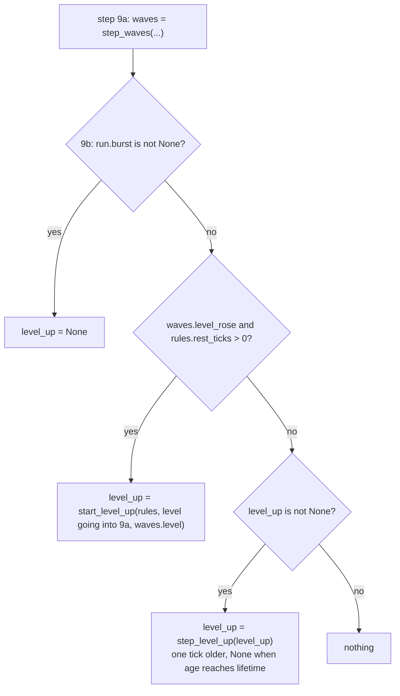
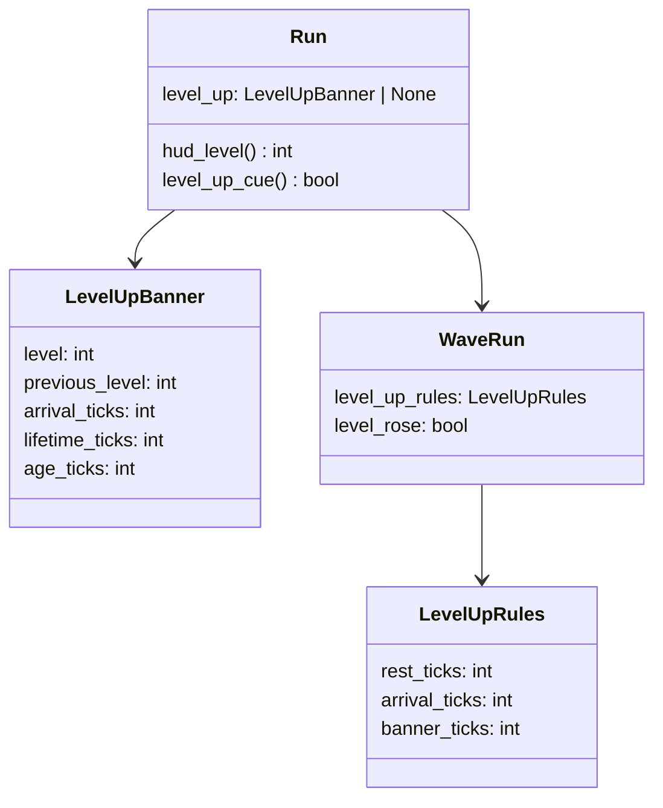

# Level-up, core
Part of: level-up
Read when: you build or test the level-up rest, the banner's state in the run, the shown level or the `level_up` cue.

## Diagram
One level rise on tick T, with `level_up_rest` R, `arrival_ticks` A and `banner_ticks` B (names from `game/tuning/level_up.json`; values in the tuning file):
```
state after tick   T          T+1        ...   T+A-1       T+A        ...   T+B-1       T+B
waves.level        new        new                new        new              new         new
waves.level_rose   True       False            False      False            False       False
resting            True       True             True       True             True        True (R covers B)
run.level_up       age 0      age 1            age A-1    age A            age B-1     None
run.hud_level      old level  old level        old level  new level        new level   new level
run.level_up_cue   True       False            False      False            False       False
```
The rest is R plus the rest gap plus the wave's extra rest, so the rest covers at least the B states the banner lives on.





## Interface
Existing signatures are read from the code. Only what DRA-148 adds or changes is here. Every changed class gets new fields last, with defaults, so every existing `WaveRun(...)`, `Run(...)` and `replace(...)` call still builds, and `start_waves(book, seed)` and `start_run(...)` build exactly what they built before.

```python
# game/core/level_up.py (new)
# Imports: stdlib (dataclasses, typing). Never pygame, ui or app. Logs nothing. Pure.
# Every module-level constant is typing.Final.

@dataclass(frozen=True, slots=True, kw_only=True)
class LevelUpRules:
    """The level-up values a run plays with. From game/tuning/level_up.json (docs/contracts/schemas/level-up.schema.json)."""
    rest_ticks: int      # level_up_rest: ticks added to the rest on a level rise, >= 0. 0 = off: no rest, no banner, no cue
    arrival_ticks: int   # age at which the HUD switches to the new level, >= 1
    banner_ticks: int    # states the banner lives on, > arrival_ticks. <= rest_ticks when rest_ticks > 0

NO_LEVEL_UP: Final[LevelUpRules]   # rest_ticks 0 (off). The default of a WaveRun, so a run built without rules plays as before

@dataclass(frozen=True, slots=True, kw_only=True)
class LevelUpBanner:
    """The banner of one level rise, aged tick by tick. Its age is the one clock every part of the banner reads."""
    level: int             # the level reached (the run's real level), 2 to LEVEL_COUNT
    previous_level: int    # the level before the rise, FIRST_LEVEL to level - 1
    arrival_ticks: int     # copied from the rules
    lifetime_ticks: int    # copied from the rules (banner_ticks)
    age_ticks: int = 0     # ticks since the rise. 0 on the state after the rise tick

def start_level_up(rules: LevelUpRules, previous_level: int, level: int) -> LevelUpBanner: ...
    # A banner at age 0 with the rules' arrival and banner ticks.
def step_level_up(banner: LevelUpBanner) -> LevelUpBanner | None: ...
    # One tick older. None when the new age reaches lifetime_ticks.
def shown_level(banner: LevelUpBanner | None, level: int) -> int: ...
    # The level the HUD shows. banner.previous_level while a banner exists and its age is below
    # arrival_ticks; else level (the run's real level).
```

```python
# game/core/waves.py, changed. Imports also core.level_up.
class WaveRun:
    ...
    level_up_rules: LevelUpRules = NO_LEVEL_UP   # the rules this run plays with. Never changes in a run
    level_rose: bool = False                     # True on the state after a tick on which the level rose. False on every other state

def start_waves(book: WaveBook, seed: int, level_up_rules: LevelUpRules = NO_LEVEL_UP) -> WaveRun: ...
    # As before, with level_up_rules kept in the state.
def next_run_waves(waves: WaveRun) -> WaveRun: ...
    # As before, with waves.level_up_rules kept: start_waves(waves.book, <next seed>, waves.level_up_rules).
```
`step_waves`, `rest_gap_ticks` and `pick_pool_wave` keep their signatures. `rest_gap_ticks` stays the gap alone; the level-up rest is added where the level rises (Rules, below).

```python
# game/core/run.py, changed. Imports also core.level_up.
class Run:
    ...
    level_up: LevelUpBanner | None = None   # the banner on screen, or None. Only step 9b changes it

    @property
    def hud_level(self) -> int: ...
        # shown_level(self.level_up, self.level): the level the HUD shows. 1 to 8.
    @property
    def level_up_cue(self) -> bool: ...
        # True when level_up is not None and its age_ticks is 0: the state after the tick the level_up
        # sound cue fires on. False on every other state.
```
`start_run` and `next_run` keep their signatures. The rules reach the run through the waves: the app starts the waves with them (`start_waves(book, seed, level_up_rules)`), and `next_run_waves` carries them to every later run. `step_run` keeps its signature.

## Rules
Values: every number is in `game/tuning/level_up.json`, never in code. `level_up_rest` is a GDD guess (08-difficulty.md, Values, `level_up_rest`); the arrival and banner ticks are the same file's (10-ui.md, `level_up_banner` and `hud_level_pop`, guess, timings in the level-up tuning file). Source for the rules below: 08-difficulty.md, rules 1, 6 and 10; 10-ui.md, `level_up_banner`, `hud_level_pop` and rule 14; 12-art-and-audio.md, rule 15; scope report DRA-148; away log DRA-148, D1, D2, D5, D6.

**The level-up rest** (`core.waves`, step 3.2 of the wave clock). On the tick a wave ends and the level rises (3.1), the rest after it is `rest_gap_ticks(new level, ended wave's extra_rest_ticks) + level_up_rules.rest_ticks`. It is added after the rest gap is worked out at the new level, never scaled, and never added when the level did not rise. With the sum above 0 the run rests as always (`resting`, `rest_ticks_left`). Wave 0 ending is no rise (the level stays 1 and a Level 1 playlist with slots plays next), Level 8 never rises, so neither adds it. A level whose playlist has no slots is passed in 3.1 and the rest is added once, for the level actually reached. The scroll keeps running and drifters of the last wave keep flying: the rest is a gap with no wave, not a pause (03-world-and-camera.md, rule 4). The next wave starts only when the rest has counted down, as in the wave clock.

**The rise flag.** `step_waves` sets `level_rose = False` at the start of every call, as it does `spawns_due`, and `True` when 3.1 raised the level during the call. So `level_rose` is True on exactly the state after the rise tick, whether or not a rest follows.

**The banner** (`core.run`, step 9b). Runs right after step 9a, on every tick that steps the waves: a playing tick and a last-life tick. In this order:
1. The run has a burst (the last life: it started this tick or an earlier one): `level_up = None`. The banner stops at once and the HUD shows the run's real level (`hud_level` is `level`). Source: scope report DRA-148, Feature (edge cases); away log D6.
2. Else, `waves` is not None, `waves.level_rose` is True and `waves.level_up_rules.rest_ticks > 0`: `level_up = start_level_up(rules, previous, waves.level)`, with `previous` the level of `run.waves` going into step 9a. Age 0 is the state after the rise tick.
3. Else, a banner exists: `level_up = step_level_up(level_up)`. It never ages past its lifetime: core drops it.
4. Else nothing. A run with no waves (the debug test spawn list) never has a banner.
- A level that rises again can't start a second banner while one plays: the next wave, and so the next rise, can come only after the rest, which covers the banner's life (`banner_ticks <= level_up_rest` when `level_up_rest > 0`, checked at load).
- A hit or a fall during the banner changes nothing about it. Source: away log D6.
- The ship keeps full control during the banner. Source: 01-vision.md, Pillar 1 and locked decision 5.

**Pause.** The game flow never steps a paused run (`systems/game-flow.md`), so the banner's age, the shown level and the bump freeze with everything else. No rule is needed. Source: away log D6.

**Game over and a new run.** A game-over tick changes nothing (`systems/run.md`, a game-over tick). The banner is already None from the tick the last life was lost (rule 1). `start_run` gives `level_up = None` and `next_run` builds a `start_run`, so a new run starts with no banner. Source: away log D6.

**The shown level** (`shown_level`, `Run.hud_level`). The HUD shows the old level until the flying number arrives, on age `arrival_ticks`, then the real level. Everything else uses the real level at once: `run.level`, the scroll speed, the spawner, `level_reached` and the saves, the debug overlay's `level` line. Only the HUD's level readout (its number, its climb bars and the number's tier color) reads `hud_level`. A skipped level (empty playlist) shows the level actually reached, because `banner.level` and the real level are the same. Source: 10-ui.md, `hud_level_pop` ("it keeps the old one until then"); scope report DRA-148, Feature, Limits ("Until arrival, the HUD keeps showing the old level"; "scroll, saves, debug overlay use the real level at once").

**The `level_up` cue** (`Run.level_up_cue`). The hook for the audio feature (12-art-and-audio.md, rule 15; open to-do AA-03). It is True on exactly the state after the rise tick, when the banner starts. Nothing plays and no app code reads it in this feature. The reader that comes later must read it only after a tick that stepped the run (`flow.run_stepped`, as `add_flow_drifters` does), or a pause on that very state would read it again. A last-life tick, or `level_up_rest` 0, starts no banner and so fires no cue. The jingle's accent should land about 22 ticks (0.37 s) after the cue, with the number's landing (12-art-and-audio.md, rule 15; the landing is the tuning file's `number.fall_end`). Source: away log D5.

**Logging.** No new log line: `core.waves` already logs `level up level=%d` on the rise and `rest start ticks=%d` with the rest, the level-up rest included. Source: game/CONTEXT.md, Logging; 15-tech-constraints.md, rule 9.

**Purity.** `core.level_up` holds no randomness, no frame time and no run mode. Core never imports pygame, `ui` or `app`. Source: game/CONTEXT.md, Layout; 15-tech-constraints.md, rules 2 and 7.
