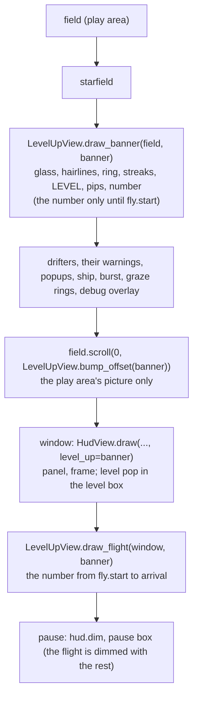

# Level-up, views
Part of: level-up
Read when: you build or test the banner, the number's flight, the picture bump or the HUD level pop.

## Diagram
Where each piece is drawn, in the frame's order (the app's draw is in `systems/app/frame-loop.md`). `age` is `run.level_up.age_ticks`:

The banner's moments by age (key names are the tuning file's; values are in it):
```
age        0          band.open_*        number.fall_*   number.fall_end            label.fade_in_*   pips.start..end   glint.start..end   hold.fade_out_*   fly.start .. arrival_tick     arrival_tick .. +pop.ticks
band       opens      open               open            open                       open              open              open               open              closes (glass, then lines)    gone
number     -          -                  falls, stretch  lands, squash, bump, ring  rests             rests             glint crosses      rests             flies, shrinks, tier color    HUD pops
label,pips -          -                  -               -                          fade in           pips pop in       -                  fade out          -                             -
HUD level  old        old                old             old                        old               old               old                old               old                           new level, pop
```

## Interface
Existing signatures are read from the code. Only what DRA-148 adds or changes is here.

```python
# game/ui/level_up_rules.py (new). Imports: stdlib only. Frozen records that mirror
# docs/contracts/schemas/level-up.schema.json. Built by game/app/level_up_tuning.py.
RGB = tuple[int, int, int]

@dataclass(frozen=True)
class LevelUpLook:
    colors: Mapping[str, RGB]   # the schema's 13 color keys, resolved to RGB (palette keys looked up in the HUD palette)
    band: BandLook
    number: NumberLook
    label: LabelLook
    hold: HoldLook
    pips: PipsLook
    ring: RingLook
    streaks: StreakLook
    glint: GlintLook
    bump: BumpLook
    fly: FlyLook
    pop: PopLook
    # Each section record (BandLook, NumberLook, ...) has the fields of the schema section of the
    # same name, with the schema's field names and types (numbers as int or float as the schema says).
```
```python
# game/ui/level_up_motion.py (new). Imports: stdlib, ui.level_up_rules. Never pygame. Pure, no state.
# Ages and elapsed ticks are ints; every share is a float from 0 to 1.

def fade_share(age: int, start: int, end: int) -> float: ...
    # 0 up to start, a straight ramp to 1 at end, 1 after. Used for every fade in and out.
def band_shares(age: int, band: BandLook) -> tuple[float, float]: ...
    # (glass share, line share), 0 to 1. Opening: both rise from 0 at open_start to 1 at open_end.
    # Between open and close both are 1. Closing, from close_start to close_end: the glass share falls
    # to 0 over the first close_glass_share of the window and the line share stays 1 until then, then
    # falls to 0 by close_end. 0 before open_start and after close_end. Eased, not straight.
def fall_offset(age: int, number: NumberLook, distance_px: float) -> float: ...
    # The number's y offset from its resting center, px, y down. -distance_px up to fall_start (fully
    # above the play area); from fall_start to fall_end it eases out to fall_overshoot_px past its
    # place by fall_peak_share of the fall, then eases back to 0 by fall_end; 0 after.
def pose_scales(age: int, number: NumberLook) -> tuple[float, float]: ...
    # (scale x, scale y). Falling (up to fall_end, exclusive): (fall_stretch_x, fall_stretch_y).
    # On fall_end: (squash_x, squash_y), easing back to (1, 1) over squash_ticks; (1, 1) after.
def bump_offset(age: int, number: NumberLook, bump: BumpLook) -> int: ...
    # Whole px the play area's picture is moved down. 0 before fall_end and from fall_end + bump.ticks on.
    # Between: rises from 0 to bump.pixels by bump.peak_share of the bump, then eases back to 0. Never negative.
    # bump.pixels 0 gives 0 always.
def fly_share(age: int, fly: FlyLook, arrival_ticks: int) -> float: ...
    # 0 up to fly.start, eased to 1 at arrival_ticks, 1 after.
def fly_position(share: float, start: tuple[float, float], end: tuple[float, float], arc_px: float) -> tuple[float, float]: ...
    # The point `share` of the way along a quadratic curve from start to end whose control point is the
    # midpoint moved up by arc_px. share 0 is start, share 1 is end exactly.
def pop_scale(elapsed: int, pop: PopLook) -> float: ...
    # The HUD number's size multiple `elapsed` ticks after arrival: pop.start_scale at 0, down through
    # pop.undershoot_scale at pop.undershoot_share of pop.ticks, then up to 1.0 at pop.ticks; 1.0 from
    # pop.ticks on. Never above start_scale.
```
```python
# game/ui/level_up_view.py (new). Imports: pygame, core.level_up, core.levels, core.world,
# ui.level_up_rules, ui.level_up_motion, ui.hud (HudView, LevelSlot). Never app. Never reads the run
# mode or a key. Needs pygame.font initialized and a display set.

@dataclass(frozen=True)
class LevelUpFonts:
    number: pygame.font.Font   # Exo 2 Bold at look.number.font_size, loaded by app.assets
    label: pygame.font.Font    # Share Tech Mono at look.label.font_size, loaded by app.assets

class LevelUpView:
    def __init__(self, look: LevelUpLook, fonts: LevelUpFonts, hud: HudView, field_origin: tuple[int, int]) -> None: ...
        # Builds every image once, here, for every level the banner can show (FIRST_LEVEL + 1 to
        # LEVEL_COUNT). `field_origin` is the play area's top-left in the window (hud_rules.window
        # field_x, field_y). `hud` gives the flight's end (HudView.level_slot).
    def draw_banner(self, field: pygame.Surface, banner: LevelUpBanner | None) -> None: ...
        # Draws on `field`, the play area, everything the banner has there at banner.age_ticks:
        # glass, hairlines, ring, streaks, LEVEL, pips and the number (the number up to fly.start).
        # Draws nothing for None. Never touches the window outside the play area.
    def draw_flight(self, window: pygame.Surface, banner: LevelUpBanner | None) -> None: ...
        # Draws on the window, over everything drawn so far, the number from fly.start up to (not
        # including) banner.arrival_ticks. Nothing for None or any other age.
    def bump_offset(self, banner: LevelUpBanner | None) -> int: ...
        # 0 for None, else ui.level_up_motion.bump_offset for the banner's age.
```
```python
# game/ui/hud.py, changed. Imports also core.level_up, core.levels, ui.level_up_rules.
@dataclass(frozen=True)
class LevelSlot:
    center: tuple[int, int]   # window px: the center of the HUD's level number image at its normal size
    size: tuple[int, int]     # that image's width and height, px
    color: RGB                # the number's tier color at that level

class HudView:
    def __init__(self, rules: HudRules, art: HudArt, level_up_look: LevelUpLook | None = None) -> None: ...
        # Also builds, once and only when level_up_look is given, the pop frames for every level the
        # banner can show: pop.steps frames per level, each the number at its size and its flash color.
        # With None no pop is ever drawn and every existing caller builds and draws as before.
    def draw(self, window: pygame.Surface, run: HudRun, best: int | None, tick: int,
             level_up: LevelUpBanner | None = None) -> None: ...
        # As before, but the level number, the tier color and the climb bars use
        # shown_level(level_up, run.level), and the level box plays the pop (Presentation).
        # level_up None, or no look given: exactly the old HUD, with run.level.
    def level_slot(self, level: int) -> LevelSlot: ...
        # Where and how the HUD draws that level's number (the rules' anchor and the number image's size).
        # Pure: it draws nothing and changes nothing.
```
`HudRun` is unchanged: `level` stays the real level, so every existing test fake still satisfies it.

## Presentation
Core fields the views read, and what each shows. Every fact shown is a core field: no view works out a time from the clock or the run.

| Core field | Shown as |
|---|---|
| `run.level_up` is None | no banner, no flight, no bump, no pop: the HUD shows `run.level`. Between level rises, in the debug test spawn list, from the last life on, on game over and in a new run |
| `level_up.age_ticks` | every part of the banner. It is the only clock: pause freezes it, so a paused banner, flight and bump hold still. Views never read the frame's view clock for the banner |
| `level_up.level` | the number on the banner, the lit pips, the flight's end and the pop's number |
| `level_up.previous_level`, `level_up.arrival_ticks` | the HUD level box: `shown_level` shows the previous level until age reaches the arrival, then the real one. The flight ends on the arrival tick |
| `level_up.age_ticks` minus `level_up.arrival_ticks` | the pop's elapsed ticks in the level box (number, new climb bar, box outline) |
| `run.level` | the HUD's level when there is no banner; the debug overlay's `level` line, always |

**The banner on the play area** (`draw_banner`, ticks are ages; all numbers are the tuning file's). A cockpit readout projected on the glass: the HUD palette and the Glass Cockpit look, flat, no blur glow, no fuchsia. Source: 10-ui.md, `level_up_banner`, rule 14; 12-art-and-audio.md, rules 6 and 14, HUD colors; away log D2, D3.
- **Glass.** A band across the full width of the play area, centered on the play area's center moved by `band.center_offset_y`, `band.height` tall at full height, in `colors.glass` at `band.alpha`: the glass stays see-through. Its height follows `band_shares` (glass share). `band.alpha` 0 draws no glass.
- **Hairlines.** Two `band.hairline_width` lines in `colors.hairline` at the band's top and bottom edges, drawn from the center out to both walls by the line share, with a corner tick of `band.corner_tick_length` at each end (inward, like the screens' brackets). While the glass is still opening or already closed the two lines sit on the same row.
- **Ring.** From the landing tick (`number.fall_end`), a ring of `colors.ring` centered on the number, from `ring.start_diameter` to `ring.end_diameter` over `ring.ticks` states, `ring.width` thick, fading out as it grows.
- **Streaks.** From the landing tick, `streaks.count` streaks of `colors.streak`, evenly spread in angle around the number, each `streaks.length` long and `streaks.width` thick, flying from `streaks.start_radius` to `streaks.end_radius` over `streaks.ticks` states and fading out.
- **LEVEL.** The word LEVEL in Share Tech Mono, `colors.label`, letter-spaced, centered `label.offset_y` from the band's center. It fades in from `label.fade_in_start` to `label.fade_in_end` while its letter spacing closes from `label.spacing_wide` to `label.spacing_normal` in `label.spacing_steps` steps, then holds, and fades out from `hold.fade_out_start` to `hold.fade_out_end`.
- **Pips.** A row of `LEVEL_COUNT` diamonds, `pips.size` across, `pips.pitch` apart, centered on the band's center column, `pips.offset_y` from its center. Pip `i` (from 0) appears from left to right, its start spread evenly so the first starts at `pips.start` and the last is fully in at `pips.end`, each taking `pips.pop_ticks`. Pips up to the new level are lit (`colors.pip_lit`), the rest unlit (`colors.pip_unlit`). The new level's pip appears with a `colors.flash` white flash fading to its lit color over `pips.flash_ticks`. The row fades out with LEVEL.
- **The number.** The new level's digit in Exo 2 Bold at `number.font_size`: a vertical gradient from `colors.number_top` at the top to `colors.number_bottom` at the bottom, with a `number.outline_width` outline in `colors.number_outline` so it reads over any background. It falls from fully above the play area (`fall_offset`), stretched tall while it falls and with a small overshoot, lands on `number.fall_end` centered `number.center_offset_y` from the band's center, squashes wide and settles (`pose_scales`), then holds. One glint of `colors.glint`, `glint.width` wide and leaning `glint.slant_degrees`, sweeps across it from `glint.start` to `glint.end`, lighting only the number's own pixels. From `fly.start` the field no longer draws the number.
- **Draw order inside the banner.** Glass, hairlines, ring, streaks, LEVEL, pips, number: the number is on top of its own ring and streaks.
- **Behind everything that matters.** The banner is drawn on the play area right after the starfield, before the drifters, their warnings, the popups, the ship, the burst, the graze rings and the debug overlay, so it never hides anything the player must see. Source: 10-ui.md, rule 14; 01-vision.md, Pillar 2; away log P1.

**The flight** (`draw_flight`). From `fly.start` the number leaves the play area's picture: it is drawn on the window, over the drifters, the ship and the HUD frame, from its resting place to `HudView.level_slot(level).center`, along `fly_position` with `fly.arc_px`, shrinking and mixing its colors toward `level_slot(level).color` (the HUD's tier color), `fly.steps` pre-rendered sizes. It ends on the arrival tick at the size `level_slot(level).size` times `pop.start_scale`, so the HUD's first pop frame is the same image where it lands. While it flies the band closes behind it (`band_shares`). It is the one part of the banner over the drifters and the ship: small, shrinking, and gone within the flight. It is drawn after the HUD and before the pause dim. Source: away log D2, P1; 10-ui.md, rule 14.

**The bump** (`bump_offset`). On landing the play area's picture moves down by `bump_offset` and springs back over `bump.ticks`. The app moves the picture, not the view: only the pixels of the play area move; the frame, the panel and the HUD stay still, and no game position, hitbox or rule changes. It never follows the ship: the same offset applies wherever the ship is, and it depends on `age_ticks` alone. Source: 10-ui.md, `level_up_banner`; 01-vision.md, locked decision 2; away log D4.

**The HUD pop** (`HudView.draw` with `level_up`). While `level_up.age_ticks` is below `arrival_ticks` the level box shows the previous level: number, tier color and climb bars. From `arrival_ticks`, for `pop.ticks`:
- **Number.** The new level's number, centered where the HUD draws it, at `pop_scale` times its size (starting at `pop.start_scale`, settling through `pop.undershoot_scale` to 1), flashing `colors.flash` white and fading to its tier color over `pop.flash_ticks`. A pre-rendered frame per step.
- **Climb bar.** The newly lit bar (the new level's) flashes `colors.flash` white and fades to its lit color over `pop.bar_flash_ticks`. Every other bar is as the HUD draws it.
- **Box outline.** The level box's outline, with its two cut corners (`pop.box_corner_cut`), flashes `colors.box_flash` at `pop.box_flash_width` and fades out over `pop.box_flash_ticks`, drawn over the baked outline; at the end the baked outline shows as before.
- After the pop the HUD is exactly the HUD of the new level. Nothing else on the panel changes. Source: 10-ui.md, `hud_level_pop`.

**Cost.** The frame rate is the project's top open problem (12-art-and-audio.md, Frame-rate check; 15-tech-constraints.md, rule 5), and the rest has an almost empty field, so a frame has little to spare. Rules the views keep, all from 10-ui.md, rule 11:
- Everything that is a picture is made once, at startup, in `__init__`: the digits with their gradient and outline for every level, the pre-scaled poses, the glint frames, the flight's sizes, the LEVEL images by spacing, the pip images, the ring frames, the streak images, the HUD's pop frames and the box outline. Nothing is built, rendered or scaled on the rise tick or on any frame.
- No font render, no `smoothscale`, no `rotate`, no new surface per frame. Per frame the views only blit pre-made images, pick one by age, set a surface alpha, and fill rects.
- A thin shape (the ring, the streaks, the glint, the box outline) is never blitted as one per-pixel-alpha picture of its whole bounding box: it is cut into strips trimmed to their ink (the HUD's sheen method, `systems/hud.md`, Rules) or built from small images. Source: `systems/hud.md`, Rules (the sheen).
- The glass is the one large shape. It is drawn by the cheapest exact method: `dst x (1 - a) + glass x a` as one multiply fill and one add fill on the band's rows, or a per-surface-alpha blit of one opaque image. The ui-developer measures the options headless and keeps the fastest; `band.alpha` 0 skips it.
- No blur, no glow, no gaussian pass. Source: 10-ui.md, `ui_glow`; 91-decision-log.md, row 128.
- Expected per-frame cost, from the HUD contract's measurement (a full play-area blend of 307,200 px cost about 14 ms): the glass is at most 76,800 px, so about 3.5 ms at full height if blended, ticks `band.open_end` to `band.close_start` only; the number, LEVEL and pips together a few thousand px (under 0.5 ms); the ring and streaks under 0.5 ms; the bump's scroll of the picture a memory copy of the play area, about 0.3 ms, for `bump.ticks`; the pop a handful of blits. Outside the 2.5 s of a banner the cost is zero: every draw call returns at once for None. The estimate is not a measurement: the browser check must measure it (`systems/app/integration-checks/DRA-148.md`). The escape hatches are tuning values: `band.alpha` 0, `band.height`, `bump.pixels` 0. Source: 12-art-and-audio.md, Frame-rate check (empty field 11 to 13 ms of a 16.7 ms frame).
- Startup cost: images for 7 levels, about 25 small images each (about 175, each at most a few thousand px, under 5 MB in all). If the browser shows the startup page's LOADING for noticeably longer, report it; do not move the work to the rise tick.

**What the views never do.** They only draw. They never change the banner, the run or the HUD's inputs, never read a key or the run mode, never log per frame, never fill the whole window, and never draw over the HUD's panel except the flight (the flight's end is inside the level box, and the pop takes over on the arrival tick). Source: 10-ui.md, rules 1, 5 and 14.
