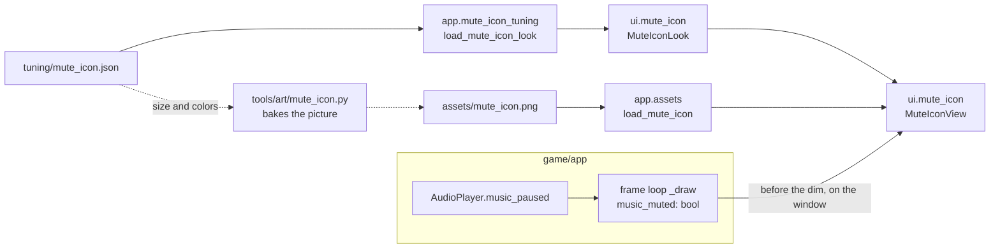

# Mute icon
Version: 1
Status: frozen
Features: DRA-159
Created by: architect

## Purpose
A small picture that tells the player the music is muted: a speaker with a slash through it, still, in the bottom-right corner of the window. It shows only while the music is muted, on every screen after the start page. On the pause and game-over screens it is dimmed with everything else. It is its own element: it adds no text and changes no HUD, screen or frame. It is a view of one fact the audio player holds, `music_paused` (`docs/contracts/systems/audio.md`). It never changes it. With no sound device there is no music to mute, so it never shows.

Four things make it: a picture made by the Art & Audio Engineer, a tuning file (its margin, its size, its two colors), a view in `game/ui/` that blits the picture, and a loader and a draw call in `game/app/`.

## Diagram


## Interface
### game/ui/mute_icon.py (new, ui-developer)
Imports pygame and the stdlib. Never imports `app` or `core`, never reads a key or a file, never mutates anything but the surface it draws on.
```python
@dataclass(frozen=True)
class MuteIconLook:
    margin: int  # px from the window's right and bottom edges, >= 0
    size: int    # px, the picture's width and height on screen, >= 1

class MuteIconView:
    def __init__(self, look: MuteIconLook, image: pygame.Surface) -> None: ...
        # Keeps both. The image is already look.size x look.size with alpha: the loader checked it. Makes nothing else.
    def draw(self, window: pygame.Surface, muted: bool) -> None: ...
        # muted False: draws nothing. muted True: one blit of the image, its bottom-right corner
        # look.margin px from the window's right and bottom edges, worked out from window.get_size().
```
The first design's function `draw_mute_icon(window, muted)` is replaced by this view. Nothing calls it yet.

### game/app/mute_icon_tuning.py (new, Integration Engineer)
Not a startup module: it imports `ui`, so only `app.frame` imports it, inside the guard.
```python
MUTE_ICON_FILE: str  # "mute_icon.json", in app.tuning.TUNING_DIR

def load_mute_icon_look(hud_rules: HudRules) -> MuteIconLook: ...
    # Reads TUNING_DIR / MUTE_ICON_FILE once at startup, in both run modes, after load_hud_rules()
    # (it needs the play area). Checks every rule of docs/contracts/schemas/mute_icon.schema.json
    # by hand, and Rules, Loading. Builds MuteIconLook from margin and size. The two colors are checked and
    # dropped: only the art script reads them. Raises on a bad file.
```

### game/app/assets.py (changed, Integration Engineer)
```python
MUTE_ICON_PICTURE: str  # "mute_icon.png", in ASSETS_DIR

def load_mute_icon(look: MuteIconLook) -> pygame.Surface: ...
    # Reads the picture with alpha and checks it is look.size x look.size. A missing file raises
    # FileNotFoundError. A wrong size raises ValueError naming assets/mute_icon.png, the size found, the size expected
    # (tuning/mute_icon.json) and "run tools/art/mute_icon.py". Call it once, after the display is open.
```
The frame loop's startup, the draw order and the `_draw` arguments are in `docs/contracts/systems/app/frame-loop.md`, Rules, The mute icon. The browser checks are in `docs/contracts/systems/app/integration-checks/DRA-159.md`.

### The picture (new, art-audio-engineer)
`game/assets/mute_icon.png`, one still image, no frames, no hitbox, no behavior: a UI picture. A speaker with a slash through it. `size` x `size` px, with alpha. Made by `tools/art/mute_icon.py`, which reads `size` and both colors from `game/tuning/mute_icon.json`, draws a large master, shrinks it to `size` and writes the picture, the way `tools/art/hud_panel.py` bakes the HUD pictures from `hud.json`. The master stays in `staging/assets/ui/`.

### game/tuning/mute_icon.json (content: the main session)
Its fields are in `docs/contracts/schemas/mute_icon.schema.json`. The main session writes it from the schema and the architect's hand-back. The file exists before the art task runs: the art script reads it.

## Presentation
| Reads | Shows |
|---|---|
| `muted` (the frame loop's `music_muted`, from `AudioPlayer.music_paused`) | the picture when True; nothing at all when False |
| `look.margin`, `look.size` (the tuning file, through the loader) | where the picture sits and how large it is |
| `window.get_size()` | the corner the margin counts from |

The view reads nothing from core: the mute is not a game fact (`docs/contracts/systems/audio.md`, Rationale). It holds no state between frames. The dim of the pause and game-over screens is the HUD's (`hud.dim`): the view does nothing for it, it is just drawn before it.

## Rules
Values: the size, the margin and both colors are in `docs/design/gdd/10-ui.md`, `mute_icon_look` (guess), and live only in `game/tuning/mute_icon.json`. Never in code, never in this file.

**Look**
1. A speaker with a slash through it, as a picture, not drawn shapes. A pale violet-white speaker and a fuchsia slash. It is still. Source: `10-ui.md`, `mute_icon_look`; `91-decision-log.md`, row 148.
2. Its size on screen is `mute_icon_look`'s, and the picture is exactly that size, so it is blitted, never scaled. It is drawn large first and shrunk, like every sprite: the master factor is the one `mute_icon_look` names. Source: `10-ui.md`, `mute_icon_look`; `12-art-and-audio.md`, `art_style` (see the DRA-159 hand-back: its factor for small sprites differs).
3. Both colors are picked from the palettes in `12-art-and-audio.md` (the screens palette for the pale violet-white, the HUD palette for the fuchsia) and kept in `game/tuning/mute_icon.json` as `speaker_color` and `slash_color`. No color is in code. Source: `mute_icon_look`; Director's delegation (decision 148); `12-art-and-audio.md`, HUD colors and screens palette.
4. The slash may be solid fuchsia: rule 6 of `12-art-and-audio.md` (a solid fuchsia shape in the play area means a coin) is about the play area, and the icon is outside it. Source: `12-art-and-audio.md`, rule 6.
5. It blinks, pulses and moves in no way: nothing in it changes while it shows. Source: `10-ui.md`, `mute_icon_look`.

**Placement**
6. The icon sits in the bottom-right corner of the window, outside the play area, with a margin from the window's right and bottom edges set in tuning. Source: `10-ui.md`, `mute_icon_place` and `mute_icon_look`.
7. The corner was checked against the HUD: the panel's drawn content ends with its footer line, well above the window's bottom edge, so the corner is empty panel body, free of the footer, the dots and every box. It is outside the play area, the frame's strip and the pillar. Source: `03-world-and-camera.md`, `play_area`; `10-ui.md`, `hud_place`, `mute_icon_place`; `docs/contracts/systems/hud.md`, Rationale (panel content centered); `game/assets/hud_panel.png`.
8. It adds no text anywhere, and changes no HUD, pause box, game-over, menu, instructions or leaderboard layout. It is drawn over what is there and moves none of it. Source: scope report DRA-159, Feature; `10-ui.md`, `mute_icon_place`.
9. It never covers a pixel of the play area, so it hides no hazard. The loader enforces it (Loading). Source: `10-ui.md`, rule 1; Pillar 2, `docs/design/gdd/01-vision.md`.

**When it shows, and what draws over it**
10. It shows only while the music is muted, and on every screen after the start page: the menu, the instructions, the leaderboard, play, the last life, the pause and the game over. Source: `10-ui.md`, `mute_icon_place`; scope report DRA-159, Feature and Decision log.
11. On the pause and game-over screens it is dimmed with the screen. It is drawn before the dim, so the dim darkens it with the HUD and the world, and the box drawn after the dim sits over it, never under. The menu, the instructions and the leaderboard have no dim: it shows there undimmed. Source: `10-ui.md`, `mute_icon_look`; `91-decision-log.md`, row 148; `docs/contracts/systems/app/frame-loop.md`, Rules, The mute icon.
12. It never shows on the start page, and the game never runs there. Source: `docs/design/gdd/02-game-flow.md`, rule 1.
13. With no sound device there is no icon, whatever the keys do. Source: `10-ui.md`, `mute_icon_look`; `docs/contracts/systems/audio.md`, Rules, rule 23.

**Loading**
14. The file is read once at startup in both run modes. A missing file raises `FileNotFoundError`. A missing, unknown or badly typed field, a value outside its range, a color that is not `#rrggbb`, or invalid JSON raises `ValueError` naming `tuning/mute_icon.json` and the field. A number is an `int`, never a `bool`. The page shows the error screen and the log names the file and the field. Source: `game/CONTEXT.md`, Error handling; `15-tech-constraints.md`, rule 8.
15. The icon's rectangle must lie inside the window and must not touch the play area's rectangle. Else `ValueError` naming `tuning/mute_icon.json`, `margin` and `size`. Source: `10-ui.md`, rule 1 and `mute_icon_place`.
16. A missing or wrongly sized picture raises inside the guard, like every asset. Source: `game/CONTEXT.md`, Error handling.
17. One INFO line after a good load of the file: `mute icon loaded margin=%d size=%d`. Nothing else is logged, and nothing per frame. Source: `game/CONTEXT.md`, Logging.

**Cost**
18. Cheap to draw: the picture is made once, loaded once with its alpha, and blitted. No per-frame drawing of shapes, no per-frame allocation, no blur glow. Source: `15-tech-constraints.md`, rule 5; `10-ui.md`, rule 11.
19. Every size, margin and color is config, never hard-coded. Source: Director (everything configurable); `10-ui.md`, rule 12.

## Rationale
- **Its own view, not part of the HUD.** The Director wants no change to the HUD layout, and the icon must also show on screens that have no HUD (menu, instructions, leaderboard). A separate view works on all of them and touches none.
- **Drawn in the corner of the window.** The window's corner is the one spot free on every screen: the play area is off limits (Pillar 2) and the corner holds no HUD content. The frame's strip is the other free place, but it is far from the corner the Director chose.
- **Parameter, not core field.** The mute is an app-level sound setting. The view takes a bool, like the debug overlay takes its visibility, so core stays free of sound state.
- **A picture, baked from tuning.** The Director wants a picture, not drawn shapes, and every value configurable. The HUD already does this: its art script reads `hud.json` and bakes the PNGs. The icon copies it, so the colors and the size stay in one file, and the loader refuses a picture that no longer fits the file.
- **No scaling at draw time.** The picture is shrunk once by the art script, with a smooth finish. Scaling it again in the game would blur it and cost a frame.
- **Drawn before the dim.** The Director wants the icon dimmed with the screen on pause and game over. The dim is one multiply over the whole window, drawn after the HUD. Drawing the icon just before it dims the icon with no code in the view, and keeps it under the boxes. The other order (after the dim) would have needed the icon to know which screens dim.
- **The loader checks the corner.** A margin is config, so a wrong value could slide the icon over the play area and hide a hazard. The check is cheap and runs once.
- **No mixer, no icon.** With no sound device there is no music to mute, and an icon claiming a mute would be wrong.
- **Colors dropped by the loader.** Only the art script needs them. The view draws a finished picture, so passing colors to it would invite recoloring at draw time.
