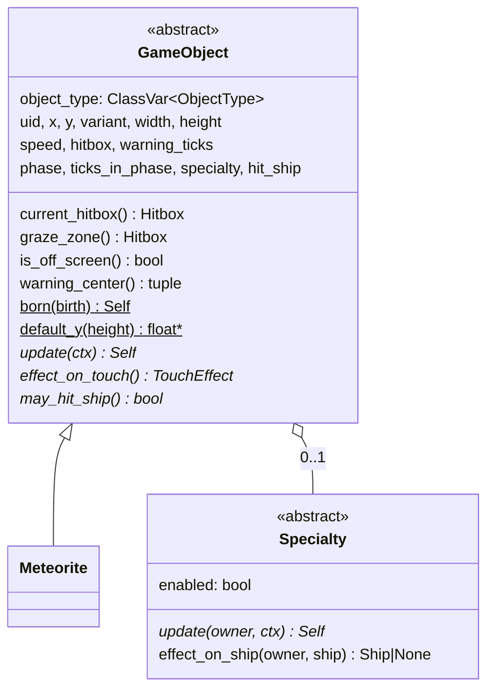
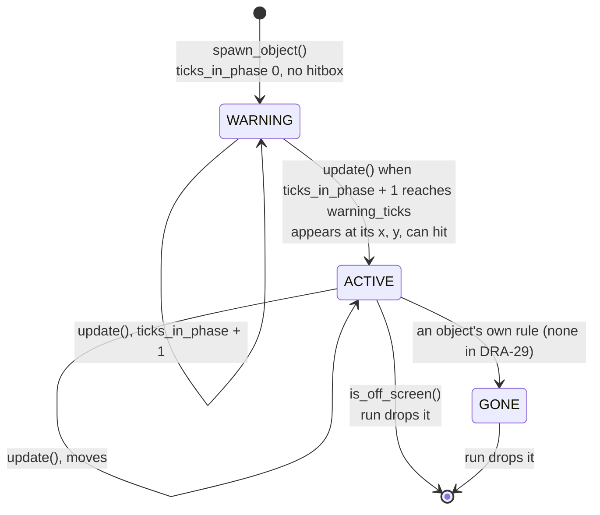
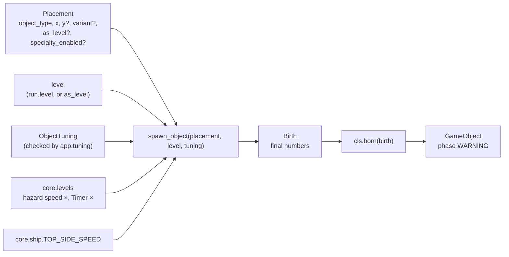
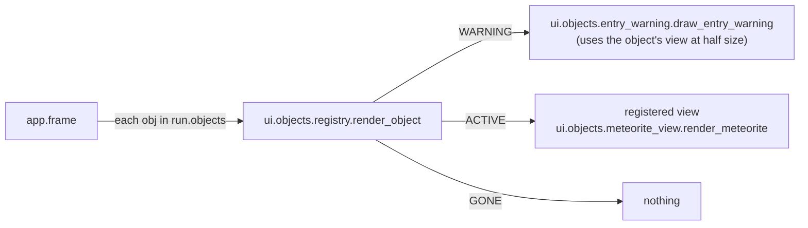

# Objects: base, hitboxes, levels, spawner, the meteorite and their views
Version: 1
Status: frozen
Features: DRA-29
Created by: architect

## Purpose
Every object in the game (hazards first, coins and the rest later) is built on one shared base. This contract holds that base, the hitbox shapes and their overlap test, the level table the spawner reads, the spawner (the only way an object is created), the first object (the meteorite), and the views that draw objects and their entry warnings.

An object carries final numbers only. The spawner reads the level once, at birth, and sets the object's speed. The object never knows the level. The run (`docs/contracts/systems/run.md`) holds the objects, updates them every tick, tests them against the ship and drops them when they leave.

Structure chosen by the Director (scope report DRA-29, Limits and Decision log): inheritance, a thin abstract base, one subclass per object, one level deep, no middle classes. Shared bits are helper functions. Guards: abstract methods, a registry that refuses duplicates, and a test that the object list, the tuning files, the classes and the views all match.

Who builds what:
- `game/core/collision.py`: the Gameplay Implementer, task `DRA-29-01-gameplay-implementer`.
- `game/core/levels.py` and the package `game/core/objects/` (`__init__.py`, `base.py`, `tuning.py`, `registry.py`, `spawner.py`, `meteorite.py`): the Gameplay Implementer, task `DRA-29-02-gameplay-implementer`.
- The objects inside `core.run` (`Run.objects`, `add_objects`, hits, drops, lifecycle logs): task `DRA-29-03-gameplay-implementer`, from `docs/contracts/systems/run.md`.
- `game/ui/shapes.py`: the UI Developer, task `DRA-29-04-ui-developer` (with the ship view, `docs/contracts/systems/ship.md`).
- The package `game/ui/objects/` (`__init__.py`, `registry.py`, `entry_warning.py`, `meteorite_view.py`): the UI Developer, task `DRA-29-05-ui-developer`.
- Hitbox and graze outlines and object labels in the debug overlay: task `DRA-29-06-ui-developer`, from `docs/contracts/systems/debug-overlay.md`.
- Tests: the QA Engineer, tasks `DRA-29-07-qa-engineer` (collision, spawner, meteorite), `DRA-29-08-qa-engineer` (objects in the run) and `DRA-29-09-qa-engineer` (registry guard and ship view).
- The tuning files `game/tuning/objects/meteorite.json` and `game/tuning/playtest.json`: the main session, by Director decision (scope report DRA-29, Limits), from `docs/contracts/schemas/object-tuning.schema.json` and `docs/contracts/schemas/playtest-switches.schema.json`. No task file.
- Loading and checking the tuning files, the debug test spawn list, and calling `add_objects` and `render_object`: the Integration Engineer, in `game/app/`, from `docs/contracts/systems/app.md`. No task file.

## Diagram
Class shape. One level deep:


Life of one object:


Birth, the only place the level is read:


Meteorite timeline, medium, Level 1, added at the end of tick T:
```
state after tick   T        T+1..T+59   T+60            T+61          ...  T+60+n
phase              WARNING  WARNING     ACTIVE          ACTIVE             ACTIVE
ticks_in_phase     0        1..59       0               1                  n
y                  -14.00   -14.00      -14.00          -14 + 2.4675       -14 + n × 2.4675
hitbox             none     none        circle r 14     circle r 14
```
Dropped on the first state where its top edge is at or past y 480: y − 14 ≥ 480, so n = 206 (y ≈ 494.3).

Views:


## Interface
Import root is `game/`, as in the tests. Core modules import stdlib and `core` only, never pygame, `ui` or `app`. Every module-level constant is `typing.Final`. Every dataclass is `frozen=True, slots=True`. Every module with code has `log = logging.getLogger(__name__)`; `core.objects` and `core.collision` log nothing (the run logs the object lifecycle, `docs/contracts/systems/run.md`, Logging).

### game/core/collision.py
```python
# Imports: stdlib only.

@dataclass(frozen=True, slots=True)
class Circle:
    """A circle hitbox shape, px."""
    cx: float        # center x: offset from the owner's center in a variant's hitbox; screen x once placed
    cy: float        # center y, same, y down
    r: float         # radius, px, > 0

@dataclass(frozen=True, slots=True)
class Box:
    """An upright box hitbox shape, px. Boxes never rotate."""
    cx: float        # center x, as Circle.cx
    cy: float        # center y, as Circle.cy
    w: float         # full width, px, > 0
    h: float         # full height, px, > 0

Shape = Circle | Box
Hitbox = tuple[Shape, ...]       # one or more shapes. Empty () = touches nothing

def place_hitbox(hitbox: Hitbox, x: float, y: float) -> Hitbox: ...
    # Every shape moved by (x, y): offsets from the owner's center become screen positions.
def hitboxes_overlap(a: Hitbox, b: Hitbox) -> bool: ...
    # True when any shape of a overlaps any shape of b. Both placed. Pure.
def grow_hitbox(hitbox: Hitbox, margin: float) -> Hitbox: ...
    # Each shape grown by margin on every side: Circle r + margin; Box w + 2 margin, h + 2 margin.
```

### game/core/levels.py
```python
# Imports: stdlib only.
LEVEL_COUNT: Final[int] = 8                                   # 08-difficulty.md, level table (locked)
HAZARD_SPEED_MULT: Final[tuple[float, ...]] = (1.00, 1.06, 1.12, 1.18, 1.24, 1.30, 1.36, 1.42)
                                                              # 08-difficulty.md, Hazard speed × row (locked)
TIMER_MULT: Final[tuple[float, ...]] = (1.00, 0.94, 0.89, 0.85, 0.81, 0.77, 0.74, 0.70)
                                                              # 08-difficulty.md, Timer × row (guess)
LEVEL_STARTS_M: Final[tuple[int, ...]] = (0,)                 # 08-difficulty.md, Starts at row: Level 1 at 0 m.
                                                              # Levels 2 to 8 are TBD (DF-05); they join here when set.

def check_level(level: int) -> None: ...
    # Raises ValueError("level <n> is outside 1 to 8") unless 1 <= level <= LEVEL_COUNT.
def hazard_speed_mult(level: int) -> float: ...   # HAZARD_SPEED_MULT[level - 1], after check_level
def timer_mult(level: int) -> float: ...          # TIMER_MULT[level - 1], after check_level
def level_at(meters: int) -> int: ...
    # The highest level whose start in LEVEL_STARTS_M is <= meters. 1 while only Level 1 has a start.
```

### game/core/objects/base.py
```python
# Imports: stdlib, core.collision, core.ship, core.world.
GRAZE_MARGIN: Final[int] = 14                    # 06-scoring.md, graze_margin, px (locked)

class ObjectType(Enum):
    """Every object the game knows. One member per object spec in 07-objects.md that is built."""
    METEORITE = "meteorite"                      # objects/01-meteorite.md

class Phase(Enum):
    WARNING = "warning"      # the entry warning shows; the object can't touch anything
    ACTIVE = "active"        # the object is on the field and can touch the ship
    GONE = "gone"            # the object is finished; the run drops it this tick

class TouchEffect(Enum):
    HIT = "hit"              # touching it is a hit (05-lives-and-damage.md, rule 1)
    COLLECT = "collect"      # reserved for coins. No object returns it in DRA-29
    NONE = "none"            # touching it does nothing

@dataclass(frozen=True, slots=True)
class TickContext:
    """Per-tick facts an object may read in update(). Never the level."""
    ship: Ship               # the ship as it was at the start of this tick

@dataclass(frozen=True, slots=True)
class Birth:
    """Everything the spawner settled for one new object. Final numbers only."""
    x: float                 # center x, screen px
    y: float                 # center y, screen px, y down
    variant: str             # the variant's name
    width: float             # the variant's visible width, px
    height: float            # the variant's visible height, px
    hitbox: Hitbox           # the variant's shapes, offsets from the center
    speed: float             # final speed, px/tick, hazard speed × already applied
    warning_ticks: int       # entry warning length, ticks, never scaled
    timer_mult: float        # the Timer × to apply to the object's own timers. The meteorite has none
    specialty_enabled: bool | None   # the placement's switch; None = the object's default

@dataclass(frozen=True, slots=True, kw_only=True)
class Specialty(ABC):
    """An optional extra behavior on top of an object's movement. Only the base exists."""
    enabled: bool            # switched on or off for this object

    @abstractmethod
    def update(self, owner: GameObject, ctx: TickContext) -> Self: ...
    def effect_on_ship(self, owner: GameObject, ship: Ship) -> Ship | None: ...
        # None: no effect. The default, and the only behavior in DRA-29.

@dataclass(frozen=True, slots=True, kw_only=True)
class GameObject(ABC):
    """One object on the field after a tick. Screen px, y down, x and y at its center."""
    object_type: ClassVar[ObjectType]    # set by each subclass
    uid: int = 0             # unique within a run, from 1. Set by core.run.add_objects; 0 before
    x: float                 # center x, screen px
    y: float                 # center y, screen px, y down
    variant: str             # the variant's name, e.g. "medium"
    width: float             # visible width, px, from the variant
    height: float            # visible height, px, from the variant
    speed: float             # final speed, px/tick, set by the spawner
    hitbox: Hitbox           # shapes as offsets from (x, y), from the variant
    warning_ticks: int       # entry warning length, ticks
    phase: Phase = Phase.WARNING
    ticks_in_phase: int = 0  # ticks spent in the current phase. 0 on the state it starts
    specialty: Specialty | None = None
    hit_ship: bool = False   # a fact: this object has hit the ship at least once. Set by the run.
                             # What it means for later touches is the object's own rule (may_hit_ship)

    def current_hitbox(self) -> Hitbox: ...
        # () unless phase is ACTIVE. Otherwise place_hitbox(hitbox, x, y).
    def graze_zone(self) -> Hitbox: ...
        # grow_hitbox(current_hitbox(), GRAZE_MARGIN) when effect_on_touch() is HIT, else ().
    def is_off_screen(self) -> bool: ...
        # True only in ACTIVE, when fully past a side wall or fully below the floor. Never at the top.
    def warning_center(self) -> tuple[float, float]: ...
        # Where the entry warning is drawn: (x, y) moved just inside the screen.

    @classmethod
    def born(cls, birth: Birth) -> Self: ...
        # Builds the object in WARNING from birth. Raises ValueError when birth.specialty_enabled
        # is True: the base has no specialty. A subclass with a specialty or own timers overrides it.
    @classmethod
    @abstractmethod
    def default_y(cls, height: float) -> float: ...
        # The start y a placement gets when it sets none.
    @abstractmethod
    def update(self, ctx: TickContext) -> Self: ...
        # Advance one 60 Hz tick and return a new object. Never mutates self.
    @abstractmethod
    def effect_on_touch(self) -> TouchEffect: ...
    @abstractmethod
    def may_hit_ship(self) -> bool: ...
        # Whether this object, in its current state, can hit the ship. Each object decides,
        # for example from hit_ship. The base has no default: LD-06 is open.

def tick_warning[T: GameObject](obj: T) -> T: ...   # PEP 695 type parameter, bound GameObject
    # The shared WARNING step: ticks_in_phase + 1, or ACTIVE with ticks_in_phase 0 once
    # ticks_in_phase + 1 reaches warning_ticks. Position unchanged.
```
The code documents each field with the comment above, as `core/ship.py` does for `Ship`. `GameObject` and `Specialty` refer to each other, so the module uses `from __future__ import annotations` or string annotations. With `slots=True` the methods never use the zero-argument `super()`.

### game/core/objects/tuning.py
Checked values the app hands to core. Built by `app.tuning` from the JSON files. Core trusts them.
```python
# Imports: stdlib, core.collision, core.objects.base.
@dataclass(frozen=True, slots=True, kw_only=True)
class VariantTuning:
    width: float             # visible width, px
    height: float            # visible height, px
    hitbox: Hitbox           # offsets from the center

@dataclass(frozen=True, slots=True, kw_only=True)
class ObjectTypeTuning:
    variants: Mapping[str, VariantTuning]   # by variant name
    default_variant: str     # one of the variant names
    speed_ratio: float       # Level 1 speed as a multiple of core.ship.TOP_SIDE_SPEED
    entry_warning_ticks: int # ticks, >= 1

@dataclass(frozen=True, slots=True, kw_only=True)
class PlaytestSwitches:
    hazard_speed_scaling: bool = True   # False: Level 1 hazard speed × at every level
    timer_scaling: bool = True          # False: Level 1 Timer × at every level

@dataclass(frozen=True, slots=True, kw_only=True)
class ObjectTuning:
    objects: Mapping[ObjectType, ObjectTypeTuning]
    switches: PlaytestSwitches
```

### game/core/objects/registry.py
```python
# Imports: stdlib, core.objects.base.
def register_object[G: GameObject](cls: type[G]) -> type[G]: ...   # PEP 695 type parameter, bound GameObject; class decorator
    # Raises TypeError if cls is abstract (inspect.isabstract) or has no object_type.
    # Raises ValueError("object type 'meteorite' is already registered") on a duplicate.
def available_objects() -> frozenset[ObjectType]: ...  # every registered type
def object_class(object_type: ObjectType) -> type[GameObject]: ...
    # Raises ValueError("no class registered for object type 'x'").
```

### game/core/objects/spawner.py
```python
# Imports: stdlib, core.levels, core.ship, core.objects.base, .tuning, .registry.
@dataclass(frozen=True, slots=True)
class Placement:
    """Where and how to place one object. Screen px, y down, at its center."""
    object_type: ObjectType
    x: float
    y: float | None = None            # None: the object's default_y for its variant
    variant: str | None = None        # None: the object's default_variant
    as_level: int | None = None       # None: the run's level
    specialty_enabled: bool | None = None   # None: the object's default

def spawn_object(placement: Placement, level: int, tuning: ObjectTuning) -> GameObject: ...
    # The only way an object is created. Pure: no logging, no randomness.
```

### game/core/objects/meteorite.py
```python
# Imports: stdlib, core.objects.base, core.objects.registry.
@register_object
@dataclass(frozen=True, slots=True, kw_only=True)
class Meteorite(GameObject):
    """Falling blocker. Falls straight down at its speed. objects/01-meteorite.md."""
    object_type: ClassVar[ObjectType] = ObjectType.METEORITE

    @classmethod
    def default_y(cls, height: float) -> float: ...   # -height / 2
    def update(self, ctx: TickContext) -> Self: ...
    def effect_on_touch(self) -> TouchEffect: ...     # TouchEffect.HIT
    def may_hit_ship(self) -> bool: ...               # not self.hit_ship (stand-in, scope report DRA-29)
```
No new fields. It uses the base `born`.

### game/core/objects/__init__.py
Imports every object module once (`meteorite` in DRA-29), so each class registers when anything under `core.objects` is first imported. A package docstring and nothing else. A new object adds one import line here.

### game/ui/shapes.py (task DRA-29-04)
```python
# Imports: pygame, core.collision. Never app.
def draw_shape(surface: pygame.Surface, color: tuple[int, int, int], shape: Shape, width: int = 0) -> None: ...
    # One placed shape. width 0 fills it; width 1 draws a 1 px outline.
def draw_hitbox(surface: pygame.Surface, color: tuple[int, int, int], hitbox: Hitbox, width: int = 0) -> None: ...
    # draw_shape for every shape, in order.
```

### game/ui/objects/ (task DRA-29-05)
```python
# game/ui/objects/registry.py. Imports: pygame, core.objects.base, ui.objects.entry_warning. Never app.
ObjectView = Callable[[pygame.Surface, GameObject, tuple[float, float], float], None]
    # view(surface, obj, center, scale): draw obj's look centered at center (screen px),
    # scaled by scale (1.0 full size, 0.5 half size).

def register_view(object_type: ObjectType) -> Callable[[ObjectView], ObjectView]: ...
    # Decorator. Raises ValueError("view for object type 'meteorite' is already registered").
def registered_views() -> frozenset[ObjectType]: ...
def render_object(surface: pygame.Surface, obj: GameObject) -> None: ...
    # WARNING: draw_entry_warning(surface, obj, view). ACTIVE: drop_entry_warning(obj), then
    # view(surface, obj, (obj.x, obj.y), 1.0).
    # GONE: nothing. Raises ValueError("no view registered for object type 'x'").

# game/ui/objects/entry_warning.py. Imports: pygame, random, core.objects.base. Never app.
ENTRY_WARNING_GLOW: Final[tuple[int, int, int]] = (255, 220, 120)   # 07-objects.md, entry_warning_glow (guess)
ENTRY_WARNING_SCALE: Final[float] = 0.5                      # 07-objects.md, entry_warning_look: half size (guess)
SPIKE_COUNT_MIN: Final[int] = 6                              # 07-objects.md, entry_warning_spikes (guess)
SPIKE_COUNT_MAX: Final[int] = 9                              # same
WARNING_SIZE_RATIO: Final[float] = 1.0                       # 07-objects.md, entry_warning_size: the whole warning
                                                             # fits inside the object's own width (guess)
GLOW_RATIO: Final[float] = 0.75                              # glow diameter as a share of the object's width.
                                                             # Placeholder choice, not in the GDD (see Rationale)

def draw_entry_warning(surface: pygame.Surface, obj: GameObject, view: ObjectView) -> None: ...
def drop_entry_warning(obj: GameObject) -> None: ...  # forget obj's warning image; nothing when it has none. render_object calls it when it draws obj ACTIVE.
    # Director approval, 2026-10-15.

# game/ui/objects/meteorite_view.py. Imports: pygame, core.objects.base, ui.objects.registry. Never app.
METEORITE_COLOR: Final[tuple[int, int, int]] = (140, 140, 140)   # objects/01-meteorite.md, placeholder_look (guess)

@register_view(ObjectType.METEORITE)
def render_meteorite(surface: pygame.Surface, obj: GameObject, center: tuple[float, float], scale: float) -> None: ...

# game/ui/objects/__init__.py: imports every view module once (meteorite_view in DRA-29),
# so each view registers. A package docstring and nothing else.
```

## Presentation
Every fact a view shows is a core field or a core method. No view works out a rule.

| Core field or method | Shown as |
|---|---|
| `obj.phase` | `render_object` picks what to draw: the entry warning in WARNING, the object in ACTIVE, nothing in GONE. Source: 07-objects.md, rule 9 |
| `obj.warning_center()` | the center of the entry warning. Source: 07-objects.md, rule 9; objects/01-meteorite.md, rule 1 |
| `obj.x`, `obj.y` | the center of the object's look while ACTIVE |
| `obj.width`, `obj.height` | the size of the look, and the size of the whole entry warning (never wider than `obj.width`) |
| `obj.uid` | the seed for the warning's spikes, so they are random per object and steady while it shows. Source: 07-objects.md, entry_warning_spikes |
| `obj.object_type` | which registered view draws it |
| `obj.variant` | not drawn by these views (the size comes from `width`). The debug label shows it (`docs/contracts/systems/debug-overlay.md`) |

**Meteorite** (`render_meteorite`). A filled circle in `METEORITE_COLOR`, (140, 140, 140), as wide as `obj.width × scale`: center `(round(center[0]), round(center[1]))`, radius `round(obj.width * scale / 2)`. Full size: radius 10, 14, 20 for small, medium, big. Source: objects/01-meteorite.md, placeholder_look, variants (guess).

**Entry warning** (`draw_entry_warning`), one image per object, built once and blitted each frame. The whole warning (glow, spikes and copy) fits inside the object's own width, so it is smaller than the object it warns of. Source: 07-objects.md, entry_warning_size (guess); scope report DRA-29, Decision log (2026-10-15). With `R = WARNING_SIZE_RATIO × obj.width / 2`, the warning's outer radius (10, 14, 20 px for small, medium, big):
- **Glow.** A filled circle in `ENTRY_WARNING_GLOW`, (255, 220, 120), radius `GLOW_RATIO × R` (7.5, 10.5, 15 px), centered. Source: 07-objects.md, entry_warning_look, entry_warning_glow (guess); the glow's radius is a placeholder choice (see Rationale).
- **Spikes.** `random.Random(obj.uid)` picks, in this order: the count, `randint(SPIKE_COUNT_MIN, SPIKE_COUNT_MAX)` (6 to 9); then for each spike an angle `uniform(0, 2π)` and a length `uniform(GLOW_RATIO × R, R)`, so each spike reaches out of the glow and never past `R`. Each spike is a 1 px line (pygame's `width` 1) in `ENTRY_WARNING_GLOW` from the center outward. Random per object, steady while it shows. Source: 07-objects.md, entry_warning_spikes (guess).
- **Copy.** On top of the glow, the object's own view at `ENTRY_WARNING_SCALE` (half size), centered: `view(image, obj, image_center, 0.5)`. For the meteorite, a grey circle half as wide as the rock (radius 5, 7, 10). Source: 07-objects.md, entry_warning_look, entry_warning_size (guess).
- **Place.** The image's center sits on `round(obj.warning_center())`: for a top entry, at the object's x, just inside the top edge. Source: 07-objects.md, rule 9; scope report DRA-29, Decision log (2026-10-15).
- **Pre-rendered.** The image is a `pygame.SRCALPHA` surface, square, side `2 × ceil(R) + 1`, with the warning's center on its middle pixel, so no pixel of the warning lies more than `R` from the center in x or y. It is built on the first frame the object shows its warning and kept in a dict keyed by `(obj.uid, obj.object_type, obj.variant)`. The entry is dropped on the first frame `render_object` draws that object ACTIVE, through `drop_entry_warning(obj)` (Director approval, 2026-10-15). The image depends only on its key, so a kept entry is never wrong. Never rebuilt per frame. Source: 12-art-and-audio.md, rule 3 (glow is pre-rendered); 15-tech-constraints.md, rule 5.

Rules for every view:
- Views only draw. They never fill, never flip, never log per frame, never catch an error, never change an object, never read the run mode or a key. Source: 10-ui.md, rule 5; game/CONTEXT.md, Run modes.
- A look partly off the surface is clipped by pygame.
- The app calls `render_object` for every object in `run.objects`, in order, after the starfield and before the ship (`docs/contracts/systems/app.md`, Draw).

## Rules
Values. Every constant above has its value and source on its line. Variant sizes, hitboxes, speed, warning length and every look value are `guess` in the GDD. The level table's Hazard speed row and `graze_margin` are locked. Variant and speed values are not in code: they come from the tuning file (Tuning, below).

Collision (`core/collision.py`). Source: 07-objects.md, rule 8; 06-scoring.md, rule 3; 91-decision-log.md, row 35:
- A hitbox is one or more circles and upright boxes. Each shape's `cx`, `cy` is an offset from the owner's center until `place_hitbox` moves it to a screen position.
- Two shapes overlap when they share area. Shapes that only touch at an edge or a point don't overlap: the tests are strict (`<`). Accepted by the Director (scope report DRA-29, Decision log, 2026-10-15). Circle and circle: distance between centers < r1 + r2. Box and box: |Δcx| < (w1 + w2) / 2 and |Δcy| < (h1 + h2) / 2. Circle and box: the box point nearest the circle's center is at a distance < r.
- `hitboxes_overlap(a, b)` is True when any shape of `a` overlaps any shape of `b`. An empty hitbox overlaps nothing.
- `grow_hitbox` grows each shape by the margin on every side: a circle's radius grows by it, a box grows by it on all four sides (w and h by twice the margin). Centers don't move. Source: 06-scoring.md, rule 3.
- Pure. No logging, no randomness.

Levels (`core/levels.py`). Source: 08-difficulty.md:
- Levels are 1 to 8. Any other level raises `ValueError` naming it.
- `level_at(meters)` is the highest level whose start is ≤ meters (rule 1). Only Level 1's start is known (0 m), so the run is at Level 1 for now. Levels 2 to 8 start at TBD distances (DF-05) and join `LEVEL_STARTS_M` when the Director sets them. Level progression is not part of DRA-29.

The base (`core/objects/base.py`):
- **Position.** `x`, `y` are the object's center in screen px, y down. Source: scope report DRA-29, Limits.
- **Phase.** Every object is born in WARNING with `ticks_in_phase` 0. In WARNING it can't touch anything: `current_hitbox()` is `()`. `tick_warning` adds one tick; once `ticks_in_phase + 1` reaches `warning_ticks`, the object turns ACTIVE with `ticks_in_phase` 0, at its placed position, and can touch from that tick on. So the warning shows on exactly `warning_ticks` states. Entry warnings never scale with level. Source: 07-objects.md, rules 1 and 9; 08-difficulty.md, rule 4.
- **Hitbox.** In ACTIVE, `current_hitbox()` is the variant's hitbox placed at (x, y). In WARNING and GONE it is `()`. Source: 07-objects.md, rules 8 and 9.
- **Graze zone.** `graze_zone()` is the current hitbox grown by `GRAZE_MARGIN` (14 px), only for an object whose `effect_on_touch()` is HIT. Others have `()`. It is computed and drawn in the debug overlay only; nothing pays for it in DRA-29. Source: 06-scoring.md, rules 3 and 5; scope report DRA-29, Limits and Out (graze scoring).
- **Leaving.** `is_off_screen()` is True only in ACTIVE, when the object is fully off screen at a side or the bottom: its right edge `x + width / 2 <= 0`, or its left edge `x - width / 2 >= SCREEN_W`, or its top edge `y - height / 2 >= SCREEN_H`. Never at the top, where objects enter, and never while the warning shows. Fully below the floor uses the same test as the ship (`systems/ship.md`, step 8). Source: 07-objects.md, rule 12; objects/01-meteorite.md, rule 5.
- **Warning place.** `warning_center()` is (x, y) clamped so the object's `width × height` footprint lies on the screen: x into `[width / 2, SCREEN_W - width / 2]`, y into `[height / 2, SCREEN_H - height / 2]`. A spot on the screen and clear of the edges is unchanged. A spot off the screen moves just inside the nearest edge, in line with it. For a top entry: at the object's x, against the top edge. Source: 07-objects.md, rule 9; objects/01-meteorite.md, rule 1; 91-decision-log.md, row 39.
- **Hitting again is each object's own rule.** Whether a hazard that hit the ship can hit it again is open in the GDD (LD-06). The base only offers the mechanism: the fact `hit_ship` (False at birth; the run sets it True on every object that takes part in a hit, `systems/run.md`) and the abstract `may_hit_ship()`, which the run asks before a touch counts. The base sets no default, so every object must decide. There is no shared rule. Source: 05-lives-and-damage.md, Edge cases (LD-06); scope report DRA-29, Stand-ins and Decision log (2026-10-15).
- **Specialty.** The slot exists; no specialty is built. `born` on the base sets `specialty = None` and raises `ValueError("<type> has no specialty")` when a placement switches one on (`specialty_enabled` True). `False` and `None` are fine. Nothing calls `Specialty.update` or `effect_on_ship` in DRA-29. The first feature with a specialty designs where they run in the tick. Source: 07-objects.md, rule 11; scope report DRA-29, Limits and Out.
- **Variants** change values only (size, hitbox, speed), never behavior. A new variant is a new entry in the object's tuning file and needs no code. Source: 07-objects.md, rule 10; scope report DRA-29, Decision log.
- `update` never mutates its input and uses no frame time, no randomness. Same object and context in, same object out. Source: 15-tech-constraints.md, rule 2.
- Core behaves the same in normal and debug mode. Source: game/CONTEXT.md, Run modes.

Registry (`core/objects/registry.py`):
- `@register_object` stores one class per `ObjectType`. A second class for the same type raises `ValueError`. An abstract class or one without `object_type` raises `TypeError`.
- `core/objects/__init__.py` imports every object module, so the registry is full once anything in `core.objects` is imported.

Spawner, `spawn_object(placement, level, tuning)`. The only place that reads a level. Source: 07-objects.md, rules 6 and 13; 08-difficulty.md, rules 3 to 5; scope report DRA-29, Limits:
1. `cls = object_class(placement.object_type)`. `type_tuning = tuning.objects[placement.object_type]`; a missing entry raises `ValueError("no tuning for object type '<type>'")`.
2. `variant_name = placement.variant` or, when None, `type_tuning.default_variant`. A name not in `type_tuning.variants` raises `ValueError("unknown variant '<name>' for object type '<type>'")`. Source: 07-objects.md, rule 10.
3. `use_level = placement.as_level` when set, else `level`. `check_level(use_level)` raises outside 1 to 8.
4. Speed: `speed = type_tuning.speed_ratio × TOP_SIDE_SPEED × hazard_speed_mult(use_level)`. When `tuning.switches.hazard_speed_scaling` is False, `hazard_speed_mult(1)` instead, whatever the level or `as_level`. Source: 08-difficulty.md, rules 3 and 5; objects/01-meteorite.md, speed_ratio.
5. Timers: `timer_mult = timer_mult(use_level)`, or `timer_mult(1)` when `tuning.switches.timer_scaling` is False. Handed to the object in `Birth`. The meteorite has no timer it scales. Source: 08-difficulty.md, rules 4 and 5.
6. `warning_ticks = type_tuning.entry_warning_ticks`, never scaled. Source: 07-objects.md, rule 9; 08-difficulty.md, rule 4.
7. `y = placement.y`, or `cls.default_y(variant.height)` when None.
8. Return `cls.born(Birth(...))` with the variant's width, height and hitbox. Phase WARNING, `ticks_in_phase` 0, `uid` 0 (the run sets it), `hit_ship` False.
- Applied once, at birth. The object keeps its speed for its whole life and never knows the level. Source: 07-objects.md, rule 6; 08-difficulty.md, rule 3; 91-decision-log.md, row 34.
- Placement coordinates are screen px, y down. Wave files use world coordinates (03-world-and-camera.md, rule 1); the wave loader converts them later.
- Pure: no logging, no randomness, no frame time.

Meteorite (`core/objects/meteorite.py`). Source: objects/01-meteorite.md:
- **Archetype:** Falling blocker. A moving object: its speed is its on-screen speed and the scroll doesn't add to it. Source: archetype, kind (locked); 03-world-and-camera.md, rule 9.
- **Start:** `default_y(height) = -height / 2`: its bottom edge on the top edge. A placement may set another y. The variants are round, so height = width and this is the spec's `−width ÷ 2`. Source: start_y (guess).
- **Update:** in WARNING, `tick_warning(self)`. In ACTIVE, `y += speed` and `ticks_in_phase + 1`; `x` never changes. In GONE, unchanged. No drift, no spin, no targeting. Source: rule 3.
- **Touch:** `effect_on_touch()` is HIT. Source: rule 4.
- **Hits once (stand-in).** `may_hit_ship()` is `not self.hit_ship`: a meteorite that hit the ship can't hit it again, even while it still overlaps it. It stays and keeps falling. This is the meteorite's rule only, a temporary stand-in while LD-06 is open. Source: scope report DRA-29, Stand-ins (Director, 2026-10-15).
- **No specialty, no telegraph.** The entry warning is its only warning. Source: specialty, telegraph (locked); rule 2.
- **Speed at Level 1:** `0.375 × TOP_SIDE_SPEED` = 0.375 × 6.58 ≈ 2.4675 px/tick with the current ship guesses. At Level 8: × 1.42 ≈ 3.50. Hotfix 2026-10-15 (91-decision-log.md, row 40). Source: speed_ratio, speed (guess, derived).

Tuning files (loaded by `app.tuning`, `docs/contracts/systems/app.md`). Source: scope report DRA-29, Limits and Decision log:
- One JSON file per object type, `game/tuning/objects/<object_type value>.json`, to `docs/contracts/schemas/object-tuning.schema.json`. The meteorite's is `game/tuning/objects/meteorite.json`.
- The two playtest switches in `game/tuning/playtest.json`, to `docs/contracts/schemas/playtest-switches.schema.json`. Both `true` by default: the level table applies (08-difficulty.md, rules 3 and 4). `false` gives Level 1 values at every level (rule 5).
- Every `ObjectType` has exactly one tuning file, one registered class and one registered view, and nothing else has. Test task DRA-29-09 guards it.

Logging: `core.collision`, `core.levels` and `core.objects.*` log nothing. The run logs spawn, active, touch and gone, by event (`systems/run.md`, Logging). Source: 15-tech-constraints.md, rule 9; scope report DRA-29 (main session: log by event only).

How to add an object (later features): add an `ObjectType` member; a subclass module with `@register_object`, imported in `core/objects/__init__.py`; a tuning file in `game/tuning/objects/`; a view module with `@register_view`, imported in `ui/objects/__init__.py`. The guard test fails until all four exist.

## Rationale
- **A thin abstract base, one subclass per object (Director).** Each object reads as one file. Abstract `update`, `effect_on_touch`, `may_hit_ship` and `default_y` make a half-built subclass fail at registration (`inspect.isabstract`), not mid-run.
- **`born` and `default_y` are classmethods.** The spawner builds every object the same way and never knows a subclass's fields. An object with its own timers or a specialty overrides `born` and applies `birth.timer_mult` there; the meteorite uses the base one. `default_y` is abstract because only the object knows where it enters.
- **`Placement.y` is optional.** The meteorite spec gives a default start y that "a placement may set" otherwise, and the test spawn list uses that default. Making the app compute `−width ÷ 2` would put a meteorite rule in the app. The Director's sketch had `y` as a plain field; this is the one change to it.
- **`Birth` carries `timer_mult` though the meteorite ignores it.** The Director asked the spawner to apply Timer × at birth, and entry warnings never scale. The meteorite has no other timer, so the value goes unused in DRA-29. It is there so the next object with a charge or a pulse gets its scaled timers from the same place.
- **`width` and `height` on the object.** Leaving the screen and the warning place are about what the player sees. The hitbox is never bigger than the look and may be smaller, so it can't be used for "fully off screen".
- **`uid`.** The lifecycle log lines need a name per object, and the warning view needs a stable seed per object. It is set by `add_objects` because the run is the one place that sees every object enter. It starts at 1 in every run, so the first object of every run gets the same spikes; they still differ between objects and stay steady while they show.
- **Strict overlap.** Shapes that only share an edge share no pixel, so the player sees no touch. Strict tests keep "the hitbox is never bigger than what you see" true at the edge.
- **The graze zone is a method on the base, not a field.** It is fully set by the current hitbox and the margin, so storing it could only drift. The overlay reads it like a property.
- **The level table lives in core, not in a tuning file.** The Director asked for tuning files per object and for the two switches. The table is locked design (Hazard speed) or a design guess (Timer ×), not a live tuning value, so it is a core constant, like `LEVEL_1_SCROLL_MULT` in `core/scroll.py`.
- **`speed_ratio`, not a speed in px/tick, in the tuning file.** The spec sets the meteorite's speed as 0.375 × the ship's top sideways speed and marks 2.5 as derived. Keeping the ratio means a ship tuning change carries through, as the spec intends. `TOP_SIDE_SPEED` comes from the ship's own constants (`systems/ship.md`).
- **`speed_ratio` is per object, not per variant.** The meteorite spec has one ratio for all sizes. A variant with its own speed (07-objects.md, rule 10 allows it) is a schema change for the feature that needs it.
- **The switches beat `as_level`.** Rule 5 says off means "Level 1 values at every level". A placement's level is still a level.
- **A placement that switches on a specialty the object lacks raises.** Silently ignoring it would hide a wave mistake. The meteorite's specialty is "none" (locked).
- **Specialty interface only.** The Director asked for the base. Where a pull or a pulse acts in the ship's tick order is a physics decision (04-ship.md, rule 2), so the first specialty designs the call site.
- **`TouchEffect.COLLECT` exists but nothing returns it.** The Director listed it. The coin feature designs what a collect does (SC-05 is open).
- **Registry and views in separate modules from the spawner.** Each object module imports the registry; the package `__init__` imports each object module. With the registry apart, those imports never form a cycle.
- **The glow's radius is 0.75 of the warning's radius.** 07-objects.md fits the whole warning inside the object's width and puts the copy at half size, with spikes reaching out of the glow, but gives no glow size. The glow has to be wider than the copy (radius 0.5 R) to show around it, and narrower than R to leave the spikes room to reach out. 0.75 is midway. Spikes start at the glow's edge in length, so none is hidden inside it. A placeholder choice with no rule depending on it; the Director may change it.
- **`may_hit_ship` is abstract, not a base default (LD-06).** The Director undid the shared "one hazard, one hit" rule and expects a later slow object to hit again if the player flies back into it. A default in the base would be a shared rule by another name. An abstract hook makes each object state its own answer, and the run only records the fact `hit_ship` and asks.
- **The warning image is cached per object and dropped when the object appears.** Glow is pre-rendered (12-art-and-audio.md, rule 3). A cache that kept every image would grow for the whole session. Objects that are cleared while still warning (a retry) leave a few entries behind; their key always gives the same image, so they are never wrong.
- **Side entries.** `is_off_screen` removes an object that is ACTIVE and fully past a side. The meteorite enters from the top, so this never bites. An object that appears off screen at a side and flies in (satellite, fireball) would be removed on its first active tick. 07-objects.md, rule 12 doesn't cover that case. The first side-entry object must settle it with the Director.
- **No spawn on the ship (07-objects.md, rule 3) is not checked at runtime.** Meteorites start above the top line, which the ship can't cross (03-world-and-camera.md, rule 2). For waves, it is a wave-design rule that wave_check will enforce.
- **No art task.** Sprite art is out of scope (scope report DRA-29, Out). Every look is a placeholder drawn in code.
