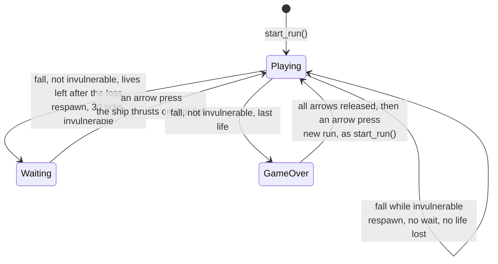
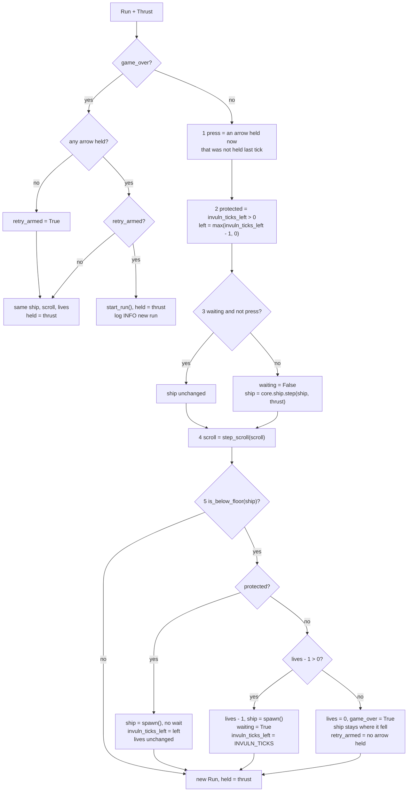

# Run: lives, falls, respawn wait, game over and retry
Version: 1
Status: frozen
Features: DRA-23
Created by: architect

## Purpose
One run of the game, from play start to game over, as one core state. It holds the ship, the world scroll, the lives, the invulnerability timer, the respawn wait and the Game Over state, and steps them all once per tick. It applies the fall rule: the ship step reports where the ship is, and the run decides what a fall costs. It also starts a new run when the player retries.

The app holds one `Run` and calls one step per tick. The ship and the scroll are no longer stepped by the app.

DRA-23 has no hazards, so the only way to lose a life is a fall. No life-lost feedback plays: the blink is the only effect (scope report DRA-23, Limits).

Who builds what:
- `game/core/run.py`: the Gameplay Implementer, task `DRA-23-01-gameplay-implementer`.
- `game/ui/game_over.py`, the Game Over box: the UI Developer, task `DRA-23-03-ui-developer`.
- `game/tests/core/test_run.py`: the QA Engineer, task `DRA-23-04-qa-engineer`.
- The hearts that show `lives`: `docs/contracts/systems/hud.md`, task `DRA-23-02-ui-developer`.
- Calling `start_run` before the first frame and `step_run` once per tick, drawing the ship only while `ship_visible`, drawing the Game Over box while `game_over`: the Integration Engineer, in `game/app/frame.py`, from `docs/contracts/systems/app.md`.

## Diagram

`Waiting` is `Playing` with `waiting = True`. The invulnerability timer runs on its own in both, wait or no wait.

One tick, `step_run(run, thrust)`:


Invulnerability and blink after a respawn on tick T (`BLINK_SWAP_TICKS` = 6):
```
state after tick   T    T+1..T+5   T+6..T+11   T+12..T+17   T+18..T+23   T+24..T+29   T+30
invuln_ticks_left  30   29..25     24..19      18..13       12..7        6..1         0
ship_visible       yes  yes        no          yes          no           yes          yes (solid)
protected on tick       T+1 .......................................................... T+30
```
The ship is protected on the 30 ticks after the respawn tick, and blinks over the 30 states it is drawn from.

## Interface
```python
# game/core/run.py
# Imports: stdlib, core.ship, core.scroll. Never pygame, ui or app.
# Every module-level constant is typing.Final.

LIVES_START: Final[int] = 3          # 05-lives-and-damage.md, lives_start (locked)
INVULN_TICKS: Final[int] = 30        # 05-lives-and-damage.md, invuln_ticks (locked)
BLINK_SWAP_TICKS: Final[int] = 6     # scope report DRA-23, blink: one visible/hidden swap every 0.1 s
                                     # (approved in chat, not in the GDD; 05-lives-and-damage.md
                                     # blink_period is TBD, LD-04). 0.1 s × 60 ticks/s
                                     # (15-tech-constraints.md, tick_rate, locked) = 6 ticks.
RESPAWN_WAIT_LIMIT: Final[int | None] = None   # 05-lives-and-damage.md, rule 2.5: the wait has no
                                               # time limit. None = no limit. Ticks, when one is set.

@dataclass(frozen=True, slots=True)
class Run:
    """One run's state after a tick."""
    ship: Ship                       # the ship (core.ship)
    scroll: Scroll                   # the world scroll and distance (core.scroll)
    lives: int = LIVES_START         # lives left, 0 to LIVES_START. 0 only in game over
    invuln_ticks_left: int = 0       # ticks of invulnerability still to come. 0 = not invulnerable
    waiting: bool = False            # the ship stands at the respawn point until an arrow press
    game_over: bool = False          # the Game Over box shows and everything is frozen
    held: Thrust = Thrust()          # the arrow keys held on the last tick, to tell a press from a hold
    retry_armed: bool = False        # game over only: every arrow has been released since the box appeared

    @property
    def invulnerable(self) -> bool: ...
        # invuln_ticks_left > 0

    @property
    def ship_visible(self) -> bool: ...
        # True when not invulnerable. While invulnerable:
        # ((INVULN_TICKS - invuln_ticks_left) // BLINK_SWAP_TICKS) % 2 == 0

def start_run() -> Run: ...
    # Run(ship=spawn(), scroll=start_scroll()). Every other field at its default.
    # Called by the app once before the first frame, and by step_run on a retry.

def step_run(run: Run, thrust: Thrust) -> Run: ...
    # One 60 Hz tick. Pure apart from event logging: same run and thrust in,
    # same run out. Never mutates its input.
```
The code documents each `Run` field with the comment above, as `core/ship.py` does for `Ship`.

`core.ship` gains the public `is_below_floor(ship) -> bool` that `step_run` uses. See `docs/contracts/systems/ship.md`.

```python
# game/ui/game_over.py
# Imports: pygame. Never core, never app. Never reads the run mode or a key.
BOX_SIZE: tuple[int, int] = (320, 120)             # scope report DRA-23, Game Over box (temporary stand-in)
BOX_COLOR: tuple[int, int, int, int] = (0, 0, 0, 90)   # same: black, alpha 90 of 255 (about 35%)
TEXT_COLOR: tuple[int, int, int] = (255, 255, 255) # same: white
TITLE_TEXT: str = "Game Over"                      # same
TITLE_FONT_SIZE: int = 32                          # same: default font, 32 px
PROMPT_TEXT: str = "Press any arrow to retry"      # same
PROMPT_FONT_SIZE: int = 16                         # same: 16 px, below the title

def draw_game_over(surface: pygame.Surface) -> None: ...
```

## Presentation
The run's fields reach the screen in three places. Every fact shown is a core field; no view works one out.

| Core field | Shown as |
|---|---|
| `run.ship_visible` | the app calls `draw_ship(surface, run.ship)` only on frames where it is True. So the ship blinks while invulnerable and is solid otherwise. Source: 05-lives-and-damage.md, invuln_blink (locked), rule 2.4; 10-ui.md, rule 3; scope report DRA-23, blink (approved in chat) |
| `run.game_over` | the app calls `draw_game_over(surface)` only on frames where it is True. Source: 02-game-flow.md, rule 5; scope report DRA-23, Game Over box |
| `run.lives` | the hearts at the top right. See `docs/contracts/systems/hud.md` |
| `run.ship`, `run.scroll` | as before: the ship view, the debug overlay, the starfield and the meters readout read them |

`draw_game_over` reads no core state. It draws, in this order:
- **Box.** A `BOX_SIZE` (320 × 120) rectangle filled with `BOX_COLOR`, black at alpha 90, so what is behind it shows through, darker. No border. Its top-left corner is `((width - 320) // 2, (height - 120) // 2)` from `surface.get_size()`: (160, 180) on the 640 × 480 screen. Source: scope report DRA-23, Values needed (Game Over box, temporary stand-in approved by the Director, not in the GDD; UI-04 is TBD).
- **Title.** `TITLE_TEXT` in the default font at 32 px (`pygame.font.Font(None, 32)`), antialiased, `TEXT_COLOR`, centered horizontally on the surface. Source: same.
- **Prompt.** `PROMPT_TEXT` in the default font at 16 px, antialiased, `TEXT_COLOR`, centered horizontally. Its top sits one title line-height (the title font's `get_linesize()`) below the title's top, so it reads as the next line. Source: same; the layout follows the error screen's (10-ui.md, error_layout).
- **Vertical place.** The two-line block, from the title's top to the prompt's bottom (title `get_linesize()` + prompt font `get_height()`), is centered vertically in the box: `title_top = box_top + (120 - block_height) // 2`.

Rules for the view:
- The box surface (`pygame.SRCALPHA`), both fonts and both rendered texts are built once, on the first draw, and kept. Never per frame. Source: 15-tech-constraints.md, rule 5.
- The view only draws. It never fills the background, never flips, never logs per frame, never catches an error, never reads the run mode or a key. Source: 10-ui.md, rule 5; game/CONTEXT.md, Run modes.
- On the black background the box is only visible where something lies behind it (stars, the text). That is the approved look: light and see-through.

## Rules
Values:
- Every constant above has its value and source on its line. `lives_start` and `invuln_ticks` are locked in the GDD. The blink, the box and its text are temporary stand-ins the Director approved in chat and kept out of the GDD. Source: scope report DRA-23, Values needed.

A playing tick (`game_over` False), in this order:
1. **Press.** `press` is True when an arrow (up, down, left or right) is held in `thrust` and was not held in `run.held`. A key held since an earlier tick is not a press. Source: 05-lives-and-damage.md, rule 2.5 ("until the first arrow key press").
2. **Invulnerability.** `protected = run.invuln_ticks_left > 0`, the state the player saw going into this tick. Then the timer counts down: `left = max(run.invuln_ticks_left - 1, 0)`. It counts down every playing tick, waiting or not. Source: 05-lives-and-damage.md, invuln_ticks, rules 2.4 and 4; scope report DRA-23, Limits ("It ends on time, wait or no wait").
3. **Wait.** The wait has no time limit (`RESPAWN_WAIT_LIMIT` is None, and nothing reads it in DRA-23). If `run.waiting` and not `press`: the ship is not stepped. It stays exactly as it is, at rest at the respawn point. No gravity, no drag, no thrust. Otherwise the wait is over (`waiting = False`) and `ship = core.ship.step(run.ship, thrust)`. So the press that ends the wait also thrusts on that same tick. Source: 05-lives-and-damage.md, rule 2.5; 91-decision-log.md, rows 27 and 28.
4. **Scroll.** `scroll = step_scroll(run.scroll)`. Every playing tick, the wait included. Source: 03-world-and-camera.md, rule 4; 05-lives-and-damage.md, rule 2.5.
5. **Fall.** If `is_below_floor(ship)` (the top edge at or past the floor):
   1. `protected`: no life is lost. `ship = spawn()`, `waiting = False`, and `invuln_ticks_left = left`: the timer keeps running. Nothing else happens. Source: 05-lives-and-damage.md, rule 2.6; 91-decision-log.md, rows 29 and 31.
   2. Not protected and `lives - 1 > 0`: `lives -= 1`, `ship = spawn()` at (320, 240) at rest, `waiting = True`, `invuln_ticks_left = INVULN_TICKS`. Source: 05-lives-and-damage.md, rules 2.1, 2.3, 2.4 and 2.5, fall_respawn (locked).
   3. Not protected and `lives - 1 == 0`: `lives = 0`, `game_over = True`, `invuln_ticks_left = 0`, `waiting = False`. The ship is not respawned: it stays where it fell, below the floor and off the screen. `retry_armed` is True only if no arrow is held in `thrust`. Source: 05-lives-and-damage.md, rule 5; 02-game-flow.md, rules 5 and 6.
6. `held = thrust` in the returned run.

If no fall happened, the returned run has the new ship and scroll, `invuln_ticks_left = left`, the `waiting` from step 3, and the same `lives`.

A game-over tick (`game_over` True):
- The ship, the scroll, the lives and the timer don't change. Nothing is stepped. Everything is frozen. Source: 02-game-flow.md, rule 5; 91-decision-log.md, row 30.
- If no arrow is held in `thrust`: `retry_armed = True`.
- Else, if `run.retry_armed`: the retry. Return `start_run()` with `held = thrust`. A new run: 3 lives, the ship at (320, 240) at rest, a new scroll at tick 0 (0 m, the scroll starts after its 30-tick delay), not invulnerable, no wait. The retry press doesn't thrust: the run starts the way the first run starts. Source: 02-game-flow.md, rules 3 and 6; 91-decision-log.md, rows 30 and 31; scope report DRA-23, Feature ("No wait for a key. Everything resets").
- Else nothing changes but `held`.
- So an arrow held when the box appears never retries. The player releases every arrow, then presses one. No delay. Only the four arrows count; F3 and every other key never reach core. Source: 02-game-flow.md, rule 6 and Edge cases; retry_key (locked); 01-vision.md, locked decision 1.

Other rules:
- Game over happens on the tick lives reach 0. That tick runs in full (the ship and the scroll step); the freeze starts on the next tick. Source: 05-lives-and-damage.md, rule 5; 02-game-flow.md, rule 5.
- A run starts with no invulnerability and no wait. Only a fall that costs a life starts them. Source: 02-game-flow.md, rule 3.
- A hit doesn't exist in DRA-23 (no hazards). `protected` only matters for rule 5.1. Hazards will read `invulnerable` when they exist. Source: scope report DRA-23, Limits and Out.
- No life-lost feedback plays: no flash, no breaking heart, no burst. The blink is the only effect. Source: scope report DRA-23, Limits and Out; 05-lives-and-damage.md, rule 3 is left for a later feature (LD-08).
- No way to gain a life. Source: 05-lives-and-damage.md, rule 6.
- `step_run` uses no frame time and no randomness. Same input, same output. Source: 15-tech-constraints.md, rule 2.
- Core behaves the same in normal and debug mode. It never reads the run mode. Source: game/CONTEXT.md, Run modes.
- Core never imports pygame, `ui` or `app`. Source: game/CONTEXT.md, Layout.

Logging (logger `core.run`, by event, never by tick). Source: game/CONTEXT.md, Logging; 15-tech-constraints.md, rule 9:
- DEBUG `respawn wait end`: on the tick a press ends the wait.
- DEBUG `invulnerable end`: on the tick the timer goes from 1 to 0.
- DEBUG `life lost lives=%d`: on every fall that costs a life, with the lives left after it (2, 1, 0).
- DEBUG `respawn from x=%.2f y=%.2f wait=%s`: on every respawn, with the position the ship fell from (the stepped ship, before the reset) and `True` for a respawn that waits, `False` for the invulnerable-fall respawn. Never on the last life.
- INFO `game over meters=%d`: on the tick lives reach 0, with `scroll.meters` after that tick. INFO because the screen changes (game/CONTEXT.md, Logging).
- INFO `new run`: on the retry tick.
- Order inside one tick: `respawn wait end`, then the ship's own lines from `core.ship.step`, then the scroll's line, then `invulnerable end`, then `life lost`, then `respawn from` or `game over`.
- Nothing else. No line on a tick where nothing happened: a ship waiting for 10 s logs nothing after its one `invulnerable end`.

## Rationale
- **A run state that holds the ship and the scroll.** The freeze at game over and the reset on retry are rules about the whole run: the ship, the scroll and the lives stop together and restart together. Core owns rules, so core holds them together. The app then keeps one state and calls one step, and can't get the order or the freeze wrong.
- **The ship step stops at step 7, and the run applies the fall.** What a fall costs depends on lives and invulnerability, which the ship doesn't know. The ship reports where it is through `is_below_floor`; the run decides. That replaces the DRA-6 stand-in, which respawned inside the ship step.
- **A press is an arrow that wasn't held on the last tick.** Rule 2.5 says the wait lasts until "the first arrow key press". A key held through the fall was pressed before the respawn, not after it. This also matches the Director's ruling for the Game Over box, that a held key must not skip it (row 31), and the reason for the wait: a player who isn't ready doesn't lose a second life. Any new press ends it, even while another arrow is still held, because that is a press. Core sees only held keys per tick, so it keeps the last tick's keys in `held` and compares. No key event reaches core.
- **Retry is stricter than the wait.** Rule 6 asks for all arrows released first, then one pressed. `retry_armed` records the release. A new press of a second arrow while the first is still held doesn't retry.
- **Protection uses the timer going into the tick.** The ship is protected on the 30 ticks after its respawn and blinks over the 30 states drawn from it. Both match "invulnerable for 30 ticks from the moment it reappears".
- **The blink is a core property.** "Is the ship drawn this frame" is a fact the screen shows, so it is a core field. The app draws the ship only when it is True, the same way it calls the overlay only while `overlay_visible`. The ship view stays unchanged.
- **The blink starts visible.** The scope says the ship "reappears" at the center, so the first 0.1 s shows it. Starting visible also ends visible (states T+24 to T+29), so the ship never vanishes for a frame just before it turns solid.
- **0.1 s is 6 ticks.** Game rules and their timers run on the 60 Hz tick (15-tech-constraints.md, rule 2). Counting the blink in ticks keeps it in step with the invulnerability it shows and makes it exact and testable. 0.1 s at 60 ticks/s is exactly 6.
- **The last life doesn't respawn.** A respawn starts the next life: invulnerability and the wait come with it (rule 2, steps 3 to 5). With no lives left there is no next life, and game over starts on that tick (rule 5). So the ship stays where it fell, off the screen, and the frozen frame shows the world without it.
- **The retry tick returns the tick-0 state.** The first run starts from `start_run()` before any tick runs. A retry gives exactly that state, so a new run plays like the first one: tick 1 is its first physics tick, and the scroll start delay counts from there.
- **The scroll steps during the wait.** Rule 2.5 and decision-log row 28 keep the world moving after a fall.
- **The wait length is a named value, `RESPAWN_WAIT_LIMIT = None`.** The scope asks for the wait length to be "its own value so a limit can be added later", and puts the limit itself out of scope. So the value exists and says "no limit", and nothing in DRA-23 reads it. What happens when a limit runs out is not designed. The feature that adds a limit designs that, adds a wait counter to `Run`, and makes `step_run` read this value.
- **No schema.** DRA-23 adds no data file. The new values are constants in code, as the ship's are.
- **No art task.** The run adds no entity type. The hearts and the box are temporary stand-ins drawn with pygame shapes and the default font, like the ship's placeholder rectangle.
- **The Game Over view takes no state.** The box shows no score in DRA-23 (02-game-flow.md, rule 5 says the final score; the scope report leaves it out because score doesn't exist yet). The app decides when to call it.
- **INFO for game over and a new run.** game/CONTEXT.md puts screen changes at INFO. The Game Over box appearing and leaving are screen changes. The rest are game events at DEBUG.
