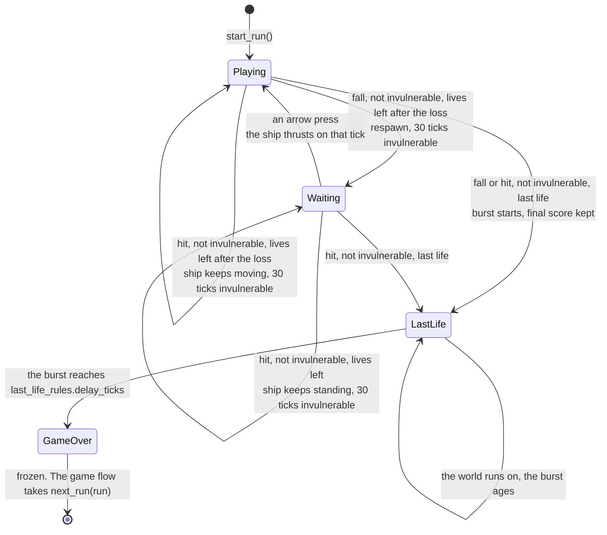
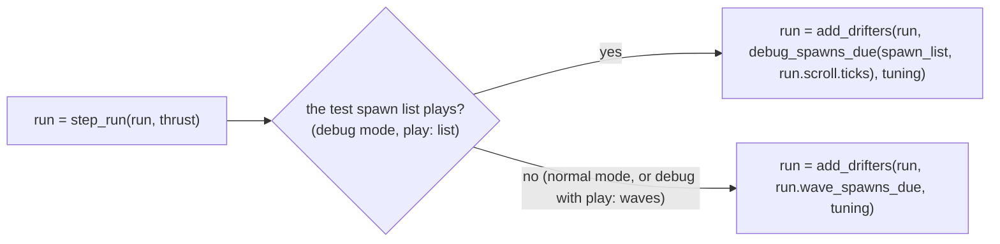
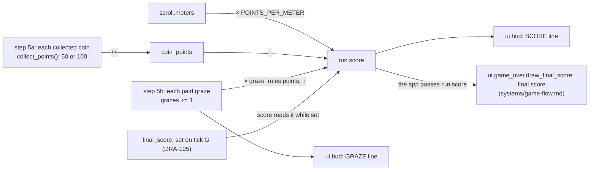

# Run: lives, score, coins, grazes, falls, hits, drifters, respawn wait, last life and game over
Version: 11
Status: draft
Features: DRA-23, DRA-29, DRA-39, DRA-47, DRA-61, DRA-62, DRA-76, DRA-86, DRA-96, DRA-104, DRA-117, DRA-125
Created by: architect

## Purpose
One run of the game, from play start to game over, as one core state. It holds the ship, the world scroll, the drifters on the field, the points popups and the graze rings on screen, the lives, the coin points, the graze count and the graze values, the invulnerability timer, the respawn wait, the last life's burst and its values, the final score, the game-over state and the run's waves, and steps them all once per tick. The run's level is its waves' level: the scroll moves at that level's speed and new drifters are born at it. A run with no waves (the debug test spawn list) stays at Level 1. It gives the run's score: the meters flown plus the coin points plus the graze points. The score starts at 0, never goes down, and freezes on the tick the last life is lost.

The last life. On the tick lives reach 0 the ship bursts and never rebuilds: the run keeps the score of that tick as the final score and starts a burst of particles at the ship's center, or at the bottom edge where it left the screen after a fall. For the last-life delay the world runs on without the ship: the scroll moves, the drifters move, the waves play and new drifters come in, the popups and graze rings age, and the burst's particles fly out and fade. Nothing collects, grazes, falls or hits, and the score stays frozen. When the delay ends the run is over: everything freezes. The run never restarts itself. The game flow (`docs/contracts/systems/game-flow.md`) decides when the run is stepped, paused, retried or left for the menu, and gets a fresh run from `next_run`: Wave 0 again, Level 1, new random picks, the same graze and last-life values.

It applies the graze rule. Every tick it follows the ship through each hazard's graze zone. When the ship leaves a zone without ever having touched that hazard, while it is flying and not invulnerable, the hazard pays one graze: the count goes up by one, a graze popup rises from the ship's center and a graze ring grows around the ship. Each hazard pays at most once. A hazard that touches the ship never pays. It applies the collect rule, the fall rule and the hit rule: the ship step reports where the ship is, the drifters report where they are and what a touch does, and the run decides what it pays or costs. A coin the ship touches is collected, invulnerable or not, but never while the ship stands in the respawn wait: its points go to the coin points, it disappears, and its points popup rises from where it was for 1 s. It tells the drifters how far the world scrolls each tick, marks when each drifter has entered the screen, starts and counts down each hazard's re-hit cooldown, and drops drifters that have left or been collected. It gathers the floating islands on the field into the ground the ship can't enter and hands it to the ship step, and to the block that holds a ship standing in the respawn wait; a ship that falls respawns at the spot nearest the respawn point that no island holds. Islands never hit and never pay. It gathers the gravity field of every planet on the field and hands them to the ship step, which pulls the ship; a ship standing in the respawn wait is not stepped, so it is never pulled. A planet's body is a hazard like any other.

The app starts the first run, with or without waves, and hands it to the game flow, which holds it and calls `step_run` on the ticks the run plays. After each tick the run was stepped, new drifters reach it through `add_drifters`, the only way a drifter enters a run: the placements the run's waves say are due, or in debug mode the test spawn list's. Each new drifter settles its entry warning there, from the ship at that moment.

A life is lost by a fall or by a hit. On a life that isn't the last, no life-lost feedback plays: the blink is the only effect. On the last life the stand-in burst plays, and there is no screen flash and no HUD life break (scope report DRA-125, Objection 1; LD-08 stays open).

## Diagram

`Waiting` is `Playing` with `waiting = True`. The invulnerability timer runs on its own in both, wait or no wait. `LastLife` is `burst` set and `game_over` False (`run.last_life`). The game flow never steps a paused run, so pausing needs no state here (`docs/contracts/systems/game-flow.md`).

One tick, `step_run(run, thrust)`:

```mermaid
flowchart TD
  IN["Run + Thrust"] --> GO{"game_over?"}
  GO -- yes --> GOUT["everything as it was<br/>held = thrust"]
  GO -- no --> LL{"last_life? (DRA-125)"}
  LL -- yes --> LT["a last-life tick (Rules):<br/>drifters, popups, rings, scroll, cool down,<br/>drop, waves, burst one tick older;<br/>no ship step, no collect, graze, fall or hit"]
  LT --> LE{"burst.finished?"}
  LE -- yes --> LG["game_over = True<br/>log INFO game over score"] --> LOUT["new Run, held = thrust"]
  LE -- no --> LOUT
  LL -- no --> P1["1 press = an arrow held now<br/>that was not held last tick"]
  P1 --> P2["2 protected = invuln_ticks_left > 0<br/>left = max(invuln_ticks_left - 1, 0)"]
  P2 --> P3["3 drifters: each obj.update(TickContext(run.ship,<br/>scroll_step_px(run.scroll, run.level))).mark_entered()"]
  P3 --> P3A["3a popups = step_popups(run.popups)<br/>graze_rings = step_graze_rings(run.graze_rings)<br/>each one tick older; the finished ones go"]
  P3A --> P4{"4 ground = island_ground(drifters, ctx.scroll_step_px) (DRA-86)<br/>wells = gravity_wells(drifters) (DRA-96)<br/>waiting and not press?"}
  P4 -- yes --> STAY["ship = block_ship(ship, ground)<br/>(stands, but islands still push it; no pull)"]
  P4 -- no --> STEP["waiting = False<br/>ship = core.ship.step(ship, thrust, ground, wells)"]
  STAY --> P5["5 scroll = step_scroll(scroll, run.level)"]
  STEP --> P5
  P5 --> P5A{"5a ship stepped in 4 (not waiting)?<br/>(DRA-62)"}
  P5A -- yes --> COL["every ACTIVE COLLECT drifter overlapping ship_hitbox(ship):<br/>coin_points += collect_points()<br/>popups += collect_popup()<br/>phase = GONE"]
  P5A -- no --> P5B
  COL --> P5B["5b graze: check_grazes(drifters, ship_hitbox(ship),<br/>may_pay = not protected and ship stepped in 4)<br/>each paid hazard: grazes += 1, a graze popup, a graze ring"]
  P5B --> P6{"6 is_below_floor(ship)?"}
  P6 -- yes --> FALL["fall rules 6.1 to 6.3: respawn at spawn_clear(ground),<br/>or on the last life the burst at (ship.x, floor)<br/>(no hit test this tick)"]
  P6 -- no --> P7{"7 touching = active HIT drifters,<br/>may_hit_ship(), overlapping ship_hitbox(ship)<br/>any, and not protected?"}
  P7 -- no --> P8
  P7 -- yes --> H1["every touching obj:<br/>rehit_ticks_left = obj.rehit_cooldown_ticks<br/>lives - 1"]
  H1 --> H2{"lives > 0?"}
  H2 -- yes --> HI["invuln_ticks_left = INVULN_TICKS<br/>ship and waiting unchanged"]
  H2 -- no --> HG["last life (DRA-125): lives 0, final_score = score,<br/>burst at the ship's center<br/>log INFO last life score"]
  FALL --> P8["8 cool down: every other obj with<br/>rehit_ticks_left > 0 counts down by 1"]
  HI --> P8
  HG --> P8
  P8 --> P9["9 drop drifters that are GONE or off screen"]
  P9 --> P9A{"9a waves is not None?<br/>(DRA-76)"}
  P9A -- yes --> WV["waves = step_waves(waves, scroll.distance_px)<br/>due placements, wave end, level rise, rest"]
  P9A -- no --> OUT
  WV --> OUT["new Run, held = thrust"]
```


Invulnerability and blink after a respawn or a hit on tick T (`BLINK_SWAP_TICKS` = 6):
```
state after tick   T    T+1..T+5   T+6..T+11   T+12..T+17   T+18..T+23   T+24..T+29   T+30
invuln_ticks_left  30   29..25     24..19      18..13       12..7        6..1         0
ship_visible       yes  yes        no          yes          no           yes          yes (solid)
protected on tick       T+1 .......................................................... T+30
```

Drifters entering, with the app's call after the tick (`docs/contracts/systems/app.md`):

A run started with waves has a wave state; one started for the test spawn list has none, so `run.wave_spawns_due` is `()` there and `run.level` stays 1 (DRA-76).

The level and the scroll around a level rise on tick T (DRA-76; `docs/contracts/systems/waves.md`):
```
tick                         T                          T+1
run.level going in           1                          2
scroll speed this tick       1.1 px (Level 1)           1.21 px (Level 2)
step 9a                      the last wave of Level 1's playlist ends, level 2
run.level after the tick     2                          2
drifters added after it      at Level 2                 at Level 2
```

Re-hit cooldown of one hazard that hits on tick T, with `rehit_cooldown_ticks` 180 (`docs/contracts/systems/drifters.md`, Diagram):
```
state after tick    T      T+1 .. T+179    T+180    T+181
rehit_ticks_left    180    179 .. 1        0        0, or 180 if it hits on T+181
can hit on tick            T+1 .. T+180: no                  T+181: yes
```

The score (DRA-61, coins from DRA-62). The last life lost on tick G (from DRA-125 the score freezes there, while the world runs on to game over on tick G + `delay_ticks`), a new run from `next_run` on tick R. A common coin collected on tick C, a rare one on tick D:

```
state after tick   0 (start_run)   1..30   ...  C            ...  D             ...  G             G+1 .. R-1          R (next_run)
scroll.meters      0               0       ...  mc           ...  md            ...  m             grows to G+delay,   0
                                                                                                   then frozen
coin_points        0               0       ...  50           ...  150           ...  150           150                 0
final_score        None            None    ...  None         ...  None          ...  m + 150       m + 150             None
score              0               0       ...  mc + 50      ...  md + 150      ...  m + 150       m + 150             0
```

The last life (DRA-125), lost on tick L, with `delay_ticks` D from `last_life_rules` (02-game-flow.md, last_life_delay):
```
state after tick     L-1        L                      L+1 .. L+D-1            L+D                 L+D+1 ..
lives                1          0                      0                       0                   0
burst.age_ticks      -          0                      1 .. D-1                D (finished)        D
burst.opacity        -          1.0                    falling, above 0        0.0                 0.0
last_life            False      True                   True                    False               False
game_over            False      False                  False                   True                True
ship_visible         -          False                  False                   False               False
the world            moves      moves (a full tick)    moves                   moves               frozen
score                s          final_score            final_score             final_score         final_score
```
The burst shows on the D states after ticks L to L+D-1; the world moves on the D ticks L+1 to L+D after the full tick L. The game flow turns to its game-over screen on the state after tick L+D.

A coin collected on tick C at its center (x, yc), with the coin file's `popup_ticks` 60 and `popup_rise_per_tick` 0.5 (DRA-62):
```
state after tick   C        C+1          C+k              C+59          C+60
coin               gone (dropped in step 9 of tick C)
popup shown        yes      yes          yes              yes           no (step 3a of tick C+60 removes it)
popup.age_ticks    0        1            k                59            -
popup.x            x        x            x                x             -
popup.y            yc       yc - 0.5     yc - 0.5 × k     yc - 29.5     -
```
The popup shows on exactly 60 drawn states. It rises up the screen and never moves with the scroll. It keeps aging on last-life ticks (DRA-125); on game-over ticks it is frozen like everything else; a new run starts with none.

One hazard's graze state (DRA-117), the ship flying and not protected unless the row says so. `P` is `graze_rules.popup_ticks`, `R` is `graze_rules.ring_ticks`:
```
tick                      E-1        E          E+1 .. X-1     X                     X+1 ..
ship in the graze zone    no         yes        yes            no (left it)          -
touches the hitbox        no         no         no             no                    -
graze_state after         OUTSIDE    INSIDE     INSIDE         SPENT                 SPENT
pays on this tick         -          -          -              yes: grazes + 1       never again
graze popup               -          -          -              age 0 at the ship's   ages like a coin popup,
                                                               center after step 4   gone after P states
graze ring                -          -          -              age 0, start size,    grows and fades, on the
                                                               full opacity          ship, gone after R states
```
The same hazard, other cases on tick X:
```
ship on tick X                         pays    graze_state after X
protected (invulnerable going in)      no      OUTSIDE: a later clean exit can still pay
standing in the respawn wait           no      OUTSIDE: a later clean exit can still pay
the press tick that ends the wait      yes     SPENT
touched the hitbox on any tick <= X    no      SPENT from the touch on
zone gone with the ship inside         yes     SPENT (chain lightning or electric ball stops firing,
  (hazard off screen, or not firing)            or the hazard is dropped off screen on tick X)
```

## Interface
```python
# game/core/run.py
# Imports: stdlib, core.ship, core.scroll, core.collision, core.levels, core.drifters (DRA-29),
# core.popup (DRA-62), core.waves (DRA-76). Never pygame, ui or app. Every module-level constant is typing.Final.

LIVES_START: Final[int] = 3  # 05-lives-and-damage.md, lives_start (locked)
INVULN_TICKS: Final[int] = 30  # 05-lives-and-damage.md, invuln_ticks (locked)
BLINK_SWAP_TICKS: Final[int] = (
    6  # scope report DRA-23, blink: one visible/hidden swap every 0.1 s
)
# (approved in chat, not in the GDD; LD-04). 0.1 s × 60 ticks/s = 6.
RESPAWN_WAIT_LIMIT: Final[int | None] = (
    None  # 05-lives-and-damage.md, rule 2.5: no time limit.
)
POINTS_PER_METER: Final[int] = 1  # DRA-61. 06-scoring.md, points_per_meter (locked)


@dataclass(frozen=True, slots=True)
class Run:
    """One run's state after a tick."""

    ship: Ship  # the ship (core.ship)
    scroll: Scroll  # the world scroll and distance (core.scroll)
    lives: int = LIVES_START  # lives left, 0 to LIVES_START. 0 only from the last life on (DRA-125)
    invuln_ticks_left: int = (
        0  # ticks of invulnerability still to come. 0 = not invulnerable
    )
    waiting: bool = False  # the ship stands at the respawn point until an arrow press
    game_over: bool = False  # the last-life delay has ended: the run is over and everything is frozen (DRA-125)
    held: Thrust = field(default_factory=Thrust)  # the arrow keys held on the last tick
    # retry_armed: removed in DRA-125. The arrow retry is gone; RETRY is the game flow's.
    drifters: tuple[Drifter, ...] = ()  # DRA-29. Drifters on the field, oldest first
    next_uid: int = 1  # DRA-29. The uid the next added drifter gets
    coin_points: int = 0  # DRA-61. Points from coins this run, >= 0. Step 5a adds to it (DRA-62)
    popups: tuple[PointsPopup, ...] = ()  # DRA-62. Points popups on screen, oldest first
    waves: WaveRun | None = None  # DRA-76. The run's waves (core.waves). None: no waves play

    @property
    def score(self) -> int:
        ...  # DRA-61
        # scroll.meters * POINTS_PER_METER + coin_points. Whole points, >= 0.

    @property
    def invulnerable(self) -> bool:
        ...
        # invuln_ticks_left > 0

    @property
    def ship_visible(self) -> bool:
        ...
        # True when not invulnerable. While invulnerable:
        # ((INVULN_TICKS - invuln_ticks_left) // BLINK_SWAP_TICKS) % 2 == 0

    @property
    def level(self) -> int:
        ...  # DRA-29, from DRA-76 the waves' level
        # waves.level, or FIRST_LEVEL (1) when waves is None. 1 to 8.

    @property
    def wave_spawns_due(self) -> tuple[Placement, ...]:
        ...  # DRA-76
        # waves.spawns_due, or () when waves is None: the placements that came due on the last tick.


def start_run(waves: WaveRun | None = None) -> Run:
    ...
    # Run(ship=spawn(), scroll=start_scroll(), waves=waves). Every other field at its default: no
    # drifters, next_uid 1, coin_points 0 (so score 0), no popups. waves (DRA-76) is the app's
    # core.waves.start_waves(book, seed), or None for no waves; left out, None.


def step_run(run: Run, thrust: Thrust) -> Run:
    ...
    # One 60 Hz tick. Pure apart from event logging. Never mutates its input.


def add_drifters(
    run: Run, placements: Sequence[Placement], tuning: DrifterTuning
) -> Run:
    ...  # DRA-29
    # The only way drifters enter a run. Spawns each placement, in order, at run.level
    # (or its as_level), gives it the next uid, and appends it. Pure apart from event logging.
    # Raises what spawn_drifter raises (unknown variant, level out of range, ...).


def island_ground(drifters: Sequence[Drifter], scroll_step_px: float) -> Ground:
    ...  # DRA-86
    # Ground(hitbox=<the current_hitbox() of every ACTIVE drifter whose effect_on_touch() is BLOCK,
    # in drifter order, its shapes in order, joined into one tuple>, velocity_x=0.0,
    # velocity_y=scroll_step_px). NO_GROUND's empty hitbox when there is none. Pure, no logging.


def gravity_wells(drifters: Sequence[Drifter]) -> tuple[GravityWell, ...]:
    ...  # DRA-96
    # tuple(<obj.gravity_well() for every drifter whose gravity_well() is not None>), in drifter
    # order. NO_WELLS (()) when there is none. Pure, no logging.
```
`Ground`, `NO_GROUND`, `block_ship` and `spawn_clear` (`core.ship`) are in `docs/contracts/systems/ship.md` (DRA-86). `island_ground` is public so tests and the later wave_check bot build the ground exactly as the run does. `GravityWell` and `NO_WELLS` (`core.ship`) are in `systems/ship.md` and `Drifter.gravity_well` in `systems/drifters.md` (DRA-96); `gravity_wells` is public for the same reason as `island_ground`. The run never asks which drifter is a planet: a drifter that has a field says so through `gravity_well()`, which is None in WARNING and for every other drifter.
The code documents each `Run` field with the comment above. `Drifter`, `TickContext`, `Phase`, `TouchEffect` (`core.drifters.base`), `Placement`, `spawn_drifter` (`core.drifters.spawner`) and `DrifterTuning` (`core.drifters.tuning`) are in `docs/contracts/systems/drifters.md`. `ship_hitbox` is in `docs/contracts/systems/ship.md`; `hitboxes_overlap` in `drifters.md`; `scroll_step_px` in `docs/contracts/systems/scroll.md` (DRA-62). `WaveRun`, `step_waves` and `next_run_waves` (`core.waves`) are in `docs/contracts/systems/waves.md`; `FIRST_LEVEL` (`core.levels`) in `drifters.md` (DRA-76).

```python
# game/core/popup.py (DRA-62)
# Imports: stdlib only. Never pygame, ui or app. Logs nothing (the module still has its log).

@dataclass(frozen=True, slots=True, kw_only=True)
class PointsPopup:
    """The points a pickup paid, shown where it was collected, rising, for a set time."""
    x: float                 # center x, screen px. Never changes
    start_y: float           # center y on the tick it appears, screen px, y down
    points: int              # the points it shows, >= 0
    lifetime_ticks: int      # how many states it shows on, >= 1
    rise_per_tick: float     # px it rises each tick, >= 0
    age_ticks: int = 0       # ticks since it appeared. 0 on the state it appears

    @property
    def y(self) -> float: ...
        # start_y - age_ticks * rise_per_tick: center y now, screen px.

def step_popups(popups: tuple[PointsPopup, ...]) -> tuple[PointsPopup, ...]: ...
    # Every popup one tick older (age_ticks + 1), in order, leaving out each one whose new
    # age_ticks reaches its lifetime_ticks. Pure.
```

```python
# game/ui/popup_view.py (DRA-62)
# Imports: pygame, core.popup. Never app. Never reads the run mode or a key.
POPUP_COLOR: Final[tuple[int, int, int]] = (255, 80, 150)  # drifters/04-coin.md, popup_color (guess)
POPUP_FONT_SIZE: Final[int] = 16   # scope report DRA-62, Limits: the HUD's default font at 16 px

def popup_text(points: int) -> str: ...
    # "+" then the points' digits: "+50", "+100". points is a whole number >= 0, trusted.

def draw_points_popup(surface: pygame.Surface, popup: PointsPopup) -> None: ...
    # One popup's text, centered on its x and y. Draws only.
```

The game-over screen's view, `game/ui/game_over.py` (`draw_game_over`, `draw_final_score` and, from DRA-125, `draw_game_over_choices`), moved to `docs/contracts/systems/game-flow.md` in DRA-125: it is a screen of the game flow. `score_text` (`game/ui/score_text.py`) is in `docs/contracts/systems/hud.md`, Interface.

### DRA-117: what graze adds and changes
Existing signatures are read from the code. Only the new and changed ones are here. Every new default constant names its GDD source and holds no value of its own: the value is the GDD's.
```python
# game/core/graze.py (new). Imports: stdlib, core.collision, core.drifters.base, core.popup,
# core.ship. Never pygame, ui or app. Logs nothing (the module still has its log).
DEFAULT_GRAZE_POINTS: Final[int]                 # 06-scoring.md, graze_points (locked)
DEFAULT_GRAZE_POPUP_TICKS: Final[int]            # 06-scoring.md, graze_popup: the ticks until it is gone (guess)
DEFAULT_GRAZE_POPUP_RISE_PER_TICK: Final[float]  # 06-scoring.md, graze_popup: px it rises per tick (guess)
DEFAULT_GRAZE_RING_TICKS: Final[int]             # 06-scoring.md, graze_ring: the ticks it grows over (guess)
DEFAULT_GRAZE_RING_START_DIAMETER: Final[float]  # 06-scoring.md, graze_ring: px across it grows from (guess)
DEFAULT_GRAZE_RING_END_DIAMETER: Final[float]    # 06-scoring.md, graze_ring: px across it grows to (guess)
DEFAULT_GRAZE_RING_WIDTH: Final[int]             # 06-scoring.md, graze_ring: line width, px (guess)

@dataclass(frozen=True, slots=True, kw_only=True)
class GrazeRules:
    """The graze values a run uses. From game/tuning/scoring.json; a field left out keeps its default."""
    points: int = DEFAULT_GRAZE_POINTS                               # points per graze, >= 0
    popup_ticks: int = DEFAULT_GRAZE_POPUP_TICKS                     # states a graze popup shows on, >= 1
    popup_rise_per_tick: float = DEFAULT_GRAZE_POPUP_RISE_PER_TICK   # px a graze popup rises each tick, >= 0
    ring_ticks: int = DEFAULT_GRAZE_RING_TICKS                       # states a graze ring shows on, >= 1
    ring_start_diameter: float = DEFAULT_GRAZE_RING_START_DIAMETER   # px across on the state it appears, > 0
    ring_end_diameter: float = DEFAULT_GRAZE_RING_END_DIAMETER       # px across it grows toward, > 0
    ring_width: int = DEFAULT_GRAZE_RING_WIDTH                       # line width, px, >= 1

DEFAULT_GRAZE_RULES: Final[GrazeRules]  # GrazeRules() with every default

@dataclass(frozen=True, slots=True, kw_only=True)
class GrazeRing:
    """The ring a paid graze shows around the ship, growing and fading for a set time."""
    start_diameter: float  # px across on the state it appears
    end_diameter: float    # px across it grows toward
    line_width: int        # px
    lifetime_ticks: int    # how many states it shows on, >= 1
    age_ticks: int = 0     # ticks since it appeared. 0 on the state it appears

    @property
    def diameter(self) -> float: ...
        # start_diameter + (end_diameter - start_diameter) * age_ticks / lifetime_ticks. px.
    @property
    def opacity(self) -> float: ...
        # 1 - age_ticks / lifetime_ticks. 1.0 on the state it appears, above 0 on every state it shows.

@dataclass(frozen=True, slots=True)
class GrazeCheck:
    """What one graze check found."""
    drifters: tuple[Drifter, ...]  # every drifter given, in order, its graze_state brought up to date
    paid: tuple[Drifter, ...]      # the drifters that paid a graze on this check, in drifter order

def check_grazes(drifters: tuple[Drifter, ...], ship_box: Hitbox, may_pay: bool) -> GrazeCheck: ...
    # Step 5b's per-drifter rule (Rules, step 5b). Pure. Never mutates its input.
def graze_popup(rules: GrazeRules, ship: Ship) -> PointsPopup: ...
    # A PointsPopup of kind GRAZE, age 0, at (ship.x, ship.y), showing rules.points, with
    # rules.popup_ticks and rules.popup_rise_per_tick.
def graze_ring(rules: GrazeRules) -> GrazeRing: ...
    # A GrazeRing at age 0 with the rules' ring values.
def step_graze_rings(rings: tuple[GrazeRing, ...]) -> tuple[GrazeRing, ...]: ...
    # Every ring one tick older (age_ticks + 1), in order, leaving out each one whose new age_ticks
    # reaches its lifetime_ticks. Pure. The same pattern as step_popups.
```
```python
# game/core/popup.py, changed. A new enum and one new field, last, with a default, so every
# existing PointsPopup(...) call still builds and the coin's popup is unchanged.
class PopupKind(Enum):
    COIN = "coin"    # a pickup's points (drifters/04-coin.md, popup)
    GRAZE = "graze"  # a paid graze (06-scoring.md, graze_popup)

class PointsPopup:
    ...
    kind: PopupKind = PopupKind.COIN  # what paid the points. The view picks its color by it
```
```python
# game/core/run.py, changed. Imports also core.graze.
class Run:
    ...
    grazes: int = 0                                     # grazes paid this run, >= 0. Only step 5b adds to it
    graze_rings: tuple[GrazeRing, ...] = ()             # graze rings on screen, oldest first
    graze_rules: GrazeRules = DEFAULT_GRAZE_RULES       # the graze values, from the app. A retry keeps them

    @property
    def score(self) -> int: ...
        # scroll.meters * POINTS_PER_METER + coin_points + grazes * graze_rules.points. Whole points, >= 0.

def start_run(waves: WaveRun | None = None, graze_rules: GrazeRules = DEFAULT_GRAZE_RULES) -> Run: ...
    # As before, with graze_rules kept in the run: grazes 0, no graze rings. start_run() and
    # start_run(waves) still build exactly the run they built before, with the GDD's graze values.
```
```python
# game/ui/popup_view.py, changed.
GRAZE_POPUP_COLOR: Final[tuple[int, int, int]]  # 06-scoring.md, graze_popup_color (guess)
# draw_points_popup keeps its signature. A popup of kind GRAZE is drawn in GRAZE_POPUP_COLOR,
# one of kind COIN in POPUP_COLOR, as before.
```
```python
# game/ui/graze_view.py (new). Imports: pygame, core.graze, core.ship. Never app. Never reads the
# run mode or a key.
GRAZE_RING_COLOR: Final[tuple[int, int, int]]  # 06-scoring.md, graze_ring_color (guess)

def draw_graze_ring(surface: pygame.Surface, ring: GrazeRing, ship: Ship) -> None: ...
    # One ring around the ship's center. Draws only.
```
`Drifter.graze_state`, `Drifter.graze_margin`, `GrazeState` and the graze zone are in `systems/drifters/shared/base-interface.md` and `shared/base.md`. The tuning files' loading is in `systems/app/tuning-loader.md`.

### DRA-125: what the last life adds and changes
Existing signatures are read from the code. Only the new and changed ones are here. Every new default constant names its source and holds no value of its own.
```python
# game/core/last_life.py (new). Imports: stdlib only. Never pygame, ui or app. Logs nothing
# (the module still has its log).
DEFAULT_LAST_LIFE_DELAY_TICKS: Final[int]   # 02-game-flow.md, last_life_delay (guess)
DEFAULT_BURST_PARTICLE_COUNT: Final[int]    # scope report DRA-125, Values needed, Burst: the number of squares (stand-in until LD-08)
DEFAULT_BURST_PARTICLE_SPEED: Final[float]  # same: px each square moves per tick
DEFAULT_BURST_PARTICLE_SIZE: Final[int]     # same: px, the side of each square

@dataclass(frozen=True, slots=True, kw_only=True)
class LastLifeRules:
    """The last life's values a run uses. From game/tuning/last_life.json; a field left out keeps its default."""
    delay_ticks: int = DEFAULT_LAST_LIFE_DELAY_TICKS             # ticks from the burst to game over, >= 1
    burst_particle_count: int = DEFAULT_BURST_PARTICLE_COUNT     # squares in the burst, >= 1
    burst_particle_speed: float = DEFAULT_BURST_PARTICLE_SPEED   # px each square moves per tick, >= 0
    burst_particle_size: int = DEFAULT_BURST_PARTICLE_SIZE       # px, the side of each square, >= 1

DEFAULT_LAST_LIFE_RULES: Final[LastLifeRules]  # LastLifeRules() with every default

@dataclass(frozen=True, slots=True, kw_only=True)
class Burst:
    """The ship bursting on the last life: squares flying out from one point and fading."""
    x: float                # origin x, screen px. Never changes
    y: float                # origin y, screen px, y down. Never changes
    particle_count: int     # squares, >= 1
    speed_per_tick: float   # px each square moves per tick, >= 0
    particle_size: int      # px, the side of each square, >= 1
    lifetime_ticks: int     # the last-life delay, ticks, >= 1
    age_ticks: int = 0      # ticks since it started. 0 on the state of the tick lives reach 0

    @property
    def opacity(self) -> float: ...
        # 1 - age_ticks / lifetime_ticks, never below 0. 1.0 at age 0, 0.0 once finished.
    @property
    def finished(self) -> bool: ...
        # age_ticks >= lifetime_ticks
    @property
    def particle_centers(self) -> tuple[tuple[float, float], ...]: ...
        # One (x, y) per square, in order k = 0 .. particle_count - 1 (Rules, Burst). Pure.

def start_burst(rules: LastLifeRules, x: float, y: float) -> Burst: ...
    # A Burst at age 0 at (x, y) with the rules' count, speed, size, and delay_ticks as lifetime_ticks.
def step_burst(burst: Burst) -> Burst: ...
    # The same burst one tick older (age_ticks + 1). Pure.
```
```python
# game/core/run.py, changed. Imports also core.last_life and core.world (SCREEN_H).
class Run:
    ...
    # retry_armed: removed.
    burst: Burst | None = None                          # the last life's burst, from the tick lives reach 0. None before
    final_score: int | None = None                      # the score on the tick lives reach 0. None before
    last_life_rules: LastLifeRules = DEFAULT_LAST_LIFE_RULES  # from the app. next_run keeps them

    @property
    def last_life(self) -> bool: ...
        # burst is not None and not game_over: the world runs on without the ship.
    @property
    def score(self) -> int: ...
        # final_score when it is not None; else the formula as before.
    @property
    def ship_visible(self) -> bool: ...
        # False once burst is not None (the ship has burst and never rebuilds); else as before.

def start_run(
    waves: WaveRun | None = None,
    graze_rules: GrazeRules = DEFAULT_GRAZE_RULES,
    last_life_rules: LastLifeRules = DEFAULT_LAST_LIFE_RULES,
) -> Run: ...
    # As before, with last_life_rules kept in the run: no burst, no final score. start_run(),
    # start_run(waves) and start_run(waves, graze_rules) build exactly the run they built before.

def next_run(run: Run) -> Run: ...
    # A fresh run after this one: log INFO `new run`, then start_run(waves=next_run_waves(run.waves)
    # or None when run.waves is None, graze_rules=run.graze_rules, last_life_rules=run.last_life_rules).
    # Any run state may be given; the game flow gives a game-over one.

def hold_arrows(run: Run, thrust: Thrust) -> Run: ...
    # The run with held = thrust and nothing else changed. The game flow calls it on paused ticks,
    # so an arrow pressed during a pause is not a press when play resumes. Pure, no logging.
```
```python
# game/ui/burst_view.py (new). Imports: pygame, core.last_life. Never app. Never reads the run mode or a key.
BURST_COLOR: Final[tuple[int, int, int]]  # scope report DRA-125, Values needed, Burst: white (stand-in until LD-08)

def draw_burst(surface: pygame.Surface, burst: Burst) -> None: ...
    # Every square of the burst at its opacity. Draws only.
```
The burst's values come from `game/tuning/last_life.json` (`docs/contracts/schemas/last-life.schema.json`), loaded by `app.tuning.load_last_life_rules` (`systems/app/tuning-loader.md`). The game flow, its screens and their keys are in `docs/contracts/systems/game-flow.md`.

## Presentation
The run's fields reach the screen in these places. Every fact shown is a core field; no view works one out.

| Core field | Shown as |
|---|---|
| `run.ship_visible` | the app calls `draw_ship(surface, run.ship)` only on frames where it is True. So the ship blinks while invulnerable, after a fall or a hit. From DRA-125 it is False from the state the last life is lost on: the ship is never drawn again in that run. Source: 05-lives-and-damage.md, invuln_blink (locked), rules 1.3, 2.4 and 5; 10-ui.md, rule 3 |
| `run.burst`, `run.last_life` (DRA-125) | the app calls `draw_burst(surface, run.burst)` only on frames where `run.last_life` is True, in the ship's place in the draw order: over the drifters and popups, under the graze rings, the debug overlay and the HUD. Burst, below. Source: 05-lives-and-damage.md, rule 5; 02-game-flow.md, rule 8; scope report DRA-125, Values needed (Burst) |
| `run.drifters` | the app calls `render_drifter(surface, obj)` for each, in order (`docs/contracts/systems/drifters.md`, Presentation). The debug overlay outlines and labels them (`docs/contracts/systems/debug-overlay.md`). From DRA-29 |
| `run.popups` | the app calls `draw_points_popup(surface, popup)` for each, in order, right after the drifters and before the ship: drawn over every drifter, under the ship, the Game Over box, the debug overlay and the HUD. Each shows `popup_text(popup.points)` centered on `(popup.x, popup.y)`. From DRA-62. Source: drifters/04-coin.md, popup, popup_color (guess); scope report DRA-62, Limits (the popup: text, color, font, place, rise, end, drawn over the other drifters) |
| `popup.kind` (DRA-117) | the popup's color: `POPUP_COLOR` for a coin's, `GRAZE_POPUP_COLOR` for a graze's. Graze popups are in `run.popups` with the coins' and drawn in the same place and order. Source: 06-scoring.md, graze_popup, graze_popup_color (guess) |
| `run.graze_rings` (DRA-117) | the app calls `draw_graze_ring(surface, ring, run.ship)` for each, in order, right after the ship's place in the draw order, whether or not the ship is drawn on that frame (it may blink): over the ship, under the debug overlay, the Game Over box and the HUD. Source: 06-scoring.md, graze_ring, graze_ring_color (guess), rule 8 |
| `run.grazes` (DRA-117) | the GRAZE line on HUD line 2: see `docs/contracts/systems/hud.md`. The score includes it through `run.score`. Source: 06-scoring.md, rule 8; 10-ui.md, hud_level_grazes |
| `run.game_over` | from DRA-125 the game flow reads it to show its game-over screen; the screen is drawn from the flow's state (`docs/contracts/systems/game-flow.md`, Presentation). Source: 02-game-flow.md, rules 8 and 10 |
| `run.score` | the SCORE line at the top left, `score_text(run.score)`: see `docs/contracts/systems/hud.md`. On the game-over screen, also its score line, through `draw_final_score` (`docs/contracts/systems/game-flow.md`). From DRA-125 it reads `final_score` once the last life is lost, so both show the frozen score. From DRA-61. Source: 10-ui.md, hud_score (locked), rule 2, game_over_screen; 02-game-flow.md, rules 8 and 10 |
| `run.lives` | the hearts at the top right. See `docs/contracts/systems/hud.md`. At 0, from the last life on, no heart shows: the lost heart disappears as before (scope report DRA-125, Feature) |
| `run.ship`, `run.scroll` | the ship view, the debug overlay and the starfield read them. The HUD reads the meters only through `run.score`. The stars move at the level's scroll speed through `run.scroll.distance_px` (DRA-76) |
| `run.waves`, `run.level` | the debug overlay's `wave` and `level` lines (`docs/contracts/systems/debug-overlay.md`; `docs/contracts/systems/waves.md`, Presentation). Not on the HUD. From DRA-76. Source: 10-ui.md, debug_overlay, debug_overlay_layout (guess); scope report DRA-76, Out (the level on the HUD) |

The game-over screen (box, GAME OVER, score line, RETRY and MENU) is presented in `docs/contracts/systems/game-flow.md`, Presentation, from DRA-125. Under it the world shows frozen where it was when the last-life delay ended: the drifters, the popups and the graze rings still on screen. The ship never shows there: it burst on the last life.

**Burst** (`draw_burst`, DRA-125). It reads only the burst it is given; no other core state, no run mode, no key. A stand-in until LD-08 sets the life-lost feedback's look (10-ui.md, life_lost_feedback, TBD).
- **Squares.** One filled square per entry of `burst.particle_centers`, in order, each `burst.particle_size` px on a side, its top-left at `(round(cx - size / 2), round(cy - size / 2))` for its center `(cx, cy)`. No outline, no other shape. Source: scope report DRA-125, Values needed (Burst: white squares).
- **Color and fade.** `BURST_COLOR` at alpha `round(255 × burst.opacity)`: drawn on a `pygame.SRCALPHA` surface and blitted. Fully opaque on the state the last life is lost, fainter each state after, as core's opacity says. Source: scope report DRA-125, Values needed (Burst: "fading from full to 0 opacity over `last_life_delay`").
- **Place.** From core only. The squares move out from the origin and never move with the scroll. Source: scope report DRA-125, Values needed (Burst: "They don't move with the scroll").
- **Cache.** The square image is built once per (size, alpha) and kept; one alpha per state, so a few hundred entries at most over a run. Never a new surface per square per frame for a key already built. Source: 15-tech-constraints.md, rule 5.
- A square partly or fully off the surface is clipped by pygame (after a fall, the squares heading down leave the screen at once). The view only draws: it never fills, flips, logs per frame, catches an error, changes the burst, or reads the run mode or a key. Source: 10-ui.md, rule 5.

**Points popup** (`draw_points_popup`, DRA-62). It reads only the popup it is given; no other core state, no run mode, no key.
- **Text.** `popup_text(popup.points)`: a `+` and the points' decimal digits, no space, no grouping: `+50` for a common coin, `+100` for a rare one. Source: drifters/04-coin.md, popup ("+50", "+100").
- **Look.** The default font at `POPUP_FONT_SIZE` (16 px, `pygame.font.Font(None, 16)`), antialiased, in `POPUP_COLOR`, (255, 80, 150), the HUD's look in the coin's popup color. No outline, no shadow, no fade. Source: drifters/04-coin.md, popup_color (guess); scope report DRA-62, Limits and Not in GDD (font and size: the HUD look from DRA-13, Director approval).
- **Place.** The rendered text's rect is centered on `(round(popup.x), round(popup.y))`. On the state it appears that is the coin's center on the tick it was collected; then it rises `rise_per_tick` (0.5 px) a state. The view never moves it: the place comes from core. Source: scope report DRA-62, Limits and Not in GDD (start at the coin's center; rise 0.5 px a tick, up the screen, not with the scroll).
- **End.** It shows while it is in `run.popups`: 60 states, then core drops it and nothing more is drawn. It vanishes at once, with no fade. Source: drifters/04-coin.md, popup (60 ticks); scope report DRA-62, Not in GDD (vanishes, no fade).
- **Cache.** The font is built once, on the first draw. The text is rendered once per points value and kept by that value (two entries in play: 50 and 100). Never a render per frame for a points value already rendered. Source: 15-tech-constraints.md, rule 5.
- A popup partly off the surface is clipped by pygame. The view only draws: it never fills, flips, logs per frame, catches an error or changes the popup. Source: 10-ui.md, rule 5.

**Graze popup** (DRA-117), drawn by the same `draw_points_popup`. Everything as for the coin's popup above, with these differences only:
- **Color.** `GRAZE_POPUP_COLOR` when `popup.kind` is GRAZE. Source: 06-scoring.md, graze_popup_color (guess).
- **Text.** `popup_text(popup.points)`: `+` and the graze points, as for a coin. Source: 06-scoring.md, graze_popup (the `graze_points`).
- **Size.** The coin popup's font and size, `POPUP_FONT_SIZE`. Source: 06-scoring.md, graze_popup ("Same text size as the coin popup").
- **Place, rise and end.** From core, as for a coin: it starts at the ship's center on the tick the graze pays and rises up the screen; it does not follow the ship. Source: 06-scoring.md, graze_popup; scope report DRA-117, Feature ("rises like the coin popup").
- **Cache.** The text is rendered once per (points, kind) and kept. Source: 15-tech-constraints.md, rule 5.

**Graze ring** (`draw_graze_ring`, DRA-117). It reads only the ring and the ship it is given.
- **Center.** `(round(ship.x), round(ship.y))`: the ship's center on this state, so the ring follows the ship. Source: 06-scoring.md, graze_ring ("on the ship's center, following the ship").
- **Size.** A circle outline of radius `round(ring.diameter / 2)` and line width `ring.line_width`. Source: 06-scoring.md, graze_ring.
- **Fade.** `GRAZE_RING_COLOR` at alpha `round(255 × ring.opacity)`: drawn on a `pygame.SRCALPHA` surface and blitted. Fully opaque on the state it appears, fainter each state, gone when core drops it. Source: 06-scoring.md, graze_ring ("fades out as it grows"), graze_ring_color (guess).
- **Nothing else.** No fill, no flash, no blink, no change to the ship's look. Source: scope report DRA-117, Decision log (ship effect: a ring, no flash on the ship; blink means invulnerable).
- **Cache.** The ring image is built once per (radius, line width, alpha) and kept; the keys are few, one per ring state. Never a draw onto a new surface per frame for a key already built. Source: 15-tech-constraints.md, rule 5.
- A ring partly off the surface is clipped by pygame. The view only draws: it never fills, flips, logs per frame, catches an error, changes the ring or the ship, or reads the run mode or a key. Source: 10-ui.md, rule 5.

## Rules
Values: every constant above has its value and source on its line. `lives_start`, `invuln_ticks` and `points_per_meter` are locked. The blink and the box are temporary stand-ins the Director approved in chat (scope report DRA-23). The score line's text, look and place are the Director's (scope report DRA-61), not in the GDD (UI-01 and UI-04 are TBD). The popup's length (60 ticks) and color are `guess` in the GDD; its rise (0.5 px a tick), start (the coin's center), font, layer and end with no fade are Director approvals not in the GDD (scope report DRA-62, Not in GDD). Its length and rise come from the coin's tuning file, through the coin (`systems/drifters.md`, Rules, Coin). The graze values (DRA-117): `graze_points` is locked; the graze popup's length and rise and the graze ring's sizes, length and line width are `guess`, and so are both graze colors. The points, the popup's and the ring's numbers come from `game/tuning/scoring.json` through `graze_rules`, with their defaults in `core/graze.py`; the colors stay constants in the views, as for every placeholder look so far. `graze_margin` (locked) comes through each hazard (`systems/drifters/shared/base.md`, Graze zone). The last life (DRA-125): `last_life_delay` is `guess` (02-game-flow.md); the burst's count, speed, size and white color are stand-ins the Director approved (scope report DRA-125, Values needed, Burst), not in the GDD, until LD-08. The delay and the burst's numbers come from `game/tuning/last_life.json` through `last_life_rules`, with their defaults in `core/last_life.py`; the color stays a constant in the view.

Step numbers changed in DRA-29: the DRA-23 steps 3 (wait), 4 (scroll), 5 (fall) and 6 (`held`) are now steps 4, 5, 6 and 10. Changed again in DRA-39: the DRA-29 steps 8 (drop) and 9 (`held`) are now steps 9 and 10, after the new step 8 (cool down). Closed task files and the earlier integration checks in `systems/app.md` use the old numbers. DRA-62 adds steps 3a (popups) and 5a (collect) and keeps every other number, so the code, `systems/drifters.md` and the DRA-39 to DRA-61 checks keep theirs. DRA-76 adds step 9a (waves) the same way, and DRA-117 step 5b (graze).

The level (DRA-76). `run.level` is read once going into the tick and used by steps 3 and 5: the whole tick moves at one speed. Step 9a may raise it; the raised level is in the returned run, so the next tick moves at its speed and the drifters `add_drifters` adds after this tick are born at it. Source: 08-difficulty.md, rule 1 and Edge cases; 91-decision-log.md, row 65; `systems/scroll.md`, Rationale (the new speed starts the tick after the level rises).

A playing tick (`game_over` False), in this order:
1. **Press.** `press` is True when an arrow is held in `thrust` and was not held in `run.held`. Source: 05-lives-and-damage.md, rule 2.5.
2. **Invulnerability.** `protected = run.invuln_ticks_left > 0`, the state going into this tick. Then `left = max(run.invuln_ticks_left - 1, 0)`. It counts down every playing tick, waiting or not. Source: 05-lives-and-damage.md, invuln_ticks, rules 1.3, 2.4 and 4.
3. **Drifters.** `ctx = TickContext(ship=run.ship, scroll_step_px=scroll_step_px(run.scroll, run.level))` (the scroll going into this tick: how far step 5 is about to move the world, at the run's level; DRA-62, level DRA-76), then `drifters = tuple(obj.update(ctx).mark_entered() for obj in run.drifters)`, in order. A parked drifter (the coin) moves by `ctx.scroll_step_px`, so it ends the tick where the world has scrolled to; moving drifters don't read it. Source for the scroll: 03-world-and-camera.md, rule 9; systems/scroll.md, The next step's movement. Every playing tick, the wait included: the world keeps going. A drifter that turns ACTIVE on this tick can touch the ship on this tick. `mark_entered()` sets `has_entered` on a drifter that is ACTIVE and at least partly on screen after its update; it never touches anything else (DRA-39). Source: drifters.md, Rules (The base, Entering); 07-drifters.md, rules 9 ("When the warning ends, the drifter appears and can hit") and 12; 91-decision-log.md, row 58; 05-lives-and-damage.md, rule 2.5.
3a. **Popups** (DRA-62). `popups = step_popups(run.popups)`: every popup one tick older, in order; one whose new `age_ticks` reaches its `lifetime_ticks` is gone. Every playing tick, the wait and protected ticks included. So a popup that appears on tick C shows on the states after ticks C to C + `lifetime_ticks` − 1 (60 states) and is gone on the state after tick C + `lifetime_ticks`. Source: drifters/04-coin.md, popup (gone after 60 ticks); scope report DRA-62, Limits ("It vanishes after 60 ticks, with no fade"). From DRA-117 graze popups age the same way, and `graze_rings = step_graze_rings(run.graze_rings)` ages the graze rings with them: a ring that appears on tick X shows on the states after ticks X to X + `ring_ticks` − 1 and is gone on the state after tick X + `ring_ticks`. Source: 06-scoring.md, graze_popup, graze_ring.
4. **Wait.** From DRA-86, first `ground = island_ground(drifters, ctx.scroll_step_px)`, with the drifters and the context of step 3: the islands where they moved to on this tick, moving by this tick's scroll. From DRA-96, also `wells = gravity_wells(drifters)`, with the same drifters: every ACTIVE planet's field where the planet moved to on this tick. If `run.waiting` and not `press`: the ship is not stepped, but `ship = block_ship(run.ship, ground)`: a standing ship is still pushed by an island that reaches it, and carried down by one above it (with no island it comes back as it was, `against_island` False). It feels no pull: the wells are not used on that tick. Otherwise `waiting = False` and `ship = core.ship.step(run.ship, thrust, ground, wells)`. Islands block and planets pull whatever the invulnerability. On the tick a press ends the wait, the ship is stepped, so the pull starts on that tick, with gravity. Source for the pull: drifters/08-planet.md, rule 4 ("It applies every tick gravity applies, so also while the ship is invulnerable, and not during the respawn wait") and Edge cases ("no pull until the respawn completes, then the pull starts with gravity"); 04-ship.md, rule 2, step 2. Source: 05-lives-and-damage.md, rule 2.5; 91-decision-log.md, rows 27 and 28; drifters/05-floating-islands.md, rules 4 and 6, Edge cases (the respawn wait under an island); scope report DRA-86, Feature ("Islands block an invulnerable ship and a ship in the respawn wait too").
5. **Scroll.** `scroll = step_scroll(run.scroll, run.level)`: the world moves at the speed of the level going into the tick (DRA-76). Source: 03-world-and-camera.md, rule 4; 08-difficulty.md, rule 2.
5a. **Collect** (DRA-62), only when the ship moved in step 4 (`waiting` is False after step 4). A ship standing in the respawn wait collects nothing; on the tick an arrow press ends the wait, the ship has moved and collects as usual.
   1. `collecting` = every drifter in `drifters` (from step 3) with phase ACTIVE and `effect_on_touch()` COLLECT whose `current_hitbox()` overlaps `ship_hitbox(ship)` (`hitboxes_overlap`, strict), with `ship` from step 4: where it moved to this tick, before step 6 can respawn it. So a ship that falls below the floor on this tick still collects what it touches on the way. Protection plays no part: an invulnerable ship collects. Source: drifters/04-coin.md, rule 4 ("An invulnerable ship collects it too", "A ship in the respawn wait never collects"); 06-scoring.md, rule 2; scope report DRA-62, Limits and Not in GDD (a coin touched on a fall tick pays: Director).
   2. For each drifter in `collecting`, in order: `coin_points += obj.collect_points()`; `obj.collect_popup()`, when not None, is appended to `popups` after the ones step 3a kept; the drifter is replaced in `drifters`, in its place, by `replace(obj, phase=Phase.GONE)`. Source: drifters/04-coin.md, rule 4 (pays, disappears, shows its popup); scope report DRA-62, Limits (the popup appears the moment the coin is collected, centered on the coin's center on that tick).
   3. Nothing else changes: no life, no invulnerability, no cooldown. A collected drifter is GONE, so step 7 never sees it, and step 9 drops it on this tick: it is never drawn again. Source: drifters/04-coin.md, rule 4.
   4. Steps 6 and 7 run after it as always. A coin and a hazard touched on one tick: the coin pays here, then the hit counts in step 7. A coin touched on a fall tick: it pays here, then the fall counts in step 6, and step 7 still tests no hit (DRA-29). On the tick lives reach 0 the coin still pays, and the final score includes it. Source: drifters/04-coin.md, Edge cases ("the coin pays and the hit counts"); scope report DRA-62, Limits.
5b. **Graze** (DRA-117). Every playing tick, the wait and protected ticks included, after step 5a, with `drifters` as step 5a left them and `ship` from step 4 (where it moved to this tick, or where it stands, before step 6 can respawn it). `ship_box = ship_hitbox(ship)`. `may_pay = not protected and not waiting`, with `protected` from step 2 and `waiting` after step 4. Then `check = check_grazes(drifters, ship_box, may_pay)`, and `drifters = check.drifters`.
   1. **Who takes part.** Only drifters whose `effect_on_touch()` is HIT: every hazard. A drifter with any other touch effect (the coin, the floating island) comes back unchanged, keeps `graze_state` OUTSIDE and never pays. Walls and lava are not drifters. Source: 06-scoring.md, rules 3 and 5; drifters/04-coin.md and drifters/05-floating-islands.md, graze (locked: no).
   2. **Spent stays spent.** A hazard whose `graze_state` is SPENT comes back unchanged. Source: 06-scoring.md, rule 4 ("once per hazard"), Edge cases (several entries pay once).
   3. **Touch.** When `hitboxes_overlap(obj.current_hitbox(), ship_box)` (strict): `graze_state = SPENT`, no pay. Whatever the protection, the wait or the re-hit cooldown: a touch is contact, a hit is a touch that costs a life, and either one ends the hazard's graze for good. So a hazard that hits never pays, and neither does one the ship passed through while invulnerable. Source: 06-scoring.md, rules 4 and 6; 14-glossary.md, Graze ("without touching it") and Hit ("Touching a hazard while not invulnerable").
   4. **Inside now.** Otherwise `inside = not obj.is_off_screen() and hitboxes_overlap(obj.graze_zone(), ship_box)` (strict). The zone is `()` when the hazard has no hitbox now (WARNING, a chain lightning or electric ball that is not firing), so the ship is not inside it. A hazard that is off screen now is dropped in step 9 of this tick, so its zone counts as gone on this tick. Source: 06-scoring.md, rules 3 and 4 (the zone going away counts as leaving it).
   5. **Exit.** If `graze_state` was INSIDE and `inside` is False, the ship has left the zone on this tick. With `may_pay`: `graze_state = SPENT` and the hazard is in `check.paid`. Without it (protected, or standing in the respawn wait): `graze_state = OUTSIDE`, no pay, and the hazard can still pay on a later clean exit. Source: 06-scoring.md, rules 4 and 5 ("Only the ship's state on the tick it leaves counts"), Edge cases; scope report DRA-117, Decision log (Q1, Q4).
   6. **Otherwise** `graze_state = INSIDE` if `inside`, else OUTSIDE.
   7. **Pay.** For each drifter in `check.paid`, in order: `grazes += 1`; `graze_popup(run.graze_rules, ship)` is appended to `popups` after the ones steps 3a and 5a left; `graze_ring(run.graze_rules)` is appended to `graze_rings` after the ones step 3a kept; log `drifter graze`. Each paid graze adds the full `graze_points`: no cap, no multiplier, and two hazards paid on one tick show two popups and two rings at the same place. Nothing else changes: no life, no invulnerability, no cooldown. Source: 06-scoring.md, rules 7 and 8, graze_cap (locked), graze_popup, graze_ring.
   8. **Protected** is the state going into the tick, the same one step 7 uses: the ship is invulnerable on the ticks hazards pass through it. So a graze can pay from the first tick a hazard could hit again, and never on a tick a hazard could not. A ship whose protection ran out while inside a zone pays when it leaves. Source: 05-lives-and-damage.md, rule 4; 14-glossary.md, Invulnerable; 06-scoring.md, rule 5 ("a ship that enters while invulnerable and leaves after invulnerability ends pays").
   9. **Waiting** is `waiting` after step 4, as for the collect: a ship standing in the respawn wait never pays; on the tick an arrow press ends the wait the ship is flying and pays. A ship hovering in place is flying. Source: 06-scoring.md, rule 5 and Edge cases; 05-lives-and-damage.md, rule 2.5; scope report DRA-117, Decision log (Q1).
   10. Steps 6 and 7 run after it as always. A graze and a hit by another hazard on one tick: the graze pays here, then the hit counts in step 7, as a coin does. A graze on a fall tick pays here, then the fall counts in step 6. On the tick lives reach 0 the graze still pays, and the final score includes it. Source: 06-scoring.md, rule 5 (the state on the tick it leaves); drifters/04-coin.md, Edge cases (the same order for a coin).
6. **Fall.** If `is_below_floor(ship)`. A ship an island carried off the floor, standing or flying, has fallen like any other (drifters/05-floating-islands.md, rule 5 and Edge cases):
   1. `protected`: no life is lost. `ship = spawn_clear(ground)`, `waiting = False`, `invuln_ticks_left = left`. Source: 05-lives-and-damage.md, rule 2.6; 91-decision-log.md, rows 29 and 31.
   2. Not protected and `lives - 1 > 0`: `lives -= 1`, `ship = spawn_clear(ground)`, `waiting = True`, `invuln_ticks_left = INVULN_TICKS`. Source: 05-lives-and-damage.md, rules 2.1 to 2.5.
   From DRA-86 the respawn is `spawn_clear(ground)`, with the ground of step 4: the respawn point, or the nearest spot straight above or below it that no island holds (`systems/ship.md`, Rules, Respawn spot). With no island it is `spawn()`, as before. Source: 05-lives-and-damage.md, rules 2.3 and 2.7.
   3. Not protected and `lives - 1 == 0`: the last life, below, with the burst at `(ship.x, SCREEN_H)`: on the bottom edge, where the ship left the screen. The ship stays where it fell. Source: 05-lives-and-damage.md, rule 5 ("After a fall, the burst plays at the bottom edge, where the ship left the screen"); 02-game-flow.md, rule 8; 03-world-and-camera.md, rule 5 (the floor is the bottom edge).
   On a tick with a fall, step 7 is skipped: no hit is tested. From DRA-29. Source: scope report DRA-29, Decision log (Director, 2026-10-15: "a fall and a touch on one tick cost only the fall"); see Rationale.
7. **Hit**, only when step 6 found no fall:
   1. `touching` = every drifter in `drifters` with phase ACTIVE, `effect_on_touch()` HIT and `may_hit_ship()` True, whose `current_hitbox()` overlaps `ship_hitbox(ship)` (`hitboxes_overlap`, strict: edge-only contact doesn't count). `may_hit_ship()` is the shared re-hit rule: False while the drifter's `rehit_ticks_left` is above 0, as it was going into this tick (step 3 never changes it) (`docs/contracts/systems/drifters.md`, Rules, Re-hit cooldown). Source: 05-lives-and-damage.md, rules 1 and 1.5; 07-drifters.md, rule 4; drifters/01-meteorite.md and drifters/02-satellite.md, rule 4.
   2. If `touching` is empty, or `protected`: nothing happens. Hazards pass through an invulnerable ship and no cooldown starts; one still overlapping when invulnerability ends can hit then, unless it is cooling down. Source: 05-lives-and-damage.md, rule 4; drifters/01-meteorite.md and drifters/02-satellite.md, Edge cases.
   3. Otherwise one hit, whatever the number of touching drifters: every drifter in `touching` gets `rehit_ticks_left = obj.rehit_cooldown_ticks` (its cooldown starts), and `lives -= 1`. A drifter that is cooling down is never in `touching`, so a hit by another hazard never restarts its cooldown. Source: 05-lives-and-damage.md, rules 1.1 and 1.5, and Edge cases ("Two hazards touch the ship in the same tick: one hit, one life lost. Both start their rehit_cooldown"; "the second one hits. Its own cooldown starts then"); 91-decision-log.md, row 54. Replaces `hit_ship = True` (DRA-39).
   4. Lives left (`lives > 0`): `invuln_ticks_left = INVULN_TICKS`. Nothing else changes: the ship keeps its position and speed, and `waiting` stays as it was. No stun. Source: 05-lives-and-damage.md, rules 1.3 and 1.4; 01-vision.md, locked decision 5; scope report DRA-29, Decision log (2026-10-15: "a hit during the respawn wait keeps the wait").
   5. Last life (`lives == 0`): the last life, below, with the burst at `(ship.x, ship.y)`, the ship's center. The ship stays where it was hit. Source: 05-lives-and-damage.md, rule 5; 02-game-flow.md, rule 8; scope report DRA-125, Values needed (Burst: "from the ship's center").
   6. Drifters that hit stay and keep moving. The run never removes a drifter for hitting. Source: 05-lives-and-damage.md, rule 1.5 ("The hazard that hit keeps going as normal: it doesn't vanish or change").
8. **Cool down** (DRA-39). Every drifter whose cooldown did not start in step 7 on this tick, and whose `rehit_ticks_left` is above 0, gets `rehit_ticks_left - 1`. Every playing tick: protected ticks, ticks during the respawn wait and ticks with a fall included. So a hazard that hit on tick T can't hit on ticks T+1 to T+`rehit_cooldown_ticks`, has `rehit_ticks_left` 0 in the state after tick T+`rehit_cooldown_ticks`, and can hit again from the tick after. Source: 05-lives-and-damage.md, rule 1.5 ("can't hit the ship again for rehit_cooldown ticks"), rehit_cooldown (guess); the counting follows invulnerability (step 2, and Rationale).
9. **Drop**. Remove every drifter whose phase is GONE (from DRA-62: a collected coin) or whose `is_off_screen()` is True. `is_off_screen()` is False for a drifter that has not yet entered (DRA-39). The rest keep their order. Source: 07-drifters.md, rule 12; 91-decision-log.md, row 58; drifters/01-meteorite.md and drifters/02-satellite.md, rule 5.
9a. **Waves** (DRA-76), only when `run.waves` is not None: `waves = step_waves(run.waves, scroll.distance_px)`, with the scroll from step 5. It works out the placements due on this tick, ends waves, raises the level and runs the rest gap (`docs/contracts/systems/waves.md`, Rules, The wave clock). Every playing tick: during the respawn wait, on protected ticks, on a fall tick and on the tick lives reach 0, because the world keeps scrolling then. The run never spawns the due placements itself: they are in `run.wave_spawns_due` for the app's `add_drifters` call after the tick. With `waves` None nothing happens. Source: 09-waves.md, rules 2, 4 and 9; 08-difficulty.md, rule 1; 03-world-and-camera.md, rule 4; scope report DRA-76, Limits.
10. `held = thrust` in the returned run.

If nothing happened, the returned run has the new ship, scroll, drifters, popups, graze rings and waves, `invuln_ticks_left = left`, the `waiting` from step 4, the same `lives`, the same `coin_points` and the same `grazes`.

**The last life** (DRA-125), from step 6.3 or 7.5, on the tick lives reach 0:
- `lives = 0`, `invuln_ticks_left = 0`, `waiting = False`. `game_over` stays False. Source: 05-lives-and-damage.md, rule 5 ("There is no invulnerability and no respawn").
- `final_score = ` the run's score at that point of the tick: the meters after step 5, and the coin points and grazes after steps 5a and 5b, so a coin or graze paid on this tick is in it. Source: 02-game-flow.md, rule 8 ("the score is frozen"); 06-scoring.md, rule 1.
- `burst = start_burst(run.last_life_rules, x, y)`, at the point step 6.3 or 7.5 names. Source: 05-lives-and-damage.md, rule 5; scope report DRA-125, Values needed (Burst).
- Log INFO `last life score=%d` with the final score.
- Steps 8, 9, 9a and 10 then run as on any playing tick: the tick runs in full. No life-lost feedback but the burst: no flash, no HUD break (scope report DRA-125, Objection 1).

**A last-life tick** (DRA-125), `run.last_life` True going in. The world runs on without the ship; in this order:
1. Drifters as in step 3, with `ctx = TickContext(ship=run.ship, scroll_step_px=scroll_step_px(run.scroll, run.level))`: the ship as it was left, where it burst. Each drifter keeps doing what it does. Source: 02-game-flow.md, rule 8 ("drifters keep moving"); 91-decision-log.md, row 82 ("The world keeps moving").
2. Popups and graze rings as in step 3a: they keep aging and go when they end. Source: same (the world keeps moving).
3. No wait, no ground, no wells, no ship step: `ship` stays as it was. Source: 05-lives-and-damage.md, rule 5 ("never rebuilds").
4. Scroll as in step 5: the world keeps scrolling at the level's speed. The meters go on counting in `scroll`, but not in the score. Source: 02-game-flow.md, rule 8.
5. No collect (5a), no graze (5b), no fall (6), no hit (7): nothing can touch the ship and no points come in. Every drifter's `graze_state` stays as it was. Source: 02-game-flow.md, rule 8 ("Nothing can hit the ship and the score is frozen: no distance, coins or grazes count").
6. Cool down (8), drop (9) and waves (9a) as on a playing tick: cooldowns run, drifters that leave are dropped, the wave clock runs on the scroll and placements come due. The app adds them after the tick as on any stepped tick, so new drifters keep coming in during the delay. Source: 09-waves.md, rules 2 and 9 (waves run on the scroll's distance); 02-game-flow.md, rule 8.
7. `burst = step_burst(run.burst)`. If the new burst is `finished`: `game_over = True` and log INFO `game over score=%d` with the final score. So game over comes on tick L + `delay_ticks` for a last life lost on tick L (Diagram). Source: 02-game-flow.md, rule 8 and last_life_delay (guess).
8. `held = thrust`. The keys play no other part: the arrows do nothing. Source: 02-game-flow.md, rule 8 ("Keys do nothing").

A game-over tick (`game_over` True):
- The ship, the scroll, the drifters, the popups, the graze rings, the burst, the coin points, the grazes, the final score, the lives, the timer and the waves don't change. Nothing is updated, collected or dropped, and the wave clock doesn't run. Only `held = thrust`. The arrows never start a new run: from DRA-125 the run has no retry of its own. Source: 02-game-flow.md, rules 10 and 11; 91-decision-log.md, row 79 (retry is Enter or Space, not an arrow).

`next_run(run)` (DRA-125):
- Logs INFO `new run`, then returns `start_run(waves=next_run_waves(run.waves), graze_rules=run.graze_rules, last_life_rules=run.last_life_rules)`, or with `waves=None` when `run.waves` is None: a new run with no drifters, `next_uid` 1, 0 grazes, no popups, no rings, no burst, no final score, 3 lives, the ship at the center point at rest; with waves, Wave 0 again at Level 1 with a new seed for its picks (DRA-76). Everything resets; the graze and last-life values stay. Source: 02-game-flow.md, rules 5 and 11; 09-waves.md, rules 3 and 4 (Wave 0 first every run, picks new every run); scope report DRA-76, Feature ("Retry starts a fresh run: Wave 0, Level 1, new random picks").
- It is the one way a run follows another: RETRY and Play after MENU both use it (`docs/contracts/systems/game-flow.md`). The new run is first stepped on the tick after.

**Burst** (DRA-125, `core/last_life.py`). A stand-in until LD-08 (10-ui.md, life_lost_feedback, TBD). Source for every item: scope report DRA-125, Values needed (Burst: squares "from the ship's center, in 12 evenly spread directions, 1 px per tick, fading from full to 0 opacity over `last_life_delay`. They don't move with the scroll"), with the count, speed and size from `last_life_rules`.
- **Directions.** Square `k`, for `k` = 0 to `particle_count` − 1, flies along the angle `2π × k / particle_count`, measured from straight right (+x) toward straight down (+y, screen y down). So the directions are evenly spread and square 0 flies right.
- **Place.** Its center on the state of age `a` is `(x + a × speed_per_tick × cos θk, y + a × speed_per_tick × sin θk)`. Every square is on the origin at age 0. The place depends on the age alone: no scroll, no wind, no drift.
- **Fade.** `opacity = max(0, 1 − age_ticks / lifetime_ticks)`: 1.0 at age 0, above 0 on every state of the last life, 0.0 when `finished`.
- **Pure.** `start_burst`, `step_burst` and the properties never mutate, never log and read no clock. Same burst in, same burst out. Source: 15-tech-constraints.md, rule 2.

`hold_arrows(run, thrust)` (DRA-125): `replace(run, held=thrust)`. Nothing else changes. Source: 02-game-flow.md, rule 7 ("Arrow keys do nothing while paused") and Edge cases (after a pause in the respawn wait, "the respawn still needs an arrow press"); 05-lives-and-damage.md, rule 2.5 ("An arrow held through the fall does not count").

`add_drifters(run, placements, tuning)` (DRA-29):
- If `run.game_over` or `placements` is empty, return `run` unchanged. Nothing enters a frozen run. During the last life drifters still enter (DRA-125): the world runs on. Source: 02-game-flow.md, rules 8 and 10.
- Otherwise, for each placement in order: `obj = spawn_drifter(placement, run.level, tuning)` (from DRA-76 `run.level` is the waves' level after the tick, so a drifter added on a level-up tick is born at the new level; drifters already on the field keep their values); then `replace(obj, uid=next_uid).settle_warning(TickContext(ship=run.ship))` and `next_uid += 1`. Append the new drifters after the existing ones. Return the run with the new `drifters` and `next_uid`. Nothing else changes. `settle_warning` (DRA-47) lets a drifter fix its entry warning from the ship as it is now, the state the warning is first drawn with; only the chain lightning uses it (the node nearest the ship), every other drifter comes back unchanged. The `drifter spawn` line logs the settled drifter; the warning's place is not logged. Source: drifters.md, Rules, Spawner and The base (Warning settle); drifters/03-chain-lightning.md, rule 2; scope report DRA-29, Limits ("a spawner is the only way a drifter is created").
- New drifters are in WARNING with `ticks_in_phase` 0. They are first updated on the next `step_run`. So a drifter added after tick T shows its warning on the states after ticks T to T + `warning_ticks` − 1.
- It works the same during the respawn wait. It never reads the run mode. The app decides what to add (`docs/contracts/systems/app.md`).
- An error from `spawn_drifter` rises. Core never catches it. Source: game/CONTEXT.md, Error handling.

Score (DRA-61):
- **Formula.** `score = scroll.meters × POINTS_PER_METER + coin_points + grazes × graze_rules.points`. One whole number. `scroll.meters` is whole meters, rounded down (`docs/contracts/systems/scroll.md`, Distance). Source: 06-scoring.md, Summary, rule 1, points_per_meter and meters_rounding (locked); scope report DRA-61, Limits; scope report DRA-117, Limits (the formula).
- **Grazes** (DRA-117). `grazes` is 0 at the start of every run. Only step 5b changes it: one per paid graze, no cap. Nothing ever lowers it, and `add_drifters` never changes it. `graze_rules` is set once, by `start_run`, and never changes during a run or across a retry. Source: 06-scoring.md, rules 4 to 7, graze_points and graze_cap (locked); scope report DRA-117, Feature ("It starts at 0 and goes back to 0 on retry").
- **Coin points** (DRA-62). `coin_points` is 0 at the start of every run. Only step 5a changes it: each collected coin adds its `collect_points()`, 50 for a common coin and 100 for a rare one. Nothing ever lowers it, and `add_drifters` never changes it. A run with no coins collected has a score equal to the meters flown. Source: 06-scoring.md, Summary, rule 2 and coin_points (common 50 locked, rare 100 guess); scope report DRA-62, Limits ("score = meters + coin points").
- **Start and a new run.** `start_run()` gives `score` 0: the scroll is at 0 m, `coin_points` and `grazes` are 0 and there is no final score. `next_run` returns a `start_run`, so the score is 0 again. Source: 02-game-flow.md, rules 5 and 11; 91-decision-log.md, row 30.
- **Never goes down.** Meters never go down and nothing lowers `coin_points` or `grazes`. A fall, a hit, a respawn and the respawn wait don't lower the score; the meters keep counting through all of them, and a coin collected or a graze paid on any of those ticks still adds to it. Source: scope report DRA-61, Feature; 06-scoring.md, rule 1; 05-lives-and-damage.md, rule 2.5.
- **Last life and game over** (DRA-125). The score on the tick lives reach 0 is the final score, a coin collected or a graze paid on that tick included. From then on `score` reads `final_score`: the scroll keeps moving through the last life, but no meter, coin or graze counts, and a game-over tick changes nothing. So the HUD and the game-over screen show the same frozen number. Source: 02-game-flow.md, rules 8 and 10; 91-decision-log.md, rows 30 and 82.
- **Level** never reads the score or the meters: from DRA-76 it is the waves' level. Source: 08-difficulty.md, rule 1.
- The score is a property, worked out from the state each time it is read. It is never stored apart from the meters, the coin points and the grazes, except as `final_score` from the tick lives reach 0 (DRA-125).

Other rules:
- The last life starts on the tick lives reach 0 (DRA-125). That tick runs in full (drifters, popups, graze rings, ship, scroll, collect, graze, cooldowns, drops, waves). Game over comes `delay_ticks` ticks later; the freeze starts on the tick after it. Cooldowns, popups and graze rings run through the last life and freeze at game over with everything else, and `next_run` starts with no drifters, no popups, no graze rings, no burst and 0 grazes. Source: 05-lives-and-damage.md, rule 5; 02-game-flow.md, rules 8 and 10.
- A run starts with no invulnerability, no wait and no drifters. Source: 02-game-flow.md, rule 5.
- On a life that isn't the last, no life-lost feedback plays: no flash, no breaking heart, no burst. The blink is the only effect, after a fall or a hit. On the last life the stand-in burst plays, with no flash and no breaking heart. Source: scope report DRA-29, Out; scope report DRA-125, Limits and Objection 1; LD-08.
- The run never reads a confirm key or the focus and never pauses itself: pausing is not stepping it (`docs/contracts/systems/game-flow.md`). Source: 02-game-flow.md, rule 7.
- No way to gain a life. Source: 05-lives-and-damage.md, rule 6.
- Drifters never touch each other or the walls. Islands block the ship only: hazards and coins pass through them. Source: 07-drifters.md, rule 15; drifters/05-floating-islands.md, Edge cases.
- **Islands never hit and never pay** (DRA-86). A BLOCK drifter is never in `collecting` (step 5a) or `touching` (step 7), so it logs no `drifter touch`, costs no life, starts no cooldown and adds no points. It only shapes where the ship can be (steps 4 and 6). Source: drifters/05-floating-islands.md, rule 5; systems/drifters.md, Rules, The base (Block).
- **Planets** (DRA-96). A planet's body is a HIT drifter: steps 7 and 8 treat it like every hazard (the hit, one life, the re-hit cooldown, the dim look), and its field never hits. Its field only pulls, through the wells of step 4. A planet's field pulls the ship only, never another drifter: drifters never read the wells. Source: drifters/08-planet.md, rules 4 and 6, Edge cases; 05-lives-and-damage.md, rules 1.5 and 2.7.
- **Grazes** (DRA-117) pay only through step 5b. Coins, floating islands, walls and lava never pay one. No graze sound. Source: 06-scoring.md, rules 5 and 8, graze_sound; scope report DRA-117, Out.
- `step_run` and `add_drifters` use no frame time. Their only randomness is the waves' random pick, drawn from a seed held in `run.waves` (`systems/waves.md`, Seeds), and a seeded drifter's own draws, from a seed held in that drifter (the UFO's weave, `systems/drifters.md`, Rules, The base, Seeded; DRA-104). Same input, same output. Source: 15-tech-constraints.md, rule 2.
- Whether a run has waves is fixed when it starts and kept by a retry. Source: scope report DRA-76, Limits (debug mode plays one or the other).
- Core behaves the same in normal and debug mode. It never reads the run mode. Source: game/CONTEXT.md, Run modes.
- Core never imports pygame, `ui` or `app`. Source: game/CONTEXT.md, Layout.

Logging (logger `core.run`, by event, never by tick). Source: game/CONTEXT.md, Logging; 15-tech-constraints.md, rule 9:
- DEBUG `drifter active id=%d type=%s x=%.2f y=%.2f`: on the tick a drifter turns from WARNING to ACTIVE, with its uid, `drifter_type.value` and position. DRA-29.
- DEBUG `respawn wait end`: on the tick a press ends the wait.
- DEBUG `invulnerable end`: on the tick the timer goes from 1 to 0.
- DEBUG `drifter touch id=%d type=%s effect=%s`: on a hit, once for each drifter in `touching`, with `effect_on_touch().value` (`hit`). DRA-29. From DRA-62 also on a collect, once for each drifter in `collecting` (step 5a), with `collect`, e.g. `drifter touch id=4 type=coin effect=collect`.
- DEBUG `life lost lives=%d`: on every fall or hit that costs a life, with the lives left after it.
- DEBUG `respawn from x=%.2f y=%.2f wait=%s`: on every respawn after a fall. Never on the last life.
- DEBUG `respawn clear of island y=%.2f` (DRA-86): right after `respawn from`, only when `spawn_clear` moved the spot off the respawn point, with the new y.
- DEBUG `drifter graze id=%d type=%s` (DRA-117): once for each drifter in `check.paid` (step 5b), with its uid and `drifter_type.value`, e.g. `drifter graze id=7 type=meteorite`. Nothing on an exit that doesn't pay, on an entry or on a touch.
- INFO `last life score=%d` (DRA-125, replaces `game over meters=%d`): on the tick lives reach 0, by a fall or a hit, with the final score.
- INFO `game over score=%d` (DRA-125): on the last-life tick the burst finishes, with the final score. Once per run.
- DEBUG `drifter gone id=%d type=%s x=%.2f y=%.2f`: once for each drifter dropped, with its last position. DRA-29. Also on last-life ticks.
- INFO `new run`: from `next_run`, once per call (DRA-125: on the game flow's RETRY tick, or its Play tick after a game over).
- DEBUG `drifter spawn id=%d type=%s variant=%s x=%.2f y=%.2f speed=%.2f level=%d`: from `add_drifters`, once per drifter, with the level used (the placement's `as_level`, else `run.level`). DRA-29.
- Order inside one tick: `drifter active`, `respawn wait end`, the ship's own lines, the scroll's line, `invulnerable end`, the collect's `drifter touch` lines (DRA-62), the `drifter graze` lines (DRA-117), then either the fall's `life lost`, `respawn from` and `respawn clear of island` (DRA-86) or `last life`, or the hit's `drifter touch` lines, `life lost` and `last life`, then `drifter gone`, then the waves' lines from step 9a (`wave end`, `level up`, `rest start`, `wave start`, logger `core.waves`; DRA-76). On a last-life tick (DRA-125): `drifter active`, the scroll's line, `drifter gone`, the waves' lines, then `game over` on the tick the burst finishes. `drifter spawn` lines come from the app's `add_drifters` call after the tick. From `next_run`: `new run`, then the new run's `wave start` for Wave 0 (from `next_run_waves`).
- Nothing else. The score, the coin points, the graze count and the burst log nothing: no line when they change (DRA-61, DRA-62, DRA-117, DRA-125). `hold_arrows` logs nothing. Popups and graze rings log nothing. A paid graze adds exactly one `drifter graze` line to its hazard's life. A hazard passing through an invulnerable ship logs nothing, and so does a cooldown starting or ending. A hazard's life logs exactly three lines, `drifter spawn`, `drifter active`, `drifter gone`, plus one `drifter touch` for each hit it takes part in. A coin never logs `drifter active` (it is born ACTIVE): a collected coin logs `drifter spawn`, `drifter touch ... effect=collect` and `drifter gone` (on the same tick, at the place it was collected); a coin that leaves logs `drifter spawn` and `drifter gone`. A floating island (DRA-86) is born ACTIVE and never touched for a hit or a collect: it logs `drifter spawn` and `drifter gone` only; the ship's `island contact` line is `core.ship`'s. A planet (DRA-96) logs like every hazard: `drifter spawn`, `drifter active`, `drifter gone`, and one `drifter touch ... effect=hit` per hit it takes part in; its pull logs nothing. A drifter that never enters never logs `drifter gone` while the run lasts, unless it is collected.

## Rationale
- **The run gathers the wells, the ship step uses them (DRA-96).** The same split as the islands: the run holds the drifters and knows which are ACTIVE; the ship step owns the physics and must not import drifters. Built after step 3, the wells sit where the planets are drawn on the state after the tick.
- **`gravity_well()` instead of a touch effect or a type test (DRA-96).** A planet is a hazard, so its touch effect is HIT and must stay that for steps 7 and 8. The field is a second, separate fact. A hook with a None default lets any drifter that ever has a field say so, and keeps the run free of drifter types, as `collect_points` did for pickups.
- **The waiting ship is not pulled (DRA-96).** The run doesn't step a waiting ship, and the pull lives in the step, so leaving the wells out of `block_ship` is all it takes to meet rule 4's "not during the respawn wait". A ship standing in a field therefore doesn't drift into the planet before the player is back in control.
- **The run gathers the ground, the ship step uses it (DRA-86).** The run already holds the drifters and knows which are ACTIVE; the ship must not import drifters (`systems/ship.md`). One shared `Ground` of placed shapes, built after step 3 so the islands stand where this tick moved them, keeps that line clean, and `island_ground` is public so tests and wave_check build the same ground.
- **The ground moves by this tick's scroll step (DRA-86).** Every blocker is parked: it moved by exactly `ctx.scroll_step_px` in step 3. That is the island's own speed the ship's speed rule measures against. A blocker that moves on its own would be a new drifter (05-floating-islands.md, How to extend) and would need its own motion in the ground.
- **A waiting ship is blocked, not stepped (DRA-86).** The wait keeps the ship standing with no gravity (05-lives-and-damage.md, rule 2.5), but an island must still carry it down (05-floating-islands.md, Edge cases). Running only the island part keeps both rules; a ship carried off the floor falls through step 6 as any fall.
- **The respawn uses this tick's ground (DRA-86).** Step 6 runs after the islands moved in step 3, so the spot is clear of the islands as they are drawn on the state after the tick, where the ship first shows.
- **The waves are stepped inside `step_run`, last (DRA-76).** Game over must freeze them and a retry must restart them; `step_run` already owns both. Stepping them after the drop, with the scroll after step 5, gives the clock this tick's distance, and nothing else in the tick reads the waves, so no other step moves.
- **The level is read once, going into the tick (DRA-76).** The whole tick moves the world and the drifters at one speed, and steps 3 and 5 agree, as `scroll_step_px` and `step_scroll` must (`systems/scroll.md`). A level raised in step 9a takes effect from the next tick and for every drifter added after this one.
- **The app adds the waves' drifters (DRA-76).** `add_drifters` stays the one way in, called by the app after the tick (DRA-29). The run states what is due; it needs no tuning of its own, and `step_run` keeps its signature.
- **A run's waves are chosen when it starts (DRA-76).** `start_run(waves)` takes a ready wave state or None. Core never reads the run mode; the app decides once, and a retry keeps the choice through `next_run_waves`. `start_run()` with no argument is exactly the old run, so every existing test and call still holds.
- **The retry seeds the next run from this one (DRA-76).** Core can't draw entropy, and `step_run` gets no input but the keys. Drawing the next seed from the old run's seed gives new picks every retry with no app call, and the same picks for the same first seed, so a run can be replayed.
- **A run state that holds the ship, the scroll and the drifters.** Game over freezes them together and a retry resets them together. Core owns rules, so core holds them together.
- **The ship step stops at step 7, and the run applies falls and hits.** What a fall or a hit costs depends on lives and invulnerability, which neither the ship nor a drifter knows.
- **A press is an arrow that wasn't held on the last tick.** Rule 2.5 says the wait lasts until "the first arrow key press". A key held through the fall was pressed before the respawn.
- **The arrow retry is gone (DRA-125).** DRA-23's retry (every arrow released, then one pressed) and its `retry_armed` are removed: RETRY is a fresh Enter or Space on the game-over screen (91-decision-log.md, row 79), and that key and its fresh press belong to the game flow, which reads every screen's keys. The run only gives a fresh run, `next_run`.
- **Protection uses the timer going into the tick.** The ship is protected on the 30 ticks after its respawn or hit, and blinks over the 30 states drawn from it.
- **The blink starts visible, 0.1 s is 6 ticks, the last life doesn't respawn, a new run is the tick-0 state, the scroll steps during the wait.** As in DRA-23; unchanged.
- **Drifters update before the ship (DRA-29).** The Director set the order: update drifters, step the ship, test overlaps, apply the touch effect, drop. Drifters read the ship as the player last saw it. DRA-39 adds the cool-down step between the touch effect and the drop.
- **No hit test on a tick with a fall (DRA-29).** The GDD doesn't cover a hit and a fall on one tick; the Director accepted "the fall only" (scope report DRA-29, Decision log, 2026-10-15). A fallen ship is fully below the floor: the player sees a fall, not a touch. After the fall the ship is either respawned with fresh invulnerability, already protected, or the run is over, so a hit test could only cost a second life on the same tick. The floor check is step 8 of the ship's tick order (04-ship.md, rule 2), right after the move, so it goes first.
- **Every touching hazard starts its cooldown on a hit (DRA-39).** Two hazards touching on one tick are one hit, and both start their cooldown (05-lives-and-damage.md, Edge cases). Replaces DRA-29's `hit_ship` fact and the meteorite's "hits once" stand-in (91-decision-log.md, row 54 answers LD-06).
- **The run sets and counts the cooldown; the drifter answers `may_hit_ship()` (DRA-39).** The run owns every timer that a hit starts, like invulnerability, and only it knows which drifters took part. The drifter holds the counter and the shared rule that reads it, so the view and the hit test read the same fact.
- **The cooldown counts down after the hit test (DRA-39).** Step 7 reads the counter as it was going into the tick, as step 2 does for invulnerability, and step 8 counts down only after. So a 180-tick cooldown blocks exactly the 180 ticks after the hit, and the hazard shows dim on exactly 180 drawn states, the same pattern as the 30-tick blink. Counting down inside step 3 would make it 179.
- **The cooldown runs on protected ticks, during the wait and on a fall tick (DRA-39).** 05-lives-and-damage.md, rule 1.5 counts it from the hit, not from the end of invulnerability, and the world keeps going during the wait (rule 2.5). Only game over freezes it.
- **Hazards that touch an invulnerable ship start no cooldown.** It didn't hit: rule 4 says hazards pass through. The drifter specs say an invulnerable touch is no hit and the hazard keeps going.
- **`mark_entered()` runs in the run, right after each update (DRA-39).** Every drifter gets it, so no subclass can forget it. It runs before the drop, so the drop sees whether the drifter has entered after this tick's move. "Partly on screen" is checked on the states the player sees, one per tick.
- **A hit during the wait keeps the wait (DRA-29).** Rule 1.4: "Nothing else changes." Accepted by the Director (scope report Decision log, 2026-10-15).
- **`add_drifters` is a separate call, made after `step_run` (DRA-29).** The Director asked for one way in that the app calls, and core never reads the run mode. Adding after the tick means a new drifter's birth state is drawn, and its warning shows on exactly `warning_ticks` drawn states.
- **`add_drifters` does nothing at game over (DRA-29).** Everything is frozen. From DRA-125 the app calls it only after a tick the run was stepped (`add_flow_drifters`, `systems/game-flow.md`), because a paused run is frozen without being over and must not get the same due placements twice.
- **The warning settles in `add_drifters` (DRA-47).** The chain lightning's warning sits above the node nearest the ship "when the warning starts". The spawner never sees the ship, and the run is the one place that has both the new drifter and the ship at that moment. One call per new drifter, with a default that does nothing, keeps `step_run` unchanged.
- **`uid` comes from the run (DRA-29).** Only the run sees every drifter enter. A counter in the run keeps `step_run` and `add_drifters` pure.
- **`level` is a property (DRA-29).** It is a fact about the run (08-difficulty.md, rule 1). From DRA-76 it reads the waves, where the level is held, so it can't disagree with them. The spawner (through `add_drifters`), the scroll (through steps 3 and 5) and the debug overlay read it.
- **Lifecycle logs in `core.run` (DRA-29).** The run sees each drifter's phase before and after the tick and owns the drop, so it can log each event once. The drifters stay pure.
- **INFO for the last life, game over and a new run.** game/CONTEXT.md puts screen changes at INFO. From DRA-125 the run's end is two events, so it has two lines; both carry the final score, which is the number the player sees.
- **The score is a property of the run (DRA-61).** It is a fact the HUD and the Game Over box show, so it lives in core (10-ui.md, How to extend). Worked out from the meters and the coin points, it can't disagree with them, and it freezes and resets with them for free: game over already freezes the scroll and a retry already returns `start_run()`.
- **`coin_points` exists now, at 0 (DRA-61).** The scope report builds the score as `meters + coin points` and asks to leave room for coins. A field that starts at 0 and that no rule changes keeps that seam open: the coin feature adds the one rule that raises it, and the score, the HUD and the Game Over box need no change then. It holds points, not a coin count, because coin variants pay different points (06-scoring.md, coin_points) and the score needs only the sum.
- **`POINTS_PER_METER` is a constant, not a bare 1 (DRA-61).** It is a locked GDD value with a name; the code shows where the meters' share of the score comes from.
- **No score log line (DRA-61).** The score changes about 6.6 times a second, which would be a line per meter (game/CONTEXT.md, Logging). `game over meters=%d` keeps its text, so no log check breaks; in DRA-61 that number is also the final score.
- **The score line is its own call, `draw_final_score`, and takes the score as a number (DRA-61).** The view stays free of core, as it was in DRA-23, and the app already reads the run's fields to decide what to draw. `draw_game_over` keeps its DRA-23 signature, so the app's existing call stays valid while the box changes. Every QA run in the build then passes with a clean typecheck and no error screen before the Integration Engineer adds the second call (Director, DRA-61 revision: "keep QA clean"). A default value on a new `score` argument was not used. It would show a wrong score until integration, or leave a no-score branch that only the build window uses. The format comes from the HUD's `score_text`, so the two places always read the same.
- **Score line under the title (DRA-61).** The Director left text and place to the design ("Wherever"; the box is redesigned later, UI-04). Under the title it reads as the result. Same label, font and size as the HUD, so the player sees one number in one look. From DRA-125 RETRY and MENU follow it in place of the prompt (`systems/game-flow.md`).
- **No digit limit on the box (DRA-61).** The Director chose no limit. At Level 1 the score grows by 6.6 a second from meters; coins add 50 or 100 each. The 320 px box holds well over 30 characters of 16 px text, a score no run can reach. The real limit stays open with UI-01 and UI-04.
- **Collect is its own step, 5a, after the scroll and before the fall (DRA-62).** The fall test can respawn the ship, and the hit test is skipped on a fall tick; the Director wants a coin touched on a fall tick to pay. Testing the touch with the ship where it moved, before step 6, gives exactly that, and leaves steps 6 and 7 as they were. It also lets "the coin pays and the hit counts" fall out of the order. A letter instead of a new number keeps every step number the code, the drifters contract and the earlier checks cite.
- **"Standing in the respawn wait" is `waiting` after step 4 (DRA-62).** The wait ends on the press tick, and that press thrusts the ship on the same tick (05-lives-and-damage.md, rule 2.5), so the ship is flying, not standing. Reading `waiting` after step 4 collects on that tick and never while the ship stands at the respawn point.
- **Protection never blocks a collect (DRA-62).** 04-coin.md, rule 4 and 06-scoring.md, rule 2: an invulnerable ship collects.
- **The run sets the coin GONE and drops it the same tick (DRA-62).** "Disappears" means it is never drawn again, and the existing drop step already removes GONE drifters with its `drifter gone` line, so the log shows where it went.
- **Popups are run state, not drifters (DRA-62).** A popup has no hitbox, never enters or leaves, and must outlive the coin that made it. Keeping it out of `run.drifters` keeps every drifter rule (touch, drop, overlay labels) away from it. It is a core fact the UI shows, so it lives in core with its place and age; the view only draws it.
- **A popup stores its start and its age, not its current y (DRA-62).** `start_y − age × rise` is exact on every state and needs no running float sum. Its age also says when it ends.
- **Popups age in step 3a, before the collect (DRA-62).** A popup made in step 5a then starts at age 0 on its own tick and shows on exactly `lifetime_ticks` states, the same pattern as the blink and the cooldown.
- **Popups freeze at game over (DRA-62).** 02-game-flow.md, rule 10: everything freezes. A popup still rising when game over comes stays where it was under the box, and a new run clears it with the rest. From DRA-125 it keeps rising through the last life first: the world keeps moving then.
- **Popups drawn after the drifters, before the ship (DRA-62).** The Director chose "drawn over the other drifters" (scope report DRA-62, Decision log, Q5). The ship stays on top of everything in the drifter layer, as it does for every drifter (`systems/app.md`, Drifters behind the ship).
- **One `drifter touch` line per collect, `drifter gone` after it (DRA-62).** The existing line already names the effect, so a collect reads like a hit with `effect=collect`, and log checks need no new pattern. The points and the score are not logged, as in DRA-61.
- **No schema in this contract.** The tuning files' schemas are owned by `docs/contracts/systems/drifters.md`, except `scoring.schema.json` (DRA-117), whose values only the run reads.
- **The graze state lives on the drifter, the run sets it (DRA-117).** It is the same split as the re-hit cooldown: the run sees the ship and every hazard and owns the rule, the drifter carries the fact. A hazard's graze state is born with it and dropped with it, so there is no table of uids to clean up, and a retry clears it with the drifters.
- **One state with three values, not three flags (DRA-117).** Once a hazard has touched the ship or paid, nothing about it can ever pay again, so "touched" and "paid" are one state, SPENT. Only OUTSIDE and INSIDE need telling apart, to find the exit tick.
- **Graze is its own step, 5b, right after the collect (DRA-117).** It reads the ship where step 4 put it, before step 6 can respawn it, and before step 7 can make it invulnerable, exactly as the collect does. So "the ship's state on the tick it leaves" is one well-defined state, a graze on a hit or fall tick follows the same order the Director set for coins, and every existing step keeps its number.
- **"Invulnerable" for a graze is `protected` (DRA-117).** The run already treats the ship as invulnerable on the ticks hazards pass through it, which is the protection going into the tick. Using the same fact means a graze can pay from the very tick a hazard could hit again, and never on a tick it could not.
- **An exit that doesn't pay leaves the hazard OUTSIDE (DRA-117).** 06-scoring.md, rule 5 judges each exit on its own tick, and rule 4 pays once per hazard. A blocked exit paid nothing, so the hazard's one payout is still there for a later clean exit. A touch, not a blocked exit, is what ends it for good.
- **A hazard dropped this tick counts as gone in step 5b (DRA-117).** Step 9 drops it on this tick, so step 5b is the last time the run sees it. Treating its zone as gone there pays the "leaves the screen" case on the tick it leaves, with no extra step after the drop. `is_off_screen()` reads the same state in steps 5b and 9: nothing between them moves a hazard.
- **The touch test ignores protection, the wait and the cooldown (DRA-117).** The GDD's graze is "leaving a hazard's graze zone without touching it", and a hit is only one kind of touch (14-glossary.md). A pass-through while invulnerable is still a touch.
- **Graze values are run state, set once by `start_run` (DRA-117).** `step_run` gets only the keys, so the run must hold the values it pays with. A retry hands them on, as it hands on the waves' seed. `start_run()` with no argument keeps the GDD values, so every existing test and call builds the same run.
- **A count, not a points total (DRA-117).** The HUD shows the number of grazes, and the GDD formula multiplies that number by `graze_points` (06-scoring.md, Summary). Holding the count gives both; the score multiplies on read.
- **Popups have a kind; colors stay in the view (DRA-117).** The graze popup is the coin popup in another color, so it shares the type, the step and the view. Core says what paid; the view picks the color. Colors stay view constants, as for every placeholder look so far.
- **Graze popups share the coins' layer (DRA-117).** They are in `run.popups` and drawn under the ship like a coin's. The placeholder ship and the popup are both white, so the layer changes nothing the player sees today, and one list keeps one step and one draw loop. If the ship's art changes (SH-06), the layer is one line in the app's draw order.
- **The ring follows the ship through the view (DRA-117).** The ring holds only its age and sizes; its center is the ship's center, read from `run.ship` on each state. Storing a position would mean moving it every tick for nothing.
- **The ring grows and fades at a steady rate (DRA-117).** 06-scoring.md, graze_ring gives a start size, an end size and a number of ticks, and says it "fades out as it grows". That reads as one even step per tick for both. It shows on `ring_ticks` states, like the popup on `popup_ticks`; the state it would reach full size is the state it has faded out, so it is dropped there.
- **The last life lives in the run, the screens in the game flow (DRA-125).** The last life moves the world, ages the burst and decides when the run is over: that is run state stepped on the tick, like the respawn wait. Which screen shows, and what a confirm key does on it, is not: it spans the menu, the pages and pauses, where no run steps at all. Keeping the run free of keys other than the arrows keeps every existing step and test about the run's own rules where they were.
- **`game_over` now means the delay has ended (DRA-125).** The GDD has two states, LastLife and GameOver, and only GameOver freezes everything (02-game-flow.md, rules 8 and 10). Keeping `game_over` for the frozen one keeps its old meaning, "everything is frozen", for `add_drifters` and every view that reads it; the last life is the new state in between, `burst` set and not over.
- **The final score is stored (DRA-125).** The world keeps scrolling through the last life, so the meters keep growing in `scroll`, but the score must not (02-game-flow.md, rule 8). Holding the score of the death tick is the one fact that freezes it without stopping the scroll or the wave clock, which still run on its distance.
- **The scroll and the waves run on in the last life (DRA-125).** "The world keeps scrolling and drifters keep moving" (02-game-flow.md, rule 8; 91-decision-log.md, row 82). Waves trigger on the scroll's distance (09-waves.md, rules 2 and 9), so a moving world plays its waves; stopping them would need a rule the GDD doesn't have.
- **The burst lives in core, its look in the view (DRA-125).** Every fact the UI shows must be a core field: where each square is and how faded. The burst holds its origin and age, as the popup does, so every place is exact on every state with no running sum. Count, speed and size are numbers in tuning, as for the graze ring; only the color is a view constant, as for every placeholder color so far.
- **The burst's age is the last-life clock (DRA-125).** The fade runs over exactly `last_life_delay` (scope report DRA-125, Burst), and game over comes when the delay ends. One counter gives both, so they can never drift apart, and `delay_ticks >= 1` keeps the fade's division safe.
- **The burst at the bottom edge after a fall (DRA-125).** The ship that fell is below the floor and out of sight; 05-lives-and-damage.md, rule 5 puts the burst "where the ship left the screen". Its x is the ship's x on the fall tick, its y the floor, the screen's bottom edge (03-world-and-camera.md, rule 5).
- **`next_run` instead of a retry inside `step_run` (DRA-125).** Two picks start a new run, RETRY and Play after MENU, and neither is a key the run reads. One function keeps the reset in one place, with the waves' new seed and the values that carry over, exactly as the DRA-23 to DRA-117 retry built it.
- **`hold_arrows` on paused ticks (DRA-125).** The respawn wait ends on an arrow press, a key down that was up on the last tick. A paused run isn't stepped, so without this an arrow pressed during the pause and still held on the first tick after it would count as a press and end the wait, though the arrows "do nothing while paused" (02-game-flow.md, rule 7). Updating `held` while paused makes such an arrow a key held through, like one held through the fall (05-lives-and-damage.md, rule 2.5).
