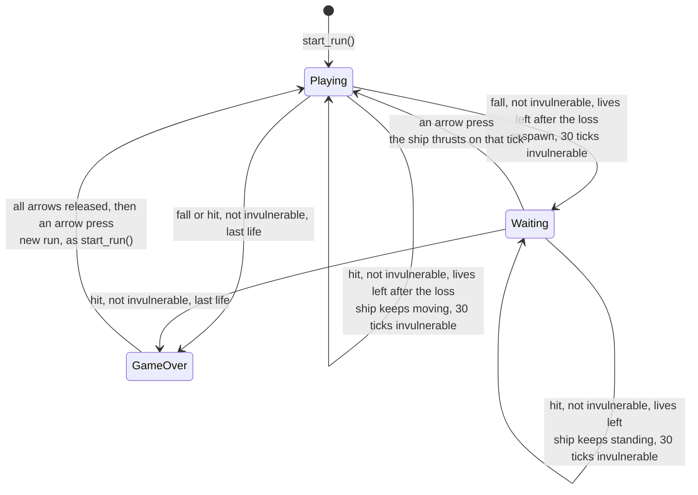
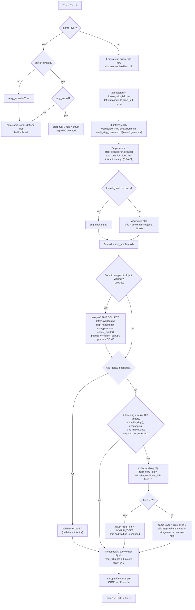
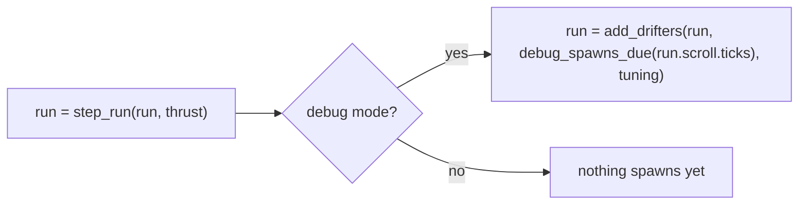
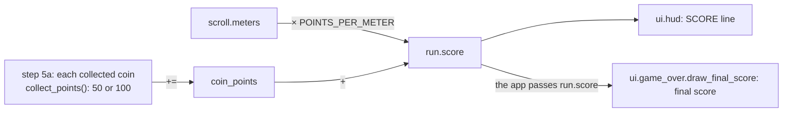

# Run: lives, score, coins, falls, hits, drifters, respawn wait, game over and retry
Version: 6
Status: frozen
Features: DRA-23, DRA-29, DRA-39, DRA-47, DRA-61, DRA-62
Created by: architect

## Purpose
One run of the game, from play start to game over, as one core state. It holds the ship, the world scroll, the drifters on the field, the points popups on screen, the lives, the coin points, the invulnerability timer, the respawn wait and the Game Over state, and steps them all once per tick. It gives the run's score: the meters flown plus the coin points. The score starts at 0, never goes down, freezes at game over and is 0 again after a retry. It applies the collect rule, the fall rule and the hit rule: the ship step reports where the ship is, the drifters report where they are and what a touch does, and the run decides what it pays or costs. A coin the ship touches is collected, invulnerable or not, but never while the ship stands in the respawn wait: its points go to the coin points, it disappears, and its points popup rises from where it was for 1 s. It tells the drifters how far the world scrolls each tick, marks when each drifter has entered the screen, starts and counts down each hazard's re-hit cooldown, and drops drifters that have left or been collected. It also starts a new run when the player retries.

The app holds one `Run` and calls one step per tick. It may also hand the run new drifters through `add_drifters`, the only way a drifter enters a run. Each new drifter settles its entry warning there, from the ship at that moment.

A life is lost by a fall or by a hit. No life-lost feedback plays: the blink is the only effect (scope report DRA-23, Limits; LD-08 stays open).

Who builds what:
- `game/core/run.py`: the Gameplay Implementer, task `DRA-23-01-gameplay-implementer`. Drifters, `add_drifters`, hits and drops: task `DRA-29-03-gameplay-implementer`. Entering, the re-hit cooldown and the end of `hit_ship`: task `DRA-39-01-gameplay-implementer`. `settle_warning` in `add_drifters`: task `DRA-47-02-gameplay-implementer`. `POINTS_PER_METER`, `coin_points` and `score`: task `DRA-61-01-gameplay-implementer`. The scroll in `TickContext`, `popups`, steps 3a and 5a: task `DRA-62-02-gameplay-implementer`.
- `game/core/popup.py`, `PointsPopup` and `step_popups`: the Gameplay Implementer, task `DRA-62-01-gameplay-implementer` (the coin builds its popup from it).
- `game/ui/popup_view.py`, the points popup's view: the UI Developer, task `DRA-62-04-ui-developer`.
- `game/ui/game_over.py`, the Game Over box: the UI Developer, task `DRA-23-03-ui-developer`. The three-line layout and `draw_final_score`, the final score line: task `DRA-61-03-ui-developer`.
- `game/tests/core/test_run.py`: the QA Engineer, task `DRA-23-04-qa-engineer`. Drifters in the run: `game/tests/core/test_run_drifters.py`, tasks `DRA-29-08-qa-engineer` and `DRA-39-07-qa-engineer`. The score: `game/tests/core/test_run_score.py`, task `DRA-61-04-qa-engineer`. The Game Over box: `game/tests/ui/test_game_over.py`, task `DRA-61-05-qa-engineer`. Coins in the run, the popups and the collect rules: `game/tests/core/test_coin.py`, task `DRA-62-06-qa-engineer`.
- The hearts that show `lives` and the SCORE line that shows `score`: `docs/contracts/systems/hud.md`. The score's text, `score_text`, is set there too.
- The meters inside the score: `docs/contracts/systems/scroll.md`.
- The drifters themselves, the spawner and their views: `docs/contracts/systems/drifters.md`.
- The coin itself, what it pays and the popup it builds: `docs/contracts/systems/drifters.md`, Rules, Coin. How far the world scrolls each tick: `docs/contracts/systems/scroll.md`, `scroll_step_px`.
- Calling `start_run` before the first frame, `step_run` once per tick, `add_drifters` for the debug test spawn list, drawing the drifters, then the popups, the ship only while `ship_visible`, and the Game Over box and its final score line from `run.score` while `game_over`: the Integration Engineer, in `game/app/`, from `docs/contracts/systems/app.md`.

## Diagram

`Waiting` is `Playing` with `waiting = True`. The invulnerability timer runs on its own in both, wait or no wait.

One tick, `step_run(run, thrust)`:


Invulnerability and blink after a respawn or a hit on tick T (`BLINK_SWAP_TICKS` = 6):
```
state after tick   T    T+1..T+5   T+6..T+11   T+12..T+17   T+18..T+23   T+24..T+29   T+30
invuln_ticks_left  30   29..25     24..19      18..13       12..7        6..1         0
ship_visible       yes  yes        no          yes          no           yes          yes (solid)
protected on tick       T+1 .......................................................... T+30
```

Drifters entering, with the app's call after the tick (`docs/contracts/systems/app.md`):

In debug mode `debug_spawns_due` takes the loaded spawn list too (`docs/contracts/systems/app.md`, Debug test spawn list).

Re-hit cooldown of one hazard that hits on tick T, with `rehit_cooldown_ticks` 180 (`docs/contracts/systems/drifters.md`, Diagram):
```
state after tick    T      T+1 .. T+179    T+180    T+181
rehit_ticks_left    180    179 .. 1        0        0, or 180 if it hits on T+181
can hit on tick            T+1 .. T+180: no                  T+181: yes
```

The score (DRA-61, coins from DRA-62). Game over on tick G, retry on tick R. A common coin collected on tick C, a rare one on tick D:

```
state after tick   0 (start_run)   1..30   ...  C            ...  D             ...  G             G+1 .. R-1    R (retry)
scroll.meters      0               0       ...  mc           ...  md            ...  m             m (frozen)    0
coin_points        0               0       ...  50           ...  150           ...  150           150           0
score              0               0       ...  mc + 50      ...  md + 150      ...  m + 150       m + 150       0
```

A coin collected on tick C at its center (x, yc), with the coin file's `popup_ticks` 60 and `popup_rise_per_tick` 0.5 (DRA-62):
```
state after tick   C        C+1          C+k              C+59          C+60
coin               gone (dropped in step 9 of tick C)
popup shown        yes      yes          yes              yes           no (step 3a of tick C+60 removes it)
popup.age_ticks    0        1            k                59            -
popup.x            x        x            x                x             -
popup.y            yc       yc - 0.5     yc - 0.5 × k     yc - 29.5     -
```
The popup shows on exactly 60 drawn states. It rises up the screen and never moves with the scroll. On game-over ticks it is frozen like everything else; a retry starts with none.

## Interface
```python
# game/core/run.py
# Imports: stdlib, core.ship, core.scroll, core.collision, core.levels, core.drifters (DRA-29),
# core.popup (DRA-62). Never pygame, ui or app. Every module-level constant is typing.Final.

LIVES_START: Final[int] = 3  # 05-lives-and-damage.md, lives_start (locked)
INVULN_TICKS: Final[int] = 30  # 05-lives-and-damage.md, invuln_ticks (locked)
BLINK_SWAP_TICKS: Final[int] = (
    6  # scope report DRA-23, blink: one visible/hidden swap every 0.1 s
)
# (approved in chat, not in the GDD; LD-04). 0.1 s × 60 ticks/s = 6.
RESPAWN_WAIT_LIMIT: Final[int | None] = (
    None  # 05-lives-and-damage.md, rule 2.5: no time limit.
)
POINTS_PER_METER: Final[int] = 1  # DRA-61. 06-scoring.md, points_per_meter (locked)


@dataclass(frozen=True, slots=True)
class Run:
    """One run's state after a tick."""

    ship: Ship  # the ship (core.ship)
    scroll: Scroll  # the world scroll and distance (core.scroll)
    lives: int = LIVES_START  # lives left, 0 to LIVES_START. 0 only in game over
    invuln_ticks_left: int = (
        0  # ticks of invulnerability still to come. 0 = not invulnerable
    )
    waiting: bool = False  # the ship stands at the respawn point until an arrow press
    game_over: bool = False  # the Game Over box shows and everything is frozen
    held: Thrust = field(default_factory=Thrust)  # the arrow keys held on the last tick
    retry_armed: bool = (
        False  # game over only: every arrow has been released since the box appeared
    )
    drifters: tuple[Drifter, ...] = ()  # DRA-29. Drifters on the field, oldest first
    next_uid: int = 1  # DRA-29. The uid the next added drifter gets
    coin_points: int = 0  # DRA-61. Points from coins this run, >= 0. Step 5a adds to it (DRA-62)
    popups: tuple[PointsPopup, ...] = ()  # DRA-62. Points popups on screen, oldest first

    @property
    def score(self) -> int:
        ...  # DRA-61
        # scroll.meters * POINTS_PER_METER + coin_points. Whole points, >= 0.

    @property
    def invulnerable(self) -> bool:
        ...
        # invuln_ticks_left > 0

    @property
    def ship_visible(self) -> bool:
        ...
        # True when not invulnerable. While invulnerable:
        # ((INVULN_TICKS - invuln_ticks_left) // BLINK_SWAP_TICKS) % 2 == 0

    @property
    def level(self) -> int:
        ...  # DRA-29
        # core.levels.level_at(scroll.meters). 1 while Levels 2 to 8 have no start (DF-05).


def start_run() -> Run:
    ...
    # Run(ship=spawn(), scroll=start_scroll()). Every other field at its default: no drifters,
    # next_uid 1, coin_points 0 (so score 0), no popups.


def step_run(run: Run, thrust: Thrust) -> Run:
    ...
    # One 60 Hz tick. Pure apart from event logging. Never mutates its input.


def add_drifters(
    run: Run, placements: Sequence[Placement], tuning: DrifterTuning
) -> Run:
    ...  # DRA-29
    # The only way drifters enter a run. Spawns each placement, in order, at run.level
    # (or its as_level), gives it the next uid, and appends it. Pure apart from event logging.
    # Raises what spawn_drifter raises (unknown variant, level out of range, ...).
```
The code documents each `Run` field with the comment above. `Drifter`, `TickContext`, `Phase`, `TouchEffect` (`core.drifters.base`), `Placement`, `spawn_drifter` (`core.drifters.spawner`) and `DrifterTuning` (`core.drifters.tuning`) are in `docs/contracts/systems/drifters.md`. `ship_hitbox` is in `docs/contracts/systems/ship.md`; `hitboxes_overlap` in `drifters.md`; `scroll_step_px` in `docs/contracts/systems/scroll.md` (DRA-62).

```python
# game/core/popup.py (DRA-62)
# Imports: stdlib only. Never pygame, ui or app. Logs nothing (the module still has its log).

@dataclass(frozen=True, slots=True, kw_only=True)
class PointsPopup:
    """The points a pickup paid, shown where it was collected, rising, for a set time."""
    x: float                 # center x, screen px. Never changes
    start_y: float           # center y on the tick it appears, screen px, y down
    points: int              # the points it shows, >= 0
    lifetime_ticks: int      # how many states it shows on, >= 1
    rise_per_tick: float     # px it rises each tick, >= 0
    age_ticks: int = 0       # ticks since it appeared. 0 on the state it appears

    @property
    def y(self) -> float: ...
        # start_y - age_ticks * rise_per_tick: center y now, screen px.

def step_popups(popups: tuple[PointsPopup, ...]) -> tuple[PointsPopup, ...]: ...
    # Every popup one tick older (age_ticks + 1), in order, leaving out each one whose new
    # age_ticks reaches its lifetime_ticks. Pure.
```

```python
# game/ui/popup_view.py (DRA-62)
# Imports: pygame, core.popup. Never app. Never reads the run mode or a key.
POPUP_COLOR: Final[tuple[int, int, int]] = (255, 80, 150)  # drifters/04-coin.md, popup_color (guess)
POPUP_FONT_SIZE: Final[int] = 16   # scope report DRA-62, Limits: the HUD's default font at 16 px

def popup_text(points: int) -> str: ...
    # "+" then the points' digits: "+50", "+100". points is a whole number >= 0, trusted.

def draw_points_popup(surface: pygame.Surface, popup: PointsPopup) -> None: ...
    # One popup's text, centered on its x and y. Draws only.
```

```python
# game/ui/game_over.py
# Imports: pygame, ui.score_text (DRA-61). Never core, never app. Never reads the run mode or a key.
BOX_SIZE: tuple[int, int] = (
    320,
    120,
)  # scope report DRA-23, Game Over box (temporary stand-in)
BOX_COLOR: tuple[int, int, int, int] = (
    0,
    0,
    0,
    90,
)  # same: black, alpha 90 of 255 (about 35%)
TEXT_COLOR: tuple[int, int, int] = (255, 255, 255)  # same: white
TITLE_TEXT: str = "Game Over"  # same
TITLE_FONT_SIZE: int = 32  # same: default font, 32 px
PROMPT_TEXT: str = "Press any arrow to retry"  # same
PROMPT_FONT_SIZE: int = 16  # same: 16 px, below the score line
SCORE_FONT_SIZE: int = 16  # DRA-61. scope report DRA-61, SCORE look: default font, 16 px


def draw_game_over(surface: pygame.Surface) -> None: ...
    # The box, the title and the prompt. Signature unchanged since DRA-23.
    # From DRA-61 it leaves the score line's place empty.


def draw_final_score(surface: pygame.Surface, score: int) -> None: ...  # DRA-61
    # The score line only, in its place between the title and the prompt.
    # score is a whole number >= 0, from the app; trusted, not checked.
```
`score_text` (`game/ui/score_text.py`) is in `docs/contracts/systems/hud.md`, Interface.

## Presentation
The run's fields reach the screen in these places. Every fact shown is a core field; no view works one out.

| Core field | Shown as |
|---|---|
| `run.ship_visible` | the app calls `draw_ship(surface, run.ship)` only on frames where it is True. So the ship blinks while invulnerable, after a fall or a hit. Source: 05-lives-and-damage.md, invuln_blink (locked), rules 1.3 and 2.4; 10-ui.md, rule 3 |
| `run.drifters` | the app calls `render_drifter(surface, obj)` for each, in order (`docs/contracts/systems/drifters.md`, Presentation). The debug overlay outlines and labels them (`docs/contracts/systems/debug-overlay.md`). From DRA-29 |
| `run.popups` | the app calls `draw_points_popup(surface, popup)` for each, in order, right after the drifters and before the ship: drawn over every drifter, under the ship, the Game Over box, the debug overlay and the HUD. Each shows `popup_text(popup.points)` centered on `(popup.x, popup.y)`. From DRA-62. Source: drifters/04-coin.md, popup, popup_color (guess); scope report DRA-62, Limits (the popup: text, color, font, place, rise, end, drawn over the other drifters) |
| `run.game_over` | the app calls `draw_game_over(surface)`, then `draw_final_score(surface, run.score)`, only on frames where it is True. Source: 02-game-flow.md, rule 5 |
| `run.score` | the SCORE line at the top left, `score_text(run.score)`: see `docs/contracts/systems/hud.md`. At game over, also the score line on the Game Over box, through `draw_final_score`, below. From DRA-61. Source: 10-ui.md, hud_score (locked), rule 2; 02-game-flow.md, rule 5 ("Shows the final score") |
| `run.lives` | the hearts at the top right. See `docs/contracts/systems/hud.md` |
| `run.ship`, `run.scroll` | the ship view, the debug overlay and the starfield read them. The HUD reads the meters only through `run.score` |

`draw_game_over` and `draw_final_score` read no core state and import no core module. `draw_final_score` gets the final score as a plain number from the app. `draw_game_over` draws the Box, the Title and the Prompt, in that order. `draw_final_score` draws only the Score line, over the box. Both place their lines by the same three-line layout (Vertical place), so the title and the prompt sit in the same place whether `draw_final_score` is called or not.
- **Box.** A `BOX_SIZE` (320 × 120) rectangle filled with `BOX_COLOR`, black at alpha 90. No border. Its top-left corner is `((width - 320) // 2, (height - 120) // 2)` from `surface.get_size()`: (160, 180) on the 640 × 480 screen. Source: scope report DRA-23, Values needed (temporary stand-in; UI-04 is TBD).
- **Title.** `TITLE_TEXT` in the default font at 32 px, antialiased, `TEXT_COLOR`, centered horizontally. Source: same.
- **Score** (DRA-61), drawn by `draw_final_score`. `score_text(score)`, for example `SCORE 1 234`, in the default font at `SCORE_FONT_SIZE` (16 px), antialiased, `TEXT_COLOR` (255, 255, 255), centered horizontally. Its top is one title line-height (the title font's `get_linesize()`) below the title's top. So it reads exactly like the HUD's SCORE line. Source: scope report DRA-61, Limits ("The final score on the Game Over box. Text and place are left to the design"; Director: "Wherever"), and the SCORE format and look; 02-game-flow.md, rule 5.
- **Prompt.** `PROMPT_TEXT` in the default font at 16 px, antialiased, `TEXT_COLOR`, centered horizontally. From DRA-61 its top is one score line-height (the score font's `get_linesize()`) below the score line's top. Source: scope report DRA-23, Values needed; 10-ui.md, error_layout.
- **Vertical place.** The three-line block (title font `get_linesize()` + score font `get_linesize()` + prompt font `get_height()`) is centered vertically in the box: the title's top is `box_top + (120 - block height) // 2`. With the default font it is well under the box's 120 px. `draw_game_over` always uses this layout and leaves the score line's place empty. `draw_final_score` works out the same box and title top from `surface.get_size()`, so its line lands in that place.
- **Width.** The score line has no digit limit (scope report DRA-61, Max digits: "score should be able to be infinite"). It stays centered however long it is. See Rationale for why it never reaches the box's sides in play.
- The box surface, the three fonts, the title and the prompt are built once, on the first draw by either function. The score line is rendered again only when `score` differs from the score it was last rendered for; while the box shows, the score is frozen, so that is once per game over. Never a render per frame with the same score. The view only draws; it never fills the background, flips, logs per frame, catches an error, or reads the run mode or a key. Source: 15-tech-constraints.md, rule 5; 10-ui.md, rule 5.
- At game over after a hit, the ship shows under the box where it was hit; after a fall, it is below the floor and doesn't show. Drifters and popups show frozen where they were.

**Points popup** (`draw_points_popup`, DRA-62). It reads only the popup it is given; no other core state, no run mode, no key.
- **Text.** `popup_text(popup.points)`: a `+` and the points' decimal digits, no space, no grouping: `+50` for a common coin, `+100` for a rare one. Source: drifters/04-coin.md, popup ("+50", "+100").
- **Look.** The default font at `POPUP_FONT_SIZE` (16 px, `pygame.font.Font(None, 16)`), antialiased, in `POPUP_COLOR`, (255, 80, 150), the HUD's look in the coin's popup color. No outline, no shadow, no fade. Source: drifters/04-coin.md, popup_color (guess); scope report DRA-62, Limits and Not in GDD (font and size: the HUD look from DRA-13, Director approval).
- **Place.** The rendered text's rect is centered on `(round(popup.x), round(popup.y))`. On the state it appears that is the coin's center on the tick it was collected; then it rises `rise_per_tick` (0.5 px) a state. The view never moves it: the place comes from core. Source: scope report DRA-62, Limits and Not in GDD (start at the coin's center; rise 0.5 px a tick, up the screen, not with the scroll).
- **End.** It shows while it is in `run.popups`: 60 states, then core drops it and nothing more is drawn. It vanishes at once, with no fade. Source: drifters/04-coin.md, popup (60 ticks); scope report DRA-62, Not in GDD (vanishes, no fade).
- **Cache.** The font is built once, on the first draw. The text is rendered once per points value and kept by that value (two entries in play: 50 and 100). Never a render per frame for a points value already rendered. Source: 15-tech-constraints.md, rule 5.
- A popup partly off the surface is clipped by pygame. The view only draws: it never fills, flips, logs per frame, catches an error or changes the popup. Source: 10-ui.md, rule 5.

## Rules
Values: every constant above has its value and source on its line. `lives_start`, `invuln_ticks` and `points_per_meter` are locked. The blink and the box are temporary stand-ins the Director approved in chat (scope report DRA-23). The score line's text, look and place are the Director's (scope report DRA-61), not in the GDD (UI-01 and UI-04 are TBD). The popup's length (60 ticks) and color are `guess` in the GDD; its rise (0.5 px a tick), start (the coin's center), font, layer and end with no fade are Director approvals not in the GDD (scope report DRA-62, Not in GDD). Its length and rise come from the coin's tuning file, through the coin (`systems/drifters.md`, Rules, Coin).

Step numbers changed in DRA-29: the DRA-23 steps 3 (wait), 4 (scroll), 5 (fall) and 6 (`held`) are now steps 4, 5, 6 and 10. Changed again in DRA-39: the DRA-29 steps 8 (drop) and 9 (`held`) are now steps 9 and 10, after the new step 8 (cool down). Closed task files and the earlier integration checks in `systems/app.md` use the old numbers. DRA-62 adds steps 3a (popups) and 5a (collect) and keeps every other number, so the code, `systems/drifters.md` and the DRA-39 to DRA-61 checks keep theirs.

A playing tick (`game_over` False), in this order:
1. **Press.** `press` is True when an arrow is held in `thrust` and was not held in `run.held`. Source: 05-lives-and-damage.md, rule 2.5.
2. **Invulnerability.** `protected = run.invuln_ticks_left > 0`, the state going into this tick. Then `left = max(run.invuln_ticks_left - 1, 0)`. It counts down every playing tick, waiting or not. Source: 05-lives-and-damage.md, invuln_ticks, rules 1.3, 2.4 and 4.
3. **Drifters.** `ctx = TickContext(ship=run.ship, scroll_step_px=scroll_step_px(run.scroll))` (the scroll going into this tick: how far step 5 is about to move the world; DRA-62), then `drifters = tuple(obj.update(ctx).mark_entered() for obj in run.drifters)`, in order. A parked drifter (the coin) moves by `ctx.scroll_step_px`, so it ends the tick where the world has scrolled to; moving drifters don't read it. Source for the scroll: 03-world-and-camera.md, rule 9; systems/scroll.md, The next step's movement. Every playing tick, the wait included: the world keeps going. A drifter that turns ACTIVE on this tick can touch the ship on this tick. `mark_entered()` sets `has_entered` on a drifter that is ACTIVE and at least partly on screen after its update; it never touches anything else (DRA-39). Source: drifters.md, Rules (The base, Entering); 07-drifters.md, rules 9 ("When the warning ends, the drifter appears and can hit") and 12; 91-decision-log.md, row 58; 05-lives-and-damage.md, rule 2.5.
3a. **Popups** (DRA-62). `popups = step_popups(run.popups)`: every popup one tick older, in order; one whose new `age_ticks` reaches its `lifetime_ticks` is gone. Every playing tick, the wait and protected ticks included. So a popup that appears on tick C shows on the states after ticks C to C + `lifetime_ticks` − 1 (60 states) and is gone on the state after tick C + `lifetime_ticks`. Source: drifters/04-coin.md, popup (gone after 60 ticks); scope report DRA-62, Limits ("It vanishes after 60 ticks, with no fade").
4. **Wait.** If `run.waiting` and not `press`: the ship is not stepped. Otherwise `waiting = False` and `ship = core.ship.step(run.ship, thrust)`. Source: 05-lives-and-damage.md, rule 2.5; 91-decision-log.md, rows 27 and 28.
5. **Scroll.** `scroll = step_scroll(run.scroll)`. Source: 03-world-and-camera.md, rule 4.
5a. **Collect** (DRA-62), only when the ship moved in step 4 (`waiting` is False after step 4). A ship standing in the respawn wait collects nothing; on the tick an arrow press ends the wait, the ship has moved and collects as usual.
   1. `collecting` = every drifter in `drifters` (from step 3) with phase ACTIVE and `effect_on_touch()` COLLECT whose `current_hitbox()` overlaps `ship_hitbox(ship)` (`hitboxes_overlap`, strict), with `ship` from step 4: where it moved to this tick, before step 6 can respawn it. So a ship that falls below the floor on this tick still collects what it touches on the way. Protection plays no part: an invulnerable ship collects. Source: drifters/04-coin.md, rule 4 ("An invulnerable ship collects it too", "A ship in the respawn wait never collects"); 06-scoring.md, rule 2; scope report DRA-62, Limits and Not in GDD (a coin touched on a fall tick pays: Director).
   2. For each drifter in `collecting`, in order: `coin_points += obj.collect_points()`; `obj.collect_popup()`, when not None, is appended to `popups` after the ones step 3a kept; the drifter is replaced in `drifters`, in its place, by `replace(obj, phase=Phase.GONE)`. Source: drifters/04-coin.md, rule 4 (pays, disappears, shows its popup); scope report DRA-62, Limits (the popup appears the moment the coin is collected, centered on the coin's center on that tick).
   3. Nothing else changes: no life, no invulnerability, no cooldown. A collected drifter is GONE, so step 7 never sees it, and step 9 drops it on this tick: it is never drawn again. Source: drifters/04-coin.md, rule 4.
   4. Steps 6 and 7 run after it as always. A coin and a hazard touched on one tick: the coin pays here, then the hit counts in step 7. A coin touched on a fall tick: it pays here, then the fall counts in step 6, and step 7 still tests no hit (DRA-29). On the tick lives reach 0 the coin still pays, and the final score includes it. Source: drifters/04-coin.md, Edge cases ("the coin pays and the hit counts"); scope report DRA-62, Limits.
6. **Fall.** If `is_below_floor(ship)`:
   1. `protected`: no life is lost. `ship = spawn()`, `waiting = False`, `invuln_ticks_left = left`. Source: 05-lives-and-damage.md, rule 2.6; 91-decision-log.md, rows 29 and 31.
   2. Not protected and `lives - 1 > 0`: `lives -= 1`, `ship = spawn()`, `waiting = True`, `invuln_ticks_left = INVULN_TICKS`. Source: 05-lives-and-damage.md, rules 2.1 to 2.5.
   3. Not protected and `lives - 1 == 0`: `lives = 0`, `game_over = True`, `invuln_ticks_left = 0`, `waiting = False`. The ship stays where it fell. `retry_armed` is True only if no arrow is held in `thrust`. Source: 05-lives-and-damage.md, rule 5; 02-game-flow.md, rules 5 and 6.
   On a tick with a fall, step 7 is skipped: no hit is tested. From DRA-29. Source: scope report DRA-29, Decision log (Director, 2026-10-15: "a fall and a touch on one tick cost only the fall"); see Rationale.
7. **Hit**, only when step 6 found no fall:
   1. `touching` = every drifter in `drifters` with phase ACTIVE, `effect_on_touch()` HIT and `may_hit_ship()` True, whose `current_hitbox()` overlaps `ship_hitbox(ship)` (`hitboxes_overlap`, strict: edge-only contact doesn't count). `may_hit_ship()` is the shared re-hit rule: False while the drifter's `rehit_ticks_left` is above 0, as it was going into this tick (step 3 never changes it) (`docs/contracts/systems/drifters.md`, Rules, Re-hit cooldown). Source: 05-lives-and-damage.md, rules 1 and 1.5; 07-drifters.md, rule 4; drifters/01-meteorite.md and drifters/02-satellite.md, rule 4.
   2. If `touching` is empty, or `protected`: nothing happens. Hazards pass through an invulnerable ship and no cooldown starts; one still overlapping when invulnerability ends can hit then, unless it is cooling down. Source: 05-lives-and-damage.md, rule 4; drifters/01-meteorite.md and drifters/02-satellite.md, Edge cases.
   3. Otherwise one hit, whatever the number of touching drifters: every drifter in `touching` gets `rehit_ticks_left = obj.rehit_cooldown_ticks` (its cooldown starts), and `lives -= 1`. A drifter that is cooling down is never in `touching`, so a hit by another hazard never restarts its cooldown. Source: 05-lives-and-damage.md, rules 1.1 and 1.5, and Edge cases ("Two hazards touch the ship in the same tick: one hit, one life lost. Both start their rehit_cooldown"; "the second one hits. Its own cooldown starts then"); 91-decision-log.md, row 54. Replaces `hit_ship = True` (DRA-39).
   4. Lives left (`lives > 0`): `invuln_ticks_left = INVULN_TICKS`. Nothing else changes: the ship keeps its position and speed, and `waiting` stays as it was. No stun. Source: 05-lives-and-damage.md, rules 1.3 and 1.4; 01-vision.md, locked decision 5; scope report DRA-29, Decision log (2026-10-15: "a hit during the respawn wait keeps the wait").
   5. Last life (`lives == 0`): `game_over = True`, `invuln_ticks_left = 0`, `waiting = False`, `retry_armed` True only if no arrow is held. The ship stays where it was hit. Source: 05-lives-and-damage.md, rule 5; 02-game-flow.md, rule 5.
   6. Drifters that hit stay and keep moving. The run never removes a drifter for hitting. Source: 05-lives-and-damage.md, rule 1.5 ("The hazard that hit keeps going as normal: it doesn't vanish or change").
8. **Cool down** (DRA-39). Every drifter whose cooldown did not start in step 7 on this tick, and whose `rehit_ticks_left` is above 0, gets `rehit_ticks_left - 1`. Every playing tick: protected ticks, ticks during the respawn wait and ticks with a fall included. So a hazard that hit on tick T can't hit on ticks T+1 to T+`rehit_cooldown_ticks`, has `rehit_ticks_left` 0 in the state after tick T+`rehit_cooldown_ticks`, and can hit again from the tick after. Source: 05-lives-and-damage.md, rule 1.5 ("can't hit the ship again for rehit_cooldown ticks"), rehit_cooldown (guess); the counting follows invulnerability (step 2, and Rationale).
9. **Drop**. Remove every drifter whose phase is GONE (from DRA-62: a collected coin) or whose `is_off_screen()` is True. `is_off_screen()` is False for a drifter that has not yet entered (DRA-39). The rest keep their order. Source: 07-drifters.md, rule 12; 91-decision-log.md, row 58; drifters/01-meteorite.md and drifters/02-satellite.md, rule 5.
10. `held = thrust` in the returned run.

If nothing happened, the returned run has the new ship, scroll, drifters and popups, `invuln_ticks_left = left`, the `waiting` from step 4, the same `lives` and the same `coin_points`.

A game-over tick (`game_over` True):
- The ship, the scroll, the drifters, the popups, the coin points, the lives and the timer don't change. Nothing is updated, collected or dropped. Source: 02-game-flow.md, rule 5; 91-decision-log.md, row 30.
- If no arrow is held: `retry_armed = True`. Else, if `run.retry_armed`: return `start_run()` with `held = thrust`: a new run with no drifters and `next_uid` 1. Else nothing changes but `held`. Source: 02-game-flow.md, rules 3 and 6; 91-decision-log.md, rows 30 and 31.

`add_drifters(run, placements, tuning)` (DRA-29):
- If `run.game_over` or `placements` is empty, return `run` unchanged. Nothing enters a frozen run. Source: 02-game-flow.md, rule 5.
- Otherwise, for each placement in order: `obj = spawn_drifter(placement, run.level, tuning)`; then `replace(obj, uid=next_uid).settle_warning(TickContext(ship=run.ship))` and `next_uid += 1`. Append the new drifters after the existing ones. Return the run with the new `drifters` and `next_uid`. Nothing else changes. `settle_warning` (DRA-47) lets a drifter fix its entry warning from the ship as it is now, the state the warning is first drawn with; only the chain lightning uses it (the node nearest the ship), every other drifter comes back unchanged. The `drifter spawn` line logs the settled drifter; the warning's place is not logged. Source: drifters.md, Rules, Spawner and The base (Warning settle); drifters/03-chain-lightning.md, rule 2; scope report DRA-29, Limits ("a spawner is the only way a drifter is created").
- New drifters are in WARNING with `ticks_in_phase` 0. They are first updated on the next `step_run`. So a drifter added after tick T shows its warning on the states after ticks T to T + `warning_ticks` − 1.
- It works the same during the respawn wait. It never reads the run mode. The app decides what to add (`docs/contracts/systems/app.md`).
- An error from `spawn_drifter` rises. Core never catches it. Source: game/CONTEXT.md, Error handling.

Score (DRA-61):
- **Formula.** `score = scroll.meters × POINTS_PER_METER + coin_points`. One whole number. `scroll.meters` is whole meters, rounded down (`docs/contracts/systems/scroll.md`, Distance). Source: 06-scoring.md, Summary, rule 1, points_per_meter and meters_rounding (locked); scope report DRA-61, Limits.
- **Grazes are not in it.** The GDD formula adds `25 × grazes`; grazes don't pay yet (SC-02 and SC-04 are open). Source: scope report DRA-61, Out and Fit; scope report DRA-39, Decision log ("score = meters + coins for now").
- **Coin points** (DRA-62). `coin_points` is 0 at the start of every run. Only step 5a changes it: each collected coin adds its `collect_points()`, 50 for a common coin and 100 for a rare one. Nothing ever lowers it, and `add_drifters` never changes it. A run with no coins collected has a score equal to the meters flown. Source: 06-scoring.md, Summary, rule 2 and coin_points (common 50 locked, rare 100 guess); scope report DRA-62, Limits ("score = meters + coin points").
- **Start and retry.** `start_run()` gives `score` 0: the scroll is at 0 m and `coin_points` is 0. A retry returns `start_run()`, so the score is 0 again. Source: 02-game-flow.md, rules 3 and 6; 91-decision-log.md, row 30.
- **Never goes down.** Meters never go down and nothing lowers `coin_points`. A fall, a hit, a respawn and the respawn wait don't lower the score; the meters keep counting through all of them, and a coin collected on any of those ticks still adds to it. Source: scope report DRA-61, Feature; 06-scoring.md, rule 1; 05-lives-and-damage.md, rule 2.5.
- **Game over.** The score on the tick lives reach 0 is the final score, a coin collected on that tick included. A game-over tick changes neither the scroll nor `coin_points`, so the score stays frozen while the box shows. Source: 02-game-flow.md, rule 5; 91-decision-log.md, row 30.
- **Level** still reads `scroll.meters`, never the score. Source: 08-difficulty.md, rule 1.
- The score is a property, worked out from the state each time it is read. It is never stored apart from the meters and the coin points.

Other rules:
- Game over happens on the tick lives reach 0. That tick runs in full (drifters, popups, ship, scroll, collect, cooldowns, drops); the freeze starts on the next tick. Cooldowns and popups freeze with everything else and a retry starts with no drifters and no popups. Source: 05-lives-and-damage.md, rule 5; 02-game-flow.md, rule 5.
- A run starts with no invulnerability, no wait and no drifters. Source: 02-game-flow.md, rule 3.
- No life-lost feedback plays: no flash, no breaking heart, no burst. The blink is the only effect, after a fall or a hit. Source: scope report DRA-29, Out; LD-08.
- No way to gain a life. Source: 05-lives-and-damage.md, rule 6.
- Drifters never touch each other or the walls. Source: 07-drifters.md, rule 15.
- Grazes are not counted or paid. Source: scope report DRA-29, Out (graze scoring).
- `step_run` and `add_drifters` use no frame time and no randomness. Same input, same output. Source: 15-tech-constraints.md, rule 2.
- Core behaves the same in normal and debug mode. It never reads the run mode. Source: game/CONTEXT.md, Run modes.
- Core never imports pygame, `ui` or `app`. Source: game/CONTEXT.md, Layout.

Logging (logger `core.run`, by event, never by tick). Source: game/CONTEXT.md, Logging; 15-tech-constraints.md, rule 9:
- DEBUG `drifter active id=%d type=%s x=%.2f y=%.2f`: on the tick a drifter turns from WARNING to ACTIVE, with its uid, `drifter_type.value` and position. DRA-29.
- DEBUG `respawn wait end`: on the tick a press ends the wait.
- DEBUG `invulnerable end`: on the tick the timer goes from 1 to 0.
- DEBUG `drifter touch id=%d type=%s effect=%s`: on a hit, once for each drifter in `touching`, with `effect_on_touch().value` (`hit`). DRA-29. From DRA-62 also on a collect, once for each drifter in `collecting` (step 5a), with `collect`, e.g. `drifter touch id=4 type=coin effect=collect`.
- DEBUG `life lost lives=%d`: on every fall or hit that costs a life, with the lives left after it.
- DEBUG `respawn from x=%.2f y=%.2f wait=%s`: on every respawn after a fall. Never on the last life.
- INFO `game over meters=%d`: on the tick lives reach 0, by a fall or a hit.
- DEBUG `drifter gone id=%d type=%s x=%.2f y=%.2f`: once for each drifter dropped, with its last position. DRA-29.
- INFO `new run`: on the retry tick.
- DEBUG `drifter spawn id=%d type=%s variant=%s x=%.2f y=%.2f speed=%.2f level=%d`: from `add_drifters`, once per drifter, with the level used (the placement's `as_level`, else `run.level`). DRA-29.
- Order inside one tick: `drifter active`, `respawn wait end`, the ship's own lines, the scroll's line, `invulnerable end`, the collect's `drifter touch` lines (DRA-62), then either the fall's `life lost` and `respawn from` or `game over`, or the hit's `drifter touch` lines, `life lost` and `game over`, then `drifter gone`. `drifter spawn` lines come from the app's `add_drifters` call after the tick.
- Nothing else. The score and the coin points log nothing: no line when they change (DRA-61, DRA-62), and `game over meters=%d` keeps its text. Popups log nothing. A hazard passing through an invulnerable ship logs nothing, and so does a cooldown starting or ending. A hazard's life logs exactly three lines, `drifter spawn`, `drifter active`, `drifter gone`, plus one `drifter touch` for each hit it takes part in. A coin never logs `drifter active` (it is born ACTIVE): a collected coin logs `drifter spawn`, `drifter touch ... effect=collect` and `drifter gone` (on the same tick, at the place it was collected); a coin that leaves logs `drifter spawn` and `drifter gone`. A drifter that never enters never logs `drifter gone` while the run lasts, unless it is collected.

## Impact
DRA-39 changes this frozen contract (v2). No `Run` field, property, signature, constant or log line changes. `step_run` changes in step 3 (`mark_entered()` after each update), step 7.3 (a hit starts each touching drifter's cooldown instead of setting `hit_ship`), the new step 8 (cool down) and step 9 (drop, through the new `is_off_screen`); the old steps 8 and 9 become 9 and 10. Every file in `game/` that depends on it, found by grepping `game/` (tests included) for `core.run`, `Run(`, `start_run`, `step_run`, `add_drifters`, `hit_ship`, `may_hit_ship` and `is_off_screen`:

| File | Change needed |
|---|---|
| `game/core/run.py` | steps 3, 7.3, 8 and 9, with the base changes in `docs/contracts/systems/drifters.md`. Task `DRA-39-01-gameplay-implementer`. |
| `game/ui/hud.py`, `game/ui/debug_overlay.py` | none. |
| `game/app/frame.py` | none from this contract (the spawn list changes come from `systems/app.md`). |
| `game/tests/core/test_run.py` | none. Its runs have no drifters. Must still pass unchanged. |
| `game/tests/ui/test_hud.py` | none. |
| `game/tests/core/test_run_drifters.py` | breaks: `rock(hit_ship=...)`, every `hit_ship` check and `test_a_meteorite_hits_once`. Rebuilt for the cooldown and the entered rule by task `DRA-39-07-qa-engineer`. |

DRA-47 changes this contract on top of DRA-39 (not closed out, still `draft` at v2). Only `add_drifters` changes: each new drifter is passed through `settle_warning(TickContext(ship=run.ship))` after it gets its uid. No `Run` field, signature, step of `step_run` or log line changes. Grepping `game/` (tests included) for `add_drifters`:

| File | Change needed |
|---|---|
| `game/core/run.py` | `add_drifters` calls `settle_warning`. Task `DRA-47-02-gameplay-implementer`. |
| `game/app/frame.py` | none. |
| `game/tests/core/test_run_drifters.py`, `game/tests/core/test_run.py` | none: the meteorite and the satellite come back unchanged from `settle_warning`. Chain lightnings in the run are tested by task `DRA-47-08-qa-engineer` in its own file. |

DRA-61 changes this frozen contract (v4). `Run` gains the `coin_points` field (default 0) and the `score` property, and the module gains `POINTS_PER_METER`. No step of `step_run`, no `add_drifters` rule and no log line changes. The Game Over box gains the score line through the new `draw_final_score`; `draw_game_over` keeps its signature. Every file in `game/` that depends on it, found by grepping `game/` (tests included) for `core.run`, `Run(`, `start_run`, `draw_game_over`, `ui.game_over` and `.meters`:

| File | Change needed |
|---|---|
| `game/core/run.py` | `POINTS_PER_METER`, `coin_points`, `score`. Task `DRA-61-01-gameplay-implementer`. |
| `game/ui/game_over.py` | `SCORE_FONT_SIZE`, the three-line layout in `draw_game_over`, the new `draw_final_score`. Task `DRA-61-03-ui-developer`. |
| `game/ui/hud.py` | reads `run.score`; see `docs/contracts/systems/hud.md`, Impact. Task `DRA-61-06-ui-developer`. |
| `game/app/frame.py` | adds `draw_final_score(surface, run.score)` right after its `draw_game_over(surface)` call. Integration Engineer, from `systems/app.md`. Until then the existing call still type-checks and runs: at game over the box shows the title and the prompt with the score line's place empty. No error screen, and every `check.sh` step passes. |
| `game/ui/debug_overlay.py`, `game/app/debug_spawns.py` | none. |
| `game/tests/core/test_run.py`, `test_run_drifters.py`, `test_chain_lightning.py`, `test_fireball.py` | none: they build `Run` by keyword and the new field has a default. Must pass unchanged. |
| `game/tests/core/test_run_score.py` (new) | the score rules. Task `DRA-61-04-qa-engineer`. |
| `game/tests/ui/test_game_over.py` (new) | the Game Over box, with and without its score line. Task `DRA-61-05-qa-engineer`. |

DRA-62 changes this frozen contract (v5). `Run` gains `popups` (default `()`); step 3 passes the scroll's next step to the drifters; the new steps 3a (popups) and 5a (collect) raise `coin_points` and add popups; `drifter touch` is also logged with `effect=collect`. No other step, signature, constant or log line changes. New: `game/core/popup.py` and `game/ui/popup_view.py`. Every file in `game/` that depends on it, found by grepping `game/` (tests included) for `core.run`, `Run(`, `start_run`, `step_run`, `add_drifters`, `coin_points`, `TickContext(` and `drifter touch`:

| File | Change needed |
|---|---|
| `game/core/run.py` | `popups`, step 3's context, steps 3a and 5a, the collect log line. Task `DRA-62-02-gameplay-implementer`. |
| `game/core/popup.py` (new) | `PointsPopup`, `step_popups`. Task `DRA-62-01-gameplay-implementer`. |
| `game/core/scroll.py` | `scroll_step_px` (`systems/scroll.md`). Task `DRA-62-02-gameplay-implementer`. |
| `game/ui/popup_view.py` (new) | `POPUP_COLOR`, `POPUP_FONT_SIZE`, `popup_text`, `draw_points_popup`. Task `DRA-62-04-ui-developer`. |
| `game/app/frame.py` | draws every popup right after the drifters (`systems/app.md`). Integration Engineer. Until then popups exist in core but are not drawn; nothing else breaks. |
| `game/ui/hud.py`, `game/ui/game_over.py`, `game/ui/debug_overlay.py` | none. The HUD and the box read `run.score`, which now counts coins with no change to them. |
| `game/tests/core/test_run.py`, `test_run_drifters.py`, `test_run_score.py`, `test_chain_lightning.py`, `test_fireball.py`, `game/tests/ui/test_hud.py` | none. They build `Run` by keyword and the new field has a default; their runs hold no coin, so `coin_points` still never changes in them and no `type=coin` line is logged. Must pass unchanged. |
| `game/tests/core/test_coin.py` (new) | coins in the run, the collect rules, the popups. Task `DRA-62-06-qa-engineer`. |

## Rationale
- **A run state that holds the ship, the scroll and the drifters.** Game over freezes them together and a retry resets them together. Core owns rules, so core holds them together.
- **The ship step stops at step 7, and the run applies falls and hits.** What a fall or a hit costs depends on lives and invulnerability, which neither the ship nor a drifter knows.
- **A press is an arrow that wasn't held on the last tick.** Rule 2.5 says the wait lasts until "the first arrow key press". A key held through the fall was pressed before the respawn.
- **Retry is stricter than the wait.** Rule 6 asks for all arrows released first, then one pressed.
- **Protection uses the timer going into the tick.** The ship is protected on the 30 ticks after its respawn or hit, and blinks over the 30 states drawn from it.
- **The blink starts visible, 0.1 s is 6 ticks, the last life doesn't respawn, the retry returns the tick-0 state, the scroll steps during the wait.** As in DRA-23; unchanged.
- **Drifters update before the ship (DRA-29).** The Director set the order: update drifters, step the ship, test overlaps, apply the touch effect, drop. Drifters read the ship as the player last saw it. DRA-39 adds the cool-down step between the touch effect and the drop.
- **No hit test on a tick with a fall (DRA-29).** The GDD doesn't cover a hit and a fall on one tick; the Director accepted "the fall only" (scope report DRA-29, Decision log, 2026-10-15). A fallen ship is fully below the floor: the player sees a fall, not a touch. After the fall the ship is either respawned with fresh invulnerability, already protected, or the run is over, so a hit test could only cost a second life on the same tick. The floor check is step 8 of the ship's tick order (04-ship.md, rule 2), right after the move, so it goes first.
- **Every touching hazard starts its cooldown on a hit (DRA-39).** Two hazards touching on one tick are one hit, and both start their cooldown (05-lives-and-damage.md, Edge cases). Replaces DRA-29's `hit_ship` fact and the meteorite's "hits once" stand-in (91-decision-log.md, row 54 answers LD-06).
- **The run sets and counts the cooldown; the drifter answers `may_hit_ship()` (DRA-39).** The run owns every timer that a hit starts, like invulnerability, and only it knows which drifters took part. The drifter holds the counter and the shared rule that reads it, so the view and the hit test read the same fact.
- **The cooldown counts down after the hit test (DRA-39).** Step 7 reads the counter as it was going into the tick, as step 2 does for invulnerability, and step 8 counts down only after. So a 180-tick cooldown blocks exactly the 180 ticks after the hit, and the hazard shows dim on exactly 180 drawn states, the same pattern as the 30-tick blink. Counting down inside step 3 would make it 179.
- **The cooldown runs on protected ticks, during the wait and on a fall tick (DRA-39).** 05-lives-and-damage.md, rule 1.5 counts it from the hit, not from the end of invulnerability, and the world keeps going during the wait (rule 2.5). Only game over freezes it.
- **Hazards that touch an invulnerable ship start no cooldown.** It didn't hit: rule 4 says hazards pass through. The drifter specs say an invulnerable touch is no hit and the hazard keeps going.
- **`mark_entered()` runs in the run, right after each update (DRA-39).** Every drifter gets it, so no subclass can forget it. It runs before the drop, so the drop sees whether the drifter has entered after this tick's move. "Partly on screen" is checked on the states the player sees, one per tick.
- **A hit during the wait keeps the wait (DRA-29).** Rule 1.4: "Nothing else changes." Accepted by the Director (scope report Decision log, 2026-10-15).
- **`add_drifters` is a separate call, made after `step_run` (DRA-29).** The Director asked for one way in that the app calls, and core never reads the run mode. Adding after the tick means a new drifter's birth state is drawn, and its warning shows on exactly `warning_ticks` drawn states.
- **`add_drifters` does nothing at game over (DRA-29).** Everything is frozen. It also keeps the app's debug list simple: it can call `add_drifters` every tick, and the frozen tick count never adds the same drifter twice.
- **The warning settles in `add_drifters` (DRA-47).** The chain lightning's warning sits above the node nearest the ship "when the warning starts". The spawner never sees the ship, and the run is the one place that has both the new drifter and the ship at that moment. One call per new drifter, with a default that does nothing, keeps `step_run` unchanged.
- **`uid` comes from the run (DRA-29).** Only the run sees every drifter enter. A counter in the run keeps `step_run` and `add_drifters` pure.
- **`level` is a property (DRA-29).** It is a fact about the run (08-difficulty.md, rule 1), computed from the meters. The spawner gets it from `add_drifters` and is the only reader.
- **Lifecycle logs in `core.run` (DRA-29).** The run sees each drifter's phase before and after the tick and owns the drop, so it can log each event once. The drifters stay pure.
- **INFO for game over and a new run.** game/CONTEXT.md puts screen changes at INFO.
- **The score is a property of the run (DRA-61).** It is a fact the HUD and the Game Over box show, so it lives in core (10-ui.md, How to extend). Worked out from the meters and the coin points, it can't disagree with them, and it freezes and resets with them for free: game over already freezes the scroll and a retry already returns `start_run()`.
- **`coin_points` exists now, at 0 (DRA-61).** The scope report builds the score as `meters + coin points` and asks to leave room for coins. A field that starts at 0 and that no rule changes keeps that seam open: the coin feature adds the one rule that raises it, and the score, the HUD and the Game Over box need no change then. It holds points, not a coin count, because coin variants pay different points (06-scoring.md, coin_points) and the score needs only the sum.
- **`POINTS_PER_METER` is a constant, not a bare 1 (DRA-61).** It is a locked GDD value with a name; the code shows where the meters' share of the score comes from.
- **No score log line (DRA-61).** The score changes about 6.6 times a second, which would be a line per meter (game/CONTEXT.md, Logging). `game over meters=%d` keeps its text, so no log check breaks; in DRA-61 that number is also the final score.
- **The score line is its own call, `draw_final_score`, and takes the score as a number (DRA-61).** The view stays free of core, as it was in DRA-23, and the app already reads the run's fields to decide what to draw. `draw_game_over` keeps its DRA-23 signature, so the app's existing call stays valid while the box changes. Every QA run in the build then passes with a clean typecheck and no error screen before the Integration Engineer adds the second call (Director, DRA-61 revision: "keep QA clean"). A default value on a new `score` argument was not used. It would show a wrong score until integration, or leave a no-score branch that only the build window uses. The format comes from the HUD's `score_text`, so the two places always read the same.
- **Score line between title and prompt (DRA-61).** The Director left text and place to the design ("Wherever"; the box is redesigned later, UI-04). Under the title it reads as the result, and the prompt stays last, as the next step. Same label, font and size as the HUD, so the player sees one number in one look.
- **No digit limit on the box (DRA-61).** The Director chose no limit. At Level 1 the score grows by 6.6 a second from meters; coins add 50 or 100 each. The 320 px box holds well over 30 characters of 16 px text, a score no run can reach. The real limit stays open with UI-01 and UI-04.
- **Collect is its own step, 5a, after the scroll and before the fall (DRA-62).** The fall test can respawn the ship, and the hit test is skipped on a fall tick; the Director wants a coin touched on a fall tick to pay. Testing the touch with the ship where it moved, before step 6, gives exactly that, and leaves steps 6 and 7 as they were. It also lets "the coin pays and the hit counts" fall out of the order. A letter instead of a new number keeps every step number the code, the drifters contract and the earlier checks cite.
- **"Standing in the respawn wait" is `waiting` after step 4 (DRA-62).** The wait ends on the press tick, and that press thrusts the ship on the same tick (05-lives-and-damage.md, rule 2.5), so the ship is flying, not standing. Reading `waiting` after step 4 collects on that tick and never while the ship stands at the respawn point.
- **Protection never blocks a collect (DRA-62).** 04-coin.md, rule 4 and 06-scoring.md, rule 2: an invulnerable ship collects.
- **The run sets the coin GONE and drops it the same tick (DRA-62).** "Disappears" means it is never drawn again, and the existing drop step already removes GONE drifters with its `drifter gone` line, so the log shows where it went.
- **Popups are run state, not drifters (DRA-62).** A popup has no hitbox, never enters or leaves, and must outlive the coin that made it. Keeping it out of `run.drifters` keeps every drifter rule (touch, drop, overlay labels) away from it. It is a core fact the UI shows, so it lives in core with its place and age; the view only draws it.
- **A popup stores its start and its age, not its current y (DRA-62).** `start_y − age × rise` is exact on every state and needs no running float sum. Its age also says when it ends.
- **Popups age in step 3a, before the collect (DRA-62).** A popup made in step 5a then starts at age 0 on its own tick and shows on exactly `lifetime_ticks` states, the same pattern as the blink and the cooldown.
- **Popups freeze at game over (DRA-62).** 02-game-flow.md, rule 5: everything freezes. A popup still rising when the run ends stays where it was under the box, and a retry clears it with the rest.
- **Popups drawn after the drifters, before the ship (DRA-62).** The Director chose "drawn over the other drifters" (scope report DRA-62, Decision log, Q5). The ship stays on top of everything in the drifter layer, as it does for every drifter (`systems/app.md`, Drifters behind the ship).
- **One `drifter touch` line per collect, `drifter gone` after it (DRA-62).** The existing line already names the effect, so a collect reads like a hit with `effect=collect`, and log checks need no new pattern. The points and the score are not logged, as in DRA-61.
- **No schema in this contract.** The tuning files' schemas are owned by `docs/contracts/systems/drifters.md`.
