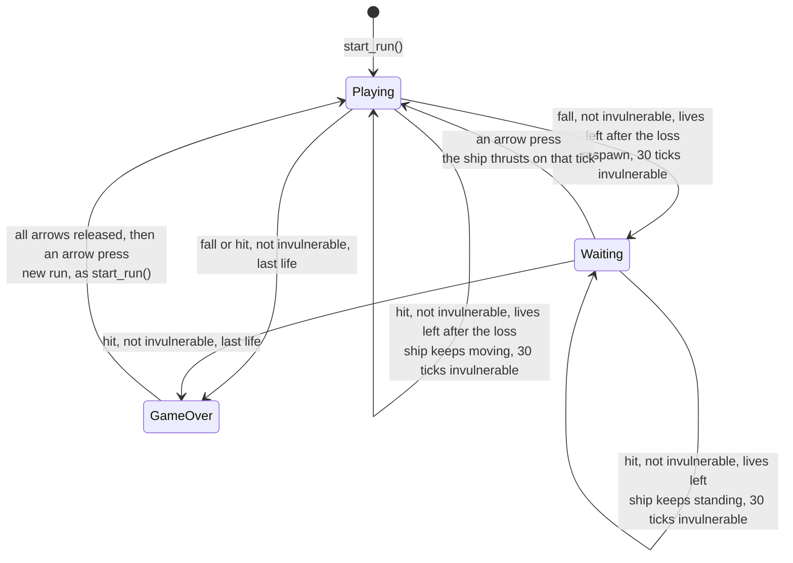
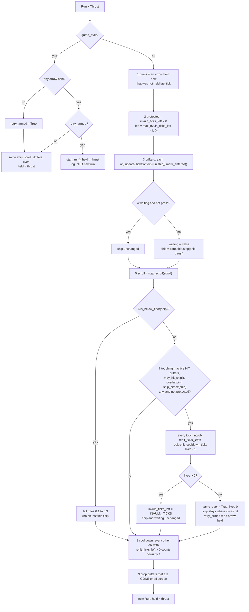
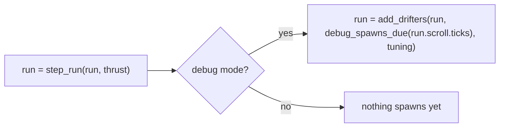

# Run: lives, falls, hits, drifters, respawn wait, game over and retry
Version: 2
Status: draft
Features: DRA-23, DRA-29, DRA-39
Created by: architect

## Purpose
One run of the game, from play start to game over, as one core state. It holds the ship, the world scroll, the drifters on the field, the lives, the invulnerability timer, the respawn wait and the Game Over state, and steps them all once per tick. It applies the fall rule and the hit rule: the ship step reports where the ship is, the drifters report where they are and what a touch does, and the run decides what it costs. It marks when each drifter has entered the screen, starts and counts down each hazard's re-hit cooldown, and drops drifters that have left. It also starts a new run when the player retries.

The app holds one `Run` and calls one step per tick. It may also hand the run new drifters through `add_drifters`, the only way a drifter enters a run.

A life is lost by a fall or by a hit. No life-lost feedback plays: the blink is the only effect (scope report DRA-23, Limits; LD-08 stays open).

Who builds what:
- `game/core/run.py`: the Gameplay Implementer, task `DRA-23-01-gameplay-implementer`. Drifters, `add_drifters`, hits and drops: task `DRA-29-03-gameplay-implementer`. Entering, the re-hit cooldown and the end of `hit_ship`: task `DRA-39-01-gameplay-implementer`.
- `game/ui/game_over.py`, the Game Over box: the UI Developer, task `DRA-23-03-ui-developer`.
- `game/tests/core/test_run.py`: the QA Engineer, task `DRA-23-04-qa-engineer`. Drifters in the run: `game/tests/core/test_run_drifters.py`, tasks `DRA-29-08-qa-engineer` and `DRA-39-07-qa-engineer`.
- The hearts that show `lives`: `docs/contracts/systems/hud.md`.
- The drifters themselves, the spawner and their views: `docs/contracts/systems/drifters.md`.
- Calling `start_run` before the first frame, `step_run` once per tick, `add_drifters` for the debug test spawn list, drawing the drifters, the ship only while `ship_visible`, and the Game Over box while `game_over`: the Integration Engineer, in `game/app/`, from `docs/contracts/systems/app.md`.

## Diagram

`Waiting` is `Playing` with `waiting = True`. The invulnerability timer runs on its own in both, wait or no wait.

One tick, `step_run(run, thrust)`:


Invulnerability and blink after a respawn or a hit on tick T (`BLINK_SWAP_TICKS` = 6):
```
state after tick   T    T+1..T+5   T+6..T+11   T+12..T+17   T+18..T+23   T+24..T+29   T+30
invuln_ticks_left  30   29..25     24..19      18..13       12..7        6..1         0
ship_visible       yes  yes        no          yes          no           yes          yes (solid)
protected on tick       T+1 .......................................................... T+30
```

Drifters entering, with the app's call after the tick (`docs/contracts/systems/app.md`):

In debug mode `debug_spawns_due` takes the loaded spawn list too (`docs/contracts/systems/app.md`, Debug test spawn list).

Re-hit cooldown of one hazard that hits on tick T, with `rehit_cooldown_ticks` 180 (`docs/contracts/systems/drifters.md`, Diagram):
```
state after tick    T      T+1 .. T+179    T+180    T+181
rehit_ticks_left    180    179 .. 1        0        0, or 180 if it hits on T+181
can hit on tick            T+1 .. T+180: no                  T+181: yes
```

## Interface
```python
# game/core/run.py
# Imports: stdlib, core.ship, core.scroll, core.collision, core.levels, core.drifters (DRA-29).
# Never pygame, ui or app. Every module-level constant is typing.Final.

LIVES_START: Final[int] = 3          # 05-lives-and-damage.md, lives_start (locked)
INVULN_TICKS: Final[int] = 30        # 05-lives-and-damage.md, invuln_ticks (locked)
BLINK_SWAP_TICKS: Final[int] = 6     # scope report DRA-23, blink: one visible/hidden swap every 0.1 s
                                     # (approved in chat, not in the GDD; LD-04). 0.1 s × 60 ticks/s = 6.
RESPAWN_WAIT_LIMIT: Final[int | None] = None   # 05-lives-and-damage.md, rule 2.5: no time limit.

@dataclass(frozen=True, slots=True)
class Run:
    """One run's state after a tick."""
    ship: Ship                       # the ship (core.ship)
    scroll: Scroll                   # the world scroll and distance (core.scroll)
    lives: int = LIVES_START         # lives left, 0 to LIVES_START. 0 only in game over
    invuln_ticks_left: int = 0       # ticks of invulnerability still to come. 0 = not invulnerable
    waiting: bool = False            # the ship stands at the respawn point until an arrow press
    game_over: bool = False          # the Game Over box shows and everything is frozen
    held: Thrust = field(default_factory=Thrust)  # the arrow keys held on the last tick
    retry_armed: bool = False        # game over only: every arrow has been released since the box appeared
    drifters: tuple[Drifter, ...] = ()   # DRA-29. Drifters on the field, oldest first
    next_uid: int = 1                # DRA-29. The uid the next added drifter gets

    @property
    def invulnerable(self) -> bool: ...
        # invuln_ticks_left > 0
    @property
    def ship_visible(self) -> bool: ...
        # True when not invulnerable. While invulnerable:
        # ((INVULN_TICKS - invuln_ticks_left) // BLINK_SWAP_TICKS) % 2 == 0
    @property
    def level(self) -> int: ...      # DRA-29
        # core.levels.level_at(scroll.meters). 1 while Levels 2 to 8 have no start (DF-05).

def start_run() -> Run: ...
    # Run(ship=spawn(), scroll=start_scroll()). Every other field at its default: no drifters, next_uid 1.

def step_run(run: Run, thrust: Thrust) -> Run: ...
    # One 60 Hz tick. Pure apart from event logging. Never mutates its input.

def add_drifters(run: Run, placements: Sequence[Placement], tuning: DrifterTuning) -> Run: ...   # DRA-29
    # The only way drifters enter a run. Spawns each placement, in order, at run.level
    # (or its as_level), gives it the next uid, and appends it. Pure apart from event logging.
    # Raises what spawn_drifter raises (unknown variant, level out of range, ...).
```
The code documents each `Run` field with the comment above. `Drifter`, `TickContext`, `Phase`, `TouchEffect` (`core.drifters.base`), `Placement`, `spawn_drifter` (`core.drifters.spawner`) and `DrifterTuning` (`core.drifters.tuning`) are in `docs/contracts/systems/drifters.md`. `ship_hitbox` is in `docs/contracts/systems/ship.md`; `hitboxes_overlap` in `drifters.md`.

```python
# game/ui/game_over.py. Unchanged in DRA-29.
# Imports: pygame. Never core, never app. Never reads the run mode or a key.
BOX_SIZE: tuple[int, int] = (320, 120)             # scope report DRA-23, Game Over box (temporary stand-in)
BOX_COLOR: tuple[int, int, int, int] = (0, 0, 0, 90)   # same: black, alpha 90 of 255 (about 35%)
TEXT_COLOR: tuple[int, int, int] = (255, 255, 255) # same: white
TITLE_TEXT: str = "Game Over"                      # same
TITLE_FONT_SIZE: int = 32                          # same: default font, 32 px
PROMPT_TEXT: str = "Press any arrow to retry"      # same
PROMPT_FONT_SIZE: int = 16                         # same: 16 px, below the title

def draw_game_over(surface: pygame.Surface) -> None: ...
```

## Presentation
The run's fields reach the screen in these places. Every fact shown is a core field; no view works one out.

| Core field | Shown as |
|---|---|
| `run.ship_visible` | the app calls `draw_ship(surface, run.ship)` only on frames where it is True. So the ship blinks while invulnerable, after a fall or a hit. Source: 05-lives-and-damage.md, invuln_blink (locked), rules 1.3 and 2.4; 10-ui.md, rule 3 |
| `run.drifters` | the app calls `render_drifter(surface, obj)` for each, in order (`docs/contracts/systems/drifters.md`, Presentation). The debug overlay outlines and labels them (`docs/contracts/systems/debug-overlay.md`). From DRA-29 |
| `run.game_over` | the app calls `draw_game_over(surface)` only on frames where it is True. Source: 02-game-flow.md, rule 5 |
| `run.lives` | the hearts at the top right. See `docs/contracts/systems/hud.md` |
| `run.ship`, `run.scroll` | as before: the ship view, the debug overlay, the starfield and the meters readout read them |

`draw_game_over` reads no core state. Unchanged in DRA-29. It draws, in this order:
- **Box.** A `BOX_SIZE` (320 × 120) rectangle filled with `BOX_COLOR`, black at alpha 90. No border. Its top-left corner is `((width - 320) // 2, (height - 120) // 2)` from `surface.get_size()`: (160, 180) on the 640 × 480 screen. Source: scope report DRA-23, Values needed (temporary stand-in; UI-04 is TBD).
- **Title.** `TITLE_TEXT` in the default font at 32 px, antialiased, `TEXT_COLOR`, centered horizontally. Source: same.
- **Prompt.** `PROMPT_TEXT` in the default font at 16 px, antialiased, `TEXT_COLOR`, centered horizontally, its top one title line-height (`get_linesize()`) below the title's top. Source: same; 10-ui.md, error_layout.
- **Vertical place.** The two-line block (title `get_linesize()` + prompt font `get_height()`) is centered vertically in the box.
- The box surface, both fonts and both texts are built once, on the first draw. The view only draws; it never fills the background, flips, logs per frame, catches an error, or reads the run mode or a key. Source: 15-tech-constraints.md, rule 5; 10-ui.md, rule 5.
- At game over after a hit, the ship shows under the box where it was hit; after a fall, it is below the floor and doesn't show. Drifters show frozen where they were.

## Rules
Values: every constant above has its value and source on its line. `lives_start` and `invuln_ticks` are locked. The blink and the box are temporary stand-ins the Director approved in chat (scope report DRA-23).

Step numbers changed in DRA-29: the DRA-23 steps 3 (wait), 4 (scroll), 5 (fall) and 6 (`held`) are now steps 4, 5, 6 and 10. Changed again in DRA-39: the DRA-29 steps 8 (drop) and 9 (`held`) are now steps 9 and 10, after the new step 8 (cool down). Closed task files and the earlier integration checks in `systems/app.md` use the old numbers.

A playing tick (`game_over` False), in this order:
1. **Press.** `press` is True when an arrow is held in `thrust` and was not held in `run.held`. Source: 05-lives-and-damage.md, rule 2.5.
2. **Invulnerability.** `protected = run.invuln_ticks_left > 0`, the state going into this tick. Then `left = max(run.invuln_ticks_left - 1, 0)`. It counts down every playing tick, waiting or not. Source: 05-lives-and-damage.md, invuln_ticks, rules 1.3, 2.4 and 4.
3. **Drifters.** `ctx = TickContext(ship=run.ship)`, then `drifters = tuple(obj.update(ctx).mark_entered() for obj in run.drifters)`, in order. Every playing tick, the wait included: the world keeps going. A drifter that turns ACTIVE on this tick can touch the ship on this tick. `mark_entered()` sets `has_entered` on a drifter that is ACTIVE and at least partly on screen after its update; it never touches anything else (DRA-39). Source: drifters.md, Rules (The base, Entering); 07-drifters.md, rules 9 ("When the warning ends, the drifter appears and can hit") and 12; 91-decision-log.md, row 58; 05-lives-and-damage.md, rule 2.5.
4. **Wait.** If `run.waiting` and not `press`: the ship is not stepped. Otherwise `waiting = False` and `ship = core.ship.step(run.ship, thrust)`. Source: 05-lives-and-damage.md, rule 2.5; 91-decision-log.md, rows 27 and 28.
5. **Scroll.** `scroll = step_scroll(run.scroll)`. Source: 03-world-and-camera.md, rule 4.
6. **Fall.** If `is_below_floor(ship)`:
   1. `protected`: no life is lost. `ship = spawn()`, `waiting = False`, `invuln_ticks_left = left`. Source: 05-lives-and-damage.md, rule 2.6; 91-decision-log.md, rows 29 and 31.
   2. Not protected and `lives - 1 > 0`: `lives -= 1`, `ship = spawn()`, `waiting = True`, `invuln_ticks_left = INVULN_TICKS`. Source: 05-lives-and-damage.md, rules 2.1 to 2.5.
   3. Not protected and `lives - 1 == 0`: `lives = 0`, `game_over = True`, `invuln_ticks_left = 0`, `waiting = False`. The ship stays where it fell. `retry_armed` is True only if no arrow is held in `thrust`. Source: 05-lives-and-damage.md, rule 5; 02-game-flow.md, rules 5 and 6.
   On a tick with a fall, step 7 is skipped: no hit is tested. From DRA-29. Source: scope report DRA-29, Decision log (Director, 2026-10-15: "a fall and a touch on one tick cost only the fall"); see Rationale.
7. **Hit**, only when step 6 found no fall:
   1. `touching` = every drifter in `drifters` with phase ACTIVE, `effect_on_touch()` HIT and `may_hit_ship()` True, whose `current_hitbox()` overlaps `ship_hitbox(ship)` (`hitboxes_overlap`, strict: edge-only contact doesn't count). `may_hit_ship()` is the shared re-hit rule: False while the drifter's `rehit_ticks_left` is above 0, as it was going into this tick (step 3 never changes it) (`docs/contracts/systems/drifters.md`, Rules, Re-hit cooldown). Source: 05-lives-and-damage.md, rules 1 and 1.5; 07-drifters.md, rule 4; drifters/01-meteorite.md and drifters/02-satellite.md, rule 4.
   2. If `touching` is empty, or `protected`: nothing happens. Hazards pass through an invulnerable ship and no cooldown starts; one still overlapping when invulnerability ends can hit then, unless it is cooling down. Source: 05-lives-and-damage.md, rule 4; drifters/01-meteorite.md and drifters/02-satellite.md, Edge cases.
   3. Otherwise one hit, whatever the number of touching drifters: every drifter in `touching` gets `rehit_ticks_left = obj.rehit_cooldown_ticks` (its cooldown starts), and `lives -= 1`. A drifter that is cooling down is never in `touching`, so a hit by another hazard never restarts its cooldown. Source: 05-lives-and-damage.md, rules 1.1 and 1.5, and Edge cases ("Two hazards touch the ship in the same tick: one hit, one life lost. Both start their rehit_cooldown"; "the second one hits. Its own cooldown starts then"); 91-decision-log.md, row 54. Replaces `hit_ship = True` (DRA-39).
   4. Lives left (`lives > 0`): `invuln_ticks_left = INVULN_TICKS`. Nothing else changes: the ship keeps its position and speed, and `waiting` stays as it was. No stun. Source: 05-lives-and-damage.md, rules 1.3 and 1.4; 01-vision.md, locked decision 5; scope report DRA-29, Decision log (2026-10-15: "a hit during the respawn wait keeps the wait").
   5. Last life (`lives == 0`): `game_over = True`, `invuln_ticks_left = 0`, `waiting = False`, `retry_armed` True only if no arrow is held. The ship stays where it was hit. Source: 05-lives-and-damage.md, rule 5; 02-game-flow.md, rule 5.
   6. Drifters that hit stay and keep moving. The run never removes a drifter for hitting. Source: 05-lives-and-damage.md, rule 1.5 ("The hazard that hit keeps going as normal: it doesn't vanish or change").
8. **Cool down** (DRA-39). Every drifter whose cooldown did not start in step 7 on this tick, and whose `rehit_ticks_left` is above 0, gets `rehit_ticks_left - 1`. Every playing tick: protected ticks, ticks during the respawn wait and ticks with a fall included. So a hazard that hit on tick T can't hit on ticks T+1 to T+`rehit_cooldown_ticks`, has `rehit_ticks_left` 0 in the state after tick T+`rehit_cooldown_ticks`, and can hit again from the tick after. Source: 05-lives-and-damage.md, rule 1.5 ("can't hit the ship again for rehit_cooldown ticks"), rehit_cooldown (guess); the counting follows invulnerability (step 2, and Rationale).
9. **Drop**. Remove every drifter whose phase is GONE or whose `is_off_screen()` is True. `is_off_screen()` is False for a drifter that has not yet entered (DRA-39). The rest keep their order. Source: 07-drifters.md, rule 12; 91-decision-log.md, row 58; drifters/01-meteorite.md and drifters/02-satellite.md, rule 5.
10. `held = thrust` in the returned run.

If nothing happened, the returned run has the new ship, scroll and drifters, `invuln_ticks_left = left`, the `waiting` from step 4 and the same `lives`.

A game-over tick (`game_over` True):
- The ship, the scroll, the drifters, the lives and the timer don't change. Nothing is updated or dropped. Source: 02-game-flow.md, rule 5; 91-decision-log.md, row 30.
- If no arrow is held: `retry_armed = True`. Else, if `run.retry_armed`: return `start_run()` with `held = thrust`: a new run with no drifters and `next_uid` 1. Else nothing changes but `held`. Source: 02-game-flow.md, rules 3 and 6; 91-decision-log.md, rows 30 and 31.

`add_drifters(run, placements, tuning)` (DRA-29):
- If `run.game_over` or `placements` is empty, return `run` unchanged. Nothing enters a frozen run. Source: 02-game-flow.md, rule 5.
- Otherwise, for each placement in order: `obj = spawn_drifter(placement, run.level, tuning)`; then `replace(obj, uid=next_uid)` and `next_uid += 1`. Append the new drifters after the existing ones. Return the run with the new `drifters` and `next_uid`. Nothing else changes. Source: drifters.md, Rules, Spawner; scope report DRA-29, Limits ("a spawner is the only way a drifter is created").
- New drifters are in WARNING with `ticks_in_phase` 0. They are first updated on the next `step_run`. So a drifter added after tick T shows its warning on the states after ticks T to T + `warning_ticks` − 1.
- It works the same during the respawn wait. It never reads the run mode. The app decides what to add (`docs/contracts/systems/app.md`).
- An error from `spawn_drifter` rises. Core never catches it. Source: game/CONTEXT.md, Error handling.

Other rules:
- Game over happens on the tick lives reach 0. That tick runs in full (drifters, ship, scroll, cooldowns, drops); the freeze starts on the next tick. Cooldowns freeze with everything else and a retry starts with no drifters. Source: 05-lives-and-damage.md, rule 5; 02-game-flow.md, rule 5.
- A run starts with no invulnerability, no wait and no drifters. Source: 02-game-flow.md, rule 3.
- No life-lost feedback plays: no flash, no breaking heart, no burst. The blink is the only effect, after a fall or a hit. Source: scope report DRA-29, Out; LD-08.
- No way to gain a life. Source: 05-lives-and-damage.md, rule 6.
- Drifters never touch each other or the walls. Source: 07-drifters.md, rule 15.
- Grazes are not counted or paid. Source: scope report DRA-29, Out (graze scoring).
- `step_run` and `add_drifters` use no frame time and no randomness. Same input, same output. Source: 15-tech-constraints.md, rule 2.
- Core behaves the same in normal and debug mode. It never reads the run mode. Source: game/CONTEXT.md, Run modes.
- Core never imports pygame, `ui` or `app`. Source: game/CONTEXT.md, Layout.

Logging (logger `core.run`, by event, never by tick). Source: game/CONTEXT.md, Logging; 15-tech-constraints.md, rule 9:
- DEBUG `drifter active id=%d type=%s x=%.2f y=%.2f`: on the tick a drifter turns from WARNING to ACTIVE, with its uid, `drifter_type.value` and position. DRA-29.
- DEBUG `respawn wait end`: on the tick a press ends the wait.
- DEBUG `invulnerable end`: on the tick the timer goes from 1 to 0.
- DEBUG `drifter touch id=%d type=%s effect=%s`: on a hit, once for each drifter in `touching`, with `effect_on_touch().value` (`hit`). DRA-29.
- DEBUG `life lost lives=%d`: on every fall or hit that costs a life, with the lives left after it.
- DEBUG `respawn from x=%.2f y=%.2f wait=%s`: on every respawn after a fall. Never on the last life.
- INFO `game over meters=%d`: on the tick lives reach 0, by a fall or a hit.
- DEBUG `drifter gone id=%d type=%s x=%.2f y=%.2f`: once for each drifter dropped, with its last position. DRA-29.
- INFO `new run`: on the retry tick.
- DEBUG `drifter spawn id=%d type=%s variant=%s x=%.2f y=%.2f speed=%.2f level=%d`: from `add_drifters`, once per drifter, with the level used (the placement's `as_level`, else `run.level`). DRA-29.
- Order inside one tick: `drifter active`, `respawn wait end`, the ship's own lines, the scroll's line, `invulnerable end`, then either the fall's `life lost` and `respawn from` or `game over`, or the hit's `drifter touch` lines, `life lost` and `game over`, then `drifter gone`. `drifter spawn` lines come from the app's `add_drifters` call after the tick.
- Nothing else. A hazard passing through an invulnerable ship logs nothing, and so does a cooldown starting or ending. A drifter's life logs exactly three lines, `drifter spawn`, `drifter active`, `drifter gone`, plus one `drifter touch` for each hit it takes part in. A drifter that never enters never logs `drifter gone` while the run lasts.

## Impact
DRA-39 changes this frozen contract (v2). No `Run` field, property, signature, constant or log line changes. `step_run` changes in step 3 (`mark_entered()` after each update), step 7.3 (a hit starts each touching drifter's cooldown instead of setting `hit_ship`), the new step 8 (cool down) and step 9 (drop, through the new `is_off_screen`); the old steps 8 and 9 become 9 and 10. Every file in `game/` that depends on it, found by grepping `game/` (tests included) for `core.run`, `Run(`, `start_run`, `step_run`, `add_drifters`, `hit_ship`, `may_hit_ship` and `is_off_screen`:

| File | Change needed |
|---|---|
| `game/core/run.py` | steps 3, 7.3, 8 and 9, with the base changes in `docs/contracts/systems/drifters.md`. Task `DRA-39-01-gameplay-implementer`. |
| `game/ui/hud.py`, `game/ui/debug_overlay.py` | none. |
| `game/app/frame.py` | none from this contract (the spawn list changes come from `systems/app.md`). |
| `game/tests/core/test_run.py` | none. Its runs have no drifters. Must still pass unchanged. |
| `game/tests/ui/test_hud.py` | none. |
| `game/tests/core/test_run_drifters.py` | breaks: `rock(hit_ship=...)`, every `hit_ship` check and `test_a_meteorite_hits_once`. Rebuilt for the cooldown and the entered rule by task `DRA-39-07-qa-engineer`. |

## Rationale
- **A run state that holds the ship, the scroll and the drifters.** Game over freezes them together and a retry resets them together. Core owns rules, so core holds them together.
- **The ship step stops at step 7, and the run applies falls and hits.** What a fall or a hit costs depends on lives and invulnerability, which neither the ship nor a drifter knows.
- **A press is an arrow that wasn't held on the last tick.** Rule 2.5 says the wait lasts until "the first arrow key press". A key held through the fall was pressed before the respawn.
- **Retry is stricter than the wait.** Rule 6 asks for all arrows released first, then one pressed.
- **Protection uses the timer going into the tick.** The ship is protected on the 30 ticks after its respawn or hit, and blinks over the 30 states drawn from it.
- **The blink starts visible, 0.1 s is 6 ticks, the last life doesn't respawn, the retry returns the tick-0 state, the scroll steps during the wait.** As in DRA-23; unchanged.
- **Drifters update before the ship (DRA-29).** The Director set the order: update drifters, step the ship, test overlaps, apply the touch effect, drop. Drifters read the ship as the player last saw it. DRA-39 adds the cool-down step between the touch effect and the drop.
- **No hit test on a tick with a fall (DRA-29).** The GDD doesn't cover a hit and a fall on one tick; the Director accepted "the fall only" (scope report DRA-29, Decision log, 2026-10-15). A fallen ship is fully below the floor: the player sees a fall, not a touch. After the fall the ship is either respawned with fresh invulnerability, already protected, or the run is over, so a hit test could only cost a second life on the same tick. The floor check is step 8 of the ship's tick order (04-ship.md, rule 2), right after the move, so it goes first.
- **Every touching hazard starts its cooldown on a hit (DRA-39).** Two hazards touching on one tick are one hit, and both start their cooldown (05-lives-and-damage.md, Edge cases). Replaces DRA-29's `hit_ship` fact and the meteorite's "hits once" stand-in (91-decision-log.md, row 54 answers LD-06).
- **The run sets and counts the cooldown; the drifter answers `may_hit_ship()` (DRA-39).** The run owns every timer that a hit starts, like invulnerability, and only it knows which drifters took part. The drifter holds the counter and the shared rule that reads it, so the view and the hit test read the same fact.
- **The cooldown counts down after the hit test (DRA-39).** Step 7 reads the counter as it was going into the tick, as step 2 does for invulnerability, and step 8 counts down only after. So a 180-tick cooldown blocks exactly the 180 ticks after the hit, and the hazard shows dim on exactly 180 drawn states, the same pattern as the 30-tick blink. Counting down inside step 3 would make it 179.
- **The cooldown runs on protected ticks, during the wait and on a fall tick (DRA-39).** 05-lives-and-damage.md, rule 1.5 counts it from the hit, not from the end of invulnerability, and the world keeps going during the wait (rule 2.5). Only game over freezes it.
- **Hazards that touch an invulnerable ship start no cooldown.** It didn't hit: rule 4 says hazards pass through. The drifter specs say an invulnerable touch is no hit and the hazard keeps going.
- **`mark_entered()` runs in the run, right after each update (DRA-39).** Every drifter gets it, so no subclass can forget it. It runs before the drop, so the drop sees whether the drifter has entered after this tick's move. "Partly on screen" is checked on the states the player sees, one per tick.
- **A hit during the wait keeps the wait (DRA-29).** Rule 1.4: "Nothing else changes." Accepted by the Director (scope report Decision log, 2026-10-15).
- **`add_drifters` is a separate call, made after `step_run` (DRA-29).** The Director asked for one way in that the app calls, and core never reads the run mode. Adding after the tick means a new drifter's birth state is drawn, and its warning shows on exactly `warning_ticks` drawn states.
- **`add_drifters` does nothing at game over (DRA-29).** Everything is frozen. It also keeps the app's debug list simple: it can call `add_drifters` every tick, and the frozen tick count never adds the same drifter twice.
- **`uid` comes from the run (DRA-29).** Only the run sees every drifter enter. A counter in the run keeps `step_run` and `add_drifters` pure.
- **`level` is a property (DRA-29).** It is a fact about the run (08-difficulty.md, rule 1), computed from the meters. The spawner gets it from `add_drifters` and is the only reader.
- **Lifecycle logs in `core.run` (DRA-29).** The run sees each drifter's phase before and after the tick and owns the drop, so it can log each event once. The drifters stay pure.
- **INFO for game over and a new run.** game/CONTEXT.md puts screen changes at INFO.
- **No schema in this contract.** The tuning files' schemas are owned by `docs/contracts/systems/drifters.md`.
