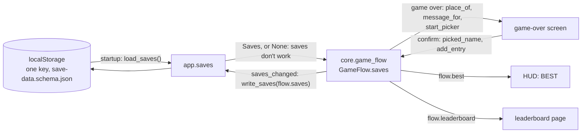

# Saves: the top 10, the last nickname, the letter picker and the place message
Version: 1
Status: frozen
Features: DRA-126
Created by: architect

## Purpose
The game keeps a top 10 of runs and the last nickname saved, in the browser's localStorage. Each entry is a nickname, a score and the level reached. Nothing else is saved. This contract holds the core side: the saved data as one state, `Saves`, the order of the list, the place a run would take on it, the message that place gives the game-over screen, and the letter picker the player names an entry with. All of it is pure: core never reads or writes the browser.

The app reads the saved data once at startup and hands it to the game flow, or hands it nothing when saves don't work (`docs/contracts/systems/app/save-storage.md`). The game flow (`docs/contracts/systems/game-flow.md`) holds it for the page's life: it works out the place when the game-over screen opens, runs the picker, adds the entry when a name is saved, and tells the app to write. BEST on the HUD and the leaderboard page read the list through the flow.

## Diagram


Place of a new run against a list (score, level reached), with `TOP_N` entries:
```
place  entry                      a run of 900, level 3 lands ...
1      1 500  LV 4
2      900    LV 4                 900 ties on score, loses on level: below
3      900    LV 3                 ties on both: the older entry stays above
4  <-- the new run, place 4        (place_of = 1 + entries that rank above or tie it)
...
```
A run that ties entry #`TOP_N` on score and level, or ranks below it, is off the list: `place_of` is None.

Letter picker, one slot per character, the cursor on slot 0 at the start:
```
last_nickname "ACE"   ->  [A][C][E][ ][ ][ ][ ][ ][ ][ ]   cursor 0
up on slot 0          ->  [B][C][E] ...                    up moves forward through NICKNAME_CHARACTERS
down on a blank       ->  the last character (wraps)
left on slot 0        ->  cursor on the last slot (wraps)
confirm               ->  picked_name "BCE": trailing blanks dropped; leading and inner blanks kept
```

## Interface
```python
# game/core/saves.py (new). Imports: stdlib, core.levels (FIRST_LEVEL, LEVEL_COUNT). Never pygame,
# ui or app. Logs nothing (the module still has its log). Every module-level constant is typing.Final.

TOP_N: Final[int]                 # 11-save-data.md, top_n (locked)
NICKNAME_LENGTH: Final[int]       # 11-save-data.md, nickname_length (locked, the most) and nickname_input (the slots)
NICKNAME_CHARACTERS: Final[str]   # 11-save-data.md, nickname_chars (locked), in the order of
                                  # nickname_char_order (guess). Index 0 is the blank.
BLANK: Final[str]                 # NICKNAME_CHARACTERS[0], the space: a blank slot

@dataclass(frozen=True, slots=True, kw_only=True)
class ScoreEntry:
    """One run on the top 10."""
    nickname: str        # a valid nickname (is_valid_nickname)
    score: int           # the run's final score, >= 0
    level_reached: int   # FIRST_LEVEL to LEVEL_COUNT

@dataclass(frozen=True, slots=True, kw_only=True)
class Saves:
    """Everything the game saves."""
    entries: tuple[ScoreEntry, ...] = ()   # place order, #1 first. 0 to TOP_N entries
    last_nickname: str | None = None       # the last name saved; None before the first

    @property
    def best(self) -> int | None: ...
        # entries[0].score, or None when entries is empty.

class GameOverMessage(Enum):
    """The game-over screen's message, by the run's place (10-ui.md, game_over_message)."""
    NEW_BEST_SCORE = "new_best_score"
    TOP_3 = "top_3"
    TOP_10 = "top_10"
    GAME_OVER = "game_over"

def place_of(saves: Saves, score: int, level_reached: int) -> int | None: ...
    # The place, 1 to TOP_N, an entry for this run would take, or None when it is off the list.
def message_for(place: int | None) -> GameOverMessage: ...
def add_entry(saves: Saves, entry: ScoreEntry) -> Saves: ...
    # entry inserted at place_of(saves, entry.score, entry.level_reached), the list cut to TOP_N,
    # last_nickname = entry.nickname. The caller only adds an entry that has a place.
def is_valid_nickname(text: str) -> bool: ...
    # True when text is 1 to NICKNAME_LENGTH characters, all in NICKNAME_CHARACTERS, the last not BLANK.

@dataclass(frozen=True, slots=True, kw_only=True)
class NamePicker:
    """The letter picker: one character per slot and the slot the cursor is on."""
    slots: tuple[str, ...]   # NICKNAME_LENGTH characters, each in NICKNAME_CHARACTERS
    cursor: int              # 0 to NICKNAME_LENGTH - 1

def start_picker(last_nickname: str | None) -> NamePicker: ...
def turn_character(picker: NamePicker, step: int) -> NamePicker: ...
    # step +1: the cursor's slot moves one character forward in NICKNAME_CHARACTERS; -1: back. Wraps.
def move_cursor(picker: NamePicker, step: int) -> NamePicker: ...
    # step +1: one slot right; -1: one slot left. Wraps.
def picked_name(picker: NamePicker) -> str: ...
    # The slots joined, trailing BLANKs dropped. "" when every slot is BLANK.
```
`FIRST_LEVEL` and `LEVEL_COUNT` (`core.levels`) are in `docs/contracts/systems/drifters.md`. The stored form (key, JSON shape) is `docs/contracts/schemas/save-data.schema.json`; reading and writing it is the app's (`systems/app/save-storage.md`).

## Rules
Values. Every value comes from the GDD; none is restated here.
- `TOP_N`: 11-save-data.md, top_n (locked). `NICKNAME_LENGTH`: nickname_length (locked: up to 10) and nickname_input (locked: 10 slots); they are one number.
- `NICKNAME_CHARACTERS`: the characters of nickname_chars (locked), in the order of nickname_char_order (guess): the blank first, then A to Z, 0 to 9, then the symbols in the order the GDD lists them. Say "guess" in reports that rely on the order.
- The level range: 08-difficulty.md, through `core.levels`.

**What is saved** (11-save-data.md, rules 1 and 4; 01-vision.md, locked decision 9). The entries, each a nickname, a score and the level reached, and `last_nickname`. Nothing else: no date, no id, no version. The age of an entry is its place in the list among equal entries, so no field is needed for the tie rule.

**Order** (11-save-data.md, rule 2 and sort_and_ties, locked). Entry `a` ranks above entry `b` when `a.score > b.score`, or the scores are equal and `a.level_reached > b.level_reached`. Equal on both: the older entry stays above. `entries` is always in this order, #1 first, and never holds more than `TOP_N`.

**Place** (`place_of`). `1 +` the number of entries that rank above the run or tie it on score and level, since a new entry goes under every older equal one. A result above `TOP_N` is None: off the list. So:
- an empty list gives place 1, whatever the score, 0 included (11-save-data.md, Edge cases: "the first score makes #1"; 01-vision.md, Edge cases);
- a run that ties #`TOP_N` on score and level is off the list (11-save-data.md, Edge cases);
- a list with fewer than `TOP_N` entries always has a place.

**Message** (`message_for`; 10-ui.md, game_over_message, locked; 11-save-data.md, rule 10; 10-ui.md, rule 10): place 1 is NEW_BEST_SCORE; 2 or 3 is TOP_3; 4 to `TOP_N` is TOP_10; None is GAME_OVER. The game flow passes None also when saves don't work (11-save-data.md, rule 5). A score off the list never gets another message.

**Adding** (`add_entry`; 11-save-data.md, rules 2 and 9). The entry goes in at its place, the entries below move down one, and an entry pushed past `TOP_N` is dropped. `last_nickname` becomes the entry's nickname. The same nickname may hold several entries (11-save-data.md, Edge cases).

**Best** (`Saves.best`; 11-save-data.md, rule 3; 10-ui.md, hud_best). The score of #1, None while the list is empty. It changes only when an entry is added at place 1.

**Nickname** (`is_valid_nickname`; 11-save-data.md, nickname_length, nickname_chars, rule 8). 1 to `NICKNAME_LENGTH` characters, each in `NICKNAME_CHARACTERS`, the last one not `BLANK`. Leading and inner blanks are allowed: the GDD drops only the blanks at the end. Every nickname the picker saves passes it; the app uses it to check the loaded data.

**Letter picker** (11-save-data.md, nickname_input (locked), nickname_char_order (guess), rules 6 to 9; 91-decision-log.md, row 92):
- `start_picker(last_nickname)`: the slots hold `last_nickname`'s characters from slot 0, then `BLANK` to the end; every slot `BLANK` when it is None. `cursor` 0. Source: rule 7; nickname_input ("The cursor starts on the first slot").
- `turn_character(picker, +1)` (up): the cursor's slot takes the next character in `NICKNAME_CHARACTERS`, the last wrapping to the first (the blank). `-1` (down): the one before, the blank wrapping to the last. Other slots and the cursor don't change.
- `move_cursor(picker, +1)` (right): the cursor moves one slot right, the last wrapping to slot 0. `-1` (left): one slot left, slot 0 wrapping to the last. The slots don't change.
- `picked_name(picker)`: the slots joined, with every `BLANK` at the end dropped. All blanks give `""`, an empty name: not valid, nothing is saved (rule 8).
- Which keys drive these, and when, is the game flow's (`systems/game-flow.md`, Rules, GAME_OVER).

**Pure.** Every function here is pure: no logging, no clock, no randomness, no I/O. Same input, same output. They never mutate their input. Source: 15-tech-constraints.md, rule 2; game/CONTEXT.md (trust values inside core: the app checks the loaded data at the edge).

**Same in both modes.** Nothing here reads the run mode: debug mode saves to the same top 10 (91-decision-log.md, row 93).

## Rationale
- **One `Saves` state in core, the storage in the app.** The order, the place, the tie rule and the picker are game rules (11-save-data.md), so they are pure core and testable without a browser. localStorage is browser I/O, like the tuning files, so it lives in `game/app/` and core never sees it.
- **Saves don't work is `None`, not a flag.** Rule 5 turns everything off together: BEST, the picker, saving and the filled leaderboard. One missing value says that in one place, and every reader handles it the same way.
- **No age field.** "The older entry stays above" needs only the list order: a new entry goes under every equal one, and nothing ever reorders the list. Adding a date would save a field locked decision 9 doesn't allow.
- **`place_of` counts ties above.** The same count answers both edge cases: ties go under, and a tie with #`TOP_N` is place `TOP_N + 1`, off the list.
- **Characters as one ordered string.** The picker's order is a guess the Director may change; one constant holds both the allowed set and the order, so a change is one edit and `is_valid_nickname` follows it.
- **`NICKNAME_LENGTH` is one constant for the slots and the longest name.** The GDD sets both to 10 and the picker's slots are the only way to make a name, so they can't differ.
- **The picker is in `core/saves.py`, not in the game flow.** 11-save-data.md owns the picker's rules. The flow only decides which press does what and when; the picker's own steps stay small and testable alone.
