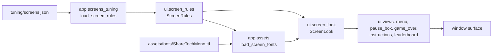

# Screens look
Version: 1
Status: draft
Features: DRA-147
Created by: architect

## Purpose
Give the menu, the pause box, the game-over screens, the instructions page and the leaderboard one look: Glass Cockpit, in the Mono Violet colors, with soft glow, in a mono font. This contract owns that look, its tuning file and the views that draw it. What each screen shows and which key does what stay in `docs/contracts/systems/game-flow.md`.

It closes UI-03 and UI-04. It replaces the white default-font stand-ins of DRA-125 and DRA-126. Where each screen sits in the window is unchanged (`10-ui.md`, `window_screens`). Source: scope report `docs/reports/scope/DRA-147.md`; `10-ui.md`, rows `screens_look`, `pause_look`, `game_over_look`, `menu_look`, `leaderboard_look`, `instructions_text_and_look`, `ui_font`, `ui_glow`, `screen_colors`; `12-art-and-audio.md`, Screen colors.

## Diagram
```
 full-window pages (856 × 518)        boxes, centered on the whole window, over the dimmed run
 +------------------------------+     +------------------+
 |:      T I T L E            :|     |[  P A U S E      ]|   glass: blurred picture, dark fill,
 |:  +--------+  +--------+   :|     |   [ENTER][SPACE]▸|   scan lines, border, corner brackets,
 |:  | card   |  | card   |   :|     +------------------+   soft glow round the lines (off: strength 0)
 |:  +--------+  +--------+   :|     320 × 120 pause, 320 × 160 game over,
 |:   [ENTER][SPACE] BACK     :|     400 × 280 game over with the picker
 +------------------------------+     (: = ruler ticks on both sides)
```


## Interface
```python
# game/ui/screen_rules.py. Imports: stdlib only. Frozen records that mirror docs/contracts/schemas/screens.schema.json.
RGB = tuple[int, int, int]
PALETTE_KEYS: tuple[str, ...]     # the 13 palette keys
FONT_ROLES: tuple[str, ...]       # the 17 text roles: title, message, menu_title, menu_item, button, label, digit,
                                  # picker, key, hint, row, top_name, top_score, level, card_title, card_text, empty

@dataclass(frozen=True)
class ScreenRules:
    palette: Mapping[str, RGB]        # the 13 keys, as RGB
    glass: GlassRules                 # fill, border, brackets, scan lines, blur_down
    glow: GlowRules                   # radius and strength of the box, text and icon glow
    fonts: FontRules                  # text_file and roles: tuple[FontRole(name, size, spacing)]
    rulers: RulerRules                # the tick marks on both sides of a page
    keycap: KeyCapRules               # key cap size, alphas and gaps
    choice: ChoiceRules               # the selected choice's fade and brackets, dim and off brightness
    pause: PauseRules                 # w, h, gap, blur
    game_over: GameOverRules          # box sizes, padding, score cells, picker slots and cursor, blur
    menu: MenuRules                   # item size and gaps, title gap, hint distance
    instructions: InstructionsRules   # margins, bands, card grid, icon box, blur
    leaderboard: LeaderboardRules     # margins, bands, table and row sizes, column widths, blur
```
```python
# game/app/screens_tuning.py. Not a startup module (imports ui); only app.frame imports it, inside the guard.
SCREENS_FILE: str                                   # "screens.json", in app.tuning.TUNING_DIR
def load_screen_rules() -> ScreenRules: ...         # read once at startup; checks every rule of the schema by hand
    # Missing file: FileNotFoundError. Bad file: ValueError naming "tuning/screens.json" and the field.
    # Range by field name: *_alpha 0..255, *_strength 0..1, *_size *_w *_h *_pitch (and w, h, size) >= 1,
    # glass.blur_down >= 1, instructions.columns >= 1, any other number >= 0. Palette: exactly PALETTE_KEYS, #rrggbb.
    # fonts.roles: every role in FONT_ROLES once, no other. rulers.major_pitch a multiple of minor_pitch.
    # game_over.picker_w, picker_h >= w, h.

# game/app/assets.py
def load_screen_fonts(rules: ScreenRules) -> dict[str, pygame.font.Font]: ...   # one Font per role at its size, after pygame.init()
```
```python
# game/ui/screen_look.py. Imports: pygame, ui.screen_rules. Never core, never app. Imports pygame only.
PLAY_SIGN: str                    # a key row's word drawn as a small play triangle
ARROW_KEYS: frozenset[str]        # UP, DOWN, LEFT, RIGHT: key caps drawn as arrows
type Anchor = Mapping[str, tuple[int, int]]   # one pygame Rect anchor, e.g. {"center": (x, y)}

class ScreenLook:
    def __init__(self, rules: ScreenRules, fonts: Mapping[str, pygame.font.Font]) -> None: ...
    rules: ScreenRules
    palette: Mapping[str, RGB]
    def text_size(self, string: str, role: str) -> tuple[int, int]: ...        # letter-spacing in, no trailing gap
    def blit_text(self, surface, string, role, color, anchor, glow=True, alpha=255) -> pygame.Rect: ...
        # draws one character at a time with the role's spacing; glow behind it; alpha 0..255 dims it; returns the text's rect
    def glass(self, surface, rect, blur, color=None) -> None: ...             # blur behind, fill, scan lines, border, brackets, glow
    def blur_behind(self, surface, rect) -> None: ...                         # no-op when glass.blur_down is 1
    def keycap_width(self, label) -> int: ...
    def keys_size(self, keys: tuple[str, ...], word: str | None) -> tuple[int, int]: ...
    def blit_keys(self, surface, keys, word, anchor, alpha=255) -> pygame.Rect: ...   # key caps, then the word or PLAY_SIGN
    def blit_choice(self, surface, label, rect, role, state) -> None: ...     # state: "selected", "dim" or "off"
    def blit_rulers(self, surface) -> None: ...                               # nothing when rulers.enabled is false

def halo(image: pygame.Surface, radius: int, strength: float) -> pygame.Surface: ...
    # image with a soft glow of its own colors behind it, 2 * radius larger on every side. The icons use it.
```
```python
# game/ui/pause_box.py. Imports: pygame, ui.screen_look.
PAUSE_TEXT: str                   # "PAUSE"
PAUSE_KEYS: tuple[str, ...]       # ("ENTER", "SPACE")
def draw_pause_box(surface: pygame.Surface, look: ScreenLook) -> None: ...

# game/ui/game_over.py. Imports: pygame, core.game_flow (GameOverChoice), core.saves, ui.score_text (SCORE_LABEL), ui.screen_look.
MESSAGE_TEXTS: Mapping[GameOverMessage, str]       # NEW BEST SCORE, TOP 3, TOP 10, GAME OVER
RETRY_TEXT, MENU_TEXT: str
PICKER_HINTS: tuple[tuple[tuple[str, ...], str], ...]   # (UP, DOWN) LETTER, (LEFT, RIGHT) SLOT, (ENTER) SAVE
def draw_game_over(surface, look, message: GameOverMessage = GAME_OVER, picker_shown: bool = False) -> None: ...
def draw_final_score(surface, look, score: int, picker_shown: bool = False) -> None: ...
def draw_name_picker(surface, look, picker: NamePicker, picking: bool) -> None: ...
def draw_game_over_choices(surface, look, selection: GameOverChoice, picker_shown: bool = False, active: bool = True) -> None: ...

# game/ui/menu.py. Imports: pygame, core.game_flow (MenuItem), ui.screen_look.
MENU_TITLE_TEXT: str              # "DRIFTWARD ACE"
MENU_HINT_TEXT: str               # "Up & Down to choose. Enter to start."
MENU_ITEM_TEXTS: Mapping[MenuItem, str]   # PLAY, INSTRUCTIONS, LEADERBOARD
def draw_menu(surface: pygame.Surface, look: ScreenLook, selection: MenuItem) -> None: ...

# game/ui/instructions.py. Imports: pygame, ui.screen_look.
INSTRUCTION_SECTIONS: tuple[tuple[str, str], ...]   # the six (topic, caption) pairs, in card order
def draw_instructions(surface: pygame.Surface, look: ScreenLook) -> None: ...
def card_rects(look: ScreenLook, size: tuple[int, int]) -> list[pygame.Rect]: ...   # the six card rects
def icon_rect(look: ScreenLook, card: pygame.Rect) -> pygame.Rect: ...

# game/ui/leaderboard.py. Imports: pygame, core.saves (ScoreEntry), ui.score_text (group_digits), ui.screen_look.
LEADERBOARD_TITLE_TEXT, LEADERBOARD_EMPTY_TEXT, LEVEL_LABEL: str   # "LEADERBOARD", "No scores yet.", "LV"
def draw_leaderboard(surface: pygame.Surface, look: ScreenLook, entries: Sequence[ScoreEntry] = ()) -> None: ...
```
`app.frame` builds the look once, after the window opens: `ScreenLook(screen_rules, load_screen_fonts(screen_rules))`, and passes it to `_draw`, which hands it to every view above.

## Presentation
Every view draws on the surface it is given and works from `surface.get_size()`: the whole 856 × 518 window in the game. The full-window pages are drawn over `WindowBackdrop`; the boxes are drawn after `hud.dim(window)`. Text is Share Tech Mono (`fonts.text_file`) at the role's size and letter-spacing. Titles and labels are capitals with nothing before them.

| Screen | What is drawn | Where |
|---|---|---|
| Pause | glass box `pause.w` × `pause.h`; PAUSE (role `title`, plating, glow); under it, `pause.gap` below, the key caps ENTER and SPACE and a play triangle | box centered on the surface; word and key row are one block centered in the box |
| Game over | glass box; the message (role `message`, plating, glow); the score line; RETRY over MENU (role `button`) | box `game_over.w` × `h`, centered; lines spread evenly between `pad_top` and `pad_bottom` |
| Game over with the picker | the same box at `picker_w` × `picker_h`; then the slot row and the hint row between the score and the choices | lines spread evenly between `picker_pad_top` and `pad_bottom` |
| Menu | title DRIFTWARD ACE (role `menu_title`, glow); PLAY, INSTRUCTIONS, LEADERBOARD as choices (role `menu_item`); the hint line (role `hint`, 60%, no glow); rulers | title, `title_gap` and the three items are one block centered on both axes; the hint's bottom is `hint_bottom` above the window's bottom |
| Instructions | HOW TO PLAY (role `title`); six glass cards in `columns` columns; footer; rulers | title `margin_top` from the top; cards fill the window between the head band and the foot band inside `margin_x`, `gap` apart; footer centered in the foot band |
| Leaderboard | LEADERBOARD (role `title`); the top 10 as three medal rows and seven plain rows; footer; rulers | title `margin_top` from the top; table `table_w` wide, centered, and centered between the bands as if it held ten rows |

**Glass.** Per box or card: the picture behind it blurred (only when its `blur` is on), a `panel_body` fill at `fill_alpha`, one scan line of `frame_lights` every `scan_pitch` rows, a 1 px `frame_lights` border, four corner brackets `bracket_out` px outside the edge, and a soft glow round the border and brackets. A medal row on the leaderboard takes its rank color (`rank_1`, `rank_2`, `rank_3`) for the border, brackets and glow.

**Score line.** The label SCORE (role `label`), then the digits in cells `score_cell_w` wide, in groups of three `score_group_gap` apart, in the `score` color. At least `score_digits` digits show; leading zeros are dim and the last digit never is. A longer score shows in full.

**Name picker.** `NICKNAME_LENGTH` slots `slot_w` × `slot_h`, `slot_gap` apart, centered; the character in role `picker`, plating; a line `slot_line_w` thick under each slot. While picking, the cursor's slot has a cyan fill (`cursor_alpha`), a solid cyan line and a triangle `arrow_gap` above and below. The hint row below shows three hints, `keycap.group_gap` apart: the UP and DOWN arrow key caps and LETTER; the LEFT and RIGHT arrow key caps and SLOT; ENTER and SAVE. After the save the slots stay and the cursor and the hint places stay empty. RETRY and MENU are faint with no frame while `active` is false.

**Choices.** The selected choice: its label lit with glow, framed by `[` and `]` `bracket_inset` from its edges, over a cyan fade that is clear at both ends and strongest in the middle. Not selected: the label at `dim_alpha`. Not pickable yet: the label at `off_alpha`.

**Instructions cards.** Order and text as in `instructions_text_and_look`: FLY, PAUSE, GRAZE, WARNING, FALL, COINS, each topic in its card's color (`frame_lights`, `ship_lines_light`, `graze`, `last_life`, `ship_lines`, `level`) and the caption in plating at about 88%. Each card has an icon box `icon_w` × `icon_h` on the left, vertically centered, and the text block to its right, wrapped to the card. The six icons are vector drawings made once: FLY (the four arrow keys, the ship, its flame, a dashed curve), PAUSE (ENTER and SPACE keys, a pause sign, a play sign), GRAZE (a dashed ring, a rock, the ship, `+25`), WARNING (one plain warning triangle with a mark and three chevrons pointing down: no drifter), FALL (the ship over a dashed floor line, a broken heart, `-1`), COINS (a rock, three coins, `+50`).

**Leaderboard rows.** Medal row (`top_h` tall, `top_gap` apart): a medal picture (a crown for #1, a ribbon medal with the number for #2 and #3, `medal_size` px, rank color, glow), the nickname (role `top_name`, plating), the score (role `top_score`, rank color, right-aligned, `group_digits`), `LV n` (role `level`, `level` color). Plain row (`row_h` tall, from `rest_gap` below the medal rows): the place number without a dot (plating at 50%), the nickname (role `row`), the score, `LV n`, and a thin `frame_lights` line below at `rule_alpha`. Entry `i` is place `i + 1`. An empty list shows `LEADERBOARD_EMPTY_TEXT` (role `empty`, plating at about 65%) `empty_top` below the head band and no rows.

**Footer.** The ENTER and SPACE key caps and the word BACK, centered in the foot band (instructions, leaderboard).

**Rulers.** Short ticks every `minor_pitch` rows and a long one every `major_pitch`, down both sides of a full-window page, `inset_x` from the side and `inset_y` from the top and bottom.

## Rules
- The views only draw. They take the surface, the look and plain values. They never fill the background, flip the display, read a key, the focus or the run mode, change game state, log per frame or catch an error. Source: 10-ui.md, rule 5; `game/CONTEXT.md`.
- Every color, size, gap, strength and letter-spacing comes from `tuning/screens.json`. No look value is written in code. The words fixed in the GDD stay in code as content. Source: 10-ui.md, rule 12; the Director's "everything configurable".
- Drawn once, then kept: the glass panels, the glow, the text pictures, the icons, the medals, the fade and the rulers are built the first time a view needs them and reused. Per frame the views only blit. The text cache is cleared if it passes 512 entries. Source: 12-art-and-audio.md, rule 3; 15-tech-constraints.md, rule 5.
- The blur is the one live cost: the picture behind a box is made smaller and scaled back up every frame. Each screen has its own `blur` switch (`pause`, `game_over`, `instructions`, `leaderboard`) and `glass.blur_down` sets the strength (1 is off). It is on for the pause box and the game-over box, where the picture behind is frozen, and off for the instructions page and the leaderboard, where the background moves. Source: 15-tech-constraints.md, rules 5 and 6; to be measured in the browser build.
- Glow is soft and only on the screens. The HUD stays flat. Source: 10-ui.md, `ui_glow`.
- Key hints are on: the pause box, the name picker and the page footers. A key is drawn as a key cap, the arrows as small triangles. Source: 10-ui.md, `pause_box`, `game_over_look`, `instructions_text_and_look`.
- No corner labels, no page label and no invented text on any screen. Source: 10-ui.md, `screens_look`.
- The window size is never written here: the views read `surface.get_size()`. The numbers fit 856 × 518 (`hud.json`, `window`). Source: 10-ui.md, `window_screens`.
- The screens use their own palette, not the HUD's. Both stay separate files. Source: 10-ui.md, `screen_colors`.
- The locked words stay as written: PAUSE, RETRY, MENU, NEW BEST SCORE, TOP 3, TOP 10, GAME OVER. Source: 10-ui.md, rule 6.

## Edge cases
- Fewer than ten entries: only those rows draw; the table is centered as if it held ten, so rows don't move.
- A score under `score_digits` digits: dim leading zeros pad it to `score_digits`. A score of 0 shows dim zeros and a lit last 0.
- A surface of another size: every view centers on it. The pages' card grid and table are sized from the tuning numbers and the surface's size.
- `glass.blur_down` of 1, `glow.*_strength` of 0 or `rulers.enabled` false: that part is simply left out.
- A box drawn near the surface edge: the blur works on the part of the box inside the surface.
- The picker with a blank slot draws the slot and its line, and no character.
- Choices while the picker takes the keys: RETRY and MENU are faint and unframed whatever `selection` says.

## Rationale
- **A `ScreenLook` object, not module constants.** Five screens share glass, glow, text, key caps and choices. One object built from the rules holds the caches, so each look change is one tuning value, and it replaces `ui/screen_look.py`'s DRA-125 constants.
- **One font, per-role size and spacing.** The mock-up's Glass Cockpit sets all text in the mono face with wide letter-spacing. pygame has no letter-spacing, so text is drawn a character at a time, once, and kept.
- **Glass without a picture file.** The look needs no baked image. Panels and icons are drawn once at startup, so a tuning change shows after a reload with no tool run.
- **Views take the look as an argument.** The look is built once in the app, like the HUD's view, and the views stay small and testable with a real look and a plain surface.
- **Blur is a switch per screen.** The pages sit over a moving background, so their blur would be recomputed every frame for six cards or three rows. The boxes sit over a frozen picture. Browser measurements decide the defaults.

## Decisions
- DRA-125 and DRA-126 stand-ins are replaced: white default-font text, black box, `>` marker, outline-square icons, the grey RETRY and MENU.
- The menu now shows the GDD's `menu_hint`, which the stand-in left out.
- Menu items are drawn in capitals (PLAY, INSTRUCTIONS, LEADERBOARD), like RETRY and MENU.
- The game-over score shows at least 7 digit cells with dim leading zeros, as the mock-up does, and not the plain `SCORE 61 250` of the stand-in.
- Leaderboard place numbers have no dot (`4`, not `4.`), as in the mock-up.
- The leaderboard's empty line "No scores yet." and the menu title DRIFTWARD ACE are carried over from the DRA-125 stand-ins. The GDD does not word them.
- The WARNING icon is one plain sign, not a drifter, so it names no hazard.
- The ruler ticks stay as pure shapes; the corner texts of the mock-up are dropped.
