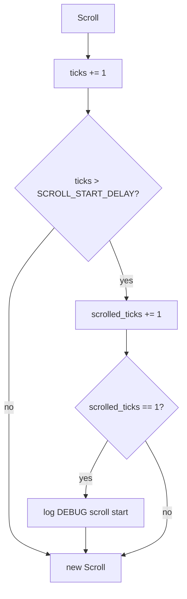
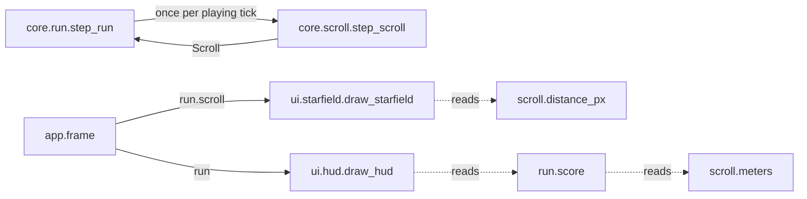

# Scroll: world scroll, distance and starfield
Version: 4
Status: frozen
Features: DRA-13, DRA-19, DRA-23, DRA-61
Created by: architect

## Purpose
The screen stays fixed. The world scrolls down past it at a steady speed, and distance counts that scroll. This contract holds the scroll's state and its one-tick step, the distance in px and in whole meters, and the starfield view that makes the motion visible. Level 1 speed only: levels and speed changes are out of DRA-13.

The scroll and the ship never touch each other. The ship's step doesn't read the scroll, and the scroll's step doesn't read the ship.

Who builds what:
- `game/core/scroll.py`: the Gameplay Implementer, task `DRA-13-01-gameplay-implementer`. `Final` and `slots` in DRA-19: task `DRA-19-01-gameplay-implementer`.
- `game/ui/starfield.py`: the UI Developer, task `DRA-13-02-ui-developer`.
- `game/tests/core/test_scroll.py`: the QA Engineer, task `DRA-13-04-qa-engineer`.
- Creating the scroll at play start and stepping it once per playing tick: `core.run`, from `docs/contracts/systems/run.md` (DRA-23). Drawing the starfield from `run.scroll`: the Integration Engineer, in `game/app/frame.py`, from `docs/contracts/systems/app.md`.
- The score, which counts `meters` at 1 point a meter: `docs/contracts/systems/run.md`. The SCORE line that shows it: `docs/contracts/systems/hud.md`. `meters` has no readout of its own.

## Diagram




Timeline from play start (tick 0 is the state `start_scroll()` returns):
```
tick      0 ... 30 | 31    32    33   ...  130
scrolled  0 ...  0 |  1     2     3   ...  100
distance  0 ...  0 | 1.1   2.2   3.3  ...  110.0 px
meters    0 ...  0 |  0     0     0   ...   11
```

## Interface
```python
# game/core/scroll.py
# Imports: stdlib only (math, logging, dataclasses, typing). Never pygame, ui or app.
# Every module-level constant is typing.Final (DRA-19).

SCROLL_BASE: Final[float] = 1.1             # 03-world-and-camera.md, scroll_base, px/tick (guess)
LEVEL_1_SCROLL_MULT: Final[float] = 1.0     # 08-difficulty.md, Level table, Level 1 scroll speed × (locked)
SCROLL_PER_TICK: Final[float]               # = SCROLL_BASE * LEVEL_1_SCROLL_MULT -> 1.1 px/tick
SCROLL_START_DELAY: Final[int] = 30         # 03-world-and-camera.md, scroll_start_delay, ticks (guess)
DISTANCE_START: Final[int] = 0              # 03-world-and-camera.md, distance_start, m (locked)
PX_PER_METER: Final[int] = 10               # 03-world-and-camera.md, px_per_meter (locked)

@dataclass(frozen=True, slots=True)
class Scroll:
    """Scroll state after a tick."""
    ticks: int = 0             # ticks run since play started
    scrolled_ticks: int = 0    # ticks on which the world moved

    @property
    def distance_px(self) -> float: ...
        # DISTANCE_START * PX_PER_METER + scrolled_ticks * SCROLL_PER_TICK

    @property
    def meters(self) -> int: ...
        # math.floor(distance_px / PX_PER_METER)

def start_scroll() -> Scroll: ...
    # Scroll(ticks=0, scrolled_ticks=0). Called once, at play start.

def step_scroll(scroll: Scroll) -> Scroll: ...
    # One 60 Hz tick. Pure apart from one event log line.
    # Same scroll in, same scroll out. Never mutates its input.
```

```python
# game/ui/starfield.py
# Imports: pygame, random, core.scroll, core.world. Never app.
STAR_COUNT: int = 50                          # scope report DRA-13, temporary stand-in
STAR_COLOR: tuple[int, int, int] = (90, 100, 140)   # scope report DRA-13, temporary stand-in
STAR_SIZES: tuple[int, ...] = (1, 2)          # px, scope report DRA-13, temporary stand-in
STAR_SEED: int                                # any fixed int; the UI Developer picks it once

Star = tuple[int, int, int]                   # (x, base_y, size), screen px
STARS: tuple[Star, ...]                       # built once from STAR_SEED

def draw_starfield(surface: pygame.Surface, scroll: Scroll) -> None: ...
```

## Presentation
`draw_starfield` reads only this core field and these constants. It draws on top of the background fill and under everything else.

| Core field | Shown as |
|---|---|
| `scroll.distance_px` | how far every star has moved down. Star drawn top-left: `(x, int((base_y + scroll.distance_px) % SCREEN_H))`. So the stars move down at the scroll speed and wrap from the bottom back to the top. Source: scope report DRA-13, Feature and Values needed (starfield, temporary stand-in); 03-world-and-camera.md, rule 4 |
| `SCREEN_W`, `SCREEN_H` (core.world) | the area the stars are spread over, and the wrap height |
| (always) | each star a filled `size` × `size` square in `STAR_COLOR`, (90, 100, 140). Source: scope report DRA-13, temporary stand-in |

The star layout:
- `STARS` holds `STAR_COUNT` (50) stars, built once with `random.Random(STAR_SEED)`. For each star, in order: `x = rng.randrange(SCREEN_W)`, `base_y = rng.randrange(SCREEN_H)`, `size = rng.choice(STAR_SIZES)`. Same seed, same layout, every run. Source: scope report DRA-13 ("the same layout every run").
- Built once, at import or on the first draw. Never per frame. Source: 15-tech-constraints.md, rule 5.
- A star whose square crosses the bottom edge is clipped by pygame. It shows again at the top once its y wraps.
- One layer, no parallax. Every star moves by the same `distance_px`. Source: scope report DRA-13, Limits (parallax is out).
- Before the scroll starts, `distance_px` is 0 and the stars sit still at their base positions.
- The view only draws. It never fills, never flips, never logs per frame, never catches an error, never changes the scroll.

## Rules
Values:
- Every constant above has its value and source on its line. `scroll_base` and `scroll_start_delay` are `guess`. The Level 1 multiplier, `distance_start` and `px_per_meter` are locked. The starfield values are temporary stand-ins the Director approved and deliberately left out of the GDD. Source: scope report DRA-13, Values needed.
- `SCROLL_PER_TICK` is computed from `SCROLL_BASE` and `LEVEL_1_SCROLL_MULT`, never written as a bare 1.1. Source: 08-difficulty.md, rule 2.

The step, every tick:
1. `ticks += 1`. Source: 15-tech-constraints.md, rule 2 (fixed tick).
2. If the new `ticks` is greater than `SCROLL_START_DELAY`: `scrolled_ticks += 1`. So ticks 1 to 30 don't move the world, and tick 31 is the first that does. Source: 03-world-and-camera.md, rule 4 and scroll_start_delay; 91-decision-log.md, row 24.

Distance:
- `distance_px = DISTANCE_START × PX_PER_METER + scrolled_ticks × SCROLL_PER_TICK`. At play start it is 0. Source: 03-world-and-camera.md, rule 8, distance_start.
- `meters = floor(distance_px / PX_PER_METER)`. Whole meters, rounded down. Source: 06-scoring.md, rule 1 and meters_rounding; 03-world-and-camera.md, px_per_meter.
- Distance grows only through the scroll. Nothing about the ship changes it: where it sits, hovering, climbing, a wall or the top line, a fall and respawn. Source: 03-world-and-camera.md, rules 4 and 8, Edge cases.
- Distance and meters never go down. Source: 06-scoring.md, rule 1.

Other rules:
- Play starts when the ship first appears at screen center: `core.run.start_run()` calls `start_scroll()` right after `spawn()`, and the app calls `start_run()` before the first frame. That is tick 0. Source: scope report DRA-13, Values needed (play start, temporary stand-in until the control card exists); systems/run.md (DRA-23).
- Once started, the scroll never stops until game over. A fall, a respawn and the respawn wait don't pause or reset it. Source: 03-world-and-camera.md, rule 4; 05-lives-and-damage.md, rule 2.5; scope report DRA-13, Limits.
- At game over the scroll freezes: `core.run` stops stepping it. A retry starts a new run with a new `start_scroll()`, so distance is 0 m again and the start delay counts again. Source: 02-game-flow.md, rules 3, 5 and 6; systems/run.md (DRA-23).
- The scroll never changes the ship, and the ship never changes the scroll. `step_scroll` takes no ship. `core.ship.step` takes no scroll. Source: 03-world-and-camera.md, rule 4; 04-ship.md, rules 3 and 4; 01-vision.md, Pillar 1.
- Level 1 speed only. Source: scope report DRA-13, Limits (levels are out).
- No frame time, no randomness. Same input, same output. Source: 15-tech-constraints.md, rule 2.
- Core behaves the same in normal and debug mode. It never reads the run mode. Source: game/CONTEXT.md, Run modes.
- Core never imports pygame, `ui` or `app`. Source: game/CONTEXT.md, Layout.

Logging (logger `core.scroll`, DEBUG, by event, never by tick). Source: game/CONTEXT.md, Logging; 15-tech-constraints.md, rule 9:
- `scroll start tick=%d`: once per scroll, on the tick the world first moves (the returned scroll has `scrolled_ticks == 1`), with that tick's `ticks` (31). From DRA-23 each run has its own scroll, so a retry logs it again for the new run.
- Nothing else. No line per tick, no line per meter.

## Impact
DRA-23 changes this frozen contract (v2). No code, signature, value or log line changes. Only who creates and steps the scroll changes (`core.run` instead of the app), and the scroll now freezes at game over and restarts on retry. Every file in `game/` that depends on it, found by grepping `game/` (tests included) for `core.scroll`, `Scroll`, `start_scroll` and `step_scroll`:

| File | Change needed |
|---|---|
| `game/core/scroll.py` | none. |
| `game/core/run.py` (new) | calls `start_scroll` and `step_scroll`. Task `DRA-23-01-gameplay-implementer`. |
| `game/ui/starfield.py` | none. The app passes `run.scroll`. |
| `game/ui/hud.py` | reads `run.scroll.meters` instead of `scroll.meters`. See `systems/hud.md`, Impact. Task `DRA-23-02-ui-developer`. |
| `game/app/frame.py` | stops calling `start_scroll` and `step_scroll`; `core.run` does. Integration Engineer, from `systems/app.md`. |
| `game/tests/core/test_scroll.py` | none. It calls the scroll directly. |
| `game/tests/ui/test_hud.py` | see `systems/hud.md`, Impact. |

DRA-61 changes this frozen contract (v3). No code, signature, value or log line changes. Only who reads `meters` for the screen changes: `core.run`'s `score` reads it, and the HUD shows the score instead of a meters readout. Grepping `game/` (tests included) for `core.scroll`, `Scroll`, `.meters`:

| File | Change needed |
|---|---|
| `game/core/scroll.py`, `game/ui/starfield.py`, `game/tests/core/test_scroll.py` | none. |
| `game/core/run.py` | `score` reads `scroll.meters`. See `systems/run.md`, Impact. Task `DRA-61-01-gameplay-implementer`. |
| `game/ui/hud.py`, `game/tests/ui/test_hud.py` | see `systems/hud.md`, Impact. |

## Rationale
- **`Final` and `slots=True` (DRA-19).** Same reasons as in `systems/ship.md`, Rationale. Core modules stay alike. `Scroll`'s field docstrings and its two properties are unaffected by slots.
- **A separate system, not part of `core/world.py`.** `world.py` is constants only, and the DRA-6 world contract keeps it that way. The scroll has state and a step, like the ship. Its constants live with it, the same way the ship's physics constants live in `core/ship.py`.
- **The state counts ticks, not pixels.** Adding 1.1 to a float every tick piles up rounding error, and a meter boundary can land a hair below the true value: floor then shows one meter less for a tick. `scrolled_ticks × SCROLL_PER_TICK` is one multiplication. At every whole-meter boundary the exact value is a whole number of px, which a float holds exactly, and rounding to nearest can't fall below it. So `meters` is exact. When levels arrive, a level feature changes the state to count ticks per speed. That is a contract change for that feature.
- **`distance_px` and `meters` are properties.** They are core facts the UI reads, computed in core, and a frozen state can't hold a distance that disagrees with its tick count.
- **`ticks` and `scrolled_ticks` both kept.** `ticks` marks play time, which the start delay needs. `scrolled_ticks` is what the distance needs, and stays right once levels change the speed partway through a run.
- **Tick 31 is the first that scrolls.** "Starts 30 ticks after play starts": after 30 ticks (0.5 s) of a still world, the world moves. Tick 0 is the state before any tick runs, the moment the ship first appears.
- **`start_scroll` and `step_scroll`, not `start` and `step`.** The app imports both `core.ship.step` and this step into one module. Distinct names avoid an alias.
- **The starfield reads `distance_px`, not a separate offset.** Distance counts the scroll, so it is the scroll offset. The view only takes it modulo the screen height. No extra core field needed.
- **The star layout lives in UI.** Star positions are a look, not a rule. Core never draws and never needs them. A fixed seed gives the same layout every run without typing 50 positions into a contract. The seed has no design meaning, so it isn't a GDD value.
- **The scroll start is logged once.** It is an event, and the integration check needs it to time the 0.5 s delay. A line per meter would be about seven a second, which the log policy rules out.
- **No art task.** The starfield is a placeholder look of plain dots, approved as a temporary stand-in. No sprite, no asset. The final background is AA-02.
- **No schema.** DRA-13 adds no data file. Every value is a constant in code, as the ship's are. The tuning file is out of scope.
