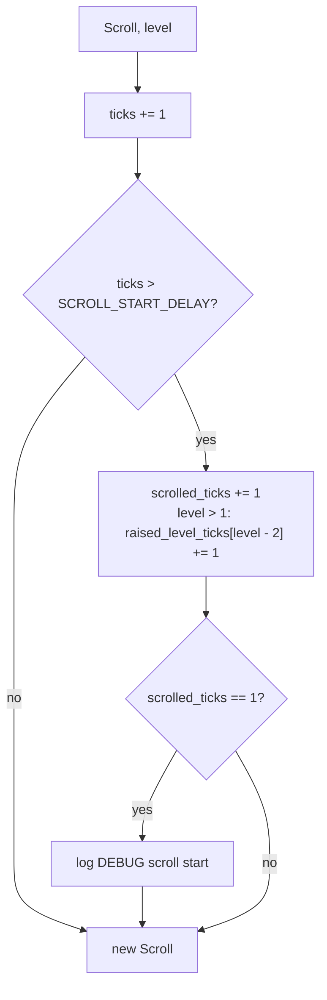
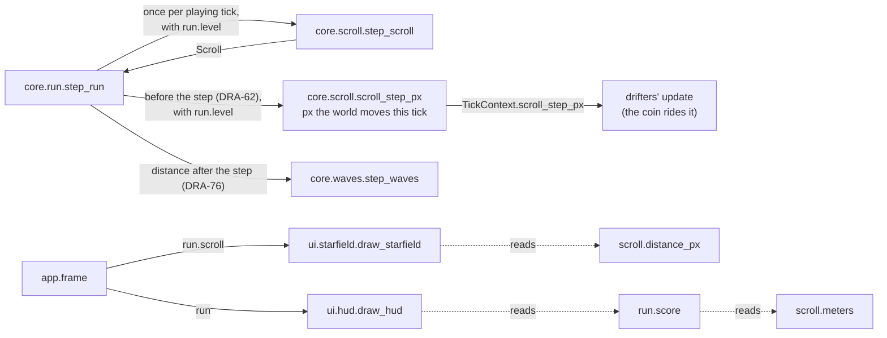

# Scroll: world scroll, distance and starfield
Version: 6
Status: frozen
Features: DRA-13, DRA-19, DRA-23, DRA-61, DRA-62, DRA-76
Created by: architect

## Purpose
The screen stays fixed. The world scrolls down past it at a speed set by the level, and distance counts that scroll. This contract holds the scroll's state and its one-tick step at a given level, how far the world moves on the next step (what a parked drifter, such as the coin, rides on), the distance in px and in whole meters, and the starfield view that makes the motion visible. The level comes from the run (`docs/contracts/systems/run.md`, `Run.level`); the scroll only uses it.

The scroll and the ship never touch each other. The ship's step doesn't read the scroll, and the scroll's step doesn't read the ship.

Who builds what:
- `game/core/scroll.py`: the Gameplay Implementer, task `DRA-13-01-gameplay-implementer`. `Final` and `slots` in DRA-19: task `DRA-19-01-gameplay-implementer`.
- `game/ui/starfield.py`: the UI Developer, task `DRA-13-02-ui-developer`.
- `game/tests/core/test_scroll.py`: the QA Engineer, task `DRA-13-04-qa-engineer`.
- Creating the scroll at play start and stepping it once per playing tick: `core.run`, from `docs/contracts/systems/run.md` (DRA-23). Drawing the starfield from `run.scroll`: the Integration Engineer, in `game/app/frame.py`, from `docs/contracts/systems/app.md`.
- The score, which counts `meters` at 1 point a meter: `docs/contracts/systems/run.md`. The SCORE line that shows it: `docs/contracts/systems/hud.md`. `meters` has no readout of its own.
- `scroll_step_px` in `game/core/scroll.py`: the Gameplay Implementer, task `DRA-62-02-gameplay-implementer`. `core.run` reads it each tick and hands it to the drifters (`docs/contracts/systems/run.md`, step 3; `docs/contracts/systems/drifters.md`, `TickContext`). Its test: task `DRA-62-06-qa-engineer`, in `game/tests/core/test_scroll.py`.
- The speed per level (`scroll_speed`, `raised_level_ticks`, the `level` argument, `DISTANCE_DECIMALS`, the meters' rounding): the Gameplay Implementer, task `DRA-76-01-gameplay-implementer`. The scroll speed × row is in `core/levels.py` (`docs/contracts/systems/drifters.md`). Its tests: task `DRA-76-02-qa-engineer`, in `game/tests/core/test_scroll.py`. `core.run` passing the run's level: task `DRA-76-05-gameplay-implementer`.

## Diagram




Timeline from play start, at Level 1 (tick 0 is the state `start_scroll()` returns):
```
tick      0 ... 30 | 31    32    33   ...  130
scrolled  0 ...  0 |  1     2     3   ...  100
distance  0 ...  0 | 1.1   2.2   3.3  ...  110.0 px
meters    0 ...  0 |  0     0     0   ...   11
```

A level rise (DRA-76). The run's level is 2 in the state after tick T (its waves raised it on that tick, `systems/waves.md`), so tick T moved at Level 1 speed and tick T+1 is the first at Level 2:
```
tick                  T          T+1        T+2
level going in        1          2          2
world moves, px       1.1        1.21       1.21
raised_level_ticks    (0, ...)   (1, ...)   (2, ...)    index 0 is Level 2
```

## Interface
```python
# game/core/scroll.py
# Imports: stdlib only (math, logging, dataclasses, typing), and core.levels (DRA-76).
# Never pygame, ui or app. Every module-level constant is typing.Final (DRA-19).

SCROLL_BASE: Final[float] = 1.1             # 03-world-and-camera.md, scroll_base, px/tick (guess)
SCROLL_START_DELAY: Final[int] = 30         # 03-world-and-camera.md, scroll_start_delay, ticks (guess)
DISTANCE_START: Final[int] = 0              # 03-world-and-camera.md, distance_start, m (locked)
PX_PER_METER: Final[int] = 10               # 03-world-and-camera.md, px_per_meter (locked)
DISTANCE_DECIMALS: Final[int] = 6           # DRA-76. Float guard: a distance is rounded to 6 decimals (micro-px)
                                            # before it is floored to meters or compared with a wave trigger
# DRA-76: LEVEL_1_SCROLL_MULT and SCROLL_PER_TICK are gone; scroll_speed(level) replaces them.

@dataclass(frozen=True, slots=True)
class Scroll:
    """Scroll state after a tick."""
    ticks: int = 0             # ticks run since play started
    scrolled_ticks: int = 0    # ticks on which the world moved, at any level
    raised_level_ticks: tuple[int, ...] = (0, 0, 0, 0, 0, 0, 0)   # DRA-76
        # ticks on which the world moved at Levels 2 to 8, Level 2 first (LEVEL_COUNT - 1 entries).
        # The ticks at Level 1 are scrolled_ticks - sum(raised_level_ticks).

    @property
    def distance_px(self) -> float: ...
        # DISTANCE_START * PX_PER_METER + SCROLL_BASE * (
        #     scroll_mult(1) * (scrolled_ticks - sum(raised_level_ticks))
        #     + sum(scroll_mult(level) * raised_level_ticks[level - 2] for level 2 to 8))

    @property
    def meters(self) -> int: ...
        # math.floor(round(distance_px, DISTANCE_DECIMALS) / PX_PER_METER)

def scroll_speed(level: int) -> float: ...                             # DRA-76
    # SCROLL_BASE * scroll_mult(level), px/tick. Raises ValueError for a level outside 1 to 8.

def start_scroll() -> Scroll: ...
    # Scroll(ticks=0, scrolled_ticks=0), no raised-level ticks. Called once, at play start.

def step_scroll(scroll: Scroll, level: int = FIRST_LEVEL) -> Scroll: ...
    # One 60 Hz tick at `level` (DRA-76; left out: Level 1). Pure apart from one event log line.
    # Same scroll and level in, same scroll out. Never mutates its input.

def scroll_step_px(scroll: Scroll, level: int = FIRST_LEVEL) -> float: ...   # DRA-62, level DRA-76
    # How far the world moves down, px, on the tick that steps this scroll at `level`:
    # scroll_speed(level) when scroll.ticks + 1 > SCROLL_START_DELAY, else 0.0.
    # Pure, logs nothing. Doesn't step anything.
```
`FIRST_LEVEL` and `scroll_mult` come from `core.levels` (`docs/contracts/systems/drifters.md`).

```python
# game/ui/starfield.py
# Imports: pygame, random, core.scroll, core.world. Never app.
STAR_COUNT: int = 50                          # scope report DRA-13, temporary stand-in
STAR_COLOR: tuple[int, int, int] = (90, 100, 140)   # scope report DRA-13, temporary stand-in
STAR_SIZES: tuple[int, ...] = (1, 2)          # px, scope report DRA-13, temporary stand-in
STAR_SEED: int                                # any fixed int; the UI Developer picks it once

Star = tuple[int, int, int]                   # (x, base_y, size), screen px
STARS: tuple[Star, ...]                       # built once from STAR_SEED

def draw_starfield(surface: pygame.Surface, scroll: Scroll) -> None: ...
```

## Presentation
`draw_starfield` reads only this core field and these constants. It draws on top of the background fill and under everything else.

| Core field | Shown as |
|---|---|
| `scroll.distance_px` | how far every star has moved down. Star drawn top-left: `(x, int((base_y + scroll.distance_px) % SCREEN_H))`. So the stars move down at the scroll speed and wrap from the bottom back to the top. Source: scope report DRA-13, Feature and Values needed (starfield, temporary stand-in); 03-world-and-camera.md, rule 4 |
| `SCREEN_W`, `SCREEN_H` (core.world) | the area the stars are spread over, and the wrap height |
| (always) | each star a filled `size` × `size` square in `STAR_COLOR`, (90, 100, 140). Source: scope report DRA-13, temporary stand-in |

The star layout:
- `STARS` holds `STAR_COUNT` (50) stars, built once with `random.Random(STAR_SEED)`. For each star, in order: `x = rng.randrange(SCREEN_W)`, `base_y = rng.randrange(SCREEN_H)`, `size = rng.choice(STAR_SIZES)`. Same seed, same layout, every run. Source: scope report DRA-13 ("the same layout every run").
- Built once, at import or on the first draw. Never per frame. Source: 15-tech-constraints.md, rule 5.
- A star whose square crosses the bottom edge is clipped by pygame. It shows again at the top once its y wraps.
- One layer, no parallax. Every star moves by the same `distance_px`. Source: scope report DRA-13, Limits (parallax is out).
- Before the scroll starts, `distance_px` is 0 and the stars sit still at their base positions.
- The view only draws. It never fills, never flips, never logs per frame, never catches an error, never changes the scroll.

## Rules
Values:
- Every constant above has its value and source on its line. `scroll_base` and `scroll_start_delay` are `guess`. `distance_start` and `px_per_meter` are locked, and so is the scroll speed × row (`core.levels`). The starfield values are temporary stand-ins the Director approved and deliberately left out of the GDD. Source: scope report DRA-13, Values needed.
- The speed at a level is `scroll_speed(level) = SCROLL_BASE × scroll_mult(level)`, never a bare number: 1.1 px a tick at Level 1, 1.21 at Level 2, up to 1.87 at Level 8 (1.7 ×). Source: 03-world-and-camera.md, rule 4; 08-difficulty.md, rule 2 and Scroll speed × row.
- `DISTANCE_DECIMALS` is a float guard, not a game value (Rationale).

The step, every tick, at the level the run passes (`Run.level` going into the tick; `systems/run.md`, step 5):
1. `ticks += 1`. Source: 15-tech-constraints.md, rule 2 (fixed tick).
2. If the new `ticks` is greater than `SCROLL_START_DELAY`: `scrolled_ticks += 1`, and at a level above 1 also `raised_level_ticks[level - 2] += 1`. So ticks 1 to 30 don't move the world, and tick 31 is the first that does. Source: 03-world-and-camera.md, rule 4 and scroll_start_delay; 91-decision-log.md, row 24.
3. A level outside 1 to 8 raises `ValueError` (from `core.levels`). Core never passes one.
- The level going into a tick sets that tick's speed. A level that rises on tick T (`systems/waves.md`) is in the state after T, so tick T+1 is the first at the new speed. Source: 08-difficulty.md, Edge cases ("The scroll speed changes on the tick the level rises"); 91-decision-log.md, row 65; Rationale.
- `step_scroll(scroll)` with no level steps at Level 1, exactly as before DRA-76.

The next step's movement (DRA-62, level DRA-76):
- `scroll_step_px(scroll, level)` is the px the world moves down on the tick that steps `scroll` at `level`: `scroll_speed(level)` when `scroll.ticks + 1 > SCROLL_START_DELAY`, else 0.0. It reads the same rule as step 2, so it always agrees with the step: `step_scroll(scroll, level).distance_px − scroll.distance_px` equals `scroll_step_px(scroll, level)` within 1e-9 px, on every tick and at every level. 0.0 on the steps to ticks 1 to 30. Source: 03-world-and-camera.md, rules 4 and 9 (parked drifters move down with the scroll).
- It is called on the scroll as it was going into a tick, with the same level `step_scroll` gets on that tick, before `step_scroll` runs (`systems/run.md`, step 3). It logs nothing, so the `scroll start` line still comes once, from `step_scroll`.
- It never changes the scroll and is never read by the ship. Only `core.run` calls it, to tell the drifters how far the world moves this tick.

Distance:
- `distance_px = DISTANCE_START × PX_PER_METER + SCROLL_BASE × (scroll_mult(1) × level_1_ticks + Σ scroll_mult(L) × raised_level_ticks[L − 2] for L = 2 to 8)`, with `level_1_ticks = scrolled_ticks − sum(raised_level_ticks)`. At play start it is 0. At Level 1 only, it is `scrolled_ticks × 1.1`, as before. Source: 03-world-and-camera.md, rules 4 and 8, distance_start.
- `meters = floor(round(distance_px, DISTANCE_DECIMALS) / PX_PER_METER)`. Whole meters, rounded down. The round only keeps float noise from dropping a meter at an exact boundary; at Level 1 it gives the same meters as before. Source: 06-scoring.md, rule 1 and meters_rounding; 03-world-and-camera.md, px_per_meter.
- Distance grows only through the scroll. Nothing about the ship changes it: where it sits, hovering, climbing, a wall or the top line, a fall and respawn. Source: 03-world-and-camera.md, rules 4 and 8, Edge cases.
- Distance and meters never go down. Source: 06-scoring.md, rule 1.

Other rules:
- Play starts when the ship first appears at screen center: `core.run.start_run()` calls `start_scroll()` right after `spawn()`, and the app calls `start_run()` before the first frame. That is tick 0. Source: scope report DRA-13, Values needed (play start, temporary stand-in until the control card exists); systems/run.md (DRA-23).
- Once started, the scroll never stops until game over. A fall, a respawn and the respawn wait don't pause or reset it. Source: 03-world-and-camera.md, rule 4; 05-lives-and-damage.md, rule 2.5; scope report DRA-13, Limits.
- At game over the scroll freezes: `core.run` stops stepping it. A retry starts a new run with a new `start_scroll()`, so distance is 0 m again and the start delay counts again. Source: 02-game-flow.md, rules 3, 5 and 6; systems/run.md (DRA-23).
- The scroll never changes the ship, and the ship never changes the scroll. `step_scroll` takes no ship. `core.ship.step` takes no scroll. Source: 03-world-and-camera.md, rule 4; 04-ship.md, rules 3 and 4; 01-vision.md, Pillar 1.
- The speed follows the level the run passes; the scroll never works out a level. Source: 01-vision.md, Locked decisions, 2 ("a steady speed set by the level"); 03-world-and-camera.md, rule 4; scope report DRA-76, Limits.
- No frame time, no randomness. Same input, same output. Source: 15-tech-constraints.md, rule 2.
- Core behaves the same in normal and debug mode. It never reads the run mode. Source: game/CONTEXT.md, Run modes.
- Core never imports pygame, `ui` or `app`. Source: game/CONTEXT.md, Layout.

Logging (logger `core.scroll`, DEBUG, by event, never by tick). Source: game/CONTEXT.md, Logging; 15-tech-constraints.md, rule 9:
- `scroll start tick=%d`: once per scroll, on the tick the world first moves (the returned scroll has `scrolled_ticks == 1`), with that tick's `ticks` (31). From DRA-23 each run has its own scroll, so a retry logs it again for the new run.
- Nothing else. No line per tick, no line per meter.

## Impact
DRA-23 changes this frozen contract (v2). No code, signature, value or log line changes. Only who creates and steps the scroll changes (`core.run` instead of the app), and the scroll now freezes at game over and restarts on retry. Every file in `game/` that depends on it, found by grepping `game/` (tests included) for `core.scroll`, `Scroll`, `start_scroll` and `step_scroll`:

| File | Change needed |
|---|---|
| `game/core/scroll.py` | none. |
| `game/core/run.py` (new) | calls `start_scroll` and `step_scroll`. Task `DRA-23-01-gameplay-implementer`. |
| `game/ui/starfield.py` | none. The app passes `run.scroll`. |
| `game/ui/hud.py` | reads `run.scroll.meters` instead of `scroll.meters`. See `systems/hud.md`, Impact. Task `DRA-23-02-ui-developer`. |
| `game/app/frame.py` | stops calling `start_scroll` and `step_scroll`; `core.run` does. Integration Engineer, from `systems/app.md`. |
| `game/tests/core/test_scroll.py` | none. It calls the scroll directly. |
| `game/tests/ui/test_hud.py` | see `systems/hud.md`, Impact. |

DRA-61 changes this frozen contract (v3). No code, signature, value or log line changes. Only who reads `meters` for the screen changes: `core.run`'s `score` reads it, and the HUD shows the score instead of a meters readout. Grepping `game/` (tests included) for `core.scroll`, `Scroll`, `.meters`:

| File | Change needed |
|---|---|
| `game/core/scroll.py`, `game/ui/starfield.py`, `game/tests/core/test_scroll.py` | none. |
| `game/core/run.py` | `score` reads `scroll.meters`. See `systems/run.md`, Impact. Task `DRA-61-01-gameplay-implementer`. |
| `game/ui/hud.py`, `game/tests/ui/test_hud.py` | see `systems/hud.md`, Impact. |

DRA-62 changes this frozen contract (v4). One new pure function, `scroll_step_px`. `Scroll`, `start_scroll`, `step_scroll`, every constant and the log line don't change. Grepping `game/` (tests included) for `core.scroll`, `Scroll`, `step_scroll` and `SCROLL_`:

| File | Change needed |
|---|---|
| `game/core/scroll.py` | `scroll_step_px`. Task `DRA-62-02-gameplay-implementer`. |
| `game/core/run.py` | step 3 passes `scroll_step_px(run.scroll)` to the drifters. See `systems/run.md`, Impact. Task `DRA-62-02-gameplay-implementer`. |
| `game/ui/starfield.py`, `game/ui/hud.py`, `game/app/frame.py`, `game/app/debug_spawns.py` | none. |
| `game/tests/core/test_scroll.py` | none needed; must pass unchanged. Task `DRA-62-06-qa-engineer` adds one test for `scroll_step_px`. |
| `game/tests/core/test_run.py`, `test_run_score.py`, `test_run_drifters.py`, `test_chain_lightning.py`, `test_fireball.py`, `game/tests/ui/test_hud.py` | none. They read `run.scroll` and its properties, which don't change. |

DRA-76 changes this frozen contract (v5). `Scroll` gains `raised_level_ticks` (default: all 0, so Level 1 only); `step_scroll` and `scroll_step_px` gain a `level` argument defaulting to Level 1; `scroll_speed` and `DISTANCE_DECIMALS` are new; `LEVEL_1_SCROLL_MULT` and `SCROLL_PER_TICK` are gone; `meters` rounds before flooring. At Level 1 every value, the step and the log line are what they were. Grepping `game/` (tests included) for `core.scroll`, `Scroll(`, `step_scroll`, `scroll_step_px`, `SCROLL_PER_TICK`, `LEVEL_1_SCROLL_MULT`, `.meters` and `distance_px`:

| File | Change needed |
|---|---|
| `game/core/scroll.py` | everything above. Task `DRA-76-01-gameplay-implementer`. |
| `game/core/run.py` | steps 3 and 5 pass `run.level` (`systems/run.md`). Task `DRA-76-05-gameplay-implementer`. Until then it calls both with no level: Level 1, as today. |
| `game/core/waves.py` (new) | imports `DISTANCE_DECIMALS` (`systems/waves.md`). Task `DRA-76-03-gameplay-implementer`. |
| `game/ui/starfield.py`, `game/ui/hud.py`, `game/app/` | none. The stars read `distance_px`, so they speed up with the level by themselves. |
| `game/tests/core/test_scroll.py` | none needed; must pass unchanged. Task `DRA-76-02-qa-engineer` adds the speed per level. |
| `game/tests/core/test_run.py`, `test_run_score.py`, `test_run_drifters.py`, `test_chain_lightning.py`, `test_fireball.py`, `test_coin.py`, `game/tests/ui/test_hud.py` | none. They build `Scroll(ticks=..., scrolled_ticks=...)` by keyword, which is still Level 1 only, and import neither removed constant. |

## Rationale
- **The level is an argument, not part of the scroll (DRA-76).** The level belongs to the run's waves (`systems/waves.md`); a copy in the scroll could disagree with it. Passing it in keeps one home for the level and leaves the scroll a plain step. The default keeps every existing call and test at Level 1.
- **Ticks counted per level (DRA-76).** The distance stays a function of whole-tick counts, as DRA-13 planned for levels: one multiplication per level, no running float sum. `scrolled_ticks` keeps its meaning (every tick the world moved), so every existing `Scroll(ticks=..., scrolled_ticks=...)` still means Level 1 only.
- **The meters round to 6 decimals first (DRA-76).** With several levels the distance is a sum, and float noise can land a hair under a whole meter. With today's values every speed is a whole number of hundredths of a px (1.1 × 1.0 to 1.7), so a true distance is a multiple of 0.01 px and is never within a micro-px of a boundary it hasn't reached. At Level 1 the result is the same as DRA-13's exact one.
- **The new speed starts the tick after the level rises (DRA-76).** A wave ends because the world moved past its length on that tick, so the tick that ends it has already moved at the old speed. The state that shows the new level is the first that uses the new speed, and the next tick moves at it. 91-decision-log.md, row 65 ("The scroll speed changes on that tick") reads as the run's speed for the next step changing in the same state as the level.
- **`Final` and `slots=True` (DRA-19).** Same reasons as in `systems/ship.md`, Rationale. Core modules stay alike. `Scroll`'s field docstrings and its two properties are unaffected by slots.
- **A separate system, not part of `core/world.py`.** `world.py` is constants only, and the DRA-6 world contract keeps it that way. The scroll has state and a step, like the ship. Its constants live with it, the same way the ship's physics constants live in `core/ship.py`.
- **The state counts ticks, not pixels.** Adding 1.1 to a float every tick piles up rounding error, and a meter boundary can land a hair below the true value: floor then shows one meter less for a tick. Ticks times a speed is one multiplication per speed. At Level 1, at every whole-meter boundary the exact value is a whole number of px, which a float holds exactly, and rounding to nearest can't fall below it. From DRA-76 the state counts ticks per level (above).
- **`distance_px` and `meters` are properties.** They are core facts the UI reads, computed in core, and a frozen state can't hold a distance that disagrees with its tick count.
- **`ticks` and `scrolled_ticks` both kept.** `ticks` marks play time, which the start delay needs. `scrolled_ticks` is what the distance needs, and stays right once levels change the speed partway through a run.
- **Tick 31 is the first that scrolls.** "Starts 30 ticks after play starts": after 30 ticks (0.5 s) of a still world, the world moves. Tick 0 is the state before any tick runs, the moment the ship first appears.
- **`start_scroll` and `step_scroll`, not `start` and `step`.** The app imports both `core.ship.step` and this step into one module. Distinct names avoid an alias.
- **The starfield reads `distance_px`, not a separate offset.** Distance counts the scroll, so it is the scroll offset. The view only takes it modulo the screen height. No extra core field needed.
- **The star layout lives in UI.** Star positions are a look, not a rule. Core never draws and never needs them. A fixed seed gives the same layout every run without typing 50 positions into a contract. The seed has no design meaning, so it isn't a GDD value.
- **The scroll start is logged once.** It is an event, and the integration check needs it to time the 0.5 s delay. A line per meter would be about seven a second, which the log policy rules out.
- **No art task.** The starfield is a placeholder look of plain dots, approved as a temporary stand-in. No sprite, no asset. The final background is AA-02.
- **`scroll_step_px` reads the scroll going into the tick (DRA-62).** The run updates drifters (step 3) before it steps the scroll (step 5), and moving the scroll step earlier would change the frozen order of the run's log lines. A pure function of the old scroll gives the same number `step_scroll` is about to add, with no second log line. Computing it in the scroll module keeps the start-delay rule in one place: the run never works out when the world moves. When levels change the speed, this function changes with `step_scroll`, and parked drifters follow for free.
- **No schema.** DRA-13 adds no data file. Every value is a constant in code, as the ship's are. The tuning file is out of scope.
