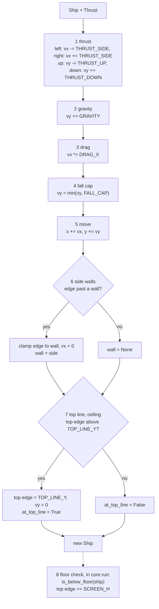
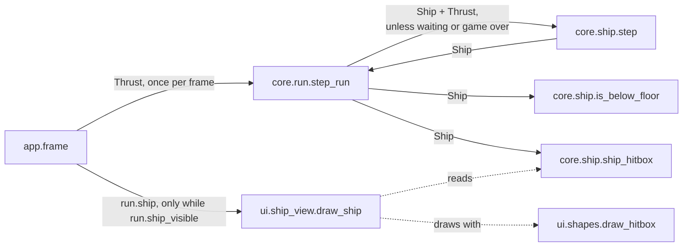

# Ship
Version: 5
Status: frozen
Features: DRA-6, DRA-13, DRA-19, DRA-23, DRA-29
Created by: architect

## Purpose
The ship's state and its one-tick physics step: thrust, gravity, drag, fall cap, move, side walls, top line. Plus the floor test the run uses, the ship's hitbox, and the view that draws the ship as its placeholder look.

From DRA-13 the top-line stop is the real rule, not a stand-in: the screen is fixed and the top line is a ceiling (03-world-and-camera.md, rule 2; 04-ship.md, rule 2, step 7). The world scroll never touches the ship (`docs/contracts/systems/scroll.md`).

From DRA-23 the step no longer respawns the ship. The step ends after the top line, and `is_below_floor` tells the run whether the ship has fallen. What a fall costs (a life, the respawn, the wait, game over) is the run's rule: `docs/contracts/systems/run.md`.

From DRA-29 the ship has a hitbox: an inverted T of two boxes, used by the run to test touches with drifters (`docs/contracts/systems/drifters.md`, `docs/contracts/systems/run.md`). The placeholder ship is drawn as that same inverted T, so what the player sees is exactly what can be hit. The ship also names its top sideways speed, which the meteorite's speed is set from. Physics, walls, top line and floor don't change.

Who builds what:
- `game/core/ship.py`: the Gameplay Implementer, task `DRA-6-01-gameplay-implementer`. Field docs, `Final` and `slots` in DRA-19: task `DRA-19-01-gameplay-implementer`. The step without the respawn, and `is_below_floor`, in DRA-23: task `DRA-23-01-gameplay-implementer`. The hitbox and `TOP_SIDE_SPEED` in DRA-29: task `DRA-29-01-gameplay-implementer`.
- `game/ui/ship_view.py`: the UI Developer, task `DRA-6-02-ui-developer`. The inverted T in DRA-29: task `DRA-29-04-ui-developer`, with the shared shape helper `game/ui/shapes.py`.
- `game/tests/core/test_ship.py`: the QA Engineer, task `DRA-6-03-qa-engineer`. Updated for DRA-23: task `DRA-23-04-qa-engineer`. The hitbox in DRA-29: task `DRA-29-07-qa-engineer`. The inverted T drawn: `game/tests/ui/test_ship_view.py`, task `DRA-29-09-qa-engineer`.
- Calling `spawn`, `step`, `is_below_floor` and `ship_hitbox`: `core.run`, from `docs/contracts/systems/run.md`. Building `Thrust` from the keys, and calling `draw_ship` only while `run.ship_visible`: the Integration Engineer, in `game/app/frame.py`, from `docs/contracts/systems/app.md`.

## Diagram


The hitbox, an inverted T, offsets from the ship's center (x, y). Screen y is down:
```
          x-16      x-6  x+6       x+16
 y-16              +-----+                 bar: Box(cx 0, cy 0, w 12, h 32)
                   |     |
                   | bar |
 y+4     +---------+     +---------+       foot: Box(cx 0, cy 10, w 32, h 12)
         |          foot           |
 y+16    +-------------------------+
```
The whole T fits the `SHIP_W × SHIP_H` (32 × 32) square, so the edges the walls, the top line and the floor use don't change.



## Interface
```python
# game/core/ship.py
# Imports: stdlib, core.world, core.collision (DRA-29). Never pygame, ui or app.
# Every module-level constant is typing.Final (DRA-19).

SHIP_W: Final[int] = 32               # 04-ship.md, ship_w (guess)
SHIP_H: Final[int] = 32               # 04-ship.md, ship_h (guess)
GRAVITY: Final[float] = 0.16          # 04-ship.md, gravity, px/tick² (guess)
THRUST_SIDE: Final[float] = 0.42      # 04-ship.md, thrust_side, px/tick² (guess)
THRUST_UP: Final[float] = 0.42        # 04-ship.md, thrust_up, px/tick² (guess)
THRUST_DOWN: Final[float] = 0.42      # 04-ship.md, thrust_down, px/tick² (guess)
DRAG_X: Final[float] = 0.94           # 04-ship.md, drag_x, × per tick (guess)
FALL_CAP: Final[float] = 5.5          # 04-ship.md, fall_cap, px/tick (guess)
SPAWN_X: Final[float] = 320.0         # 03-world-and-camera.md ship_start = 05-lives-and-damage.md fall_respawn
SPAWN_Y: Final[float] = 240.0         # same
TOP_SIDE_SPEED: Final[float]          # DRA-29. = THRUST_SIDE * DRAG_X / (1 - DRAG_X) -> 6.58 px/tick
                                      # 04-ship.md, derived values (top sideways speed with a side key held)
HITBOX_BAR_W: Final[int] = 12         # DRA-29. 04-ship.md, hitbox: the bar is 12 px wide, SHIP_H tall (guess)
HITBOX_FOOT_H: Final[int] = 12        # DRA-29. 04-ship.md, hitbox: the foot is SHIP_W wide, 12 px tall (guess)
SHIP_HITBOX: Final[Hitbox]            # DRA-29. Offsets from the ship's center:
                                      # (Box(cx=0, cy=0, w=HITBOX_BAR_W, h=SHIP_H),
                                      #  Box(cx=0, cy=SHIP_H / 2 - HITBOX_FOOT_H / 2, w=SHIP_W, h=HITBOX_FOOT_H))
                                      # -> bar (0, 0, 12, 32), foot (0, 10, 32, 12)

Wall = Literal["left", "right"]       # a type alias, not a constant: no Final

@dataclass(frozen=True, slots=True)
class Thrust:
    """Which arrow keys are held this tick."""
    up: bool = False
    down: bool = False
    left: bool = False
    right: bool = False

@dataclass(frozen=True, slots=True)
class Ship:
    """Ship state after a tick. Screen px, y down."""
    x: float                       # center x
    y: float                       # center y
    vx: float                      # px/tick, + is right
    vy: float                      # px/tick, + is down (falling)
    wall: Wall | None = None       # wall the ship was clamped against this tick
    at_top_line: bool = False      # the top line (ceiling) clamped the ship this tick

def spawn() -> Ship: ...
    # Ship at (SPAWN_X, SPAWN_Y), vx = vy = 0, wall None, at_top_line False.

def step(ship: Ship, thrust: Thrust) -> Ship: ...
    # One 60 Hz tick, steps 1 to 7. Pure apart from event logging: same ship and
    # thrust in, same ship out. Never mutates its input. Never respawns (DRA-23).

def is_below_floor(ship: Ship) -> bool: ...     # DRA-23
    # True when the ship is fully below the floor: top edge >= SCREEN_H.
    # Pure, no logging.

def ship_hitbox(ship: Ship) -> Hitbox: ...      # DRA-29
    # place_hitbox(SHIP_HITBOX, ship.x, ship.y): the two boxes at screen positions.
    # Pure, no logging.
```
`Hitbox`, `Box` and `place_hitbox` come from `core.collision` (`docs/contracts/systems/drifters.md`, Interface). Derived edges, used by the rules below: left edge `x - SHIP_W / 2`, right edge `x + SHIP_W / 2`, top edge `y - SHIP_H / 2`.

The code carries each `Ship` field's comment above (what it is, its unit, its sign) as that field's documentation, together with the class docstring's "Screen px, y down". From DRA-19. Source: scope report DRA-19, item 1; review DRA-6-01-gameplay-implementer, finding 1.

```python
# game/ui/ship_view.py
# Imports: pygame, core.ship, ui.shapes (DRA-29). Never app.
SHIP_COLOR: tuple[int, int, int] = (255, 255, 255)   # 04-ship.md, placeholder_look (guess)

def draw_ship(surface: pygame.Surface, ship: Ship) -> None: ...
```
The signature doesn't change in DRA-29. `ui.shapes` is in `docs/contracts/systems/drifters.md`, Interface.

## Presentation
`draw_ship` reads only these core fields and functions. It draws on top of what is there and never fills the background.

| Core field | Shown as |
|---|---|
| `ship_hitbox(ship)` | the ship, filled, in `SHIP_COLOR`: `draw_hitbox(surface, SHIP_COLOR, ship_hitbox(ship))`, each box a filled rectangle. The look is the hitbox. From DRA-29. Source: 04-ship.md, placeholder_look ("the same inverted T as `hitbox`") and hitbox (guess); 91-decision-log.md, row 35 |
| (always) | color `SHIP_COLOR`, (255, 255, 255). Source: 04-ship.md, placeholder_look (guess) |

- Each placed box is drawn as the rectangle with top-left `(round(cx - w / 2), round(cy - h / 2))` and size `round(w) × round(h)` (`ui.shapes.draw_shape`). Every offset in `SHIP_HITBOX` is an even whole number of px (bar left −6, top −16; foot left −16, top +4), so both boxes round the same way and the T never splits. At spawn (320, 240): bar x 314 to 325, rows 224 to 255; foot x 304 to 335, rows 244 to 255. Rows 224 to 243 left of x 314 and right of x 325 stay empty.
- `vx`, `vy`, `wall` and `at_top_line` are not shown by the ship view. The debug overlay shows `vx` and `vy` and outlines the hitbox (`docs/contracts/systems/debug-overlay.md`).
- A ship partly past the floor is drawn as is. pygame clips what falls outside the surface. At game over after a fall the ship stays where it fell, fully below the floor, so nothing of it shows. At game over after a hit it stays where it was hit and shows.
- The blink: the app calls `draw_ship` only on frames where `run.ship_visible` is True (`docs/contracts/systems/run.md`, Presentation). The view knows nothing about the blink.
- The view only draws. It never flips, never logs per frame, never catches an error, never changes the ship.

## Rules
Values:
- Every constant above has its value and source on its line. All are `guess` in the GDD except `fall_respawn`, which is locked. Source: 04-ship.md, 03-world-and-camera.md and 05-lives-and-damage.md, Values. Scope report DRA-6, Values needed; scope report DRA-29, Values needed.
- `TOP_SIDE_SPEED` is computed from `THRUST_SIDE` and `DRAG_X`, never written as a bare 6.58. Source: 04-ship.md, derived values ("Recompute when a value changes").
- `SHIP_HITBOX` is computed from `SHIP_W`, `SHIP_H`, `HITBOX_BAR_W` and `HITBOX_FOOT_H`, never from bare numbers.

The step, in this order, every time it is called. Source: 04-ship.md, rule 2:
1. **Thrust.** `left` subtracts `THRUST_SIDE` from `vx`, `right` adds it. `up` subtracts `THRUST_UP` from `vy`, `down` adds `THRUST_DOWN`. Opposite keys held together cancel. Source: 04-ship.md, rule 2.1 and Edge cases.
2. **Gravity.** `vy += GRAVITY`. Always, whatever is held. Source: 04-ship.md, rule 2.2; 01-vision.md, locked decision 4.
3. **Drag.** `vx *= DRAG_X`. No drag on `vy`. Source: 04-ship.md, rules 2.3 and 7.
4. **Fall cap.** If `vy > FALL_CAP`, `vy = FALL_CAP`. No cap on upward speed. Source: 04-ship.md, rules 2.4 and 7.
5. **Move.** `x += vx`, `y += vy`. Source: 04-ship.md, rule 2.5.
6. **Side walls.** If the left edge is below 0: set the left edge to 0, `vx = 0`, `wall = "left"`. If the right edge is past `SCREEN_W`: set the right edge to `SCREEN_W`, `vx = 0`, `wall = "right"`. Otherwise `wall = None`. No bounce. Source: 03-world-and-camera.md, rule 6; 01-vision.md, locked decision 3; 04-ship.md, rule 2.6.
7. **Top line, a ceiling.** If the top edge is above `TOP_LINE_Y` (`y - SHIP_H / 2 < TOP_LINE_Y`): set the top edge to `TOP_LINE_Y`, `vy = 0`, `at_top_line = True`. Otherwise `at_top_line = False`. Source: 03-world-and-camera.md, rule 2; 04-ship.md, rule 2, step 7; 91-decision-log.md, row 22.

Then `step` returns the ship. It never respawns it, even when the ship is past the floor. Source: scope report DRA-23, Feature.

8. **Floor check, `is_below_floor`.** True when the ship is fully below the floor: `y - SHIP_H / 2 >= SCREEN_H`. `core.run` calls it right after the step and applies the fall. Source: 04-ship.md, rule 2.8; 03-world-and-camera.md, rule 5; 05-lives-and-damage.md, rule 2; `docs/contracts/systems/run.md`.

Hitbox (DRA-29):
- An inverted T of two upright boxes: a bar `HITBOX_BAR_W` (12) px wide and `SHIP_H` (32) tall, centered on the ship; and a foot `SHIP_W` (32) wide and `HITBOX_FOOT_H` (12) tall, along the bottom (its bottom edge on the ship's bottom edge). Source: 04-ship.md, hitbox (guess); 91-decision-log.md, row 35.
- The ship never rotates, so the boxes stay upright. Source: 04-ship.md, rule 8.
- The hitbox is never bigger than what the player sees: the ship is drawn as exactly these two boxes. Source: 04-ship.md, rule 8 and placeholder_look; 07-drifters.md, rule 8.
- `ship_hitbox(ship)` places it at the ship's center. The run tests it against each drifter's hitbox (`systems/run.md`). The ship's hitbox is the same during the blink and the respawn wait: the blink is a look, not a state. Source: 05-lives-and-damage.md, Edge cases.
- The ship has no graze zone. Graze zones belong to hazards. Source: 06-scoring.md, rule 3.

Other rules:
- `step` always runs steps 1 to 7. Whether it is called on a tick is the run's rule: not while the ship waits at the respawn point, and not during game over. Source: 05-lives-and-damage.md, rule 2.5; 02-game-flow.md, rule 5; `docs/contracts/systems/run.md`. 04-ship.md, rule 3 names these as its two exceptions (91-decision-log.md, row 32).
- Input only changes acceleration. No key sets a speed or a position. The wall clamp and the top-line stop are rules, not input. A hit changes neither the position nor the speed (05-lives-and-damage.md, rule 1.4). Source: 04-ship.md, rule 4; 01-vision.md, Pillar 1.
- A run starts with `spawn()`: (320, 240), at rest. `core.run.start_run` calls it. Source: 03-world-and-camera.md, ship_start (guess); 02-game-flow.md, rule 3.
- `step`, `is_below_floor` and `ship_hitbox` use no frame time and no randomness. Same input, same output. Source: 15-tech-constraints.md, rule 2.
- Core behaves the same in normal and debug mode. It never reads the run mode. Source: game/CONTEXT.md, Run modes.
- Core never imports pygame, `ui` or `app`. Source: game/CONTEXT.md, Layout.
- The ship never reads the world scroll, and the scroll never changes the ship. Source: 03-world-and-camera.md, rule 4; systems/scroll.md.

Logging (logger `core.ship`, DEBUG, by event, never by tick). Source: game/CONTEXT.md, Logging; 15-tech-constraints.md, rule 9:
- `wall hit side=%s x=%.2f y=%.2f`: when the returned ship has `wall` set and the input ship's `wall` was different. Holding a key against a wall logs once, not every tick.
- `top line stop x=%.2f y=%.2f`: when the returned ship has `at_top_line` True and the input ship had it False. Holding Up at the line logs once.
- Values are the new position after the clamp. Nothing else is logged. `ship_hitbox` logs nothing. Hits are logged by `core.run`.

## Impact
DRA-29 changes this frozen contract (v4). `core/ship.py` gains `TOP_SIDE_SPEED`, `HITBOX_BAR_W`, `HITBOX_FOOT_H`, `SHIP_HITBOX` and `ship_hitbox`, and imports `core.collision`. Every existing constant, field, signature, step and log line stays as it is. The ship view draws the inverted T instead of the 32 × 32 square; its signature doesn't change. Every file in `game/` that depends on it, found by grepping `game/` (tests included) for `core.ship`, `draw_ship`, `ship_view`, `SHIP_W`, `SHIP_H` and `Ship`:

| File | Change needed |
|---|---|
| `game/core/ship.py` | the new constants and `ship_hitbox`, the `core.collision` import, and the module docstring names the hitbox. Task `DRA-29-01-gameplay-implementer`. |
| `game/core/collision.py` (new) | `Box`, `Hitbox`, `place_hitbox`. Task `DRA-29-01-gameplay-implementer`. |
| `game/ui/ship_view.py` | draws `ship_hitbox(ship)` filled with `ui.shapes.draw_hitbox`; the docstrings stop naming a rectangle. Task `DRA-29-04-ui-developer`. |
| `game/ui/shapes.py` (new) | `draw_shape`, `draw_hitbox`. Task `DRA-29-04-ui-developer`. |
| `game/core/run.py` | calls `ship_hitbox`. See `systems/run.md`, Impact. Task `DRA-29-03-gameplay-implementer`. |
| `game/ui/debug_overlay.py` | outlines `ship_hitbox(run.ship)`. See `systems/debug-overlay.md`, Impact. Task `DRA-29-06-ui-developer`. |
| `game/app/frame.py` | none from this contract. `draw_ship(surface, run.ship)` is unchanged. |
| `game/tests/core/test_ship.py` | none breaks: no test reads a removed name. Task `DRA-29-07-qa-engineer` adds the hitbox test in its own file. |
| `game/tests/core/test_run.py`, `game/tests/ui/test_hud.py` | none. They use `spawn()`, `step`, `Ship` and `Thrust`, which don't change. `test_hud.py` never draws the ship. |

## Rationale
- **The top-line stop stays as built.** The GDD makes the top line a ceiling with the same clamp and `vy = 0` that DRA-6 built as a stand-in (91-decision-log.md, row 22).
- **The step no longer respawns (DRA-23).** A fall now costs a life, starts invulnerability and a wait, or ends the run. All of that depends on state the ship doesn't hold. The ship reports the fact, `is_below_floor`; the run applies the rule.
- **`step` is not called during the wait or game over (DRA-23).** 05-lives-and-damage.md, rule 2.5 and decision-log row 27 say the ship stands at rest after a fall until the first press. 02-game-flow.md, rule 5 freezes everything at game over. 04-ship.md, rule 3 names both as its exceptions (91-decision-log.md, row 32).
- **`x`, `y` are the ship's center.** The GDD puts `ship_start` and `fall_respawn` at "screen center (320, 240)".
- **`step` returns a new frozen `Ship`.** A pure step is easy to test and to repeat.
- **`wall` and `at_top_line` live in the state.** They let `step` log only when contact starts, and later features (lava walls) will need them.
- **Fully below the floor is `top edge >= SCREEN_H`.** With the top edge at 480 no pixel of the ship is on the 480-row screen.
- **The top-line clamp triggers only when the edge is past the line.** A ship resting exactly on the line isn't "hitting" it.
- **The hitbox lives with the ship, as offsets (DRA-29).** It is a ship value from 04-ship.md, like `SHIP_W`. Offsets from the center let the run, the view and the overlay all place it with one helper.
- **The view draws the hitbox (DRA-29).** 04-ship.md says the placeholder is "the same inverted T as `hitbox`". Drawing from `ship_hitbox` makes that true by construction: there is one shape, not two copies that could drift.
- **The T's bounding box is the 32 × 32 square (DRA-29).** The bar spans the full height and the foot the full width. So the wall, top-line and floor rules, which use the square's edges, still match the T's outer edges, and no physics rule changes.
- **`TOP_SIDE_SPEED` lives here (DRA-29).** It is the ship's own derived value (04-ship.md, derived values). The meteorite's speed is a ratio of it, and the spawner reads it here, so a tuning change to the ship carries through.
- **Physics constants stay in `core/ship.py`.** DRA-29 adds tuning files for drifters and the playtest switches only (scope report DRA-29, Limits). Moving the ship's physics to a tuning file is a later contract change.
- **No art task.** Sprite art is out of scope. The placeholder T needs no asset.
- **The view rounds each box's corner.** pygame draws on whole pixels. Even offsets make both boxes round the same way.
- **The ship color lives in `ship_view.py`, not `ui/look.py`.** Only the ship view uses it.
- **`Final[int]` and `Final[float]`, not bare `Final` (DRA-19).** Keeping the type inside `Final` keeps the contract text and the code the same.
- **`slots=True` on both dataclasses (DRA-19).** Both are small frozen records built thousands of times a run.
