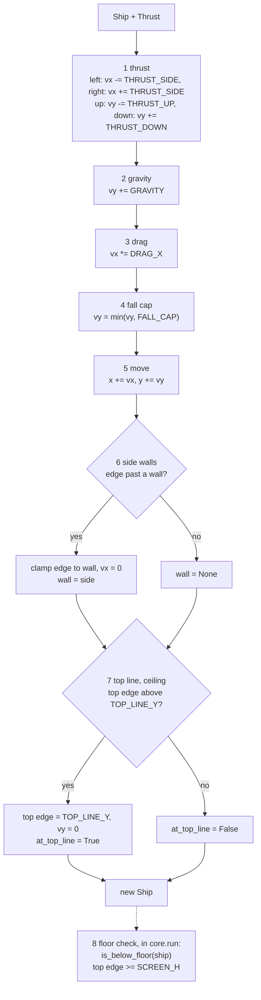
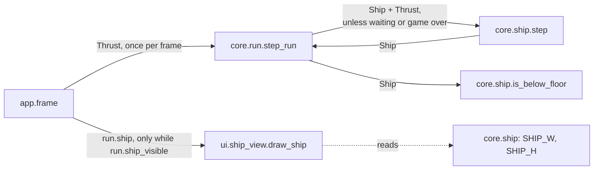

# Ship
Version: 4
Status: frozen
Features: DRA-6, DRA-13, DRA-19, DRA-23
Created by: architect

## Purpose
The ship's state and its one-tick physics step: thrust, gravity, drag, fall cap, move, side walls, top line. Plus the floor test the run uses, and the view that draws the ship as its placeholder rectangle.

From DRA-13 the top-line stop is the real rule, not a stand-in: the screen is fixed and the top line is a ceiling (03-world-and-camera.md, rule 2; 04-ship.md, rule 2, step 7). The world scroll never touches the ship (`docs/contracts/systems/scroll.md`).

From DRA-23 the step no longer respawns the ship. The DRA-6 stand-in "fall off the floor, respawn, no life lost" is gone. The step ends after the top line, and `is_below_floor` tells the run whether the ship has fallen. What a fall costs (a life, the respawn, the wait, game over) is the run's rule: `docs/contracts/systems/run.md`.

Who builds what:
- `game/core/ship.py`: the Gameplay Implementer, task `DRA-6-01-gameplay-implementer`. Field docs, `Final` and `slots` in DRA-19: task `DRA-19-01-gameplay-implementer`. The step without the respawn, and `is_below_floor`, in DRA-23: task `DRA-23-01-gameplay-implementer`.
- `game/ui/ship_view.py`: the UI Developer, task `DRA-6-02-ui-developer`.
- `game/tests/core/test_ship.py`: the QA Engineer, task `DRA-6-03-qa-engineer`. Updated for DRA-23: task `DRA-23-04-qa-engineer`.
- Calling `spawn`, `step` and `is_below_floor`: `core.run`, from `docs/contracts/systems/run.md` (DRA-23). Building `Thrust` from the keys, and calling `draw_ship` only while `run.ship_visible`: the Integration Engineer, in `game/app/frame.py`, from `docs/contracts/systems/app.md`.

## Diagram




## Interface
```python
# game/core/ship.py
# Imports: stdlib, core.world. Never pygame, ui or app.
# Every module-level constant is typing.Final (DRA-19).

SHIP_W: Final[int] = 32               # 04-ship.md, ship_w (guess)
SHIP_H: Final[int] = 32               # 04-ship.md, ship_h (guess)
GRAVITY: Final[float] = 0.16          # 04-ship.md, gravity, px/tick² (guess)
THRUST_SIDE: Final[float] = 0.42      # 04-ship.md, thrust_side, px/tick² (guess)
THRUST_UP: Final[float] = 0.42        # 04-ship.md, thrust_up, px/tick² (guess)
THRUST_DOWN: Final[float] = 0.42      # 04-ship.md, thrust_down, px/tick² (guess)
DRAG_X: Final[float] = 0.94           # 04-ship.md, drag_x, × per tick (guess)
FALL_CAP: Final[float] = 5.5          # 04-ship.md, fall_cap, px/tick (guess)
SPAWN_X: Final[float] = 320.0         # 03-world-and-camera.md ship_start = 05-lives-and-damage.md fall_respawn
SPAWN_Y: Final[float] = 240.0         # same

Wall = Literal["left", "right"]       # a type alias, not a constant: no Final

@dataclass(frozen=True, slots=True)
class Thrust:
    """Which arrow keys are held this tick."""
    up: bool = False
    down: bool = False
    left: bool = False
    right: bool = False

@dataclass(frozen=True, slots=True)
class Ship:
    """Ship state after a tick. Screen px, y down."""
    x: float                       # center x
    y: float                       # center y
    vx: float                      # px/tick, + is right
    vy: float                      # px/tick, + is down (falling)
    wall: Wall | None = None       # wall the ship was clamped against this tick
    at_top_line: bool = False      # the top line (ceiling) clamped the ship this tick

def spawn() -> Ship: ...
    # Ship at (SPAWN_X, SPAWN_Y), vx = vy = 0, wall None, at_top_line False.

def step(ship: Ship, thrust: Thrust) -> Ship: ...
    # One 60 Hz tick, steps 1 to 7. Pure apart from event logging: same ship and
    # thrust in, same ship out. Never mutates its input. Never respawns (DRA-23).

def is_below_floor(ship: Ship) -> bool: ...     # DRA-23
    # True when the ship is fully below the floor: top edge >= SCREEN_H.
    # Pure, no logging.
```
Derived edges, used by the rules below: left edge `x - SHIP_W / 2`, right edge `x + SHIP_W / 2`, top edge `y - SHIP_H / 2`.

The code carries each `Ship` field's comment above (what it is, its unit, its sign) as that field's documentation, together with the class docstring's "Screen px, y down". From DRA-19. Source: scope report DRA-19, item 1; review DRA-6-01-gameplay-implementer, finding 1.

```python
# game/ui/ship_view.py
# Imports: pygame, core.ship. Never app.
SHIP_COLOR: tuple[int, int, int] = (255, 255, 255)   # 04-ship.md, placeholder_look (guess)

def draw_ship(surface: pygame.Surface, ship: Ship) -> None: ...
```

## Presentation
`draw_ship` reads only these core fields and constants. It draws on top of what is there and never fills the background.

| Core field | Shown as |
|---|---|
| `ship.x`, `ship.y` | the center of the ship rectangle. Its top-left corner is `(round(ship.x - SHIP_W / 2), round(ship.y - SHIP_H / 2))`. Source: 04-ship.md, placeholder_look; 03-world-and-camera.md, ship_start (screen center) |
| `SHIP_W`, `SHIP_H` | the rectangle's size, 32 × 32. Source: 04-ship.md, ship_w, ship_h (guess) |
| (always) | filled, color `SHIP_COLOR`, (255, 255, 255). Source: 04-ship.md, placeholder_look (guess) |

- `vx`, `vy`, `wall` and `at_top_line` are not shown by the ship view. The debug overlay shows `vx` and `vy` (`docs/contracts/systems/debug-overlay.md`).
- A ship partly past the floor is drawn as is. pygame clips what falls outside the surface. At game over the ship stays where it fell, fully below the floor, so nothing of it shows.
- The blink (DRA-23): the app calls `draw_ship` only on frames where `run.ship_visible` is True (`docs/contracts/systems/run.md`, Presentation). The view itself knows nothing about the blink and doesn't change.
- The view only draws. It never flips, never logs per frame, never catches an error, never changes the ship.

## Rules
Values:
- Every constant above has its value and source on its line. All are `guess` in the GDD except `fall_respawn`, which is locked. Source: 04-ship.md, 03-world-and-camera.md and 05-lives-and-damage.md, Values. Scope report DRA-6, Values needed.

The step, in this order, every time it is called. Source: 04-ship.md, rule 2:
1. **Thrust.** `left` subtracts `THRUST_SIDE` from `vx`, `right` adds it. `up` subtracts `THRUST_UP` from `vy`, `down` adds `THRUST_DOWN`. Opposite keys held together cancel. Source: 04-ship.md, rule 2.1 and Edge cases.
2. **Gravity.** `vy += GRAVITY`. Always, whatever is held. Source: 04-ship.md, rule 2.2; 01-vision.md, locked decision 4.
3. **Drag.** `vx *= DRAG_X`. No drag on `vy`. Source: 04-ship.md, rules 2.3 and 7.
4. **Fall cap.** If `vy > FALL_CAP`, `vy = FALL_CAP`. No cap on upward speed. Source: 04-ship.md, rules 2.4 and 7.
5. **Move.** `x += vx`, `y += vy`. Source: 04-ship.md, rule 2.5.
6. **Side walls.** If the left edge is below 0: set the left edge to 0, `vx = 0`, `wall = "left"`. If the right edge is past `SCREEN_W`: set the right edge to `SCREEN_W`, `vx = 0`, `wall = "right"`. Otherwise `wall = None`. No bounce. Source: 03-world-and-camera.md, rule 6; 01-vision.md, locked decision 3; 04-ship.md, rule 2.6.
7. **Top line, a ceiling.** If the top edge is above `TOP_LINE_Y` (`y - SHIP_H / 2 < TOP_LINE_Y`): set the top edge to `TOP_LINE_Y`, `vy = 0`, `at_top_line = True`. Otherwise `at_top_line = False`. Permanent from DRA-13. Source: 03-world-and-camera.md, rule 2 (a ceiling; the top edge is the point that counts); 04-ship.md, rule 2, step 7; 91-decision-log.md, row 22; scope report DRA-13, Limits.

Then `step` returns the ship. It never respawns it, even when the ship is past the floor. A ship below the floor keeps falling if it is stepped again. From DRA-23. Source: scope report DRA-23, Feature ("This replaces the DRA-6 stand-in").

8. **Floor check, `is_below_floor`.** True when the ship is fully below the floor: `y - SHIP_H / 2 >= SCREEN_H`. `core.run` calls it right after the step and applies the fall. Source: 04-ship.md, rule 2.8; 03-world-and-camera.md, rule 5; 05-lives-and-damage.md, rule 2; `docs/contracts/systems/run.md`, Rules, step 5.

Other rules:
- `step` always runs steps 1 to 7. Whether it is called on a tick is the run's rule: not while the ship waits at the respawn point, and not during game over. Source: 05-lives-and-damage.md, rule 2.5; 02-game-flow.md, rule 5; `docs/contracts/systems/run.md`. See Rationale for 04-ship.md, rule 3.
- Input only changes acceleration. No key sets a speed or a position. The wall clamp and the top-line stop are rules, not input. Source: 04-ship.md, rule 4; 01-vision.md, Pillar 1.
- A run starts with `spawn()`: (320, 240), at rest. `core.run.start_run` calls it. Source: 03-world-and-camera.md, ship_start (guess); 02-game-flow.md, rule 3.
- `step` and `is_below_floor` use no frame time and no randomness. Same input, same output. Source: 15-tech-constraints.md, rule 2.
- Core behaves the same in normal and debug mode. It never reads the run mode. Source: game/CONTEXT.md, Run modes; 15-tech-constraints.md, rule 7.
- Core never imports pygame, `ui` or `app`. Source: game/CONTEXT.md, Layout.
- The ship never reads the world scroll, and the scroll never changes the ship. `step` takes no scroll. Source: 03-world-and-camera.md, rule 4; systems/scroll.md.

Logging (logger `core.ship`, DEBUG, by event, never by tick). Source: game/CONTEXT.md, Logging; 15-tech-constraints.md, rule 9:
- `wall hit side=%s x=%.2f y=%.2f`: when the returned ship has `wall` set and the input ship's `wall` was different. Holding a key against a wall logs once, not every tick.
- `top line stop x=%.2f y=%.2f`: when the returned ship has `at_top_line` True and the input ship had it False. Holding Up at the line logs once.
- Values are the new position after the clamp. Nothing else is logged. No line on a tick where nothing happened.
- From DRA-23 `core.ship` logs no respawn line. The respawn, with its line, is `core.run`'s (`docs/contracts/systems/run.md`, Logging). Since the step never respawns, "the ship after the clamps" (DRA-19 wording) is the returned ship. The two lines above don't change.

## Impact
DRA-23 changes this frozen contract (v3). The step loses step 8, the DRA-6 respawn stand-in, and its `respawn from` log line. The floor test becomes public as `is_below_floor`. Every other step, constant, field, signature and log line stays as it is. Every file in `game/` that depends on it, found by grepping `game/` (tests included) for `core.ship`, `spawn`, `step(`, `respawn`, `_is_below_floor`, `draw_ship` and `Ship`:

| File | Change needed |
|---|---|
| `game/core/ship.py` | `step` returns the ship after step 7, with no floor check and no `respawn from` line. `_is_below_floor` becomes the public `is_below_floor`. The module docstring and `step`'s docstring stop naming the respawn stand-in. Task `DRA-23-01-gameplay-implementer`. |
| `game/core/run.py` (new) | calls `spawn`, `step` and `is_below_floor`. Task `DRA-23-01-gameplay-implementer`. |
| `game/ui/ship_view.py` | none. The app decides whether to call it. |
| `game/ui/debug_overlay.py` | none. It reads `ship.x`, `y`, `vx`, `vy`. The app passes `run.ship`. |
| `game/app/frame.py` | stops calling `spawn` and `step` itself; `core.run` does. Calls `draw_ship(surface, run.ship)` only while `run.ship_visible`. Integration Engineer, from `systems/app.md`. |
| `game/tests/core/test_ship.py` | `test_floor_respawns_at_spawn` expects the old respawn and fails after task DRA-23-01. The respawn part of `test_events_log_once` expects a `respawn` line from `core.ship` and fails too. Both are replaced in task `DRA-23-04-qa-engineer`. Every other test in the file stays and must still pass. |
| `game/tests/ui/test_hud.py` | none from this contract. It uses `spawn()` for the overlay. See `systems/hud.md`, Impact. |

## Rationale
- **The top-line stop stays as built.** The GDD makes the top line a ceiling with the same clamp and `vy = 0` that DRA-6 built as a stand-in (91-decision-log.md, row 22).
- **The step no longer respawns (DRA-23).** A fall now costs a life, starts invulnerability and a wait, or ends the run. All of that depends on state the ship doesn't hold. The ship reports the fact, `is_below_floor`; the run applies the rule. The tick order in 04-ship.md, rule 2 is kept: steps 1 to 7 here, step 8 in `core.run` right after.
- **`step` is not called during the wait or game over (DRA-23).** 04-ship.md, rule 3 says no fall ever pauses the physics. 05-lives-and-damage.md, rule 2.5 and decision-log row 27 say the ship stands at rest after a fall until the first press, because it is "not fully respawned until it moves". The newer, specific rule is the one the Director approved for this feature (scope report DRA-23, objection 1). 02-game-flow.md, rule 5 freezes everything at game over. The step itself still runs every step whenever it is called. 04-ship.md, rule 3 now names the respawn wait and the game-over freeze as its two exceptions (91-decision-log.md, row 32).
- **`x`, `y` are the ship's center.** The GDD puts `ship_start` and `fall_respawn` at "screen center (320, 240)". With center coordinates the overlay shows exactly 320 and 240 at the start, the same numbers the GDD uses.
- **`step` returns a new frozen `Ship`.** A pure step is easy to test and to repeat.
- **`wall` and `at_top_line` live in the state.** The log policy forbids a line every tick, but holding a key against a wall clamps every tick. Keeping the last tick's contact lets `step` log only when contact starts. They are also the facts a later feature (lava walls) will need.
- **Fully below the floor is `top edge >= SCREEN_H`.** With the top edge at 480 the ship covers rows 480 to 511. No pixel of it is on the 480-row screen, so it is fully below the floor (03, rule 5).
- **The top-line clamp triggers only when the edge is past the line.** A ship resting exactly on the line with no upward speed isn't "hitting" it. So `vy = 0` and the log happen when the ship actually pushes past.
- **Physics constants live in `core/ship.py`.** The tuning file doesn't exist yet. When it does, a later contract moves these values to it, with a schema.
- **No art task.** The scope rules out sprite art and the thrust flame. The placeholder rectangle needs no asset.
- **The view rounds the corner with `round`.** pygame draws on whole pixels. Rounding the corner, not the center, keeps the rectangle exactly 32 × 32.
- **The ship color lives in `ship_view.py`, not `ui/look.py`.** Only the ship view uses it. `look.py` holds values shared by several views.
- **`Final[int]` and `Final[float]`, not bare `Final` (DRA-19).** Keeping the type inside `Final` keeps the contract text and the code the same.
- **`slots=True` on both dataclasses (DRA-19).** Both are small frozen records built thousands of times a run. Slots make them lighter and stop stray attributes.
