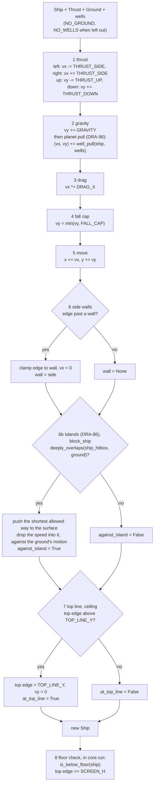
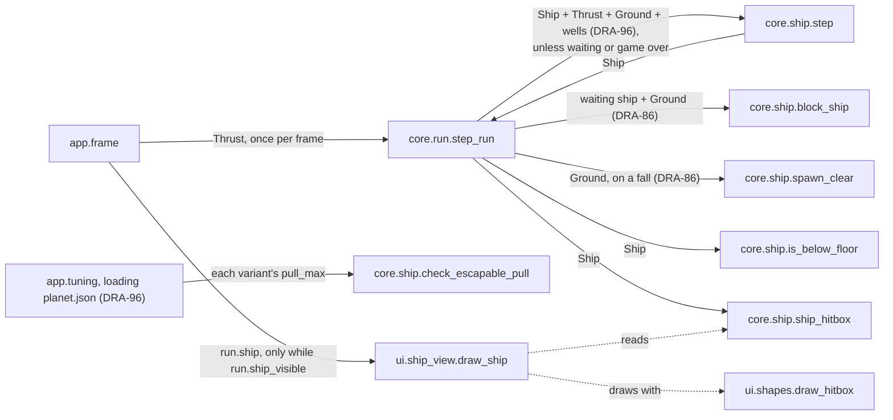

# Ship
Version: 7
Status: frozen
Features: DRA-6, DRA-13, DRA-19, DRA-23, DRA-29, DRA-86, DRA-96
Created by: architect

## Purpose
The ship's state and its one-tick physics step: thrust, gravity, planet pull, drag, fall cap, move, side walls, floating islands, top line. Plus the floor test the run uses, the fall respawn spot clear of islands, the ship's hitbox, the check that a planet's pull can always be escaped, and the view that draws the ship as its placeholder look.

The screen is fixed and the top line is a ceiling (03-world-and-camera.md, rule 2). The world scroll never touches the ship (`docs/contracts/systems/scroll.md`). The step never respawns the ship: it ends after the top line, and `is_below_floor` tells the run whether the ship has fallen. What a fall costs (a life, the respawn, the wait, game over) is the run's rule: `docs/contracts/systems/run.md`.

The ship's hitbox is an inverted T of two boxes. The run tests it against drifters (`docs/contracts/systems/drifters.md`, `docs/contracts/systems/run.md`), and the placeholder ship is drawn as that same T, so what the player sees is exactly what can be hit. The ship names its top sideways speed, which drifter speeds are set from.

Floating islands are ground. The run hands the step every island as one `Ground`, with how far it moved this tick. Right after the side walls the step moves the ship out of the ground the shortest way, just to the surface, and drops the part of its speed that goes into the surface, measured against the island's own movement; the part along the surface stays. So the ship slides down a slope, stands on top and rides down, and is held under an underside and carried at the island's speed, never faster, always free to slide out sideways. The same block holds a ship standing in the respawn wait, and `spawn_clear` gives the fall respawn spot moved straight up or down out of an island.

Planets pull. The run hands the step every planet's field as a `GravityWell`. Right after gravity the step adds each field's pull to the ship's speed: toward the planet's center, 0 at the field's edge, rising in a straight line to `pull_max` at the planet's surface, never more. Fields add up. The pull is an acceleration like thrust and gravity, so it bends the drift and never sets a speed. `check_escapable_pull` refuses a pull the ship's thrust can't beat; the app calls it when it loads a planet's tuning.

Who builds what:
- `game/core/ship.py`: the Gameplay Implementer, task `DRA-6-01-gameplay-implementer`. Field docs, `Final` and `slots` in DRA-19: task `DRA-19-01-gameplay-implementer`. The step without the respawn, and `is_below_floor`, in DRA-23: task `DRA-23-01-gameplay-implementer`. The hitbox and `TOP_SIDE_SPEED` in DRA-29: task `DRA-29-01-gameplay-implementer`.
- `game/ui/ship_view.py`: the UI Developer, task `DRA-6-02-ui-developer`. The inverted T in DRA-29: task `DRA-29-04-ui-developer`, with the shared shape helper `game/ui/shapes.py`.
- `game/tests/core/test_ship.py`: the QA Engineer, task `DRA-6-03-qa-engineer`. Updated for DRA-23: task `DRA-23-04-qa-engineer`. The hitbox in DRA-29: task `DRA-29-07-qa-engineer`. The inverted T drawn: `game/tests/ui/test_ship_view.py`, task `DRA-29-09-qa-engineer`.
- `Ground`, `NO_GROUND`, `Ship.against_island`, the islands in `step`, `block_ship`, `spawn_clear` and the `island contact` log line, in DRA-86: task `DRA-86-03-gameplay-implementer`. They measure with `core.collision`'s push-out (`docs/contracts/systems/drifters.md`, task `DRA-86-01-gameplay-implementer`). Tests: `game/tests/core/test_ship_islands.py`, task `DRA-86-08-qa-engineer`.
- `GravityWell`, `NO_WELLS`, `well_pull`, the pull in `step` and `check_escapable_pull`: task `DRA-96-01-gameplay-implementer`. Tests: `game/tests/core/test_ship_pull.py`, task `DRA-96-05-qa-engineer`.
- Calling `check_escapable_pull` for every planet variant's `pull_max` when the planet's tuning file loads: the Integration Engineer, in `game/app/tuning.py`, from `docs/contracts/systems/app.md`.
- Calling `spawn`, `spawn_clear`, `step`, `block_ship`, `is_below_floor` and `ship_hitbox`, building the ground from the islands and the wells from the planets: `core.run`, from `docs/contracts/systems/run.md`. Building `Thrust` from the keys, and calling `draw_ship` only while `run.ship_visible`: the Integration Engineer, in `game/app/frame.py`, from `docs/contracts/systems/app.md`.

## Diagram


The hitbox, an inverted T, offsets from the ship's center (x, y). Screen y is down:
```
          x-16      x-6  x+6       x+16
 y-16              +-----+                 bar: Box(cx 0, cy 0, w 12, h 32)
                   |     |
                   | bar |
 y+4     +---------+     +---------+       foot: Box(cx 0, cy 10, w 32, h 12)
         |          foot           |
 y+16    +-------------------------+
```
The whole T fits the `SHIP_W × SHIP_H` (32 × 32) square, so the edges the walls, the top line and the floor use don't change.

Islands (DRA-86), at Level 1 (the ground moves 1.1 px down a tick), with no key unless said. `vy` and `y` after each tick, the ship's bottom edge at `y + 16`:
```
Stand and ride: on a rectangle whose top edge is at 300 after the tick, island moving 1.1
  step 1-5:  vy 1.10 + 0.16 = 1.26, y 282.90 + 1.26 = 284.16 (bottom 300.16, 0.16 inside)
  island:    the shortest way out is up, 0.16; relative speed 1.26 - 1.10 = 0.16 goes into it -> 0
  result:    y 284.00, vy 1.10, against_island True    the ship moves 1.1 a tick, as the island
  up held:   vy 1.10 - 0.42 + 0.16 = 0.84 < 1.10: the ship moves less than the island, comes
             free of it, against_island False: it lifts off

Held and carried: under a rectangle whose bottom edge is at 200 after the tick, up held
  step 1-5:  vy 1.10 - 0.42 + 0.16 = 0.84, y 214.90 + 0.84 = 215.74 (top 199.74, 0.26 inside:
             the island moved 1.1, the ship only 0.84)
  island:    out downward 0.26; relative speed 0.84 - 1.10 = -0.26 goes into it -> 0
  result:    y 216.00, vy 1.10: carried at the island's speed, never faster. Left or right still
             thrusts and drags as always, so the ship slides out sideways
  no key:    vy 1.26 > 1.10: it falls away from the underside

Slope: resting on the triangle's slope, outward normal n = (0.3511, -0.9363), world still
  step 1-5:  vy 0.16: the foot's lower right corner is 0.16 down, 0.1498 deep along n
  island:    out along n by 0.1498 (shorter than straight up, 0.16)
  speed:     (0, 0.16) has -0.1498 along n, removed: (0.0526, 0.0197), along the slope
  result:    the ship slides down and to the right, gaining speed each tick; no bounce
```

Planet pull (DRA-96), one field at the GDD values: center (320, 400), `surface_radius` 32, `pull_radius` 150, `pull_max` 0.2. The ramp runs over 150 − 32 = 118 px. Every spot below is clear of the walls, the top line and the floor. The ship starts at rest with no key unless said; `d` is the distance from the ship's center to the field's center, going into the tick:
```
ship at       d      pull (toward the center)        after the tick
(320, 240)    160    0: outside the field             vx 0, vy 0.16
(320, 250)    150    0: on the edge                   vx 0, vy 0.16
(320, 280)    120    0.2 × 30/118 = 0.050847 down     vx 0, vy 0.210847
(320, 309)    91     0.2 × 59/118 = 0.1 down          vx 0, vy 0.26           mid-field
(320, 368)    32     0.2 down, at the surface         vx 0, vy 0.36
(320, 390)    10     0.2 down, inside the surface     vx 0, vy 0.36           never more than pull_max
(320, 400)    0      0: no direction                  vx 0, vy 0.16
(229, 400)    91     0.1 right                        vx 0.1 × 0.94 = 0.094, vy 0.16   drag acts on it
Escape, up held at (320, 368):   vy = -0.42 + 0.16 + 0.2 = -0.06: it still climbs
Escape, left held at (288, 400): vx = (-0.42 + 0.2) × 0.94 = -0.2068: it still moves away
Two fields, (320, 391) and (411, 300), ship at (320, 300), d 91 to each:
             0.1 down + 0.1 right             vx 0.094, vy 0.26: the pulls add up
```

The respawn spot (DRA-86), `spawn_clear(ground)`, from (320, 240): the ship's 32 × 32 square covers rows 224 to 256.
```
island (box 120 x 120)     top..bottom    ship there?    above: y, top edge     below: y     spot
centered (320, 330)        270..390       no             -                      -            (320, 240)
centered (320, 300)        240..360       yes            224, 208 (ok)          376          (320, 224) above
centered (320, 250)        190..310       yes            174, 158 (past 168)    326          (320, 326) below
centered (320, 160)        100..220       no             -                      -            (320, 240)
```



## Interface
```python
# game/core/ship.py
# Imports: stdlib, core.world, core.collision (DRA-29). Never pygame, ui or app.
# Every module-level constant is typing.Final (DRA-19).

SHIP_W: Final[int] = 32               # 04-ship.md, ship_w (guess)
SHIP_H: Final[int] = 32               # 04-ship.md, ship_h (guess)
GRAVITY: Final[float] = 0.16          # 04-ship.md, gravity, px/tick² (guess)
THRUST_SIDE: Final[float] = 0.42      # 04-ship.md, thrust_side, px/tick² (guess)
THRUST_UP: Final[float] = 0.42        # 04-ship.md, thrust_up, px/tick² (guess)
THRUST_DOWN: Final[float] = 0.42      # 04-ship.md, thrust_down, px/tick² (guess)
DRAG_X: Final[float] = 0.94           # 04-ship.md, drag_x, × per tick (guess)
FALL_CAP: Final[float] = 5.5          # 04-ship.md, fall_cap, px/tick (guess)
SPAWN_X: Final[float] = 320.0         # 03-world-and-camera.md ship_start = 05-lives-and-damage.md fall_respawn
SPAWN_Y: Final[float] = 240.0         # same
TOP_SIDE_SPEED: Final[float]          # DRA-29. = THRUST_SIDE * DRAG_X / (1 - DRAG_X) -> 6.58 px/tick
                                      # 04-ship.md, derived values (top sideways speed with a side key held)
HITBOX_BAR_W: Final[int] = 12         # DRA-29. 04-ship.md, hitbox: the bar is 12 px wide, SHIP_H tall (guess)
HITBOX_FOOT_H: Final[int] = 12        # DRA-29. 04-ship.md, hitbox: the foot is SHIP_W wide, 12 px tall (guess)
SHIP_HITBOX: Final[Hitbox]            # DRA-29. Offsets from the ship's center:
                                      # (Box(cx=0, cy=0, w=HITBOX_BAR_W, h=SHIP_H),
                                      #  Box(cx=0, cy=SHIP_H / 2 - HITBOX_FOOT_H / 2, w=SHIP_W, h=HITBOX_FOOT_H))
                                      # -> bar (0, 0, 12, 32), foot (0, 10, 32, 12)

Wall = Literal["left", "right"]       # a type alias, not a constant: no Final

@dataclass(frozen=True, slots=True)
class Thrust:
    """Which arrow keys are held this tick."""
    up: bool = False
    down: bool = False
    left: bool = False
    right: bool = False

@dataclass(frozen=True, slots=True)
class Ship:
    """Ship state after a tick. Screen px, y down."""
    x: float                       # center x
    y: float                       # center y
    vx: float                      # px/tick, + is right
    vy: float                      # px/tick, + is down (falling)
    wall: Wall | None = None       # wall the ship was clamped against this tick
    at_top_line: bool = False      # the top line (ceiling) clamped the ship this tick
    against_island: bool = False   # DRA-86. A floating island pushed the ship out this tick

@dataclass(frozen=True, slots=True)
class Ground:                                                        # DRA-86
    """The ground the ship can't enter this tick: every floating island, as one. Screen px."""
    hitbox: Hitbox = ()            # every island's shapes, placed: boxes and polygons only
    velocity_x: float = 0.0        # px the ground moved this tick, + is right
    velocity_y: float = 0.0        # px the ground moved this tick, + is down

NO_GROUND: Final[Ground] = Ground()   # DRA-86. No island: the step is exactly the DRA-29 step

@dataclass(frozen=True, slots=True)
class GravityWell:                                                   # DRA-96
    """One planet's gravity field this tick. Screen px, y down."""
    x: float                       # the field's center x: the planet's center
    y: float                       # the field's center y
    surface_radius: float          # px from the center where the pull reaches pull_max: the
                                   # planet's surface, > 0
    pull_radius: float             # px from the center where the pull is 0: the field's edge,
                                   # > surface_radius
    pull_max: float                # px/tick², the pull at the surface and inside it, > 0

NO_WELLS: Final[tuple[GravityWell, ...]] = ()   # DRA-96. No planet: the step is exactly the DRA-86 step

def well_pull(ship: Ship, wells: tuple[GravityWell, ...]) -> tuple[float, float]: ...   # DRA-96
    # (pull_x, pull_y), px/tick²: the sum of every well's pull on the ship at its center
    # (Rules, Planet pull). (0.0, 0.0) with no well, or none that holds the ship. Pure, no logging.

def check_escapable_pull(pull_max: float) -> None: ...              # DRA-96
    # Raises ValueError when the ship's thrust can't beat a pull of pull_max (Rules, Escape).
    # Reads GRAVITY, THRUST_UP and THRUST_SIDE at call time. Pure, no logging.

def spawn() -> Ship: ...
    # Ship at (SPAWN_X, SPAWN_Y), vx = vy = 0, wall None, at_top_line False, against_island False.

def spawn_clear(ground: Ground) -> Ship: ...                         # DRA-86
    # spawn(), moved straight up or down to the nearest spot clear of the ground (Rules,
    # Respawn spot). spawn() itself when the ground doesn't hold it. Pure, no logging.

def step(ship: Ship, thrust: Thrust, ground: Ground = NO_GROUND,
         wells: tuple[GravityWell, ...] = NO_WELLS) -> Ship: ...
    # One 60 Hz tick, steps 1 to 7, islands in step 6 from DRA-86, the planet pull in step 2
    # from DRA-96. Pure apart from event logging: same ship, thrust, ground and wells in, same
    # ship out. Never mutates its input. Never respawns (DRA-23).

def block_ship(ship: Ship, ground: Ground) -> Ship: ...              # DRA-86
    # The island part of step 6 alone: the ship pushed out of the ground (Rules, Islands), with
    # against_island set for this tick. Pure apart from the island contact log line.

def is_below_floor(ship: Ship) -> bool: ...     # DRA-23
    # True when the ship is fully below the floor: top edge >= SCREEN_H.
    # Pure, no logging.

def ship_hitbox(ship: Ship) -> Hitbox: ...      # DRA-29
    # place_hitbox(SHIP_HITBOX, ship.x, ship.y): the two boxes at screen positions.
    # Pure, no logging.
```
`Hitbox`, `Box` and `place_hitbox` come from `core.collision` (`docs/contracts/systems/drifters.md`, Interface), and from DRA-86 `Direction`, `SURFACE_TOLERANCE`, `deeply_overlaps`, `push_directions` and `exit_distance` too (drifters.md, Rules, Push-out). Derived edges, used by the rules below: left edge `x - SHIP_W / 2`, right edge `x + SHIP_W / 2`, top edge `y - SHIP_H / 2`.

Every existing call of `step(ship, thrust)` keeps working and gives the same ship as before DRA-86, with `against_island` False. `Ground` holds placed shapes and its motion only; it knows nothing of drifters, so `core.ship` still never imports `core.drifters`. The run builds it (`systems/run.md`, `island_ground`).

DRA-96: every existing call of `step(ship, thrust)` and `step(ship, thrust, ground)` keeps working and gives the same ship as before, because `wells` defaults to `NO_WELLS`. Like `Ground`, a `GravityWell` is plain numbers and knows nothing of drifters; the planet builds its own (`systems/drifters.md`, `gravity_well`) and the run gathers them (`systems/run.md`, `gravity_wells`). `core.ship` imports `math` (the distance) and nothing new from `core`.

The code carries each `Ship` field's comment above (what it is, its unit, its sign) as that field's documentation, together with the class docstring's "Screen px, y down". From DRA-19. Source: scope report DRA-19, item 1; review DRA-6-01-gameplay-implementer, finding 1.

```python
# game/ui/ship_view.py
# Imports: pygame, core.ship, ui.shapes (DRA-29). Never app.
SHIP_COLOR: tuple[int, int, int] = (255, 255, 255)   # 04-ship.md, placeholder_look (guess)

def draw_ship(surface: pygame.Surface, ship: Ship) -> None: ...
```
The signature doesn't change in DRA-29. `ui.shapes` is in `docs/contracts/systems/drifters.md`, Interface.

## Presentation
`draw_ship` reads only these core fields and functions. It draws on top of what is there and never fills the background.

| Core field | Shown as |
|---|---|
| `ship_hitbox(ship)` | the ship, filled, in `SHIP_COLOR`: `draw_hitbox(surface, SHIP_COLOR, ship_hitbox(ship))`, each box a filled rectangle. The look is the hitbox. From DRA-29. Source: 04-ship.md, placeholder_look ("the same inverted T as `hitbox`") and hitbox (guess); 91-decision-log.md, row 35 |
| (always) | color `SHIP_COLOR`, (255, 255, 255). Source: 04-ship.md, placeholder_look (guess) |

- Each placed box is drawn as the rectangle with top-left `(round(cx - w / 2), round(cy - h / 2))` and size `round(w) × round(h)` (`ui.shapes.draw_shape`). Every offset in `SHIP_HITBOX` is an even whole number of px (bar left −6, top −16; foot left −16, top +4), so both boxes round the same way and the T never splits. At spawn (320, 240): bar x 314 to 325, rows 224 to 255; foot x 304 to 335, rows 244 to 255. Rows 224 to 243 left of x 314 and right of x 325 stay empty.
- `vx`, `vy`, `wall`, `at_top_line` and `against_island` (DRA-86) are not shown by the ship view. The ship is drawn where it is after the push, so it sits on an island's surface, never in it. The debug overlay shows `vx` and `vy` and outlines the hitbox (`docs/contracts/systems/debug-overlay.md`).
- A ship partly past the floor is drawn as is. pygame clips what falls outside the surface. At game over after a fall the ship stays where it fell, fully below the floor, so nothing of it shows. At game over after a hit it stays where it was hit and shows.
- The blink: the app calls `draw_ship` only on frames where `run.ship_visible` is True (`docs/contracts/systems/run.md`, Presentation). The view knows nothing about the blink.
- The view only draws. It never flips, never logs per frame, never catches an error, never changes the ship.

## Rules
Values:
- `NO_GROUND` and the island rules add no game value: the islands' sizes are theirs (`systems/drifters.md`), and `SURFACE_TOLERANCE` is not a game value (drifters.md, Rationale). DRA-86.
- `GravityWell`, `NO_WELLS`, `well_pull` and `check_escapable_pull` add no game value. A well's numbers are the planet's (`pull_radius`, `pull_max` and its size, from `game/tuning/drifters/planet.json`, `systems/drifters.md`); the escape check reads this module's `GRAVITY`, `THRUST_UP` and `THRUST_SIDE`. DRA-96. Source: scope report DRA-96, Out ("Moving the ship's physics values to a tuning file ... the guard reads them there").
- Every constant above has its value and source on its line. All are `guess` in the GDD except `fall_respawn`, which is locked. Source: 04-ship.md, 03-world-and-camera.md and 05-lives-and-damage.md, Values. Scope report DRA-6, Values needed; scope report DRA-29, Values needed.
- `TOP_SIDE_SPEED` is computed from `THRUST_SIDE` and `DRAG_X`, never written as a bare 6.58. Source: 04-ship.md, derived values ("Recompute when a value changes").
- `SHIP_HITBOX` is computed from `SHIP_W`, `SHIP_H`, `HITBOX_BAR_W` and `HITBOX_FOOT_H`, never from bare numbers.

The step, in this order, every time it is called. Source: 04-ship.md, rule 2:
1. **Thrust.** `left` subtracts `THRUST_SIDE` from `vx`, `right` adds it. `up` subtracts `THRUST_UP` from `vy`, `down` adds `THRUST_DOWN`. Opposite keys held together cancel. Source: 04-ship.md, rule 2.1 and Edge cases.
2. **Gravity.** `vy += GRAVITY`. Always, whatever is held. Source: 04-ship.md, rule 2.2; 01-vision.md, locked decision 4.
   **Then planet pull** (DRA-96): `(pull_x, pull_y) = well_pull(ship, wells)`, with the ship as it came into the step (its position before step 5 moves it), then `vx += pull_x`, `vy += pull_y` (Planet pull, below). With `NO_WELLS` both are 0.0 and nothing changes. Drag (step 3) and the fall cap (step 4) then act on the speed as always, pull included. Source: 04-ship.md, rule 2, step 2 ("Then planet pull: add each planet's pull to vx and vy"); drifters/08-planet.md, rule 4.
3. **Drag.** `vx *= DRAG_X`. No drag on `vy`. Source: 04-ship.md, rules 2.3 and 7.
4. **Fall cap.** If `vy > FALL_CAP`, `vy = FALL_CAP`. No cap on upward speed. Source: 04-ship.md, rules 2.4 and 7.
5. **Move.** `x += vx`, `y += vy`. Source: 04-ship.md, rule 2.5.
6. **Side walls.** If the left edge is below 0: set the left edge to 0, `vx = 0`, `wall = "left"`. If the right edge is past `SCREEN_W`: set the right edge to `SCREEN_W`, `vx = 0`, `wall = "right"`. Otherwise `wall = None`. No bounce. Source: 03-world-and-camera.md, rule 6; 01-vision.md, locked decision 3; 04-ship.md, rule 2.6.
   **Then islands** (DRA-86): the ship after the walls, still carrying the input ship's `against_island`, goes through `block_ship(ship, ground)` (Islands, below). `wall` stays as the walls set it. Source: 04-ship.md, rule 2, step 6 ("Then islands"); drifters/05-floating-islands.md, rule 4.
7. **Top line, a ceiling.** If the top edge is above `TOP_LINE_Y` (`y - SHIP_H / 2 < TOP_LINE_Y`): set the top edge to `TOP_LINE_Y`, `vy = 0`, `at_top_line = True`. Otherwise `at_top_line = False`. Source: 03-world-and-camera.md, rule 2; 04-ship.md, rule 2, step 7; 91-decision-log.md, row 22.

Then `step` returns the ship. It never respawns it, even when the ship is past the floor. Source: scope report DRA-23, Feature.

8. **Floor check, `is_below_floor`.** True when the ship is fully below the floor: `y - SHIP_H / 2 >= SCREEN_H`. `core.run` calls it right after the step and applies the fall. Source: 04-ship.md, rule 2.8; 03-world-and-camera.md, rule 5; 05-lives-and-damage.md, rule 2; `docs/contracts/systems/run.md`.

Hitbox (DRA-29):
- An inverted T of two upright boxes: a bar `HITBOX_BAR_W` (12) px wide and `SHIP_H` (32) tall, centered on the ship; and a foot `SHIP_W` (32) wide and `HITBOX_FOOT_H` (12) tall, along the bottom (its bottom edge on the ship's bottom edge). Source: 04-ship.md, hitbox (guess); 91-decision-log.md, row 35.
- The ship never rotates, so the boxes stay upright. Source: 04-ship.md, rule 8.
- The hitbox is never bigger than what the player sees: the ship is drawn as exactly these two boxes. Source: 04-ship.md, rule 8 and placeholder_look; 07-drifters.md, rule 8.
- `ship_hitbox(ship)` places it at the ship's center. The run tests it against each drifter's hitbox (`systems/run.md`). The ship's hitbox is the same during the blink and the respawn wait: the blink is a look, not a state. Source: 05-lives-and-damage.md, Edge cases.
- The ship has no graze zone. Graze zones belong to hazards. Source: 06-scoring.md, rule 3.

Islands, `block_ship(ship, ground)` (DRA-86). Source: drifters/05-floating-islands.md, rules 4 to 6 and Edge cases; 04-ship.md, rule 2, step 6; 01-vision.md, locked decisions 3 and 5 and Pillar 1. Push-out measures: `docs/contracts/systems/drifters.md`, Rules, Push-out:
1. **Inside?** With `moving = ship_hitbox(ship)`: if `ground.hitbox` is empty, or `deeply_overlaps(moving, ground.hitbox)` is False, return the ship with `against_island = False` and nothing else changed. An edge touching, or an overlap no deeper than `SURFACE_TOLERANCE`, is not inside.
2. **The shortest way out.** For each `direction` in `push_directions(moving, ground.hitbox)`, in order: `distance = exit_distance(moving, ground.hitbox, direction)`, and the spot is the center moved by `distance × direction`. A direction is not used when its spot puts the ship's left edge below 0 or its right edge past `SCREEN_W` (no push through a side wall), or when it points up (`direction[1] < 0`) and its spot puts the ship's top edge above `TOP_LINE_Y` (no push through the top line). Of the rest, the smallest distance wins; a later direction replaces an earlier one only when its distance is smaller by more than `SURFACE_TOLERANCE`, so ties go to the earlier one: up, then down, then left, then right, then the slopes. Straight down is never refused (the side walls clamped the ship already and nothing is solid below), so a way out always exists.
3. **Just to the surface.** The ship moves to that spot: no further, no bounce, no shove. Source: rule 4.1.
4. **Speed.** With the ground's motion `g = (ground.velocity_x, ground.velocity_y)` and the winning `direction` `n` (it points out of the island), the ship's speed relative to the island is `r = (vx − g_x, vy − g_y)`. If `r · n < 0` (it moves into the surface), `r` loses that part: `r = r − (r · n) × n`. Then `(vx, vy) = r + g`. If `r · n ≥ 0`, the speed stays. So the part of the speed going into the surface becomes 0 and the part along it stays, both measured against the island, which moves with the world. Source: rule 4.2.
5. Return the ship with the new position and speed and `against_island = True`.

What that gives, with no extra rule (Diagram, Islands):
- **On top** (rule 4.3): a ship resting on an island is pushed up the little gravity sank it each tick and keeps the island's speed, so it stands and rides down with it, sliding along with whatever `vx` it has, slowed by drag as always. Thrusting up gives it less downward speed than the island, so it comes free: it lifts off.
- **Underneath** (rule 4.4): a ship thrusting up into an underside is pushed down to it and left with the island's downward speed, never more, so it is held and carried at the island's speed. There is no shove: the push only moves it to the surface. Its sideways speed is along the surface and untouched, so it can always slide out sideways. Without thrust it falls away.
- **Sides:** the speed into an island's side drops to 0, like a side wall. No bounce.
- **Slopes** (rule 4.2): on the triangle's slope only the part of the speed across the slope is dropped, so gravity slides the ship down it.
- **Corners:** a ship that clips an island's corner is pushed out whichever way is shorter: over the top, under the bottom or back out to the side.
- **Several islands, the L and the T:** one push clears the ship of every island shape at once, so it never stops on the seam where two shapes meet.
- **Invulnerable or not, waiting or not:** the block never reads either; the run calls it for a waiting ship too (`systems/run.md`, step 4). Source: rule 6; Edge cases.
- No key is read and no speed is set by input: the block is a rule, like the wall clamp. Source: 04-ship.md, rule 4.

Planet pull, `well_pull(ship, wells)` (DRA-96). Source: drifters/08-planet.md, pull_shape (locked), pull_radius, pull_max (guess), rule 4 and Edge cases; 04-ship.md, rules 2 and 4; 91-decision-log.md, row 76:
1. Start from `(0.0, 0.0)`. For each `well` in `wells`, in order: `dx = well.x − ship.x`, `dy = well.y − ship.y`, `d = math.hypot(dx, dy)`.
2. **Outside or on the edge:** `d >= well.pull_radius`: this well adds nothing. The pull acts only while the ship's center is inside the field.
3. **At the very center:** `d == 0.0`: this well adds nothing. There is no direction to pull in.
4. **Strength:** `pull_max` when `d <= well.surface_radius` (at the surface and inside it); otherwise `pull_max × (pull_radius − d) / (pull_radius − surface_radius)`: 0 at the edge, rising in a straight line to `pull_max` at the surface.
5. **Direction:** toward the well's center: add `strength × dx / d` to `pull_x` and `strength × dy / d` to `pull_y`.
6. Return the sums. Overlapping fields add up: the ship feels the sum. Source: rule 4 ("Pulls from overlapping planets add up"); Edge cases ("Two fields overlap").
- **Never more than `pull_max`.** Inside the surface the pull stays at `pull_max`: the line is not carried on past the surface. Source: pull_max (the most the pull reaches); rule 5 and 04-ship.md, rule 5 (the escape bound holds only if no single field pulls harder than `pull_max`).
- **The ship's center** is what the field holds: its `x`, `y`, never its hitbox. Source: rule 4 ("while the ship's center is inside `pull_radius`").
- **When it applies** is the run's rule: every tick the step runs, so while the ship is invulnerable too, and never while it stands in the respawn wait (the run doesn't step it then) or at game over. Source: rule 4; Edge cases ("The ship waits to respawn inside a field"); `systems/run.md`, step 4.
- The pull is an acceleration only. It never sets a speed or a position, and no key is read for it. Source: 04-ship.md, rule 4; 01-vision.md, Pillar 1 and locked decision 5.
- Only the ship is pulled. Source: rule 4 ("It pulls only the ship, never other drifters").

Escape, `check_escapable_pull(pull_max)` (DRA-96). Source: 04-ship.md, rule 5; drifters/08-planet.md, rule 5; scope report DRA-96, Limits ("the game refuses a tuning where ..."):
1. If `pull_max + GRAVITY >= THRUST_UP`: raise `ValueError(f"pull_max is too strong: pull_max + gravity must stay below thrust_up ({pull_max:g} + {GRAVITY:g} >= {THRUST_UP:g})")`.
2. Else, if `pull_max >= THRUST_SIDE`: raise `ValueError(f"pull_max is too strong: pull_max must stay below thrust_side ({pull_max:g} >= {THRUST_SIDE:g})")`.
3. Else return None. With today's values: 0.2 + 0.16 = 0.36 < 0.42 and 0.2 < 0.42: accepted. `pull_max` 0.3: refused by rule 1, `(0.3 + 0.16 >= 0.42)`.
- "Below" is strict: a pull that only ties thrust is refused. Source: 04-ship.md, rule 5 ("must stay greater").
- The check reads the module's constants when it is called, never copies of them. It checks one field: fields that overlap may add up past it (drifters/08-planet.md, Edge cases), which is a wave-design matter, not a tuning one.
- Core never calls it: tuning values reaching core are already checked. The app calls it for each planet variant while loading `planet.json` and names the file and the field (`systems/app.md`, Rules, Tuning loader).

Respawn spot, `spawn_clear(ground)` (DRA-86). Source: 05-lives-and-damage.md, rule 2.3; drifters/05-floating-islands.md, Edge cases:
1. `ship = spawn()`, `moving = ship_hitbox(ship)`. If `deeply_overlaps(moving, ground.hitbox)` is False (the ground is empty, or it doesn't hold the ship at the respawn point), return `ship`.
2. `up = exit_distance(moving, ground.hitbox, (0.0, −1.0))`, `down = exit_distance(moving, ground.hitbox, (0.0, 1.0))`.
3. The spot above, `SPAWN_Y − up`, is used when its top edge is at or below the top line (`SPAWN_Y − up − SHIP_H / 2 >= TOP_LINE_Y`) and `up <= down`. Otherwise the spot below, `SPAWN_Y + down`. x stays `SPAWN_X`; the ship is at rest, `vx = vy = 0`, every flag False.
- "Covers that point" is read as: the ship, standing at the respawn point, would be inside an island. So a ship never respawns overlapping an island, even by its edge. Decided by Architect, Director to confirm.
- Equally near above and below: above. Decided by Architect, Director to confirm.
- The spot below may be past the floor (an island stack reaching below row 464): the ship then falls again on the next tick, like any fall. A single island is at most 120 px tall and can't do it.

Other rules:
- `step` always runs steps 1 to 7. Whether it is called on a tick is the run's rule: not while the ship waits at the respawn point (from DRA-86 the run then calls `block_ship` alone), and not during game over. Source: 05-lives-and-damage.md, rule 2.5; 02-game-flow.md, rule 5; `docs/contracts/systems/run.md`. 04-ship.md, rule 3 names these as its two exceptions (91-decision-log.md, row 32).
- Input only changes acceleration. No key sets a speed or a position. The wall clamp and the top-line stop are rules, not input. A hit changes neither the position nor the speed (05-lives-and-damage.md, rule 1.4). Source: 04-ship.md, rule 4; 01-vision.md, Pillar 1.
- A run starts with `spawn()`: (320, 240), at rest. `core.run.start_run` calls it. Source: 03-world-and-camera.md, ship_start (guess); 02-game-flow.md, rule 3.
- `step`, `block_ship`, `spawn_clear`, `is_below_floor`, `ship_hitbox`, `well_pull` and `check_escapable_pull` use no frame time and no randomness. Same input, same output. Source: 15-tech-constraints.md, rule 2.
- Core behaves the same in normal and debug mode. It never reads the run mode. Source: game/CONTEXT.md, Run modes.
- Core never imports pygame, `ui` or `app`. Source: game/CONTEXT.md, Layout.
- The ship never reads the world scroll, and the scroll never changes the ship. An island moves with the world, and the ship learns only how far the ground moved, from the `Ground` the run hands it (DRA-86). Source: 03-world-and-camera.md, rule 4; systems/scroll.md.

Logging (logger `core.ship`, DEBUG, by event, never by tick). Source: game/CONTEXT.md, Logging; 15-tech-constraints.md, rule 9:
- `wall hit side=%s x=%.2f y=%.2f`: when the returned ship has `wall` set and the input ship's `wall` was different. Holding a key against a wall logs once, not every tick.
- `top line stop x=%.2f y=%.2f`: when the returned ship has `at_top_line` True and the input ship had it False. Holding Up at the line logs once.
- `island contact x=%.2f y=%.2f` (DRA-86): logged by `block_ship` when the ship it returns has `against_island` True and the ship it got had it False. Standing, riding or being carried logs once, when the contact starts; a ship that lifts off and lands again logs again. In `step` it comes between `wall hit` and `top line stop`. A ship in the respawn wait logs it through the run's call too.
- Values are the new position after the clamp or the push. Nothing else is logged. `ship_hitbox` and `spawn_clear` log nothing. Hits are logged by `core.run`.
- The planet pull logs nothing (DRA-96): entering or leaving a field is not logged, and neither `well_pull` nor `check_escapable_pull` logs. A refused pull is reported by the error it raises.

## Impact
DRA-96 changes this frozen contract (v6). New: `GravityWell`, `NO_WELLS`, `well_pull`, `check_escapable_pull`, the optional `wells` argument of `step` (default `NO_WELLS`) and the pull right after gravity in step 2. Every existing constant, field, signature, step and log line stays as it is, and `step(ship, thrust)` and `step(ship, thrust, ground)` give the same ship as before. Every file that depends on it, found by grepping `game/` (tests included) and `tools/` for `core.ship`, `step(`, `GRAVITY`, `THRUST_UP`, `THRUST_SIDE` and `Ship(`:

| File | Change needed |
|---|---|
| `game/core/ship.py` | the new names and the pull in step 2. Task `DRA-96-01-gameplay-implementer`. |
| `game/core/drifters/base.py`, `game/core/drifters/planet.py` (new) | the `gravity_well` hook returns a `GravityWell` (`systems/drifters.md`). Task `DRA-96-02-gameplay-implementer`. |
| `game/core/run.py` | gathers the wells and passes them to `step` (`systems/run.md`). Task `DRA-96-03-gameplay-implementer`. |
| `game/app/tuning.py` | calls `check_escapable_pull` for each planet variant (`systems/app.md`). Integration Engineer. |
| `game/core/drifters/spawner.py` | none from this contract: it reads `TOP_SIDE_SPEED`, which doesn't change. |
| `game/ui/ship_view.py`, `game/ui/debug_overlay.py`, `game/ui/hud.py`, `game/app/frame.py` | none. They read `x`, `y`, `vx`, `vy` and `ship_hitbox`, and build `Thrust`. |
| `game/tests/core/test_ship.py`, `test_ship_islands.py`, `test_run.py` and every test that builds a `Ship` or calls `step` | none. Their calls leave `wells` out, so no pull acts. Must pass unchanged. |
| `game/tests/core/test_ship_pull.py` (new) | the pull, the escape check. Task `DRA-96-05-qa-engineer`. |
| `tools/wave_check/bot.py` | none now: it calls `step(ship, action)` with no wells, so its bot feels no pull. The bot's pull physics is part 2 of wave_check, out of DRA-96's scope (scope report DRA-96, Out); when built it steps the ship with `step(ship, thrust, ground, gravity_wells(drifters))`. |
| `tools/wave_check/checks.py`, `tracks.py`, `wave_check.py`, `tools/wave_editor/` | none from this contract. The planet in wave_check is the main session's part of DRA-96 (`systems/drifters.md`, Rules, Planet, For wave_check). |

DRA-86 changes this frozen contract (v5). New: `Ground`, `NO_GROUND`, `Ship.against_island` (default False), `spawn_clear`, `block_ship`, the optional `ground` argument of `step` (default `NO_GROUND`), the islands after the side walls, the `island contact` log line; `core.ship` imports more of `core.collision`. Every existing constant, field, signature, step and log line stays as it is, and `step(ship, thrust)` gives the same ship as before. Every file that depends on it, found by grepping `game/` (tests included) and `tools/` for `core.ship`, `step(`, `spawn(`, `Ship(` and `draw_ship`:

| File | Change needed |
|---|---|
| `game/core/ship.py` | the new names and rules above. Task `DRA-86-03-gameplay-implementer`. |
| `game/core/collision.py` | the push-out functions (`systems/drifters.md`). Task `DRA-86-01-gameplay-implementer`, before this one. |
| `game/core/run.py` | builds the ground, passes it to `step`, blocks the waiting ship, respawns with `spawn_clear` (`systems/run.md`). Task `DRA-86-04-gameplay-implementer`. |
| `game/core/drifters/base.py` | none: it reads `Ship` in `TickContext`, and the new field has a default. |
| `game/ui/ship_view.py`, `game/ui/debug_overlay.py`, `game/ui/hud.py` | none. They read `x`, `y`, `vx`, `vy` and `ship_hitbox`. |
| `game/app/frame.py` | none. It builds `Thrust` and reads `run.ship`. |
| `game/tests/core/test_ship.py`, `test_run.py`, every test that builds a `Ship` or calls `step(ship, thrust)` | none. They build `Ship` by keyword or with the first four fields, and compare ships that now all have `against_island` False. Must pass unchanged. |
| `game/tests/core/test_ship_islands.py` (new) | the block, the speed rule, the respawn spot, the log line. Task `DRA-86-08-qa-engineer`. |
| `tools/wave_check/` | none now: it calls `spawn()` and `ship_hitbox`. Its later bot steps the ship with `step(ship, thrust, ground)` (`systems/drifters.md`, Rules, Floating island, For wave_check). |

DRA-29 changes this frozen contract (v4). `core/ship.py` gains `TOP_SIDE_SPEED`, `HITBOX_BAR_W`, `HITBOX_FOOT_H`, `SHIP_HITBOX` and `ship_hitbox`, and imports `core.collision`. Every existing constant, field, signature, step and log line stays as it is. The ship view draws the inverted T instead of the 32 × 32 square; its signature doesn't change. Every file in `game/` that depends on it, found by grepping `game/` (tests included) for `core.ship`, `draw_ship`, `ship_view`, `SHIP_W`, `SHIP_H` and `Ship`:

| File | Change needed |
|---|---|
| `game/core/ship.py` | the new constants and `ship_hitbox`, the `core.collision` import, and the module docstring names the hitbox. Task `DRA-29-01-gameplay-implementer`. |
| `game/core/collision.py` (new) | `Box`, `Hitbox`, `place_hitbox`. Task `DRA-29-01-gameplay-implementer`. |
| `game/ui/ship_view.py` | draws `ship_hitbox(ship)` filled with `ui.shapes.draw_hitbox`; the docstrings stop naming a rectangle. Task `DRA-29-04-ui-developer`. |
| `game/ui/shapes.py` (new) | `draw_shape`, `draw_hitbox`. Task `DRA-29-04-ui-developer`. |
| `game/core/run.py` | calls `ship_hitbox`. See `systems/run.md`, Impact. Task `DRA-29-03-gameplay-implementer`. |
| `game/ui/debug_overlay.py` | outlines `ship_hitbox(run.ship)`. See `systems/debug-overlay.md`, Impact. Task `DRA-29-06-ui-developer`. |
| `game/app/frame.py` | none from this contract. `draw_ship(surface, run.ship)` is unchanged. |
| `game/tests/core/test_ship.py` | none breaks: no test reads a removed name. Task `DRA-29-07-qa-engineer` adds the hitbox test in its own file. |
| `game/tests/core/test_run.py`, `game/tests/ui/test_hud.py` | none. They use `spawn()`, `step`, `Ship` and `Thrust`, which don't change. `test_hud.py` never draws the ship. |

## Rationale
- **The pull lives in the ship step (DRA-96).** 04-ship.md, rule 2 puts it in step 2, right after gravity, before drag and the fall cap. The step already owns every acceleration; the run only hands it the fields. So the ship never knows what a planet is, and the later wave_check bot gets the same physics from the same call, as with the islands.
- **A well is plain numbers, built by the planet (DRA-96).** The ship must not import drifters. A `GravityWell` carries only what the pull formula needs, and the planet fills it, so its size and pull come from its tuning file and never reach `core.ship` as drifter fields.
- **The pull is measured from the ship's position going into the tick (DRA-96).** Steps 1 to 4 change only speed; the position moves in step 5. Thrust and gravity are applied to that same state, so the pull is too. The planet's position is the one after its own update this tick (`systems/run.md`, step 4), as for the islands; the two differ by one scroll step, at most 1.87 px, which no player can feel.
- **Inside the surface the pull stays at `pull_max` (DRA-96).** The GDD's line runs from the edge to the surface. Carrying it on inward would pull harder than `pull_max`, and 04-ship.md, rule 5 holds only if no field pulls harder than that. A ship's center gets inside the surface only after a touch, protected or cooling down, and the rule keeps it able to fly out.
- **No pull at the exact center (DRA-96).** The direction is undefined there. It is one point, met only by a ship already in the planet, and adding nothing keeps the formula free of a divide by zero.
- **`well_pull` is public (DRA-96).** Tests check the formula on its own, and the later wave_check bot can read the same sum.
- **The escape check is in core, called by the app (DRA-96).** It is a ship rule (04-ship.md, rule 5) and reads the ship's own constants, which stay here (Physics constants stay in `core/ship.py`, below). The app validates tuning at the edge and calls it with each variant's `pull_max`, so a bad file stops the game at startup with a message naming the file and the field, never mid-run. Core never calls it, so a run built in a test can still hold any pull.
- **The escape check reads the constants at call time (DRA-96).** A future tuning change to `GRAVITY` or the thrusts carries through with no second copy to update.
- **The top-line stop stays as built.** The GDD makes the top line a ceiling with the same clamp and `vy = 0` that DRA-6 built as a stand-in (91-decision-log.md, row 22).
- **The step no longer respawns (DRA-23).** A fall now costs a life, starts invulnerability and a wait, or ends the run. All of that depends on state the ship doesn't hold. The ship reports the fact, `is_below_floor`; the run applies the rule.
- **`step` is not called during the wait or game over (DRA-23).** 05-lives-and-damage.md, rule 2.5 and decision-log row 27 say the ship stands at rest after a fall until the first press. 02-game-flow.md, rule 5 freezes everything at game over. 04-ship.md, rule 3 names both as its exceptions (91-decision-log.md, row 32).
- **`x`, `y` are the ship's center.** The GDD puts `ship_start` and `fall_respawn` at "screen center (320, 240)".
- **`step` returns a new frozen `Ship`.** A pure step is easy to test and to repeat.
- **`wall` and `at_top_line` live in the state.** They let `step` log only when contact starts, and later features (lava walls) will need them.
- **Fully below the floor is `top edge >= SCREEN_H`.** With the top edge at 480 no pixel of the ship is on the 480-row screen.
- **The top-line clamp triggers only when the edge is past the line.** A ship resting exactly on the line isn't "hitting" it.
- **The hitbox lives with the ship, as offsets (DRA-29).** It is a ship value from 04-ship.md, like `SHIP_W`. Offsets from the center let the run, the view and the overlay all place it with one helper.
- **The view draws the hitbox (DRA-29).** 04-ship.md says the placeholder is "the same inverted T as `hitbox`". Drawing from `ship_hitbox` makes that true by construction: there is one shape, not two copies that could drift.
- **The T's bounding box is the 32 × 32 square (DRA-29).** The bar spans the full height and the foot the full width. So the wall, top-line and floor rules, which use the square's edges, still match the T's outer edges, and no physics rule changes.
- **`TOP_SIDE_SPEED` lives here (DRA-29).** It is the ship's own derived value (04-ship.md, derived values). The meteorite's speed is a ratio of it, and the spawner reads it here, so a tuning change to the ship carries through.
- **Physics constants stay in `core/ship.py`.** DRA-29 adds tuning files for drifters and the playtest switches only (scope report DRA-29, Limits). Moving the ship's physics to a tuning file is a later contract change.
- **No art task.** Sprite art is out of scope. The placeholder T needs no asset.
- **Islands block inside the ship step (DRA-86).** 04-ship.md, rule 2 puts them in step 6, right after the side walls, before the top line. The ship step already owns every rule that stops the ship; the run only hands it the ground. So the ship never knows what an island is, and the later wave_check bot gets the same physics from the same call.
- **The speed into the surface is measured against the island (DRA-86).** Rule 4.2 drops "the part of its speed going into the surface", and rules 4.3 and 4.4 need the ship to ride down with the island and be carried at its speed. Measured against a still surface, a ship standing on a falling island would be left at speed 0 each tick, drop away from it and land again, a hop of about 3 px every 13 ticks at Level 1. Measured against the island, it rides at the island's speed exactly, and a held ship is carried at that speed and never faster. It is the same rule as the side walls when the island stands still. Decided by Architect, Director to confirm.
- **The ship's T is what collides with islands (DRA-86).** It is the ship's hitbox, and the walls, top line and floor use its outer edges already. With the T, a slope stops the ship at the foot's corner, and an island's corner can sit over the foot beside the bar, as drawn. A 32 × 32 square would stop the ship a few px short of what the player sees.
- **No push through a wall or the top line (DRA-86).** The walls clamp first, and the top line clamps after the islands. A push past either would be undone by the clamp and leave the ship inside the island. Refusing those directions picks the next shortest way, and down is always free, because the floor is not solid.
- **Ties go up, then down, then left, then right (DRA-86).** A ship that lands exactly on a corner ends up on top, the friendlier outcome, and a fixed order keeps the step repeatable.
- **One push per tick (DRA-86).** The push-out measures the ship against every island shape at once, so one push leaves it clear of all of them. A ship in a corner loses the speed into one surface this tick and the other on the next, a hair later than a perfect solver; no player can see it.
- **No tunnelling at the file's sizes (DRA-86).** The ship would have to sink more than half of the island's thinnest part plus its own height (about 36 px at `arm` 40) in one tick to come out on the far side. Its fastest sideways speed is about 6.6 px a tick, its fall cap 5.5, its climb never past about 13 below the top line, and the island moves at most 1.87; the deepest sink in a tick is under 15 px. A much thinner island would need a second look.
- **`against_island` is state (DRA-86).** Like `wall` and `at_top_line`, it lets the block log only when contact starts, and the waiting ship's contact carries over to the press tick.
- **A waiting ship is blocked with the same function (DRA-86).** Rule 6 and the Edge cases: the island carries a waiting ship like any ship. The run doesn't step a waiting ship, so it calls the island part on its own. The ship then has the island's speed, so on the press tick it starts moving with it and doesn't sink in.
- **The respawn spot is measured with the same push-out (DRA-86).** "The nearest clear spot straight above or below" is the exit distance up and the exit distance down, so the same code that stops the ship decides where it reappears, and the spot is just clear of the island.
- **The view rounds each box's corner.** pygame draws on whole pixels. Even offsets make both boxes round the same way.
- **The ship color lives in `ship_view.py`, not `ui/look.py`.** Only the ship view uses it.
- **`Final[int]` and `Final[float]`, not bare `Final` (DRA-19).** Keeping the type inside `Final` keeps the contract text and the code the same.
- **`slots=True` on both dataclasses (DRA-19).** Both are small frozen records built thousands of times a run.
