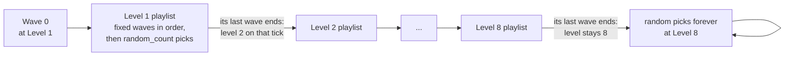
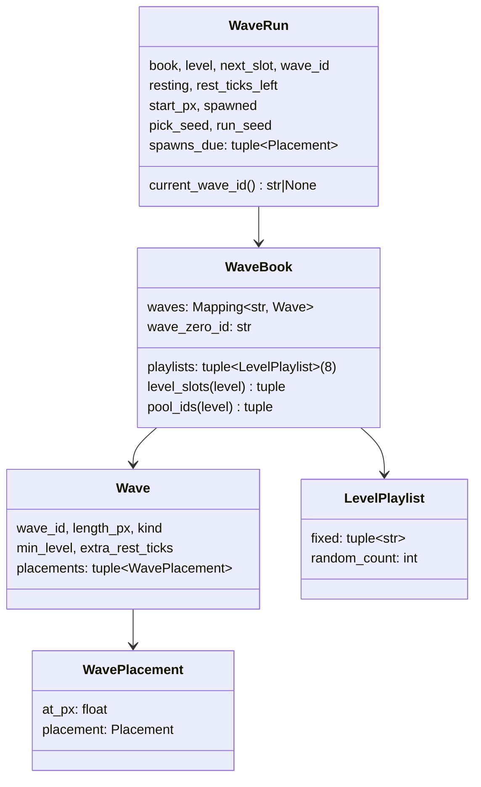
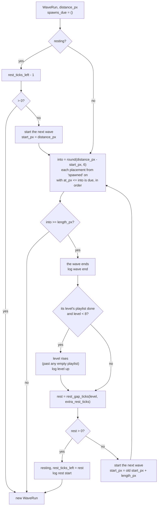
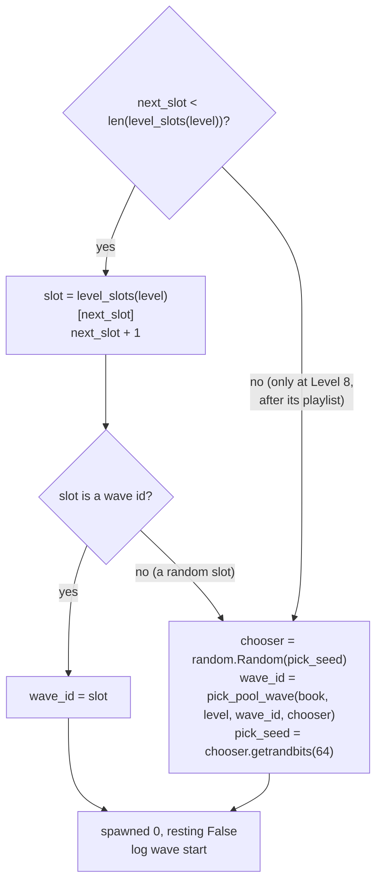

# Waves: wave files, the wave book, the wave clock, playlists and the random picker
Version: 3
Status: frozen
Features: DRA-76, DRA-104, DRA-111
Created by: architect

## Purpose
A normal run is made of waves. A wave is a hand-authored group of drifters, each placed at a scroll distance from the wave's start; it plays as the world scrolls past. This contract holds the waves and playlists as core data (the wave book), the check that turns the decoded wave and playlist files into a book or refuses them, the wave state one run carries (the level, the wave playing, the rest gap, the next random pick), its one-tick step (the wave clock and the playlist runner), and the random picker.

Every run opens with Wave 0 at Level 1. Then each level plays its playlist: its fixed waves in order, then `random_count` random picks. When the last wave of a level's playlist ends, the level goes up by one on that tick. After Level 8's playlist, random picks play forever at Level 8. A random pick is a pool wave allowed at the current level, never the wave that just played, and new every run. Between two waves there is a rest gap: `rest_gap_base` × the level's Rest gap × (0 ticks for now), plus the extra rest of the wave that ended. The world keeps scrolling through it.

The wave state lives inside the run (`docs/contracts/systems/run.md`, `Run.waves`): it freezes at game over, and a retry starts it again from Wave 0 with new picks. Its level is the run's level: the scroll speed (`docs/contracts/systems/scroll.md`) and the spawner read it. A run with no wave state plays no waves and stays at Level 1: that is the debug test spawn list.

## Diagram
The order of one run:

Between every two waves: the rest gap (0 ticks with today's values and no extra rest).

Data:


One playing tick, `step_waves(waves, distance_px)`, called by `core.run` (step 9a) with the scroll's distance after this tick:


Starting the next wave (never Wave 0, which `start_waves` starts):


A rest gap of R ticks after a wave that ends on tick T (R = 2: an extra rest of 2, `rest_gap_base` 0):
```
state after tick   T        T+1      T+2
resting            True     True     False
rest_ticks_left    2        1        0
current_wave_id    None     None     <next wave id>   (it starts at the distance after tick T+2)
```
The rest shows on exactly R states. With R = 0 the next wave starts on tick T, right where the last one ended.

With the placeholder content (scope report DRA-76, Values needed: `wave_0`, `l1_a` and `l1_b` 1320 px each; every level plays fixed `[l1_a]`, then 1 random; `l1_b` is the only pool wave), no extra rest and `rest_gap_base` 0. Level 1 scrolls 1.1 px a tick, Level 2 1.21 (`systems/scroll.md`):
```
wave (level)        wave_0 (1)   l1_a (1)   l1_b (1, random)   l1_a (2)   l1_b (2, random)   ...   l1_b (8, random) forever
starts at, px       0            1320       2640               3960       5280                ...
ends after tick     1230         2430       3630               4721       5812                ...
time                20.5 s       40.5 s     60.5 s             78.7 s     96.9 s
```
The level is 2 in the state after tick 3630, and tick 3631 is the first that scrolls at 1.21 px.

## Interface
```python
# game/core/waves.py
# Imports: stdlib (collections.abc, dataclasses, enum, logging, math, random, typing), core.levels,
# core.scroll (DISTANCE_DECIMALS), core.drifters.spawner (Placement). Never pygame, ui or app.
# Every module-level constant is typing.Final.

REST_GAP_BASE_TICKS: Final[int] = 0  # 08-difficulty.md, rest_gap_base, ticks (guess; the real value is DF-02)


class WaveKind(Enum):
    FIXED = "fixed"  # played where a playlist names it
    POOL = "pool"    # picked for random slots


@dataclass(frozen=True, slots=True, kw_only=True)
class WavePlacement:
    """One drifter of a wave: when it comes and how it is placed."""
    at_px: float          # trigger: px of scroll from the wave's start, >= 0
    placement: Placement  # where and how (core.drifters.spawner). speed is always None. seed is
                          # set for a seeded drifter (the UFO, DRA-104), None for every other


@dataclass(frozen=True, slots=True, kw_only=True)
class Wave:
    """One hand-authored wave."""
    wave_id: str                                 # the file name without .json
    length_px: float                             # px of scroll, > 0
    kind: WaveKind
    min_level: int | None                        # POOL: lowest level it may play at, 1 to 8. FIXED: None
    extra_rest_ticks: int = 0                    # ticks added to the rest gap after it, >= 0
    placements: tuple[WavePlacement, ...] = ()   # by at_px, ties in file order


@dataclass(frozen=True, slots=True, kw_only=True)
class LevelPlaylist:
    """One level's playlist."""
    fixed: tuple[str, ...] = ()   # wave ids, in play order
    random_count: int = 0         # random slots after the fixed waves, >= 0


@dataclass(frozen=True, slots=True, kw_only=True)
class WaveBook:
    """Every wave and every playlist, checked. Never changes after loading."""
    waves: Mapping[str, Wave]              # by wave id
    wave_zero_id: str                      # Wave 0
    playlists: tuple[LevelPlaylist, ...]   # LEVEL_COUNT entries, Level 1 first

    def level_slots(self, level: int) -> tuple[str | None, ...]: ...
        # The level's fixed wave ids in order, then random_count times None (a random slot).
    def pool_ids(self, level: int) -> tuple[str, ...]: ...
        # Ids of the POOL waves with min_level <= level, sorted by id.


@dataclass(frozen=True, slots=True, kw_only=True)
class WaveRun:
    """One run's waves after a tick."""
    book: WaveBook
    level: int                  # the run's level, 1 to LEVEL_COUNT
    next_slot: int              # slots of this level's playlist started so far. Wave 0 is no slot
    wave_id: str                # the wave playing; while resting, the wave that just ended
    resting: bool = False       # a rest gap is running
    rest_ticks_left: int = 0    # ticks of rest still to come, > 0 only while resting
    start_px: float = 0.0       # scroll distance where the playing wave started, px
    spawned: int = 0            # placements of the playing wave already due
    pick_seed: int              # seed of the next random pick, >= 0
    run_seed: int               # the seed this run's waves started from, >= 0
    spawns_due: tuple[Placement, ...] = ()   # placements that came due on the last tick, in order

    @property
    def current_wave_id(self) -> str | None: ...
        # None while resting, else wave_id.


def start_waves(book: WaveBook, seed: int) -> WaveRun: ...
    # Wave 0 at Level 1: level FIRST_LEVEL, next_slot 0, wave_id book.wave_zero_id, start_px 0.0,
    # spawned 0, pick_seed seed, run_seed seed, nothing due. Logs its wave start.

def step_waves(waves: WaveRun, distance_px: float) -> WaveRun: ...
    # One playing tick. distance_px is the run's scroll distance after this tick's scroll step.
    # Pure apart from event logging. Never mutates its input.

def next_run_waves(waves: WaveRun) -> WaveRun: ...
    # The waves of the next run: start_waves(waves.book, random.Random(waves.run_seed).getrandbits(64)).

def pick_pool_wave(book: WaveBook, level: int, last_wave_id: str, chooser: random.Random) -> str: ...
    # One random pick. Draws from chooser only.

def rest_gap_ticks(level: int, extra_rest_ticks: int) -> int: ...
    # ceil(round(REST_GAP_BASE_TICKS * rest_gap_mult(level), 6)) + extra_rest_ticks. >= 0.
```

```python
# game/core/wave_files.py
# Imports: stdlib (collections.abc, logging, re, typing), core.levels, core.waves,
# core.drifters (base: DrifterType, TouchEffect; spawner: Placement, spawn_drifter, placement_seed,
# MAX_SEED (DRA-104); registry: drifter_class (DRA-104); tuning: DrifterTuning).
# Never pygame, ui or app. Never opens a file: the app reads and decodes them.

SEAM_CLEAR_PX: Final[float] = 120.0          # 09-waves.md, seam_clear, px of scroll (locked)
NAME_PATTERN: Final[str] = r"^[a-z][a-z0-9_]*$"   # wave ids, drifter types and variant names
WAVES_FOLDER: Final[str] = "waves"            # how errors name the folder
PLAYLIST_NAME: Final[str] = "playlist"        # the playlist file's name, without .json


def build_wave_book(
    wave_documents: Mapping[str, object],
    playlist_document: object,
    tuning: DrifterTuning,
) -> WaveBook: ...
    # wave_documents: each wave file's decoded JSON, keyed by wave id (its file name without .json).
    # playlist_document: playlist.json's decoded JSON. Checks everything in Rules, Wave files, and
    # builds the book. Raises ValueError naming the file and the problem. Pure; logs nothing.
```

## Presentation
The waves show only in the debug overlay, through the run. Lines 5 and 6 and their text are set in `docs/contracts/systems/debug-overlay.md`.

| Core field | Shown as |
|---|---|
| `run.waves` is None | `wave none` (the test spawn list plays) |
| `run.waves.current_wave_id` | `wave <id>`, or `wave rest` when it is None |
| `run.level` | `level <n>` |

The level is not on the HUD in this feature (scope report DRA-76, Out; 10-ui.md, rule 2).

## Rules
Values. Source for each: on its line in Interface.
- `REST_GAP_BASE_TICKS` 0 is a GDD guess (08-difficulty.md, rest_gap_base; DF-02). `SEAM_CLEAR_PX` 120 is locked (09-waves.md). The level count and the multipliers come from `core.levels` (`systems/drifters.md`), never copied here.
- The placeholder lengths and playlists are content, not contract values (scope report DRA-76, Values needed).

The order. Source: 09-waves.md, rules 3 and 4; 08-difficulty.md, rule 1; 91-decision-log.md, rows 65 and 66:
- A run's waves start with `start_waves(book, seed)`: Wave 0 at Level 1, starting at 0 px, the run's distance at play start. Wave 0 is no slot of any playlist. Its kind plays no part: it always comes first, every run.
- A level's slots are its playlist's fixed wave ids in order, then `random_count` random slots (`level_slots`). Each new wave fills the next slot of the current level (`next_slot`). A fixed slot plays the wave it names. A random slot plays `pick_pool_wave`.
- Past the last slot of Level 8's playlist every new wave is a random pick at Level 8, forever. Source: 09-waves.md, rule 4; 08-difficulty.md, Edge cases (cap at Level 8).
- A fixed wave may be named in several playlists, or twice in one. Source: 09-waves.md, rule 4.

The wave clock (`step_waves`, steps as in the Diagram). Source: 09-waves.md, rules 2 and 9; 08-difficulty.md, rules 1 and 4; scope report DRA-76, Limits ("The wave clock"):
1. **Rest.** While `resting`, each tick takes 1 from `rest_ticks_left`. Above 0, nothing else happens and nothing is due. At 0 the rest ends and the next wave starts on this tick, with `start_px` = this tick's `distance_px`.
2. **Due.** `into = round(distance_px - start_px, DISTANCE_DECIMALS)`, px of scroll into the playing wave. Every placement from index `spawned` on whose `at_px <= into` is due, in placement order, and `spawned` moves past them. A placement is due once, on the first tick its trigger is reached. So a trigger of 0 is due on the tick its wave starts (for Wave 0, tick 1 of play).
3. **End.** When `into >= length_px` the wave ends on this tick. Every placement with `at_px <= into` is due first (step 2). A placement whose `at_px` is beyond the wave's length is never due.
   1. **Level rise.** If the wave that ended filled the last slot of its level's playlist (`next_slot >= len(level_slots(level))`) and `level < LEVEL_COUNT`: `level + 1` and `next_slot = 0`. While the new level is below `LEVEL_COUNT` and its playlist has no slots, `level + 1` again. Log `level up` once, with the new level. At Level 8 the level never rises. Source: 08-difficulty.md, rule 1 ("Each level ends on the tick the last wave of its playlist ends, and the next level starts on that tick"), Edge cases (no Level 9).
   2. **Rest gap.** `rest = rest_gap_ticks(level, ended_wave.extra_rest_ticks)`, with the level after 3.1. Above 0: `resting = True`, `rest_ticks_left = rest`; nothing more this tick. Source: 08-difficulty.md, rules 6 and rest_gap_base; 09-waves.md, rule 11.
   3. **Next wave.** With no rest, the next wave starts on this tick at `start_px = old start_px + old length_px`, where the last one ended, and step 2 runs again for it with the same `distance_px`. So a wave that ends partway through a tick's scroll loses none of that scroll, and waves keep their layout end to end.
4. `spawns_due` in the returned state holds every placement that came due on this tick, across every wave that played on it, in order. `()` when none.
- The level only changes in 3.1, so it never changes inside a wave. Source: 08-difficulty.md, Edge cases.
- `step_waves` is called once per playing tick, every playing tick: during the respawn wait, on protected ticks and on the tick lives reach 0. Never on a game-over tick: the run freezes the waves with everything else (`systems/run.md`). Source: 02-game-flow.md, rule 5; 03-world-and-camera.md, rule 4 (the world keeps going).
- `distance_px` never goes down, so `into` never does.

Starting a wave (not Wave 0). Source: 09-waves.md, rule 4:
- If `next_slot < len(level_slots(level))`: take that slot and add 1 to `next_slot`. Else (only at Level 8, after its playlist): a random slot, `next_slot` unchanged.
- A wave id slot: `wave_id` is that id. A random slot: `chooser = random.Random(pick_seed)`, `wave_id = pick_pool_wave(book, level, <the wave_id before this start>, chooser)`, then `pick_seed = chooser.getrandbits(64)`.
- Then `spawned = 0`, `resting = False`, `rest_ticks_left = 0`, and `start_px` as the caller set it.

Random picks (`pick_pool_wave`). Source: 09-waves.md, rules 4 and 10; 91-decision-log.md, row 66; scope report DRA-76, Limits ("The random picker"):
- Candidates: `book.pool_ids(level)`, pool waves with `min_level <= level`, sorted by id so the same seed always gives the same pick.
- With more than one candidate, `last_wave_id` is left out: never the wave that just played. That is the wave before this start, whatever played it: Wave 0, a fixed slot or a random one, in this level or the last.
- With one candidate, it plays even if it just played.
- `chooser.choice(candidates)`. The function draws from `chooser` and nothing else. The load check makes sure a level with a random slot has a candidate (Wave files), so core never picks from none.
- No tier check: `min_level` is set by hand while DF-01 is open. Source: scope report DRA-76, Out.

Seeds: new picks every run, the same picks for the same seed. Source: 09-waves.md, rule 4 ("Picks are new every run"); scope report DRA-76, Not in GDD (picks not seeded, new every run); 15-tech-constraints.md, rule 2:
- Core never draws from the clock or the OS. The app gives the first run's seed (`systems/app.md`). Each pick starts a `random.Random` from `pick_seed` and stores the next seed it draws.
- `next_run_waves` gives the next run a seed drawn from this run's `run_seed`. So every run after the first has new picks, with no input from the app.

The rest gap (`rest_gap_ticks`). Source: 08-difficulty.md, rule 6, rest_gap_base, Rest gap × row; 09-waves.md, rule 11; 91-decision-log.md, row 69:
- `ceil(round(REST_GAP_BASE_TICKS × rest_gap_mult(level), 6)) + extra_rest_ticks`. The scaled part rounds up to a whole tick, as 08-difficulty.md, rule 4 does for a scaled timer; the round to 6 decimals keeps float noise from adding a tick. With `rest_gap_base` 0 it is 0 at every level, and the rest gap is the extra rest alone.
- The extra rest never scales with level.
- The world keeps scrolling during a rest, and the distance keeps counting. Nothing is due during it.

The wave files (`build_wave_book`). Source: scope report DRA-76, Limits ("refusing bad files with an error that names the file and the problem", the list of refusals); 09-waves.md, rules 1, 2, 9 to 12 and 7.4; game/CONTEXT.md, Error handling; CLAUDE.md, no silent schema drift:
- Called once, at startup, in both modes, by the app (`systems/app.md`). Never during play.
- Each error is a `ValueError` whose message starts with the file, named from the game folder down: `waves/<wave id>.json: ...` or `waves/playlist.json: ...`, then the field and the problem. Examples below. A problem with no single file says `waves: ...`. The first problem found raises; no list.
- Order: every wave, by id; then the playlist; then the pool checks, Level 1 to 8. Inside a file, fields in the order below, placements by index.
- **Wave id.** Each key of `wave_documents` matches `NAME_PATTERN`. Else `waves/<key>.json: the file name must match ^[a-z][a-z0-9_]*$`.
- **Wave file** (`docs/contracts/schemas/wave.schema.json`), checked by hand like the tuning files (no schema library: pygbag has none). A JSON object. No unknown field. Required: `length_px`, a number > 0; `kind`, `"fixed"` or `"pool"`; `placements`, a list (may be empty). `min_level`: required for a pool wave, an integer from 1 to 8; refused for a fixed wave. `extra_rest_ticks`: optional, an integer >= 0, 0 when left out. A number is an `int` or a `float`, never a `bool`; an integer is an `int`, never a `bool`. Examples: `waves/l1_a.json: length_px must be a number > 0`, `waves/l1_b.json: min_level is required for a pool wave`, `waves/l1_a.json: min_level is only for a pool wave`, `waves/l1_a.json: unknown field 'speed'`.
- **Placement**, each item of `placements`. A JSON object. No unknown field: so `speed` is refused, as it stays a debug-only field (scope report DRA-76, Limits). Required: `at_px`, a number >= 0; `type`, a string. Optional: `x`, `y`, numbers; `variant`, a string matching `NAME_PATTERN`; `invert`, `specialty`, booleans; `as_level`, an integer from 1 to 8; `seed` (DRA-104), an integer from 0 to `MAX_SEED` (4294967295). Examples: `waves/wave_0.json: placements[3].at_px must be a number >= 0`, `waves/l1_a.json: placements[0]: unknown field 'speed'`, `waves/l1_a.json: placements[0].seed must be an integer from 0 to 4294967295`.
- **Drifter type.** `type` is a `DrifterType` value. Else `waves/<id>.json: placements[<i>].type 'comet' is not a drifter type (meteorite, satellite, chain_lightning, fireball, coin, floating_island, planet, ufo, electric_ball)`, the list in enum order (`electric_ball` from DRA-111; `core.wave_files` builds it from the enum, so its code doesn't change). An electric ball is a hazard to the seam check like every drifter whose touch is a hit, and its placement takes `x` (required), `y`, `variant`, `invert` (no effect) and `as_level` (`systems/drifters/electric-ball/core.md`, Placement fields).
- **Built drifter.** Each placement becomes `Placement(drifter_type, x=x, y=y, variant=variant, as_level=as_level, specialty_enabled=specialty, invert=invert, seed=seed)`, every field left out at its `Placement` default (`invert` False), `speed` None. **Seed** (DRA-104): when the file leaves `seed` out and `drifter_class(drifter_type).seeded` is True (the UFO), `seed = placement_seed(<wave id>, i)`, with `i` the placement's index in the file's `placements` list (before the sort by `at_px`). For any other drifter a seed left out stays None, and a seed given is passed on, so its load-time spawn refuses it below. Source: drifters/07-ufo.md, seed (locked: fixed per placement) and rule 10; `systems/drifters.md`, Rules, Spawner (Placement seed). It is spawned once with `spawn_drifter(placement, FIRST_LEVEL, tuning)` and the drifter is kept only for the next check. Whatever that raises (an unknown variant, a coordinate the drifter needs, an `invert` or a specialty it refuses) is raised again as `ValueError` naming the placement, `from` the original: `waves/l1_a.json: placements[2]: unknown variant 'huge' for drifter type 'meteorite'`. From DRA-104 that includes a seed on a drifter that has none (`placements[2]: meteorite has no seed`) and a UFO placed outside its band (`placements[4]: ufo placement y 100 is outside its band 188 to 440`). Source: the same load-time spawn as the debug test spawn list (`systems/app.md`, Rules, Debug test spawn list).
- **One path per UFO** (DRA-104). Within one wave, no two placements of a seeded drifter have the same seed, given or default. The later one, by index in the file, is refused: `waves/l1_a.json: placements[5]: seed 7 is already used by placements[2]`. Checked after every placement of the wave is built and spawned. Seeds are never compared across waves. Source: drifters/07-ufo.md, seed (locked: "Two UFOs in one wave never share a path").
- **Seam start.** A placement whose drifter's `effect_on_touch()` is `HIT` (a hazard) with `at_px < SEAM_CLEAR_PX` is refused: `waves/l1_a.json: placements[0]: a hazard (meteorite) at 100 px is inside the first 120 px`, the two numbers in `g` format. A trigger of exactly 120 px is allowed: the hazard's warning shows from 120 px on. Pickups (the coin) may trigger anywhere. Source: 09-waves.md, rule 7.4 (an entry warning counts as on screen; it shows from the tick the drifter is due); scope report DRA-76, Limits.
- **Playlist** (`docs/contracts/schemas/playlist.schema.json`). A JSON object. No unknown field. Required: `wave_zero`, a string; `levels`, a list of exactly `LEVEL_COUNT` (8) objects, Level 1 first. Each level: no unknown field; required `fixed`, a list of strings, and `random_count`, an integer >= 0. Example: `waves/playlist.json: levels must be a list of exactly 8 levels`, `waves/playlist.json: levels[2].random_count must be an integer >= 0`.
- **Named waves exist.** `wave_zero` and every `fixed` entry name a wave in `wave_documents`. Else `waves/playlist.json: wave_zero names 'wave_00', which is not a wave`, `waves/playlist.json: levels[0].fixed[1] names 'l1_c', which is not a wave`.
- **Random slots can be filled.** For each level `n` from 1 to 8 with `random_count > 0`, `pool_ids(n)` is not empty. Else `waves/playlist.json: levels[<n - 1>] (level <n>) has random_count <k> but no pool wave with min_level <= <n>`.
- **Level 8 forever.** `pool_ids(8)` is not empty, whatever the playlists say. Else `waves: no pool wave can play at level 8`.
- **Built.** `Wave` per file, with `length_px` and every `at_px` as `float`, `extra_rest_ticks` 0 when left out, and its placements sorted by `at_px`, ties in file order (a stable sort). `LevelPlaylist` per level, `fixed` as a tuple. `WaveBook(waves=<by id, in id order>, wave_zero_id=wave_zero, playlists=<8, Level 1 first>)`. Core trusts the book after this.
- **Not checked at load**, by scope: the seam at a wave's end, gaps, coin distances, the bot path and the tiers (`wave_check` and DF-01, later; 09-waves.md, rule 7 and Edge cases, provisional waves); Wave 0's hazards being meteorites only (01-vision.md, Locked decisions, 7: a content rule for the Wave Critic); a placement past the wave's length; a playlist level with no slots; a pool wave named in a `fixed` list. Each plays as written: the clock rules above say what that does.

Logging (logger `core.waves`, DEBUG, by event, never by tick). Source: game/CONTEXT.md, Logging; 15-tech-constraints.md, rule 9:
- `wave start id=%s level=%d random=%s`: each time a wave starts, Wave 0 included (from `start_waves`), with its id, the level and whether a random slot picked it. E.g. `wave start id=l1_b level=1 random=True`.
- `wave end id=%s`: each time a wave ends.
- `level up level=%d`: when the level rises, once, with the new level.
- `rest start ticks=%d`: when a rest gap above 0 starts.
- Order on one tick, for each wave that ends: `wave end`, `level up` if any, then `rest start` or the next `wave start`.
- Nothing else: no line when a placement is due (the run logs `drifter spawn` when it enters), no line per tick, no line for the rest's countdown. `core.wave_files` logs nothing; the app logs the one load line (`systems/app.md`).

Other rules:
- `step_waves`, `start_waves`, `next_run_waves`, `pick_pool_wave`, `rest_gap_ticks` and `build_wave_book` use no frame time. The only randomness is `random.Random` built from a seed in the state or handed in, or, for a default placement seed, from the wave id and index (`placement_seed`, DRA-104). Same input, same output. Source: 15-tech-constraints.md, rule 2.
- Core behaves the same in normal and debug mode and never reads the run mode. Whether a run has waves is the app's choice, made when it starts the run. Source: game/CONTEXT.md, Run modes; 15-tech-constraints.md, rule 7.
- Drifter values stay per drifter type: a wave sets no speed, size or timer, only placement fields. Source: 09-waves.md, rule 12; 91-decision-log.md, row 71.
- Core never imports pygame, `ui` or `app`, and never reads a file. Source: game/CONTEXT.md, Layout.

## Rationale
- **The default seed is filled in here (DRA-104).** Only the loader knows the wave id and the placement's index, the two facts that stay fixed while the file does; the spawner and the UFO never see the wave. `systems/drifters.md`, Rationale, has the reasoning on the seed itself.
- **Equal seeds are refused, not re-drawn (DRA-104).** "Two UFOs in one wave never share a path" is locked. Silently changing a seed the designer typed would break "a placement may set `seed` to pick another path"; refusing it names the placement, and a different seed fixes it. Default seeds collide only by a 1-in-4-billion chance, and the same message covers that.
- **The wave state lives in the run.** Game over must freeze it and a retry must restart it, the same as the ship and the scroll. `step_run` already does both for everything it holds, so the waves get them for free. Core owns the rule; the app only chooses, once per page load, whether the run has waves.
- **The run's level comes from the wave state.** The level is now a fact of the playlist (08-difficulty.md, rule 1), and only the wave clock knows when a playlist ends. A run with no waves (the test spawn list) stays at Level 1, as the scope report asks.
- **The book travels inside the wave state.** A retry happens inside `step_run`, which has no other way to reach the waves to restart. The book never changes, so carrying a reference costs nothing.
- **Due placements are handed out, not spawned here.** `add_drifters` is the run's only way in, and the app calls it after the tick (DRA-29, Director's choice). `spawns_due` is the waves' answer to "what is due"; the app passes it to `add_drifters` with the tuning, exactly as it does with the test spawn list. So a wave's drifters are added after the tick, their birth state is drawn, and they use the level after the tick, which is the risen level on a level-up tick.
- **The clock compares distances, not ticks.** A wave is a scroll distance and its triggers are distances (09-waves.md, rule 9), so the same wave keeps its layout at every level and just arrives faster. Reading the run's own distance means the clock can never disagree with the scroll.
- **Distances are rounded to 6 decimals before a comparison.** The distance is a sum of floats. A trigger on an exact boundary could otherwise be missed by 1e-13 px and come a tick late. A micro-px is far below anything the player can see.
- **No rest: the next wave starts where the last one ended, not at this tick's distance.** A wave that ends partway through a tick's scroll would otherwise lose that fraction, and two waves would drift apart by up to a tick's scroll each time. Contiguous starts keep the seam exactly 2 × `seam_clear` when both waves follow the seam rule.
- **After a rest, the next wave starts at the distance of the tick the rest ends.** The rest is counted in ticks, and the world moved during it; there is no earlier distance to start from.
- **The rest counts down from the tick after the wave ends.** A rest of R ticks then shows on exactly R states, like the blink and the cooldown in `systems/run.md`.
- **The level rises before the rest gap is worked out.** 08-difficulty.md, rule 6 uses "the level current when the gap starts", and rule 1 starts the next level on the tick the last wave ends, which is the tick the gap starts. With `rest_gap_base` 0 this has no effect yet.
- **The scaled rest rounds up.** The GDD has one rule for a scaled tick count, "A scaled timer rounds up to a whole tick" (08-difficulty.md, rule 4). The rest gap is the same kind of number, so it follows that rule. No effect while `rest_gap_base` is 0.
- **A level whose playlist has no slots is passed on the tick it starts.** 08-difficulty.md, rule 1 ends a level when its last wave ends; a level with no waves has nothing to wait for. The loader doesn't refuse it, because the scope report's list of refusals doesn't include it. No placeholder playlist is empty.
- **Wave 0 is no slot.** 08-difficulty.md, rule 1: "Wave 0 plays at Level 1, before the Level 1 playlist." Counting it outside the playlist keeps `random_count` and the fixed list exactly what the Director writes for Level 1.
- **Candidates sorted by id.** The book is built from a folder listing, whose order the browser's file system doesn't promise. Sorting makes a seed give the same picks everywhere, so tests and the log can be compared.
- **Seeds in the state, not a live generator.** A `random.Random` object changes when it is used, which a frozen state can't hold. Storing the next seed keeps every step a pure function of its inputs, and QA can replay any run from its seed. The app's one seed per page load makes picks new every page load; `next_run_waves` makes them new every retry.
- **The loader's checks live in core, the file reading in the app.** The checks are wave rules (the seam, the pool) and must be tested; `game/tests/check.sh` tests only `core` and `ui`. Reading files and decoding JSON is the app's edge work, as for the tuning (game/CONTEXT.md, Layout). `build_wave_book` takes decoded JSON, so it is pure and testable with test-only wave files, and the app stays thin.
- **One file per wave, the id is the file name.** A wave id written inside the file could disagree with the file's name; with no id field it can't. The playlist is the one file with another name, so `playlist` can't be a wave id.
- **The spawn spot is in screen px, the trigger is the world distance.** 03-world-and-camera.md, rule 1 and 09-waves.md, rule 2 put placements relative to the wave's start. The trigger is that relative world distance. The spot uses the placement fields every drifter already takes (07-drifters.md, rule 13), in the same screen px as the test spawn list, so one spawner and one set of drifter rules serve both. A parked drifter (a coin) placed just above the top edge at trigger t sits t px into the wave in the world.
- **The seam is checked only at the start.** The scope report lists "a hazard triggered inside the wave's first 120 px" as a refusal. Whether a hazard is still on screen in the last 120 px depends on its flight, which only `wave_check` (later) can play out.
- **Every placement is spawned once at load.** Only a drifter knows which coordinate it needs, which variants it has and whether it takes `invert` or a specialty. Spawning each placement once through the real spawner checks all of that with core's own rules, at startup, naming the placement. The hazard test reads the drifter's own `effect_on_touch()`, so a new hazard type needs no change here.
- **`min_level` is refused on a fixed wave.** A fixed wave plays where a playlist names it, whatever the level (09-waves.md, rule 10). A `min_level` there would read as a rule that does nothing.
- **No schema field marks a wave provisional.** The scope report keeps provisional status in the critic report, so nothing has to be dropped from the files once `wave_check` exists.
