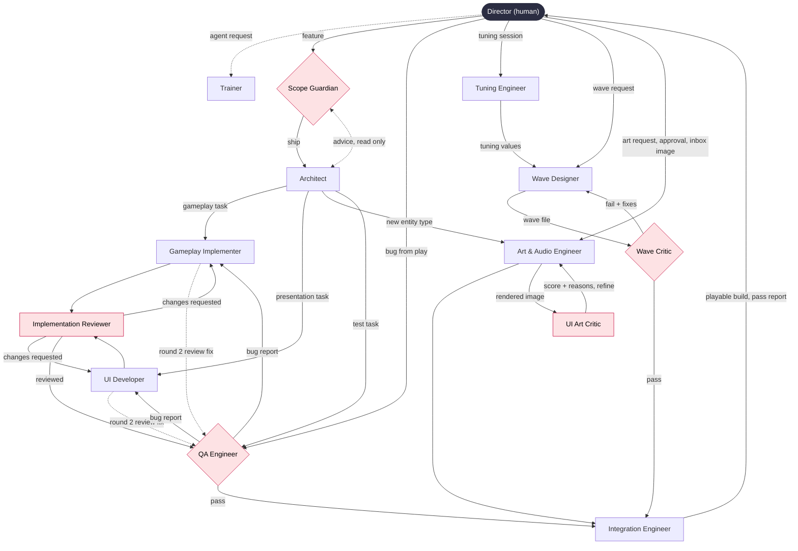

# Driftward Ace: Crew Roster

Source of truth for who owns what. The Trainer reads this file before writing any agent. Only the Director edits it.

## Crew diagram

Diamonds block work until they pass. Pink nodes are critics.

## Roster

| # | Agent | Writes only to | Trigger | Role | The player sees |
|---|---|---|---|---|---|
| 0 | Director (human) | `docs/design/`, `docs/crew/` | — | Decides | a game with a point of view rather than a committee's average |
| 1 | Trainer | `.claude/agents/` | Director asks to create or revise an agent, or reports an ownership gap | Builder | a finished game, because no work fell between two agents |
| 2 | Scope Guardian | `docs/reports/scope/`; Linear feature issues and their task statuses | the Director opens a chat with a feature or idea | Gate, blocks; the Director's assistant for Linear | one finished game instead of three half-built systems |
| 3 | Architect | `docs/contracts/` (content); Linear task sub-issues (create; close when the Director asks) | Scope Guardian approves a feature, or asks for technical advice | Generator | new features land without breaking what already worked |
| 4 | Gameplay Implementer | `game/core/`, `game/requirements.txt`, `game/ruff.toml`, `docs/reports/implementation/gameplay/` | Architect issues a gameplay task, or the Implementation Reviewer requests changes | Generator | the ship thrusts, drifts, falls, and dies on contact |
| 5 | UI Developer | `game/ui/`, `docs/reports/implementation/ui/` | Architect issues a presentation task, or the Implementation Reviewer requests changes | Generator | height, score, and death state shown clearly on screen |
| 6 | Tuning Engineer | `game/tuning/` | physics loop first runs, or Director calls a tuning session | Generator | controls that feel tight instead of floaty or leaden |
| 7 | Wave Designer | `game/waves/` | Director requests a new wave | Generator | a hand-shaped gauntlet instead of random noise |
| 8 | Wave Critic | `docs/reports/waves/` | Wave Designer submits a wave file | Critic, blocks | waves that are punishing but always survivable |
| 9 | Art & Audio Engineer | `game/assets/`, `staging/assets/`, `tools/art/` | Architect registers a new entity type, the Director asks directly or drops an image in `staging/art-inbox/`, or the `/ui-art-loop` skill runs a round | Generator; refines from the UI Art Critic's report | a coherent world instead of colored rectangles |
| 10 | Implementation Reviewer | `docs/reports/review/` | Gameplay Implementer or UI Developer finishes a task, or answers its findings (Re-check, once) | Critic, advises; sends findings back for one fix round before QA | a game that stays stable as features pile up |
| 11 | QA Engineer | `game/tests/`, `docs/reports/qa/` | the review reads `reviewed`, or an implementer's round 2 review fix lands, an implementer submits a fix, Architect issues a test task, or the Director reports a bug | Critic, blocks | collisions, scoring, and wave loading correct on every run |
| 12 | Integration Engineer | `game/main.py`, `game/app/`, `game/scripts/`, `pygbag.ini`, `docs/reports/integration/` | work from two or more agents needs to merge | Generator | the game launches and runs in the browser |
| 13 | UI Art Critic | `docs/reports/ui-art/` | the `/ui-art-loop` skill hands it a rendered image, or the Director asks it to judge one | Evaluator, read-only, advises: a score and one reason per criterion, no pass or fail | sprites, screens and backgrounds that look like one world |

## Work lanes

**Structural:** the work changes a contract. Scope Guardian → Architect → implementer → Implementation Reviewer → QA Engineer → Integration Engineer → close-out (Director with the main session). `scripts/close-out.sh <feature-id>` shows the open review findings and the integration Observations first. Nothing closes until the Director decides. After it writes, the main session sets the feature's Linear sub-issues to Done. Any contract change that comes out of it goes to a fresh Architect run.

**Review fixes:** inside the structural lane. If the review asks for any change, the implementer fixes every finding it can (round 1) → the Reviewer re-checks once → if a must-fix or should-fix is still open, the implementer fixes only those (round 2) → QA. Notes left open stay open. The Reviewer runs at most twice per task.

**Content:** the work fills an existing contract (waves, tuning values, assets). It skips the Architect. The producer follows the schema exactly; if the schema doesn't fit, it stops and reports, and the work moves to the structural lane.

**Fixes:** a QA bug report goes straight to the agent that owns the broken file, then back through QA. QA bug fixes skip review.

**UI art loop:** inside the content lane. The `/ui-art-loop` skill runs Art & Audio Engineer (make) → UI Art Critic (score) → Art & Audio Engineer (refine), with no input from the Director. It stops at a score of 8 or more, or after 3 rounds. Each round keeps its image in `staging/assets/` and its report at `docs/reports/ui-art/<asset>-r<round>.md`. The result waits in staging for the Director's approval, like any asset.

## Rules
- No two agents write the same path. Any agent may read anything.
- Only the Director edits `docs/design/` and `docs/crew/`.
- The Architect writes contract content. The close-out script (`scripts/close-out.sh`, which runs `scripts/python/contracts.py`) may change only contract `Status:` and `Version:` lines and task `Status:` lines, and append to `docs/contracts/CHANGELOG.md`.
- The one-time split script (`scripts/split-contract.sh`) may also cut a contract into part files and remove its history blocks (Impact tables, the Purpose task list), changing no other word. The Director and the main session run it. No agent runs it. `scripts/contracts.sh verify` proves no line was lost.
- `scripts/` belongs to the Director and the main session. No agent writes there.
- `staging/art-inbox/` belongs to the Director: images made in other tools go there. The Art & Audio Engineer only reads it.
