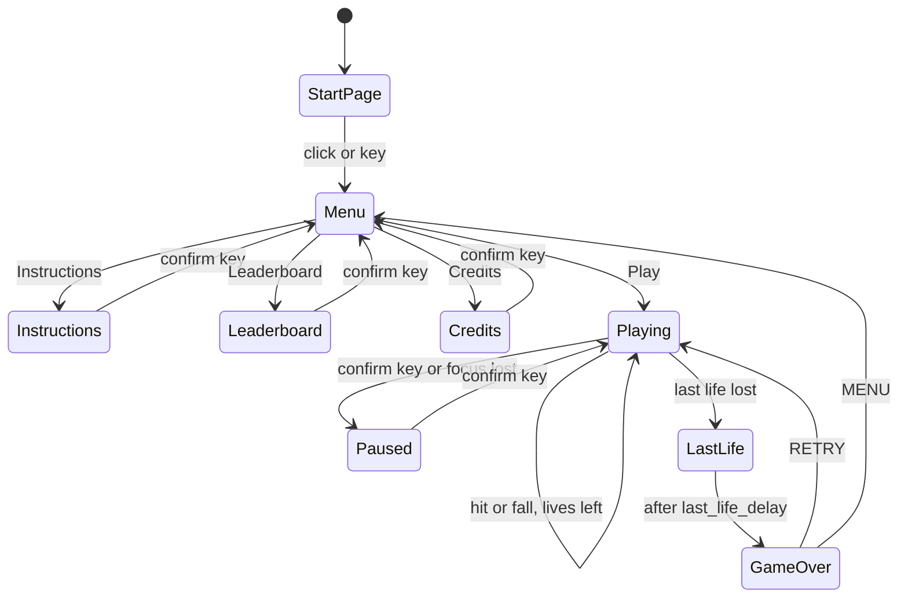

# Game flow
Status: draft
Depends on: [05-lives-and-damage.md](05-lives-and-damage.md), [10-ui.md](10-ui.md), [11-save-data.md](11-save-data.md)

## Summary
The game moves through a few fixed states. The start page comes first: the game's name over the menu's painting, a loading bar, then a prompt. One click or key press unlocks audio and opens the menu. Then the main menu shows: Play, Instructions, Leaderboard, Credits. A run plays until the last life is lost. The ship bursts, the world runs on for two seconds, then the game-over screen shows. If the score made the top 10, the player enters a name there first. RETRY starts a new run; MENU goes back to the menu.

## Values
| Key | Value | Unit | Range | Status | Source |
|---|---|---|---|---|---|
| fly_keys | arrow keys | — | — | locked | [01-vision.md](01-vision.md), Locked decisions |
| confirm_keys | Enter or Space. Both do the same everywhere | — | — | locked | Director |
| fresh_press | every confirm key counts only on a fresh press, on every screen. A key held from the screen before does nothing | — | — | locked | Director |
| menu_items | Play, Instructions, Leaderboard, Credits, in that order | — | — | locked | Director |
| menu_start_selection | Play | — | — | guess | this GDD |
| menu_navigation | up and down arrows move the selection and wrap around at both ends; a confirm key picks it | — | — | locked | Director |
| start_key | a confirm key on Play | — | — | locked | Director |
| demo_flight | the first Play after each page load shows a short scripted flight before the run (rule 5a). Not saved: a reload shows it again. Later Plays and retries go straight to the run. It can be switched off in the tuning | — | — | locked | Director |
| demo_script | stand still 60, hold up 18, let go 60, hover in the middle 90, hold up and right 20 (the coin), fly back to the middle and hover 140: 388 ticks (about 6.5 s). To hover and to fly back, the script taps the arrows itself as a player would (the keys light with each tap). The coin waits where the ship ends the up-and-right hold. Captions: HOLD UP TO THRUST, LET GO AND GRAVITY PULLS YOU DOWN, TAP UP TO HOVER, HOLD UP + RIGHT TO STEER, COINS ARE POINTS. In the last 50 ticks START shows in place of the caption, and the run then starts with no fade, the ship already in the middle Captions: HOLD UP TO THRUST, LET GO AND GRAVITY PULLS YOU DOWN, HOLD UP + RIGHT TO STEER, COINS ARE POINTS. The last 18 ticks fade to black, and the run fades in over its first 18 | ticks | — | guess | Director's outline (hold, let go, hold, right, get a coin); timings tuned on the real ship values |
| demo_skip | a confirm key during the demo skips it and starts the run. The press that picked Play doesn't count (rule 12) | — | — | locked | Director |
| pause_key | a confirm key, during Playing. The same key resumes | — | — | locked | Director |
| pause_on_focus_loss | yes | — | — | locked | Director |
| mute_key | M. Mutes and unmutes the music only. The effects always play. Works on every screen after the start page, the pause and the game-over screen included. It never picks, moves or confirms anything. Fresh press only. The mute is not saved: every page load starts with the music on | — | — | locked | Director |
| last_life_delay | 120 (2 s): from the ship bursting to the next screen | ticks | — | guess | Director |
| game_over_choices | RETRY, with MENU under it. RETRY is selected first. Up and down move the selection and wrap around; a confirm key picks it | — | — | locked | Director |
| retry_key | a confirm key on RETRY | — | — | locked | Director |

## Rules
1. **StartPage.** Shows on page load, before the game runs. It loads the game, then waits for one click or any key press. That input is the gesture the browser needs to allow sound ([15-tech-constraints.md](15-tech-constraints.md) rule 3). Content is in [10-ui.md](10-ui.md), `start_page`. The press only opens the game: it never picks a menu item, and a key held through it counts as held on the menu (rule 12).
2. **Menu.** Shows after the click, and again when MENU is picked on GameOver. It opens with `menu_start_selection` selected. Up and down move the selection, a confirm key picks it. Play starts a run (rule 5), after the demo flight the first time (rule 5a). Nothing else returns to the menu; a run in progress never does. Source: [01-vision.md](01-vision.md), Locked decisions.
3. **Instructions.** Opens only from the menu, never on its own. Content is in [10-ui.md](10-ui.md). A confirm key goes back to the menu.
4. **Leaderboard.** Opens from the menu. Shows the top 10 ([11-save-data.md](11-save-data.md)). It opens even when the list is empty or saves don't work. A confirm key goes back to the menu.
5. **Playing.** Every run starts the same way: 5 lives, score 0, distance 0 m, Level 1, Wave 0, the ship at the center point at rest, and the scroll starting after its start delay ([03-world-and-camera.md](03-world-and-camera.md)). The ship holds at the center until the first arrow key press, as in the respawn wait ([05-lives-and-damage.md](05-lives-and-damage.md) rule 2.5): an arrow held through the start does not count. Meanwhile the scroll, the waves and the drifters run as usual, with no invulnerability, so a hazard can reach the waiting ship. This holds for every run: from Play, after the demo flight and on RETRY. See [05-lives-and-damage.md](05-lives-and-damage.md) and [09-waves.md](09-waves.md).
5a. **Demo flight.** The first Play after a page load shows the demo before the run (`demo_flight`). The ship flies by the real physics with the keys of `demo_script`: it stands, climbs with up held, drifts up and falls back once up is let go, is caught and hovers in the middle by taps of up, climbs right with up and right held into a coin, which pays its points as in a run, flies back to the middle and hovers while START shows. The keys the script holds light up on four arrow key caps at the bottom of the play area, with a caption over them. The HUD shows the waiting run; its score shows the coin's points. Nothing can hit the ship and the player's arrows do nothing. A confirm key skips it (`demo_skip`). When it ends or is skipped, the run starts from rule 5. Pillars: Master the drift (the player sees the drift before flying), Risk brings reward (the coin is a pickup, not a hazard). Source: Director.
6. A hit or a fall inside Playing costs a life. The game stays in Playing. Invulnerability and the fall respawn happen inside it ([05-lives-and-damage.md](05-lives-and-damage.md)).
7. **Paused.** A confirm key during Playing pauses. So does the browser tab or window losing focus. A PAUSE box shows in the middle of the screen. Everything freezes: physics, scroll, drifters, timers, invulnerability, cooldowns and the respawn wait. A confirm key resumes. Getting focus back does not resume on its own. The pause has no other options. Arrow keys do nothing while paused. M still works (rule 13).
8. **LastLife.** Entered the tick the last life is lost ([05-lives-and-damage.md](05-lives-and-damage.md) rule 5). The ship bursts and never rebuilds. The game-over sound plays as it bursts, after the hit sound ([12-art-and-audio.md](12-art-and-audio.md), `sound_list`). For `last_life_delay` ticks the world keeps scrolling and drifters keep moving while the particles float. Nothing can hit the ship and the score is frozen: no distance, coins or grazes count. Keys do nothing. Then the game goes to GameOver.
9. **Name entry.** Part of GameOver, not a screen of its own. It shows only when saves work and the run's score makes the top 10. The player picks a name and saves it with a confirm key. Until then, RETRY and MENU take no keys. Rules are in [11-save-data.md](11-save-data.md).
10. **GameOver.** Everything is frozen. From its first frame it shows the result message for the run's place, the score, and RETRY with MENU under it. When the score makes the top 10, the letter picker shows too (rule 9). Content is in [10-ui.md](10-ui.md). The message never changes while the screen shows.
11. **Retry.** A confirm key on RETRY starts a new run from rule 5. There is no delay. Everything resets. Retry goes straight into the run; the menu and the instructions don't show.
12. **One press, one action.** Every confirm key counts only on a fresh press, on every screen. A key still held from the screen before does nothing on the new one. One press never does two things.
13. **Music mute.** M mutes the music where it is. Pressing M again resumes it from the same spot, never from the start. While muted, a small icon shows ([10-ui.md](10-ui.md), `mute_icon_place`). The music plays without a break through the menu, a run, the pause and the game-over screen. Only M stops it. The effects never mute. Source: Director.
14. **Credits.** Opens from the menu. Names the sources of the sounds and fonts the game uses, as their licenses ask. Content is in [10-ui.md](10-ui.md), `credits_page`. A confirm key goes back to the menu, which opens on `menu_start_selection`. Source: Director.

## Edge cases
- The player saves the name and keeps the key held. The held key does not pick RETRY. They release it and press again (rule 12).
- The player picks Play and keeps the key held. The run doesn't pause. They release it and press again to pause (rule 12).
- The tab loses focus on the menu, the instructions, the leaderboard, the credits or GameOver: nothing changes. Only Playing pauses.
- The tab loses focus during LastLife: it doesn't pause. The two seconds run on.
- The player pauses during the respawn wait after a fall: the wait freezes with everything else. A confirm key resumes; the respawn still needs an arrow press ([05-lives-and-damage.md](05-lives-and-damage.md) rule 2.5).

## Open
- None.

## How to extend
A new screen (settings) is a new state. Add it to the diagram and rules, give it its key in Values, and check the key against Locked decision 1 in [01-vision.md](01-vision.md): arrows fly, Enter or Space confirms, M mutes the music.
