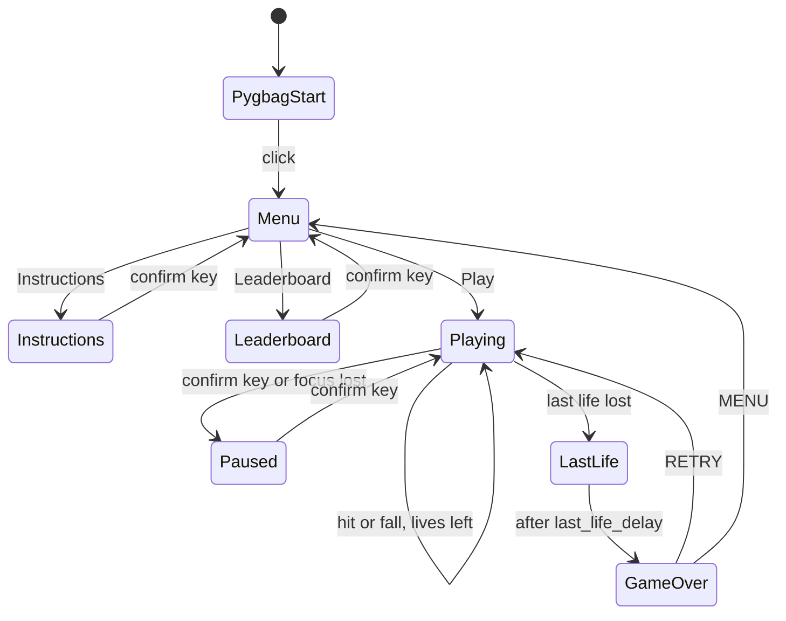

# Game flow
Status: draft
Depends on: [05-lives-and-damage.md](05-lives-and-damage.md), [10-ui.md](10-ui.md), [11-save-data.md](11-save-data.md)

## Summary
The game moves through a few fixed states. pygbag's own click-to-start screen comes first and unlocks audio. Then the main menu shows: Play, Instructions, Leaderboard. A run plays until the last life is lost. The ship bursts, the world runs on for two seconds, then the game-over screen shows. If the score made the top 10, the player enters a name there first. RETRY starts a new run; MENU goes back to the menu.

## Values
| Key | Value | Unit | Range | Status | Source |
|---|---|---|---|---|---|
| fly_keys | arrow keys | — | — | locked | [01-vision.md](01-vision.md), Locked decisions |
| confirm_keys | Enter or Space. Both do the same everywhere | — | — | locked | Director |
| fresh_press | every confirm key counts only on a fresh press, on every screen. A key held from the screen before does nothing | — | — | locked | Director |
| menu_items | Play, Instructions, Leaderboard, in that order | — | — | locked | Director |
| menu_start_selection | Play | — | — | guess | this GDD |
| menu_navigation | up and down arrows move the selection and wrap around at both ends; a confirm key picks it | — | — | locked | Director |
| start_key | a confirm key on Play | — | — | locked | Director |
| pause_key | a confirm key, during Playing. The same key resumes | — | — | locked | Director |
| pause_on_focus_loss | yes | — | — | locked | Director |
| last_life_delay | 120 (2 s): from the ship bursting to the next screen | ticks | — | guess | Director |
| game_over_choices | RETRY, with MENU under it. RETRY is selected first. Up and down move the selection and wrap around; a confirm key picks it | — | — | locked | Director |
| retry_key | a confirm key on RETRY | — | — | locked | Director |

## Rules
1. **PygbagStart.** pygbag's built-in click-to-start screen. Never build a custom one. Source: [15-tech-constraints.md](15-tech-constraints.md).
2. **Menu.** Shows after the click, and again when MENU is picked on GameOver. It opens with `menu_start_selection` selected. Up and down move the selection, a confirm key picks it. Play starts a run (rule 5). Nothing else returns to the menu; a run in progress never does. Source: [01-vision.md](01-vision.md), Locked decisions.
3. **Instructions.** Opens only from the menu, never on its own. Content is in [10-ui.md](10-ui.md). A confirm key goes back to the menu.
4. **Leaderboard.** Opens from the menu. Shows the top 10 ([11-save-data.md](11-save-data.md)). It opens even when the list is empty or saves don't work. A confirm key goes back to the menu.
5. **Playing.** Every run starts the same way: 3 lives, score 0, distance 0 m, Level 1, Wave 0, the ship at the center point at rest, and the scroll starting after its start delay ([03-world-and-camera.md](03-world-and-camera.md)). See [05-lives-and-damage.md](05-lives-and-damage.md) and [09-waves.md](09-waves.md).
6. A hit or a fall inside Playing costs a life. The game stays in Playing. Invulnerability and the fall respawn happen inside it ([05-lives-and-damage.md](05-lives-and-damage.md)).
7. **Paused.** A confirm key during Playing pauses. So does the browser tab or window losing focus. A PAUSE box shows in the middle of the screen. Everything freezes: physics, scroll, drifters, timers, invulnerability, cooldowns and the respawn wait. A confirm key resumes. Getting focus back does not resume on its own. The pause has no other options. Arrow keys do nothing while paused.
8. **LastLife.** Entered the tick the last life is lost ([05-lives-and-damage.md](05-lives-and-damage.md) rule 5). The ship bursts and never rebuilds. The game-over sound plays as it bursts, once the game has sound ([12-art-and-audio.md](12-art-and-audio.md), AA-03). For `last_life_delay` ticks the world keeps scrolling and drifters keep moving while the particles float. Nothing can hit the ship and the score is frozen: no distance, coins or grazes count. Keys do nothing. Then the game goes to GameOver.
9. **Name entry.** Part of GameOver, not a screen of its own. It shows only when saves work and the run's score makes the top 10. The player picks a name and saves it with a confirm key. Until then, RETRY and MENU take no keys. Rules are in [11-save-data.md](11-save-data.md).
10. **GameOver.** Everything is frozen. From its first frame it shows the result message for the run's place, the score, and RETRY with MENU under it. When the score makes the top 10, the letter picker shows too (rule 9). Content is in [10-ui.md](10-ui.md). The message never changes while the screen shows.
11. **Retry.** A confirm key on RETRY starts a new run from rule 5. There is no delay. Everything resets. Retry goes straight into the run; the menu and the instructions don't show.
12. **One press, one action.** Every confirm key counts only on a fresh press, on every screen. A key still held from the screen before does nothing on the new one. One press never does two things.

## Edge cases
- The player saves the name and keeps the key held. The held key does not pick RETRY. They release it and press again (rule 12).
- The player picks Play and keeps the key held. The run doesn't pause. They release it and press again to pause (rule 12).
- The tab loses focus on the menu, the instructions, the leaderboard or GameOver: nothing changes. Only Playing pauses.
- The tab loses focus during LastLife: it doesn't pause. The two seconds run on.
- The player pauses during the respawn wait after a fall: the wait freezes with everything else. A confirm key resumes; the respawn still needs an arrow press ([05-lives-and-damage.md](05-lives-and-damage.md) rule 2.5).

## Open
- None.

## How to extend
A new screen (settings) is a new state. Add it to the diagram and rules, give it its key in Values, and check the key against Locked decision 1 in [01-vision.md](01-vision.md): arrows fly, Enter or Space confirms.
