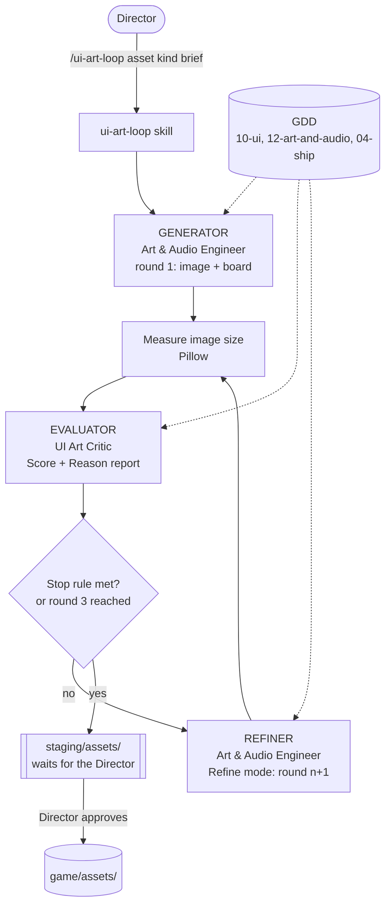
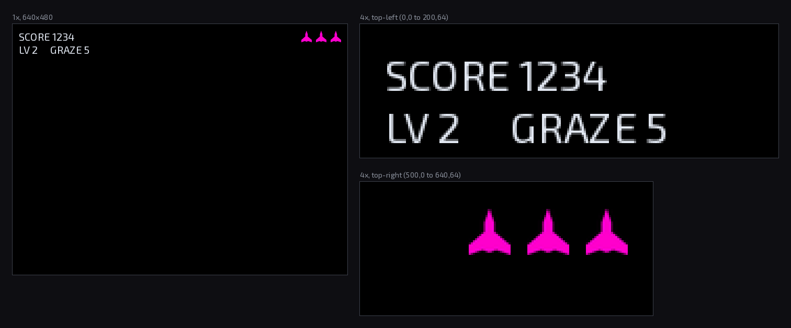
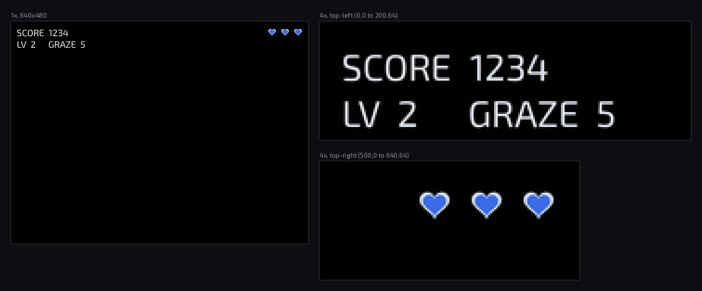
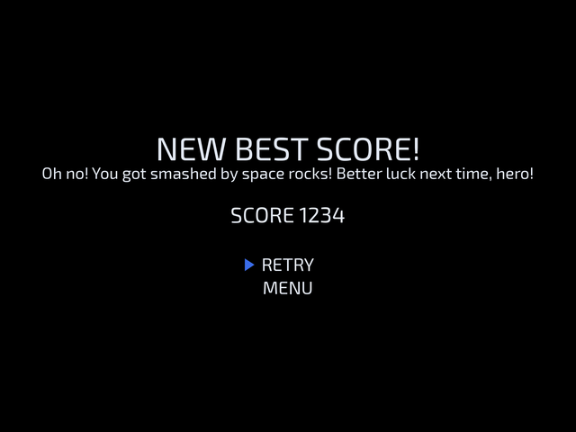
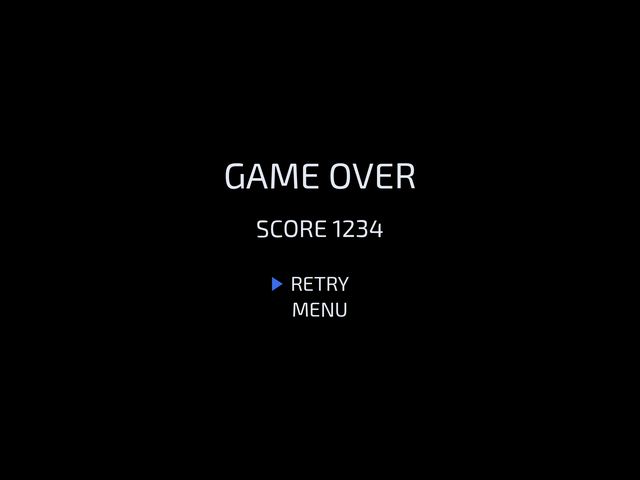
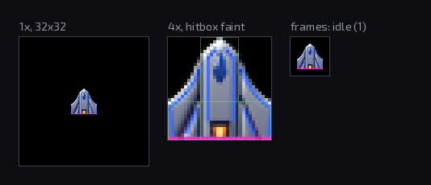
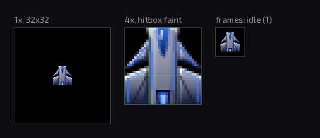

# Style Guide Agent

**Author:** David Monestel Aguilar
**Course:** Multi-Agent AI for Game Development
**Game:** Driftward Ace
**Repo & branch:** [task-6-style-guide-agent](https://github.com/david-mntl/driftward-ace/tree/task-6-style-guide-agent)

---

## 1. Summary

Driftward Ace already uses a crew of AI agents. For this task I added a self-correcting art loop, the `/ui-art-loop` skill. It makes one asset, scores it against the game's GDD, and fixes it by itself, for up to 3 rounds. The Director (me) only starts it and approves the result at the end.

| Loop role | Agent in the crew | What it does |
|---|---|---|
| Generator | Art & Audio Engineer, round 1 | Draws the asset with a Python script (`tools/art/`), or converts it from another image, and writes a preview board |
| Evaluator | UI Art Critic | Scores 5 criteria from 0 to 10 and gives a reason for each one, citing the GDD rule it breaks |
| Refiner | Art & Audio Engineer, Refine mode | Reads the Critic's report and redraws the asset, fixing every issue it names to aim for 10/10 |
| Loop controller | `/ui-art-loop` skill | Runs the rounds, measures each image, applies the stop rule |

---

## 2. Style Guide

The style guide is not a separate document. It is the GDD itself: `12-art-and-audio.md` (world brief, color language, art rules), `10-ui.md` (font, voice, locked words, layout) and `04-ship.md` (ship size, hitbox, look). The Critic must read these files on every run and can only score against what they say. It is not allowed to invent a rule.

### Where the rules come from: the lore

Two galaxies collapsed into the largest black hole ever. A magnetic **anomaly** broke physics and marks everything it touches with a **fuchsia shimmer**. The player's ship is the **one thing left untouched**: pale plating, cobalt lines, a blue flame. The mood is "beautiful and doomed, lonely, never horror". Every rule below follows from that story.

### Constraint types

| # | Constraint type | Rule (from the GDD) | Tied to the lore because... |
|---|---|---|---|
| 1 | **Color language** | Fuchsia/purple = the anomaly and coins. Orange/yellow = heat and danger. Pale white-cyan = electricity. Cobalt + pale plating = you. **Rule 6:** a solid, bright fuchsia shape always means a coin. | Colors tell the player what something *is* before they read it. A fuchsia life icon would read as a coin. |
| 2 | **Lore / world fit** | **Rule 8:** every object the anomaly touched gets a thin fuchsia rim on the side facing the black hole. *The ship has none: it is untouched.* Ship `look_reference`: long blade-like wings, cobalt lines, blue flame, **no fuchsia**. Light: hard white highlights, deep navy shadows. | The ship surviving untouched is the core of the story. Any fuchsia on it breaks that. |
| 3 | **Tone & vocabulary** | `ui_voice`: terse arcade, short labels, few words. **Rule 6 (UI):** no filler, no hype. Locked words stay as written: PAUSE, RETRY, NEW BEST SCORE, TOP 3, TOP 10, GAME OVER. **Rule 10:** a score off the top 10 always says GAME OVER. | The mood is lonely and calm. Cheerful, cartoon text ("Better luck next time, hero!") is off-brand. |
| 4 | **Format, size & layout** | Screen 640 × 480. Ship 32 × 32 with an inverted-T hitbox that is never bigger than what the player sees. HUD: score top-left, lives top-right as **hearts, one per life**. Game over: one centered stack, message 36 px, score 24 px, Exo 2 Regular, flat, no glow. | Pillar 2, *See it before it hits you*: what you see must match what can hit you. |

### The Critic's rubric

Each kind of asset gets five criteria. Size comes first and has priority.

| Sprite | Screen |
|---|---|
| 1. Size (vs GDD size and hitbox) | 1. Size & layout |
| 2. World fit (lore, mood) | 2. Colors (color language) |
| 3. Colors (color language) | 3. Font & glow |
| 4. Light & glow (rim rule) | 4. Voice & words (tone, locked words, length) |
| 5. Readability & finish | 5. Readability at 1× |

---

## 3. The Evaluator & Refiner Loop

### Pipeline diagram (art path)



### Generator: two ways to make round 1

The Art & Audio Engineer picks its mode from the brief:

- **Request mode:** draws the asset from scratch with a Python script. All three demos used this.
- **Convert mode:** makes the asset from another image: a public-domain photo or an image the Director drops in `staging/art-inbox/`. It cuts it out, shrinks it to game size, fits it to the palette, adds the rim light where the GDD asks for it, and makes the frames.

In both modes the result goes through the same Critic and Refiner rounds.

### Evaluator output (SCORE + REASON)

Every round writes one report, `docs/reports/ui-art/<asset>-r<n>.md`. Line 1 is the score the skill reads:

```
Score: 7.0 | Lowest: 4 | Size: 7
```

Then a table with one score and one concrete reason per criterion, a `## Fix first` list, and from round 2 a `## Since round n-1` list showing what moved.

### Refiner

The Refiner gets only the report path. It fixes everything the report names, aiming for 10/10 on every criterion. Size comes first if it is wrong, then the lowest scores and the `## Fix first` items, then every other reason below 10. A criterion already at 10 stays as it is. It writes new files for the next round, so earlier rounds are never overwritten.

### Stop rule

The loop stops when **Score ≥ 8, Lowest ≥ 6 and Size ≥ 8**, or after round 3. Nothing goes into the game until the Director approves a file by name.

### How I ran it

Each demo started with a flaw seeded on purpose in the round 1 brief. The asset was a test fixture, not for shipping. Everything else followed the GDD.


---

## 4. Before/After Demonstration

### Example 1: HUD, Color language and icon format

**What was asked (round 1 brief):**
> Make the round 1 files for the demo asset demo-hud (kind screen). This is a deliberate test fixture for the homework demo, not for shipping. Seed this flaw on purpose: the lives hearts are solid bright fuchsia and are gonna be ships instead of hearts. Everything else follows GDD.

| Round 1 (before) | Round 2 (after) |
|---|---|
|  |  |
| **Score 7.0, Lowest 4, Size 7** | **Score 8.4, Lowest 8, Size 9** |

**What was wrong and how the Critic caught it:**

| Criterion | R1 | Critic's reason (short) | R2 | What the Refiner changed |
|---|---|---|---|---|
| Colors | **4** | Lives are solid bright fuchsia. **Rule 6:** solid fuchsia always means a coin, so lives read as coins. Fuchsia is also the anomaly's color, and the ship is "untouched". | 8 | Hearts are now cobalt with a pale rim, the "you, untouched" color |
| Size & layout | 7 | `lives_display` asks for **hearts, one per life**. The 10-ui.md sketch shows hearts. These are ship icons. | 9 | Ships replaced by 3 hearts, top-right |
| Readability | 7 | *Not seeded:* "SCORE 1234" reads as SCORE1234, and GRAZE has uneven letter gaps. | 8 | Word gap opened, letters evened out |

**Result:** the seeded flaw was found with the exact GDD rule it broke. The Critic also caught two spacing faults nobody had planted. The loop stopped after round 2.

---

### Example 2: Game Over screen, Tone and vocabulary

**What was asked (round 1 brief):** the game-over screen from `game_over_look`, for a score **off** the top 10, with two flaws seeded: the wrong locked message, and an off-tone extra line.

| Round 1 (before) | Round 2 (after) |
|---|---|
|  |  |
| **Score 6.0, Lowest 1, Size 5** | **Score 9.2, Lowest 9, Size 9** |

**What was wrong and how the Critic caught it:**

| Criterion | R1 | Critic's reason (short) | R2 | What the Refiner changed |
|---|---|---|---|---|
| Voice & words | **1** | Score is off the top 10, so **rule 10** requires GAME OVER. "NEW BEST SCORE!" tells the player something false, and the "!" changes a locked word. "Oh no! You got smashed by space rocks! Better luck next time, hero!" is filler and hype. | **10** | Message is now GAME OVER, with no "!". The filler line is removed. |
| Size & layout | 5 | The extra line is not in the `game_over_screen` content list and pushes SCORE out of its 32 px spot. | 9 | Stack matches the spec: message, score, RETRY, MENU |
| Readability | 6 | The dense second line crowds the top and pulls the eye from the score. | 9 | Stack reads in one look |

**Result:** the largest jump of the three demos (Voice 1 → 10). The Critic judged the message by the run's real placement, not only by whether the text looked nice.

---

### Example 3: Ship sprite, Lore accuracy

**What was asked (round 1 brief):** the 32 × 32 player ship from `look_reference`, with two lore flaws seeded: an orange engine flame and a fuchsia rim on the bottom edge.

| Round 1 (before) | Round 2 (after) |
|---|---|
|  |  |
| **Score 5.2, Lowest 3, Size 8** | **Score 8.0, Lowest 7, Size 9** |

**What was wrong and how the Critic caught it:**

| Criterion | R1 | Critic's reason (short) | R2 | What the Refiner changed |
|---|---|---|---|---|
| Colors | **3** | Orange/yellow flame means heat and danger. The ship's row asks for "a blue flame". The fuchsia bottom line breaks "No fuchsia" and rule 6. | 8 | Blue flame, no fuchsia anywhere |
| Light & glow | **3** | **Rule 8:** "The ship has none: it is untouched." The fuchsia rim marks the ship as touched by the anomaly. | 8 | Rim removed |
| World fit | 5 | *Not seeded:* wings are a broad delta, not the "long blade-like wings" of `look_reference`. | 8 | Wings redrawn as swept blades |
| Size | 8 | *Not seeded:* the nose is narrower than the hitbox bar, so the hitbox is bigger than what the player sees (rule 8, 07-drifters). | 9 | Fuselage widened to fill the bar |

**Result:** the Critic understood the story behind the color, not only the color. A fuchsia rim is wrong on the ship because the ship is the one untouched thing. It also found a hitbox problem that affects fair play.

---

## 5. Results

### Scores

| Example | Violation class | Round 1 | Round 2 | Rounds used | Stopped because |
|---|---|---|---|---|---|
| 1. HUD | Color language / icon format | 7.0 (low 4) | **8.4** (low 8) | 2 of 3 | Stop rule met |
| 2. Game Over | Tone / vocabulary | 6.0 (low 1) | **9.2** (low 9) | 2 of 3 | Stop rule met |
| 3. Ship | Lore accuracy | 5.2 (low 3) | **8.0** (low 7) | 2 of 3 | Stop rule met |

### How the agents behaved

- **Every seeded flaw was found in round 1** and scored lowest. Every finding names the GDD rule it breaks.
- **The Critic found real faults no one planted:** HUD spacing, the ship's delta wings and the hitbox gap at the nose. So it did not just repeat the brief.
- **The Refiner stayed focused.** It fixed what the report named and kept what scored well. Font & glow and Voice stayed the same in the HUD.
- **One fix per round was enough.** All three stopped at round 2, before the 3-round cap.
- **It stays honest after the stop.** Round 2 reports still list what is left: the hearts are a bit dim, and the ship's lower wings are grey instead of deep navy. These are left for the Director to judge.
- **No human input during the run.** The Director only starts the loop and approves the result. Every round stays in `staging/` until then.

### Limits

- The Critic can't measure pixels by eye. It scores size only from the numbers the skill measures, and it says when it can't confirm a gap (game over, round 2).
- Values marked `TBD` in the GDD (for example HUD margins, UI-01) are not scored. The Critic marks them `n/a`.

---

## 6. Pipeline Connection

This Style Guide Agent runs during UI and art creation, started by hand by the Director with `/ui-art-loop` whenever a new asset or a UI style change is needed, so every sprite and screen is scored and fixed against the GDD before it waits in staging for approval.

---

## 7. File References

All paths are from the root of the repository.

| What | File |
|---|---|
| Loop skill (controller) | `.claude/skills/ui-art-loop/SKILL.md` |
| Evaluator agent | `.claude/agents/ui-art-critic.md` |
| Generator and Refiner agent | `.claude/agents/art-audio-engineer.md` |
| Style guide (GDD) | `docs/design/gdd/12-art-and-audio.md`, `docs/design/gdd/10-ui.md`, `docs/design/gdd/04-ship.md` |
| Example 1 reports | `docs/reports/ui-art/demo-hud-r1.md`, `docs/reports/ui-art/demo-hud-r2.md` |
| Example 1 images | `staging/assets/ui/demo-hud-r1.png`, `demo-hud-r1-board.png`, `demo-hud-r2.png`, `demo-hud-r2-board.png` |
| Example 2 reports | `docs/reports/ui-art/demo-gameover-r1.md`, `docs/reports/ui-art/demo-gameover-r2.md` |
| Example 2 images | `staging/assets/ui/demo-gameover-r1.png`, `demo-gameover-r1-board.png`, `demo-gameover-r2.png`, `demo-gameover-r2-board.png` |
| Example 3 reports | `docs/reports/ui-art/demo-ship-r1.md`, `docs/reports/ui-art/demo-ship-r2.md` |
| Example 3 images | `staging/assets/sprites/demo-ship-r1.png`, `demo-ship-r1-board.png`, `demo-ship-r2.png`, `demo-ship-r2-board.png` |
