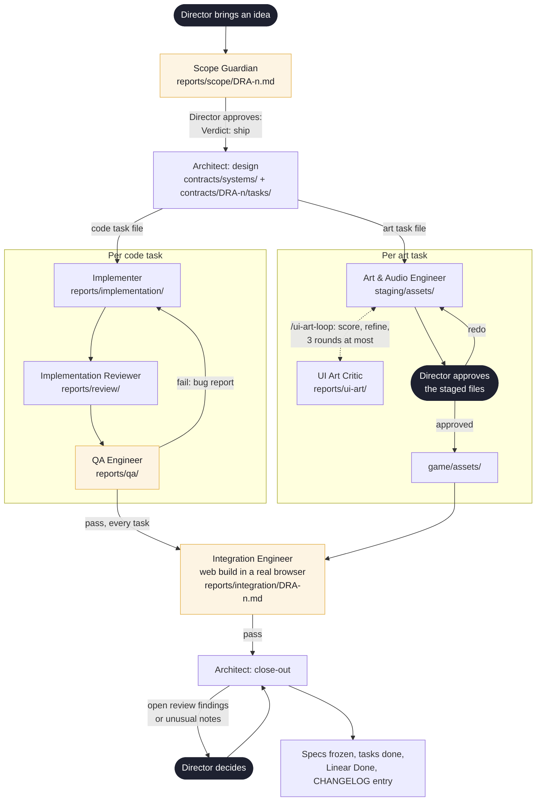
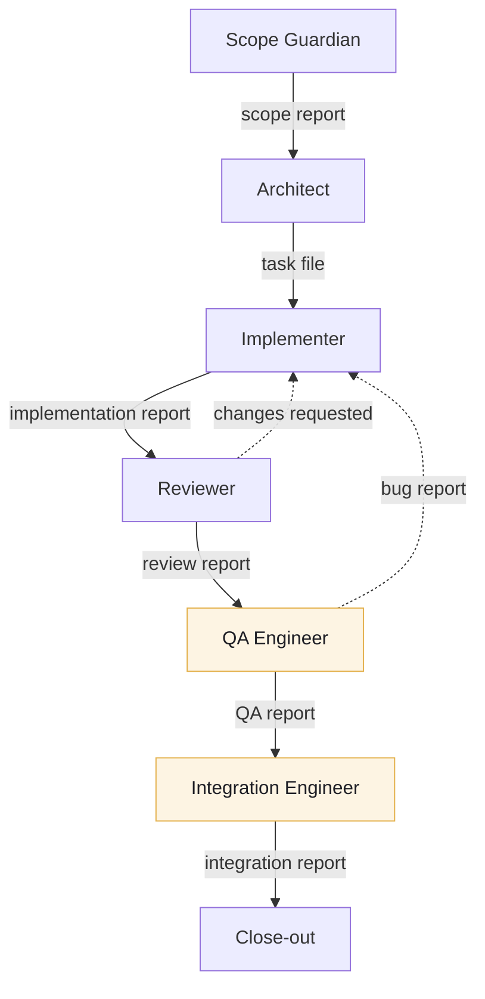

# The complete AI dev pipeline

| | |
|---|---|
| Course | Multi-Agent AI for Game Development |
| Author | David Monestel Aguilar |
| Game | Driftward Ace, an endless arcade dodger (Python, pygame-ce, runs in the browser with pygbag) |
| Repo and branch | [github.com/david-mntl/driftward-ace/tree/task-7-the-complete-ai-dev-pipeline](https://github.com/david-mntl/driftward-ace/tree/task-7-the-complete-ai-dev-pipeline) |
| Playable link | [david-mntl.itch.io/driftward-ace](https://david-mntl.itch.io/driftward-ace) |
| Password | `D4V1D` |

This is how Driftward Ace gets built. The **Director** makes every final call. A crew of AI agents (Claude Code subagents, one file each in `.claude/agents/`) does the work.

Who owns what is in `docs/crew/roster.md`. Where each file lives is in `docs/README.md`.

## Rules

- **One source of truth.** The game design document (`docs/design/gdd/`) holds every rule and number. An agent never makes up a value. If it's missing, the agent asks the Director.
- **One owner per path.** Each agent writes only to its own folders. Any agent may read anything.
- **Handoff through files.** Every step leaves a file in the repo, and the next step starts from it. Nothing depends on chat memory.
- **Gates block.** Critics check the work. Some stop it until it passes, others only send findings back.
- **Every loop has a limit.** Fix rounds are capped. Past the cap, the Director decides.
- **Every result can be checked.** Code ends as something the Director can run or play.

## The crew

| Agent | Job |
|---|---|
| Scope Guardian | Debates each idea with the Director and cuts it down to something finishable. Blocks |
| Architect | Writes the specs and splits the feature into tasks |
| Gameplay Implementer, UI Developer | Write the game code |
| Implementation Reviewer | Reads the code against its spec. Advises |
| QA Engineer | Writes and runs the tests. Blocks |
| Integration Engineer | Builds the game for the web and plays it in a browser. Blocks close-out |
| Art & Audio Engineer, UI Art Critic | Make art and score it against the GDD |
| Wave Designer | Drafts waves, when the Director asks |
| Trainer | Writes the agent definitions |

## How one feature moves

Amber steps block work until they pass. Dark steps are the Director.

1. **Scope.** The Scope Guardian checks the idea against the design pillars and asks for every missing value. It ships only on the Director's explicit approval.
2. **Design.** The Architect writes the specs and one task file per piece of work, each with a Linear sub-issue.
3. **Build.** Each code task goes through implement, review and QA. Art waits in staging until the Director approves it.
4. **Integrate.** The Integration Engineer builds the game and plays it in a browser.
5. **Close-out.** `scripts/close-out.sh` shows the open findings. Once the Director decides, it freezes the specs and logs the change.

## How the agents talk

Agents never message each other. Each one reads the file the step before it wrote, and writes its own for the next.

- The Implementer writes an implementation report.
- The Reviewer reads it and writes a review report.
- QA reads that and writes a QA report.
- The Integration Engineer reads the QA reports and writes the integration report. Close-out reads it.
- When the Reviewer asks for changes or QA finds a bug, the Implementer reads that report, fixes the code and adds a fix section to its own report.
- The first line of every report is its status, so the next step knows whether to go on.

Reports live in `docs/reports/<step>/`, named after the feature or task. Specs and task files live in `docs/contracts/`.

> **The end product of every run is a playable web build, proven in a browser, with a report that says exactly how it was proven.**

## The Integration Engineer

Tests prove the rules. They can't prove the game starts in a browser. So `/implement` ends every feature with an integration run, and each run starts from scratch:

1. Wire the feature into the startup code.
2. Build a new web build with `pygbag --archive game`.
3. Serve it locally and open it in a real browser driven by Playwright.
4. Check that it loads, logs its start line, shows no console errors, and responds to the arrow keys. It reads the ship's position from the game's log before and after a key press.
5. Try every behaviour the scope report promises that a browser can show.
6. Stop the server and write the report, with numbers, not screenshots.

It may fix only its own startup files. A bug anywhere else goes back to the owner with the file, the line and a way to reproduce it.

Bugs it caught that tests missed: a wave file name that stopped the game at startup (DRA-86), a crash when the browser blocks storage (DRA-126), and menus running at a third of the play frame rate (DRA-147).

## Wave check and the bot

`tools/wave_check/` tests a wave against the GDD's wave rules by running the game's own physics with no window. It checks that drifters enter the screen and never appear on top of the ship, that warnings are long enough, that coins sit near hazards, and that the start of each wave is clear.

The **bot** proves a wave can be survived. It knows where every drifter will be, tries every arrow-key combination, and keeps the safest ships. If one ship gets through with zero hits, the wave passes. `/implement` runs the wave check on every changed wave before integration, and CI runs the bot.

## Running without the Director

The Director steps in at four points only: approving the scope, answering open questions, approving art, and closing the feature.

**First, everything gets clarified.** The Scope Guardian collects every missing value before approval. The Architect traces each value to the GDD or to a Director answer. If a question is still open, it writes no tasks and stops. So by the time tasks exist, nothing is left to guess.

**Then it runs alone.** After approval, the Scope Guardian starts the Architect. The Director then types `/implement <feature-id>`. The skill runs every task through build, review, QA, the wave check and integration, with no questions in between. It reads each step's result from its file to pick the next one, so a stopped run resumes where it left off. `/ui-art-loop` works the same way for art: make, score, refine, up to 3 rounds.

**When something isn't clear, it stops.** An agent never guesses past a gap. It marks its report blocked, says what it needs, and the chain stops with the report to read. It also stops when QA still fails after 2 fix rounds, when the wave check fails, or when integration fails. After the Director answers, the chain picks up again from the files.

**Away mode.** The Director can also hand over a whole feature and leave. Then the main session answers the questions itself, logs every decision in `docs/reports/<feature-id>-away-log.md`, and keeps going. It never touches locked decisions and never closes the feature. DRA-47 was built this way.
