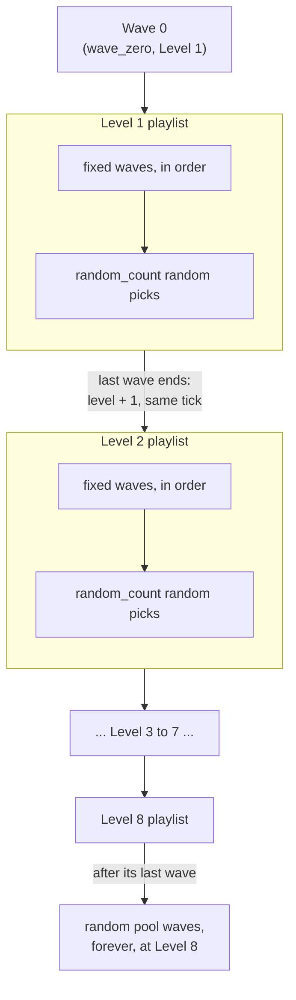
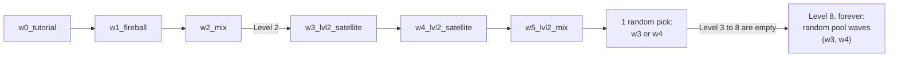

# Waves

A run is a chain of waves. This folder holds them: one JSON file per wave, plus `playlist.json`, which says which waves play and in what order.

The game reads every `*.json` file in this folder at startup. A bad file stops the game before the first frame, and the error names the file and the field. Subfolders are not read.

```
game/waves/
  playlist.json          which wave is Wave 0, and the playlist of each level
  w0_tutorial.json       one file per wave; the file name is the wave's id
  w1_fireball.json
  ...
```

Schemas: `docs/contracts/schemas/wave.schema.json` and `playlist.schema.json`. The rules: `docs/design/gdd/09-waves.md`.

## A wave

A wave is a stretch of scrolling world with drifters placed along it. Each drifter has a trigger, `at_px`: the distance the world must scroll from the wave's start before the drifter enters. A wave always plays the same way, at any level. At a higher level the world scrolls faster, so the wave just arrives faster.

```json
{
  "length_px": 1320,
  "kind": "fixed",
  "placements": [
    { "at_px": 150, "type": "meteorite", "x": 140, "variant": "small" },
    { "at_px": 150, "type": "coin", "x": 210 }
  ]
}
```

| Field | Needed | What it does |
|---|---|---|
| `length_px` | yes | Length of the wave in px of scroll, above 0. 1320 px is 20 s at Level 1. |
| `kind` | yes | `fixed` or `pool`. See below. |
| `min_level` | pool only | Lowest level the wave may be picked at, 1 to 8. Refused on a fixed wave. |
| `extra_rest_ticks` | no | Ticks added to the rest after this wave. Default 0. Never scales with level. |
| `placements` | yes | The drifters. Any order; the game sorts them by `at_px`. May be empty. |

A placement:

| Field | Needed | What it does |
|---|---|---|
| `at_px` | yes | Scroll distance from the wave's start. A hazard needs 120 or more. Coins may use any value. |
| `type` | yes | `meteorite`, `satellite`, `fireball`, `chain_lightning` or `coin`. |
| `x`, `y` | per type | Spawn spot in screen px, y down. Meteorite, chain lightning and coin need `x`. Satellite needs `y`. Left out, a drifter enters from just outside the screen. A coin with both `x` and `y` shows at that spot at once. |
| `variant` | no | A variant name from the drifter's tuning file. Left out: the default variant. |
| `invert` | no | Mirrored version, where the drifter has one. |
| `specialty`, `as_level` | no | Specialty switch, and a level whose hazard speed to use. |

A wave never sets drifter values (speed, size, warning time). Those live in `game/tuning/`. Any extra field is refused.

## Fixed and pool

| | `fixed` | `pool` |
|---|---|---|
| Plays | where a playlist names it | in a random slot |
| `min_level` | refused | required |
| Order | the playlist's order | random |
| Use it for | scripted moments, tutorials, set pieces | variety, and endless play after Level 8 |

A fixed wave is only played where the playlist lists it. A pool wave is picked at random when a playlist has a random slot, and it is never picked below its `min_level`.

A pool wave may also be named in a playlist's `fixed` list. The game allows it and plays it as written. It can then come up again as a random pick.

## The playlist

`playlist.json` has two parts: `wave_zero`, and exactly 8 `levels`, Level 1 first.

```json
{
  "wave_zero": "w0_tutorial",
  "levels": [
    { "fixed": ["w1_fireball", "w2_mix"], "random_count": 0 },
    { "fixed": ["w3_lvl2_satellite", "w4_lvl2_satellite", "w5_lvl2_mix"], "random_count": 1 },
    { "fixed": [], "random_count": 0 }
  ]
}
```

(The real file lists all 8 levels.)

Each level has:

- `fixed`: wave ids, played in this order at the start of the level. May be empty. A wave may appear in several levels, or twice in one.
- `random_count`: how many random picks come after the fixed waves. 0 or more.

### How a run walks through it



- Wave 0 plays first, at Level 1. It is not part of any playlist. Its only hazard is the meteorite.
- The level rises on the tick the last wave of its playlist ends. The next level starts on that same tick.
- There is no Level 9. After Level 8's playlist, random pool waves play forever at Level 8.
- A level with no waves (`fixed` empty and `random_count` 0) is passed the moment it starts. Empty levels in a row are all skipped. Levels 3 to 8 are empty right now, so the run goes from Level 2 straight to Level 8.

### Random picks

The pool is the whole folder, not the playlist. A random slot does not look at the waves a playlist names. It looks at every `.json` file in this folder (not in subfolders) whose `kind` is `pool`. So a new pool wave joins the random picks as soon as you save it here. You don't add it to `playlist.json`.

A random pick:

1. Takes every pool wave in the folder whose `min_level` is at most the current level.
2. Drops the wave that just played, unless it is the only one left.
3. Picks one at random. The pick is new every run.

A fixed wave is never a candidate, even if its file is in the folder. A pool wave that a level lists in `fixed` is still a candidate for random slots.

So every level with `random_count` above 0 needs at least one pool wave it can use, and at least one pool wave must be playable at Level 8. The game refuses the playlist otherwise.

### The rest between waves

Between two waves the world keeps scrolling. The rest is `rest_gap_base` × the level's rest gap factor, plus the finished wave's `extra_rest_ticks`. `rest_gap_base` is 0 for now, so only `extra_rest_ticks` counts.

### The playlist today



## Naming

The wave's id is its file name without `.json`. There is no id inside the file, so the two can't disagree.

- The id matches `^[a-z][a-z0-9_]*$`: lower case letters, digits and `_`, starting with a letter.
- `playlist` is taken. No wave can use it.
- Convention: `w<number>_<short_name>`. The number is the order the waves were authored in. The name says what the wave is about: `w1_fireball`, `w2_mix`.
- Add `lvl<N>` after the number when the wave is made for Level N: `w3_lvl2_satellite`.
- Don't reuse a name. Two waves named alike with only the number different get confusing. Say how they differ.

## What the game checks, and what it doesn't

At load, the game refuses:

- unknown fields, wrong types, a missing `min_level` on a pool wave, a `min_level` on a fixed wave
- an unknown drifter type or variant, or a coordinate the drifter needs
- a hazard with `at_px` below 120
- a playlist that is not exactly 8 levels, or that names a wave that doesn't exist
- a level with random picks and no pool wave for it

It does not check these. They are the Wave Critic's job and the `wave_check` tool's:

- gaps, telegraph time, coin distance, and whether a bot can survive the wave
- the clear seam at the end of a wave
- Wave 0 holding only meteorites as hazards
- a placement past the wave's `length_px`. It never plays.

## Adding a wave

1. Make the wave in the wave editor, or by hand. Name it as above.
2. Save it here as `<id>.json`.
3. If it is `fixed`, list it in a level's `fixed` in `playlist.json`. If it is `pool`, set `min_level`; it joins the random picks from that level up.
4. Start the game once. If a file is wrong, the error says which one.
5. Run `wave_check` on it.
