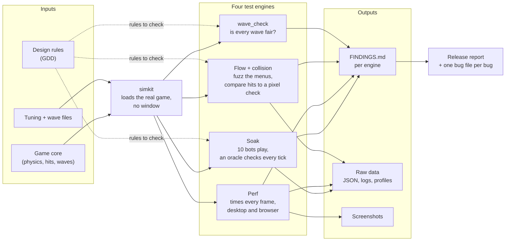

# Adversary: automated bug and performance hunt

Adversary is a test harness for Driftward Ace. Bots play the real game, far faster than a person could, and try to break it. An independent checker watches every tick and records anything the game design forbids. A second part times every frame to find where the game slows down.

It answers three questions before a release:
1. **Does anything break?** Crashes, a stuck ship, a missed hit, a menu you can't leave.
2. **Where does it lag?** Which wave, which level, and which piece of code.
3. **What happens at the end?** The bots play past the last level, which a person rarely reaches.

Nothing here ships with the game, and nothing here changes the game's code.

## How it works



The game core is pure and deterministic: the same state and the same keys always give the same next tick. That is what makes the harness possible. A bot can copy the game state, try several moves, and keep the best one. A failing run can be replayed exactly from its seed.

## As a module

| | |
|---|---|
| **Input** | The game as it is in the repo: code, tuning files, wave files. A seed, a bot, and a length for each run. |
| **Process** | Bots press keys tick by tick. After each tick, a checker tests the new state against 26 rules taken from the design ([rules.md](../../docs/reports/release-hunt/rules.md)). The perf engine times each frame and splits the cost by part. |
| **Output** | One `FINDINGS.md` per engine in `out/<engine>/`, plus raw data. A release report sums them up. |
| **Exit** | Clean when every engine's FINDINGS has no finding above `info`. |

## The four engines

| Engine | What it does | Main output |
|---|---|---|
| **Soak** (`soak/`) | Ten bots play: nine with fixed habits (idle, random, hover, wall, top-line and floor huggers, island and hazard seekers) and a planner that looks ahead. They play from Wave 0 to deep past Level 8. An oracle checks every tick: walls, islands, hits, lives, score, leaks, progress. | `out/soak/FINDINGS.md`: one table row per run, one section per finding |
| **Perf** (`perf/`) | Runs the real game loop with real drawing, one tick per frame, and times each part. Also runs the browser build in headless Chromium. | `out/perf/FINDINGS.md`: frame times per level and wave, ranked causes, the slowest code |
| **Flow + collision** (`flow_collision/`) | Presses random and scripted keys on every screen (menu, pause, game over, name entry). Compares every hit test against an independent pixel-based check. | `out/flow_collision/FINDINGS.md` |
| **wave_check** (`../wave_check/`) | Checks each wave's design rules and searches for a path through it with no hit. | Pass or fail per wave, in the terminal |

## Reading the output

Start with `FINDINGS.md` in each `out/<engine>/` folder. Each one has:
1. **A short summary.** Five lines: what broke, what was clean, and the limits of the run.
2. **A run table.** One row per run, with the bot, seed, length, furthest level and result.
3. **One section per finding.** Each finding gives its severity, a confidence, the rule it breaks, and an exact command that reproduces it.

Severity, from worst to least: `crash`, `softlock`, `rule-violation`, `leak`, then perf `critical` / `major` / `minor`, then `suspect` and `info`. A finding is only `confirmed` once it has been reproduced.

Details on every output file, the columns, and what p95 means: [docs/outputs.md](docs/outputs.md).

## Run it

Run one engine at a time. All of them at once overloads an 8-core machine and skews the timings.

```sh
cd tools/adversary/soak && python run_matrix.py immortal --seeds 1,2,3 && python summarize.py
cd tools/adversary/perf && python soak.py --label main --seed 1 --tail-minutes 5 && python analyze.py main
cd tools/adversary/flow_collision && python a1_flow_fuzz.py && python b1_collision_diff.py
python tools/wave_check/wave_check.py --all --force --bot
```

Each folder's own README lists every script in one line.

## Working on the harness

- **Every script has the same first lines.** One line adds this folder to `sys.path` (Python only knows the script's own folder), then the imports. Every script takes `--help`, from its docstring (`cli.py`).
- **Every module that imports the game starts with `import paths`.** `paths.py` is the one place that puts `game/` on `sys.path`, so import order does not matter. Never put a path in code: use `paths.out_dir("soak")`, which creates the folder.
- **Never edit `game/`.** Patch it at runtime if you must (see `patched()` in `flow_collision/flowlib.py`).
- **Two kinds of game number.** A checker holds the game to a number from the GDD: those live in `gdd_rules.py`, copied on purpose. Code that only drives the game (bots, scripts) imports the geometry from `core.world` and `core.ship`. Don't type a game number in a script.
- **One place for each piece of logic.** A game tick is `soak/stepper.py`. A scenario runner is `flow_collision/scenarios.py`. Reading a soak run is `perf/perfdata.py`. Before copying a block, look for these.
- **Make runs repeat.** Seed every random source from the run's seed. Don't use `hash()` of text or an unseeded `random`.
- **Lint and format** with the config in this folder: `ruff check tools/adversary` and `ruff format --check tools/adversary`. Import sorting is off on purpose.

## More detail
- [docs/architecture.md](docs/architecture.md): the blocks, the bots and the oracle.
- [docs/performance-method.md](docs/performance-method.md): how the frame rate is measured, and why the numbers can be trusted.
- [docs/outputs.md](docs/outputs.md): every output file and how to read it.
