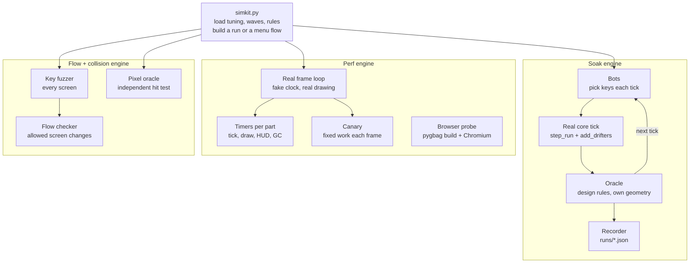

# Architecture

How the harness is built, block by block. For what each block writes, see [outputs.md](outputs.md).

## The idea that makes it work
The game splits into a **core** (physics, hits, waves, score, screens) and an **app** (window, drawing, sound, keyboard). The core is pure. Each tick is a function: old state + keys in, new state out. Nothing hidden, no clock, no randomness outside the seed.

That gives the harness three powers:
- **Speed.** The core runs headless at about 500 ticks a second on desktop, about 8x real time. A full playthrough to Level 8 takes about 30 seconds.
- **Lookahead.** A bot can copy the state, try a move, and throw the copy away.
- **Exact replay.** A seed plus the recorded keys rebuild any run, tick for tick. Every finding comes with a command that reproduces it.

## The blocks

### simkit
One small module (`simkit.py`). It loads the shipped tuning, wave book, graze, last-life and level-up rules exactly as the game does, with no window and no sound. Every engine starts here, so every engine tests the same game the player gets.

### Bots (soak)
Each bot looks at the state and returns the keys for the next tick.

| Bot | Habit | Hunts for |
|---|---|---|
| idle | presses nothing | falls, the respawn wait, game over |
| sticky random | holds random keys for random lengths | whatever a careless player triggers |
| hover | stays mid-screen | long runs that reach every wave |
| wall, top-line and floor huggers | lives on one edge | edge and clamp bugs |
| island seeker | pushes into islands and corners | a stuck ship, a ship pushed through things |
| hazard seeker | flies into hazards | missed hits, double hits |
| planner | tries several moves ahead, keeps the safest | how far a good player gets; hits no path avoids |

Each bot runs **immortal** (lives refilled, to reach the end) and **mortal** (the real game, to game over).

### Oracle (soak)
After every tick, the oracle checks the new state against the rules in [rules.md](../../../docs/reports/release-hunt/rules.md). It doesn't trust the code under test: it has its own geometry (`geom.py`) and recomputes what should have happened. Examples:
- The ship touched a hazard while unprotected, so a life must be lost. And every life lost must have a cause.
- The ship never ends a tick inside an island, and never moves further than physics allows in one tick.
- Lives never go up. Score and distance never go down. Every drifter leaves the field in bounded time.

A broken rule becomes a finding with the bot, seed, tick, wave and state.

### Perf probe
Runs the real app frame loop, drawing included, with a fake clock so each frame is exactly one tick. Timers wrap the tick and each drawing part. A cProfile pass names the slowest functions. The browser probe does the same inside the real web build. Method: [performance-method.md](performance-method.md).

### Flow fuzzer and checker
Drives the menu, pause, game over and name-entry screens with random and scripted keys. The checker holds a table of screen changes allowed by the design. It fails on any other change, on a run that moves while paused, or on a state with no way back to the menu.

### Pixel oracle (collision)
An independent hit test. It measures overlap from a signed-distance grid, not with the game's geometry. It compares about 50,000 drifter and ship positions against the game's answer. A known bug injected on purpose (`*_mutation_sanity.py`) proves the oracle catches it.

## Design choices
- **Never edit the game.** The harness only reads the game, or patches it at runtime. A test can't change what it measures.
- **Independent checks.** The oracle and the pixel check don't reuse the code they test, so a bug can't hide in both.
- **Scripts print summaries, files hold the data.** A run prints a few lines; the details go to JSON.
- **Every finding is reproducible.** Seed, tick and a command.
