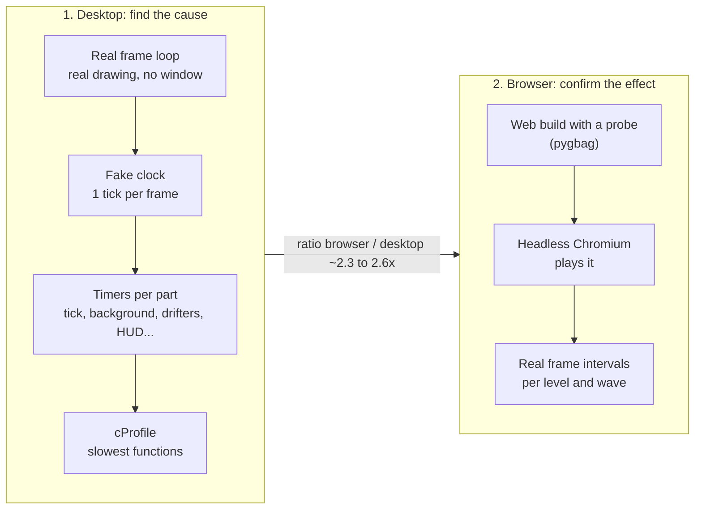

# How performance is measured

The goal is to find where the game drops below 60 frames per second, and why. One frame has 16.7 ms to run the game logic (the "tick") and draw the screen.

## Two measurements

**Desktop** finds the cause. The real game loop runs with real drawing but no visible window. A fake clock hands it exactly one tick per frame, so every run is the same length and every frame does the same work. Timers wrap each part: the tick, the background, the drifters, the HUD, the popups. Python's cProfile names the functions that cost the most.

**Browser** confirms the effect. The game ships as WebAssembly, where Python runs slower. A probe goes into a copy of the web build and records every frame's interval, tick time and draw time, with the level and wave. Headless Chromium plays it. The desktop-to-browser ratio, about 2.3 to 2.6x here, turns desktop numbers into a browser estimate.

## Making the numbers trustworthy
A shared or busy machine makes every timing slower. Three things guard against that.

1. **CPU time, not wall time.** Timers count the time the game's own thread spent working. Waiting for another program doesn't count.
2. **The canary.** Each frame also runs the same small fixed loop. When the canary takes twice as long, the machine was twice as slow. Every frame is corrected by it. That's the `p95n` column in the reports.
3. **Quiet re-runs.** Key results are measured again when the machine is idle. In this hunt, the quiet re-run matched the busy one within about 1.3x.

## What gets reported
- **Per level and per wave:** p50, p95, p99 and max frame cost, plus the peak drifter count. p95 means 95% of frames were faster than this. It shows the stutter a player feels, where the average hides it.
- **Worst frames:** the 15 slowest, with what was on screen and which part cost the most.
- **Cost per part and per drifter type:** where the milliseconds go.
- **Trend:** the slope of frame cost over a long endless run. Flat means no slowdown over time.
- **Memory:** process memory, live Python objects and allocation growth (tracemalloc) between Level 1, Level 8 and deep in the endless tail.

## Budget used
| Where | Target | Why |
|---|---|---|
| Desktop, p95 per wave | under 8 ms | leaves room for the ~2.5x browser slowdown |
| Browser, p95 frame interval | under 20 ms | close to 60 fps, with small dips allowed |
| Browser, single frames | none over 50 ms caused by the game | a 50 ms freeze is a visible hitch |

## Example result (2026-11-08 hunt)
The worst case was the ship touching a floating island: one tick took up to 53 ms on desktop in wave w11. The profile traced it to the island push-out testing every island shape on screen. Report: `docs/reports/release-hunt/bug-02-performance.md`.
